# 에버의 Spring security 지도 그리기
[https://youtu.be/GkbS45V7DqM?si=wWzR6dzOXLkOAytm](https://youtu.be/GkbS45V7DqM?si=wWzR6dzOXLkOAytm)

# 에버의 Spring security 지도 그리기
* toc
{:toc}

---

### Spring Security 내부 구조 완벽 이해: DelegatingFilterProxy, FilterChainProxy, SecurityFilterChain과 커스텀 필터 실행 순서

Spring Boot 애플리케이션에서 인증과 인가를 구현할 때 가장 많이 사용하는 프레임워크 중 하나가 Spring Security다.

Spring Security를 사용하면 로그인, 사용자 인증, 권한 검사, 세션 관리, CSRF 방어 등 다양한 보안 기능을 구현할 수 있다.

예를 들어 다음과 같이 간단한 설정만으로 API 접근 권한을 제한할 수 있다.

```java
@Bean
public SecurityFilterChain securityFilterChain(
        HttpSecurity http
) throws Exception {

    http.authorizeHttpRequests(authorize -> authorize
            .requestMatchers("/api/public/**").permitAll()
            .requestMatchers("/api/admin/**").hasRole("ADMIN")
            .anyRequest().authenticated()
    );

    return http.build();
}
```

위 설정은 다음과 같은 의미를 가진다.

`/api/public/**`는 인증되지 않은 사용자도 접근할 수 있다.

`/api/admin/**`는 `ADMIN` 권한을 가진 사용자만 접근할 수 있다.

그 외의 요청은 인증된 사용자에게만 허용된다.

설정 자체는 어렵지 않다.

하지만 실제로 이 설정이 어떻게 동작하는지 생각해 보면 여러 질문이 생긴다.

**Spring Security는 Controller가 실행되기 전에 어떻게 요청을 가로챌까?**

**JWT에서 추출한 사용자 정보는 어디에 저장될까?**

**`@PreAuthorize`나 `hasRole()`은 어떤 정보를 기준으로 권한을 확인할까?**

**커스텀 필터를 직접 작성했다면 기존 필터 사이의 어느 위치에 추가해야 할까?**

이러한 질문에 답하지 못한 상태에서 설정 코드를 그대로 사용하면 요구사항이 변경되었을 때 문제가 발생하기 쉽다.

특히 JWT 인증 필터를 직접 구현할 때 다음과 같은 코드를 자주 사용한다.

```java
http.addFilterBefore(
        jwtAuthenticationFilter,
        UsernamePasswordAuthenticationFilter.class
);
```

그런데 왜 `UsernamePasswordAuthenticationFilter`보다 앞에 배치하는 것일까?

다른 필터를 기준으로 추가하면 안 되는 것일까?

아무 위치에 추가해도 JWT 검증만 정상적으로 수행하면 되는 것 아닐까?

실제로 Spring Security에서는 필터의 위치에 따라 인증과 인가 결과가 달라질 수 있다.

예를 들어 JWT 인증 필터가 사용자 인증 정보를 생성하기 전에 인가 필터가 실행된다면 어떻게 될까?

요청에 유효한 JWT가 포함되어 있더라도 인가 필터는 아직 인증되지 않은 사용자라고 판단할 수 있다.

이처럼 Spring Security의 필터들은 서로 독립적으로 동작하는 것이 아니다.

일부 필터는 앞선 필터가 생성한 정보를 이용해 자신의 작업을 수행한다.

따라서 커스텀 필터를 올바르게 추가하려면 Spring Security의 전체 요청 처리 구조를 먼저 이해해야 한다.

---

### 개념

#### Spring Security란 무엇인가?

Spring Security는 Spring 기반 애플리케이션에서 인증(Authentication), 인가(Authorization), 보안 공격 방어 등의 기능을 제공하는 보안 프레임워크다.

가장 기본적인 개념은 인증과 인가다.

#### 인증(Authentication)

인증은 사용자가 누구인지 확인하는 과정이다.

예를 들어 로그인 요청에서 사용자의 비밀번호를 검증하거나 JWT의 서명과 만료 시간을 검증하는 작업이 인증에 해당한다.

```text
사용자 요청
    ↓
인증 정보 확인
    ↓
사용자 식별
    ↓
인증 성공 또는 실패
```

#### 인가(Authorization)

인가는 인증된 사용자가 특정 자원에 접근할 권한이 있는지 확인하는 과정이다.

예를 들어 일반 사용자는 상품을 조회할 수 있지만 관리자는 상품을 삭제할 수 있다고 가정하자.

```text
인증된 사용자
    ↓
보유 권한 확인
    ↓
요청한 기능의 필요 권한 비교
    ↓
접근 허용 또는 거부
```

두 개념을 비교하면 다음과 같다.

| 구분 | 인증 | 인가 |
|---|---|---|
| 영어 | Authentication | Authorization |
| 핵심 질문 | 누구인가? | 무엇을 할 수 있는가? |
| 주요 입력 | 비밀번호, JWT, API Key 등 | Authentication, Authority |
| 주요 처리 | 사용자 신원 확인 | 접근 권한 검사 |
| 실패 시 대표적인 응답 | 401 | 403 |
| 관련 구성 요소 | AuthenticationManager, AuthenticationProvider | AuthorizationManager, AuthorizationFilter |

여기서 중요한 점은 인증과 인가의 순서다.

일반적으로 사용자가 어떤 권한을 가졌는지 판단하려면 먼저 사용자를 식별해야 한다.

따라서 요청 처리 과정에서도 인증이 인가보다 먼저 수행되어야 하는 경우가 많다.

이 관계를 실제로 구현하는 핵심 구성 요소가 Spring Security의 필터 체인이다.

---

### 왜 Spring Security는 Filter를 사용할까?

Spring MVC에서 일반적인 HTTP 요청은 `DispatcherServlet`을 통해 Controller로 전달된다.

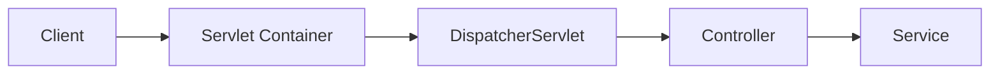

그런데 인증과 인가는 Controller가 실행되기 전에 수행되어야 하는 경우가 많다.

예를 들어 관리자가 아닌 사용자가 관리자 API에 접근했다고 가정하자.

```http
DELETE /api/admin/products/100
```

권한이 없는 요청이라면 Controller의 삭제 로직이 실행되기 전에 차단해야 한다.

이를 위해 Servlet Filter를 사용할 수 있다.

Servlet Filter는 요청이 Servlet에 도달하기 전과 응답이 반환되는 과정에 개입할 수 있는 구성 요소다.

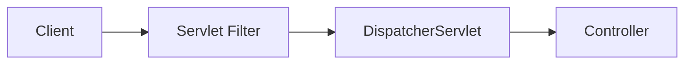

Filter는 다음과 같은 작업을 수행할 수 있다.

- 요청 정보 확인
- 인증 정보 추출
- 특정 요청 차단
- 요청 또는 응답 래핑
- 보안 관련 Header 설정
- 다음 Filter로 요청 전달

Spring Security는 이러한 Servlet Filter를 활용해 보안 기능을 구성한다.

하지만 단순히 하나의 필터에서 모든 보안 기능을 처리하지는 않는다.

인증, 인가, CSRF 방어, SecurityContext 관리 등 서로 다른 책임을 가진 필터들을 연결해 사용한다.

이 구조를 이해하기 위해 먼저 일반적인 Servlet Filter의 동작부터 살펴보자.

---

### Servlet Filter는 어떻게 동작할까?

Servlet Filter는 `Filter` 인터페이스를 구현할 수 있다.

가장 중요한 메서드는 `doFilter()`다.

```java
public class LoggingFilter implements Filter {

    @Override
    public void doFilter(
            ServletRequest request,
            ServletResponse response,
            FilterChain chain
    ) throws IOException, ServletException {

        System.out.println("요청 처리 전");

        chain.doFilter(request, response);

        System.out.println("요청 처리 후");
    }
}
```

이 코드에서 중요한 부분은 다음과 같다.

```java
chain.doFilter(request, response);
```

해당 코드는 요청을 다음 필터 또는 최종 Servlet으로 전달한다.

예를 들어 다음과 같은 구조를 생각해 보자.

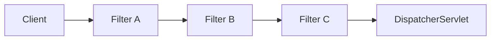

각 필터가 다음과 같이 작성되었다고 가정하자.

```java
System.out.println("Before");

chain.doFilter(request, response);

System.out.println("After");
```

실행 흐름은 다음과 같은 중첩 구조가 된다.

```text
Filter A Before
    ↓
Filter B Before
    ↓
Filter C Before
    ↓
Controller 실행
    ↓
Filter C After
    ↓
Filter B After
    ↓
Filter A After
```

여기서 중요한 특징이 있다.

**Filter는 자신보다 뒤에 있는 필터의 실행을 제어할 수 있다.**

예를 들어 인증에 실패한 경우 다음 코드를 호출하지 않을 수 있다.

```java
chain.doFilter(request, response);
```

그렇다면 뒤에 있는 필터와 Controller는 실행되지 않는다.

반대로 앞에 있는 필터가 생성한 정보를 뒤에 있는 필터가 사용할 수도 있다.

이 때문에 필터의 순서가 중요하다.

---

### Spring Security의 전체 구조

Spring Security의 Servlet 기반 요청 처리 구조에는 세 가지 핵심 구성 요소가 존재한다.

첫 번째는 `DelegatingFilterProxy`다.

두 번째는 `FilterChainProxy`다.

세 번째는 `SecurityFilterChain`이다.

전체 구조를 먼저 살펴보자.

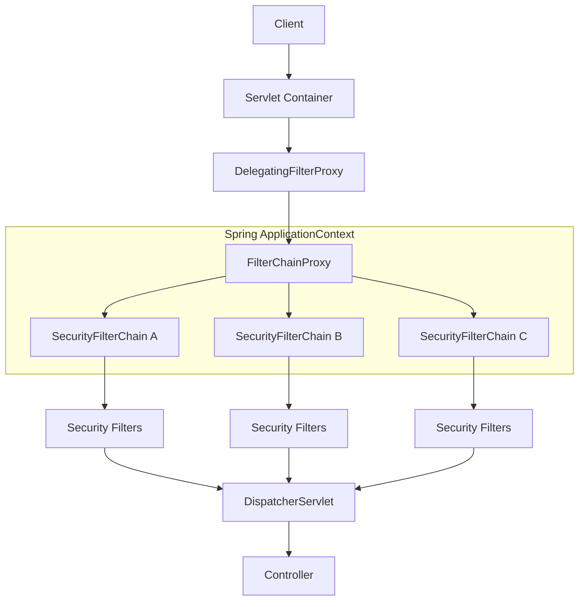

실제 요청에서는 모든 `SecurityFilterChain`이 실행되는 것이 아니다.

`FilterChainProxy`가 요청에 맞는 체인을 선택한다.

선택된 체인에 포함된 보안 필터들이 순서대로 실행된다.

Spring Security 공식 문서에서도 `FilterChainProxy`가 여러 `SecurityFilterChain`을 관리하고 요청에 일치하는 체인을 선택한다고 설명한다.

이제 각 구성 요소의 역할을 살펴보자.

---

### DelegatingFilterProxy란 무엇인가?

`DelegatingFilterProxy`는 Servlet Container와 Spring ApplicationContext 사이를 연결하는 필터다.

Servlet Container는 Servlet 표준에 따라 Filter를 관리한다.

반면 Spring은 ApplicationContext를 통해 Bean을 관리한다.

이 두 영역은 객체를 생성하고 관리하는 방식이 다르다.

```text
Servlet Container
    └── Servlet Filter 관리

Spring ApplicationContext
    └── Spring Bean 관리
```

그런데 Spring Security의 보안 기능은 Spring Bean으로 관리하고 싶다.

예를 들어 다음과 같은 이유가 있다.

- 다른 Spring Bean에 의존성 주입
- 보안 설정을 Spring Configuration으로 관리
- 애플리케이션 설정과 통합
- 인증 서비스와 Repository 사용
- Spring의 생명주기 관리 활용

이 문제를 해결하기 위한 연결 지점이 `DelegatingFilterProxy`다.

#### DelegatingFilterProxy의 동작

개념적으로 다음과 같이 동작한다.

```java
public void doFilter(
        ServletRequest request,
        ServletResponse response,
        FilterChain chain
) throws IOException, ServletException {

    Filter delegate = findFilterBean();

    delegate.doFilter(
            request,
            response,
            chain
    );
}
```

위 코드는 동작을 설명하기 위한 의사 코드다.

핵심은 Servlet Container에 등록된 필터가 Spring Bean을 찾아 요청 처리를 위임한다는 것이다.

Spring Security에서는 일반적으로 `springSecurityFilterChain`이라는 이름의 Bean이 위임 대상이 된다.

실제 해당 Bean은 `FilterChainProxy`다.

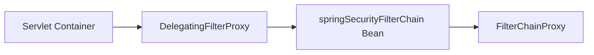

따라서 `DelegatingFilterProxy` 자체가 JWT를 검증하거나 사용자 권한을 판단하는 것은 아니다.

주요 역할은 Spring Security의 필터 구조로 요청을 연결하는 것이다.

---

### FilterChainProxy란 무엇인가?

`FilterChainProxy`는 여러 `SecurityFilterChain`을 관리하고 현재 요청에 적용할 체인을 선택하는 핵심 구성 요소다.

예를 들어 다음과 같은 요구사항이 있다고 가정하자.

```text
/api/**

JWT 인증 사용
```

```text
/admin/**

관리자 인증 사용
```

```text
/public/**

인증 없이 접근 가능
```

이러한 요구사항을 하나의 필터 체인에 모두 작성할 수도 있지만, 인증 방식이 다르다면 여러 체인으로 분리할 수 있다.

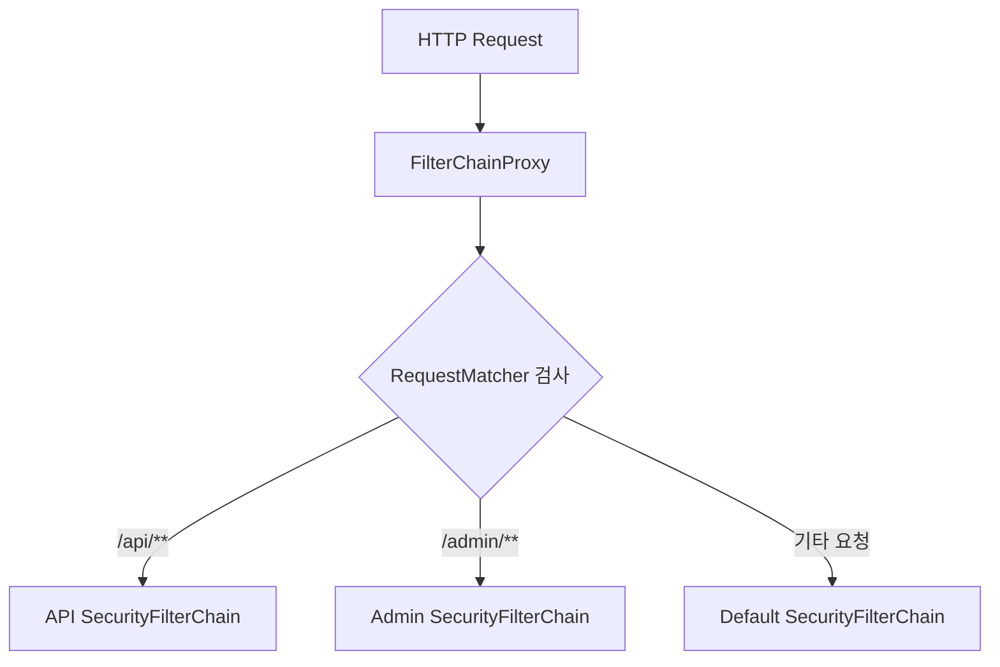

이때 중요한 특징이 있다.

**여러 SecurityFilterChain이 존재하더라도 요청과 처음 일치하는 체인 하나만 선택된다.**

예를 들어 다음 두 체인이 있다고 가정하자.

```text
SecurityFilterChain A

/api/**
```

```text
SecurityFilterChain B

/**
```

요청 경로가 다음과 같다면 어떻게 될까?

```http
GET /api/products/100
```

두 경로 조건에 모두 일치할 수 있다.

하지만 `FilterChainProxy`는 우선순위에 따라 처음 일치하는 체인을 선택한다.

따라서 일반적인 구조에서는 A가 선택되면 B를 추가로 실행하지 않는다.

이 특징은 여러 인증 방식을 하나의 애플리케이션에서 사용할 때 중요하다.

---

### SecurityFilterChain이란 무엇인가?

`SecurityFilterChain`은 실제 보안 작업을 수행할 필터들의 집합이다.

예를 들어 다음과 같은 필터들이 포함될 수 있다.

```text
SecurityContextHolderFilter

HeaderWriterFilter

CsrfFilter

LogoutFilter

BearerTokenAuthenticationFilter

AnonymousAuthenticationFilter

ExceptionTranslationFilter

AuthorizationFilter
```

다만 이 목록이 모든 Spring Security 애플리케이션에서 동일하게 적용되는 것은 아니다.

설정에 따라 포함되는 필터가 달라진다.

예를 들어 HTTP Basic 인증을 활성화하면 `BasicAuthenticationFilter`가 추가될 수 있다.

폼 로그인을 활성화하면 `UsernamePasswordAuthenticationFilter`가 사용될 수 있다.

OAuth2 Resource Server의 Bearer Token 인증을 활성화하면 `BearerTokenAuthenticationFilter`가 사용된다.

따라서 정확한 필터 구성은 현재 애플리케이션의 설정과 Spring Security 버전에 따라 달라진다.

#### 필터의 대표적인 실행 순서

개념적으로 다음과 같이 이해할 수 있다.

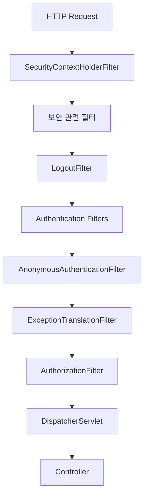

각 필터의 역할은 다음과 같다.

| 필터 | 주요 역할 |
|---|---|
| SecurityContextHolderFilter | 요청의 SecurityContext 준비 |
| HeaderWriterFilter | 보안 관련 응답 Header 처리 |
| CorsFilter | CORS 정책 처리 |
| CsrfFilter | CSRF 방어 |
| LogoutFilter | 로그아웃 처리 |
| UsernamePasswordAuthenticationFilter | 폼 로그인 인증 |
| BasicAuthenticationFilter | HTTP Basic 인증 |
| BearerTokenAuthenticationFilter | Bearer Token 인증 |
| AnonymousAuthenticationFilter | 인증되지 않은 요청에 익명 Authentication 제공 |
| ExceptionTranslationFilter | 인증·인가 예외를 HTTP 응답으로 변환 |
| AuthorizationFilter | 요청에 대한 인가 판단 |

여기서 중요한 것은 모든 필터의 이름을 암기하는 것이 아니다.

**어떤 필터가 인증 정보를 생성하고, 어떤 필터가 그 인증 정보를 사용하는지 이해하는 것**이다.

---

### Spring Security의 인증 정보는 어디에 저장될까?

Spring Security에서 인증 상태를 이해하려면 세 가지 개념을 알아야 한다.

첫 번째는 `Authentication`이다.

두 번째는 `SecurityContext`다.

세 번째는 `SecurityContextHolder`다.

#### Authentication

`Authentication`은 현재 사용자의 인증 정보를 표현하는 인터페이스다.

일반적으로 다음 정보를 포함한다.

| 속성 | 의미 |
|---|---|
| Principal | 사용자 또는 인증 주체 |
| Credentials | 인증에 사용된 자격 증명 |
| Authorities | 사용자가 보유한 권한 |
| Details | 요청과 관련된 추가 정보 |
| Authenticated | 인증 여부 |

예를 들어 JWT 인증에 성공했다면 다음과 같은 정보가 만들어질 수 있다.

```text
Principal = user-100

Authorities = [ROLE_USER]

Authenticated = true
```

이러한 정보를 `Authentication` 객체로 표현한다.

#### SecurityContext

`SecurityContext`는 현재 요청의 인증 정보를 보관하는 객체다.

대표적으로 `Authentication`을 저장한다.

```java
SecurityContext context =
        SecurityContextHolder.createEmptyContext();

context.setAuthentication(authentication);
```

#### SecurityContextHolder

`SecurityContextHolder`는 현재 실행 흐름에서 `SecurityContext`에 접근할 수 있도록 하는 구성 요소다.

일반적인 Servlet 환경에서는 기본적으로 `ThreadLocal`을 사용한다.

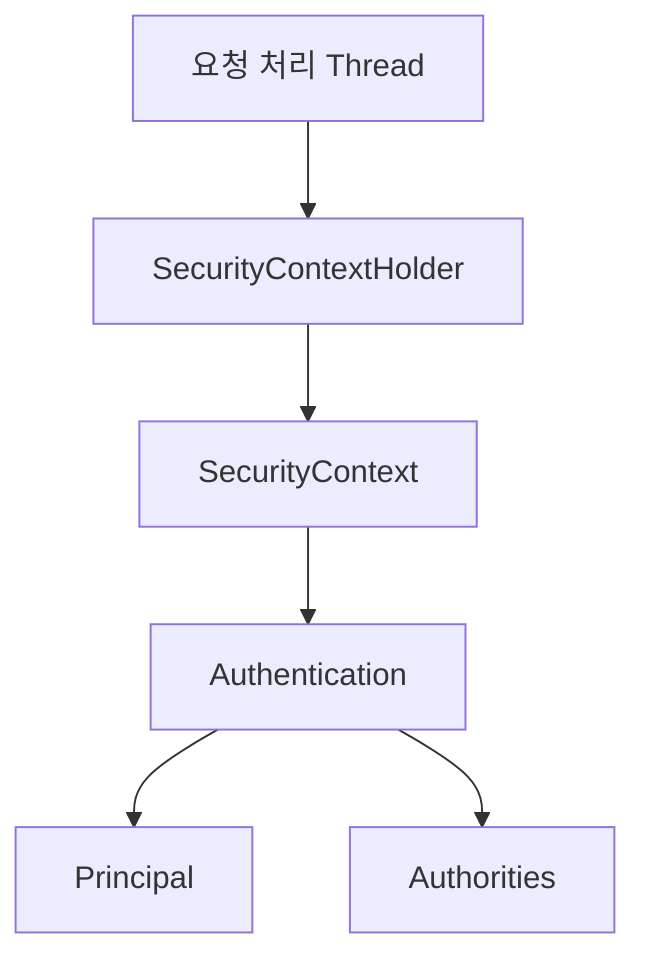

따라서 인증 필터에서 인증 정보를 저장하면 이후 인가 필터가 해당 정보를 사용할 수 있다.

예를 들어 다음과 같다.

```java
Authentication authentication =
        SecurityContextHolder.getContext()
                .getAuthentication();
```

이 코드를 통해 현재 요청의 인증 정보를 가져올 수 있다.

Spring Security 공식 문서는 `SecurityContextHolder`가 기본적으로 `ThreadLocal`을 사용하며, 요청 처리 종료 시 SecurityContext를 정리하도록 구성되어 있다고 설명한다.

---

### SecurityContextHolderFilter는 어떤 역할을 할까?

`SecurityContextHolderFilter`는 요청 처리 과정에서 사용할 `SecurityContext`를 준비하는 역할을 한다.

여기서 중요한 점은 `SecurityContextHolderFilter` 자체가 사용자의 JWT를 검증하는 필터는 아니라는 것이다.

이 필터는 `SecurityContextRepository` 등을 통해 SecurityContext를 사용할 수 있도록 한다.

실제 인증 정보를 생성하는 작업은 별도의 인증 필터 또는 인증 처리 구성 요소가 수행한다.

예를 들어 Stateless JWT 인증에서는 다음과 같은 흐름이 일반적이다.

```text
HTTP Request
    ↓
SecurityContextHolderFilter
    ↓
JWT Authentication Filter
    ↓
SecurityContext에 Authentication 저장
    ↓
AuthorizationFilter
    ↓
Authentication 권한 확인
```

여기서 주의해야 할 점이 있다.

Spring Security 6 이후의 기본적인 SecurityContext 관리 방식에서는 인증 정보를 세션 등에 영구 저장하려면 명시적인 저장 작업이 필요한 경우가 있다.

반면 Stateless JWT 인증은 일반적으로 매 요청마다 토큰을 검증해 인증 정보를 다시 구성한다.

따라서 현재 요청의 `SecurityContextHolder`에 인증 정보를 설정하는 것과 다음 요청에서도 사용할 수 있도록 세션에 저장하는 것은 서로 다른 개념이다.

---

### JWT 인증 필터는 어떤 역할을 할까?

JWT 인증 필터는 HTTP 요청에서 JWT를 추출하고 검증한 뒤 Spring Security가 이해할 수 있는 `Authentication`을 생성하는 역할을 한다.

예를 들어 다음 요청이 들어왔다고 가정하자.

```http
GET /api/members/me
Authorization: Bearer eyJhbGciOi...
```

JWT 인증 필터에서는 일반적으로 다음 작업을 수행한다.

```text
Authorization Header 조회
        ↓
Bearer Token 추출
        ↓
JWT 서명 검증
        ↓
만료 시간 및 Claim 검증
        ↓
사용자 식별
        ↓
Authentication 생성
        ↓
SecurityContext에 저장
        ↓
다음 필터 실행
```

이 과정을 거친 후 인가 필터가 실행되면 사용자 인증 정보를 사용할 수 있다.

하지만 JWT 인증 필터보다 인가 필터가 먼저 실행된다면 어떻게 될까?

이제 필터 실행 순서가 중요한 이유를 살펴보자.

---

### 필터 순서가 잘못되면 어떤 문제가 발생할까?

예를 들어 다음 두 필터가 있다고 가정하자.

```text
JwtAuthenticationFilter

AuthorizationFilter
```

`JwtAuthenticationFilter`는 JWT를 검증하고 인증 정보를 생성한다.

`AuthorizationFilter`는 생성된 인증 정보를 바탕으로 요청에 대한 접근 권한을 검사한다.

#### 정상적인 순서

먼저 JWT 인증 필터가 실행된다.

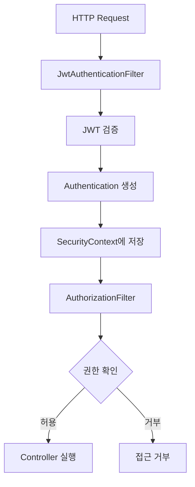

유효한 JWT가 들어왔고 사용자가 필요한 권한을 가지고 있다면 요청이 정상적으로 처리된다.

예를 들어 다음과 같은 결과가 발생할 수 있다.

```http
HTTP/1.1 200 OK
```

#### 잘못된 순서

이번에는 JWT 인증 필터보다 인가 필터가 먼저 실행된다고 가정하자.

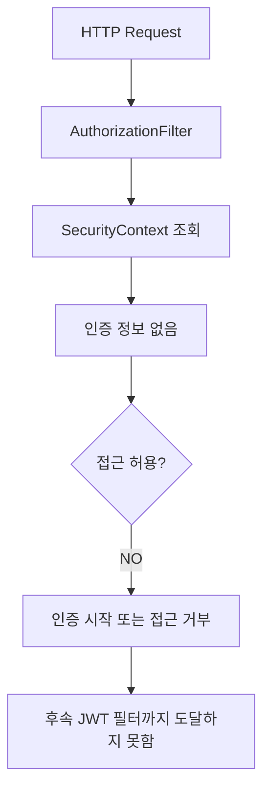

인가 필터가 실행되는 시점에는 아직 JWT 검증이 수행되지 않았다.

따라서 현재 사용자를 인증된 사용자로 판단할 수 없다.

요청에 유효한 JWT가 포함되어 있더라도 마찬가지다.

실제로 인증되지 않은 사용자의 보호된 API 접근으로 판단되면 인증 시작 처리가 실행될 수 있다.

API 환경에서 인증 시작 처리가 HTTP 401을 반환하도록 설정되어 있다면 결과는 다음과 같을 수 있다.

```http
HTTP/1.1 401 Unauthorized
```

하지만 모든 환경에서 반드시 401이 반환되는 것은 아니다.

인증 방식과 `AuthenticationEntryPoint`, `AccessDeniedHandler` 설정에 따라 로그인 화면으로 Redirect하거나 다른 응답을 반환할 수도 있다.

핵심은 상태 코드 자체가 아니다.

**인증 정보를 사용하는 필터가 인증 정보를 생성하는 필터보다 먼저 실행되었다는 점**이다.

---

### 커스텀 필터의 위치를 결정하는 기준

Spring Security에서 커스텀 필터의 위치를 결정할 때 가장 중요한 질문은 다음과 같다.

**내 필터는 다른 필터의 결과를 만들어 주는가, 아니면 다른 필터가 만든 결과를 사용하는가?**

이를 두 가지로 구분할 수 있다.

#### 1. 인증 정보를 생성하는 필터

대표적인 예는 다음과 같다.

- JWT 인증 필터
- API Key 인증 필터
- 사용자 정의 인증 필터

이러한 필터는 `Authentication`을 생성한다.

따라서 해당 인증 정보를 필요로 하는 `AuthorizationFilter`보다 먼저 실행되어야 한다.

#### 2. 인증 정보를 사용하는 필터

대표적인 예는 다음과 같다.

- 사용자별 접근 로그 필터
- Tenant 권한 검사 필터
- 사용자 권한 기반 요청 제한 필터

이러한 필터는 인증된 사용자 정보를 사용한다.

따라서 필요한 인증 처리가 완료된 이후 실행되어야 한다.

이를 구조로 표현하면 다음과 같다.

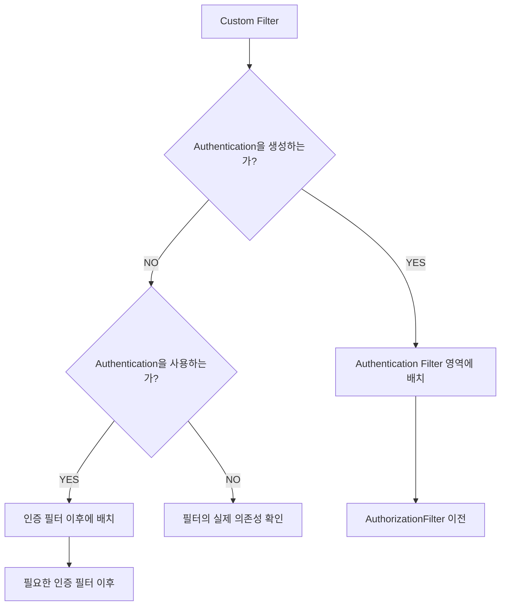

여기서 인증 정보를 사용하는 필터를 반드시 `AuthorizationFilter` 뒤에 배치해야 한다는 의미는 아니다.

예를 들어 인증된 사용자의 Tenant 접근 권한을 확인하는 필터라면 인증 필터 이후이면서 최종 인가 필터 이전에 배치할 수 있다.

또 접근 로그 필터는 인증 성공 요청뿐 아니라 인증 실패 요청도 기록해야 할 수 있다.

이 경우 단순히 인증 필터 뒤에 배치하는 것으로는 충분하지 않을 수 있다.

따라서 **어떤 정보가 언제 필요한지와 요청이 중간에 종료될 가능성까지 함께 고려해야 한다.**

Spring Security 공식 문서에서도 커스텀 필터가 수행하는 역할에 따라 배치 위치를 선택하도록 권장한다.

---

### Spring Security에서 커스텀 필터를 추가하는 방법

`HttpSecurity`는 커스텀 필터를 등록하기 위한 메서드를 제공한다.

대표적으로 다음 세 가지가 있다.

```java
addFilterBefore()
```

```java
addFilterAfter()
```

```java
addFilterAt()
```

각각의 역할을 살펴보자.

#### addFilterBefore()

특정 필터보다 앞에 커스텀 필터를 추가한다.

```java
http.addFilterBefore(
        customFilter,
        UsernamePasswordAuthenticationFilter.class
);
```

이 코드는 `UsernamePasswordAuthenticationFilter`의 알려진 순서를 기준으로 앞쪽에 커스텀 필터를 배치한다.

JWT 인증 필터를 추가하는 예제에서 자주 사용하는 방식이다.

하지만 중요한 점이 있다.

**JWT 인증 필터는 반드시 UsernamePasswordAuthenticationFilter 앞에 배치해야만 하는 것은 아니다.**

해당 필터가 현재 체인에서 어떤 인증 방식을 사용하는지와 다른 필터와의 관계에 따라 적절한 위치가 달라질 수 있다.

#### addFilterAfter()

특정 필터보다 뒤에 커스텀 필터를 추가한다.

예를 들어 다음과 같이 작성할 수 있다.

```java
http.addFilterAfter(
        customAuthenticationFilter,
        LogoutFilter.class
);
```

Spring Security의 일반적인 필터 순서에서 `LogoutFilter` 이후는 사용자 정의 인증 필터를 배치하는 데 적절한 위치가 될 수 있다.

이 위치에서는 SecurityContext 준비와 앞선 보안 처리 이후 인증 작업을 수행할 수 있다.

또 `AnonymousAuthenticationFilter`와 `AuthorizationFilter`보다 앞에서 인증 정보를 생성하도록 구성할 수 있다.

#### addFilterAt()

특정 필터의 위치를 기준으로 커스텀 필터를 등록한다.

```java
http.addFilterAt(
        customAuthenticationFilter,
        BasicAuthenticationFilter.class
);
```

이 방식은 기존 인증 필터의 역할을 사용자 정의 필터로 대체하려는 상황에서 사용할 수 있다.

다만 단순히 같은 위치에 필터를 추가한다고 기존 필터의 설정까지 자동으로 안전하게 제거된다고 가정해서는 안 된다.

예를 들어 HTTP Basic 인증을 활성화한 상태에서 동일한 위치에 또 다른 Basic 인증 필터를 등록하려 하면 구성 충돌이나 중복 등록 문제가 발생할 수 있다.

따라서 기본 필터를 직접 교체하려면 관련 기본 인증 기능을 비활성화하는 설정도 함께 검토해야 한다.

---

### 필터를 등록할 때 반드시 알아야 할 사실

Spring Security에서 다음 코드를 사용한다고 가정하자.

```java
http.addFilterBefore(
        jwtAuthenticationFilter,
        UsernamePasswordAuthenticationFilter.class
);
```

이 코드가 의미하는 것은 JWT 인증 필터의 위치를 지정한다는 것이다.

반드시 현재 `SecurityFilterChain`에 `UsernamePasswordAuthenticationFilter`가 실제로 포함되어 있다는 의미는 아니다.

Spring Security는 알려진 필터들의 순서 정보를 바탕으로 커스텀 필터를 배치할 수 있다.

따라서 기준으로 지정한 필터가 실제 체인에 포함되어 있는지도 별도로 확인하는 것이 좋다.

또 필터 순서는 모든 Spring Security 버전에서 완전히 동일한 고정 목록이라고 볼 수 없다.

새로운 필터가 도입되거나 설정에 따라 필터 구성이 달라질 수 있다.

**커스텀 필터의 위치는 특정 순서 번호를 외우는 방식보다 실제 인증 흐름을 기준으로 결정하는 것이 안전하다.**

---

### 주요 필터들의 역할을 조금 더 자세히 살펴보자

커스텀 필터의 위치를 결정하려면 주변 필터의 역할을 이해할 필요가 있다.

#### SecurityContextHolderFilter

현재 요청에서 사용할 SecurityContext를 준비한다.

이후 인증 필터가 생성한 Authentication을 SecurityContext에 저장할 수 있다.

#### LogoutFilter

로그아웃 요청을 처리한다.

인증 필터의 위치를 정할 때 기준점으로 사용할 수 있다.

#### UsernamePasswordAuthenticationFilter

일반적인 폼 로그인에서 사용자 이름과 비밀번호를 추출해 인증을 요청한다.

폼 로그인을 사용하지 않는 JWT 기반 API라면 해당 필터가 실제로 등록되지 않을 수 있다.

#### BearerTokenAuthenticationFilter

HTTP 요청에서 Bearer Token을 추출해 인증을 수행한다.

Spring Security OAuth2 Resource Server의 JWT 인증에서 중요한 역할을 한다.

#### AnonymousAuthenticationFilter

현재 SecurityContext에 Authentication이 존재하지 않는 경우 익명 사용자를 나타내는 Authentication을 설정할 수 있다.

여기서 주의할 점이 있다.

익명 Authentication 객체가 존재한다고 해서 해당 사용자를 정상적으로 인증된 사용자로 취급하는 것은 아니다.

Spring Security의 인가 처리에서는 익명 사용자와 실제 인증된 사용자를 구분한다.

#### ExceptionTranslationFilter

인증·인가 처리 중 발생하는 특정 보안 예외를 HTTP 응답으로 변환한다.

대표적으로 다음 구성 요소를 사용한다.

```text
AuthenticationEntryPoint

AccessDeniedHandler
```

#### AuthorizationFilter

현재 요청의 접근 권한을 판단한다.

예를 들어 다음과 같은 설정이 있다고 가정하자.

```java
.requestMatchers("/api/admin/**").hasRole("ADMIN")
```

`AuthorizationFilter`는 현재 Authentication과 요청 정보를 바탕으로 접근 허용 여부를 판단한다.

---

### ExceptionTranslationFilter는 왜 중요할까?

Spring Security를 사용하면서 자주 경험하는 오류가 있다.

커스텀 인증 필터에서 예외를 발생시켰는데 기대한 HTTP 401 응답이 반환되지 않는 경우다.

이 문제를 이해하려면 `ExceptionTranslationFilter`의 동작 구조를 알아야 한다.

일반적인 필터 순서는 다음과 같다.

```text
Authentication Filter
        ↓
AnonymousAuthenticationFilter
        ↓
ExceptionTranslationFilter
        ↓
AuthorizationFilter
```

`ExceptionTranslationFilter`는 자신보다 뒤에 있는 필터를 호출하면서 발생하는 보안 예외를 처리한다.

개념적으로 다음과 같이 동작한다.

```java
try {

    filterChain.doFilter(request, response);

} catch (AuthenticationException exception) {

    authenticationEntryPoint.commence(
            request,
            response,
            exception
    );

} catch (AccessDeniedException exception) {

    // 현재 인증 상태에 따라
    // 인증 시작 또는 접근 거부 처리
}
```

위 코드는 동작을 이해하기 위한 의사 코드다.

중요한 것은 `filterChain.doFilter()` 내부에서 발생한 예외를 처리한다는 사실이다.

예를 들어 `AuthorizationFilter`에서 접근 거부 예외가 발생하면 앞에 위치한 `ExceptionTranslationFilter`가 이를 처리할 수 있다.

하지만 커스텀 JWT 인증 필터는 일반적으로 `ExceptionTranslationFilter`보다 앞에 위치한다.

이 경우 JWT 인증 필터 내부에서 발생한 예외를 단순히 밖으로 던지면 `ExceptionTranslationFilter`가 처리하지 못할 수 있다.

왜냐하면 아직 `ExceptionTranslationFilter`까지 실행이 도달하지 않았기 때문이다.

따라서 커스텀 인증 필터에서는 인증 실패를 적절하게 처리해야 한다.

대표적으로 다음과 같은 방법을 사용할 수 있다.

- `AuthenticationEntryPoint`를 호출한다.
- 인증 실패 처리를 담당하는 필터 구조를 사용한다.
- Spring Security가 제공하는 인증 필터를 활용한다.

Spring Security 공식 문서에서도 `ExceptionTranslationFilter`가 후속 필터에서 발생한 인증·인가 예외를 처리하는 구조를 설명한다.

---

### 401 Unauthorized와 403 Forbidden의 차이

Spring Security에서는 인증과 인가에 따라 서로 다른 상태 코드가 반환될 수 있다.

#### 401 Unauthorized

인증이 필요하거나 제출한 인증 정보가 유효하지 않은 상황에서 주로 사용한다.

예를 들어 다음과 같다.

```text
JWT 없음

JWT 만료

JWT 서명 검증 실패

API Key 없음

API Key 유효하지 않음
```

이러한 상황에서는 API 정책에 따라 HTTP 401을 반환할 수 있다.

#### 403 Forbidden

인증된 사용자가 요청한 자원에 접근할 권한이 없는 경우에 주로 사용한다.

예를 들어 다음과 같다.

```text
사용자 인증 성공

보유 권한 = ROLE_USER

필요 권한 = ROLE_ADMIN

접근 거부
```

이 경우 HTTP 403을 반환할 수 있다.

두 상황을 비교하면 다음과 같다.

| 상황 | Authentication | 권한 | 대표 응답 |
|---|---|---|---|
| 토큰 없음 | 없음 또는 Anonymous | 없음 | 401 |
| 유효하지 않은 JWT | 인증 실패 | 없음 | 401 |
| 유효한 JWT + 권한 충분 | 인증 성공 | 충분 | 200 |
| 유효한 JWT + 권한 부족 | 인증 성공 | 부족 | 403 |

다만 이러한 상태 코드는 API 환경에서 일반적인 처리 결과다.

폼 로그인 환경에서는 로그인 화면으로 Redirect하는 등 다른 동작이 발생할 수 있다.

따라서 정확한 응답은 애플리케이션의 `AuthenticationEntryPoint`와 `AccessDeniedHandler` 설정에 따라 결정된다.

---

### 예제

### Spring Boot에서 커스텀 인증 필터 구현하기

이번에는 Spring Boot에서 실제로 동작하는 커스텀 인증 필터를 구현해 보자.

JWT 인증 필터는 보안 요구사항이 많기 때문에 직접 구현할 때 주의해야 한다.

따라서 먼저 **API Key 인증 필터**를 사용해 Spring Security 내부 구조를 확인한다.

API Key는 요청 Header에 포함된 인증값이다.

예를 들어 다음과 같은 요청을 생각해 보자.

```http
GET /api/integrations/orders
X-API-Key: example-secret-key
```

애플리케이션은 전달받은 API Key를 검증한다.

인증에 성공하면 Authentication을 생성한다.

이후 AuthorizationFilter가 해당 Authentication의 권한을 확인한다.

전체 구조는 다음과 같다.

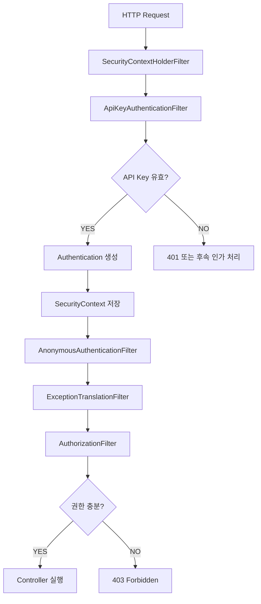

이 예제의 목표는 인증 필터가 만든 결과를 인가 필터에서 사용하는 흐름을 직접 확인하는 것이다.

#### 개발 환경

다음 환경을 기준으로 한다.

| 항목 | 환경 |
|---|---|
| Java | 17 |
| Spring Boot | 3.5.7 |
| Spring Security | Spring Boot 3.5.x에서 관리하는 6.5 계열 |
| 빌드 도구 | Gradle |
| 인증 방식 | API Key |
| 인증 상태 | Stateless |
| 사용자 저장소 | 예제용 고정 인증 주체 |

버전은 구현 구조를 설명하기 위해 고정한 예시이며 최신 버전이라는 의미는 아니다.

---

### Gradle 설정

`build.gradle`

```groovy
plugins {
    id 'java'
    id 'org.springframework.boot' version '3.5.7'
    id 'io.spring.dependency-management' version '1.1.7'
}

group = 'com.example'
version = '1.0.0'

java {
    toolchain {
        languageVersion = JavaLanguageVersion.of(17)
    }
}

repositories {
    mavenCentral()
}

dependencies {
    implementation 'org.springframework.boot:spring-boot-starter-web'

    implementation 'org.springframework.boot:spring-boot-starter-security'

    testImplementation 'org.springframework.boot:spring-boot-starter-test'

    testImplementation 'org.springframework.security:spring-security-test'
}

tasks.named('test') {
    useJUnitPlatform()
}
```

Spring Security의 핵심 의존성은 다음과 같다.

```groovy
implementation 'org.springframework.boot:spring-boot-starter-security'
```

해당 의존성을 추가하면 Spring Boot의 보안 자동 설정이 적용될 수 있다.

하지만 애플리케이션에서 `SecurityFilterChain` Bean을 직접 정의하면 해당 보안 정책을 명시적으로 구성할 수 있다.

---

### application.yml 설정

`src/main/resources/application.yml`

```yaml
server:
  port: 8080

spring:
  application:
    name: security-filter-demo

app:
  integration:
    api-key: ${APP_API_KEY}

logging:
  level:
    org.springframework.security: DEBUG
```

API Key는 환경 변수로 전달한다.

```text
APP_API_KEY
```

실제 운영 환경에서는 API Key를 설정 파일에 직접 기록하지 않고 Secret Manager 등의 보안 저장소를 활용하는 것이 좋다.

또 API Key가 로그에 출력되지 않도록 주의해야 한다.

---

### ApiKeyAuthenticationFilter 구현

이제 커스텀 필터를 작성한다.

Spring Security에서 커스텀 필터를 구현할 때는 `OncePerRequestFilter`를 자주 사용한다.

`OncePerRequestFilter`는 Servlet 요청의 특정 디스패치 과정에서 필터가 중복 실행되는 문제를 줄이기 위한 기본 클래스다.

다만 하나의 HTTP 요청에서 발생하는 모든 `ASYNC`, `ERROR` 디스패치를 포함해 절대 한 번만 실행된다는 뜻은 아니다.

디스패치 처리 방식과 설정에 따라 동작을 이해해야 한다.

`ApiKeyAuthenticationFilter.java`

```java
package com.example.security;

import java.io.IOException;
import java.nio.charset.StandardCharsets;
import java.security.MessageDigest;
import java.util.List;

import jakarta.servlet.FilterChain;
import jakarta.servlet.ServletException;
import jakarta.servlet.http.HttpServletRequest;
import jakarta.servlet.http.HttpServletResponse;

import org.springframework.security.authentication.BadCredentialsException;
import org.springframework.security.authentication.UsernamePasswordAuthenticationToken;

import org.springframework.security.core.Authentication;
import org.springframework.security.core.authority.SimpleGrantedAuthority;

import org.springframework.security.core.context.SecurityContext;
import org.springframework.security.core.context.SecurityContextHolder;

import org.springframework.security.web.AuthenticationEntryPoint;

import org.springframework.web.filter.OncePerRequestFilter;

public class ApiKeyAuthenticationFilter
        extends OncePerRequestFilter {

    private static final String API_KEY_HEADER = "X-API-Key";

    private final String expectedApiKey;

    private final AuthenticationEntryPoint authenticationEntryPoint;

    public ApiKeyAuthenticationFilter(
            String expectedApiKey,
            AuthenticationEntryPoint authenticationEntryPoint
    ) {
        this.expectedApiKey = expectedApiKey;
        this.authenticationEntryPoint = authenticationEntryPoint;
    }

    @Override
    protected boolean shouldNotFilter(
            HttpServletRequest request
    ) {

        return !request.getServletPath()
                .startsWith("/api/integrations/");
    }

    @Override
    protected void doFilterInternal(
            HttpServletRequest request,
            HttpServletResponse response,
            FilterChain filterChain
    ) throws ServletException, IOException {

        String apiKey = request.getHeader(API_KEY_HEADER);

        // API Key가 없으면 다음 필터가 인증 필요 여부를 판단한다.
        if (apiKey == null || apiKey.isBlank()) {

            filterChain.doFilter(request, response);

            return;
        }

        // API Key가 유효하지 않다면 인증 실패 응답을 반환한다.
        if (!isValidApiKey(apiKey)) {

            SecurityContextHolder.clearContext();

            authenticationEntryPoint.commence(
                    request,
                    response,
                    new BadCredentialsException("Invalid API Key")
            );

            return;
        }

        // 인증에 성공한 주체와 권한을 구성한다.
        Authentication authentication =
                UsernamePasswordAuthenticationToken.authenticated(
                        "integration-client",
                        null,
                        List.of(
                                new SimpleGrantedAuthority("ROLE_PARTNER")
                        )
                );

        // 현재 요청의 SecurityContext에 인증 정보를 저장한다.
        SecurityContext context =
                SecurityContextHolder.createEmptyContext();

        context.setAuthentication(authentication);

        SecurityContextHolder.setContext(context);

        // 다음 필터로 요청을 전달한다.
        filterChain.doFilter(request, response);
    }

    private boolean isValidApiKey(String providedApiKey) {

        byte[] expected = expectedApiKey.getBytes(
                StandardCharsets.UTF_8
        );

        byte[] provided = providedApiKey.getBytes(
                StandardCharsets.UTF_8
        );

        return MessageDigest.isEqual(expected, provided);
    }
}
```

코드를 단계별로 살펴보자.

#### 1. 요청 Header에서 API Key를 추출한다

```java
String apiKey = request.getHeader("X-API-Key");
```

요청에 포함된 API Key를 가져온다.

API Key가 존재하지 않는다면 후속 필터로 요청을 전달한다.

```java
filterChain.doFilter(request, response);
```

이후 `AuthorizationFilter`가 해당 API에 인증이 필요한지 판단한다.

인증이 필요한 API라면 인증되지 않은 요청은 거부된다.

#### 2. API Key를 검증한다

```java
if (!isValidApiKey(apiKey)) {

    SecurityContextHolder.clearContext();

    authenticationEntryPoint.commence(
            request,
            response,
            new BadCredentialsException("Invalid API Key")
    );

    return;
}
```

API Key가 유효하지 않다면 인증 실패 처리를 수행한다.

이 예제에서는 `AuthenticationEntryPoint`를 직접 호출한다.

앞서 살펴본 것처럼 인증 필터는 일반적으로 `ExceptionTranslationFilter`보다 앞에 위치하기 때문이다.

단순히 예외를 밖으로 던지는 대신 명시적으로 인증 실패 응답을 생성한다.

#### 3. Authentication을 생성한다

```java
Authentication authentication =
        UsernamePasswordAuthenticationToken.authenticated(
                "integration-client",
                null,
                List.of(
                        new SimpleGrantedAuthority("ROLE_PARTNER")
                )
        );
```

인증된 주체는 `integration-client`다.

부여된 권한은 `ROLE_PARTNER`다.

여기서 `UsernamePasswordAuthenticationToken`이라는 이름 때문에 사용자 이름과 비밀번호 인증에만 사용할 수 있다고 오해하기 쉽다.

하지만 이 클래스는 인증된 주체와 권한을 표현하는 데에도 사용할 수 있다.

다만 실제 서비스에서는 인증 방식에 적합한 사용자 정의 Authentication 타입을 만드는 것이 더 명확할 수도 있다.

#### 4. SecurityContext에 저장한다

```java
SecurityContext context =
        SecurityContextHolder.createEmptyContext();

context.setAuthentication(authentication);

SecurityContextHolder.setContext(context);
```

현재 요청에서 사용할 SecurityContext를 생성한다.

그리고 Authentication을 저장한다.

이제 뒤에 있는 필터가 사용자 인증 정보를 조회할 수 있다.

#### 5. 다음 필터를 실행한다

```java
filterChain.doFilter(request, response);
```

인증 정보를 생성했으므로 다음 필터로 요청을 전달한다.

이후 인가 필터에서 현재 사용자의 권한을 검사할 수 있다.

---

### SecurityConfig 작성

이제 커스텀 필터를 Spring Security에 등록한다.

`SecurityConfig.java`

```java
package com.example.security;

import org.springframework.beans.factory.annotation.Value;

import org.springframework.context.annotation.Bean;
import org.springframework.context.annotation.Configuration;

import org.springframework.http.HttpStatus;

import org.springframework.security.config.annotation.web.builders.HttpSecurity;

import org.springframework.security.config.annotation.web.configurers.AbstractHttpConfigurer;

import org.springframework.security.config.http.SessionCreationPolicy;

import org.springframework.security.web.AuthenticationEntryPoint;
import org.springframework.security.web.SecurityFilterChain;

import org.springframework.security.web.authentication.HttpStatusEntryPoint;

import org.springframework.security.web.authentication.logout.LogoutFilter;

@Configuration
public class SecurityConfig {

    @Bean
    public SecurityFilterChain securityFilterChain(
            HttpSecurity http,
            @Value("${app.integration.api-key}") String apiKey
    ) throws Exception {

        AuthenticationEntryPoint authenticationEntryPoint =
                new HttpStatusEntryPoint(HttpStatus.UNAUTHORIZED);

        ApiKeyAuthenticationFilter apiKeyFilter =
                new ApiKeyAuthenticationFilter(
                        apiKey,
                        authenticationEntryPoint
                );

        http
                .csrf(AbstractHttpConfigurer::disable)

                .sessionManagement(session -> session
                        .sessionCreationPolicy(
                                SessionCreationPolicy.STATELESS
                        )
                )

                .formLogin(AbstractHttpConfigurer::disable)

                .httpBasic(AbstractHttpConfigurer::disable)

                .authorizeHttpRequests(authorize -> authorize

                        .requestMatchers("/public/**").permitAll()

                        .requestMatchers("/api/integrations/admin")
                        .hasRole("ADMIN")

                        .requestMatchers("/api/integrations/**")
                        .hasRole("PARTNER")

                        .anyRequest().denyAll()
                )

                .exceptionHandling(exception -> exception

                        .authenticationEntryPoint(
                                authenticationEntryPoint
                        )

                        .accessDeniedHandler(
                                (request, response, exception1) ->
                                        response.sendError(
                                                HttpStatus.FORBIDDEN.value()
                                        )
                        )
                )

                .addFilterAfter(
                        apiKeyFilter,
                        LogoutFilter.class
                );

        return http.build();
    }
}
```

이 설정에서 가장 중요한 부분은 다음과 같다.

```java
.addFilterAfter(
        apiKeyFilter,
        LogoutFilter.class
);
```

커스텀 인증 필터를 `LogoutFilter` 뒤에 배치한다.

일반적인 Spring Security 필터 순서에서 이 위치는 `AnonymousAuthenticationFilter`와 `AuthorizationFilter`보다 앞이다.

따라서 API Key 인증 필터가 생성한 Authentication을 인가 필터에서 사용할 수 있다.

#### 왜 SessionCreationPolicy.STATELESS를 사용할까?

```java
.sessionManagement(session -> session
        .sessionCreationPolicy(
                SessionCreationPolicy.STATELESS
        )
)
```

이 예제는 API Key를 매 요청마다 전달받는 인증 방식이다.

따라서 서버 세션에 인증 상태를 저장할 필요가 없다.

`STATELESS`를 사용하면 Spring Security의 세션 기반 인증 상태 관리 의존성을 줄일 수 있다.

다만 Stateless 설정과 CSRF 방어는 서로 다른 개념이다.

위 예제에서는 인증 정보를 사용자 브라우저의 Cookie가 아니라 명시적인 Header로 전달하는 API라는 전제에서 CSRF를 비활성화했다.

브라우저가 자동으로 전송하는 Cookie 기반 인증을 함께 사용한다면 CSRF 위험을 별도로 검토해야 한다.

---

### Controller 구현

이제 인증 결과를 확인할 Controller를 작성한다.

`IntegrationController.java`

```java
package com.example.security;

import java.util.Map;

import org.springframework.security.core.Authentication;

import org.springframework.web.bind.annotation.GetMapping;
import org.springframework.web.bind.annotation.RestController;

@RestController
public class IntegrationController {

    @GetMapping("/public/ping")
    public Map<String, String> ping() {

        return Map.of(
                "status", "UP"
        );
    }

    @GetMapping("/api/integrations/orders")
    public Map<String, String> orders(
            Authentication authentication
    ) {

        return Map.of(
                "principal", authentication.getName(),
                "result", "SUCCESS"
        );
    }

    @GetMapping("/api/integrations/admin")
    public Map<String, String> admin() {

        return Map.of(
                "result", "ADMIN_SUCCESS"
        );
    }
}
```

세 가지 API를 제공한다.

| API | 필요 권한 |
|---|---|
| `/public/ping` | 없음 |
| `/api/integrations/orders` | ROLE_PARTNER |
| `/api/integrations/admin` | ROLE_ADMIN |

API Key 인증 필터에서는 `ROLE_PARTNER`만 부여한다.

따라서 유효한 API Key가 있더라도 관리자 API에는 접근할 수 없다.

---

### Spring Boot 실행

애플리케이션 진입점을 작성한다.

`SecurityFilterDemoApplication.java`

```java
package com.example.security;

import org.springframework.boot.SpringApplication;
import org.springframework.boot.autoconfigure.SpringBootApplication;

@SpringBootApplication
public class SecurityFilterDemoApplication {

    public static void main(String[] args) {

        SpringApplication.run(
                SecurityFilterDemoApplication.class,
                args
        );
    }
}
```

이제 로컬 환경에서 API Key를 설정한다.

```bash
export APP_API_KEY="local-demo-secret-key"
```

이 값은 로컬 동작 확인을 위한 예시다.

실제 운영 환경에서는 충분한 엔트로피를 가진 API Key를 생성하고 안전하게 관리해야 한다.

애플리케이션을 실행한다.

```bash
./gradlew bootRun
```

정상적으로 실행되면 API를 호출할 수 있다.

---

### 인증되지 않은 요청 확인하기

먼저 공개 API를 호출한다.

```bash
curl -i http://localhost:8080/public/ping
```

예상 응답은 다음과 같다.

```http
HTTP/1.1 200
Content-Type: application/json
```

```json
{
  "status": "UP"
}
```

공개 API이므로 인증 정보가 없어도 접근할 수 있다.

이번에는 보호된 API를 호출한다.

```bash
curl -i http://localhost:8080/api/integrations/orders
```

API Key가 없으므로 인증 정보를 생성하지 않는다.

이후 인가 필터에서 인증되지 않은 요청으로 판단한다.

예상 결과는 다음과 같다.

```http
HTTP/1.1 401
```

---

### 올바른 API Key로 요청하기

이번에는 API Key를 포함한다.

```bash
curl -i \
  -H "X-API-Key: local-demo-secret-key" \
  http://localhost:8080/api/integrations/orders
```

커스텀 인증 필터가 API Key를 검증한다.

인증이 성공하면 다음 정보가 생성된다.

```text
Principal = integration-client

Authorities = [ROLE_PARTNER]

Authenticated = true
```

이후 인가 필터에서 접근을 허용한다.

예상 응답은 다음과 같다.

```http
HTTP/1.1 200
Content-Type: application/json
```

```json
{
  "principal": "integration-client",
  "result": "SUCCESS"
}
```

이 예제에서 가장 중요한 것은 Controller가 API Key를 직접 검증하지 않는다는 점이다.

Controller는 이미 인증된 사용자 정보를 전달받는다.

인증 처리는 Controller에 도달하기 전에 Spring Security Filter Chain에서 수행된다.

---

### 권한이 부족한 요청 확인하기

이번에는 같은 API Key로 관리자 API를 호출한다.

```bash
curl -i \
  -H "X-API-Key: local-demo-secret-key" \
  http://localhost:8080/api/integrations/admin
```

API Key는 유효하다.

따라서 인증에는 성공한다.

하지만 해당 사용자는 다음 권한만 가지고 있다.

```text
ROLE_PARTNER
```

관리자 API에서는 다음 권한을 요구한다.

```text
ROLE_ADMIN
```

따라서 인가에 실패한다.

예상 응답은 다음과 같다.

```http
HTTP/1.1 403
```

이렇게 하면 인증 실패와 인가 실패의 차이를 직접 확인할 수 있다.

---

### JWT 인증 필터를 직접 구현한다면 어떻게 해야 할까?

앞선 예제에서는 API Key 인증 필터를 사용했다.

이번에는 동일한 구조를 JWT 인증에 적용해 보자.

JWT 인증에서는 단순히 토큰 문자열이 존재하는지 확인하는 것으로는 충분하지 않다.

최소한 다음 항목을 검증해야 한다.

- JWT 서명
- 허용된 서명 알고리즘
- 만료 시간
- 사용 시작 시간
- 발급자
- 수신 대상
- 사용자 식별 정보
- 필요한 권한

이러한 검증을 모두 직접 구현하면 보안 오류가 발생하기 쉽다.

따라서 JWT를 직접 파싱하고 서명을 수동으로 검증하는 방식보다 Spring Security에서 제공하는 `JwtDecoder`를 활용하는 것이 좋다.

다음 코드는 JWT 인증 필터의 핵심 구조를 설명한다.

`JwtAuthenticationFilter.java`

```java
package com.example.security;

import java.io.IOException;

import jakarta.servlet.FilterChain;
import jakarta.servlet.ServletException;
import jakarta.servlet.http.HttpServletRequest;
import jakarta.servlet.http.HttpServletResponse;

import org.springframework.security.authentication.BadCredentialsException;

import org.springframework.security.core.Authentication;

import org.springframework.security.core.context.SecurityContext;
import org.springframework.security.core.context.SecurityContextHolder;

import org.springframework.security.oauth2.jwt.Jwt;
import org.springframework.security.oauth2.jwt.JwtDecoder;
import org.springframework.security.oauth2.jwt.JwtException;

import org.springframework.security.oauth2.server.resource.authentication.JwtAuthenticationConverter;

import org.springframework.security.web.AuthenticationEntryPoint;

import org.springframework.web.filter.OncePerRequestFilter;

public class JwtAuthenticationFilter
        extends OncePerRequestFilter {

    private static final String BEARER_PREFIX = "Bearer ";

    private final JwtDecoder jwtDecoder;

    private final JwtAuthenticationConverter authenticationConverter;

    private final AuthenticationEntryPoint authenticationEntryPoint;

    public JwtAuthenticationFilter(
            JwtDecoder jwtDecoder,
            JwtAuthenticationConverter authenticationConverter,
            AuthenticationEntryPoint authenticationEntryPoint
    ) {

        this.jwtDecoder = jwtDecoder;

        this.authenticationConverter = authenticationConverter;

        this.authenticationEntryPoint = authenticationEntryPoint;
    }

    @Override
    protected void doFilterInternal(
            HttpServletRequest request,
            HttpServletResponse response,
            FilterChain filterChain
    ) throws ServletException, IOException {

        String authorization =
                request.getHeader("Authorization");

        if (authorization == null
                || !authorization.startsWith(BEARER_PREFIX)) {

            filterChain.doFilter(request, response);

            return;
        }

        String token = authorization.substring(
                BEARER_PREFIX.length()
        );

        Jwt jwt;

        try {

            // 서명과 Claim 검증을 포함하는 JWT 처리
            jwt = jwtDecoder.decode(token);

        } catch (JwtException exception) {

            SecurityContextHolder.clearContext();

            authenticationEntryPoint.commence(
                    request,
                    response,
                    new BadCredentialsException(
                            "Invalid JWT",
                            exception
                    )
            );

            return;
        }

        Authentication authentication =
                authenticationConverter.convert(jwt);

        SecurityContext context =
                SecurityContextHolder.createEmptyContext();

        context.setAuthentication(authentication);

        SecurityContextHolder.setContext(context);

        filterChain.doFilter(request, response);
    }
}
```

이 코드는 `JwtDecoder`와 `JwtAuthenticationConverter`를 활용한 커스텀 필터 구조 예시다.

앞선 API Key 예제에 그대로 추가하는 완성 설정은 아니다.

사용하려면 OAuth2 Resource Server 관련 의존성과 `JwtDecoder` Bean, JWT 발급자의 검증 정책 등을 추가로 구성해야 한다.

또 실제 운영에서는 잘못된 Bearer Header 형식과 인증 정보 충돌, 오류 응답 정책 등을 더 엄격하게 처리할 필요가 있다.

여기서 중요한 부분은 다음과 같다.

```java
Authentication authentication =
        authenticationConverter.convert(jwt);
```

JWT를 검증한 결과를 Spring Security의 Authentication으로 변환한다.

그다음 다음 코드로 저장한다.

```java
SecurityContext context =
        SecurityContextHolder.createEmptyContext();

context.setAuthentication(authentication);

SecurityContextHolder.setContext(context);
```

이제 후속 인가 필터가 인증 정보를 사용할 수 있다.

---

### JWT 필터는 어디에 배치해야 할까?

커스텀 JWT 인증 필터를 사용한다면 인증 처리 영역에 배치해야 한다.

예를 들어 다음과 같이 구성할 수 있다.

```java
http.addFilterAfter(
        jwtAuthenticationFilter,
        LogoutFilter.class
);
```

이 위치를 선택한 이유는 다음과 같다.

먼저 SecurityContext가 준비된다.

이후 JWT 인증 필터가 Authentication을 생성한다.

그리고 AnonymousAuthenticationFilter와 AuthorizationFilter가 실행된다.

따라서 유효한 JWT를 포함한 요청에서 인가 필터가 인증 정보를 사용할 수 있다.

다만 이것이 유일하게 올바른 위치라는 의미는 아니다.

커스텀 필터가 어떤 인증 방식과 함께 사용되는지에 따라 순서를 조정해야 한다.

예를 들어 이미 `BearerTokenAuthenticationFilter`가 JWT를 처리하고 있다면 동일한 JWT를 검증하는 커스텀 필터를 또 추가하는 것은 중복 작업일 수 있다.

이때는 필터를 직접 구현하는 대신 기존 JWT 인증 설정을 확장하는 것이 더 적절하다.

---

### JWT 인증 필터를 직접 구현해야 할까?

Spring Security에는 JWT 인증을 처리하는 기능이 이미 존재한다.

대표적으로 OAuth2 Resource Server를 사용할 수 있다.

JWT 기반 API 인증을 구현할 때는 커스텀 필터를 직접 만드는 것보다 이 기능을 먼저 검토하는 것이 좋다.

Spring Security OAuth2 Resource Server의 JWT 인증 흐름에는 다음 구성 요소가 사용된다.

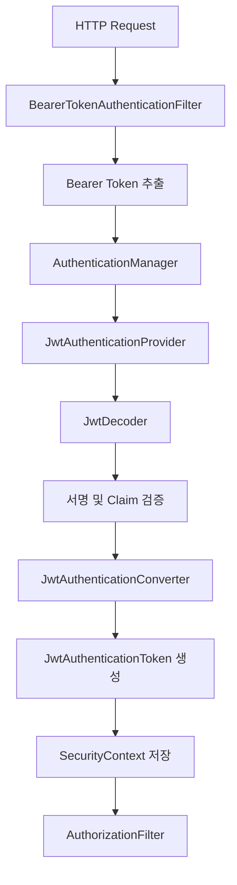

이 구조에서는 Spring Security가 인증 필터와 AuthenticationProvider를 구성한다.

개발자는 JWT 발급자와 공개키 정보, 검증 정책, 권한 매핑 등의 설정에 집중할 수 있다.

Spring Security 공식 문서에서도 Resource Server가 `BearerTokenAuthenticationFilter`, `JwtAuthenticationProvider`, `JwtDecoder` 등을 사용해 JWT 인증을 처리한다고 설명한다.

---

### OAuth2 Resource Server를 이용한 JWT 인증

JWT를 발급하는 인증 서버가 따로 있다고 가정하자.

예를 들어 다음 주소가 JWT의 발급자라고 가정한다.

```text
https://auth.example.com
```

Spring Boot에서는 다음과 같은 의존성을 추가할 수 있다.

```groovy
dependencies {
    implementation 'org.springframework.boot:spring-boot-starter-web'

    implementation 'org.springframework.boot:spring-boot-starter-security'

    implementation 'org.springframework.boot:spring-boot-starter-oauth2-resource-server'
}
```

이제 JWT 인증 설정을 작성한다.

`application.yml`

```yaml
spring:
  security:
    oauth2:
      resourceserver:
        jwt:
          issuer-uri: https://auth.example.com
```

이 설정은 인증 서버가 적절한 OAuth2 또는 OpenID Connect 메타데이터와 공개키 정보를 제공한다는 전제에서 사용할 수 있다.

Spring Security는 JWT 검증을 위한 `JwtDecoder`를 구성할 수 있다.

이제 다음과 같이 SecurityFilterChain을 정의한다.

```java
@Configuration
public class JwtSecurityConfig {

    @Bean
    public SecurityFilterChain securityFilterChain(
            HttpSecurity http
    ) throws Exception {

        http
                .csrf(AbstractHttpConfigurer::disable)

                .sessionManagement(session -> session
                        .sessionCreationPolicy(
                                SessionCreationPolicy.STATELESS
                        )
                )

                .authorizeHttpRequests(authorize -> authorize

                        .requestMatchers("/public/**").permitAll()

                        .requestMatchers("/api/admin/**")
                        .hasAuthority("SCOPE_admin")

                        .anyRequest().authenticated()
                )

                .oauth2ResourceServer(oauth2 -> oauth2
                        .jwt(Customizer.withDefaults())
                );

        return http.build();
    }
}
```

이 예제에서는 커스텀 JWT 인증 필터를 만들지 않았다.

대신 Spring Security가 제공하는 JWT 인증 기능을 활용한다.

#### JWT 권한은 어떻게 매핑될까?

JWT에는 다음과 같은 Claim이 포함될 수 있다.

```json
{
  "sub": "user-100",
  "iss": "https://auth.example.com",
  "scope": "read admin"
}
```

Spring Security의 기본 JWT 권한 변환에서는 Scope를 다음과 같은 Authority로 변환할 수 있다.

```text
SCOPE_read

SCOPE_admin
```

따라서 다음 설정이 가능하다.

```java
.hasAuthority("SCOPE_admin")
```

하지만 애플리케이션에서 `ROLE_ADMIN` 형태의 권한을 사용한다면 별도의 변환 설정이 필요할 수 있다.

예를 들어 JWT에 다음 Claim이 있다고 가정하자.

```json
{
  "sub": "user-100",
  "roles": [
    "USER",
    "ADMIN"
  ]
}
```

이 경우 다음과 같이 `JwtAuthenticationConverter`를 설정할 수 있다.

```java
@Bean
public JwtAuthenticationConverter jwtAuthenticationConverter() {

    JwtGrantedAuthoritiesConverter authoritiesConverter =
            new JwtGrantedAuthoritiesConverter();

    authoritiesConverter.setAuthoritiesClaimName("roles");

    authoritiesConverter.setAuthorityPrefix("ROLE_");

    JwtAuthenticationConverter authenticationConverter =
            new JwtAuthenticationConverter();

    authenticationConverter.setJwtGrantedAuthoritiesConverter(
            authoritiesConverter
    );

    return authenticationConverter;
}
```

그다음 JWT 설정에 적용한다.

```java
.oauth2ResourceServer(oauth2 -> oauth2
        .jwt(jwt -> jwt
                .jwtAuthenticationConverter(
                        jwtAuthenticationConverter()
                )
        )
)
```

이렇게 하면 JWT의 `roles` Claim을 Spring Security의 Authority로 변환할 수 있다.

다만 JWT를 검증할 때는 서명뿐 아니라 `issuer`, `audience`, `expiration` 등 서비스에 필요한 검증 조건을 함께 적용해야 한다.

특히 서로 다른 서비스가 같은 인증 서버에서 발급한 JWT를 사용한다면 수신 대상인 `aud` 검증이 중요할 수 있다.

---

### 커스텀 필터와 기본 JWT 인증 중 무엇을 선택해야 할까?

두 방식의 차이를 정리하면 다음과 같다.

| 구분 | 커스텀 JWT 필터 | OAuth2 Resource Server |
|---|---|---|
| 토큰 추출 | 직접 처리 | 기본 기능 제공 |
| JWT 검증 | 직접 구성 | JwtDecoder 제공 |
| 인증 객체 생성 | 직접 처리 | AuthenticationProvider 및 Converter 사용 |
| SecurityContext 저장 | 직접 처리 | 기본 인증 필터가 처리 |
| 인증 실패 처리 | 직접 구현 필요 | 기본 구조 제공 |
| 권한 변환 | 직접 구현 | Converter 설정 |
| 유지보수 | 직접 관리할 영역 많음 | 프레임워크 기능 활용 |
| 추천 상황 | 특수한 인증 프로토콜 | 일반적인 Bearer JWT 인증 |

일반적인 JWT 기반 API 서버라면 OAuth2 Resource Server를 먼저 고려하는 것이 좋다.

커스텀 필터는 기존 기능으로 해결하기 어려운 요구사항이 있을 때 추가하는 편이 적절하다.

예를 들어 다음과 같은 상황이 있다.

- 독자적인 API Key 인증
- 특별한 인증 Header 형식
- 사용자 정의 인증 프로토콜
- 인증된 사용자의 Tenant 접근 검증
- 인증된 사용자 기반 요청 제한

이때도 기존 Spring Security의 구성 요소를 최대한 재사용하는 것이 좋다.

---

### 구조

### 여러 SecurityFilterChain을 함께 사용한다면?

하나의 애플리케이션에서 서로 다른 인증 방식을 사용할 수 있다.

예를 들어 다음과 같은 요구사항을 생각해 보자.

```text
/api/**

JWT 인증
```

```text
/partner/**

API Key 인증
```

```text
/web/**

Session 기반 인증
```

이 경우 하나의 SecurityFilterChain에 모든 인증 방식을 혼합할 수도 있다.

하지만 인증 방식이 명확하게 구분된다면 여러 체인을 사용하는 편이 이해하기 쉬울 수 있다.

개념적으로 다음과 같이 구성한다.

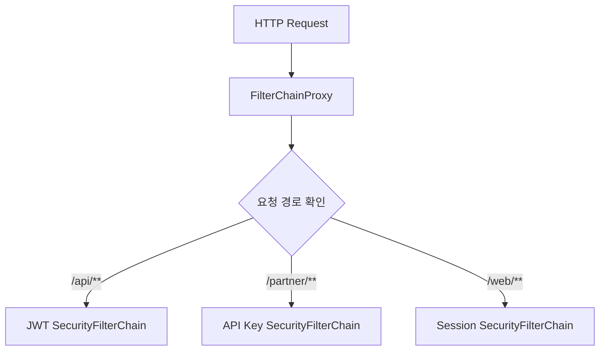

다음과 같이 `@Order`를 사용할 수 있다.

```java
@Bean
@Order(1)
public SecurityFilterChain apiSecurity(
        HttpSecurity http
) throws Exception {

    http
            .securityMatcher("/api/**")

            .authorizeHttpRequests(authorize -> authorize
                    .anyRequest().authenticated()
            )

            .oauth2ResourceServer(oauth2 -> oauth2
                    .jwt(Customizer.withDefaults())
            );

    return http.build();
}
```

여기서 중요한 부분은 다음과 같다.

```java
.securityMatcher("/api/**")
```

이 설정은 현재 SecurityFilterChain이 처리할 요청의 범위를 결정한다.

반면 다음 코드는 체인 내부에서 접근 권한을 결정한다.

```java
.requestMatchers("/api/admin/**")
.hasRole("ADMIN")
```

두 설정은 역할이 다르다.

| 구분 | 역할 |
|---|---|
| securityMatcher() | SecurityFilterChain 자체의 적용 대상 결정 |
| requestMatchers() | 선택된 SecurityFilterChain 내부의 인가 규칙 결정 |

예를 들어 다음 설정을 생각해 보자.

```java
http
        .securityMatcher("/api/**")
        .authorizeHttpRequests(authorize -> authorize
                .anyRequest().authenticated()
        );
```

이 설정의 `anyRequest()`는 애플리케이션의 모든 URL을 의미하지 않는다.

현재 선택된 체인의 요청 범위 안에서 모든 요청을 의미한다.

따라서 `/admin/**` 요청은 해당 SecurityFilterChain의 적용 대상이 아닐 수 있다.

---

### 여러 체인을 사용할 때 발생할 수 있는 보안 문제

다음과 같은 설정이 있다고 가정하자.

```text
SecurityFilterChain A

/api/**
```

```text
SecurityFilterChain B

/admin/**
```

그런데 `/internal/**` 요청을 처리하는 체인이 없다면 어떻게 될까?

해당 요청이 어떤 SecurityFilterChain에도 일치하지 않을 수 있다.

그 결과 Spring Security의 보안 필터가 적용되지 않는 문제가 발생할 수 있다.

따라서 여러 체인을 사용할 때는 기본 체인을 마련하는 것이 좋다.

예를 들어 다음과 같이 작성할 수 있다.

```java
@Bean
@Order(99)
public SecurityFilterChain fallbackSecurity(
        HttpSecurity http
) throws Exception {

    http.authorizeHttpRequests(authorize -> authorize
            .anyRequest().denyAll()
    );

    return http.build();
}
```

이 체인은 앞선 체인에서 선택되지 않은 요청을 처리하는 기본 정책으로 사용할 수 있다.

물론 실제 애플리케이션에서는 공개 리소스나 Health Check 등의 접근 정책을 함께 정의해야 한다.

하지만 보안상 중요한 원칙은 동일하다.

**명시적으로 허용하지 않은 요청은 기본적으로 거부하는 방향으로 설계하는 것이 안전하다.**

---

### permitAll과 필터 제외는 무엇이 다를까?

Spring Security를 사용할 때 자주 혼동하는 설정이 있다.

첫 번째는 `permitAll()`이다.

두 번째는 보안 필터 체인에서 요청을 제외하는 것이다.

예를 들어 다음 설정을 생각해 보자.

```java
.requestMatchers("/public/**").permitAll()
```

이 설정은 해당 요청에 대한 접근을 허용한다.

하지만 요청이 Spring Security Filter Chain 자체를 우회한다는 의미는 아니다.

따라서 공개 API라도 앞에 있는 인증 필터가 실행될 수 있다.

예를 들어 커스텀 JWT 필터가 모든 요청의 Authorization Header를 검증하도록 구현되어 있다면 공개 API 요청에서도 해당 필터가 동작할 수 있다.

반면 `WebSecurityCustomizer`의 `ignoring()` 등을 사용하면 특정 요청을 보안 필터 체인에서 제외할 수 있다.

두 방식은 다음과 같이 다르다.

| 구분 | permitAll() | ignoring() |
|---|---|---|
| SecurityFilterChain 적용 | 일반적으로 적용 | 제외 |
| 인증 필요 여부 | 인증 없이 허용 | 보안 체인 자체를 우회 |
| 보안 Header 처리 | 적용 가능 | 적용되지 않을 수 있음 |
| 커스텀 보안 필터 실행 | 실행될 수 있음 | 체인 내부 필터 실행 안 함 |
| 일반적인 권장 방식 | 우선 고려 | 특별한 경우에만 사용 |

Spring Security 공식 문서에서도 공개 리소스를 처리할 때 보안 필터를 완전히 제외하는 것보다 `permitAll()`을 우선 고려하도록 설명한다.

---

### OncePerRequestFilter를 사용하면 반드시 한 번만 실행될까?

커스텀 필터를 구현할 때 다음 클래스를 자주 사용한다.

```java
OncePerRequestFilter
```

이름만 보면 HTTP 요청 하나에 대해 반드시 한 번만 실행되는 것처럼 생각하기 쉽다.

하지만 실제로는 조금 더 주의해야 한다.

Servlet 환경에는 여러 Dispatcher Type이 존재한다.

대표적으로 다음과 같다.

```text
REQUEST

ASYNC

ERROR

FORWARD
```

하나의 HTTP 요청에서도 비동기 처리나 오류 처리 과정에서 새로운 디스패치가 발생할 수 있다.

`OncePerRequestFilter`는 이미 실행한 필터를 식별하기 위한 Request Attribute 등을 활용해 중복 실행을 방지한다.

하지만 비동기 또는 오류 디스패치에 참여하는지에 따라 동작이 달라질 수 있다.

또 Spring Security Filter Chain에 등록된 필터를 Servlet Container에도 별도로 등록하면 예기치 않은 실행 순서와 중복 문제가 발생할 수 있다.

따라서 `OncePerRequestFilter`를 사용한다고 필터 등록 구조를 신경 쓰지 않아도 되는 것은 아니다.

---

### 커스텀 필터가 두 번 실행되는 이유

Spring Boot에서 다음과 같이 커스텀 필터를 선언했다고 가정하자.

```java
@Component
public class JwtAuthenticationFilter
        extends OncePerRequestFilter {

    // ...
}
```

그리고 SecurityConfig에서 다음과 같이 등록한다.

```java
http.addFilterBefore(
        jwtAuthenticationFilter,
        UsernamePasswordAuthenticationFilter.class
);
```

이 경우 문제가 발생할 수 있다.

Spring Boot는 `Filter` 타입의 Spring Bean을 Servlet Container에 자동 등록할 수 있다.

그런데 같은 필터를 Spring Security Filter Chain에도 추가했다.

따라서 다음 두 경로에 등록될 수 있다.

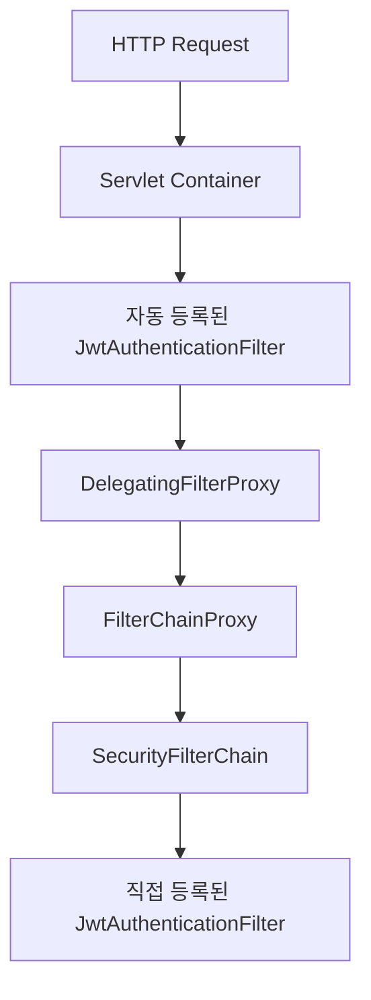

이 구조에서는 필터가 의도하지 않은 위치에서 실행될 수 있다.

특히 Servlet Container 레벨에서 실행되는 필터는 Spring Security의 SecurityContext 준비 이전에 실행될 수도 있다.

따라서 인증 관련 필터의 실행 결과가 예상과 달라질 수 있다.

#### 해결 방법 1. Spring Bean으로 등록하지 않는다

커스텀 필터가 별도의 Spring Bean일 필요가 없다면 SecurityConfig 내부에서 직접 생성할 수 있다.

```java
ApiKeyAuthenticationFilter filter =
        new ApiKeyAuthenticationFilter(
                apiKey,
                authenticationEntryPoint
        );

http.addFilterAfter(
        filter,
        LogoutFilter.class
);
```

앞선 전체 구현 예제에서 사용한 방식이다.

#### 해결 방법 2. FilterRegistrationBean을 사용한다

의존성 주입 등의 이유로 커스텀 필터를 Spring Bean으로 관리해야 한다면 Servlet Container 자동 등록을 비활성화할 수 있다.

```java
@Bean
public FilterRegistrationBean<JwtAuthenticationFilter>
jwtFilterRegistration(
        JwtAuthenticationFilter filter
) {

    FilterRegistrationBean<JwtAuthenticationFilter> registration =
            new FilterRegistrationBean<>(filter);

    registration.setEnabled(false);

    return registration;
}
```

이렇게 하면 해당 필터를 Spring Security Filter Chain을 통해서만 사용하도록 구성할 수 있다.

Spring Security 공식 문서도 Spring Bean으로 선언된 필터의 Servlet Container 중복 등록 가능성과 `FilterRegistrationBean`을 이용한 해결 방법을 안내한다.

---

### 필터가 인증 정보를 읽어야 한다면 어디에 배치해야 할까?

예를 들어 사용자별 접근 로그를 남기는 필터를 생각해 보자.

```text
User ID

Request URI

HTTP Method

Response Status
```

이 필터는 현재 사용자가 누구인지 알아야 한다.

따라서 Authentication이 생성된 이후 실행되어야 한다.

하지만 여기에도 중요한 문제가 있다.

JWT 인증에 실패한 요청도 기록하고 싶다면 어떻게 해야 할까?

인증 실패 시 JWT 필터가 더 이상 다음 필터를 호출하지 않을 수 있다.

```java
return;
```

이 경우 인증 필터 뒤에 위치한 로깅 필터는 실행되지 않을 수 있다.

따라서 로깅 요구사항을 구분해야 한다.

#### 인증된 사용자 중심의 로깅

인증이 완료된 사용자의 작업을 기록하는 목적이라면 인증 필터 이후에 로깅 필터를 배치할 수 있다.

#### 모든 HTTP 요청의 로깅

인증 성공과 실패를 포함한 모든 요청을 기록해야 한다면 더 앞선 Servlet Filter 또는 관측성 계층에서 요청 전체를 기록할 수 있다.

이때 인증된 사용자 정보가 필요한 경우에는 인증 이후 이벤트 또는 별도의 보안 감사 로깅과 결합할 수 있다.

즉 로깅 필터라는 이유만으로 특정 위치에 무조건 배치해야 하는 것은 아니다.

**어떤 요청을 기록해야 하고, 어떤 시점의 정보를 사용해야 하는지가 위치를 결정한다.**

---

### 실무에서의 활용

### 커스텀 필터를 설계할 때 고려해야 할 12가지 전략

Spring Security의 내부 구조를 이해했다면 실제 서비스에서 커스텀 필터를 설계할 때 고려해야 하는 요소들을 정리할 수 있다.

#### 1. 인증 로직을 직접 구현하기 전에 기본 기능을 확인한다

JWT 인증이 필요하다고 해서 무조건 `JwtAuthenticationFilter`를 작성할 필요는 없다.

Spring Security는 OAuth2 Resource Server를 통해 JWT 검증 기능을 제공한다.

또 HTTP Basic과 폼 로그인 등 기본 인증 기능도 제공한다.

따라서 먼저 기존 기능으로 요구사항을 해결할 수 있는지 확인하는 것이 좋다.

커스텀 필터를 직접 구현하면 인증 실패와 예외 처리, SecurityContext 관리까지 직접 책임져야 하기 때문이다.

#### 2. 필터의 역할을 명확하게 정의한다

커스텀 필터가 어떤 책임을 가지는지 먼저 결정해야 한다.

예를 들어 다음과 같은 필터들이 있다고 가정하자.

```text
JwtAuthenticationFilter

ApiKeyAuthenticationFilter

TenantAuthorizationFilter

RequestLoggingFilter
```

각 필터의 책임이 명확해야 실행 순서도 결정할 수 있다.

JWT 인증 필터는 Authentication을 생성한다.

Tenant 권한 필터는 이미 생성된 Authentication을 사용한다.

따라서 두 필터의 순서가 달라질 수밖에 없다.

#### 3. 인증과 인가를 하나의 필터에 과도하게 혼합하지 않는다

예를 들어 JWT 인증 필터에서 다음 작업을 모두 수행한다고 가정하자.

```text
JWT 검증

사용자 조회

관리자 권한 확인

Tenant 권한 확인

요청 URL별 접근 제한
```

이렇게 되면 필터가 지나치게 많은 책임을 가지게 된다.

또 Spring Security의 인가 기능과 중복될 수 있다.

따라서 인증 정보 생성과 접근 권한 판단을 구분하는 것이 좋다.

일반적인 권한 검사는 `AuthorizationFilter`, `AuthorizationManager`, 메서드 보안 등을 활용할 수 있다.

#### 4. SecurityContext를 명확하게 관리한다

인증에 성공하면 현재 요청에 사용할 Authentication을 저장해야 한다.

```java
SecurityContext context =
        SecurityContextHolder.createEmptyContext();

context.setAuthentication(authentication);

SecurityContextHolder.setContext(context);
```

기존 SecurityContext를 직접 수정하는 것보다 새로운 Context를 생성해 설정하는 방식이 적절한 경우가 많다.

또 Stateless 인증이라면 세션 저장이 필요하지 않은지 검토해야 한다.

반대로 세션 로그인에서는 SecurityContext의 영속화 정책을 별도로 고려해야 한다.

#### 5. AuthenticationEntryPoint와 AccessDeniedHandler를 구분한다

인증에 실패한 요청과 권한이 부족한 요청은 서로 다르다.

따라서 다음 두 구성 요소의 역할을 구분해야 한다.

```text
AuthenticationEntryPoint

AccessDeniedHandler
```

인증 실패 시에는 AuthenticationEntryPoint가 사용될 수 있다.

정상적으로 인증되었지만 권한이 부족한 경우에는 AccessDeniedHandler가 사용될 수 있다.

이 구분이 잘못되면 모든 오류가 403으로 반환되거나 정상적인 로그인 Redirect가 발생하는 등의 문제가 나타날 수 있다.

#### 6. 필터에서 발생하는 예외의 처리 위치를 확인한다

필터에서 예외가 발생한다고 모든 예외가 `@ControllerAdvice`에서 처리되는 것은 아니다.

Servlet Filter는 일반적으로 DispatcherServlet보다 앞에서 실행된다.

따라서 필터에서 발생한 예외가 Controller의 예외 처리 구조에 도달하지 않을 수 있다.

또 `ExceptionTranslationFilter`보다 앞에서 발생한 인증 예외 역시 별도 처리가 필요할 수 있다.

따라서 인증 실패 응답은 Security의 인증 실패 처리 메커니즘과 연결하는 것이 좋다.

#### 7. 공개 API에서도 커스텀 필터가 실행될 수 있음을 고려한다

다음 설정은 인증 없이 접근하도록 허용한다.

```java
.requestMatchers("/public/**").permitAll()
```

하지만 커스텀 인증 필터가 해당 요청에서 실행되지 않는다는 의미는 아니다.

따라서 필터에서 요청 경로를 제한하거나 인증 Header가 없는 경우 후속 필터로 전달하는 정책이 필요할 수 있다.

이때 `shouldNotFilter()`를 활용할 수 있다.

```java
@Override
protected boolean shouldNotFilter(
        HttpServletRequest request
) {

    return request.getServletPath()
            .startsWith("/public/");
}
```

다만 공개 API에서 유효하지 않은 인증 Header를 전달한 경우 어떤 정책을 적용할지도 명확하게 결정해야 한다.

#### 8. 다중 SecurityFilterChain의 적용 범위를 검증한다

여러 SecurityFilterChain을 사용하는 경우 체인 우선순위와 RequestMatcher를 확인해야 한다.

예를 들어 `/api/**` 체인이 먼저 선택되면 이후의 더 일반적인 체인은 실행되지 않는다.

따라서 각 체인이 어떤 요청을 처리하는지 테스트해야 한다.

특히 기본 체인을 누락해 특정 API가 보안 필터를 우회하지 않도록 주의해야 한다.

#### 9. 필터의 중복 등록을 방지한다

커스텀 필터를 `@Component`로 등록하면서 SecurityFilterChain에 직접 추가하면 중복 등록 문제가 발생할 수 있다.

따라서 Servlet Container와 Spring Security 중 어느 계층에서 실행되어야 하는지 명확하게 결정해야 한다.

Spring Security의 인증 필터라면 일반적으로 SecurityFilterChain 내부에서 관리하는 편이 자연스럽다.

#### 10. ThreadLocal 기반 인증 정보의 전파 범위를 이해한다

`SecurityContextHolder`는 기본적으로 ThreadLocal을 사용한다.

따라서 같은 요청 처리 Thread에서는 인증 정보에 접근하기 쉽다.

하지만 별도의 비동기 Thread에서는 해당 정보가 자동으로 전달되지 않을 수 있다.

예를 들어 다음과 같은 코드가 있다고 가정하자.

```java
@Async
public void process() {

    Authentication authentication =
            SecurityContextHolder.getContext()
                    .getAuthentication();
}
```

이 메서드가 별도 Thread에서 실행된다면 호출한 요청의 SecurityContext가 그대로 존재한다고 가정해서는 안 된다.

필요하다면 Spring Security가 제공하는 SecurityContext 전파 기능을 사용해야 한다.

또 작업에 필요한 사용자 식별자를 명시적인 인수로 전달하는 방식도 고려할 수 있다.

#### 11. 인증 필터에서 불필요한 DB 조회를 반복하지 않는다

JWT 인증 필터에서 모든 요청마다 사용자 정보를 DB에서 조회한다고 가정하자.

```text
JWT 검증

↓

사용자 DB 조회

↓

Authentication 생성
```

이 방식은 JWT를 사용하는 이유 중 하나인 서버 측 인증 상태 조회 부담 감소라는 장점을 약화시킬 수 있다.

하지만 모든 JWT 인증에서 DB 조회를 제거해야 한다는 의미는 아니다.

예를 들어 즉시 계정 정지나 권한 변경을 반영해야 한다면 서버 측 상태 확인이 필요할 수 있다.

따라서 다음 요소를 고려해야 한다.

- JWT 유효 기간
- 권한 변경 반영 시점
- 계정 정지 정책
- Refresh Token 관리
- Token 폐기 정책
- DB 조회 비용
- 인증 상태 캐싱

인증 방식의 보안 요구사항과 성능 사이에서 균형을 결정해야 한다.

#### 12. 필터의 순서를 테스트로 검증한다

필터 순서는 설정 코드만 보고 판단하는 것보다 실제 요청을 통해 검증하는 것이 좋다.

예를 들어 다음 상황을 검증할 수 있다.

```text
인증 정보 없음 → 401

유효하지 않은 인증 정보 → 401

유효한 인증 정보 → 200

인증 성공 + 권한 부족 → 403
```

이러한 테스트를 통해 인증과 인가가 올바른 순서로 수행되는지 확인할 수 있다.

---

### Spring Security 필터를 테스트하는 방법

앞서 구현한 API Key 인증 예제를 테스트해 보자.

Spring Boot에서는 MockMvc를 활용할 수 있다.

`SecurityFilterTest.java`

```java
package com.example.security;

import org.junit.jupiter.api.Test;

import org.springframework.beans.factory.annotation.Autowired;

import org.springframework.boot.test.autoconfigure.web.servlet.AutoConfigureMockMvc;
import org.springframework.boot.test.context.SpringBootTest;

import org.springframework.test.context.TestPropertySource;

import org.springframework.test.web.servlet.MockMvc;

import static org.springframework.test.web.servlet.request.MockMvcRequestBuilders.get;

import static org.springframework.test.web.servlet.result.MockMvcResultMatchers.status;

@SpringBootTest
@AutoConfigureMockMvc
@TestPropertySource(
        properties = "app.integration.api-key=test-secret"
)
class SecurityFilterTest {

    @Autowired
    private MockMvc mockMvc;

    @Test
    void 공개_API는_인증_없이_접근할_수_있다() throws Exception {

        mockMvc.perform(
                get("/public/ping")
        ).andExpect(
                status().isOk()
        );
    }

    @Test
    void 인증_정보가_없으면_401을_반환한다() throws Exception {

        mockMvc.perform(
                get("/api/integrations/orders")
        ).andExpect(
                status().isUnauthorized()
        );
    }

    @Test
    void 잘못된_API_KEY는_401을_반환한다() throws Exception {

        mockMvc.perform(
                get("/api/integrations/orders")
                        .header("X-API-Key", "invalid")
        ).andExpect(
                status().isUnauthorized()
        );
    }

    @Test
    void 정상_API_KEY는_인증에_성공한다() throws Exception {

        mockMvc.perform(
                get("/api/integrations/orders")
                        .header("X-API-Key", "test-secret")
        ).andExpect(
                status().isOk()
        );
    }

    @Test
    void 인증에_성공해도_권한이_부족하면_403이다() throws Exception {

        mockMvc.perform(
                get("/api/integrations/admin")
                        .header("X-API-Key", "test-secret")
        ).andExpect(
                status().isForbidden()
        );
    }
}
```

테스트를 실행한다.

```bash
./gradlew test
```

정상적으로 통과하면 각 API가 의도한 보안 정책을 따르고 있음을 확인할 수 있다.

다만 이러한 테스트가 모든 보안 요구사항을 검증하는 것은 아니다.

실제 운영 환경에서는 Header 중복, 인증 정보 유출, API Key 교체, 요청 재전송, 인증 서버 장애 등의 상황도 검토해야 한다.

---

### 필터 실행 순서는 어떻게 확인할까?

Spring Security의 필터 순서는 실제 로그를 통해 확인할 수 있다.

`application.yml`에 다음 설정을 추가한다.

```yaml
logging:
  level:
    org.springframework.security: TRACE
```

이제 애플리케이션을 실행하면 필터 체인 구성과 요청 처리 과정에 관한 상세 로그를 확인할 수 있다.

예를 들어 다음과 같은 형태의 로그가 출력될 수 있다.

```text
Securing GET /api/integrations/orders

Invoking SecurityContextHolderFilter

Invoking HeaderWriterFilter

Invoking LogoutFilter

Invoking ApiKeyAuthenticationFilter

Invoking AnonymousAuthenticationFilter

Invoking ExceptionTranslationFilter

Invoking AuthorizationFilter
```

위 내용은 실행 순서를 설명하기 위한 예시이며 실제 필터 목록과 로그 형식은 설정 및 버전에 따라 달라진다.

이 로그에서 확인해야 할 것은 다음과 같다.

**첫 번째, 커스텀 필터가 실제 SecurityFilterChain에 포함되어 있는가?**

**두 번째, 커스텀 필터가 인증 정보를 사용하는 필터보다 먼저 실행되는가?**

**세 번째, 인증 실패 시 어떤 필터에서 요청 처리가 종료되는가?**

**네 번째, 요청 경로에 맞는 SecurityFilterChain이 선택되었는가?**

이 네 가지를 확인하면 커스텀 필터의 위치 문제를 분석하기 쉬워진다.

---

### Spring Security에서 자주 발생하는 문제

| 문제 | 주요 원인 | 해결 방향 |
|---|---|---|
| JWT가 유효한데 401 발생 | 인증 필터가 실행되지 않거나 인가 이후 실행 | 필터 체인 및 순서 확인 |
| 인증 없이 접근해야 하는 API에서 401 | 커스텀 필터가 공개 API 요청도 차단 | shouldNotFilter 및 인증 정책 확인 |
| 인증된 사용자에게 403 발생 | Authority 불일치 | ROLE_와 SCOPE_ 매핑 확인 |
| 필터가 두 번 실행됨 | Servlet Container와 SecurityFilterChain 중복 등록 | FilterRegistrationBean 또는 Bean 등록 방식 변경 |
| 필터가 실행되지 않음 | 잘못된 SecurityFilterChain 선택 | securityMatcher 및 @Order 확인 |
| Authentication이 null | 인증 정보 생성 전 조회 | 필터 위치 및 SecurityContext 확인 |
| ControllerAdvice에서 예외 처리 안 됨 | Filter 단계에서 예외 발생 | AuthenticationEntryPoint 등 사용 |
| JWT 인증 실패가 500으로 반환됨 | 예외를 적절하게 처리하지 않음 | 인증 실패 처리 구성 |
| Stateless인데 Session 관련 동작 발생 | 인증 상태 저장 또는 다른 Session 의존성 | Session 정책과 SecurityContextRepository 확인 |
| 인증 정보가 비동기 작업에서 사라짐 | ThreadLocal 전파 문제 | SecurityContext 전파 정책 |
| 공개 API도 JWT를 검증함 | permitAll과 Filter 실행을 혼동 | 필터 적용 범위 정의 |
| 특정 API가 인증 없이 접근됨 | SecurityFilterChain 적용 범위 누락 | 기본 Deny 정책 및 체인 테스트 |

---

### Spring Security의 전체 요청 처리 흐름

지금까지 살펴본 내용을 하나로 연결해 보자.

다음은 JWT 인증을 사용하는 일반적인 API 서버의 개념적인 요청 처리 흐름이다.

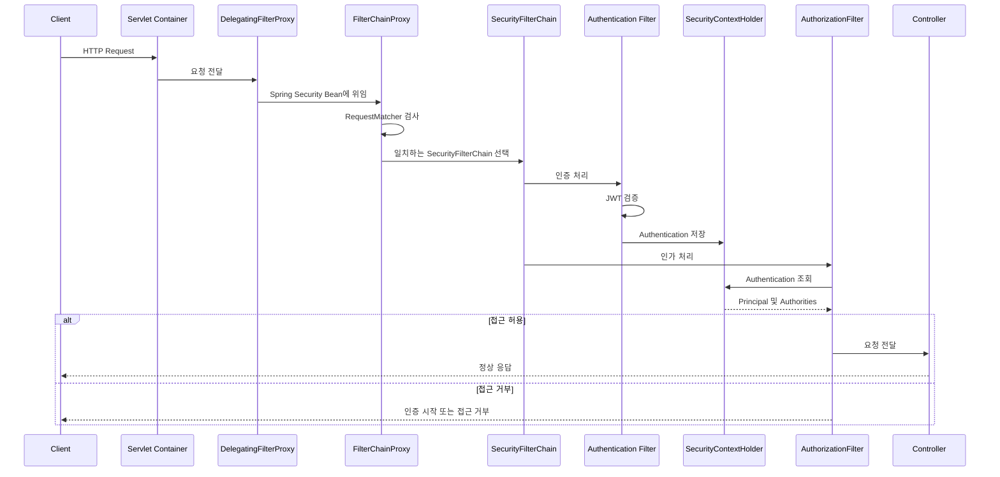

이 흐름에서 각 구성 요소의 책임을 정리하면 다음과 같다.

`DelegatingFilterProxy`는 Servlet Container와 Spring Bean을 연결한다.

`FilterChainProxy`는 요청에 적용할 SecurityFilterChain을 선택한다.

`SecurityFilterChain`은 실제 보안 필터들의 실행 순서를 구성한다.

인증 필터는 요청에서 인증 정보를 추출하고 검증한다.

`SecurityContextHolder`는 현재 요청의 인증 정보를 제공한다.

`AuthorizationFilter`는 Authentication과 요청 정보를 바탕으로 접근 권한을 판단한다.

따라서 인증 필터와 인가 필터는 서로 독립적으로 실행되는 구성 요소가 아니다.

인증 필터가 생성한 결과를 인가 필터가 사용한다.

이것이 커스텀 필터를 추가할 때 실행 순서를 고려해야 하는 가장 중요한 이유다.

---

### 추가 심화: 커스텀 필터를 반드시 사용해야 할까?

Spring Security에서 새로운 보안 요구사항이 발생하면 커스텀 필터부터 작성하는 경우가 있다.

하지만 모든 보안 요구사항을 필터에서 해결하는 것이 좋은 설계는 아니다.

예를 들어 다음과 같은 요구사항이 있다고 가정하자.

```text
현재 사용자가 특정 주문의 소유자인지 확인한다.
```

이 검증을 Servlet Filter에서 수행해야 할까?

반드시 그렇지는 않다.

주문의 소유자를 확인하려면 주문 정보를 데이터베이스에서 조회해야 할 수 있다.

또 해당 검증은 HTTP 요청 자체보다는 비즈니스 도메인과 밀접하게 관련되어 있다.

이러한 경우에는 Service 계층이나 Method Security를 활용하는 것이 더 자연스러울 수 있다.

예를 들어 다음과 같이 구성할 수 있다.

```java
@PreAuthorize("hasRole('ADMIN')")
public void updateAdminSettings() {

    // 관리자 설정 변경
}
```

또 사용자와 자원의 관계를 검증해야 한다면 다음과 같은 구조를 고려할 수 있다.

```java
public void cancelOrder(
        Long orderId,
        Long memberId
) {

    Order order = orderRepository.findById(orderId)
            .orElseThrow();

    order.validateOwner(memberId);

    order.cancel();
}
```

이처럼 보안 검증은 여러 계층에서 수행될 수 있다.

| 계층 | 적합한 책임 |
|---|---|
| Servlet Filter | HTTP 요청 수준의 공통 처리 |
| Authentication Filter | 요청의 인증 정보 처리 |
| AuthenticationProvider | 인증 자격 증명 검증 |
| AuthorizationFilter | URL 기반 접근 권한 검사 |
| Method Security | 메서드 호출 권한 검사 |
| Domain Service | 비즈니스 권한과 정책 검증 |
| Repository | 데이터 접근 범위 제한 등 |

따라서 새로운 보안 요구사항이 발생하면 먼저 다음 질문을 해야 한다.

**이 문제는 HTTP 요청의 공통 보안 문제인가, 아니면 특정 비즈니스 기능의 권한 문제인가?**

이 구분을 통해 필터의 책임이 지나치게 커지는 것을 방지할 수 있다.

---

### 정리

Spring Security는 Spring 기반 애플리케이션에서 인증과 인가를 비롯한 다양한 보안 기능을 제공하는 프레임워크다.

Servlet 기반 Spring Security는 Servlet Filter를 중심으로 동작한다.

클라이언트의 HTTP 요청은 Servlet Container로 전달된다.

이후 `DelegatingFilterProxy`를 거쳐 Spring Security의 `FilterChainProxy`로 위임된다.

`DelegatingFilterProxy`는 Servlet Container와 Spring Bean 사이를 연결하는 역할을 한다.

`FilterChainProxy`는 여러 SecurityFilterChain 중에서 현재 요청에 적용할 체인을 선택한다.

그리고 선택된 SecurityFilterChain에 포함된 보안 필터들이 순서대로 실행된다.

여기서 중요한 것은 필터의 실행 순서다.

Spring Security의 일부 필터는 다른 필터가 생성한 정보를 이용해 동작한다.

대표적인 예가 인증 필터와 인가 필터다.

인증 필터는 JWT나 API Key 등을 검증해 Authentication을 생성한다.

생성된 Authentication은 SecurityContext에 저장된다.

이후 AuthorizationFilter는 SecurityContext에서 인증 정보를 확인하고 사용자의 접근 권한을 판단한다.

따라서 인증 필터가 인가 필터보다 뒤에 위치한다면 문제가 발생할 수 있다.

인가 필터가 실행되는 시점에 인증 정보가 아직 존재하지 않기 때문이다.

이 경우 유효한 JWT가 전달되었더라도 요청이 인증되지 않은 요청으로 처리될 수 있다.

이러한 문제를 방지하려면 커스텀 필터가 어떤 정보를 생성하고 어떤 정보를 사용하는지 이해해야 한다.

인증 정보를 생성하는 필터라면 후속 인가 필터보다 앞에 배치해야 한다.

반면 인증 정보를 사용하는 필터라면 필요한 인증 처리가 완료된 이후 배치해야 한다.

Spring Security는 커스텀 필터를 추가하기 위해 `addFilterBefore()`, `addFilterAfter()`, `addFilterAt()`을 제공한다.

하지만 단순히 메서드 이름을 아는 것만으로 올바른 필터 위치를 결정할 수는 없다.

각 필터의 책임과 정보 의존 관계를 이해해야 한다.

또 커스텀 인증 필터를 구현할 때는 인증 실패 처리에 주의해야 한다.

일반적인 필터 순서에서 `ExceptionTranslationFilter`는 인증 필터보다 뒤에 위치할 수 있다.

따라서 커스텀 인증 필터 내부에서 발생한 예외를 `ExceptionTranslationFilter`가 자동으로 처리한다고 가정해서는 안 된다.

필요한 경우 `AuthenticationEntryPoint`를 직접 사용하거나 Spring Security에서 제공하는 인증 실패 처리 구조를 활용해야 한다.

또 인증 실패와 인가 실패도 구분해야 한다.

인증 정보가 없거나 유효하지 않은 경우에는 일반적으로 HTTP 401을 사용한다.

정상적으로 인증되었지만 필요한 권한이 부족한 경우에는 HTTP 403을 사용한다.

하지만 실제 응답은 애플리케이션의 보안 설정에 따라 달라질 수 있다.

JWT 인증을 구현할 때도 모든 기능을 직접 작성할 필요는 없다.

Spring Security의 OAuth2 Resource Server는 Bearer Token을 이용한 JWT 인증을 지원한다.

`BearerTokenAuthenticationFilter`, `JwtAuthenticationProvider`, `JwtDecoder` 등을 이용해 인증 흐름을 구성할 수 있다.

따라서 일반적인 JWT 인증이라면 기본 기능을 활용하는 것이 유지보수와 보안 측면에서 유리할 수 있다.

커스텀 필터는 API Key 인증이나 독자적인 인증 프로토콜 등 특별한 요구사항이 있을 때 고려하는 것이 좋다.

또 여러 SecurityFilterChain을 사용하는 경우 우선순위와 적용 범위를 정확하게 관리해야 한다.

`securityMatcher()`는 SecurityFilterChain 자체의 적용 범위를 결정한다.

`requestMatchers()`는 선택된 체인 내부에서 접근 권한을 결정한다.

두 설정을 혼동하면 특정 요청이 예상하지 않은 체인에서 처리되거나 보안 체인을 우회하는 문제가 발생할 수 있다.

마지막으로 커스텀 필터의 중복 등록에도 주의해야 한다.

Spring Boot에서는 Filter 타입의 Bean이 Servlet Container에 자동 등록될 수 있다.

따라서 같은 필터를 SecurityFilterChain에도 추가하면 의도하지 않은 실행 순서나 중복 등록 문제가 발생할 수 있다.

이 경우 필터를 SecurityConfig에서 직접 생성하거나 `FilterRegistrationBean`을 이용해 Servlet Container 자동 등록을 비활성화할 수 있다.

핵심 개념을 정리하면 다음과 같다.

| 개념 | 핵심 역할 |
|---|---|
| Spring Security | 인증과 인가 등의 보안 기능 제공 |
| Servlet Filter | HTTP 요청과 응답 처리에 개입 |
| DelegatingFilterProxy | Servlet Container와 Spring Bean 연결 |
| FilterChainProxy | 요청에 적용할 SecurityFilterChain 선택 |
| SecurityFilterChain | 실제 보안 필터들의 집합 |
| RequestMatcher | 요청이 특정 조건에 일치하는지 확인 |
| Authentication | 현재 사용자 인증 정보 |
| Principal | 인증된 사용자 또는 인증 주체 |
| GrantedAuthority | 사용자에게 부여된 권한 |
| SecurityContext | Authentication을 보관하는 객체 |
| SecurityContextHolder | 현재 실행 흐름의 SecurityContext 접근 |
| SecurityContextHolderFilter | 요청의 SecurityContext 준비 |
| AuthenticationManager | 인증 작업을 관리하는 인터페이스 |
| AuthenticationProvider | 특정 인증 방식의 실제 검증 |
| UsernamePasswordAuthenticationFilter | 폼 로그인 인증 처리 |
| BearerTokenAuthenticationFilter | Bearer Token 인증 처리 |
| AnonymousAuthenticationFilter | 익명 사용자 인증 정보 제공 |
| ExceptionTranslationFilter | 보안 예외를 HTTP 응답으로 변환 |
| AuthorizationFilter | 요청의 접근 권한 판단 |
| AuthenticationEntryPoint | 인증이 필요한 요청의 처리 시작 |
| AccessDeniedHandler | 접근 거부 처리 |
| OncePerRequestFilter | 요청 디스패치에서 필터 중복 실행을 줄이는 기본 클래스 |
| addFilterBefore() | 특정 필터보다 앞에 배치 |
| addFilterAfter() | 특정 필터보다 뒤에 배치 |
| addFilterAt() | 특정 필터의 순서에 맞춰 등록 |
| securityMatcher() | SecurityFilterChain 적용 범위 결정 |
| requestMatchers() | 체인 내부의 접근 권한 규칙 결정 |
| permitAll() | 인증 없이 접근 허용 |
| denyAll() | 접근 거부 |
| FilterRegistrationBean | Servlet Container의 Filter 등록 제어 |

결국 커스텀 필터를 올바른 위치에 배치하기 위해 가장 중요한 것은 모든 필터의 순서를 암기하는 것이 아니다.

**내 필터가 어떤 데이터를 생성하고, 어떤 데이터를 사용하며, 어떤 필터보다 먼저 실행되어야 하는지를 이해하는 것**이다.

이 관계를 명확하게 정의하면 Spring Security의 복잡한 필터 구조도 훨씬 쉽게 이해할 수 있다.

#### 한 줄 요약

**Spring Security는 `DelegatingFilterProxy`를 통해 요청을 `FilterChainProxy`로 전달하고, 요청에 맞는 `SecurityFilterChain`을 선택해 보안 필터들을 순서대로 실행한다. 커스텀 필터의 위치는 다른 필터와의 정보 의존 관계에 따라 결정해야 하며, 특히 JWT나 API Key처럼 Authentication을 생성하는 필터는 해당 인증 정보를 사용하는 AuthorizationFilter보다 먼저 실행되어야 한다.**
