# 로운의 비밀번호 유출 걱정 끝! Passkey 알아보기
[https://youtu.be/JJAuZDuXceo?si=q4u17RgBoZeaHlpH](https://youtu.be/JJAuZDuXceo?si=q4u17RgBoZeaHlpH)

# 로운의 비밀번호 유출 걱정 끝! Passkey 알아보기
* toc
{:toc}

---

### 패스키(Passkey) 완벽 이해: WebAuthn, FIDO2, 공개키 암호화, Origin Binding과 Spring Boot 인증 구현

웹 서비스를 개발할 때 사용자 인증은 가장 기본적이면서도 중요한 기능 중 하나다.

일반적으로 사용자는 아이디와 비밀번호를 입력해 로그인한다.

```http
POST /api/auth/login
Content-Type: application/json

{
  "email": "user@example.com",
  "password": "MyPassword123!"
}
```

서버는 전달받은 사용자 정보를 확인하고 비밀번호를 검증한다.

인증이 성공하면 Session이나 Access Token 등을 발급해 이후 요청에서 사용자를 식별한다.

이러한 방식은 오랫동안 사용되어 왔으며 지금도 많은 서비스에서 활용된다.

하지만 비밀번호 기반 인증에는 구조적인 한계가 존재한다.

사용자는 여러 서비스에 가입하면서 수많은 비밀번호를 관리해야 한다.

비밀번호를 기억하기 어렵기 때문에 동일한 비밀번호를 여러 서비스에서 재사용하거나 예측하기 쉬운 문자열을 사용하는 경우도 있다.

또 아무리 복잡한 비밀번호를 사용하더라도 사용자가 피싱 사이트에 직접 입력하면 공격자에게 노출될 수 있다.

이러한 문제를 해결하기 위해 비밀번호 정책을 강화하거나 다중 인증(MFA)을 도입하기도 한다.

하지만 사용자에게 복잡한 비밀번호와 추가 인증을 계속 요구하는 방식이 가장 좋은 해결책일까?

여기서 새로운 접근이 등장한다.

**사용자가 서버에 비밀번호를 전달하지 않고도 자신의 신원을 증명할 수 있다면 어떨까?**

이 질문을 해결하는 대표적인 기술이 패스키(Passkey)다.

패스키는 공개키 암호화와 WebAuthn을 활용해 비밀번호를 입력하지 않고도 사용자를 인증할 수 있도록 설계된 인증 방식이다.

사용자는 기기의 지문 인식이나 얼굴 인식, PIN 등으로 인증 과정을 진행한다.

하지만 실제로 서버에 전달되는 것은 지문이나 얼굴 정보가 아니다.

서버가 요청한 Challenge에 대해 개인키로 생성한 전자서명과 관련 인증 데이터다.

서버는 등록된 공개키를 사용해 해당 서명을 검증한다.

이 구조는 기존 비밀번호 인증과 근본적인 차이가 있다.

패스키를 제대로 이해하려면 다음 개념을 함께 알아야 한다.

- 기존 비밀번호 인증의 보안 문제
- 공개키와 개인키의 역할
- 전자서명과 암호화의 차이
- WebAuthn과 FIDO2의 관계
- Origin Binding과 RP ID
- Challenge-Response 인증
- Replay Attack 방지
- Passkey 등록과 로그인 과정
- 기기 간 동기화와 복구
- Spring Boot에서의 WebAuthn 구현
- 운영 환경의 인증 보안과 장애 대응

이러한 개념을 순서대로 살펴보자.

---

### 개념

#### 패스키(Passkey)란 무엇인가?

패스키는 공개키 암호화 기반의 FIDO 인증 자격 증명을 이용해 비밀번호 없이 로그인할 수 있도록 하는 인증 방식이다.

사용자는 웹사이트마다 복잡한 비밀번호를 기억하고 입력하는 대신 기기에서 제공하는 인증 수단을 사용한다.

대표적인 사용자 인증 수단에는 다음과 같은 것들이 있다.

- 지문 인식
- 얼굴 인식
- 기기 잠금 PIN
- 운영체제의 화면 잠금 인증
- 물리적인 보안 키

예를 들어 다음과 같은 로그인 과정을 생각해 보자.

```text
사용자가 로그인 버튼 클릭
        ↓
브라우저가 패스키 사용 요청
        ↓
기기에서 지문 또는 얼굴 인증
        ↓
개인키로 인증 데이터에 서명
        ↓
서버가 공개키로 서명 검증
        ↓
로그인 성공
```

사용자는 비밀번호를 직접 입력하지 않는다.

또 서버는 사용자의 지문이나 얼굴 데이터를 전달받지 않는다.

실제 사용자 확인은 기기 내부에서 수행된다.

서버는 해당 기기가 올바른 개인키를 사용해 인증 작업을 수행했다는 사실을 검증한다.

이러한 방식은 FIDO Alliance가 정의한 패스키의 핵심 개념이다.

#### 패스키는 단순한 생체인증일까?

그렇지 않다.

패스키는 생체인증과 동일한 개념이 아니다.

지문과 얼굴 인식은 일반적으로 기기 내부에서 개인키를 사용할 수 있도록 사용자를 확인하는 수단이다.

반면 패스키의 핵심은 공개키와 개인키를 이용한 암호학적 인증이다.

다음과 같이 구분할 수 있다.

| 구분 | 역할 |
|---|---|
| 패스키 | 공개키 암호화 기반 인증 자격 증명 |
| 지문 인식 | 기기에서 사용자를 확인하는 방법 |
| 얼굴 인식 | 기기에서 사용자를 확인하는 방법 |
| PIN | 기기에서 사용자를 확인하는 방법 |
| 개인키 | 인증 데이터에 전자서명 |
| 공개키 | 서버에서 전자서명 검증 |

즉 패스키를 사용할 때 지문 인증이 등장하더라도 서버가 지문 정보를 인증에 직접 사용하는 것은 아니다.

이 차이는 보안 설계를 이해하는 데 중요하다.

---

### 기존 비밀번호 인증은 어떤 문제가 있을까?

패스키가 등장한 배경을 이해하려면 먼저 비밀번호 기반 인증의 한계를 살펴봐야 한다.

#### 1. 비밀번호 재사용 문제

사용자는 많은 서비스에 가입한다.

하지만 모든 서비스마다 서로 다른 비밀번호를 기억하는 것은 쉽지 않다.

따라서 동일한 비밀번호를 여러 서비스에서 재사용하는 경우가 발생한다.

예를 들어 다음과 같은 상황을 생각해 보자.

```text
Service A

email: user@example.com
password: Password123!
```

```text
Service B

email: user@example.com
password: Password123!
```

```text
Service C

email: user@example.com
password: Password123!
```

이 상황에서 Service A의 계정 정보가 유출된다면 어떻게 될까?

공격자는 탈취한 이메일과 비밀번호 조합을 다른 서비스에도 시도할 수 있다.

이를 Credential Stuffing이라고 한다.

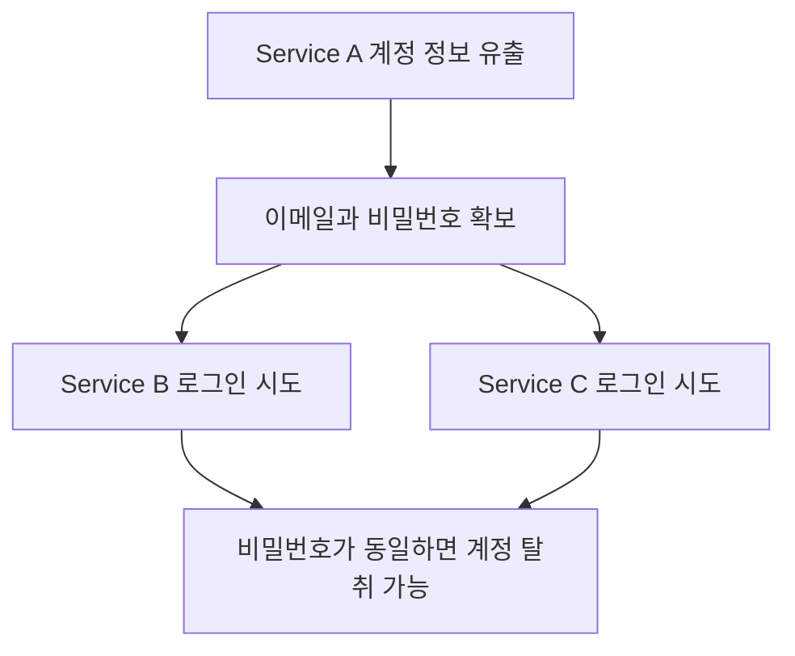

비밀번호가 복잡하더라도 여러 서비스에서 재사용하면 이러한 공격에 노출될 수 있다.

패스키는 서비스별로 구분되는 인증 자격 증명을 사용하므로 다른 서비스에 동일한 비밀번호를 재사용하는 문제가 발생하지 않는다.

#### 2. 서버의 비밀번호 저장 문제

일반적인 비밀번호 인증에서는 서버가 사용자의 비밀번호를 검증할 수 있어야 한다.

이때 비밀번호 원문을 데이터베이스에 그대로 저장해서는 안 된다.

일반적으로 다음과 같은 구조를 사용한다.

```text
사용자 비밀번호
        ↓
Password Hashing
        ↓
Salt가 적용된 Password Hash
        ↓
Database 저장
```

예를 들어 서버에서는 다음과 같은 방식으로 비밀번호를 검증할 수 있다.

```java
boolean matches = passwordEncoder.matches(
        rawPassword,
        storedPasswordHash
);
```

여기서 주의할 점이 있다.

**일반적인 HTTPS 비밀번호 로그인에서는 브라우저가 비밀번호를 해시한 뒤 전송하는 것이 아니다.**

보통 비밀번호 원문이 HTTP 요청 본문에 포함되고, TLS가 전송 구간을 암호화한다.

서버는 TLS로 보호된 요청을 받은 뒤 비밀번호를 검증한다.

데이터베이스에는 Argon2id, bcrypt 등 적절한 Password Hashing 알고리즘을 통해 생성한 검증값을 저장한다.

따라서 비밀번호를 안전하게 저장하는 것과 네트워크 전송을 안전하게 보호하는 것은 서로 다른 문제다.

또 Salt를 사용하는 이유는 동일한 비밀번호가 동일한 해시 결과를 갖는 문제를 줄이고 사전 계산 공격에 대응하기 위해서다.

Salt는 비밀번호를 암호화하는 키가 아니며, 비밀번호 자체를 복구할 수 있도록 만드는 값도 아니다.

이러한 방법을 사용하면 원문 비밀번호 유출 위험을 크게 줄일 수 있다.

하지만 데이터베이스에 저장된 Password Hash가 유출되면 공격자가 오프라인에서 비밀번호를 추측하는 공격을 시도할 가능성은 남아 있다.

패스키에서는 서버가 인증을 위한 비밀번호 검증값 대신 공개키를 저장한다.

이것이 중요한 차이점이다.

#### 3. 피싱(Phishing) 문제

비밀번호 인증의 또 다른 문제는 피싱이다.

예를 들어 실제 서비스 주소가 다음과 같다고 가정하자.

```text
https://login.example.com
```

공격자가 다음과 같은 주소로 가짜 로그인 화면을 만든다.

```text
https://login-example-security.com
```

사용자가 주소를 정확하게 확인하지 않고 비밀번호를 입력하면 공격자가 해당 정보를 탈취할 수 있다.

비밀번호가 복잡하더라도 사용자가 직접 입력하는 순간 공격자에게 노출될 수 있다.

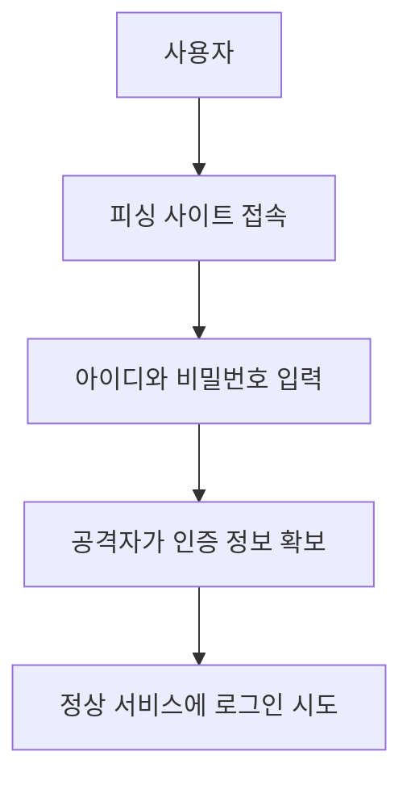

비밀번호 기반 인증은 일반적으로 사용자가 입력하는 비밀값을 기반으로 한다.

따라서 사용자가 비밀번호를 입력하는 사이트의 진위를 판단해야 하는 부담이 존재한다.

패스키는 이러한 문제를 해결하기 위해 **인증 자격 증명을 특정 웹사이트의 식별자에 연결하는 구조**를 사용한다.

---

### 공개키 암호화란 무엇인가?

패스키를 이해하기 위한 첫 번째 핵심 개념은 공개키 암호화다.

공개키 기반 암호 기술에서는 서로 연관된 두 개의 키를 사용한다.

첫 번째는 공개키(Public Key)다.

두 번째는 개인키(Private Key)다.

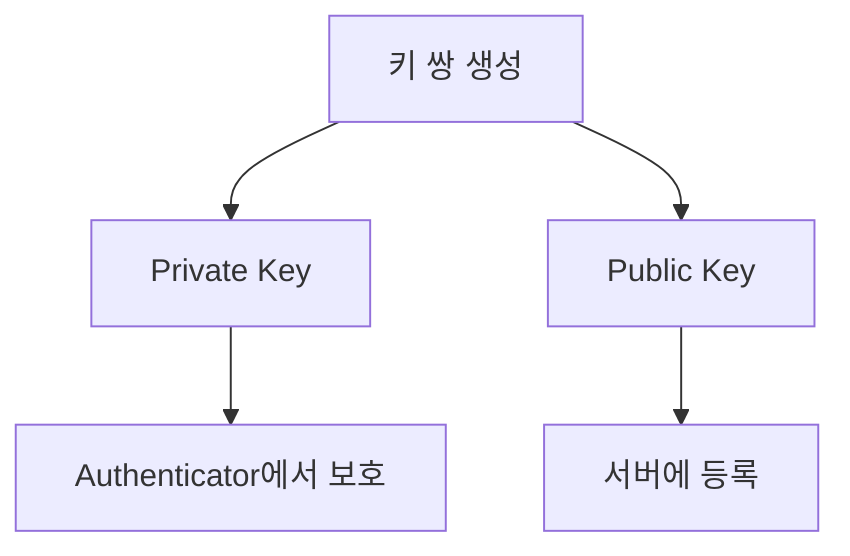

공개키와 개인키는 서로 수학적으로 연결되어 있다.

하지만 공개키만 알고 있다고 해서 개인키를 실용적으로 계산할 수 있어서는 안 된다.

패스키에서는 일반적으로 다음과 같이 사용한다.

| 키 | 보관 위치 | 역할 |
|---|---|---|
| Private Key | Authenticator 또는 패스키 제공자의 보호 영역 | 전자서명 생성 |
| Public Key | 서비스 서버 | 전자서명 검증 |

여기서 중요한 점은 개인키를 서버에 전달하지 않는다는 것이다.

서버는 공개키를 사용해 사용자가 올바른 개인키를 보유하고 있는지 검증한다.

이러한 방식은 사용자가 비밀번호라는 공유 비밀값을 서버에 전달하는 구조와 다르다.

---

### 공개키 암호화와 전자서명은 무엇이 다를까?

공개키 암호화를 설명할 때 자주 발생하는 혼동이 있다.

개인키로 데이터를 암호화하고 공개키로 복호화하는 방식이 곧 전자서명이라는 설명이다.

하지만 실제 전자서명 알고리즘은 단순히 암호화 방향을 바꾸는 것으로 이해하면 정확하지 않다.

전자서명(Digital Signature)의 목적은 다음과 같다.

**특정 개인키를 보유한 주체가 해당 데이터에 대해 유효한 서명을 생성했는지 검증하는 것이다.**

개념적으로 다음과 같은 과정을 거친다.

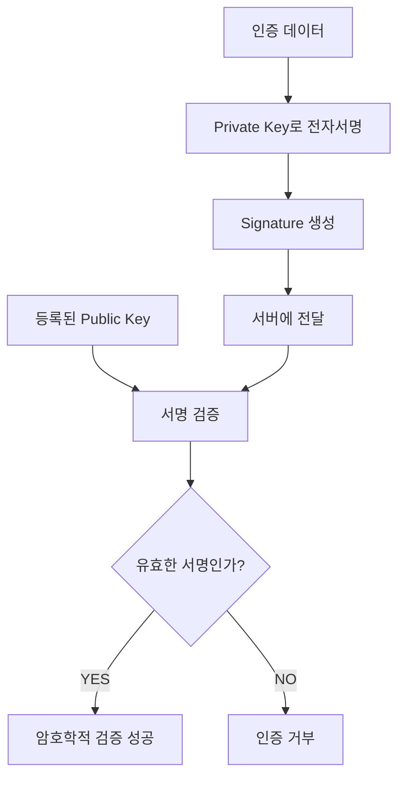

여기서 전자서명은 인증 데이터의 내용을 숨기는 것이 아니다.

서명이 해당 개인키에 의해 생성되었는지 검증하는 역할을 한다.

따라서 다음처럼 구분해야 한다.

| 구분 | 암호화 | 전자서명 |
|---|---|---|
| 주요 목적 | 데이터 기밀성 | 무결성과 서명자 검증 |
| 핵심 질문 | 내용을 읽을 수 있는가? | 올바른 키로 서명했는가? |
| 패스키에서의 역할 | 전송 보호 등에 별도 사용 | 로그인 인증의 핵심 |
| 서버의 주요 작업 | 복호화가 필요한 경우 복호화 | 공개키로 서명 검증 |

패스키 인증에서는 개인키를 이용한 전자서명이 중요한 역할을 한다.

---

### 공개키만 저장하면 왜 안전할까?

기존 비밀번호 인증에서는 서버가 비밀번호를 검증할 수 있는 값을 보관한다.

패스키에서는 서버가 개인키를 보관하지 않는다.

대신 공개키를 저장한다.

예를 들어 다음과 같은 데이터가 있다고 가정하자.

```text
User ID: 100

Credential ID: credential-abc123

Public Key: 등록된 공개키
```

공격자가 서버의 사용자 인증 데이터베이스를 탈취했다고 가정해 보자.

공격자는 Credential ID와 공개키를 확보할 수 있다.

하지만 공개키는 전자서명을 검증하는 데 사용된다.

개인키가 없다면 새로운 인증 요청에 대한 유효한 서명을 생성할 수 없다.

따라서 공개키 데이터베이스의 유출만으로 사용자의 패스키 로그인을 위조하기는 어렵다.

다만 이것이 서버의 모든 보안 문제가 해결된다는 의미는 아니다.

공격자가 서버의 인증 처리 로직이나 세션 발급 기능 자체를 장악했다면 다른 방식으로 계정을 탈취할 수 있다.

또 서버에 저장된 사용자 정보와 Credential 메타데이터는 여전히 보호해야 할 대상이다.

**패스키가 제거하는 주요 위험은 서버가 비밀번호라는 공유 비밀값을 보관해야 하는 구조에서 발생하는 위험이다.**

---

### 그런데 공개키 기반 인증만으로 피싱을 막을 수 있을까?

공개키 기반 인증에서는 개인키를 전달하지 않는다.

하지만 이것만으로 모든 피싱 문제를 해결할 수 있는 것은 아니다.

예를 들어 사용자가 어떤 메시지에 서명하는지만 생각해 보자.

```text
Message = "LOGIN"
```

개인키로 다음 메시지에 서명한다.

```text
SIGN("LOGIN")
```

이 서명이 어느 서비스에 사용되는지 구분할 수 없다면 문제가 발생할 수 있다.

공격자가 사용자를 속여 정상 서비스에 제출할 수 있는 형태의 서명을 만들도록 유도할 가능성이 있기 때문이다.

따라서 서명 대상에 대한 맥락이 중요하다.

이 문제를 해결하기 위해 WebAuthn은 웹사이트의 Origin과 RP ID에 인증 자격 증명을 연결한다.

---

### Origin Binding이란 무엇인가?

Origin Binding은 인증 과정이 올바른 웹사이트의 출처(Origin)와 연결되도록 하는 보안 메커니즘이다.

여기서 Origin은 일반적으로 다음 요소로 구성된다.

```text
Scheme + Host + Port
```

예를 들어 다음 주소를 생각해 보자.

```text
https://login.example.com:443
```

Origin은 다음과 같이 정규화해 표현할 수 있다.

```text
https://login.example.com
```

반면 다음 주소는 다른 Origin이다.

```text
https://fake.example.net
```

WebAuthn에서는 브라우저가 현재 웹페이지의 Origin 정보를 인증 데이터에 포함한다.

서버는 전달받은 Origin이 자신이 허용한 Origin인지 확인한다.

다만 WebAuthn이 단순히 도메인 문자열 하나에 서명하는 것은 아니다.

실제로는 `clientDataJSON`과 `authenticatorData`를 사용한다.

이 두 데이터의 역할을 이해해야 Origin Binding의 구조를 정확하게 이해할 수 있다.

---

### WebAuthn에서 Origin과 RP ID는 무엇이 다를까?

WebAuthn에서는 Origin 외에도 RP ID라는 개념을 사용한다.

RP는 Relying Party의 약자다.

Relying Party는 사용자를 인증하는 서비스를 의미한다.

예를 들어 다음과 같은 서비스가 있다고 가정하자.

```text
https://login.example.com
```

이 서비스는 다음과 같은 RP ID를 사용할 수 있다.

```text
example.com
```

Origin과 RP ID는 다음과 같이 구분할 수 있다.

| 구분 | 예시 | 역할 |
|---|---|---|
| Origin | `https://login.example.com` | 인증 요청이 발생한 웹페이지의 출처 |
| RP ID | `example.com` | 인증 자격 증명이 연결된 서비스 식별자 |
| Credential ID | 바이너리 식별자 | 등록된 인증 자격 증명 구분 |
| Public Key | 공개키 | 서버의 전자서명 검증 |

RP ID는 브라우저의 출처와 무관하게 임의의 도메인을 지정할 수 있는 값이 아니다.

브라우저는 요청한 웹사이트가 해당 RP ID를 사용할 수 있는지 검증한다.

예를 들어 `login.example.com`에서 `example.com`을 RP ID로 사용하는 것은 일반적인 규칙에서 허용될 수 있다.

하지만 전혀 관계없는 `attacker.example.net`이 `example.com`의 패스키를 마음대로 사용하도록 요청할 수는 없다.

또 서버는 인증 응답에 포함된 Origin과 RP ID 관련 검증을 수행해야 한다.

이러한 WebAuthn의 도메인 범위 제한이 피싱 방어의 중요한 기반이다.

---

### 피싱 사이트에서는 왜 패스키를 사용할 수 없을까?

다음과 같은 상황을 생각해 보자.

정상 서비스는 다음 주소를 사용한다.

```text
https://shop.example.com
```

공격자는 다음 주소로 피싱 사이트를 만들었다.

```text
https://shop-example-security.com
```

사용자가 피싱 사이트에 접속했다고 가정하자.

공격자가 정상 서비스용 패스키를 사용하도록 유도하더라도 브라우저와 Authenticator는 인증 자격 증명의 RP ID 범위를 확인한다.

피싱 사이트는 정상 서비스의 RP ID에 해당하는 인증 자격 증명을 사용할 수 없다.

또 서버는 인증 응답에 포함된 Origin이 허용된 값인지 검증한다.

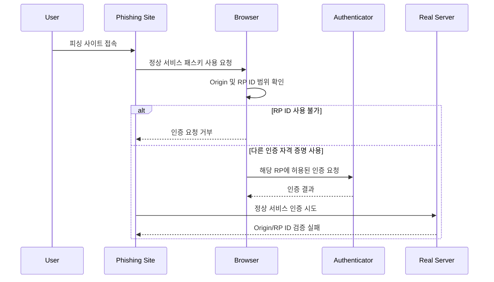

중요한 점은 사용자에게 가짜 사이트인지 구별하라고 요구하는 것이 아니라는 것이다.

**브라우저와 인증 장치가 인증 자격 증명의 사용 범위를 제한하고, 서버가 그 결과를 검증한다.**

이 때문에 패스키는 일반적인 비밀번호 인증보다 피싱에 강한 구조를 가진다.

다만 패스키가 모든 종류의 피싱이나 사기를 방어하는 것은 아니다.

예를 들어 사용자가 이미 인증된 세션에서 악의적인 거래를 승인하도록 속는 공격은 별도로 고려해야 한다.

---

### Replay Attack이란 무엇인가?

공개키 기반 인증과 Origin Binding을 적용했다고 가정하자.

그런데 매번 동일한 메시지에 서명한다면 어떤 문제가 발생할까?

예를 들어 다음과 같은 서명이 있다고 가정하자.

```text
SIGN(
    "LOGIN TO example.com"
)
```

사용자가 해당 서명을 정상적으로 생성했다.

그런데 공격자가 서명 데이터를 탈취했다면 같은 서명을 다시 전송하는 공격을 시도할 수 있다.

이를 Replay Attack이라고 한다.

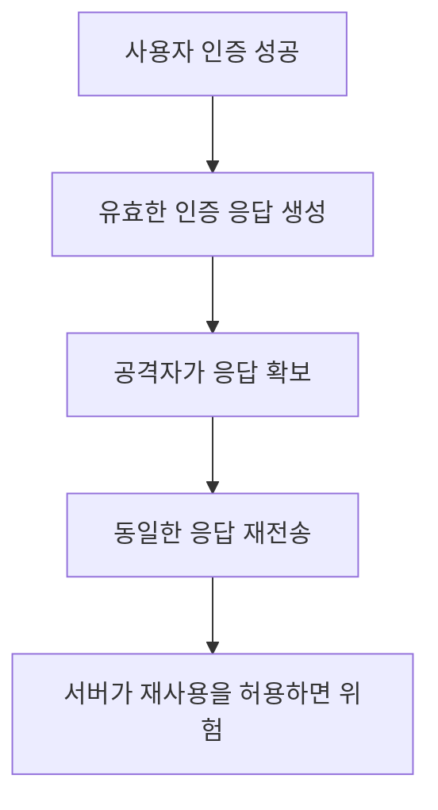

전자서명의 유효성은 데이터가 이전에 사용되었는지를 자동으로 판단해 주지 않는다.

동일한 데이터에 대한 유효한 서명은 여전히 암호학적으로 유효할 수 있기 때문이다.

따라서 인증 요청마다 다른 값을 사용해야 한다.

이를 위해 사용하는 것이 Challenge다.

---

### Challenge-Response 인증이란 무엇인가?

Challenge-Response는 서버가 임의의 값을 생성하고, 클라이언트가 해당 값에 대한 올바른 응답을 제출하도록 하는 인증 방식이다.

패스키에서는 서버가 예측하기 어려운 Challenge를 생성한다.

예를 들어 다음과 같다.

```text
Challenge A = 임의의 바이트 값
```

사용자는 해당 Challenge가 포함된 인증 데이터에 대해 개인키로 서명한다.

서버는 서명을 검증한다.

다음 로그인에서는 새로운 Challenge를 사용한다.

```text
Challenge B = 새로운 임의의 바이트 값
```

Challenge A에 대해 생성된 서명은 Challenge B에 대한 인증에 사용할 수 없다.

따라서 이전 인증 응답을 그대로 재전송해도 서버가 올바르게 검증한다면 인증에 실패한다.

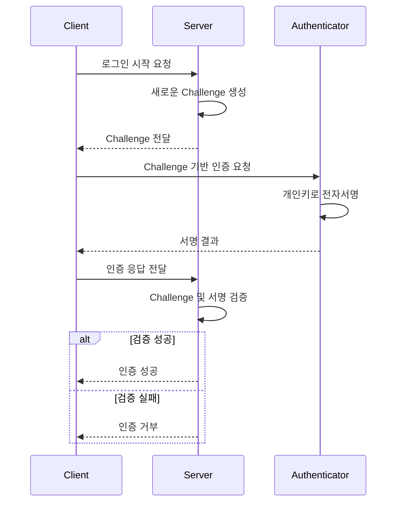

여기서 중요한 것은 Challenge를 단순히 무작위 문자열로 생성하는 데서 끝나지 않는다는 것이다.

서버는 다음 사항을 관리해야 한다.

- 암호학적으로 안전한 난수 사용
- 충분한 Challenge 길이
- 인증 시도별 Challenge 구분
- Challenge 만료 시간
- Challenge와 인증 요청의 연관 관계
- 이전 Challenge의 재사용 방지
- 로그인 시도 완료 후 Challenge 폐기

Challenge를 재사용하거나 검증하지 않으면 Replay Attack에 대한 방어가 약해질 수 있다.

---

### Java에서 안전한 Challenge를 생성하는 방법

Java에서는 `SecureRandom`을 사용해 암호학적으로 안전한 난수를 생성할 수 있다.

다음 예제를 살펴보자.

```java
import java.security.SecureRandom;
import java.util.Base64;

public class ChallengeGenerator {

    private static final SecureRandom SECURE_RANDOM =
            new SecureRandom();

    public static String generate() {

        byte[] challenge = new byte[32];

        SECURE_RANDOM.nextBytes(challenge);

        return Base64.getUrlEncoder()
                .withoutPadding()
                .encodeToString(challenge);
    }

    public static void main(String[] args) {

        System.out.println(generate());

        System.out.println(generate());
    }
}
```

이 코드는 32바이트 길이의 난수를 생성한다.

이후 Base64URL 형식으로 인코딩한다.

Base64URL은 바이너리 데이터를 URL과 JSON 등에서 다루기 편리한 문자열 형태로 표현할 때 사용한다.

실행할 때마다 서로 다른 값이 생성될 수 있다.

```text
1fY7JjB7...생략

R2n1vX5c...생략
```

위 코드는 Challenge 생성 원리를 확인하기 위한 독립적인 예제다.

실제 WebAuthn에서는 Challenge 생성뿐 아니라 인증 요청 저장, 만료, 일회성 사용, 응답 검증까지 하나의 흐름으로 관리해야 한다.

따라서 운영 환경에서는 검증된 WebAuthn 서버 라이브러리를 사용하는 것이 적절하다.

---

### WebAuthn이란 무엇인가?

WebAuthn(Web Authentication)은 브라우저에서 공개키 기반 인증 자격 증명을 생성하고 사용할 수 있도록 정의한 웹 표준이다.

WebAuthn을 통해 웹 애플리케이션은 사용자의 인증 장치에 공개키 기반 인증을 요청할 수 있다.

대표적인 브라우저 API는 다음 두 가지다.

```javascript
navigator.credentials.create()
```

```javascript
navigator.credentials.get()
```

두 API의 역할은 다르다.

| API | 역할 |
|---|---|
| `navigator.credentials.create()` | 새로운 인증 자격 증명 등록 |
| `navigator.credentials.get()` | 기존 인증 자격 증명으로 인증 |

새로운 패스키를 등록할 때는 `create()`를 사용한다.

로그인할 때는 `get()`을 사용한다.

두 API 모두 서버가 제공하는 옵션을 기반으로 동작한다.

브라우저는 플랫폼 인증 장치나 외부 보안 키 등과 통신하고 그 결과를 웹 애플리케이션에 반환한다.

WebAuthn의 등록 및 인증 과정은 W3C 표준으로 정의되어 있다.

---

### FIDO2와 WebAuthn은 어떤 관계일까?

FIDO2는 비밀번호 없는 강력한 인증을 지원하는 기술 체계다.

대표적으로 WebAuthn과 CTAP가 관련된다.

#### WebAuthn

웹 애플리케이션과 브라우저가 공개키 인증 기능을 사용하는 방법을 정의한다.

#### CTAP

Client to Authenticator Protocol의 약자다.

클라이언트 플랫폼과 인증 장치 사이의 통신을 정의한다.

전체 구조는 다음과 같다.


여기서 Authenticator는 실제 인증 자격 증명을 생성하거나 사용하는 구성 요소다.

예를 들어 다음과 같은 장치가 Authenticator 역할을 수행할 수 있다.

- 스마트폰
- 노트북의 플랫폼 인증 장치
- 운영체제와 연결된 패스키 제공자
- USB 보안 키
- NFC 또는 BLE 기반 보안 장치

WebAuthn은 웹사이트가 이러한 인증 장치의 기능을 사용할 수 있도록 연결하는 표준이다.

CTAP는 클라이언트와 외부 또는 연결된 Authenticator 사이의 통신을 담당한다.

---

### WebAuthn의 핵심 구성 요소

WebAuthn을 제대로 이해하려면 각 구성 요소의 책임을 구분해야 한다.

| 구성 요소 | 역할 |
|---|---|
| User | 인증을 수행하는 사용자 |
| Relying Party(RP) | 사용자를 인증하는 서비스 |
| Browser | WebAuthn API 제공 및 Origin 확인 |
| Authenticator | 키 생성과 개인키 사용 |
| Credential ID | 인증 자격 증명 식별 |
| Private Key | 전자서명 생성 |
| Public Key | 서버의 서명 검증 |
| Challenge | 인증 요청별 임의값 |
| Origin | 인증 요청이 발생한 웹 출처 |
| RP ID | 인증 자격 증명이 연결된 서비스 식별자 |

이러한 구성 요소가 협력해 안전한 인증 절차를 수행한다.

---

### 패스키 등록 과정은 어떻게 동작할까?

패스키를 사용하려면 먼저 사용자의 계정에 인증 자격 증명을 등록해야 한다.

등록 과정은 일반적으로 다음 순서로 진행된다.

1. 사용자가 패스키 등록을 요청한다.
2. 서버가 등록용 Challenge와 옵션을 생성한다.
3. 브라우저가 Authenticator에 키 생성을 요청한다.
4. Authenticator가 공개키와 개인키의 쌍을 생성한다.
5. 개인키는 Authenticator가 보호한다.
6. 브라우저가 Credential ID와 공개키 관련 데이터를 서버에 전달한다.
7. 서버가 등록 응답을 검증한다.
8. 검증에 성공하면 사용자의 계정에 Credential을 저장한다.

이 과정을 구조로 표현하면 다음과 같다.

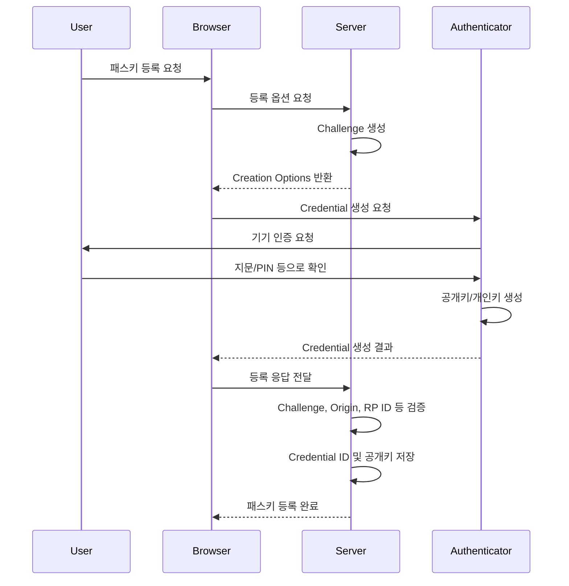

여기서 핵심은 개인키의 위치다.

서버는 개인키를 전달받지 않는다.

서버는 공개키와 Credential 정보를 저장한다.

개인키는 Authenticator 또는 패스키 제공자가 보호한다.

---

### 패스키 등록 옵션에는 어떤 데이터가 포함될까?

등록을 시작할 때 서버는 `PublicKeyCredentialCreationOptions`를 생성한다.

대표적인 구조는 다음과 같다.

```json
{
  "rp": {
    "id": "example.com",
    "name": "Example Service"
  },
  "user": {
    "id": "dXNlci0xMDA",
    "name": "user@example.com",
    "displayName": "홍길동"
  },
  "challenge": "서버가_생성한_Base64URL_Challenge",
  "pubKeyCredParams": [
    {
      "type": "public-key",
      "alg": -7
    },
    {
      "type": "public-key",
      "alg": -257
    }
  ],
  "timeout": 60000,
  "authenticatorSelection": {
    "residentKey": "required",
    "userVerification": "required"
  },
  "attestation": "none"
}
```

위 JSON은 주요 필드를 이해하기 위한 예시다.

실제 Challenge와 User ID는 적절한 바이너리 값이어야 하며 브라우저 API에서 요구하는 형식으로 전달해야 한다.

각 필드의 의미는 다음과 같다.

| 필드 | 의미 |
|---|---|
| `rp.id` | 인증 자격 증명을 연결할 RP ID |
| `rp.name` | 사용자에게 표시할 서비스 이름 |
| `user.id` | 사용자를 구분하는 안정적인 바이너리 식별자 |
| `user.name` | 계정 식별에 사용하는 이름 |
| `user.displayName` | 사용자에게 표시할 이름 |
| `challenge` | 서버에서 생성한 일회성 값 |
| `pubKeyCredParams` | 허용하는 공개키 알고리즘 |
| `timeout` | 브라우저에 전달하는 인증 요청 시간 힌트 |
| `residentKey` | Discoverable Credential 요구 수준 |
| `userVerification` | 사용자 확인 요구 수준 |
| `attestation` | 인증 장치의 출처 증명 요구 수준 |

`pubKeyCredParams`에 등장하는 `-7`은 일반적으로 ES256을 의미한다.

`-257`은 RS256을 의미한다.

어떤 알고리즘을 사용할 수 있는지는 Authenticator의 지원 범위와 서비스의 정책에 따라 달라진다.

또 패스키 등록에서는 사용자 이름을 입력하지 않고도 로그인할 수 있도록 Discoverable Credential을 활용하는 경우가 많다.

이를 위해 `residentKey` 설정이 중요하다.

---

### Discoverable Credential이란 무엇인가?

Discoverable Credential은 서버가 특정 Credential ID를 미리 전달하지 않더라도 Authenticator가 해당 서비스에 사용할 수 있는 인증 자격 증명을 찾을 수 있도록 하는 방식이다.

예를 들어 사용자가 로그인 페이지에 접속했다고 가정하자.

```text
https://example.com/login
```

브라우저는 해당 서비스에 사용할 수 있는 패스키를 찾는다.

사용자는 저장된 계정을 선택한다.

```text
홍길동

user@example.com
```

이후 기기 인증을 수행한다.

이러한 사용자 경험은 Discoverable Credential을 통해 구현할 수 있다.

반면 서버가 특정 사용자를 먼저 식별하고 해당 사용자의 Credential ID 목록을 전달하는 방식도 존재한다.

이를 비교하면 다음과 같다.

| 구분 | 사용자 식별 방식 |
|---|---|
| Username-first | 사용자를 먼저 식별한 뒤 Credential ID 전달 |
| Usernameless | Discoverable Credential로 계정 선택 |
| Conditional UI | 로그인 입력창의 자동완성 UI에서 패스키 선택 |

패스키는 사용자가 아이디를 먼저 입력하지 않고 로그인하는 경험을 제공할 수 있다.

하지만 모든 WebAuthn 인증이 반드시 Usernameless 방식으로 동작해야 하는 것은 아니다.

서비스의 사용자 경험과 인증 정책에 따라 적절한 방식을 선택할 수 있다.

---

### 패스키 로그인 과정은 어떻게 동작할까?

등록된 패스키로 로그인할 때는 새로운 키를 생성하지 않는다.

이미 등록된 개인키를 이용해 인증 요청에 서명한다.

로그인 과정은 다음과 같다.

1. 사용자가 로그인을 요청한다.
2. 서버가 새로운 Challenge를 생성한다.
3. 서버가 RP ID와 인증 옵션을 전달한다.
4. 브라우저가 사용할 패스키를 찾는다.
5. 사용자가 지문·얼굴·PIN 등으로 인증한다.
6. Authenticator가 개인키로 서명을 생성한다.
7. 브라우저가 서명과 인증 데이터를 서버에 전달한다.
8. 서버가 저장된 공개키로 서명을 검증한다.
9. 검증에 성공하면 로그인 세션 등을 생성한다.

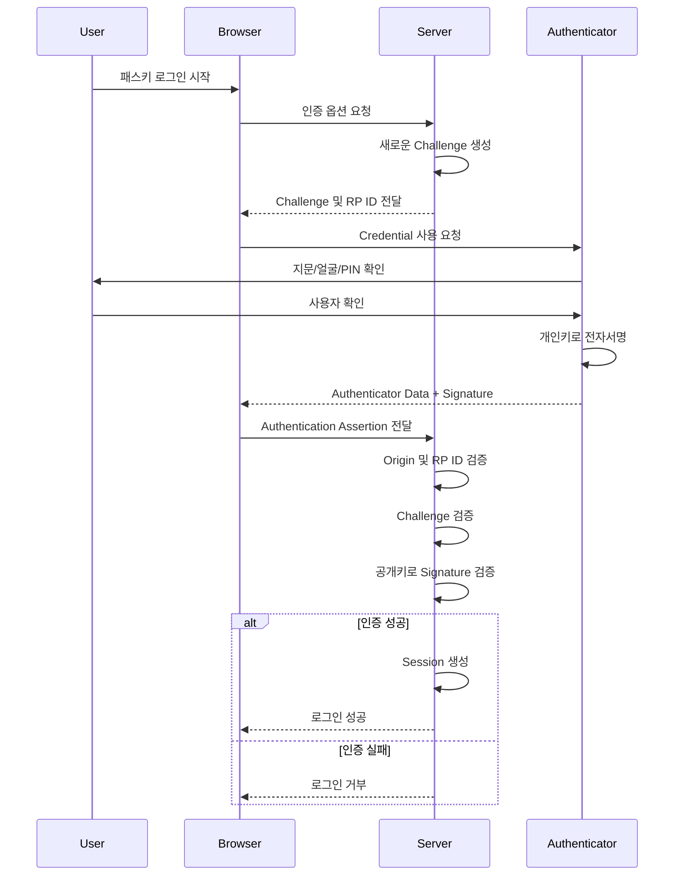

이 구조에서는 매번 새로운 Challenge를 사용한다.

따라서 이전 로그인에서 생성한 인증 응답을 그대로 재사용할 수 없다.

또 Origin과 RP ID 검증을 통해 다른 사이트에서 생성한 인증 응답을 정상 서비스에 제출하는 공격을 방어한다.

---

### WebAuthn은 실제로 어떤 데이터에 서명할까?

패스키의 내부 동작을 이해할 때 가장 중요한 부분이다.

WebAuthn은 단순히 Challenge 문자열이나 도메인 주소에 직접 서명하는 구조가 아니다.

인증 과정에서는 대표적으로 두 개의 데이터가 등장한다.

첫 번째는 `clientDataJSON`이다.

두 번째는 `authenticatorData`다.

#### clientDataJSON

브라우저에서 생성하는 인증 관련 데이터다.

개념적으로 다음 정보를 포함한다.

```json
{
  "type": "webauthn.get",
  "challenge": "서버가_전달한_Challenge",
  "origin": "https://example.com",
  "crossOrigin": false
}
```

여기서 중요한 정보는 세 가지다.

`type`은 어떤 인증 작업을 수행했는지 나타낸다.

로그인에서는 일반적으로 `webauthn.get`을 사용한다.

`challenge`는 서버가 생성한 인증 요청별 임의값이다.

`origin`은 인증 요청이 발생한 웹페이지의 출처다.

따라서 이 데이터는 다음 질문에 대한 답을 포함한다.

**어떤 웹사이트에서 어떤 인증 요청을 수행했는가?**

#### authenticatorData

Authenticator가 생성하는 바이너리 데이터다.

대표적으로 다음과 같은 정보를 포함한다.

```text
rpIdHash

flags

signCount

추가 인증 장치 데이터
```

각 항목의 의미는 다음과 같다.

| 항목 | 의미 |
|---|---|
| `rpIdHash` | RP ID의 SHA-256 해시 |
| `flags` | User Presence, User Verification 등의 상태 |
| `signCount` | 인증 장치의 서명 카운터 정보 |
| 추가 데이터 | 확장 정보 등 |

여기서 `rpIdHash`가 중요하다.

서버는 Authenticator가 어떤 RP ID를 대상으로 인증 작업을 수행했는지 확인할 수 있다.

---

### 전자서명은 어떻게 생성될까?

WebAuthn 인증에서 서명 대상 데이터는 개념적으로 다음과 같이 구성된다.

```text
clientDataHash = SHA256(clientDataJSON)

signedData =
    authenticatorData || clientDataHash

signature =
    SIGN(privateKey, signedData)
```

여기서 `||`는 두 바이트 배열을 연결하는 연산을 의미한다.

즉 서버에서 전달한 Challenge가 포함된 `clientDataJSON`의 해시와 Authenticator가 생성한 데이터를 결합한다.

이 결합된 데이터에 대해 개인키로 서명을 생성한다.

구조는 다음과 같다.

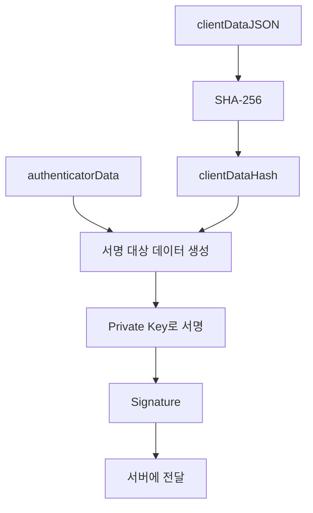

서버는 같은 방식으로 서명 대상 데이터를 구성한다.

그리고 사용자의 Credential에 등록된 공개키로 Signature를 검증한다.

이때 서버는 단순히 서명이 유효한지만 확인해서는 안 된다.

Origin과 RP ID, Challenge, 사용자 확인 상태 등을 모두 검증해야 한다.

이러한 검증 절차는 WebAuthn 표준에서 정의되어 있다.

---

### 서버에서는 무엇을 검증해야 할까?

패스키 인증에서 서버는 단순한 공개키 검증 이상의 작업을 수행한다.

대표적인 검증 항목을 살펴보자.

| 검증 항목 | 목적 |
|---|---|
| Credential ID | 등록된 인증 자격 증명인지 확인 |
| Credential 소유자 | 올바른 사용자 계정과 연결되어 있는지 확인 |
| `type` | 올바른 WebAuthn 작업인지 확인 |
| Challenge | 현재 인증 요청에 대한 응답인지 확인 |
| Origin | 허용된 웹사이트에서 생성한 응답인지 확인 |
| RP ID Hash | 올바른 RP에 연결된 Credential인지 확인 |
| User Presence | 사용자의 인증 참여 여부 확인 |
| User Verification | 요구된 사용자 확인이 수행되었는지 확인 |
| Signature | 등록된 공개키로 서명을 검증 |
| Sign Counter | 복제 의심 등 위험 신호 확인 |
| Challenge 상태 | 만료되거나 이미 사용된 값인지 확인 |

예를 들어 서버가 생성한 Challenge가 다음과 같다고 가정하자.

```text
Challenge = A
```

그런데 클라이언트에서 전달된 데이터에는 다음 값이 들어 있다.

```text
Challenge = B
```

서버는 인증을 거부해야 한다.

또 Origin이 다음과 같이 다르면 문제가 된다.

```text
Expected Origin:
https://example.com
```

```text
Received Origin:
https://attacker.example.net
```

서버는 허용된 Origin과 일치하지 않는 인증 응답을 거부해야 한다.

실제 운영에서는 이러한 검증을 직접 구현하기보다 검증된 WebAuthn 라이브러리를 이용하는 것이 안전하다.

암호화 알고리즘뿐 아니라 바이너리 데이터 파싱, CBOR/COSE 처리, 서명 형식, 확장 데이터 등 다양한 세부 규칙을 함께 처리해야 하기 때문이다.

---

### User Presence와 User Verification은 무엇이 다를까?

WebAuthn에는 두 가지 중요한 사용자 확인 개념이 있다.

첫 번째는 User Presence(UP)다.

두 번째는 User Verification(UV)이다.

#### User Presence

사용자가 인증 과정에 참여했다는 사실을 나타낸다.

예를 들어 보안 키의 버튼을 누르는 동작 등이 해당할 수 있다.

#### User Verification

Authenticator가 사용자의 신원을 확인했음을 나타낸다.

예를 들어 다음과 같은 방법이 사용될 수 있다.

- 지문 확인
- 얼굴 확인
- PIN 확인
- 기기 잠금 인증

두 개념을 비교하면 다음과 같다.

| 구분 | User Presence | User Verification |
|---|---|---|
| 핵심 질문 | 사용자가 인증에 참여했는가? | 사용자가 적절히 확인되었는가? |
| 예시 | 보안 키 터치 | 지문, 얼굴, PIN |
| WebAuthn Flag | UP | UV |
| 역할 | 사용자 참여 확인 | 추가적인 사용자 검증 |

서비스에서 User Verification을 필수로 요구한다면 인증 옵션에 다음과 같이 설정할 수 있다.

```json
{
  "userVerification": "required"
}
```

이 경우 서버도 인증 응답에서 UV 상태를 확인해야 한다.

단순히 클라이언트에 `required`를 전달했다는 사실만으로 검증이 끝나는 것은 아니다.

---

### 지문과 얼굴 정보는 서버로 전송될까?

패스키에서 자주 발생하는 오해 중 하나다.

패스키 로그인에서 지문이나 얼굴 정보가 서버에 전송되는 것은 아니다.

일반적인 사용자 확인 과정은 기기 내부에서 수행된다.

예를 들어 스마트폰에서 얼굴 인증을 수행했다고 가정하자.

```text
사용자 얼굴 인식
        ↓
기기 내부에서 사용자 확인
        ↓
개인키 사용 허용
        ↓
전자서명 생성
        ↓
서버에 서명과 인증 데이터 전달
```

서버는 사용자의 얼굴 이미지를 받지 않는다.

대신 WebAuthn 인증 응답에 포함된 UV Flag 등을 통해 사용자가 기기에서 적절하게 확인되었는지 검증한다.

따라서 다음과 같은 차이가 존재한다.

| 항목 | 패스키 |
|---|---|
| 지문 이미지 서버 전송 | 일반적으로 하지 않음 |
| 얼굴 이미지 서버 전송 | 일반적으로 하지 않음 |
| 개인키 서버 전송 | 하지 않음 |
| 공개키 서버 저장 | 수행 |
| 전자서명 서버 전달 | 수행 |
| 사용자 확인 상태 서버 검증 | 수행 |

이 구조는 생체정보를 서버에 직접 수집하고 저장해야 하는 부담을 줄여준다.

---

### 패스키와 WebAuthn은 완전히 같은 개념일까?

두 용어는 밀접하게 관련되어 있지만 완전히 동일하지는 않다.

WebAuthn은 웹에서 공개키 기반 인증을 수행하기 위한 표준이다.

패스키는 이러한 기술을 기반으로 사용자 친화적인 비밀번호 없는 인증 경험을 제공하는 인증 자격 증명이다.

WebAuthn은 패스키 이외에도 다양한 인증 구성에 사용될 수 있다.

예를 들어 기존 비밀번호 로그인 이후 보안 키를 추가 인증 수단으로 사용하는 방식도 가능하다.

반면 패스키는 일반적으로 비밀번호 없이 로그인하는 경험을 제공하는 데 초점을 맞춘다.

| 구분 | WebAuthn | Passkey |
|---|---|---|
| 개념 | 웹 인증 표준 | 사용자 인증 자격 증명 및 로그인 방식 |
| 핵심 기술 | 공개키 기반 인증 | WebAuthn/FIDO 기반 인증 |
| 사용 목적 | 인증 및 추가 인증 | 주로 비밀번호 없는 인증 |
| 사용 방식 | 브라우저 API | 운영체제·브라우저·패스키 제공자와 통합 |
| 사용자 경험 | 구현에 따라 다름 | 계정 선택 및 기기 인증 중심 |

즉 패스키는 WebAuthn을 사용하지만 WebAuthn이 곧 패스키만을 의미하는 것은 아니다.

---

### 패스키는 왜 다른 기기에서도 사용할 수 있을까?

초기 FIDO 인증 방식에서는 개인키가 특정 장치에 강하게 연결된 형태가 많았다.

이러한 방식은 보안 측면에서 장점이 있지만 사용성에는 제약이 존재한다.

예를 들어 스마트폰에 저장된 인증 자격 증명만 사용할 수 있다면 스마트폰을 분실했을 때 계정 접근이 어려워질 수 있다.

이를 개선하기 위해 동기화 가능한 패스키가 등장했다.

패스키 제공자는 사용자의 인증 자격 증명을 보호된 방식으로 여러 기기에 동기화할 수 있다.

예를 들어 사용자가 스마트폰과 노트북을 사용한다고 가정하자.

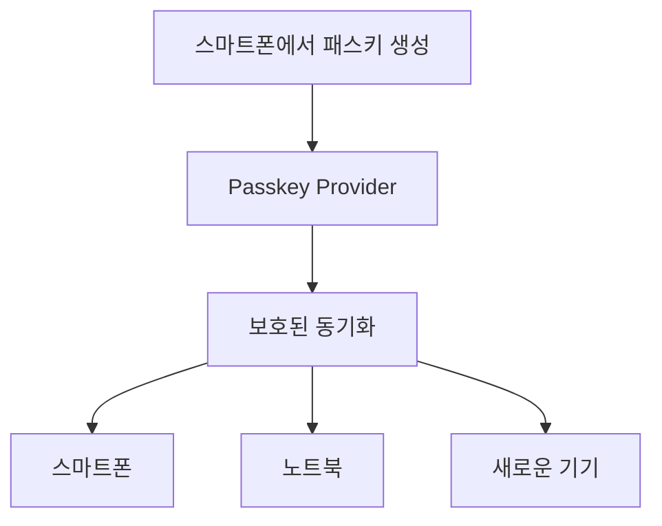

이렇게 하면 새로운 기기에서도 동일한 패스키 제공자 계정을 통해 패스키를 사용할 수 있다.

하지만 **모든 패스키가 반드시 클라우드에 동기화되는 것은 아니다.**

패스키에는 크게 다음과 같은 형태가 존재한다.

#### Synced Passkey

지원되는 패스키 제공자를 통해 여러 기기에 동기화될 수 있는 인증 자격 증명이다.

#### Device-Bound Passkey

특정 장치 또는 보안 키에 연결되어 사용되는 인증 자격 증명이다.

일반적으로 다른 기기로 개인키가 동기화되지 않는다.

두 방식을 비교하면 다음과 같다.

| 구분 | Synced Passkey | Device-Bound Passkey |
|---|---|---|
| 주요 특징 | 여러 기기에서 사용 가능 | 특정 장치에 연결 |
| 편의성 | 높은 편 | 장치 관리 필요 |
| 기기 교체 | 동기화 및 복구 지원 가능 | 별도 인증 수단 필요할 수 있음 |
| 주요 고려사항 | 패스키 제공자 계정의 보안 | 장치 분실과 복구 |
| 활용 | 일반 사용자 서비스 | 높은 보안 요구사항이 있는 환경 |

따라서 패스키를 설계할 때는 동기화 여부를 일률적으로 가정해서는 안 된다.

또 WebAuthn 인증 데이터에는 백업 가능 여부와 백업 상태를 나타내는 정보가 포함될 수 있다.

이를 BE(Backup Eligibility), BS(Backup State) Flag라고 한다.

---

### Cross-Device Authentication이란 무엇인가?

Cross-Device Authentication(CDA)은 다른 기기에 저장된 패스키를 사용해 현재 기기에서 로그인하는 방식이다.

예를 들어 다음과 같은 상황을 생각해 보자.

```text
PC: Windows

스마트폰: iPhone

패스키 저장 위치: iPhone
```

사용자는 Windows PC에서 웹사이트에 로그인하려고 한다.

하지만 PC에는 해당 서비스의 패스키가 저장되어 있지 않다.

이때 스마트폰에 저장된 패스키를 사용할 수 있다.

일반적인 흐름은 다음과 같다.

```text
Windows PC에서 로그인 요청
        ↓
다른 기기의 패스키 사용 선택
        ↓
QR 코드 표시
        ↓
iPhone으로 QR 코드 스캔
        ↓
기기 간 근접성 확인
        ↓
iPhone에서 Face ID 또는 PIN 확인
        ↓
iPhone의 패스키로 인증
        ↓
PC에서 로그인 완료
```

구조는 다음과 같다.

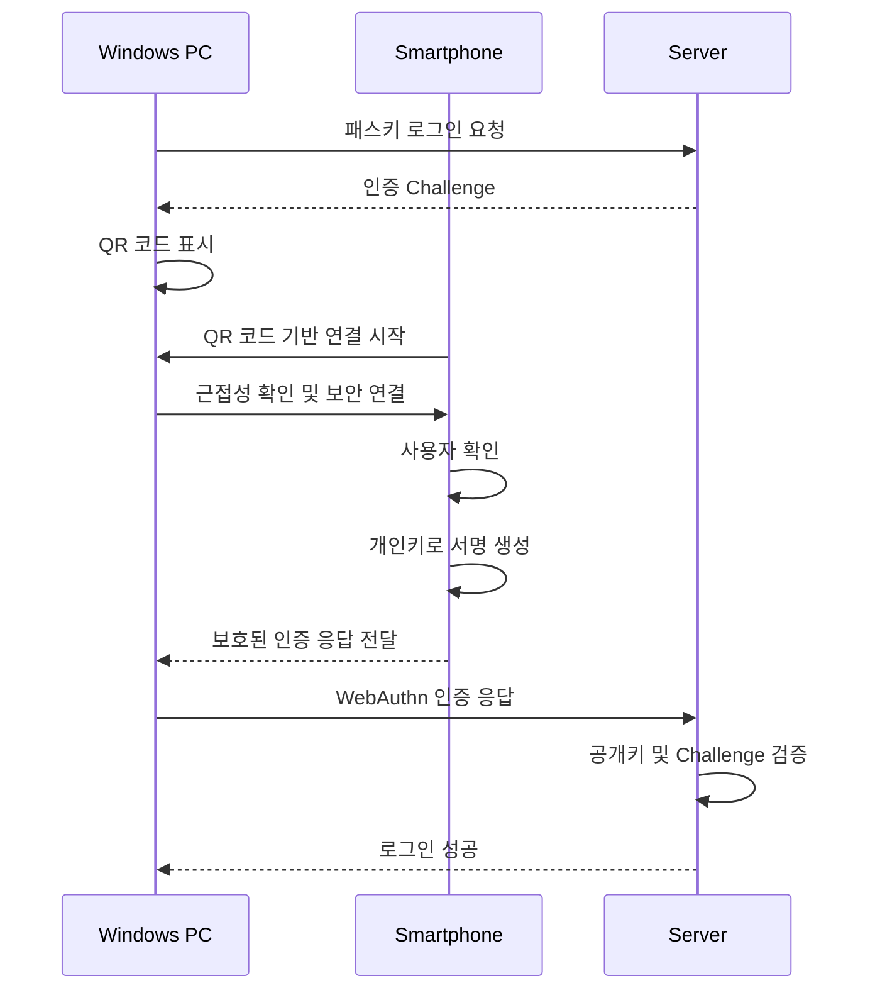

여기서 Bluetooth Low Energy(BLE)가 사용될 수 있다.

하지만 BLE의 역할을 정확히 이해해야 한다.

**BLE는 기기 사이의 물리적 근접성을 확인하는 데 중요한 역할을 하며, 개인키 자체를 Bluetooth로 전달하는 구조가 아니다.**

기기 간 인증은 별도의 암호학적 보호 메커니즘을 사용한다.

FIDO Alliance는 이러한 Cross-Device Authentication을 CTAP의 Hybrid Transport와 연관된 기능으로 설명한다.

---

### 패스키와 기존 인증 방식을 비교해 보자

패스키는 기존 비밀번호 인증보다 여러 측면에서 장점을 가진다.

하지만 모든 상황에서 기존 인증보다 무조건 단순하다고 볼 수는 없다.

| 비교 항목 | 비밀번호 인증 | Passkey |
|---|---|---|
| 사용자 입력 | 비밀번호 | 기기 인증 |
| 서버 저장 | Password Hash | Public Key |
| 사용자 비밀값 전송 | 비밀번호가 TLS로 보호되어 전송 | 개인키를 전송하지 않음 |
| 비밀번호 재사용 공격 | 위험 존재 | 동일한 공유 비밀번호가 없음 |
| 일반적인 피싱 공격 | 취약할 수 있음 | RP ID 및 Origin 기반 방어 |
| Replay Attack | 인증 방식에 따라 방어 필요 | Challenge 기반 방어 |
| 기기 분실 | 비밀번호를 기억하면 로그인 가능 | 복구 또는 다른 인증 수단 필요 |
| 계정 복구 | 비밀번호 재설정 | 패스키 복구 및 대체 인증 설계 |
| 운영 복잡성 | 비밀번호 정책·재설정 관리 | Credential 생명주기·복구 정책 관리 |

패스키의 주요 장점은 사용자가 비밀번호를 기억하지 않아도 된다는 점이다.

또 서비스마다 서로 다른 인증 자격 증명을 사용하기 때문에 비밀번호 재사용 공격을 줄일 수 있다.

하지만 패스키에서는 계정 복구와 기기 변경을 신중하게 설계해야 한다.

특히 높은 보안이 필요한 서비스에서는 등록된 패스키를 누가, 어떤 조건에서 추가하거나 삭제할 수 있는지가 중요하다.

---

### 예제

### 브라우저에서 WebAuthn을 사용하는 방법

이제 WebAuthn API를 이용한 기본적인 등록 및 로그인 흐름을 살펴보자.

여기서는 브라우저가 서버에서 등록 옵션과 인증 옵션을 전달받는 구조를 가정한다.

#### 패스키 등록

먼저 서버에서 등록 옵션을 가져온다.

```javascript
const response = await fetch(
    "/api/passkeys/register/options",
    {
        method: "POST",
        credentials: "same-origin"
    }
);

if (!response.ok) {
    throw new Error("패스키 등록 옵션 조회 실패");
}

const options = await response.json();
```

서버는 RP 정보와 사용자 정보, Challenge 등을 반환한다.

이제 반환된 데이터를 WebAuthn API에서 사용할 수 있는 형태로 변환해야 한다.

WebAuthn API의 일부 필드는 문자열이 아니라 바이너리 값을 요구한다.

이를 위해 Base64URL 디코딩이 필요하다.

현대적인 브라우저에서는 다음 API를 사용할 수 있다.

```javascript
const publicKeyOptions =
    PublicKeyCredential.parseCreationOptionsFromJSON(
        options
    );
```

이 메서드는 WebAuthn JSON 형식의 옵션을 API에서 사용할 수 있는 형태로 변환한다.

이제 인증 자격 증명을 생성한다.

```javascript
const credential = await navigator.credentials.create({
    publicKey: publicKeyOptions
});
```

브라우저는 적절한 Authenticator를 선택한다.

사용자는 기기의 지문, 얼굴, PIN 등의 방법으로 확인 절차를 수행한다.

이후 Credential 생성 결과를 서버에 전달한다.

```javascript
const result = await fetch(
    "/api/passkeys/register/verify",
    {
        method: "POST",
        headers: {
            "Content-Type": "application/json"
        },
        credentials: "same-origin",
        body: JSON.stringify(
            credential.toJSON()
        )
    }
);

if (!result.ok) {
    throw new Error("패스키 등록 검증 실패");
}
```

여기서 중요한 점은 `toJSON()`이 WebAuthn 응답의 바이너리 값을 JSON 전송에 적합한 형식으로 변환한다는 것이다.

하지만 서버에서 해당 JSON을 받았다고 등록을 즉시 완료해서는 안 된다.

서버는 등록 응답에 포함된 Challenge와 Origin, RP ID, Credential 정보를 검증한 뒤 저장해야 한다.

위 API 경로는 사용자 정의 백엔드를 가정한 예시다.

Spring Security에서 제공하는 기본 WebAuthn Endpoint와는 경로 및 요청 형식이 다를 수 있다.

---

### 패스키 로그인

로그인할 때는 `navigator.credentials.get()`을 사용한다.

먼저 서버에서 인증 옵션을 가져온다.

```javascript
const response = await fetch(
    "/api/passkeys/login/options",
    {
        method: "POST",
        credentials: "same-origin"
    }
);

if (!response.ok) {
    throw new Error("인증 옵션 조회 실패");
}

const options = await response.json();
```

이제 JSON 데이터를 WebAuthn 요청 옵션으로 변환한다.

```javascript
const publicKeyOptions =
    PublicKeyCredential.parseRequestOptionsFromJSON(
        options
    );
```

인증을 요청한다.

```javascript
const credential = await navigator.credentials.get({
    publicKey: publicKeyOptions
});
```

Authenticator는 해당 RP에서 사용할 수 있는 Credential을 찾는다.

사용자 확인을 수행한 뒤 인증 응답을 생성한다.

이제 결과를 서버에 전달한다.

```javascript
const result = await fetch(
    "/api/passkeys/login/verify",
    {
        method: "POST",
        headers: {
            "Content-Type": "application/json"
        },
        credentials: "same-origin",
        body: JSON.stringify(
            credential.toJSON()
        )
    }
);

if (!result.ok) {
    throw new Error("패스키 인증 실패");
}
```

서버는 전자서명과 Challenge, Origin, RP ID 등을 검증한다.

검증에 성공하면 로그인 세션이나 토큰을 발급할 수 있다.

`parseCreationOptionsFromJSON()`, `parseRequestOptionsFromJSON()`, `toJSON()`은 브라우저에서 WebAuthn 데이터를 다루는 데 도움이 되는 API다.

---

### Spring Boot에서 패스키 인증 구현하기

Java 백엔드에서는 WebAuthn 인증 검증을 직접 구현하기보다 Spring Security가 제공하는 기능을 사용할 수 있다.

Spring Security는 WebAuthn 기반 패스키 인증을 지원한다.

Spring Security 6.4부터 관련 기능이 도입되었으며, Spring Security 7 계열에서도 활용할 수 있다.

다만 버전에 따라 필요한 의존성과 API 구성이 달라질 수 있다.

예를 들어 Spring Security 6.5 계열의 문서는 WebAuthn4J 의존성을 안내하고 있으며, Spring Security 7 계열에서는 `spring-security-webauthn` 모듈을 제공한다.

아래 예제는 **Spring Boot 4.1.2와 Spring Security 7 계열**을 기준으로 한다.

#### 1. 프로젝트 의존성 설정

`build.gradle`

```groovy
plugins {
    id 'java'
    id 'org.springframework.boot' version '4.1.2'
}

group = 'com.example'
version = '1.0.0'

java {
    toolchain {
        languageVersion = JavaLanguageVersion.of(17)
    }
}

repositories {
    mavenCentral()
}

dependencies {
    implementation 'org.springframework.boot:spring-boot-starter-webmvc'

    implementation 'org.springframework.boot:spring-boot-starter-security'

    implementation 'org.springframework.security:spring-security-webauthn'

    testImplementation 'org.springframework.boot:spring-boot-starter-test'
}

tasks.named('test') {
    useJUnitPlatform()
}
```

여기서 중요한 의존성은 다음과 같다.

```groovy
implementation 'org.springframework.security:spring-security-webauthn'
```

Spring Security의 WebAuthn 지원 기능을 사용하기 위한 모듈이다.

`spring-boot-starter-security`는 일반적인 인증과 인가 기능을 제공한다.

`spring-boot-starter-webmvc`는 HTTP 요청을 처리할 웹 애플리케이션 구성을 제공한다.

---

### 2. Spring Security 설정

패스키를 사용하기 위해 RP ID와 허용할 Origin을 설정한다.

여기서는 로컬 개발 환경에서 실행한다고 가정하자.

```text
http://localhost:8080
```

`localhost`는 브라우저에서 안전한 개발 컨텍스트로 취급될 수 있으므로 WebAuthn 기능을 테스트할 수 있다.

실제 운영 서비스에서는 HTTPS를 사용해야 한다.

`SecurityConfig.java`

```java
package com.example.passkey;

import org.springframework.context.annotation.Bean;
import org.springframework.context.annotation.Configuration;

import org.springframework.security.config.annotation.web.builders.HttpSecurity;
import org.springframework.security.web.SecurityFilterChain;

import org.springframework.security.core.userdetails.User;
import org.springframework.security.core.userdetails.UserDetails;
import org.springframework.security.core.userdetails.UserDetailsService;
import org.springframework.security.provisioning.InMemoryUserDetailsManager;

import static org.springframework.security.config.Customizer.withDefaults;

@Configuration
public class SecurityConfig {

    @Bean
    public SecurityFilterChain securityFilterChain(
            HttpSecurity http
    ) throws Exception {

        http
                .authorizeHttpRequests(authorize -> authorize
                        .requestMatchers("/", "/error").permitAll()
                        .anyRequest().authenticated()
                )

                .formLogin(withDefaults())

                .webAuthn(webAuthn -> webAuthn
                        .rpId("localhost")
                        .allowedOrigins("http://localhost:8080")
                );

        return http.build();
    }

    @Bean
    public UserDetailsService userDetailsService() {

        UserDetails user = User.withUsername("demo")
                .password("{noop}demo-password")
                .roles("USER")
                .build();

        return new InMemoryUserDetailsManager(user);
    }
}
```

위 코드는 기본적인 패스키 등록과 로그인 흐름을 확인하기 위한 개발 환경 예제다.

사용자 정보는 메모리에 저장한다.

또 예제의 `{noop}` 비밀번호는 로컬 테스트를 단순화하기 위한 설정으로, 운영 환경에서는 사용해서는 안 된다.

실제 서비스에서는 안전한 Password Encoder와 사용자 저장소를 사용하거나 비밀번호 없는 계정 등록 정책을 별도로 구성해야 한다.

핵심 설정을 살펴보자.

```java
.webAuthn(webAuthn -> webAuthn
        .rpId("localhost")
        .allowedOrigins("http://localhost:8080")
)
```

`rpId()`는 WebAuthn 인증 자격 증명이 연결될 RP ID를 설정한다.

`allowedOrigins()`는 인증 요청이 발생할 수 있는 허용된 Origin을 설정한다.

운영 환경에서는 다음과 같이 구성할 수 있다.

```java
.webAuthn(webAuthn -> webAuthn
        .rpId("example.com")
        .allowedOrigins("https://login.example.com")
)
```

이렇게 하면 인증 서버가 허용할 Origin을 명확하게 정의할 수 있다.

단, 실제 서비스에서 사용하는 Origin과 RP ID의 범위가 WebAuthn 규칙에 맞아야 한다.

---

### 3. 애플리케이션 실행

먼저 애플리케이션 진입점을 작성한다.

`PasskeyApplication.java`

```java
package com.example.passkey;

import org.springframework.boot.SpringApplication;
import org.springframework.boot.autoconfigure.SpringBootApplication;

@SpringBootApplication
public class PasskeyApplication {

    public static void main(String[] args) {

        SpringApplication.run(
                PasskeyApplication.class,
                args
        );
    }
}
```

이제 인증 이후 사용자 정보를 확인할 API를 작성한다.

`ProfileController.java`

```java
package com.example.passkey;

import java.security.Principal;
import java.util.Map;

import org.springframework.web.bind.annotation.GetMapping;
import org.springframework.web.bind.annotation.RestController;

@RestController
public class ProfileController {

    @GetMapping("/")
    public Map<String, String> home() {

        return Map.of(
                "message",
                "Passkey Authentication Example"
        );
    }

    @GetMapping("/api/profile")
    public Map<String, String> profile(
            Principal principal
    ) {

        return Map.of(
                "username",
                principal.getName()
        );
    }
}
```

`/`는 인증 없이 접근할 수 있다.

반면 `/api/profile`은 인증된 사용자만 접근할 수 있다.

이제 애플리케이션을 실행한다.

```bash
./gradlew bootRun
```

브라우저에서 다음 주소에 접속한다.

```text
http://localhost:8080/login
```

개발용 계정으로 로그인한다.

```text
Username: demo

Password: demo-password
```

이후 Spring Security가 제공하는 WebAuthn 등록 화면에서 패스키를 등록할 수 있다.

기본 등록 경로는 다음과 같다.

```text
http://localhost:8080/webauthn/register
```

패스키를 등록하면 이후 로그인 과정에서 등록된 패스키를 사용할 수 있다.

실제 화면과 지원되는 인증 방식은 브라우저와 운영체제, 인증 장치에 따라 달라질 수 있다.

---

### Spring Security는 어떤 작업을 대신 처리할까?

WebAuthn을 직접 구현하려면 다음과 같은 기능이 필요하다.

- 등록용 Challenge 생성
- 인증용 Challenge 생성
- Credential 등록 옵션 생성
- 브라우저 응답 데이터 파싱
- Credential ID 검증
- Origin 검증
- RP ID Hash 검증
- 전자서명 검증
- Credential 저장 및 조회
- 인증 성공 후 SecurityContext 구성

Spring Security의 WebAuthn 지원 기능은 이러한 절차를 프레임워크의 인증 처리 흐름에 통합할 수 있도록 한다.

기본적인 등록 과정에서는 다음과 같은 Endpoint를 사용할 수 있다.

```http
POST /webauthn/register/options
```

서버는 등록 옵션을 반환한다.

이후 브라우저에서 새로운 Credential을 생성한다.

```javascript
navigator.credentials.create(...)
```

생성된 인증 자격 증명의 정보를 서버에 등록한다.

```http
POST /webauthn/register
```

로그인할 때는 인증 옵션을 요청하고 다음 API를 사용한다.

```javascript
navigator.credentials.get(...)
```

인증 응답은 Spring Security의 WebAuthn 인증 처리 흐름으로 전달된다.

대표적인 인증 Endpoint는 다음과 같다.

```http
POST /login/webauthn
```

실제 요청 형식은 Spring Security 버전과 기본 UI 사용 여부에 따라 달라질 수 있다.

또 Spring Security의 기본 WebAuthn 흐름에서는 CSRF 보호가 적용되므로 관련 POST 요청에 유효한 CSRF Token이 필요하다.

**WebAuthn을 지원한다는 이유로 Spring Security의 CSRF 보호를 무조건 비활성화해서는 안 된다.**

Spring Security는 등록 옵션 생성과 Credential 등록, 인증 처리에 대한 기본 구현을 제공한다.

---

### 운영 환경에서는 Credential을 어디에 저장해야 할까?

앞선 예제는 동작 원리를 확인하기 위한 구성이다.

운영 환경에서는 패스키의 Credential 정보를 영구 저장소에 보관해야 한다.

예를 들어 다음과 같은 정보를 관리할 수 있다.

| 필드 | 역할 |
|---|---|
| User ID | 사용자 계정 식별 |
| User Handle | WebAuthn 사용자 식별자 |
| Credential ID | 패스키 Credential 식별 |
| Public Key | 서명 검증용 공개키 |
| Signature Counter | 서명 카운터 |
| Credential Label | 사용자가 구분할 이름 |
| Created At | 등록 시각 |
| Last Used At | 마지막 사용 시각 |
| Backup Eligibility | 백업 가능한 Credential 여부 |
| Backup State | 백업 상태 |
| Revoked At | 폐기 시각 |

데이터베이스 구조를 개념적으로 표현하면 다음과 같다.

```sql
CREATE TABLE passkey_credentials (

    id BIGINT GENERATED ALWAYS AS IDENTITY PRIMARY KEY,

    user_id BIGINT NOT NULL,

    credential_id BYTEA NOT NULL,

    public_key BYTEA NOT NULL,

    sign_count BIGINT NOT NULL DEFAULT 0,

    credential_label VARCHAR(100),

    created_at TIMESTAMP NOT NULL,

    last_used_at TIMESTAMP,

    revoked_at TIMESTAMP,

    CONSTRAINT uk_passkey_credential_id
        UNIQUE (credential_id)
);
```

위 SQL은 PostgreSQL에서 Credential 저장 구조를 이해하기 위한 예시다.

Spring Security가 사용하는 실제 Credential Repository 스키마와 동일하다는 의미는 아니다.

실제 저장소 구현에서는 공개키 인코딩 형식과 User Handle, 인증 알고리즘, Credential 메타데이터 등을 추가로 고려해야 한다.

Spring Security에서는 다음 인터페이스를 통해 WebAuthn 관련 데이터를 관리한다.

```text
PublicKeyCredentialUserEntityRepository

UserCredentialRepository
```

또 JDBC 기반 구현도 제공한다.

```text
JdbcPublicKeyCredentialUserEntityRepository

JdbcUserCredentialRepository
```

기본적인 메모리 저장 방식은 애플리케이션 재시작 시 데이터가 사라질 수 있으므로 운영 환경에는 적합하지 않다.

따라서 실제 서비스에서는 데이터베이스 기반 저장소 또는 사용자 정의 Repository를 구성해야 한다.

---

### 구조

### 패스키 인증과 기존 로그인 시스템의 차이

기존 비밀번호 인증에서는 서버가 Password Hash를 검증한다.

패스키에서는 서버가 WebAuthn Authentication Assertion을 검증한다.

두 구조를 비교하면 다음과 같다.

#### 기존 비밀번호 인증

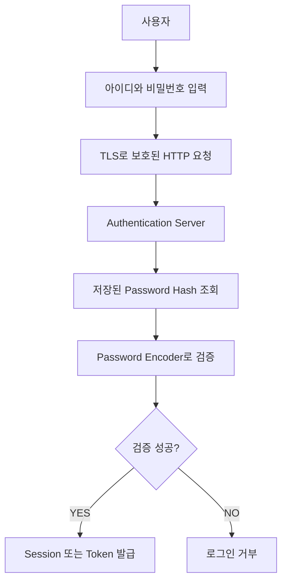

#### 패스키 인증

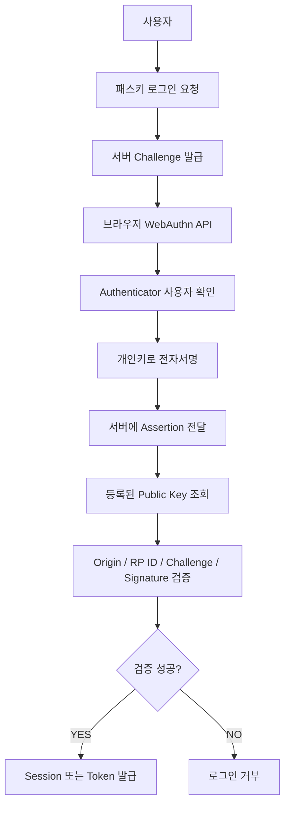

두 방식 모두 최종적으로는 서버에서 사용자를 인증한다.

그리고 인증이 성공하면 Session이나 Token을 발급할 수 있다.

하지만 사용자를 검증하는 과정이 다르다.

비밀번호 인증은 사용자가 알고 있는 비밀값의 일치 여부를 확인한다.

패스키 인증은 개인키를 보유한 인증 장치가 올바른 인증 응답을 생성했는지 확인한다.

이 차이는 인증 시스템의 보안 구조 전체에 영향을 준다.

---

### 패스키와 Session, JWT는 어떤 관계일까?

패스키를 사용하면 Session이나 JWT가 필요 없어질까?

그렇지는 않다.

패스키는 주로 사용자의 최초 인증 또는 재인증에 사용된다.

반면 Session과 JWT는 인증 이후의 요청에서 사용자 상태를 확인하는 데 사용한다.

예를 들어 다음과 같은 구조를 사용할 수 있다.

```text
패스키 인증 성공
        ↓
서버에서 사용자 식별
        ↓
Session 생성
        ↓
Session Cookie 발급
        ↓
이후 요청에서 Session 검증
```

또 다른 구조는 다음과 같다.

```text
패스키 인증 성공
        ↓
서버에서 사용자 식별
        ↓
Access Token 발급
        ↓
Refresh Token 정책 적용
        ↓
이후 요청에서 Token 검증
```

따라서 패스키와 JWT는 서로 대체하는 개념이 아니다.

패스키는 사용자의 신원을 증명하는 인증 수단이다.

JWT는 인증 결과나 권한 정보를 전달하는 데 사용할 수 있는 Token 형식이다.

두 기술을 조합해 사용할 수 있다.

다만 패스키가 피싱에 강하더라도 발급된 Session Cookie나 Access Token이 탈취되면 세션 하이재킹 위험이 존재한다.

따라서 Session과 Token에 대한 보안 정책은 별도로 필요하다.

---

### 실무에서의 활용

### 패스키를 도입할 때 고려해야 할 12가지 설계 전략

패스키는 기존 비밀번호 인증보다 사용자 경험과 보안 측면에서 많은 장점을 제공한다.

하지만 실제 서비스에 적용할 때는 인증 프로토콜 이외의 운영 문제도 고려해야 한다.

#### 1. 기존 비밀번호 로그인과 단계적으로 통합한다

이미 많은 사용자가 비밀번호를 사용하는 서비스라면 패스키로 한 번에 전환하기 어려울 수 있다.

따라서 다음과 같은 단계적 접근을 고려할 수 있다.

```text
1단계

기존 비밀번호 로그인 유지
```

```text
2단계

로그인 이후 패스키 등록 지원
```

```text
3단계

패스키 로그인 우선 제공
```

```text
4단계

사용자별 복구 수단 확인
```

```text
5단계

비밀번호 없는 인증 정책 확대
```

이러한 방식은 사용자에게 패스키 등록을 강제하지 않으면서 새로운 인증 방식으로 전환할 수 있다는 장점이 있다.

다만 비밀번호 로그인이나 복구 경로가 남아 있다면 해당 경로를 이용한 공격 가능성도 계속 존재한다.

따라서 패스키 인증만 강력하게 구성하는 것으로 충분하지 않다.

---

#### 2. 패스키 등록은 인증된 사용자에게만 허용한다

기존 계정에 새로운 패스키를 등록하는 기능은 보안적으로 매우 중요하다.

공격자가 다른 사용자의 계정에 자신의 패스키를 등록할 수 있다면 계정을 지속적으로 탈취할 수 있기 때문이다.

따라서 기존 계정에 패스키를 추가할 때는 적절한 사용자 인증이 필요하다.

예를 들어 다음과 같은 정책을 고려할 수 있다.

```text
기존 사용자 로그인
        ↓
민감 작업 재인증
        ↓
패스키 등록 요청
        ↓
새로운 Credential 생성
        ↓
서버 검증
        ↓
사용자 계정에 Credential 연결
```

특히 새로운 기기 등록이나 인증 수단 변경은 민감한 계정 관리 작업으로 분류하는 것이 좋다.

---

#### 3. 계정당 여러 개의 패스키를 등록할 수 있도록 설계한다

하나의 계정에 패스키가 하나만 등록되어 있다면 해당 인증 수단을 사용할 수 없을 때 문제가 발생할 수 있다.

따라서 사용자가 여러 개의 패스키를 등록할 수 있도록 설계하는 것이 유용하다.

예를 들어 다음과 같다.

```text
사용자 계정

├── iPhone Passkey
├── Windows Passkey
└── Security Key
```

각 Credential은 별도의 식별자를 가진다.

서버는 사용자의 계정에 여러 Credential을 연결할 수 있다.

이러한 구조는 기기 분실이나 교체 상황에 대응하는 데 도움이 된다.

다만 Credential을 여러 개 등록할 수 있다고 해서 계정 복구가 완전히 해결되는 것은 아니다.

모든 인증 수단을 사용할 수 없는 경우를 위한 복구 정책도 필요하다.

---

#### 4. 계정 복구 절차를 패스키만큼 중요하게 설계한다

패스키의 보안성이 높더라도 복구 과정이 취약하면 전체 계정 보안 수준이 낮아질 수 있다.

예를 들어 공격자가 이메일 계정을 탈취했다고 가정하자.

이메일만으로 기존 패스키를 삭제하고 새로운 패스키를 등록할 수 있다면 패스키의 보안 이점이 약해질 수 있다.

따라서 다음과 같은 복구 정책을 검토해야 한다.

- 기존 등록 기기를 통한 재인증
- 별도 복구 코드
- 추가 등록된 인증 수단
- 복구 요청 알림
- 복구 이후 일정 시간의 민감 작업 제한
- 복구 요청에 대한 감사 로그
- 고위험 계정의 강화된 복구 절차

패스키의 개인키는 서버가 복구할 수 있는 일반적인 비밀번호와 다르다.

따라서 패스키 제공자의 동기화 기능과 서비스 자체의 계정 복구 정책을 구분해서 설계해야 한다.

---

#### 5. Challenge는 인증 시도별로 관리한다

서버는 로그인 요청마다 새로운 Challenge를 생성해야 한다.

또 Challenge가 어떤 인증 시도와 연결되어 있는지 관리해야 한다.

예를 들어 Redis를 사용한다면 다음과 같은 데이터를 저장할 수 있다.

```text
Key:

webauthn:challenge:request-123
```

```text
Value:

challenge = 랜덤 바이트 값

createdAt = 생성 시각

expiresAt = 만료 시각

purpose = AUTHENTICATION
```

실제 저장 구조에서는 Challenge와 사용자 또는 인증 시도의 연결을 안전하게 관리해야 한다.

또 인증에 성공한 Challenge는 다시 사용할 수 없어야 한다.

다중 인스턴스 환경에서는 여러 서버가 같은 Challenge 상태를 확인할 수 있도록 공유 저장소를 사용할 수 있다.

하지만 Challenge 저장소가 Redis라고 해서 단순히 읽고 삭제하는 두 작업만 수행하면 경쟁 조건이 완전히 해결되는 것은 아니다.

동일한 Challenge가 동시에 제출되는 상황을 고려해 일회성 소비를 원자적으로 처리하는 전략이 필요할 수 있다.

---

#### 6. Credential ID와 사용자 계정의 연결을 검증한다

WebAuthn 인증 과정에서는 Credential ID가 중요하다.

서버는 Credential ID를 이용해 등록된 공개키를 찾는다.

하지만 Credential ID가 존재한다는 사실만으로 인증을 완료해서는 안 된다.

해당 Credential이 올바른 사용자 계정에 연결되어 있는지 확인해야 한다.

예를 들어 다음과 같은 상황을 생각해 보자.

```text
User A

Credential ID: AAA
```

```text
User B

Credential ID: BBB
```

사용자가 User A로 로그인하려고 하는데 Credential BBB를 제출했다면 계정 연결 관계를 검증해야 한다.

또 Usernameless Login에서는 인증에 성공한 Credential과 User Handle 등을 통해 적절한 사용자 계정을 식별해야 한다.

**인증 자격 증명의 서명 검증과 사용자 계정 식별은 서로 구분해야 하는 작업이다.**

---

#### 7. Signature Counter를 절대적인 인증 기준으로 사용하지 않는다

WebAuthn 인증 데이터에는 `signCount`라는 값이 포함될 수 있다.

이는 Authenticator의 서명 카운터와 관련된 정보다.

일부 인증 장치에서는 이 값을 이용해 인증 자격 증명의 복제 가능성을 탐지하는 데 도움을 받을 수 있다.

하지만 모든 Authenticator가 동일한 방식으로 카운터를 증가시키는 것은 아니다.

특히 동기화 가능한 패스키에서는 카운터가 0이거나 단조 증가한다고 가정하기 어려운 경우가 있다.

따라서 다음과 같이 이해해야 한다.

```text
Signature Counter

= 위험 신호를 판단하기 위한 보조 정보
```

단순히 이전 값보다 작거나 같다는 이유만으로 모든 인증을 무조건 거부하는 정책은 정상 사용자의 로그인까지 방해할 수 있다.

실제 처리 방식은 사용 중인 Authenticator와 서비스의 위험 관리 정책에 따라 결정해야 한다.

WebAuthn 표준도 서명 카운터의 이상 상황을 위험 평가에 활용하도록 설명한다.

---

#### 8. 패스키 삭제 기능을 안전하게 구현한다

사용자는 더 이상 사용하지 않는 기기의 패스키를 삭제할 수 있어야 한다.

예를 들어 스마트폰을 분실했다고 가정하자.

사용자는 등록된 Credential 목록을 확인하고 해당 기기와 관련된 Credential을 삭제할 수 있어야 한다.

```http
DELETE /api/passkeys/{credentialId}
```

다만 이 기능은 민감한 작업이다.

따라서 삭제 요청을 수행하는 사용자가 해당 Credential의 소유자인지 검증해야 한다.

또 중요한 Credential을 삭제하기 전에 재인증을 요구할 수도 있다.

추가로 마지막 인증 수단을 삭제하는 상황을 고려해야 한다.

모든 패스키를 삭제했는데 다른 로그인 수단도 없다면 사용자가 계정에 접근하지 못할 수 있기 때문이다.

따라서 마지막 인증 수단을 삭제할 때는 대체 인증 수단 등록 여부를 확인하는 등의 정책이 필요하다.

---

#### 9. Origin과 RP ID를 환경별로 명확하게 설정한다

개발 환경과 운영 환경에서는 웹사이트의 Origin이 다르다.

예를 들어 다음과 같다.

```text
Local

http://localhost:8080
```

```text
Development

https://dev.example.com
```

```text
Production

https://login.example.com
```

실제 WebAuthn 인증에서는 RP ID와 허용 Origin의 관계를 정확히 설정해야 한다.

또 개발 환경에서 사용하던 설정을 운영 환경에 그대로 적용해서는 안 된다.

특히 Origin 검증을 우회하기 위해 임의의 Origin을 모두 허용하는 방식은 위험하다.

서비스에서 실제로 사용할 수 있는 Origin을 명시적으로 관리해야 한다.

HTTPS와 인증서 설정도 함께 확인해야 한다.

---

#### 10. 인증 실패와 사용자 취소를 구분한다

패스키 인증은 브라우저와 운영체제의 사용자 인터페이스를 포함한다.

따라서 사용자가 인증을 취소할 수도 있다.

또 지원되지 않는 기기에서 요청하거나 사용 가능한 패스키가 존재하지 않을 수도 있다.

대표적인 상황은 다음과 같다.

| 상황 | 처리 방향 |
|---|---|
| 사용자가 인증 취소 | 재시도 또는 다른 로그인 방법 제공 |
| 사용 가능한 Credential 없음 | 다른 기기 또는 인증 방법 안내 |
| Challenge 만료 | 새로운 Challenge 발급 |
| Origin 불일치 | 인증 거부 및 보안 로그 |
| Signature 검증 실패 | 인증 거부 |
| Credential 폐기 상태 | 인증 거부 |
| Authenticator 지원 불가 | 지원되는 인증 수단 제공 |

이러한 상황을 모두 동일한 서버 오류로 처리하면 사용자 경험이 나빠질 수 있다.

따라서 보안 실패와 일반적인 사용자 취소를 구분해 처리해야 한다.

다만 보안에 민감한 내부 원인을 클라이언트에 지나치게 상세하게 노출해서는 안 된다.

---

#### 11. 패스키 인증과 중요한 거래 승인을 구분한다

패스키 인증이 성공했다는 사실은 사용자가 인증 자격 증명을 사용해 신원을 증명했다는 의미다.

하지만 이후의 모든 비즈니스 작업을 자동으로 승인했다는 의미는 아니다.

예를 들어 결제 서비스에서는 로그인 이후 다음과 같은 작업이 발생할 수 있다.

```text
로그인 성공
        ↓
결제 금액 입력
        ↓
결제 요청
        ↓
최종 결제 승인
```

패스키로 로그인했다고 해서 결제 금액이 올바르다는 사실까지 보장되지는 않는다.

또 사용자가 악의적인 화면에 속아 거래를 진행하는 경우도 고려해야 한다.

따라서 결제와 같은 중요한 작업에서는 다음 요소가 필요할 수 있다.

- 거래 금액과 수취인 검증
- 재인증
- 거래 승인 정책
- 이상 거래 탐지
- 멱등성
- 감사 로그

패스키는 안전한 사용자 인증을 위한 강력한 수단이지만 비즈니스 트랜잭션의 정확성까지 자동으로 보장하지는 않는다.

---

#### 12. 사용자 인증 이벤트를 관측 가능하게 만든다

패스키 인증을 운영 환경에 도입하면 로그인 성공 여부만 기록해서는 충분하지 않을 수 있다.

다음과 같은 지표를 함께 관리하는 것이 좋다.

```text
Passkey Registration Success Rate

Passkey Authentication Success Rate

Authentication Failure Rate

User Cancellation Rate

Challenge Expiration Rate

Credential Not Found Rate

Origin Validation Failure

Signature Verification Failure

Account Recovery Request Count
```

이러한 지표를 이용하면 패스키 도입 이후 실제 인증 성공률이 개선되었는지 확인할 수 있다.

또 특정 브라우저나 운영체제에서 인증 오류가 증가하는지도 분석할 수 있다.

다만 인증 로그에는 Credential의 개인키나 민감한 인증 데이터를 기록해서는 안 된다.

Challenge와 Assertion 원문도 불필요하게 저장하지 않는 것이 좋다.

인증 실패의 원인을 파악할 수 있는 범위에서 필요한 메타데이터만 기록해야 한다.

---

### 추가 심화: 패스키에서 함께 알아야 할 개념

#### 1. Attestation

Attestation은 Authenticator의 특성이나 출처를 검증하는 데 활용할 수 있는 증명 메커니즘이다.

일반적인 소비자 서비스에서는 모든 사용자의 기기를 엄격하게 제한할 필요가 없을 수 있다.

하지만 특정 보안 키나 인증 장치만 허용해야 하는 기업 환경에서는 Attestation 정책을 고려할 수 있다.

다만 Attestation을 강화하면 사용 가능한 기기가 제한되거나 사용자 개인정보 측면의 고려사항이 증가할 수 있다.

따라서 서비스 요구사항에 따라 적용 범위를 결정해야 한다.

#### 2. Authenticator Attachment

Authenticator는 일반적으로 다음과 같은 형태로 구분할 수 있다.

| 유형 | 의미 |
|---|---|
| Platform Authenticator | 기기 또는 운영체제와 통합된 인증 장치 |
| Cross-Platform Authenticator | 외부 보안 키처럼 별도로 연결되는 인증 장치 |

예를 들어 노트북의 생체인증 기능은 Platform Authenticator로 활용될 수 있다.

USB 보안 키는 Cross-Platform Authenticator로 활용될 수 있다.

#### 3. Conditional UI

Conditional UI는 사용자가 로그인 입력창에서 자동완성 방식으로 패스키를 선택할 수 있도록 하는 기능이다.

예를 들어 다음과 같은 HTML 입력창을 사용할 수 있다.

```html
<input
    type="text"
    name="username"
    autocomplete="username webauthn"
/>
```

브라우저는 사용 가능한 패스키를 자동완성 선택지로 제공할 수 있다.

관련 인증 요청에서는 다음과 같은 옵션을 사용할 수 있다.

```javascript
const credential = await navigator.credentials.get({
    publicKey: publicKeyOptions,
    mediation: "conditional"
});
```

이 방식은 기존 비밀번호 로그인과 패스키 로그인을 하나의 화면에서 제공할 때 유용하다.

다만 브라우저와 플랫폼의 지원 여부를 확인하고 적절한 대체 경로를 제공해야 한다.

#### 4. Credential Lifecycle

패스키도 등록 이후 지속적인 관리가 필요하다.

대표적인 생명주기는 다음과 같다.

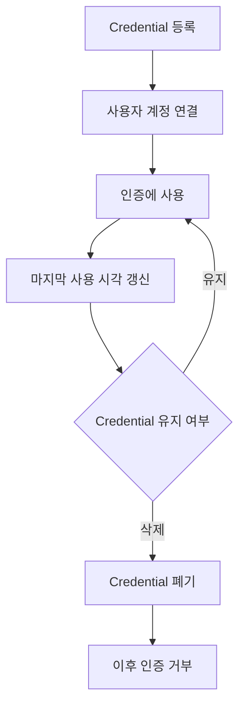

패스키를 추가하고 삭제하는 기능은 단순한 사용자 편의 기능이 아니다.

계정 접근 권한을 변경하는 중요한 보안 기능이다.

따라서 Credential 등록과 폐기에는 적절한 재인증 및 감사 정책이 필요하다.

#### 5. Passkey Provider

Passkey Provider는 패스키를 저장하고 관리하는 역할을 수행한다.

운영체제에 통합된 제공자나 별도의 자격 증명 관리 서비스 등이 해당할 수 있다.

사용자는 제공자에 따라 여러 기기에서 동기화된 패스키를 사용할 수 있다.

하지만 서비스 개발자는 특정 제공자의 동기화 방식에 모든 인증 정책을 의존해서는 안 된다.

패스키 제공자마다 지원 기능과 복구 경험이 다를 수 있기 때문이다.

---

### 패스키에서 자주 발생하는 오해

| 오해 | 정확한 이해 |
|---|---|
| 패스키는 지문 인증이다 | 지문은 개인키 사용을 위한 사용자 확인 수단 중 하나 |
| 패스키는 비밀번호를 암호화해서 전송한다 | 개인키로 인증 데이터에 전자서명을 생성 |
| 서버가 개인키를 보관한다 | 서버는 일반적으로 공개키와 Credential 정보를 저장 |
| 공개키를 탈취하면 로그인할 수 있다 | 공개키만으로 유효한 전자서명을 생성할 수 없음 |
| WebAuthn은 도메인 문자열에 직접 서명한다 | `authenticatorData`와 `clientDataJSON` 해시를 결합한 데이터를 서명 |
| Challenge가 없더라도 서명만 검증하면 안전하다 | 인증 응답 재사용 방지를 위해 Challenge 검증이 중요 |
| Origin 검증은 브라우저만 수행한다 | 서버도 허용 Origin과 RP ID 관련 정보를 검증해야 함 |
| 패스키는 모두 클라우드에 동기화된다 | Synced Passkey와 Device-Bound Passkey가 존재 |
| 패스키는 반드시 지문이 있어야 한다 | PIN 등 다양한 사용자 확인 방법을 사용할 수 있음 |
| 패스키를 사용하면 JWT가 필요 없다 | 패스키와 JWT는 서로 다른 계층의 개념 |
| 패스키를 사용하면 모든 피싱이 사라진다 | 일반적인 Credential Phishing에 강하지만 모든 사기를 막지는 못함 |
| 패스키를 사용하면 계정 복구가 필요 없다 | 기기 분실과 인증 수단 상실에 대한 복구 설계가 중요 |
| Spring Security를 사용하면 운영 준비가 끝난다 | 영구 저장소, HTTPS, 사용자 관리, 복구, 모니터링 등이 필요 |

---

### 정리

패스키는 비밀번호 기반 인증이 가진 구조적인 문제를 해결하기 위해 등장한 공개키 기반 인증 방식이다.

기존 비밀번호 인증에서는 사용자가 알고 있는 비밀값을 서버에 전달하고 서버가 이를 검증한다.

일반적인 HTTPS 환경에서는 비밀번호가 TLS로 보호되어 전송된다.

또 서버는 비밀번호를 원문으로 저장하지 않고 적절한 Password Hashing 알고리즘을 사용해야 한다.

하지만 비밀번호 재사용과 피싱, 비밀번호 검증 데이터 유출 등의 위험은 여전히 존재할 수 있다.

패스키는 이러한 문제에 다른 방식으로 접근한다.

먼저 사용자의 인증 장치에서 공개키와 개인키의 쌍을 생성한다.

개인키는 Authenticator나 패스키 제공자가 보호한다.

서버에는 공개키와 Credential 정보가 등록된다.

이후 로그인할 때 서버는 새로운 Challenge를 생성한다.

브라우저는 WebAuthn API를 통해 Authenticator에 인증을 요청한다.

사용자는 지문이나 얼굴, PIN 등으로 인증 장치에서 자신을 확인한다.

Authenticator는 개인키를 사용해 인증 데이터에 서명한다.

서버는 등록된 공개키로 전자서명을 검증한다.

따라서 서버가 개인키를 보관하거나 사용자로부터 비밀번호를 전달받을 필요가 없다.

이 과정에서 Origin Binding과 RP ID가 중요한 역할을 한다.

WebAuthn은 인증 자격 증명을 특정 RP의 범위에 연결한다.

브라우저는 해당 웹사이트가 Credential을 사용할 수 있는지 확인한다.

서버 역시 인증 응답에 포함된 Origin과 RP ID 관련 정보를 검증한다.

따라서 공격자가 정상 서비스와 관계없는 피싱 사이트에서 해당 서비스의 패스키를 사용하도록 유도하기 어렵다.

또 Challenge-Response 방식으로 인증 응답의 재사용을 방지한다.

서버는 로그인 요청마다 새로운 Challenge를 발급한다.

Authenticator는 해당 Challenge가 포함된 인증 데이터에 서명한다.

이전 인증 응답을 다시 전달하면 Challenge가 일치하지 않으므로 인증이 거부된다.

이러한 방식은 Replay Attack에 대응하는 데 중요한 역할을 한다.

패스키의 기반 기술인 WebAuthn은 브라우저에서 공개키 기반 인증을 수행할 수 있도록 정의한 표준이다.

주요 API는 `navigator.credentials.create()`와 `navigator.credentials.get()`이다.

`create()`는 새로운 인증 자격 증명을 등록할 때 사용한다.

`get()`은 기존 인증 자격 증명으로 로그인할 때 사용한다.

WebAuthn은 FIDO2 기술 체계와 연결되어 있다.

FIDO2에서는 WebAuthn과 CTAP 등을 통해 웹 애플리케이션과 인증 장치가 협력한다.

또 Passkey Provider를 통해 인증 자격 증명을 관리할 수 있다.

패스키는 여러 기기에서 사용할 수도 있다.

동기화 가능한 패스키는 지원되는 제공자를 통해 여러 기기에서 사용할 수 있다.

반면 Device-Bound Passkey는 특정 장치에 연결되어 사용된다.

따라서 모든 패스키가 클라우드에 동기화된다고 이해해서는 안 된다.

Cross-Device Authentication은 현재 기기에 패스키가 없더라도 다른 기기에 저장된 패스키를 이용해 로그인할 수 있도록 한다.

이 과정에서는 QR 코드와 BLE 기반 근접성 확인, 보호된 기기 간 인증 절차 등이 활용될 수 있다.

하지만 개인키가 단순히 Bluetooth를 통해 다른 기기로 전달되는 것은 아니다.

서버 구현 측면에서는 Spring Security의 WebAuthn 지원 기능을 활용할 수 있다.

Spring Security는 패스키 등록과 인증을 위한 기본적인 기능을 제공한다.

다만 실제 운영 환경에서는 Credential의 영구 저장과 사용자 계정 연결, Challenge 관리, Origin 검증, 인증 실패 처리 등을 함께 고려해야 한다.

또 인증에 성공한 이후에는 Session이나 JWT 등을 이용해 사용자 인증 상태를 유지할 수 있다.

패스키가 Session과 Token을 대체하는 것은 아니다.

패스키는 사용자의 신원을 증명하는 인증 수단이다.

Session과 Token은 이후 요청에서 인증 상태를 전달하고 확인하는 데 활용할 수 있다.

마지막으로 패스키를 실제 서비스에 적용할 때는 계정 복구와 인증 자격 증명의 생명주기를 중요하게 고려해야 한다.

사용자가 기기를 분실하거나 패스키 제공자에 접근하지 못하는 상황이 발생할 수 있기 때문이다.

또 새로운 패스키 등록과 기존 패스키 삭제는 계정 접근 권한을 변경하는 민감한 작업이다.

따라서 재인증과 감사 로그, 복구 정책 등을 함께 설계해야 한다.

핵심 개념을 정리하면 다음과 같다.

| 개념 | 핵심 의미 |
|---|---|
| Passkey | 공개키 암호화 기반의 비밀번호 없는 인증 자격 증명 |
| WebAuthn | 웹에서 공개키 기반 인증을 수행하기 위한 표준 |
| FIDO2 | WebAuthn과 CTAP 등을 포함하는 인증 기술 체계 |
| Public Key | 서버에서 전자서명을 검증하는 키 |
| Private Key | Authenticator에서 전자서명을 생성하는 키 |
| Digital Signature | 개인키를 사용해 인증 데이터에 서명 |
| Credential ID | 등록된 인증 자격 증명 식별자 |
| Challenge | 인증 요청마다 생성하는 예측하기 어려운 임의값 |
| Challenge-Response | 요청별 Challenge에 대한 응답을 검증하는 인증 방식 |
| Replay Attack | 이전 인증 데이터를 재사용하는 공격 |
| Origin | 인증 요청이 발생한 웹 출처 |
| RP ID | 인증 자격 증명이 연결된 서비스 식별자 |
| Origin Binding | 인증이 올바른 웹사이트와 연결되도록 하는 보안 메커니즘 |
| clientDataJSON | Challenge와 Origin 등 브라우저 인증 정보 |
| authenticatorData | RP ID Hash와 Flag 등을 포함하는 인증 데이터 |
| User Presence | 사용자의 인증 참여 여부 |
| User Verification | 사용자 확인 수행 여부 |
| Authenticator | 인증 자격 증명을 생성하고 개인키를 사용하는 구성 요소 |
| Discoverable Credential | 사용자 계정을 먼저 지정하지 않고도 사용할 수 있는 Credential |
| Synced Passkey | 지원되는 제공자를 통해 동기화 가능한 패스키 |
| Device-Bound Passkey | 특정 장치에 연결된 패스키 |
| Cross-Device Authentication | 다른 기기의 패스키로 로그인하는 방식 |
| CTAP | 클라이언트와 Authenticator 사이의 통신 프로토콜 |
| Attestation | 인증 장치의 특성이나 출처를 검증하기 위한 증명 |
| Conditional UI | 자동완성 방식의 패스키 선택 경험 |
| Credential Lifecycle | Credential의 등록·사용·관리·폐기 과정 |

결국 패스키의 핵심은 사용자가 비밀번호를 입력하지 않아도 된다는 편의성에만 있지 않다.

**서버와 사용자가 동일한 비밀값을 공유하지 않고도 인증할 수 있도록 구조를 변경했다는 점**이 가장 중요하다.

공개키와 개인키를 분리하고, 인증 요청마다 새로운 Challenge를 사용하며, Origin과 RP ID를 검증함으로써 기존 비밀번호 인증이 가진 주요 위험을 줄일 수 있다.

하지만 패스키의 보안성이 높다는 사실이 전체 인증 시스템의 안전성을 자동으로 보장하지는 않는다.

계정 복구와 Credential 등록·삭제, Session 관리, 인증 실패 처리, 사용자 권한 검증까지 함께 설계해야 신뢰할 수 있는 인증 시스템을 구축할 수 있다.

#### 한 줄 요약

**패스키(Passkey)는 WebAuthn과 FIDO2를 기반으로 사용자의 기기에서 개인키를 보호하고 서버에는 공개키만 저장하는 인증 방식이다. 로그인 시 서버가 발급한 Challenge와 웹사이트의 Origin·RP ID 관련 정보를 검증하고 전자서명을 확인함으로써 비밀번호 재사용, 일반적인 피싱, 인증 응답 재전송 공격에 대한 저항성을 높인다. 실제 서비스에서는 패스키 등록과 로그인뿐 아니라 Credential 저장, 기기 변경, 계정 복구, Session 관리까지 함께 설계해야 한다.**
