# 맥스의 장애 전파 관점에서 바라본 서버 가용성 - 외부 API 장애를 서비스 전파의 장애로 만들지 않는 방법
[https://youtu.be/Tv44xv3BF2s?si=DBkRmkyR1SggB6W2](https://youtu.be/Tv44xv3BF2s?si=DBkRmkyR1SggB6W2)

# 맥스의 장애 전파 관점에서 바라본 서버 가용성 - 외부 API 장애를 서비스 전파의 장애로 만들지 않는 방법
* toc
{:toc}

---

### 장애 전파와 서버 가용성 완벽 이해: Tomcat Thread Pool, Timeout, Circuit Breaker, Bulkhead와 Resilience4j

백엔드 서비스를 개발하다 보면 다른 시스템의 API를 호출해야 하는 상황이 자주 발생한다.

예를 들어 쇼핑몰 서비스를 개발한다고 가정하자.

쇼핑몰에는 다음과 같은 기능들이 존재한다.

- 상품 목록 조회
- 사용자 정보 조회
- 주문 생성
- 결제 승인
- 배송 상태 조회
- 외부 추천 서비스 연동

이 중 배송 상태 조회 기능은 외부 물류 시스템의 API를 호출한다고 가정하자.

```text
GET /api/shipping/status/100
```

해당 API의 내부 동작은 다음과 같다.

```text
사용자 요청
    ↓
Shopping Application
    ↓
외부 물류 API 호출
    ↓
배송 상태 응답
    ↓
사용자에게 결과 반환
```

일반적인 상황에서는 문제가 없다.

하지만 외부 물류 API에 장애가 발생하면 어떻게 될까?

가장 먼저 예상할 수 있는 문제는 배송 상태 조회 기능의 실패다.

외부 API가 정상적으로 응답하지 않으므로 배송 상태를 조회하지 못하는 것이다.

그런데 실제 운영 환경에서는 여기서 끝나지 않을 수 있다.

**외부 물류 API의 장애가 상품 조회나 사용자 정보 조회처럼 외부 물류 API와 전혀 관계없는 기능까지 영향을 줄 수 있다.**

이유는 애플리케이션의 여러 기능이 동일한 서버 자원을 공유하기 때문이다.

대표적인 공유 자원에는 다음과 같은 것들이 있다.

- Tomcat Request Thread
- DB Connection Pool
- HTTP Connection Pool
- CPU
- 메모리
- 네트워크 연결
- 작업 대기열
- 비동기 작업 실행 Thread Pool

특정 기능이 이러한 공유 자원을 장시간 점유하면 다른 기능이 사용할 자원이 부족해진다.

결과적으로 하나의 외부 시스템 장애가 애플리케이션 전체의 성능 저하와 서비스 장애로 이어질 수 있다.

이러한 문제를 **장애 전파(Failure Propagation)**라고 한다.

장애 전파를 이해하기 위해서는 먼저 서버가 요청을 처리하는 방식과 외부 API 호출이 어떤 자원을 사용하는지 알아야 한다.

---

### 개념

#### 장애 전파(Failure Propagation)란 무엇인가?

장애 전파는 하나의 시스템이나 구성 요소에서 발생한 장애가 연결된 다른 시스템이나 기능에 영향을 주면서 장애 범위를 확대하는 현상이다.

예를 들어 다음과 같은 구조를 생각해 보자.

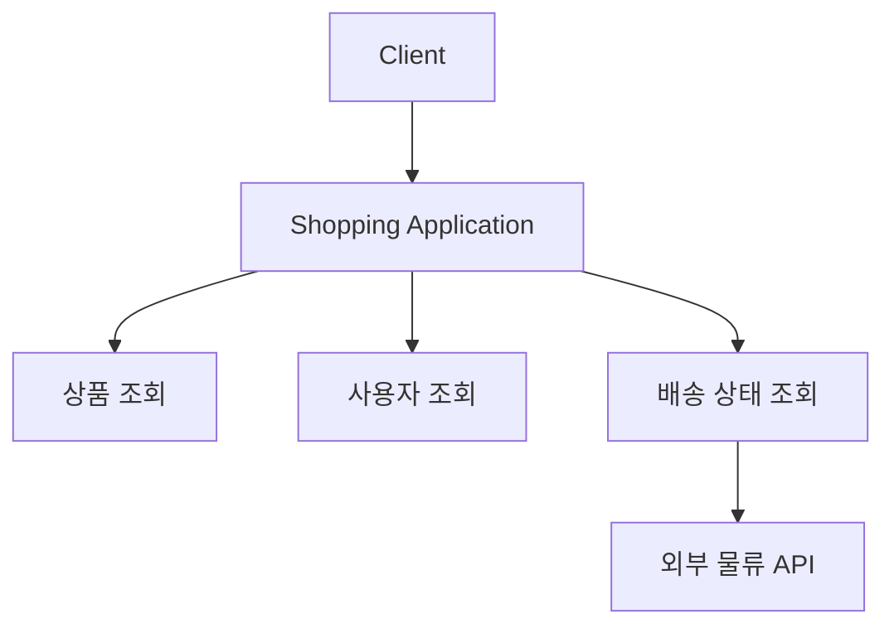

외부 물류 API가 느려졌다고 가정하자.

이상적인 상황에서는 배송 상태 조회 기능만 영향을 받아야 한다.

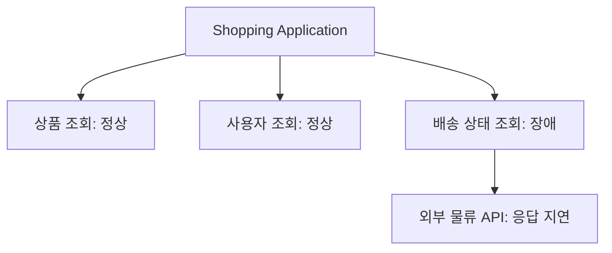

하지만 실제로는 다음과 같은 상황이 발생할 수 있다.

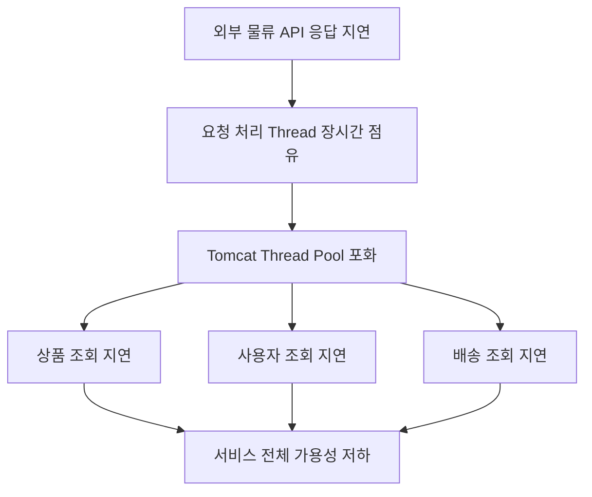

배송 상태 조회 기능의 장애가 다른 기능으로 확산된 것이다.

이때 중요한 점이 있다.

**상품 조회 API 자체에는 아무런 문제가 없어도 상품 조회가 실패할 수 있다는 것이다.**

상품 조회 로직이 잘못되었기 때문이 아니다.

요청을 처리할 서버 자원이 부족하기 때문이다.

이처럼 장애 전파는 비즈니스 코드의 직접적인 의존 관계뿐 아니라 **공유 인프라와 실행 자원의 간접적인 의존 관계**를 통해서도 발생한다.

---

### 가용성(Availability)이란 무엇인가?

가용성은 사용자가 서비스를 필요로 할 때 정상적으로 사용할 수 있는 정도를 의미한다.

일반적으로 가용성을 설명할 때 다음과 같은 공식을 사용한다.

```text
Availability

= 정상적으로 사용 가능한 시간
  / 전체 관측 시간
  × 100
```

하지만 실제 백엔드 서비스에서는 단순히 서버가 실행 중인 시간만으로 가용성을 판단하기 어렵다.

예를 들어 다음과 같은 상황을 생각해 보자.

```text
Application Process: Running

HTTP Server: Running

상품 조회 API 응답 시간: 15초
```

서버는 정상적으로 실행 중이다.

하지만 상품 조회 API가 15초 후에 응답한다면 사용자는 서비스를 정상적으로 이용하고 있다고 느끼기 어렵다.

따라서 서비스의 가용성을 판단할 때는 **요청 성공 여부와 응답 시간**을 함께 고려할 필요가 있다.

#### 가용성 측정을 위한 기준 정의

다음과 같은 정상 API가 있다고 가정하자.

```http
GET /api/products/100
```

이 API가 다음 두 조건을 모두 만족할 때 가용한 요청으로 정의할 수 있다.

1. HTTP 200 응답을 반환한다.
2. 1초 이내에 응답한다.

이를 수식으로 표현하면 다음과 같다.

```text
Available Request

= HTTP Status 200
  AND Response Time <= 1초
```

이제 전체 요청 중 가용한 요청의 비율을 계산할 수 있다.

```text
가용 요청 비율

= 조건을 만족한 요청 수
  / 전체 측정 요청 수
  × 100
```

예를 들어 1,000개의 요청 중 950개가 위 조건을 만족했다면 가용 요청 비율은 95%다.

여기서 중요한 점은 가용성의 기준이 서비스마다 다를 수 있다는 것이다.

| 서비스 | 가용성 판단 기준 예시 |
|---|---|
| 상품 조회 | HTTP 200 + 1초 이내 응답 |
| 결제 승인 | 정상 승인 결과 + 허용된 처리 시간 |
| 관리자 통계 | HTTP 200 + 3초 이내 응답 |
| 비동기 알림 | 정해진 시간 내 정상 처리 완료 |
| 주문 생성 | 정상 주문 생성 + 중복 주문 방지 |

따라서 가용성은 단순한 서버 실행 상태가 아니라 사용자에게 제공해야 하는 서비스의 요구사항을 기준으로 판단해야 한다.

이러한 측정 지표를 SLI(Service Level Indicator)라고 부른다.

---

### 왜 외부 API 장애가 정상 API까지 영향을 줄까?

핵심 원인은 **공유된 Thread Pool**에 있다.

Spring Boot에서 Spring MVC와 내장 Tomcat을 사용한다고 가정하자.

일반적인 동기식 요청 처리 구조는 다음과 같다.

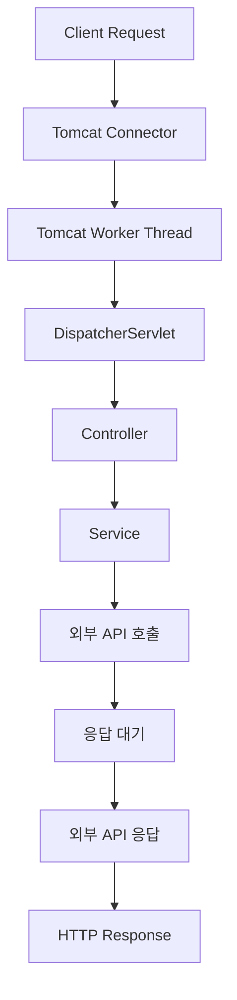

Tomcat은 들어온 HTTP 요청을 처리하기 위해 Worker Thread를 사용한다.

요청을 받은 Thread는 Controller와 Service의 로직을 실행한다.

이 과정에서 외부 API를 동기 방식으로 호출한다면 어떻게 될까?

예를 들어 다음 코드를 살펴보자.

```java
@Service
public class ShippingService {

    private final RestClient restClient;

    public ShippingService(RestClient restClient) {
        this.restClient = restClient;
    }

    public String getShippingStatus(Long shipmentId) {

        return restClient.get()
                .uri("/shipping/{id}", shipmentId)
                .retrieve()
                .body(String.class);
    }
}
```

`RestClient`는 동기식 HTTP 클라이언트다.

따라서 외부 API의 응답을 기다리는 동안 현재 요청 처리 흐름이 블로킹될 수 있다.

```text
Tomcat Thread
    ↓
Controller 실행
    ↓
Service 실행
    ↓
외부 API 호출
    ↓
외부 API 응답 대기
    ↓
Thread가 다른 요청을 처리하지 못함
```

외부 API가 빠르게 응답하면 큰 문제가 없을 수 있다.

하지만 응답이 5초 동안 지연된다면 해당 요청을 처리하는 Thread도 그 시간 동안 점유될 수 있다.

여기서 중요한 것은 Thread가 CPU 연산을 수행하지 않더라도 **사용 가능한 Worker Thread 하나를 차지하고 있다**는 점이다.

즉 외부 API의 응답 지연은 단순한 네트워크 문제를 넘어 애플리케이션의 동시 요청 처리 능력에 영향을 줄 수 있다.

---

### Tomcat Thread Pool은 어떻게 동작할까?

Spring Boot에서 Tomcat을 사용하는 경우 요청 처리 Thread의 최대 개수를 설정할 수 있다.

예를 들어 다음과 같이 설정할 수 있다.

```yaml
server:
  tomcat:
    threads:
      max: 40
      min-spare: 10
```

`max: 40`은 Tomcat Worker Thread의 최대 개수를 40개로 제한하는 설정이다.

`min-spare: 10`은 유지할 최소 여유 Thread 수와 관련된 설정이다.

Spring Boot 3.5에서는 `server.tomcat.threads.max` 속성을 제공한다. 다만 Virtual Thread를 활성화한 환경에서는 이 설정의 의미가 달라질 수 있다.

이제 최대 40개의 Worker Thread를 사용할 수 있다고 가정하자.

```text
Tomcat Thread Pool

Thread 1
Thread 2
Thread 3
...
Thread 40
```

외부 API가 5초 동안 응답하지 않는 상황에서 외부 API 호출 요청이 초당 10개씩 들어온다고 가정한다.

그러면 다음과 같은 상황이 발생할 수 있다.

| 시간 | 새로 유입된 요청 | 외부 응답을 기다리는 요청 수 |
|---|---:|---:|
| 1초 | 10개 | 약 10개 |
| 2초 | 10개 | 약 20개 |
| 3초 | 10개 | 약 30개 |
| 4초 | 10개 | 약 40개 |
| 5초 | 10개 | 기존 요청 완료 여부에 따라 달라짐 |

약 4초가 지나면 40개의 Worker Thread가 모두 외부 API 응답을 기다리는 상태에 도달할 수 있다.

이제 상품 조회 요청이 들어온다.

```http
GET /api/products/100
```

상품 조회 자체는 외부 물류 API와 아무런 관계가 없다.

하지만 해당 요청을 처리할 Worker Thread가 부족하다.

따라서 상품 조회 요청도 대기하거나 실패할 수 있다.

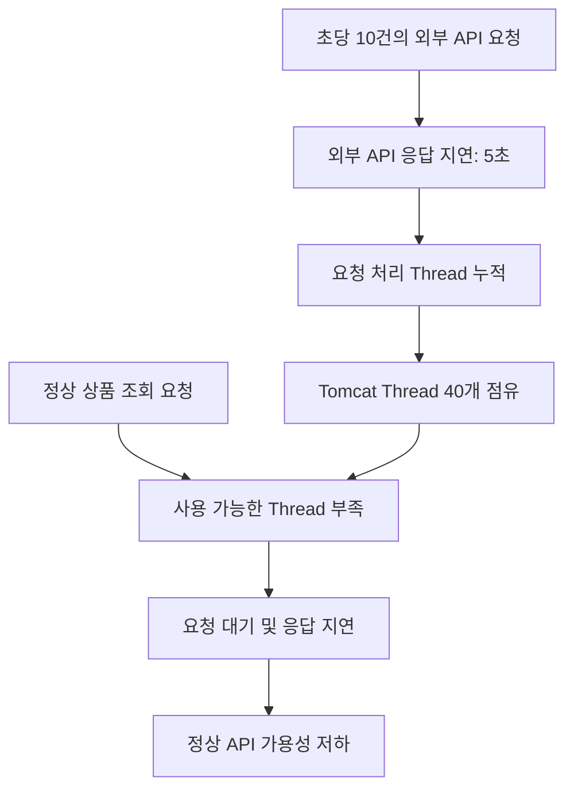

이것이 외부 API 장애가 정상 기능으로 전파되는 대표적인 과정이다.

다만 정확한 Thread 점유 수와 포화 시점은 요청 도착 패턴, Thread 생성 시점, 실제 응답 시간, 서버의 대기열 설정 등에 따라 달라진다.

위 수치는 원리를 이해하기 위한 근사적인 예다.

---

### Little's Law로 Thread 점유량 이해하기

앞선 현상을 조금 더 정량적으로 이해하기 위해 Little's Law를 활용할 수 있다.

Little's Law는 안정적인 시스템에서 평균적으로 시스템에 머무는 작업 수와 처리량, 평균 체류 시간 사이의 관계를 나타낸다.

```text
L = λ × W
```

각 기호의 의미는 다음과 같다.

| 기호 | 의미 |
|---|---|
| L | 시스템에 평균적으로 존재하는 작업 수 |
| λ | 단위 시간당 평균 처리량 |
| W | 작업의 평균 체류 시간 |

외부 API 호출 구간에 적용하면 다음과 같이 생각할 수 있다.

```text
동시에 진행 중인 외부 API 호출 수

≈ 초당 외부 API 호출 수 × 평균 호출 소요 시간
```

예를 들어 다음 조건을 가정하자.

```text
초당 외부 API 요청: 10건

외부 API 응답 시간: 5초
```

그러면 평균 동시 호출 수는 다음과 같이 추정할 수 있다.

```text
10 × 5 = 50
```

외부 API 호출을 처리하기 위해 평균적으로 약 50개의 동시 실행 작업이 필요할 수 있다는 의미다.

하지만 현재 Tomcat Worker Thread의 최대 개수는 40개다.

따라서 이 조건을 지속적으로 유지하기 어렵다.

요청이 대기열에 쌓이거나, 응답 시간이 늘어나거나, 일부 요청이 실패할 수 있다.

여기서 Little's Law를 적용할 때는 주의해야 한다.

시스템이 이미 과부하 상태여서 요청이 계속 쌓이고 있다면 안정 상태를 전제로 한 계산을 그대로 사용할 수 없다.

또 실제 처리량과 외부에서 유입되는 요청량은 다를 수 있다.

따라서 이 공식은 **정확한 장애 발생 시점을 예측하는 수단보다 요청량과 점유 시간이 자원 사용량에 어떤 영향을 주는지 이해하는 도구**로 활용하는 것이 좋다.

---

### 첫 번째 상황: 아무런 방어 장치가 없다면?

다음 조건을 가정하자.

| 항목 | 설정 |
|---|---|
| Tomcat Worker Thread | 최대 40개 |
| 외부 API 요청량 | 초당 10건 |
| 외부 API 응답 시간 | 5초 |
| 외부 호출 시간 제한 | 충분히 길거나 사실상 제한 없음 |
| 정상 API 가용 기준 | HTTP 200 + 1초 이내 응답 |

외부 API 호출이 지속적으로 발생한다.

각 요청은 약 5초 동안 Thread를 점유한다.

그러면 외부 API 응답을 기다리는 요청이 점점 증가한다.

```text
1초 → 10개

2초 → 20개

3초 → 30개

4초 → 40개
```

Worker Thread가 모두 점유된 시점부터 정상 API도 영향을 받기 시작한다.

정상 API는 외부 시스템에 의존하지 않더라도 요청 처리 자원을 확보하지 못할 수 있다.

이 상황에서 가용성 저하가 발생하는 이유를 정리하면 다음과 같다.

```text
외부 API 장애
    ↓
외부 API 호출 시간 증가
    ↓
요청별 Thread 점유 시간 증가
    ↓
동시에 점유되는 Thread 수 증가
    ↓
Tomcat Thread Pool 포화
    ↓
정상 API 요청 대기
    ↓
정상 API 가용성 저하
```

핵심 원인은 외부 API가 느리다는 사실 자체가 아니다.

**외부 API의 지연이 우리 서버의 공유 자원 고갈로 이어졌다는 점**이다.

따라서 해결책은 외부 API의 응답을 무조건 빠르게 만드는 것에만 있지 않다.

외부 API에 장애가 발생하더라도 우리 서버가 사용하는 자원을 보호해야 한다.

이러한 관점에서 가장 먼저 적용할 수 있는 기술이 Timeout이다.

---

### Timeout이란 무엇인가?

Timeout은 특정 작업이 완료되기를 기다릴 수 있는 시간을 제한하는 설정이다.

외부 API를 호출할 때 응답을 무한정 기다리면 요청 처리 자원이 장시간 점유될 수 있다.

따라서 적절한 시간 제한이 필요하다.

HTTP 호출에서 자주 사용하는 Timeout은 크게 다음과 같다.

| Timeout | 의미 |
|---|---|
| Connect Timeout | 원격 서버와 연결을 설정할 때 기다릴 수 있는 시간 |
| Read Timeout | 연결 후 데이터를 읽는 작업에서 기다릴 수 있는 시간 |
| Response Timeout | 응답을 기다리는 시간을 제한하는 클라이언트별 개념 |
| Connection Pool Acquisition Timeout | HTTP Connection Pool에서 연결을 확보하기 위해 기다리는 시간 |
| Overall Request Timeout | HTTP 요청 전체에 허용하는 시간 |
| Business Deadline | 비즈니스 요청 전체가 완료되어야 하는 최종 시간 |

여기서 중요한 점은 사용하는 HTTP 클라이언트에 따라 Timeout의 의미가 조금씩 다를 수 있다는 것이다.

예를 들어 어떤 클라이언트의 Read Timeout은 소켓 읽기 작업이 일정 시간 동안 진행되지 않을 때 발생한다.

이 경우 서버가 데이터를 조금씩 계속 보내면 전체 요청 시간은 Read Timeout보다 길어질 수도 있다.

따라서 **Read Timeout이 항상 HTTP 요청 전체의 최대 실행 시간을 보장하는 것은 아니다.**

---

### Connect Timeout이란 무엇인가?

Connect Timeout은 외부 서버와 네트워크 연결을 설정할 때 기다릴 수 있는 시간을 제한한다.

예를 들어 다음과 같은 흐름이 있다고 가정하자.

```text
Shopping Application
    ↓
TCP 연결 시도
    ↓
외부 서버 연결 대기
    ↓
연결 성공 또는 실패
```

외부 서버가 응답하지 않아 TCP 연결이 완료되지 않는다면 Connect Timeout이 발생할 수 있다.

예를 들어 Connect Timeout을 300ms로 설정했다고 가정하자.

```text
연결 시도

↓

300ms 동안 연결 완료되지 않음

↓

Connect Timeout
```

이 설정은 연결 과정에서 발생하는 무한 대기를 방지하는 데 도움이 된다.

하지만 TCP 연결이 정상적으로 완료된 후 외부 서버가 응답을 늦게 보내는 상황에는 Connect Timeout만으로 대응하기 어렵다.

이때 필요한 것이 Read Timeout이다.

---

### Read Timeout이란 무엇인가?

Read Timeout은 연결이 설정된 이후 응답 데이터를 읽는 과정에서 허용할 대기 시간을 제한한다.

예를 들어 다음과 같은 상황을 생각해 보자.

```text
Shopping Application
    ↓
외부 API 연결 성공
    ↓
HTTP 요청 전송
    ↓
외부 서버 내부 처리 지연
    ↓
응답 데이터 대기
```

외부 API가 5초 동안 응답 데이터를 보내지 않는다고 가정하자.

Read Timeout이 1초라면 약 1초의 응답 대기 이후 읽기 작업이 실패할 수 있다.

```text
외부 API 요청 시작
    ↓
응답 대기
    ↓
1초 경과
    ↓
Read Timeout
    ↓
외부 호출 종료
    ↓
요청 처리 Thread 반환 가능
```

이렇게 하면 하나의 외부 요청이 장시간 Thread를 점유하는 문제를 완화할 수 있다.

하지만 Timeout이 발생한 이후에도 예외 처리나 Fallback, 재시도, 로그 기록 등이 추가로 실행될 수 있다.

따라서 정확히 1초 후에 항상 Thread가 반환된다고 보장할 수는 없다.

---

### 두 번째 상황: Read Timeout을 1초로 설정한다면?

이번에는 다음 조건을 가정하자.

| 항목 | 설정 |
|---|---|
| Tomcat Worker Thread | 최대 40개 |
| 외부 API 요청량 | 초당 10건 |
| 외부 API 응답 시간 | 5초 |
| Read Timeout | 1초 |
| 정상 API 가용 기준 | HTTP 200 + 1초 이내 응답 |

외부 API의 실제 응답 시간은 여전히 5초다.

하지만 우리 서버는 응답을 5초 동안 기다리지 않는다.

약 1초 동안 기다린 후 Timeout으로 호출을 종료한다.

따라서 동시에 외부 API 응답을 기다리는 요청 수를 다음과 같이 추정할 수 있다.

```text
초당 요청 수 = 10

평균 점유 시간 ≈ 1초

동시 점유량 ≈ 10 × 1 = 10
```

이전에는 약 50개의 동시 실행 작업이 필요할 수 있었다.

하지만 Timeout을 적용하면 외부 API 호출 구간에서 필요한 동시 실행 작업 수가 약 10개 수준으로 줄어들 수 있다.

Tomcat Worker Thread가 40개라면 나머지 Thread를 정상 요청 처리에 사용할 여지가 생긴다.

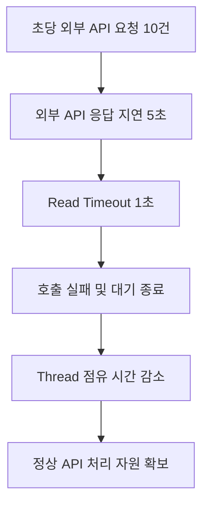

이렇게 Timeout은 외부 API 장애가 애플리케이션 전체로 전파되는 문제를 완화할 수 있다.

하지만 여기에는 중요한 한계가 존재한다.

**Timeout은 요청 하나가 자원을 점유하는 시간을 줄일 뿐, 실패하는 요청이 계속 유입되는 현상 자체를 막지는 못한다.**

이 차이를 이해해야 다음 상황을 설명할 수 있다.

---

### 세 번째 상황: 요청량이 증가하면 Timeout만으로 충분할까?

이번에는 Read Timeout을 1초로 유지하면서 외부 API 요청량을 증가시킨다고 가정하자.

기존에는 초당 10건의 요청이 들어왔다.

이번에는 초당 50건이 들어온다.

| 항목 | 설정 |
|---|---|
| Tomcat Worker Thread | 최대 40개 |
| 외부 API 요청량 | 초당 50건 |
| 외부 API 응답 시간 | 5초 |
| Read Timeout | 1초 |
| 정상 API 가용 기준 | HTTP 200 + 1초 이내 응답 |

동시에 진행 중인 외부 호출 수를 다시 추정해 보자.

```text
초당 요청 수 = 50

평균 점유 시간 ≈ 1초

동시 점유량 ≈ 50 × 1 = 50
```

필요한 동시 실행 작업 수가 약 50개가 될 수 있다.

하지만 Tomcat Worker Thread는 40개뿐이다.

따라서 Read Timeout을 설정했더라도 Thread가 포화될 수 있다.

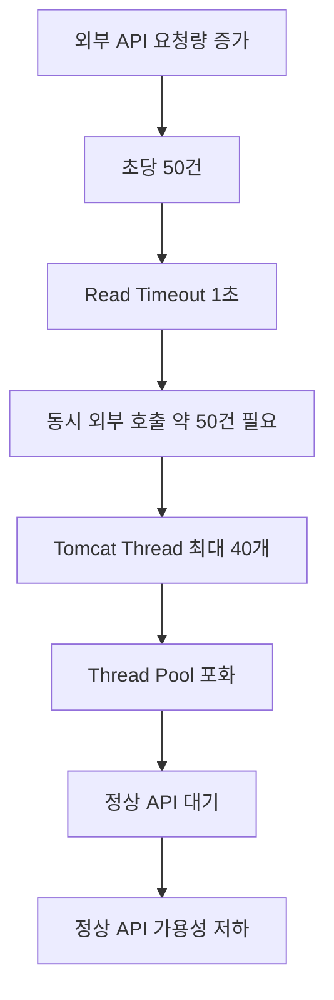

이 상황은 Timeout의 한계를 명확하게 보여준다.

Timeout은 실패하는 작업의 점유 시간을 줄인다.

하지만 유입되는 작업의 수가 충분히 많다면 여전히 자원이 고갈될 수 있다.

즉 다음 두 요소를 함께 고려해야 한다.

```text
자원 점유 시간

+

동시에 실행되는 작업 수
```

Timeout은 주로 첫 번째 요소를 제어한다.

하지만 두 번째 요소를 직접 제한하는 기능은 아니다.

또 외부 시스템에 장애가 발생했다는 사실을 기억하고 이후 요청을 차단하지도 않는다.

따라서 장애가 발생한 외부 시스템에 반복적으로 요청을 보내는 문제를 해결하기 위한 별도의 기술이 필요하다.

대표적인 방법이 **Circuit Breaker**다.

---

### Circuit Breaker란 무엇인가?

Circuit Breaker는 외부 시스템 호출의 실패율이나 응답 지연 등을 관찰하고, 문제가 발생했다고 판단되면 일정 시간 동안 해당 시스템으로의 호출을 차단하는 패턴이다.

전기 회로의 차단기에서 이름을 가져왔다.

전기 회로에서 과도한 전류가 흐르면 회로를 차단해 더 큰 사고를 방지한다.

소프트웨어에서도 비슷한 원리를 적용한다.

외부 시스템에 장애가 발생했다고 판단되면 계속해서 요청을 보내는 대신 빠르게 실패하도록 처리한다.

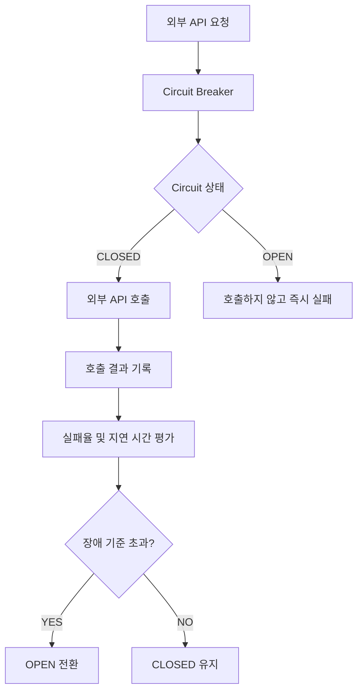

이 구조에서 중요한 것은 외부 시스템의 상태를 매번 직접 확인하지 않아도 된다는 점이다.

Circuit Breaker는 최근 호출 결과를 바탕으로 외부 시스템의 상태를 추정한다.

그리고 실패가 일정 수준을 넘으면 요청을 차단한다.

이를 통해 장애가 발생한 외부 API에 계속 Thread와 네트워크 자원을 사용하는 상황을 줄일 수 있다.

---

### Circuit Breaker가 해결하는 문제

앞선 세 번째 상황을 다시 살펴보자.

```text
외부 API 요청량 = 초당 50건

Read Timeout = 1초

Tomcat Thread = 최대 40개
```

Timeout만 적용하면 외부 API 요청이 계속 발생한다.

```text
요청 A → 1초 후 실패

요청 B → 1초 후 실패

요청 C → 1초 후 실패

요청 D → 1초 후 실패
```

실패가 반복되더라도 다음 요청은 다시 외부 API를 호출한다.

반면 Circuit Breaker를 적용하면 다음과 같이 동작할 수 있다.

```text
요청 A → Timeout

요청 B → Timeout

요청 C → Timeout

...

실패율 기준 초과

↓

Circuit Breaker OPEN

↓

이후 요청은 외부 API를 호출하지 않음

↓

즉시 실패 또는 Fallback
```

이렇게 하면 이미 장애 상태라고 판단된 외부 시스템에 불필요한 요청을 계속 보내는 것을 방지할 수 있다.

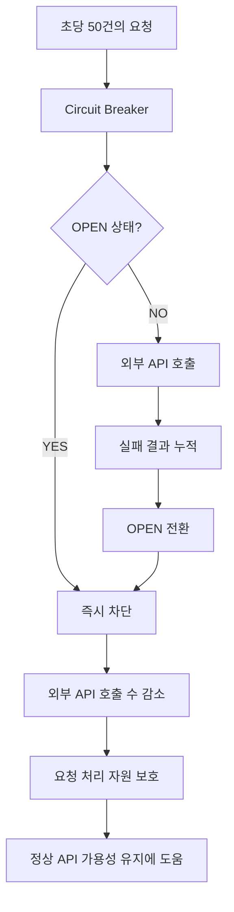

하지만 여기에도 주의할 점이 있다.

**Circuit Breaker가 OPEN 상태가 되기 전까지는 일부 요청이 여전히 외부 API를 호출할 수 있다.**

또 동시에 많은 요청이 들어오면 OPEN으로 전환되기 전에 여러 호출이 이미 실행 중일 수 있다.

따라서 Circuit Breaker만으로 모든 순간의 동시 실행 수를 제한할 수는 없다.

이 문제를 해결하기 위한 별도의 패턴이 Bulkhead다.

---

### Circuit Breaker의 세 가지 상태

Circuit Breaker는 일반적으로 세 가지 주요 상태를 가진다.

1. CLOSED
2. OPEN
3. HALF_OPEN

각 상태는 서로 다른 역할을 수행한다.

---

### CLOSED 상태

CLOSED는 외부 시스템에 대한 호출을 허용하는 상태다.

```text
Circuit Breaker = CLOSED

↓

외부 API 호출 허용

↓

호출 결과 기록

↓

실패율 및 지연 시간 평가
```

일반적인 정상 운영 상태라고 생각하면 된다.

하지만 CLOSED가 외부 시스템이 반드시 정상이라는 사실을 의미하지는 않는다.

최근 호출 결과가 설정한 장애 판단 기준을 넘지 않았다는 의미에 가깝다.

예를 들어 외부 API 호출 중 일부가 실패하더라도 실패율이 임계값보다 낮다면 CLOSED 상태를 유지할 수 있다.

---

### OPEN 상태

OPEN은 외부 API 호출을 차단하는 상태다.

```text
Circuit Breaker = OPEN

↓

외부 API 호출 차단

↓

즉시 예외 반환 또는 Fallback
```

Resilience4j에서는 OPEN 상태에서 허용되지 않은 호출에 대해 `CallNotPermittedException`이 발생할 수 있다.

이 상태에서는 일반적으로 실제 외부 API 호출을 수행하지 않는다.

따라서 외부 시스템의 응답을 기다리는 시간이 줄어든다.

이것이 Circuit Breaker의 중요한 장점이다.

다만 OPEN 상태에서도 애플리케이션으로 들어오는 HTTP 요청 자체가 사라지는 것은 아니다.

요청을 빠르게 처리하거나 실패시키는 것이므로 유입 트래픽이 과도하다면 별도의 Rate Limiting이나 Admission Control이 필요할 수 있다.

---

### HALF_OPEN 상태

Circuit Breaker가 OPEN 상태로 계속 유지된다면 외부 시스템이 복구되었는지 확인할 수 없다.

따라서 일정 시간이 지난 후 제한된 수의 호출을 허용한다.

이를 HALF_OPEN 상태라고 한다.

```text
Circuit Breaker = OPEN

↓

설정된 대기 시간 경과

↓

HALF_OPEN

↓

일부 요청만 외부 API 호출

↓

결과 평가
```

허용된 호출이 정상적으로 처리되면 CLOSED 상태로 복귀할 수 있다.

반대로 장애가 계속 발생하면 다시 OPEN 상태로 전환된다.

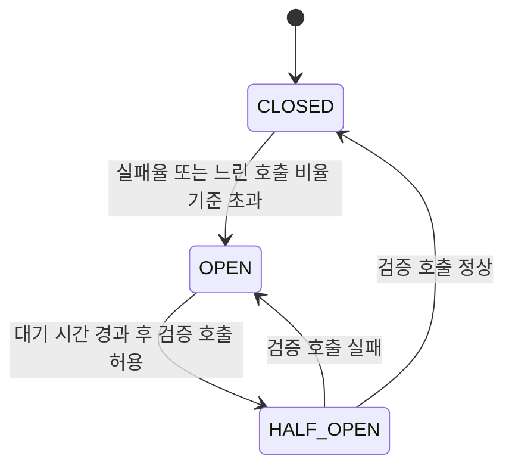

여기서 중요한 점은 복구 여부를 무제한 요청으로 확인하지 않는다는 것이다.

일부 요청만 허용해 외부 시스템의 복구 상태를 확인한다.

Resilience4j는 이러한 상태 전환과 실패율, 느린 호출 비율을 기반으로 Circuit Breaker를 구현한다.

---

### Circuit Breaker는 실패율을 어떻게 계산할까?

Circuit Breaker는 일반적으로 최근 호출 결과를 저장하는 Sliding Window를 사용한다.

예를 들어 최근 10개의 호출 결과를 저장한다고 가정하자.

```text
성공
실패
실패
성공
실패
실패
실패
성공
실패
성공
```

총 10개의 호출이 존재한다.

이 중 실패는 6개다.

따라서 실패율은 60%다.

```text
Failure Rate

= 실패한 호출 수 / 전체 측정 호출 수 × 100

= 6 / 10 × 100

= 60%
```

Circuit Breaker의 실패율 임계값이 50%라면 OPEN 상태로 전환될 수 있다.

하지만 여기서 중요한 설정이 하나 더 존재한다.

바로 `minimumNumberOfCalls`다.

---

### minimumNumberOfCalls는 왜 필요할까?

예를 들어 Circuit Breaker가 최근 10개의 호출 결과를 기준으로 판단한다고 가정하자.

그런데 아직 호출이 한 번밖에 발생하지 않았다.

```text
첫 번째 요청 → 실패
```

실패율을 계산하면 100%다.

그렇다면 곧바로 Circuit Breaker를 OPEN 상태로 전환해야 할까?

반드시 그렇지는 않다.

하나의 실패만으로 외부 시스템 전체에 장애가 발생했다고 판단하는 것은 지나치게 민감할 수 있다.

이를 방지하기 위해 최소 측정 호출 수를 설정한다.

예를 들어 다음과 같다.

```yaml
minimumNumberOfCalls: 10
```

이 경우 최소 10개의 호출 결과가 기록되기 전에는 실패율을 기반으로 OPEN 전환 여부를 판단하지 않는다.

따라서 첫 번째 요청이 실패했다고 곧바로 Circuit Breaker가 열리지는 않는다.

여기서 설정값의 의미를 정리하면 다음과 같다.

| 설정 | 역할 |
|---|---|
| `slidingWindowSize` | 최근 호출 결과를 계산하는 범위 |
| `minimumNumberOfCalls` | 상태 전환 판단에 필요한 최소 호출 수 |
| `failureRateThreshold` | 허용할 실패율 임계값 |
| `slowCallRateThreshold` | 느린 호출 비율 임계값 |
| `slowCallDurationThreshold` | 느린 호출로 판단하는 시간 기준 |

이러한 설정은 서비스의 트래픽 규모에 맞게 조정해야 한다.

요청량이 적은 외부 API에 최소 호출 수를 지나치게 높게 설정하면 장애를 감지하는 데 오래 걸릴 수 있다.

반대로 최소 호출 수를 지나치게 낮게 설정하면 우연한 실패에도 Circuit Breaker가 쉽게 열릴 수 있다.

---

### Count-Based와 Time-Based Sliding Window

Resilience4j에서는 Sliding Window를 크게 두 가지 방식으로 설정할 수 있다.

#### Count-Based Sliding Window

최근 N개의 호출을 기준으로 실패율을 계산한다.

예를 들어 다음과 같다.

```yaml
slidingWindowType: COUNT_BASED
slidingWindowSize: 10
```

최근 10개의 호출 결과를 기준으로 계산한다.

#### Time-Based Sliding Window

최근 N초 동안의 호출을 기준으로 실패율을 계산한다.

예를 들어 다음과 같다.

```yaml
slidingWindowType: TIME_BASED
slidingWindowSize: 10
```

최근 10초 동안의 호출 결과를 기준으로 계산한다.

두 방식을 비교하면 다음과 같다.

| 구분 | Count-Based | Time-Based |
|---|---|---|
| 기준 | 최근 호출 수 | 최근 시간 |
| 예시 | 최근 10건 | 최근 10초 |
| 장점 | 호출 수 기준으로 판단하기 쉬움 | 시간에 따른 장애 상태 반영 |
| 주의사항 | 요청량이 적으면 판단이 늦어질 수 있음 | 요청량이 적으면 측정 결과가 부족할 수 있음 |
| 적합한 상황 | 호출량이 일정한 서비스 | 시간 기반 장애 감지가 필요한 서비스 |

어느 방식이 더 좋다고 단정할 수는 없다.

실제 요청량과 장애 패턴에 따라 선택해야 한다.

---

### 네 가지 상황 비교

지금까지 살펴본 흐름을 하나의 표로 정리해 보자.

| 단계 | 외부 API 지연 | 요청량 | Read Timeout | Circuit Breaker | 예상 결과 |
|---|---:|---:|---:|---|---|
| 1 | 5초 | 10 RPS | 충분히 김 | 없음 | Thread 포화 가능 |
| 2 | 5초 | 10 RPS | 1초 | 없음 | Thread 점유량 감소 |
| 3 | 5초 | 50 RPS | 1초 | 없음 | Thread 재포화 가능 |
| 4 | 5초 | 50 RPS | 1초 | 적용 | OPEN 이후 외부 호출 차단 |

여기서 RPS는 Requests Per Second의 약자다.

초당 요청 수를 의미한다.

각 단계에서 핵심적으로 확인해야 하는 것은 다음과 같다.

**외부 API가 정상적으로 응답하지 않는 상황에서도 외부 API에 의존하지 않는 정상 API는 허용된 응답 시간 안에 처리될 수 있는가?**

이 질문을 통해 장애 전파 방지의 효과를 확인할 수 있다.

다만 Circuit Breaker가 적용되었다고 정상 API 가용성이 항상 100%가 된다고 보장할 수는 없다.

Circuit Breaker가 열리기 전의 순간적인 자원 포화나 다른 공유 자원의 병목이 존재할 수 있기 때문이다.

---

### Spring Boot에서 실제로 구현하기

이제 Spring Boot에서 다음 네 가지 상황을 재현할 수 있는 구조를 구현해 보자.

1. 외부 API를 호출하는 정상적인 애플리케이션
2. 일정 시간 동안 응답을 지연시키는 외부 API
3. Timeout 설정을 적용한 외부 API 호출
4. Resilience4j Circuit Breaker를 적용한 외부 API 호출

중요한 점은 **외부 API 서버와 우리 애플리케이션 서버를 서로 다른 프로세스로 실행한다**는 것이다.

두 API를 같은 Tomcat 인스턴스에서 실행하면 외부 API 역할을 하는 요청도 동일한 Thread Pool을 사용하므로 실험 결과가 왜곡될 수 있다.

따라서 같은 프로젝트를 서로 다른 프로파일로 실행해 두 개의 서버를 구성한다.

#### 개발 환경

다음 환경을 기준으로 한다.

| 항목 | 버전 및 기술 |
|---|---|
| Java | 17 |
| Spring Boot | 3.5.16 |
| Spring MVC | 사용 |
| HTTP Client | RestClient |
| HTTP Server | Tomcat |
| Circuit Breaker | Resilience4j 2.4.0 |
| 빌드 도구 | Gradle |

Spring Boot 3.5.16은 3.5 계열의 마지막 공개 OSS 릴리스다. 신규 프로젝트에서는 유지보수 정책을 고려해 지원 중인 Spring Boot 4 계열을 검토할 수 있지만, 여기서는 Spring Boot 3와 Resilience4j의 구성을 명확히 설명하기 위해 3.5.16을 사용한다.

---

### Gradle 의존성 설정

`build.gradle`

```groovy
plugins {
    id 'java'
    id 'org.springframework.boot' version '3.5.16'
    id 'io.spring.dependency-management' version '1.1.7'
}

group = 'com.example'
version = '1.0.0'

java {
    toolchain {
        languageVersion = JavaLanguageVersion.of(17)
    }
}

repositories {
    mavenCentral()
}

dependencies {
    implementation 'org.springframework.boot:spring-boot-starter-web'

    implementation 'org.springframework.boot:spring-boot-starter-actuator'

    implementation 'org.springframework.boot:spring-boot-starter-aop'

    implementation 'io.github.resilience4j:resilience4j-spring-boot3:2.4.0'

    testImplementation 'org.springframework.boot:spring-boot-starter-test'
}

tasks.named('test') {
    useJUnitPlatform()
}
```

여기서 중요한 의존성은 다음과 같다.

```groovy
implementation 'io.github.resilience4j:resilience4j-spring-boot3:2.4.0'
```

Resilience4j를 Spring Boot 3 환경에서 사용하기 위한 모듈이다.

또 다음 의존성도 중요하다.

```groovy
implementation 'org.springframework.boot:spring-boot-starter-aop'
```

Resilience4j의 `@CircuitBreaker` 같은 어노테이션은 Spring AOP를 활용해 메서드 호출을 감싼다.

따라서 관련 AOP 구성이 필요하다.

Resilience4j 공식 문서에서도 Spring Boot 통합을 위한 AOP와 Actuator 의존성을 안내한다.

---

### 프로젝트 구조

다음과 같은 구조를 사용한다.

```text
src/main/java/com/example/availability/
├── AvailabilityApplication.java
├── config/
│   └── HttpClientConfig.java
├── simulator/
│   └── SimulatedExternalController.java
├── client/
│   └── ExternalPartnerClient.java
├── service/
│   └── ProtectedPartnerService.java
├── controller/
│   └── DemoController.java
└── exception/
    └── ExternalApiExceptionHandler.java

src/main/resources/
└── application.yml
```

각 구성 요소의 역할은 다음과 같다.

| 클래스 | 역할 |
|---|---|
| AvailabilityApplication | Spring Boot 실행 |
| HttpClientConfig | 외부 API 호출 클라이언트 설정 |
| SimulatedExternalController | 지연되는 외부 API 역할 |
| ExternalPartnerClient | 실제 HTTP 요청 수행 |
| ProtectedPartnerService | Circuit Breaker 적용 |
| DemoController | 정상 API와 외부 연동 API 제공 |
| ExternalApiExceptionHandler | 외부 연동 실패를 HTTP 응답으로 변환 |

---

### application.yml 설정

먼저 서버와 외부 API 호출 설정을 작성한다.

`application.yml`

```yaml
spring:
  application:
    name: availability-demo

server:
  port: ${SERVER_PORT:8080}

  tomcat:
    threads:
      max: ${TOMCAT_MAX_THREADS:40}
      min-spare: 10

    accept-count: 100

demo:
  external:
    base-url: ${EXTERNAL_BASE_URL:http://localhost:9090}

    connect-timeout: ${CONNECT_TIMEOUT:300ms}

    read-timeout: ${READ_TIMEOUT:5s}

  simulator:
    delay: ${SIMULATOR_DELAY:5s}

resilience4j:
  circuitbreaker:
    instances:
      partnerApi:
        slidingWindowType: COUNT_BASED

        slidingWindowSize: 10

        minimumNumberOfCalls: 10

        failureRateThreshold: 50

        slowCallRateThreshold: 100

        slowCallDurationThreshold: 2s

        waitDurationInOpenState: 20s

        permittedNumberOfCallsInHalfOpenState: 2

        automaticTransitionFromOpenToHalfOpenEnabled: false

management:
  endpoints:
    web:
      exposure:
        include:
          - health
          - info
          - metrics
```

중요한 설정을 하나씩 살펴보자.

#### Tomcat Thread 제한

```yaml
server:
  tomcat:
    threads:
      max: 40
```

Tomcat의 최대 Worker Thread 수를 40개로 제한한다.

이를 통해 외부 API 호출이 Thread를 장시간 점유했을 때 발생하는 문제를 관찰할 수 있다.

#### 외부 API URL

```yaml
demo:
  external:
    base-url: http://localhost:9090
```

외부 API 서버는 9090 포트에서 실행한다.

우리 애플리케이션은 8080 포트에서 실행한다.

#### Connect Timeout

```yaml
connect-timeout: 300ms
```

외부 서버와 연결을 설정하는 데 사용할 제한 시간이다.

#### Read Timeout

```yaml
read-timeout: 5s
```

외부 API 응답을 읽는 데 사용할 제한 시간이다.

이 값은 실행 시 환경 변수로 변경할 수 있도록 구성했다.

```text
READ_TIMEOUT
```

따라서 애플리케이션 코드를 수정하지 않고 Timeout 조건을 바꿀 수 있다.

#### Circuit Breaker 설정

```yaml
minimumNumberOfCalls: 10

failureRateThreshold: 50
```

최소 10개 호출이 기록된 이후 실패율을 평가한다.

실패율이 50% 이상이면 Circuit Breaker가 OPEN 상태로 전환될 수 있다.

```yaml
waitDurationInOpenState: 20s
```

OPEN 상태에서 20초 동안 대기한 뒤 HALF_OPEN 상태의 검증 호출을 허용할 수 있도록 설정한다.

---

### Spring Boot 애플리케이션 작성

`AvailabilityApplication.java`

```java
package com.example.availability;

import org.springframework.boot.SpringApplication;
import org.springframework.boot.autoconfigure.SpringBootApplication;

@SpringBootApplication
public class AvailabilityApplication {

    public static void main(String[] args) {

        SpringApplication.run(
                AvailabilityApplication.class,
                args
        );
    }
}
```

이 클래스는 애플리케이션의 진입점이다.

프로파일에 따라 일반 API 서버 또는 외부 API 시뮬레이터로 실행한다.

---

### 외부 API 시뮬레이터 구현

먼저 의도적으로 응답을 지연시키는 서버를 구현한다.

`SimulatedExternalController.java`

```java
package com.example.availability.simulator;

import java.time.Duration;
import java.util.Map;

import org.springframework.beans.factory.annotation.Value;
import org.springframework.context.annotation.Profile;
import org.springframework.web.bind.annotation.GetMapping;
import org.springframework.web.bind.annotation.RestController;

@Profile("simulator")
@RestController
public class SimulatedExternalController {

    private final Duration delay;

    public SimulatedExternalController(
            @Value("${demo.simulator.delay}") Duration delay
    ) {
        this.delay = delay;
    }

    @GetMapping("/api/simulated-remote")
    public Map<String, Object> getRemoteData()
            throws InterruptedException {

        Thread.sleep(delay.toMillis());

        return Map.of(
                "status", "SUCCESS",
                "data", "external-data"
        );
    }
}
```

이 API는 요청을 받으면 설정된 시간만큼 대기한다.

현재 설정에서는 5초 동안 대기한다.

```text
요청 수신
    ↓
5초 대기
    ↓
HTTP 200 반환
```

이 코드는 장애 상황을 재현하기 위한 예제다.

실제 서비스에서 HTTP 요청을 지연시키기 위해 `Thread.sleep()`을 사용하는 구조를 권장하는 것은 아니다.

---

### RestClient Timeout 설정

이제 외부 API를 호출하는 HTTP 클라이언트를 구성한다.

`HttpClientConfig.java`

```java
package com.example.availability.config;

import java.time.Duration;

import org.springframework.beans.factory.annotation.Value;
import org.springframework.context.annotation.Bean;
import org.springframework.context.annotation.Configuration;
import org.springframework.context.annotation.Profile;

import org.springframework.http.client.SimpleClientHttpRequestFactory;

import org.springframework.web.client.RestClient;

@Profile("!simulator")
@Configuration
public class HttpClientConfig {

    @Bean
    public RestClient externalRestClient(
            @Value("${demo.external.base-url}")
            String baseUrl,

            @Value("${demo.external.connect-timeout}")
            Duration connectTimeout,

            @Value("${demo.external.read-timeout}")
            Duration readTimeout
    ) {

        SimpleClientHttpRequestFactory requestFactory =
                new SimpleClientHttpRequestFactory();

        requestFactory.setConnectTimeout(connectTimeout);

        requestFactory.setReadTimeout(readTimeout);

        return RestClient.builder()
                .baseUrl(baseUrl)
                .requestFactory(requestFactory)
                .build();
    }
}
```

이 코드에서 중요한 부분은 다음과 같다.

```java
requestFactory.setConnectTimeout(connectTimeout);

requestFactory.setReadTimeout(readTimeout);
```

외부 API 호출에 Connect Timeout과 Read Timeout을 각각 설정한다.

여기서는 기본 원리를 명확하게 확인하기 위해 `SimpleClientHttpRequestFactory`를 사용했다.

이 구현은 JDK의 `HttpURLConnection`에 기반하며, 실제 대규모 운영 환경에서는 HTTP Connection Pool과 연결 확보 대기 시간 등을 더 세밀하게 설정할 수 있는 클라이언트를 고려할 수 있다.

---

### 외부 API Client 구현

이제 HTTP 요청을 실제로 수행하는 클래스를 작성한다.

`ExternalPartnerClient.java`

```java
package com.example.availability.client;

import org.springframework.context.annotation.Profile;
import org.springframework.stereotype.Service;

import org.springframework.web.client.RestClient;

@Profile("!simulator")
@Service
public class ExternalPartnerClient {

    private final RestClient restClient;

    public ExternalPartnerClient(RestClient externalRestClient) {
        this.restClient = externalRestClient;
    }

    public String request() {

        return restClient.get()
                .uri("/api/simulated-remote")
                .retrieve()
                .body(String.class);
    }
}
```

이 클래스는 9090 포트의 외부 API에 요청을 전송한다.

```text
localhost:8080
    ↓
ExternalPartnerClient
    ↓
localhost:9090
    ↓
5초 지연
    ↓
응답
```

현재 코드에는 Circuit Breaker가 적용되지 않았다.

따라서 이 클래스를 직접 호출하면 Timeout만 적용된 외부 API 요청을 수행한다.

---

### Circuit Breaker 적용

이제 Resilience4j를 활용해 Circuit Breaker를 적용한다.

`ProtectedPartnerService.java`

```java
package com.example.availability.service;

import com.example.availability.client.ExternalPartnerClient;

import io.github.resilience4j.circuitbreaker.annotation.CircuitBreaker;

import org.springframework.context.annotation.Profile;
import org.springframework.stereotype.Service;

@Profile("!simulator")
@Service
public class ProtectedPartnerService {

    private final ExternalPartnerClient externalPartnerClient;

    public ProtectedPartnerService(
            ExternalPartnerClient externalPartnerClient
    ) {
        this.externalPartnerClient = externalPartnerClient;
    }

    @CircuitBreaker(name = "partnerApi")
    public String request() {

        return externalPartnerClient.request();
    }
}
```

핵심은 다음 어노테이션이다.

```java
@CircuitBreaker(name = "partnerApi")
```

이 설정은 `partnerApi`라는 이름의 Circuit Breaker를 적용한다.

메서드가 정상적으로 완료되면 성공 호출로 기록한다.

예외가 발생하면 설정에 따라 실패 호출로 기록한다.

실패율이 설정된 기준을 넘으면 Circuit Breaker가 OPEN 상태로 전환될 수 있다.

OPEN 상태에서는 실제 메서드 실행을 차단하고 `CallNotPermittedException`을 발생시킬 수 있다.

여기서 주의할 점이 있다.

Resilience4j의 어노테이션 방식은 Spring AOP를 사용한다.

따라서 다음과 같이 같은 클래스 내부에서 자기 자신의 메서드를 호출하면 AOP가 적용되지 않을 수 있다.

```java
public String execute() {
    return request();
}

@CircuitBreaker(name = "partnerApi")
public String request() {
    return externalPartnerClient.request();
}
```

이러한 문제를 피하기 위해 외부 API 호출과 Circuit Breaker 적용을 별도의 Spring Bean으로 구성했다.

---

### 정상 API와 외부 API Endpoint 구현

`DemoController.java`

```java
package com.example.availability.controller;

import java.util.Map;

import com.example.availability.client.ExternalPartnerClient;
import com.example.availability.service.ProtectedPartnerService;

import io.github.resilience4j.circuitbreaker.CircuitBreaker;
import io.github.resilience4j.circuitbreaker.CircuitBreakerRegistry;

import org.springframework.context.annotation.Profile;
import org.springframework.web.bind.annotation.GetMapping;
import org.springframework.web.bind.annotation.RestController;

@Profile("!simulator")
@RestController
public class DemoController {

    private final ExternalPartnerClient externalPartnerClient;

    private final ProtectedPartnerService protectedPartnerService;

    private final CircuitBreakerRegistry circuitBreakerRegistry;

    public DemoController(
            ExternalPartnerClient externalPartnerClient,
            ProtectedPartnerService protectedPartnerService,
            CircuitBreakerRegistry circuitBreakerRegistry
    ) {

        this.externalPartnerClient = externalPartnerClient;

        this.protectedPartnerService = protectedPartnerService;

        this.circuitBreakerRegistry = circuitBreakerRegistry;
    }

    @GetMapping("/api/normal")
    public Map<String, String> normal() {

        return Map.of(
                "status", "OK",
                "message", "normal-api"
        );
    }

    @GetMapping("/api/external/plain")
    public String plain() {

        return externalPartnerClient.request();
    }

    @GetMapping("/api/external/protected")
    public String protectedRequest() {

        return protectedPartnerService.request();
    }

    @GetMapping("/api/circuit-state")
    public Map<String, Object> circuitState() {

        CircuitBreaker circuitBreaker =
                circuitBreakerRegistry.circuitBreaker("partnerApi");

        return Map.of(
                "state", circuitBreaker.getState().name(),

                "failureRate",
                circuitBreaker.getMetrics().getFailureRate(),

                "notPermittedCalls",
                circuitBreaker.getMetrics()
                        .getNumberOfNotPermittedCalls()
        );
    }
}
```

이 예제에서는 네 가지 Endpoint를 제공한다.

| Endpoint | 역할 |
|---|---|
| `/api/normal` | 외부 API를 호출하지 않는 정상 기능 |
| `/api/external/plain` | Timeout만 적용된 외부 API 호출 |
| `/api/external/protected` | Timeout과 Circuit Breaker 적용 |
| `/api/circuit-state` | Circuit Breaker 상태 확인 |

이렇게 분리한 이유는 Circuit Breaker 적용 여부에 따른 차이를 확인하기 위해서다.

---

### 외부 API 실패 응답 처리

외부 API 호출에서 Timeout이 발생하면 예외가 발생할 수 있다.

또 Circuit Breaker가 OPEN 상태라면 `CallNotPermittedException`이 발생할 수 있다.

이러한 예외를 HTTP 응답으로 변환해 보자.

`ExternalApiExceptionHandler.java`

```java
package com.example.availability.exception;

import java.util.Map;

import io.github.resilience4j.circuitbreaker.CallNotPermittedException;

import org.springframework.context.annotation.Profile;
import org.springframework.http.HttpStatus;
import org.springframework.http.ResponseEntity;

import org.springframework.web.bind.annotation.ExceptionHandler;
import org.springframework.web.bind.annotation.RestControllerAdvice;

import org.springframework.web.client.RestClientException;

@Profile("!simulator")
@RestControllerAdvice
public class ExternalApiExceptionHandler {

    @ExceptionHandler(CallNotPermittedException.class)
    public ResponseEntity<Map<String, String>> circuitOpen(
            CallNotPermittedException exception
    ) {

        return ResponseEntity
                .status(HttpStatus.SERVICE_UNAVAILABLE)
                .body(Map.of(
                        "error", "CIRCUIT_OPEN",
                        "message", "외부 서비스 호출이 일시적으로 차단되었습니다."
                ));
    }

    @ExceptionHandler(RestClientException.class)
    public ResponseEntity<Map<String, String>> externalFailure(
            RestClientException exception
    ) {

        return ResponseEntity
                .status(HttpStatus.SERVICE_UNAVAILABLE)
                .body(Map.of(
                        "error", "EXTERNAL_API_FAILURE",
                        "message", "외부 서비스를 사용할 수 없습니다."
                ));
    }
}
```

이 예제에서는 외부 연동 장애가 발생하면 HTTP 503을 반환한다.

이렇게 하면 정상 API의 성공 여부와 외부 API의 장애 여부를 구분할 수 있다.

단, 실제 서비스에서는 Timeout과 외부 서버의 4xx 응답, 5xx 응답, Circuit Breaker 차단 등을 더 세밀하게 구분하는 것이 좋다.

예를 들어 외부 시스템에서 HTTP 400을 반환했다고 해서 반드시 재시도하거나 Circuit Breaker의 실패로 기록해야 하는 것은 아니다.

이는 잘못된 요청에 대한 정상적인 비즈니스 응답일 수도 있기 때문이다.

---

### 애플리케이션 실행 방법

먼저 외부 API 시뮬레이터를 실행한다.

#### 1. 외부 API 서버 실행

첫 번째 터미널에서 다음 명령어를 실행한다.

```bash
SERVER_PORT=9090 \
TOMCAT_MAX_THREADS=300 \
SPRING_PROFILES_ACTIVE=simulator \
SIMULATOR_DELAY=5s \
./gradlew bootRun
```

이 명령어의 의미는 다음과 같다.

| 설정 | 의미 |
|---|---|
| `SERVER_PORT=9090` | 외부 API 서버 포트 |
| `TOMCAT_MAX_THREADS=300` | 외부 API 시뮬레이터의 Worker Thread 제한 |
| `SPRING_PROFILES_ACTIVE=simulator` | 외부 API 시뮬레이터 활성화 |
| `SIMULATOR_DELAY=5s` | 응답을 5초 지연 |

외부 API를 호출해 보자.

```bash
curl -i http://localhost:9090/api/simulated-remote
```

약 5초 후 다음과 같은 응답이 반환된다.

```http
HTTP/1.1 200
Content-Type: application/json
```

```json
{
  "data": "external-data",
  "status": "SUCCESS"
}
```

#### 2. 일반 API 서버 실행

두 번째 터미널에서 다음 명령어를 실행한다.

```bash
SERVER_PORT=8080 \
TOMCAT_MAX_THREADS=40 \
READ_TIMEOUT=1s \
./gradlew bootRun
```

이 서버에서는 다음과 같은 설정이 적용된다.

```text
Tomcat Worker Thread = 최대 40개

Read Timeout = 1초

External API URL = http://localhost:9090
```

정상 API를 호출한다.

```bash
curl -i http://localhost:8080/api/normal
```

예상 응답은 다음과 같다.

```json
{
  "status": "OK",
  "message": "normal-api"
}
```

이번에는 외부 API를 호출한다.

```bash
curl -i http://localhost:8080/api/external/plain
```

외부 API는 5초 후 응답하도록 설정되어 있다.

하지만 현재 Read Timeout은 1초다.

따라서 응답을 읽는 과정에서 Timeout이 발생할 수 있다.

예상되는 결과는 다음과 같다.

```http
HTTP/1.1 503
```

```json
{
  "error": "EXTERNAL_API_FAILURE",
  "message": "외부 서비스를 사용할 수 없습니다."
}
```

이제 외부 API 호출이 실패하는 상황을 재현할 수 있다.

---

### Circuit Breaker 동작 확인

이번에는 Circuit Breaker를 적용한 API를 호출한다.

```bash
curl -i http://localhost:8080/api/external/protected
```

처음에는 Circuit Breaker가 CLOSED 상태다.

따라서 실제 외부 API 호출을 수행한다.

이후 Timeout이 발생하면 실패 호출로 기록된다.

해당 요청을 여러 번 반복해 보자.

```bash
for i in $(seq 1 15)
do
    curl \
      --silent \
      --output /dev/null \
      --write-out "HTTP %{http_code} | %{time_total}s\n" \
      http://localhost:8080/api/external/protected
done
```

처음에는 약 1초 이후 실패가 발생할 수 있다.

```text
HTTP 503 | 1.01s
HTTP 503 | 1.00s
HTTP 503 | 1.00s
```

설정된 실패율 기준을 만족하면 Circuit Breaker가 OPEN 상태로 전환된다.

이후 요청은 외부 API까지 전달되지 않는다.

따라서 다음과 같이 빠르게 실패할 수 있다.

```text
HTTP 503 | 0.003s
HTTP 503 | 0.002s
HTTP 503 | 0.002s
```

이 출력은 동작을 설명하기 위한 예시다.

실제 전환 시점과 응답 시간은 요청 간격과 실행 환경에 따라 달라진다.

또 OPEN 대기 시간이 지나면 HALF_OPEN 검증 호출이 발생할 수 있다.

#### Circuit Breaker 상태 확인

다음 Endpoint를 호출한다.

```bash
curl http://localhost:8080/api/circuit-state
```

OPEN 상태라면 다음과 비슷한 결과가 반환될 수 있다.

```json
{
  "state": "OPEN",
  "failureRate": 100.0,
  "notPermittedCalls": 5
}
```

`failureRate`는 실패율을 의미한다.

`notPermittedCalls`는 Circuit Breaker가 허용하지 않은 호출 수를 의미한다.

최소 호출 수를 충족하기 전에는 실패율이 `-1`로 표시될 수도 있다.

이는 아직 실패율을 계산하기 위한 충분한 호출 결과가 없다는 의미다.

---

### 장애 전파 상황을 부하 테스트로 확인하기

이제 단일 요청이 아니라 여러 요청이 동시에 발생하는 상황을 확인해 보자.

여기서는 외부 API 호출 요청과 정상 API 요청을 동시에 발생시킨다.

목표는 외부 API 요청량이 증가했을 때 정상 API의 응답 시간이 어떻게 변하는지 확인하는 것이다.

#### 부하 테스트 조건

다음 조건을 사용한다.

```text
외부 API 응답 지연 = 5초

Tomcat Worker Thread = 40개

정상 API 가용 기준 = HTTP 200 + 1초 이내 응답
```

외부 API 요청량은 단계별로 변경한다.

```text
1단계 = 10 RPS

2단계 = 10 RPS

3단계 = 50 RPS

4단계 = 50 RPS
```

각 단계에서 Timeout과 Circuit Breaker를 다르게 적용한다.

#### 부하 테스트 스크립트

다음은 Python 표준 라이브러리만 사용해 요청을 발생시키는 예제다.

`load_test.py`

```python
import argparse
import concurrent.futures
import time
import urllib.error
import urllib.request


def request(url, request_type):
    started = time.monotonic()

    try:
        with urllib.request.urlopen(
            url,
            timeout=8
        ) as response:

            status = response.status
            response.read()

    except urllib.error.HTTPError as error:
        status = error.code

    except Exception:
        status = 0

    elapsed = time.monotonic() - started

    return {
        "type": request_type,
        "status": status,
        "elapsed": elapsed,
    }


def main():
    parser = argparse.ArgumentParser()

    parser.add_argument(
        "--external-path",
        default="/api/external/plain"
    )

    parser.add_argument(
        "--external-rps",
        type=int,
        default=10
    )

    parser.add_argument(
        "--normal-rps",
        type=int,
        default=5
    )

    parser.add_argument(
        "--seconds",
        type=int,
        default=15
    )

    args = parser.parse_args()

    base_url = "http://localhost:8080"

    futures = []

    with concurrent.futures.ThreadPoolExecutor(
        max_workers=500
    ) as executor:

        started = time.monotonic()

        for second in range(args.seconds):

            target_time = started + second

            while time.monotonic() < target_time:
                time.sleep(0.001)

            for _ in range(args.external_rps):

                futures.append(
                    executor.submit(
                        request,
                        base_url + args.external_path,
                        "external"
                    )
                )

            for _ in range(args.normal_rps):

                futures.append(
                    executor.submit(
                        request,
                        base_url + "/api/normal",
                        "normal"
                    )
                )

        results = [
            future.result()
            for future in futures
        ]

    normal_results = [
        result
        for result in results
        if result["type"] == "normal"
    ]

    available_results = [
        result
        for result in normal_results
        if result["status"] == 200
        and result["elapsed"] <= 1.0
    ]

    availability = (
        len(available_results)
        / len(normal_results)
        * 100
    ) if normal_results else 0

    print(
        f"Normal API Requests: {len(normal_results)}"
    )

    print(
        f"Available Requests: {len(available_results)}"
    )

    print(
        f"Availability: {availability:.2f}%"
    )


if __name__ == "__main__":
    main()
```

이 스크립트는 초당 요청 수를 기준으로 요청을 발생시킨다.

다만 요청 도착 간격을 완전히 균등하게 만드는 정밀한 부하 테스트 도구는 아니다.

또 로컬 실행 환경의 CPU와 네트워크 상태에 따라 결과가 달라질 수 있다.

정확한 운영 성능 측정에는 별도의 부하 테스트 도구와 모니터링 시스템을 함께 사용하는 것이 좋다.

#### 1단계: Timeout이 충분히 긴 경우

애플리케이션을 다음과 같이 실행한다.

```bash
SERVER_PORT=8080 \
TOMCAT_MAX_THREADS=40 \
READ_TIMEOUT=10s \
./gradlew bootRun
```

외부 API 요청을 초당 10건 발생시킨다.

```bash
python3 load_test.py \
  --external-path /api/external/plain \
  --external-rps 10 \
  --seconds 15
```

외부 API는 약 5초 후에 응답한다.

따라서 요청들이 장시간 Thread를 점유할 수 있다.

정상 API의 가용 요청 비율이 감소하는지 확인한다.

#### 2단계: Read Timeout 1초 적용

애플리케이션을 재시작하면서 Read Timeout을 1초로 변경한다.

```bash
SERVER_PORT=8080 \
TOMCAT_MAX_THREADS=40 \
READ_TIMEOUT=1s \
./gradlew bootRun
```

같은 요청량으로 다시 테스트한다.

```bash
python3 load_test.py \
  --external-path /api/external/plain \
  --external-rps 10 \
  --seconds 15
```

각 외부 API 요청의 대기 시간이 줄어들기 때문에 정상 API의 가용성이 개선될 수 있다.

#### 3단계: 요청량을 50 RPS로 증가

이번에는 Timeout을 그대로 유지하면서 요청량을 증가시킨다.

```bash
python3 load_test.py \
  --external-path /api/external/plain \
  --external-rps 50 \
  --seconds 15
```

요청량이 증가하면 Read Timeout이 1초여도 Thread가 포화될 수 있다.

따라서 정상 API의 응답 시간이 다시 증가할 수 있다.

#### 4단계: Circuit Breaker 적용

이번에는 Circuit Breaker가 적용된 Endpoint를 사용한다.

```bash
python3 load_test.py \
  --external-path /api/external/protected \
  --external-rps 50 \
  --seconds 15
```

Circuit Breaker가 OPEN 상태로 전환되면 새로운 외부 API 호출을 즉시 차단한다.

따라서 외부 API 응답을 기다리는 Thread 수가 감소할 수 있다.

정상 API의 가용성도 개선될 수 있다.

다만 최초 장애 감지 구간과 HALF_OPEN 상태 전환 시점에는 실제 외부 호출이 발생할 수 있다.

따라서 결과는 설정과 트래픽 조건에 따라 달라진다.

---

### Circuit Breaker만으로 충분하지 않은 이유

Circuit Breaker가 OPEN 상태에서는 외부 API 호출을 차단한다.

하지만 CLOSED 상태에서는 일반적으로 외부 호출을 허용한다.

예를 들어 다음 상황을 생각해 보자.

```text
Circuit Breaker = CLOSED

동시에 들어온 요청 = 100개

Tomcat Thread = 40개
```

Circuit Breaker는 아직 외부 API 장애를 판단하지 않았다.

따라서 여러 요청이 동시에 외부 API 호출을 시작할 수 있다.

이 경우 Circuit Breaker가 OPEN으로 전환되기 전에 Thread Pool이 포화될 수 있다.

또 Resilience4j의 Sliding Window Size가 10이라고 해서 동시 호출 수가 10개로 제한되는 것도 아니다.

Sliding Window Size는 최근 호출 결과를 측정하는 범위일 뿐이다.

실행 중인 요청 수를 제한하지는 않는다.

Resilience4j 공식 문서도 Circuit Breaker가 동시 호출 수 자체를 제한하지 않으며, 이를 위해 Bulkhead를 조합할 수 있다고 설명한다.

따라서 외부 API 장애 전파를 더욱 적극적으로 제한하려면 **Bulkhead**를 고려해야 한다.

---

### Bulkhead란 무엇인가?

Bulkhead는 특정 작업이 사용할 수 있는 자원을 제한해 다른 작업으로 장애가 전파되는 것을 막는 패턴이다.

선박의 격벽에서 유래한 개념이다.

배의 한 구역에 문제가 발생하더라도 격벽을 통해 다른 구역까지 피해가 확산되는 것을 줄이는 원리와 비슷하다.

소프트웨어에서는 특정 기능의 동시 실행 수나 Thread Pool 등을 분리하는 방식으로 구현할 수 있다.

예를 들어 다음과 같은 구조를 생각해 보자.

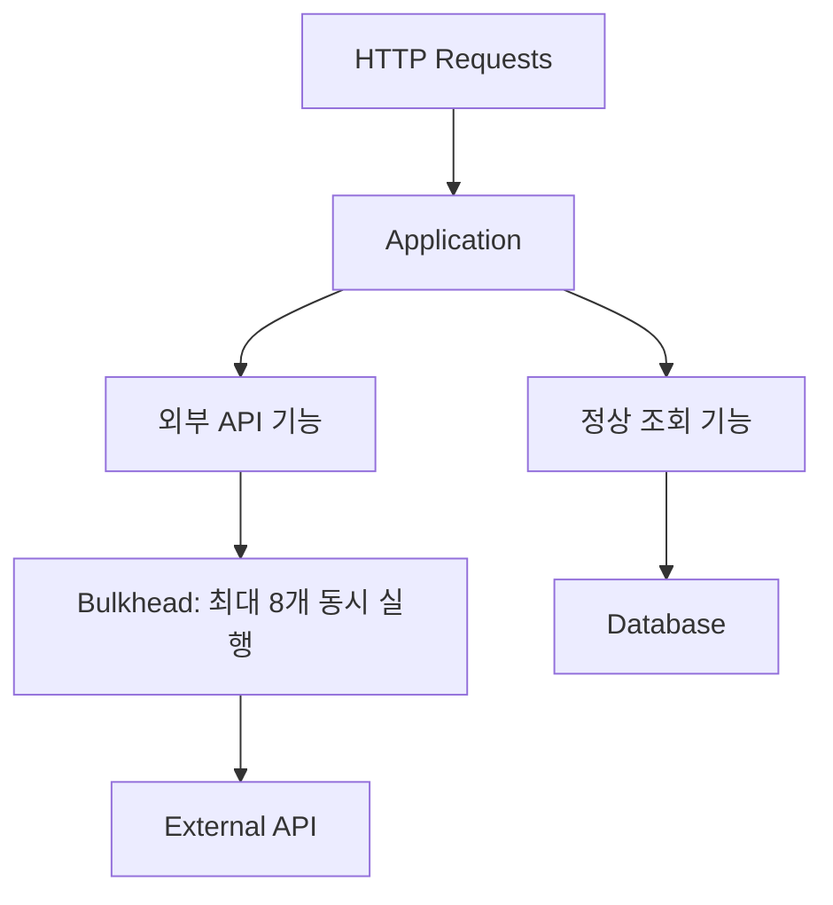

외부 API 기능에 최대 8개의 동시 실행만 허용한다고 가정하자.

그러면 외부 API 요청이 수백 개 들어와도 동시에 외부 API를 호출하는 작업 수를 제한할 수 있다.

이렇게 하면 외부 API 장애가 다른 기능으로 전파되는 범위를 줄일 수 있다.

---

### Semaphore Bulkhead와 Thread Pool Bulkhead

Resilience4j는 대표적으로 두 가지 Bulkhead 구현을 제공한다.

#### Semaphore Bulkhead

Semaphore를 이용해 동시에 실행할 수 있는 호출 수를 제한한다.

예를 들어 최대 동시 호출 수를 8개로 설정했다고 가정하자.

```text
최대 동시 호출 = 8

현재 실행 중 = 8

새로운 요청 = 즉시 거부 또는 설정된 시간만큼 대기
```

이 방식은 동시 호출 수를 제한한다.

하지만 중요한 점이 있다.

**Semaphore Bulkhead는 별도의 Thread Pool로 작업을 이동시키는 기술이 아니다.**

Spring MVC에서 동기식 외부 API 호출을 수행한다면 허용된 호출은 여전히 Tomcat Worker Thread에서 실행될 수 있다.

따라서 Semaphore Bulkhead는 동시 실행 수를 제한하는 데 도움이 되지만 Thread 자체를 완전히 격리하는 방식은 아니다.

#### Thread Pool Bulkhead

Thread Pool Bulkhead는 특정 작업을 별도의 Thread Pool에서 실행하도록 구성하는 방식이다.

```text
Tomcat Request Thread
        ↓
별도 External API Executor
        ↓
External API 호출
```

이 방식에서는 외부 API 작업에 사용할 Thread Pool과 대기열을 별도로 제한할 수 있다.

하지만 비동기 작업 처리와 결과 대기 방식에 따라 Tomcat Thread가 여전히 대기할 수도 있다.

따라서 Thread Pool을 분리했다는 사실만으로 요청 처리 Thread의 블로킹이 자동으로 사라지는 것은 아니다.

Resilience4j는 Semaphore Bulkhead와 Thread Pool Bulkhead를 모두 제공한다.

---

### Resilience4j Bulkhead 설정

다음과 같이 설정할 수 있다.

```yaml
resilience4j:
  bulkhead:
    instances:
      partnerApi:
        maxConcurrentCalls: 8

        maxWaitDuration: 0ms
```

각 설정의 의미는 다음과 같다.

| 설정 | 의미 |
|---|---|
| `maxConcurrentCalls` | 동시에 실행할 수 있는 최대 호출 수 |
| `maxWaitDuration` | 실행 허가를 얻기 위해 기다리는 최대 시간 |

현재 설정에서는 외부 API 호출을 최대 8개까지 동시에 허용한다.

8개의 호출이 이미 실행 중이라면 새로운 호출은 기다리지 않고 거부된다.

해당 상황에서는 `BulkheadFullException`이 발생할 수 있다.

이제 Service에 Bulkhead를 적용할 수 있다.

```java
@CircuitBreaker(name = "partnerApi")
@Bulkhead(name = "partnerApi")
public String request() {

    return externalPartnerClient.request();
}
```

필요한 import는 다음과 같다.

```java
import io.github.resilience4j.bulkhead.annotation.Bulkhead;
```

이렇게 하면 Circuit Breaker와 Bulkhead를 함께 사용할 수 있다.

하지만 여러 Resilience4j 어노테이션을 조합할 때는 AOP Aspect의 적용 순서도 고려해야 한다.

어떤 예외가 Circuit Breaker의 실패율에 반영되는지, Bulkhead가 어느 단계에서 호출을 거부하는지에 따라 결과가 달라질 수 있기 때문이다.

---

### Timeout, Circuit Breaker, Bulkhead의 차이

세 기술은 비슷해 보이지만 해결하는 문제가 다르다.

| 기술 | 핵심 질문 | 보호 대상 |
|---|---|---|
| Timeout | 얼마나 오래 기다릴 것인가? | 요청별 점유 시간 |
| Circuit Breaker | 장애 상태인 시스템을 계속 호출해야 하는가? | 반복적인 실패 호출 |
| Bulkhead | 특정 기능이 자원을 얼마나 사용할 수 있는가? | 동시 실행 자원 |
| Rate Limiter | 단위 시간에 얼마나 많은 요청을 허용할 것인가? | 유입 요청량 |
| Retry | 실패한 요청을 다시 시도할 것인가? | 일시적인 오류 복구 |

이러한 기술은 서로를 완전히 대체하지 않는다.

예를 들어 다음과 같이 조합할 수 있다.

```text
외부 API 호출
    ↓
Rate Limiter
    ↓
Bulkhead
    ↓
Circuit Breaker
    ↓
Timeout이 설정된 HTTP Client
    ↓
외부 API
```

위 그림은 개념적인 계층 구조다.

실제 Resilience4j 어노테이션 조합에서 실행 순서는 AOP Aspect 우선순위에 따라 달라질 수 있다.

따라서 운영 환경에서는 각 보호 기능의 적용 순서를 명확하게 정의하고 검증해야 한다.

---

### Retry는 왜 장애 전파를 악화시킬 수 있을까?

Retry는 일시적인 오류가 발생했을 때 요청을 다시 시도하는 방법이다.

예를 들어 외부 API 호출이 한 번 실패했다고 가정하자.

```text
첫 번째 시도 → 실패

두 번째 시도 → 성공
```

이런 상황에서는 Retry가 유용하다.

하지만 외부 API가 완전히 장애 상태라면 어떻게 될까?

모든 요청이 실패한다.

그런데 각 요청을 세 번씩 시도한다고 가정하자.

```text
원래 요청: 초당 50건

각 요청당 최대 3회 시도
```

모든 요청이 재시도 횟수까지 소진한다면 외부 API 호출 시도 횟수가 크게 증가할 수 있다.

단순히 계산하면 최대 초당 150회의 호출 시도가 발생하는 상황을 생각할 수 있다.

물론 실제 시도율은 Retry 대기 시간과 요청 처리 시간, 동시성 제한 등에 따라 달라진다.

하지만 중요한 점은 동일하다.

**Retry가 장애 상황에서 외부 시스템의 부하를 더욱 증가시킬 수 있다는 것이다.**

이를 Retry Storm이라고 부르기도 한다.

---

### Exponential Backoff와 Jitter

Retry를 적용할 때는 요청을 즉시 반복하는 방식보다 점진적으로 대기 시간을 늘리는 방법을 고려할 수 있다.

이를 Exponential Backoff라고 한다.

예를 들어 다음과 같다.

```text
첫 번째 실패 → 100ms 대기

두 번째 실패 → 200ms 대기

세 번째 실패 → 400ms 대기

네 번째 실패 → 800ms 대기
```

이 방식은 연속적인 재시도 요청이 외부 시스템에 집중되는 문제를 완화할 수 있다.

하지만 모든 클라이언트가 동일한 시간에 재시도하면 다시 요청이 몰릴 수 있다.

따라서 대기 시간에 무작위 값을 추가할 수 있다.

이를 Jitter라고 한다.

```text
Client A → 210ms 후 재시도

Client B → 270ms 후 재시도

Client C → 190ms 후 재시도
```

요청 시점을 분산시키는 것이다.

실무에서는 다음 사항을 함께 고려해야 한다.

- 최대 재시도 횟수
- 재시도할 예외 종류
- 재시도할 HTTP 상태 코드
- Exponential Backoff
- Jitter
- 전체 요청 Deadline
- 멱등성
- Circuit Breaker와의 조합

특히 결제 승인이나 주문 생성처럼 중복 실행에 민감한 요청은 Retry를 적용하기 전에 멱등성을 확보해야 한다.

---

### Fallback이란 무엇인가?

Fallback은 외부 시스템 호출이 실패했을 때 대체 동작을 수행하는 방식이다.

예를 들어 추천 서비스가 장애 상태라고 가정하자.

쇼핑몰의 상품 상세 페이지는 추천 서비스를 호출한다.

```text
상품 상세 조회
    ↓
추천 서비스 호출
    ↓
추천 상품 응답
```

그런데 추천 서비스에 장애가 발생한다.

이때 상품 상세 페이지 전체를 실패시켜야 할까?

추천 상품이 필수 기능이 아니라면 추천 영역을 제외하고 상품 상세 정보만 제공할 수 있다.

```text
상품 상세 조회
    ↓
추천 서비스 장애
    ↓
추천 상품 대신 빈 목록 반환
    ↓
상품 상세 페이지 정상 제공
```

이러한 방식이 Fallback이다.

Resilience4j에서는 다음과 같이 구현할 수 있다.

```java
@CircuitBreaker(
        name = "recommendationApi",
        fallbackMethod = "fallbackRecommendations"
)
public List<String> getRecommendations(Long productId) {

    return recommendationClient.getRecommendations(productId);
}

private List<String> fallbackRecommendations(
        Long productId,
        Throwable throwable
) {

    return List.of();
}
```

이 코드에서는 추천 API 호출이 실패하면 빈 목록을 반환한다.

하지만 Fallback은 모든 서비스에서 사용할 수 있는 것은 아니다.

예를 들어 다음 상황을 생각해 보자.

```text
결제 승인 API 장애
```

이 상황에서 결제가 성공했다고 가정하고 응답을 반환한다면 심각한 문제가 발생할 수 있다.

따라서 Fallback은 다음과 같이 구분해야 한다.

| 기능 | Fallback 예시 | 적합성 |
|---|---|---|
| 추천 상품 | 빈 목록 제공 | 적합할 수 있음 |
| 사용자 프로필 이미지 | 기본 이미지 사용 | 적합할 수 있음 |
| 관리자 통계 | 허용된 범위의 이전 데이터 제공 | 적합할 수 있음 |
| 배송 예상일 | 일시적으로 표시하지 않음 | 적합할 수 있음 |
| 결제 승인 | 성공으로 처리 | 부적절 |
| 재고 차감 | 임의 수량으로 처리 | 부적절 |
| 계좌 잔액 변경 | 이전 결과를 무조건 성공으로 사용 | 부적절 |

**Fallback은 장애를 숨기는 기능이 아니라 서비스의 핵심 기능을 보호하기 위한 명시적인 대체 정책이어야 한다.**

---

### 장애 전파를 방지하는 전체 아키텍처

지금까지 살펴본 개념을 하나의 구조로 정리해 보자.

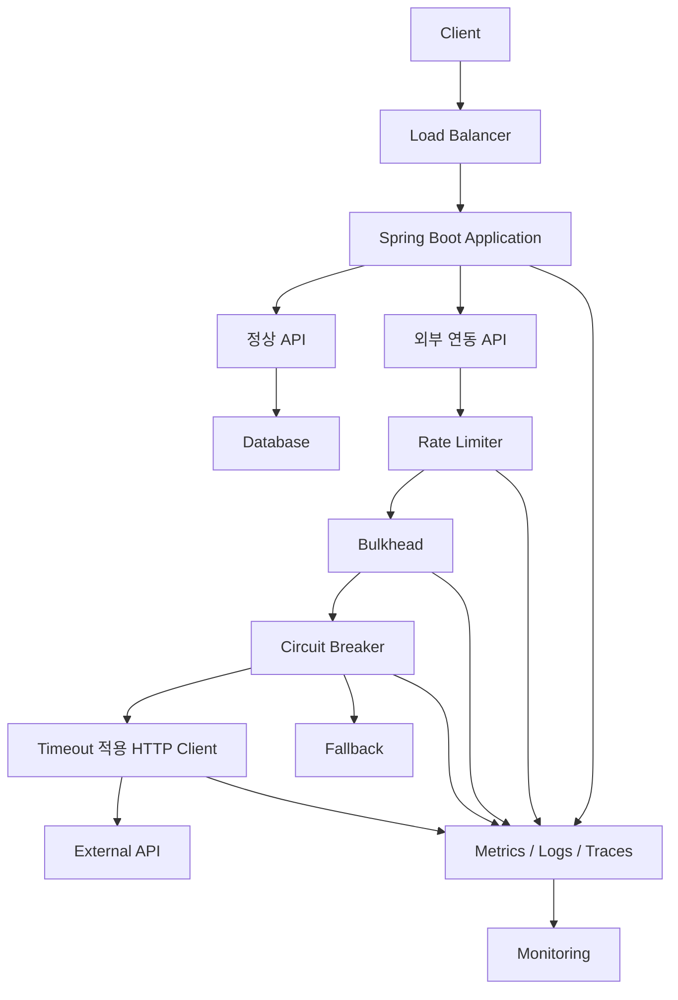

이 구조에서 각 구성 요소는 서로 다른 책임을 가진다.

Rate Limiter는 유입되는 요청량을 제한한다.

Bulkhead는 외부 연동이 사용할 수 있는 동시 실행 자원을 제한한다.

Circuit Breaker는 장애 상태인 외부 시스템에 대한 반복 호출을 차단한다.

Timeout은 개별 호출의 대기 시간을 제한한다.

Fallback은 장애가 발생했을 때 허용 가능한 대체 결과를 제공한다.

관측성 시스템은 이러한 보호 장치가 실제로 효과를 발휘하는지 확인할 수 있도록 한다.

중요한 것은 특정 기술 하나를 적용하는 것이 아니다.

**서로 다른 장애 유형에 대응하는 보호 장치를 적절하게 조합하는 것**이다.

---

### 실무에서의 활용

### 장애 전파를 방지하기 위한 12가지 설계 전략

실제 백엔드 시스템에서는 외부 API뿐 아니라 데이터베이스, Redis, 메시지 브로커, 다른 내부 서비스 등 다양한 의존 대상이 존재한다.

이러한 의존 대상의 장애가 전체 서비스로 전파되지 않도록 설계해야 한다.

#### 1. 모든 외부 HTTP 호출에 명시적인 Timeout을 설정한다

외부 API를 호출할 때 기본 Timeout 설정에만 의존하지 않는 것이 좋다.

HTTP 클라이언트의 종류에 따라 기본 Timeout이 다를 수 있기 때문이다.

또 어떤 설정에서는 무한 대기와 유사한 동작이 발생할 수 있다.

따라서 다음 항목을 명시적으로 검토해야 한다.

```text
Connect Timeout

Read Timeout

Connection Pool Acquisition Timeout

전체 요청 Deadline
```

특히 외부 API에 장애가 발생했을 때 가장 먼저 문제가 되는 것은 호출이 얼마나 오래 실행되는지다.

따라서 Timeout은 기본적인 보호 장치라고 볼 수 있다.

#### 2. 전체 요청의 Deadline을 정의한다

외부 API 하나의 Timeout만 설정하는 것으로는 충분하지 않을 수 있다.

예를 들어 다음과 같은 요청 흐름을 생각해 보자.

```text
Order API
    ↓
Payment API
    ↓
Membership API
    ↓
Notification API
```

각 API의 Timeout을 3초로 설정했다고 가정하자.

순차적으로 호출한다면 전체 요청 시간이 길어질 수 있다.

따라서 최종 사용자 요청에 허용할 전체 시간을 먼저 정의하고, 그 안에서 각 외부 호출의 시간 예산을 배분하는 방식이 필요하다.

이를 Deadline Propagation 또는 Timeout Budgeting 관점에서 이해할 수 있다.

예를 들어 다음과 같이 설계할 수 있다.

```text
전체 요청 제한 = 3초

Payment API = 최대 1초

Membership API = 최대 500ms

Notification = 비동기 처리
```

이 구조는 단순히 모든 API에 동일한 Timeout을 설정하는 것보다 전체 사용자 응답 시간을 관리하기 쉽다.

#### 3. 의존 대상별 Circuit Breaker를 분리한다

다음과 같은 외부 시스템이 있다고 가정하자.

```text
PayPal API

Stripe API

Shipping API

Recommendation API
```

모든 외부 API에 하나의 Circuit Breaker를 공유하면 어떻게 될까?

추천 API 장애로 인해 결제 API 호출까지 차단되는 상황이 발생할 수 있다.

따라서 서로 다른 장애 특성을 가진 의존 대상에는 Circuit Breaker를 분리하는 것이 좋다.

```yaml
resilience4j:
  circuitbreaker:
    instances:
      paypalApi:
        failureRateThreshold: 50

      stripeApi:
        failureRateThreshold: 50

      shippingApi:
        failureRateThreshold: 60

      recommendationApi:
        failureRateThreshold: 70
```

이는 개념적인 설정 예시다.

실제 운영에서는 최소 호출 수와 Sliding Window, OPEN 대기 시간 등을 함께 설정해야 한다.

중요한 점은 장애가 발생한 의존 대상만 격리하는 것이다.

#### 4. Bulkhead를 이용해 동시 실행 수를 제한한다

Circuit Breaker는 실패가 누적되어야 OPEN으로 전환된다.

따라서 장애를 감지하기 전에는 여러 요청이 동시에 외부 API를 호출할 수 있다.

Bulkhead는 이러한 초기 구간의 자원 점유를 제한하는 데 도움이 된다.

예를 들어 외부 추천 API의 동시 호출을 최대 10개로 제한하면 추천 API가 느려져도 요청 처리 자원 전체를 독점하는 문제를 줄일 수 있다.

다만 Semaphore Bulkhead는 동시 호출 수를 제한할 뿐, 별도의 Thread Pool로 작업을 옮기는 것은 아니라는 점을 이해해야 한다.

#### 5. HTTP Connection Pool도 함께 관리한다

외부 API 호출에서 Thread Pool만 중요한 것은 아니다.

HTTP Connection Pool도 중요한 공유 자원이다.

예를 들어 다음과 같은 상황을 생각해 보자.

```text
Tomcat Thread = 100개

HTTP Connection Pool = 최대 20개
```

100개의 Thread가 외부 API를 호출하려고 한다.

하지만 사용할 수 있는 HTTP Connection은 20개뿐이다.

나머지 요청은 연결이 반환되기를 기다릴 수 있다.

따라서 HTTP Connection Pool이 병목이 될 수 있다.

이때는 다음 설정을 고려해야 한다.

```text
Maximum Connections

Maximum Connections Per Route

Connection Acquisition Timeout

Connect Timeout

Response Timeout
```

Thread Pool과 HTTP Connection Pool은 서로 다른 자원이다.

두 자원의 크기와 대기 정책을 함께 관리해야 한다.

#### 6. 외부 API 호출을 DB 트랜잭션 내부에서 수행하는지 확인한다

다음과 같은 코드를 생각해 보자.

```java
@Transactional
public void createOrder() {

    Order order = orderRepository.save(new Order());

    paymentClient.approve(order);

    order.complete();
}
```

외부 결제 API가 5초 동안 응답하지 않는다면 어떻게 될까?

트랜잭션 구조와 실제 JDBC Connection 획득 시점에 따라 DB Connection이 외부 API 응답을 기다리는 동안 점유될 수 있다.

이렇게 되면 외부 API 장애가 DB Connection Pool 고갈로 이어질 수 있다.

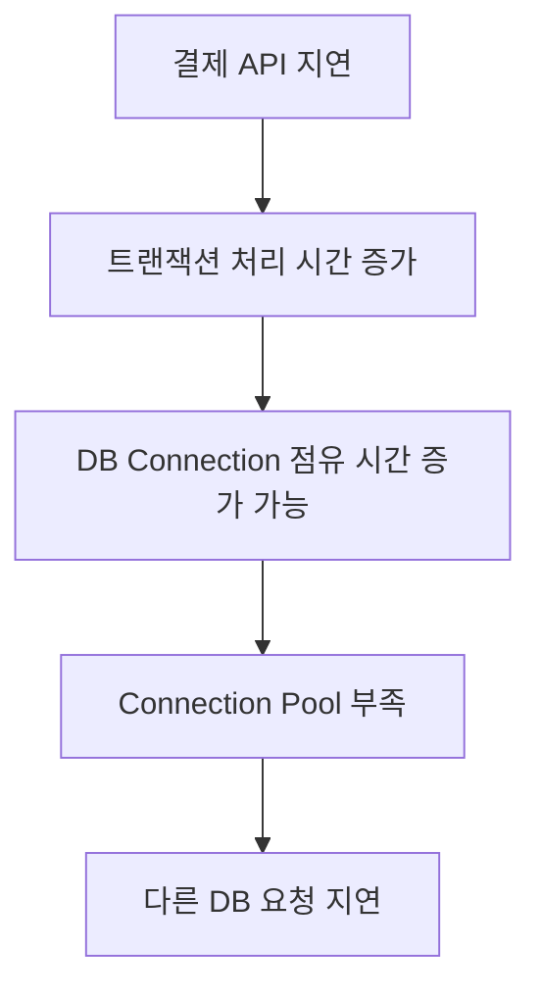

따라서 외부 API 호출을 장시간 실행되는 DB 트랜잭션 안에 포함하는 것이 적절한지 검토해야 한다.

다만 트랜잭션 밖으로 호출을 이동시키는 것만으로 결제와 주문 사이의 정합성 문제가 해결되지는 않는다.

외부 결제 성공 후 DB 저장에 실패하는 상황 등을 별도로 고려해야 한다.

결제와 같은 중요한 도메인에서는 상태 전이와 멱등성, 보상 처리, Outbox Pattern 등을 함께 설계해야 한다.

#### 7. Retry는 실패 유형에 따라 선택적으로 적용한다

모든 실패를 재시도하면 안 된다.

예를 들어 다음과 같이 구분할 수 있다.

| 실패 유형 | Retry 고려 |
|---|---|
| 일시적인 네트워크 오류 | 가능 |
| HTTP 503 | 상황에 따라 가능 |
| HTTP 429 | Retry-After 및 정책 확인 |
| HTTP 400 | 일반적으로 부적절 |
| 인증 실패 401 | 토큰 갱신 등 별도 정책 필요 |
| 결제 승인 결과 불명확 | 상태 조회 및 멱등성 필요 |
| Circuit Breaker OPEN | 무의미한 반복 Retry 지양 |

특히 외부 시스템의 장애가 지속되는 상황에서 무분별하게 재시도하면 장애를 더욱 악화시킬 수 있다.

따라서 Retry는 전체 Deadline과 Circuit Breaker, 멱등성을 함께 고려해야 한다.

#### 8. 필수 기능과 선택 기능을 구분한다

모든 외부 의존성이 동일한 중요도를 가지는 것은 아니다.

예를 들어 상품 상세 페이지에서 추천 상품 정보는 선택 기능일 수 있다.

추천 API가 실패해도 상품 정보는 제공할 수 있다.

반면 결제 승인 API가 실패하면 결제를 성공으로 처리해서는 안 된다.

따라서 외부 의존성을 다음과 같이 분류하는 것이 좋다.

```text
필수 의존성

→ 실패 시 비즈니스 작업 중단
```

```text
선택 의존성

→ 실패 시 Fallback 또는 기능 축소
```

이러한 구분이 명확하면 장애 발생 시 어떤 기능을 유지해야 하는지 결정하기 쉽다.

#### 9. Circuit Breaker를 무조건 OPEN으로 만드는 것이 목표가 되어서는 안 된다

Circuit Breaker가 자주 OPEN 상태가 된다면 보호 장치가 정상적으로 작동하고 있다는 의미일 수도 있다.

하지만 동시에 외부 시스템의 안정성이 낮거나 Timeout과 임계값이 부적절하다는 신호일 수도 있다.

예를 들어 정상적인 외부 API의 p99 응답 시간이 1.5초인데 Read Timeout을 500ms로 설정했다고 가정하자.

이 경우 정상적인 호출까지 Timeout이 발생할 수 있다.

그러면 Circuit Breaker가 지나치게 자주 OPEN 상태로 전환될 수 있다.

따라서 Timeout과 Circuit Breaker의 임계값은 실제 응답 시간 분포를 기반으로 설정해야 한다.

#### 10. HALF_OPEN 상태의 호출 수를 조절한다

외부 시스템이 장애에서 복구되는 과정에서는 한꺼번에 많은 요청을 보내면 문제가 재발할 수 있다.

따라서 HALF_OPEN 상태에서는 제한된 수의 호출을 허용한다.

예를 들어 다음과 같이 설정할 수 있다.

```yaml
permittedNumberOfCallsInHalfOpenState: 2
```

이 설정은 HALF_OPEN 상태에서 허용할 검증 호출 수를 제한한다.

다만 검증 호출이 모두 완료되지 않거나 Timeout이 발생하는 상황도 고려해야 한다.

외부 시스템의 복구 시간이 길다면 OPEN 대기 시간과 HALF_OPEN 검증 정책을 함께 조정해야 한다.

#### 11. Circuit Breaker 상태를 모니터링한다

Circuit Breaker는 장애 발생 시 자동으로 요청을 차단할 수 있다.

하지만 OPEN 상태가 지속되어도 운영자가 알지 못한다면 문제가 된다.

따라서 다음 지표를 모니터링해야 한다.

```text
Circuit Breaker State

Failure Rate

Slow Call Rate

Not Permitted Calls

External API Latency

Timeout Count
```

Resilience4j는 Micrometer와 Spring Boot Actuator를 통해 관련 지표를 노출할 수 있다.

예를 들어 다음 Endpoint를 확인할 수 있다.

```http
GET /actuator/metrics
```

설정에 따라 다음과 같은 메트릭을 확인할 수 있다.

```text
resilience4j.circuitbreaker.calls

resilience4j.circuitbreaker.state

resilience4j.circuitbreaker.failure.rate
```

이러한 지표를 통해 Circuit Breaker가 자주 열리는지, 외부 API의 실패율이 증가하는지 확인할 수 있다.

#### 12. 장애가 전파되지 않는지 실제 부하 테스트로 검증한다

Timeout과 Circuit Breaker를 설정했다고 해서 장애 전파가 완전히 차단되었다고 판단해서는 안 된다.

실제 트래픽을 가정한 테스트가 필요하다.

예를 들어 다음과 같은 상황을 검증할 수 있다.

```text
외부 API 응답 지연

외부 API 연결 실패

외부 API HTTP 500

외부 API 간헐적 Timeout

외부 API 요청량 급증

외부 API 정상 복구
```

각 상황에서 확인할 지표는 다음과 같다.

- 정상 API의 성공률
- 정상 API의 p95 및 p99 응답 시간
- Tomcat Busy Thread
- HTTP Connection Pool 사용량
- DB Connection Pool 사용량
- Circuit Breaker 상태
- Bulkhead 거부 횟수
- Timeout 발생 횟수

궁극적으로 검증해야 하는 것은 하나다.

**특정 의존성에 장애가 발생하더라도 관계없는 정상 기능이 영향을 받지 않거나, 영향을 허용 가능한 수준으로 제한할 수 있는가?**

---

### 추가 심화: 장애 전파와 함께 알아야 할 핵심 키워드

#### 1. Cascading Failure

Cascading Failure는 하나의 장애가 연쇄적으로 다른 시스템의 장애를 발생시키는 현상이다.

예를 들어 다음과 같은 구조를 생각해 보자.

```text
API Gateway
    ↓
Order Service
    ↓
Payment Service
    ↓
External PG
```

External PG에 장애가 발생한다.

Payment Service가 응답을 기다린다.

Order Service 역시 Payment Service의 응답을 기다린다.

API Gateway도 Order Service의 응답을 기다린다.

결과적으로 여러 서비스의 자원이 동시에 점유될 수 있다.

이러한 연쇄적인 장애 확산을 Cascading Failure라고 한다.

장애 전파가 하나의 서비스 내부에서 발생할 수도 있지만, 마이크로서비스 환경에서는 여러 서비스에 걸쳐 발생할 수 있다는 점이 중요하다.

#### 2. Fail-Fast

Fail-Fast는 실패할 가능성이 높은 작업을 불필요하게 오래 기다리지 않고 빠르게 실패시키는 접근이다.

Circuit Breaker의 OPEN 상태가 대표적인 예다.

하지만 Fail-Fast를 단순히 HTTP 500을 빠르게 반환하는 것으로 이해해서는 안 된다.

핵심은 실패가 예상되는 작업이 시스템 자원을 장시간 점유하지 않도록 하는 것이다.

#### 3. Backpressure

Backpressure는 데이터를 생산하는 쪽의 속도가 소비하는 쪽의 처리 능력을 초과할 때 이를 제어하는 개념이다.

예를 들어 메시지 소비자가 초당 100건을 처리할 수 있는데 생산자가 초당 1,000건을 생성한다면 어떻게 될까?

대기 중인 메시지가 계속 증가할 수 있다.

Backpressure는 이러한 상황에서 생산 속도와 소비 속도의 차이를 관리하는 데 활용된다.

다만 HTTP 서버의 Rate Limiting과 Reactive Streams의 Backpressure는 구체적인 동작 방식이 다르다.

공통점은 처리 능력을 초과하는 작업이 무제한으로 누적되지 않도록 제어한다는 것이다.

#### 4. Load Shedding

Load Shedding은 시스템이 처리할 수 있는 용량을 초과했을 때 일부 요청을 의도적으로 거부하는 방식이다.

예를 들어 다음과 같은 상황을 생각해 보자.

```text
서버 처리 가능 요청 = 초당 1,000건

실제 유입 요청 = 초당 5,000건
```

모든 요청을 받아 대기열에 쌓으면 전체 요청의 응답 시간이 급격히 증가할 수 있다.

이때 일부 요청을 빠르게 거부하면 정상적으로 처리할 수 있는 요청의 가용성을 보호할 수 있다.

즉 무조건 모든 요청을 처리하려고 하는 것보다 처리 가능한 요청을 안정적으로 처리하는 것이 더 나을 수 있다.

#### 5. Queue Saturation

Thread Pool이 포화되면 요청이 대기열에 쌓일 수 있다.

이때 대기열이 무제한으로 증가하면 메모리 사용량과 응답 시간이 증가할 수 있다.

따라서 Thread Pool의 크기뿐 아니라 대기열의 길이와 거부 정책도 중요하다.

예를 들어 다음과 같은 구조를 생각할 수 있다.

```text
요청 유입
    ↓
Worker Thread 확인
    ↓
사용 가능하면 즉시 실행
    ↓
사용 불가능하면 대기열
    ↓
대기열도 포화되면 요청 거부
```

이때 대기열이 길어지면 실제 비즈니스 작업을 시작하기 전에 이미 상당한 시간이 경과할 수 있다.

따라서 외부 API의 Timeout만으로 전체 응답 시간을 관리하기 어려울 수 있다.

#### 6. Thread Starvation

Thread Starvation은 작업이 실행에 필요한 Thread를 확보하지 못해 오랫동안 대기하는 상황이다.

외부 API 호출로 Tomcat Worker Thread가 모두 점유되면 정상 API가 실행되지 못하는 현상도 Thread Starvation 관점에서 설명할 수 있다.

Thread Starvation은 단순한 Thread 개수 부족뿐 아니라 Lock 경합이나 특정 작업의 장시간 실행으로 인해 발생할 수도 있다.

#### 7. Resource Exhaustion

Resource Exhaustion은 시스템이 제공할 수 있는 자원이 고갈되는 현상이다.

대표적인 자원에는 다음과 같은 것들이 있다.

```text
Thread

Memory

CPU

DB Connection

HTTP Connection

File Descriptor

Network Socket
```

장애 전파는 이러한 자원 고갈을 통해 발생하는 경우가 많다.

따라서 장애를 분석할 때는 단순히 어떤 API가 실패했는지만 확인해서는 안 된다.

어떤 공유 자원이 고갈되었는지도 확인해야 한다.

#### 8. Timeout Budget

Timeout Budget은 전체 요청에 허용된 시간 안에서 각 작업이 사용할 시간을 배분하는 개념이다.

예를 들어 주문 생성 API의 목표 응답 시간이 2초라고 가정하자.

다음과 같이 시간을 배분할 수 있다.

```text
주문 검증 = 200ms

결제 승인 = 1,000ms

DB 저장 = 300ms

응답 생성 = 100ms

여유 시간 = 400ms
```

이 방식은 전체 요청의 응답 시간 목표를 기준으로 외부 의존성의 Timeout을 설계하는 데 도움이 된다.

다만 실제로는 각 단계의 실행 시간 분포와 병렬 처리 여부, 네트워크 오버헤드를 고려해야 한다.

#### 9. Dependency Isolation

Dependency Isolation은 서로 다른 의존성이 사용하는 자원을 분리해 장애 영향 범위를 제한하는 설계다.

예를 들어 외부 결제 API와 외부 추천 API를 같은 Thread Pool에서 처리한다고 가정하자.

추천 API가 느려지면 결제 API 요청도 영향을 받을 수 있다.

반면 각 의존성의 동시 실행 자원과 대기열을 분리하면 장애 전파 범위를 제한할 수 있다.

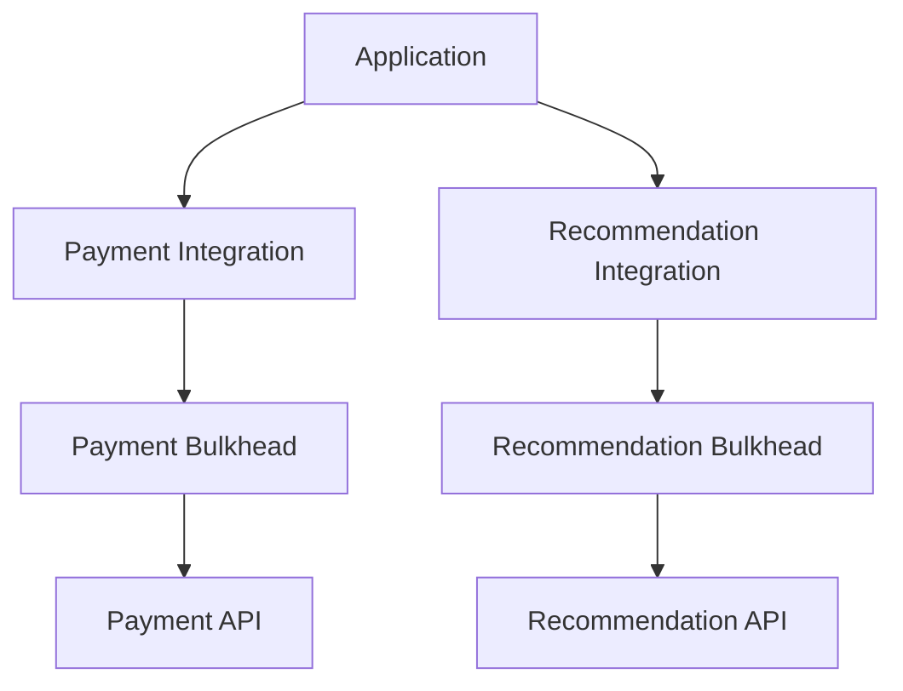

이 구조는 단순히 서버를 여러 대로 늘리는 것과는 다른 관점이다.

**서버 내부에서도 기능별 자원 사용을 격리해야 한다는 것**이 핵심이다.

#### 10. Graceful Degradation

Graceful Degradation은 일부 기능에 장애가 발생하더라도 핵심 기능을 유지하면서 서비스를 축소된 형태로 제공하는 방식이다.

예를 들어 추천 API 장애가 발생했다고 가정하자.

상품 상세 페이지에서 추천 상품 영역을 숨기고 나머지 기능은 정상적으로 제공할 수 있다.

또 외부 환율 API가 실패했을 때 마지막으로 확인된 환율을 표시하되, 실제 결제 시점에는 별도의 유효성 검사를 수행하도록 설계할 수 있다.

이러한 방식은 장애가 발생했을 때 모든 기능을 함께 실패시키는 것보다 사용자 경험을 개선할 수 있다.

다만 오래된 데이터를 사용하는 Fallback은 데이터 최신성과 정확성 요구사항을 충족해야 한다.

#### 11. Adaptive Concurrency Limiting

Adaptive Concurrency Limiting은 고정된 동시 실행 제한 대신 시스템의 응답 시간과 부하 상태 등을 고려해 허용 동시성을 동적으로 조정하는 접근이다.

예를 들어 외부 API가 정상적으로 빠르게 응답할 때는 더 많은 요청을 허용할 수 있다.

반면 응답 시간이 증가하면 동시에 실행할 수 있는 호출 수를 줄일 수 있다.

이러한 방식은 정적인 Bulkhead 설정보다 변화하는 트래픽에 유연하게 대응할 수 있는 가능성이 있다.

하지만 동시성 제한을 자동으로 조정한다고 해서 항상 안정성이 높아지는 것은 아니다.

조정 알고리즘이 지나치게 민감하면 처리량이 불안정해질 수도 있다.

따라서 실제 응답 시간 분포와 처리량을 기반으로 검증해야 한다.

#### 12. Observability와 SLO

장애 전파를 방지하는 기술을 적용했다면 실제로 가용성이 유지되는지 확인해야 한다.

예를 들어 정상 API의 SLO를 다음과 같이 정의할 수 있다.

```text
정상 API 요청의 99.9%가

HTTP 200을 반환하고

1초 이내에 응답해야 한다.
```

이제 외부 API 장애를 발생시킨 상태에서도 해당 SLO를 만족하는지 확인한다.

관측해야 할 지표는 다음과 같다.

| 지표 | 확인할 내용 |
|---|---|
| Normal API Availability | 정상 API 가용성 |
| External API Failure Rate | 외부 API 실패율 |
| External API Latency | 외부 API 응답 시간 |
| Circuit Breaker State | Circuit 상태 |
| Circuit Breaker Rejected Calls | 차단된 호출 수 |
| Bulkhead Available Permissions | 남은 동시 실행 허용량 |
| Tomcat Busy Threads | 사용 중인 Worker Thread |
| DB Connection Pool Usage | DB 연결 사용량 |
| HTTP Connection Pool Usage | 외부 HTTP 연결 사용량 |
| HTTP 5xx Rate | 서버 오류 비율 |
| p95/p99 Latency | 사용자 요청의 지연 시간 |

이러한 지표를 통해 외부 의존성 장애가 어떤 공유 자원에 영향을 주는지 파악할 수 있다.

특히 외부 API의 실패율만 측정하는 것보다 **외부 API와 관계없는 정상 API의 가용성까지 함께 측정하는 것**이 중요하다.

---

### 장애 전파 관점에서 기술을 선택하는 기준

지금까지 살펴본 여러 기술을 어떤 상황에서 사용해야 하는지 정리해 보자.

| 문제 상황 | 우선 고려할 기술 |
|---|---|
| 외부 서버 연결이 오래 걸림 | Connect Timeout |
| 외부 API 응답이 느림 | Read Timeout, Response Timeout |
| 전체 요청 시간이 지나치게 길어짐 | Overall Deadline |
| 외부 API가 반복적으로 실패 | Circuit Breaker |
| 외부 API 동시 호출이 많음 | Bulkhead |
| 초당 요청량이 지나치게 많음 | Rate Limiter |
| 작업 대기열이 계속 증가 | Bounded Queue, Load Shedding |
| 일시적인 오류가 발생 | 제한적인 Retry |
| Retry 요청이 한꺼번에 몰림 | Exponential Backoff, Jitter |
| 선택 기능 장애로 전체 기능 실패 | Fallback, Graceful Degradation |
| 외부 API 장애가 DB 연결 고갈로 확산 | 트랜잭션 경계 검토 |
| 여러 시스템으로 장애가 전파 | Dependency Isolation |
| 장애 발생 원인을 파악하기 어려움 | Metrics, Logs, Traces |

이 표에서 알 수 있듯이 각 기술은 서로 다른 문제를 해결한다.

따라서 Timeout과 Circuit Breaker를 적용했다고 모든 종류의 장애 전파를 방지할 수 있는 것은 아니다.

외부 API 요청의 동시 실행 수가 많다면 Bulkhead가 필요할 수 있다.

요청량 자체가 지나치게 많다면 Rate Limiter가 필요할 수 있다.

대기열이 계속 증가한다면 Load Shedding을 고려해야 할 수도 있다.

**장애의 전파 경로를 분석한 뒤 해당 경로에서 고갈되는 자원을 직접 보호하는 것이 중요하다.**

---

### 정리

장애 전파는 하나의 의존 대상에서 발생한 장애가 해당 기능에만 머무르지 않고 다른 기능이나 시스템으로 확산되는 현상이다.

대표적인 예는 외부 API의 응답 지연이다.

Spring MVC와 Tomcat을 사용하는 동기식 서버에서는 HTTP 요청을 처리하는 Worker Thread가 존재한다.

애플리케이션이 외부 API를 동기적으로 호출하면 해당 Thread는 외부 응답을 기다리는 동안 다른 요청을 처리하지 못할 수 있다.

외부 API의 응답 시간이 길어지면 Thread 점유 시간도 증가한다.

여기에 요청량까지 증가하면 동시에 점유되는 Thread 수가 늘어난다.

결과적으로 Tomcat Thread Pool이 포화될 수 있다.

이때 외부 API와 관계없는 정상 API도 요청을 처리할 Thread를 확보하지 못해 응답이 지연되거나 실패할 수 있다.

이러한 현상을 이해할 때 Little's Law를 활용할 수 있다.

시스템에 동시에 존재하는 작업 수는 평균 처리량과 평균 체류 시간의 관계로 설명할 수 있다.

따라서 요청량이 동일하더라도 응답 시간이 증가하면 동시에 실행 중인 작업 수가 증가할 수 있다.

이러한 문제를 해결하기 위한 첫 번째 방법은 Timeout이다.

Connect Timeout은 외부 서버와 연결을 설정하는 과정의 대기 시간을 제한한다.

Read Timeout은 응답 데이터를 읽는 과정의 대기 시간을 제한한다.

Timeout을 설정하면 외부 API 장애로 인해 요청 처리 Thread가 장시간 점유되는 문제를 완화할 수 있다.

하지만 Timeout만으로 모든 문제가 해결되는 것은 아니다.

예를 들어 Read Timeout이 1초여도 외부 API 요청이 초당 50건 발생한다면 동시 실행 수가 상당히 증가할 수 있다.

Tomcat Worker Thread가 40개뿐이라면 다시 포화될 수 있다.

즉 Timeout은 요청 하나의 점유 시간을 제한할 뿐 반복적으로 실패하는 호출의 발생 자체를 차단하지 않는다.

이 문제를 해결하기 위한 대표적인 기술이 Circuit Breaker다.

Circuit Breaker는 외부 API 호출의 실패율이나 지연 시간 등을 관찰한다.

장애가 일정 기준을 넘으면 OPEN 상태로 전환해 새로운 외부 API 호출을 차단한다.

OPEN 상태에서는 외부 API에 요청을 보내지 않고 즉시 실패시키거나 Fallback을 실행할 수 있다.

따라서 장애가 발생한 외부 시스템에 불필요한 요청을 계속 보내는 문제를 줄일 수 있다.

Circuit Breaker는 CLOSED, OPEN, HALF_OPEN이라는 세 가지 주요 상태를 가진다.

CLOSED에서는 외부 호출을 허용하고 결과를 측정한다.

OPEN에서는 외부 호출을 차단한다.

HALF_OPEN에서는 제한된 요청을 허용해 외부 시스템의 복구 여부를 확인한다.

Resilience4j는 이러한 Circuit Breaker 기능을 제공하는 Java 라이브러리다.

Spring Boot에서는 `@CircuitBreaker`를 사용해 특정 메서드에 Circuit Breaker를 적용할 수 있다.

또 `application.yml`에서 Sliding Window, 최소 호출 수, 실패율 임계값, OPEN 대기 시간 등을 설정할 수 있다.

하지만 Circuit Breaker가 동시 호출 수 자체를 제한하는 것은 아니다.

CLOSED 상태에서는 여러 요청이 동시에 외부 API를 호출할 수 있다.

따라서 초기 장애 구간의 자원 포화를 완화하려면 Bulkhead를 함께 고려할 수 있다.

Bulkhead는 특정 작업이 사용할 수 있는 동시 실행 자원을 제한한다.

Semaphore Bulkhead는 동시 호출 수를 제한한다.

Thread Pool Bulkhead는 별도의 실행 자원과 대기열을 구성하는 데 활용할 수 있다.

하지만 Thread Pool Bulkhead를 사용해도 호출자가 동기적으로 결과를 기다린다면 요청 처리 Thread는 계속 점유될 수 있다.

따라서 실행 모델을 함께 고려해야 한다.

또 Retry도 신중하게 적용해야 한다.

일시적인 오류에서는 Retry가 유용하지만 외부 시스템에 장애가 지속되는 상황에서는 재시도가 오히려 부하를 증가시킬 수 있다.

따라서 최대 재시도 횟수와 Exponential Backoff, Jitter, 전체 Deadline 등을 함께 고려해야 한다.

Fallback은 외부 API 호출이 실패했을 때 대체 결과를 제공하는 방식이다.

추천 상품이나 부가 정보처럼 선택적인 기능에서는 유용할 수 있다.

하지만 결제 승인이나 재고 차감처럼 정확성이 중요한 기능에서는 잘못된 Fallback이 심각한 문제를 발생시킬 수 있다.

따라서 Fallback은 비즈니스 요구사항에 따라 명시적으로 설계해야 한다.

마지막으로 장애 전파는 외부 HTTP API에만 발생하는 문제가 아니다.

데이터베이스 Connection Pool, Redis, 메시지 브로커, 내부 서비스 등의 장애도 공유 자원 고갈을 통해 다른 기능에 영향을 줄 수 있다.

따라서 안정적인 백엔드 시스템을 설계하려면 다음 원칙이 중요하다.

**첫째, 외부 의존성의 응답을 무한정 기다리지 않는다.**

**둘째, 장애 상태인 의존성에 불필요한 요청을 반복하지 않는다.**

**셋째, 특정 기능이 모든 공유 자원을 점유하지 못하도록 제한한다.**

**넷째, 장애가 발생해도 유지해야 하는 핵심 기능을 명확히 정의한다.**

**다섯째, 정상 기능의 가용성을 실제로 측정하고 검증한다.**

핵심 개념을 정리하면 다음과 같다.

| 개념 | 핵심 의미 |
|---|---|
| Availability | 서비스를 정상적으로 사용할 수 있는 정도 |
| Failure Propagation | 하나의 장애가 다른 기능이나 시스템으로 확산되는 현상 |
| Cascading Failure | 장애가 여러 시스템에 연쇄적으로 확산되는 현상 |
| Thread Pool | 요청 처리 Thread를 관리하는 자원 |
| Thread Starvation | 실행에 필요한 Thread를 확보하지 못하는 현상 |
| Resource Exhaustion | Thread, Connection 등의 자원 고갈 |
| Little's Law | 평균 작업 수와 처리량, 체류 시간 사이의 관계 |
| Connect Timeout | 외부 서버 연결 대기 시간 제한 |
| Read Timeout | 응답 데이터 읽기 대기 시간 제한 |
| Overall Deadline | 전체 요청에 허용하는 시간 제한 |
| Circuit Breaker | 반복적인 실패가 발생하면 외부 호출 차단 |
| CLOSED | 외부 호출 허용 |
| OPEN | 외부 호출 차단 |
| HALF_OPEN | 외부 시스템 복구 여부 확인 |
| Sliding Window | 최근 호출 결과를 측정하는 범위 |
| Failure Rate Threshold | Circuit Open 판단을 위한 실패율 기준 |
| Bulkhead | 특정 기능의 동시 실행 자원 제한 |
| Semaphore Bulkhead | Semaphore 기반 동시 호출 수 제한 |
| Thread Pool Bulkhead | 별도 Thread Pool과 대기열 활용 |
| Rate Limiter | 단위 시간당 요청량 제한 |
| Retry | 실패한 작업 재시도 |
| Exponential Backoff | 재시도 대기 시간을 점진적으로 증가 |
| Jitter | 재시도 시점을 분산하는 무작위 지연 |
| Fallback | 장애 발생 시 대체 동작 수행 |
| Fail-Fast | 실패 가능성이 높은 작업을 빠르게 종료 |
| Load Shedding | 과부하 상황에서 일부 요청을 의도적으로 거부 |
| Backpressure | 생산 속도와 소비 속도의 차이를 제어 |
| Graceful Degradation | 일부 기능 장애 시 핵심 기능 유지 |
| Dependency Isolation | 의존 대상별 자원 격리 |
| Resilience4j | Java 기반 장애 복원력 라이브러리 |

결국 장애 전파를 방지하는 핵심은 특정 외부 시스템이 항상 정상적으로 동작할 것이라고 가정하지 않는 것이다.

외부 API는 언제든지 느려질 수 있고, 응답하지 않을 수도 있으며, 일시적으로 실패할 수도 있다.

이러한 상황을 모두 제거할 수는 없다.

하지만 **외부 시스템의 장애가 우리 시스템 전체의 장애로 이어지지 않도록 영향 범위를 제한하는 것은 설계할 수 있다.**

#### 한 줄 요약

**외부 API의 응답 지연은 Spring MVC의 요청 처리 Thread를 장시간 점유해 Tomcat Thread Pool을 고갈시키고, 관계없는 정상 API까지 장애를 전파할 수 있다. Timeout은 요청별 자원 점유 시간을 제한하고, Circuit Breaker는 반복적으로 실패하는 외부 호출을 차단하며, Bulkhead는 특정 기능이 사용할 수 있는 동시 실행 자원을 제한한다. 안정적인 백엔드 시스템을 위해서는 이 세 가지를 중심으로 Retry, Rate Limiter, Fallback, Connection Pool 관리와 관측성을 함께 설계해야 한다.**
