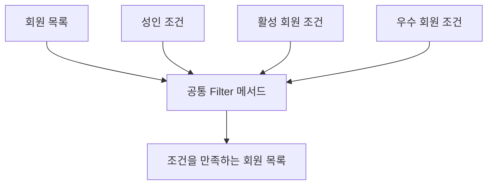
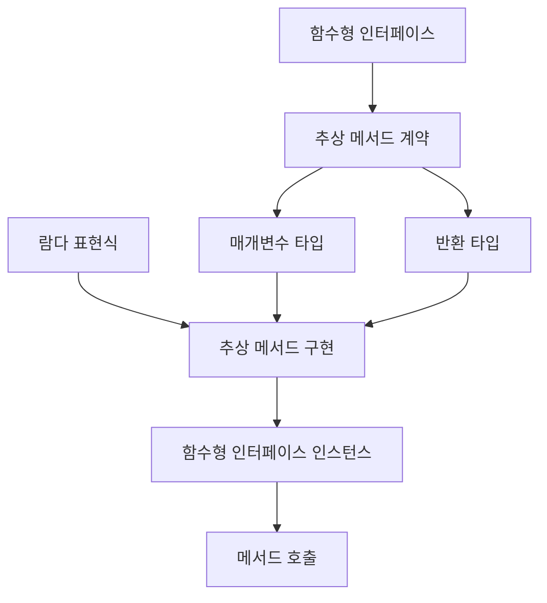
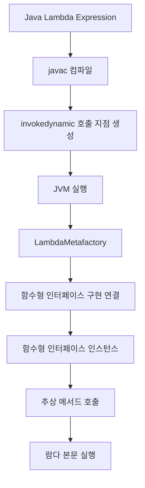
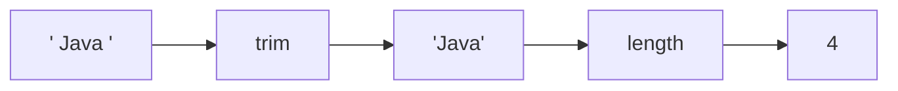
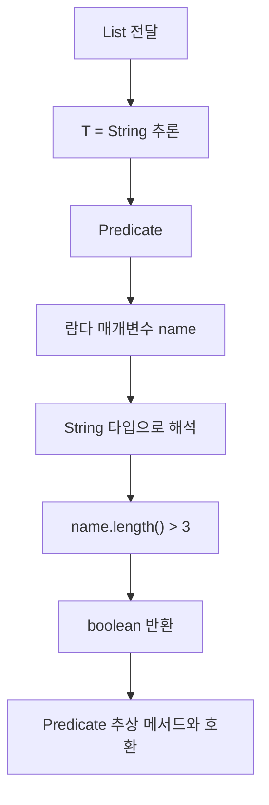
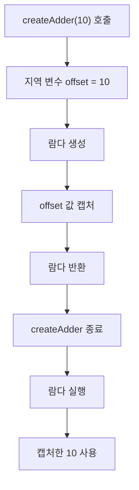
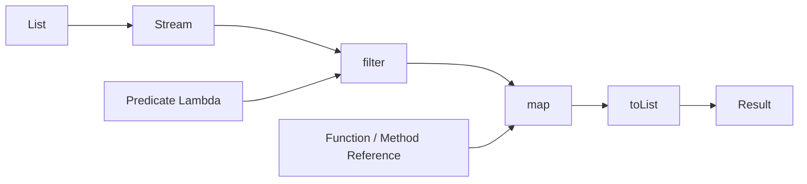

# 리버의 람다
[https://youtu.be/nsK4TP_uvaY?si=AETi-7dZFMgv7u_q](https://youtu.be/nsK4TP_uvaY?si=AETi-7dZFMgv7u_q)

# 리버의 람다
* toc
{:toc}

---

### Java 람다 완벽 이해: 함수형 인터페이스, 익명 클래스와의 차이, invokedynamic, 타입 추론과 실무 활용

Java에서 컬렉션을 정렬하거나 특정 조건에 맞는 데이터를 추출할 때 다음과 같은 코드를 자주 사용한다.

```java
List<String> names = List.of(
        "Kim",
        "Jisoo",
        "Park",
        "Seoyeon"
);

List<String> result = names.stream()
        .filter(name -> name.length() > 3)
        .toList();
```

여기서 다음 부분이 람다 표현식이다.

```java
name -> name.length() > 3
```

처음 보면 메서드 이름도 없고 반환 타입도 존재하지 않는다.

그런데 Java는 이 코드가 문자열을 전달받아 boolean 값을 반환하는 동작이라는 사실을 알고 실행한다.

어떻게 가능한 것일까?

또 다음과 같이 람다를 변수에 저장할 수도 있다.

```java
Predicate<String> condition =
        name -> name.length() > 3;
```

마치 함수를 하나의 값처럼 변수에 저장하는 것처럼 보인다.

하지만 Java에서 람다는 JavaScript와 같은 언어의 함수 객체와 정확히 같은 개념으로 이해해서는 안 된다.

Java의 람다 표현식은 **함수형 인터페이스(Functional Interface)를 대상 타입으로 사용하며, 평가 결과로 해당 인터페이스의 인스턴스를 제공한다.**

더 나아가 람다는 익명 클래스와 문법적으로 비슷해 보이지만 컴파일과 실행 방식에서 차이가 있다.

익명 클래스는 일반적으로 별도의 클래스 파일을 생성하는 방식으로 컴파일된다.

반면 Java의 일반적인 람다 구현은 `invokedynamic`와 `LambdaMetafactory`를 활용해 실행 시점에 함수형 인터페이스의 구현을 연결한다.

이 차이를 이해하면 람다를 단순한 문법 설탕(Syntactic Sugar)이 아니라 Java의 타입 시스템과 JVM 실행 구조를 연결하는 기능으로 이해할 수 있다.

이번에는 다음 두 가지 질문을 중심으로 살펴보자.

**첫 번째, 람다는 무엇이며 Java 내부에서 어떻게 동작하는가?**

**두 번째, 람다는 함수형 인터페이스와 제네릭을 통해 어떻게 사용되는가?**

이후 실무에서 자주 발생하는 성능 문제와 설계상의 주의점까지 확장한다.

---

### 개념

#### 람다(Lambda Expression)란 무엇인가?

람다는 이름을 명시하지 않고 매개변수와 실행할 동작을 표현할 수 있는 Java의 문법이다.

Java 8에서 도입되었으며, 함수형 인터페이스를 기반으로 동작을 다른 메서드에 전달하거나 변수에 보관할 수 있도록 지원한다.

일반적인 메서드와 비교해 보자.

```java
public int add(int a, int b) {
    return a + b;
}
```

이 메서드는 두 개의 정수를 전달받아 합계를 반환한다.

동일한 계산을 람다 표현식으로 작성하면 다음과 같다.

```java
(a, b) -> a + b
```

차이점을 비교하면 다음과 같다.

| 구성 요소 | 일반적인 메서드 | 람다 표현식 |
|---|---|---|
| 메서드 이름 | 필요 | 없음 |
| 매개변수 | 필요 | 필요 |
| 매개변수 타입 | 일반적으로 명시 | 문맥에 따라 생략 가능 |
| 반환 타입 | 선언 | 대상 함수형 인터페이스로 결정 |
| 반환문 | `return` 사용 | 표현식 본문이면 생략 가능 |
| 본문 | 메서드 블록 | 표현식 또는 블록 |
| 사용 방식 | 메서드 호출 | 함수형 인터페이스를 통해 호출 |

람다는 단순히 메서드를 짧게 만드는 문법 이상의 의미를 가진다.

기존에는 메서드를 통해 값이나 객체를 전달하는 것이 일반적이었다.

람다를 사용하면 **어떤 동작을 수행할 것인지도 메서드의 인수로 전달할 수 있다.**

예를 들어 다음과 같이 작성할 수 있다.

```java
public static void execute(Runnable action) {
    action.run();
}
```

이 메서드는 어떤 작업을 수행할지 직접 결정하지 않는다.

실행할 작업을 외부에서 전달받는다.

```java
execute(() -> System.out.println("작업 실행"));
```

이를 통해 실행 흐름과 실제 동작을 분리할 수 있다.

---

### 람다의 기본 문법

람다 표현식은 다음 세 가지 요소로 구성된다.

```text
(매개변수) -> 실행할 동작
```

각 구성 요소를 살펴보자.

#### 1. 매개변수가 없는 경우

```java
() -> System.out.println("Hello");
```

매개변수가 없으면 빈 괄호를 사용한다.

#### 2. 매개변수가 하나인 경우

```java
name -> name.length()
```

타입을 생략한 매개변수가 하나라면 괄호도 생략할 수 있다.

다음처럼 작성해도 된다.

```java
(name) -> name.length()
```

타입을 명시할 수도 있다.

```java
(String name) -> name.length()
```

#### 3. 매개변수가 두 개인 경우

```java
(a, b) -> a + b
```

매개변수가 둘 이상이면 괄호가 필요하다.

#### 4. 실행문이 여러 개인 경우

```java
(a, b) -> {
    int result = a + b;

    System.out.println("result = " + result);

    return result;
}
```

여러 문장을 실행하려면 중괄호를 사용한다.

반환값이 있는 블록 본문에서는 필요한 경로에 명시적인 `return`을 작성해야 한다.

#### 5. 실행문이 하나인 경우

다음 코드를 살펴보자.

```java
(a, b) -> {
    return a + b;
}
```

본문이 하나의 반환 표현식이라면 다음처럼 간결하게 작성할 수 있다.

```java
(a, b) -> a + b
```

이때 반환값은 대상 함수형 인터페이스의 메서드 시그니처에 맞게 결정된다.

다만 모든 람다에서 중괄호와 `return`을 무조건 제거할 수 있는 것은 아니다.

본문의 형태와 대상 메서드의 반환 타입이 호환되어야 한다.

---

### 왜 람다를 사용하는가?

람다의 가장 큰 장점은 코드를 짧게 만드는 것이 아니다.

**동작을 데이터처럼 전달할 수 있도록 함으로써 실행 흐름과 실제 비즈니스 로직을 분리할 수 있다는 점**이다.

예를 들어 회원 목록에서 특정 조건을 만족하는 회원만 추출한다고 가정하자.

처음에는 다음과 같은 메서드를 작성할 수 있다.

```java
public List<Member> findAdultMembers(List<Member> members) {

    List<Member> result = new ArrayList<>();

    for (Member member : members) {
        if (member.getAge() >= 19) {
            result.add(member);
        }
    }

    return result;
}
```

이후 활성 회원만 추출해야 하는 요구사항이 추가되었다.

```java
public List<Member> findActiveMembers(List<Member> members) {

    List<Member> result = new ArrayList<>();

    for (Member member : members) {
        if (member.isActive()) {
            result.add(member);
        }
    }

    return result;
}
```

두 메서드를 비교하면 반복되는 구조가 존재한다.

```text
회원 목록 순회
    ↓
조건 검사
    ↓
조건에 맞는 회원 추가
    ↓
결과 반환
```

달라지는 부분은 조건뿐이다.

이러한 상황에서 람다를 사용하면 공통된 실행 흐름과 변경되는 조건을 분리할 수 있다.

```java
public List<Member> filter(
        List<Member> members,
        Predicate<Member> condition
) {

    List<Member> result = new ArrayList<>();

    for (Member member : members) {
        if (condition.test(member)) {
            result.add(member);
        }
    }

    return result;
}
```

이제 조건을 외부에서 전달할 수 있다.

```java
List<Member> adults = filter(
        members,
        member -> member.getAge() >= 19
);
```

```java
List<Member> activeMembers = filter(
        members,
        Member::isActive
);
```

기존에는 조건이 달라질 때마다 새로운 메서드를 만들었다.

하지만 람다를 사용하면 조건을 전달하는 방식으로 재사용할 수 있다.



이 구조의 중요한 장점은 변경 가능성을 분리했다는 점이다.

회원 목록을 순회하고 결과를 만드는 과정은 공통으로 유지된다.

조건이 변경되더라도 공통 처리 로직을 수정할 필요가 없다.

람다는 이러한 **동작의 추상화(Behavior Abstraction)**를 간결하게 표현하는 수단이다.

---

### 람다는 함수를 변수에 저장하는 것일까?

다음 코드를 살펴보자.

```java
Function<Integer, Integer> doubleValue =
        value -> value * 2;
```

마치 함수를 변수에 저장한 것처럼 보인다.

실제로 다음과 같이 호출할 수도 있다.

```java
int result = doubleValue.apply(10);

System.out.println(result);
```

실행 결과는 다음과 같다.

```text
20
```

하지만 여기서 중요한 점이 있다.

Java에서 람다 표현식이 단독으로 독립적인 함수 타입을 만드는 것은 아니다.

위 코드에서 `doubleValue`의 타입은 다음과 같다.

```java
Function<Integer, Integer>
```

`Function`은 인터페이스다.

람다 표현식은 해당 인터페이스의 추상 메서드를 구현하는 형태로 해석된다.

즉 Java의 람다는 **함수형 인터페이스를 통해 동작을 표현하는 객체 참조**라고 이해하는 것이 정확하다.

Java 언어 명세도 람다 표현식을 평가하면 함수형 인터페이스 타입의 객체 참조가 생성되거나 기존 객체 참조가 사용될 수 있다고 설명한다.

---

### 함수형 인터페이스란 무엇인가?

함수형 인터페이스(Functional Interface)는 람다 표현식의 대상 타입으로 사용할 수 있는 인터페이스다.

일반적으로 추상 메서드를 하나만 가진 인터페이스라고 설명한다.

예를 들어 다음과 같다.

```java
@FunctionalInterface
public interface Calculator {

    int calculate(int a, int b);
}
```

추상 메서드가 하나 존재한다.

```java
int calculate(int a, int b);
```

따라서 다음과 같이 람다를 사용할 수 있다.

```java
Calculator calculator = (a, b) -> a + b;
```

이제 인터페이스의 메서드를 호출한다.

```java
int result = calculator.calculate(10, 20);

System.out.println(result);
```

결과는 다음과 같다.

```text
30
```

여기서 중요한 관계를 정리하면 다음과 같다.



람다 표현식만 보고 모든 타입을 결정하는 것이 아니다.

대상 함수형 인터페이스의 추상 메서드가 어떤 형태인지 확인하고 람다의 타입을 결정한다.

---

### @FunctionalInterface는 반드시 필요한가?

다음 코드를 살펴보자.

```java
public interface Calculator {

    int calculate(int a, int b);
}
```

`@FunctionalInterface`가 없다.

그렇다면 람다를 사용할 수 없을까?

그렇지 않다.

```java
Calculator calculator = (a, b) -> a + b;
```

정상적으로 사용할 수 있다.

`@FunctionalInterface`는 함수형 인터페이스임을 명시하고 컴파일러가 그 계약을 검사하도록 하는 어노테이션이다.

반드시 붙여야만 람다를 사용할 수 있는 것은 아니다.

하지만 다음과 같은 상황을 생각해 보자.

```java
@FunctionalInterface
public interface Calculator {

    int add(int a, int b);

    int subtract(int a, int b);
}
```

추상 메서드가 두 개 존재한다.

이 경우 컴파일 오류가 발생한다.

따라서 함수형 인터페이스를 직접 선언한다면 `@FunctionalInterface`를 사용하는 것이 좋다.

인터페이스가 실수로 변경되어 람다를 사용할 수 없게 되는 문제를 컴파일 시점에 확인할 수 있기 때문이다.

---

### 함수형 인터페이스에는 정말 메서드가 하나만 존재해야 할까?

여기서 조금 더 정확하게 이해할 필요가 있다.

함수형 인터페이스는 반드시 전체 메서드가 하나만 존재해야 하는 것은 아니다.

**함수형 계약을 구성하는 추상 메서드가 하나여야 한다.**

따라서 `default` 메서드와 `static` 메서드를 추가할 수 있다.

예를 들어 다음과 같다.

```java
@FunctionalInterface
public interface Calculator {

    int calculate(int a, int b);

    default int calculateAndDouble(int a, int b) {
        return calculate(a, b) * 2;
    }

    static Calculator addition() {
        return Integer::sum;
    }
}
```

이 인터페이스에는 세 개의 메서드가 존재한다.

하지만 추상 메서드는 하나다.

따라서 람다로 구현할 수 있다.

```java
Calculator calculator = (a, b) -> a + b;

System.out.println(
        calculator.calculateAndDouble(10, 20)
);
```

결과는 다음과 같다.

```text
60
```

또 `Object`의 `public` 인스턴스 메서드와 대응되는 추상 메서드는 함수형 인터페이스의 추상 메서드 수를 판단할 때 특별하게 취급된다.

대표적인 예가 `Comparator<T>`다.

`Comparator`에는 비교를 수행하는 추상 메서드가 존재한다.

```java
int compare(T o1, T o2);
```

인터페이스에 `equals(Object)` 선언이 존재하더라도 함수형 인터페이스로 사용할 수 있다.

이러한 규칙은 Java 언어 명세에 정의되어 있다.

---

### 주요 특징

### 익명 클래스와 람다는 무엇이 다를까?

람다가 등장하기 전에는 인터페이스를 구현하는 동작을 간단히 전달하기 위해 익명 클래스를 자주 사용했다.

예를 들어 다음 인터페이스가 있다고 가정하자.

```java
@FunctionalInterface
public interface MyFunction {

    void execute();
}
```

익명 클래스를 사용하면 다음과 같이 구현할 수 있다.

```java
MyFunction function = new MyFunction() {

    @Override
    public void execute() {
        System.out.println("Hello");
    }
};
```

람다를 사용하면 다음과 같다.

```java
MyFunction function =
        () -> System.out.println("Hello");
```

두 코드 모두 다음 메서드를 호출할 수 있다.

```java
function.execute();
```

실행 결과도 동일하다.

```text
Hello
```

하지만 내부적인 구현은 다르다.

두 방식을 비교하면 다음과 같다.

| 구분 | 익명 클래스 | 람다 |
|---|---|---|
| 문법 | 클래스 본문 작성 | 매개변수와 실행 동작 표현 |
| 컴파일 | 일반적으로 별도 클래스 파일 생성 | 일반적으로 `invokedynamic` 활용 |
| `this` | 익명 클래스의 인스턴스 | 람다를 감싸는 바깥 문맥 |
| 추상 메서드 | 여러 메서드 구현 가능 | 함수형 인터페이스 대상 |
| 추가 필드 선언 | 가능 | 람다 본문 자체에 인스턴스 필드 선언 불가 |
| 객체 생성 | 일반적인 클래스 인스턴스 생성 | JVM 구현 전략에 따라 달라짐 |
| 객체 동일성 | 일반적인 `new` 의미 | 동일성에 의존하면 안 됨 |
| 주요 용도 | 별도 상태나 구현이 필요한 객체 | 간결한 동작 전달 |

특히 주의 깊게 살펴볼 부분은 `this`의 동작과 JVM 내부 구현 방식이다.

---

### 익명 클래스의 this는 무엇을 가리킬까?

다음 클래스를 살펴보자.

```java
public class MyService {

    private final String name = "MyService";

    public void execute() {

        Runnable task = new Runnable() {

            @Override
            public void run() {

                System.out.println(this.getClass().getName());

                System.out.println(MyService.this.name);
            }
        };

        task.run();
    }
}
```

익명 클래스 내부의 `this`는 익명 클래스 자신의 인스턴스를 가리킨다.

따라서 다음 코드는 익명 클래스의 런타임 타입을 조회한다.

```java
this.getClass().getName()
```

반면 바깥 클래스의 인스턴스에 접근하려면 다음과 같이 작성할 수 있다.

```java
MyService.this.name
```

이것은 익명 클래스가 자신만의 `this`를 가지기 때문이다.

개념적으로 다음과 같다.

```text
MyService 인스턴스
    │
    └── 익명 클래스 인스턴스
            │
            ├── this → 익명 클래스 인스턴스
            │
            └── MyService.this → 바깥 MyService 인스턴스
```

---

### 람다의 this는 무엇을 가리킬까?

동일한 기능을 람다로 작성해 보자.

```java
public class MyService {

    private final String name = "MyService";

    public void execute() {

        Runnable task = () -> {

            System.out.println(this.getClass().getName());

            System.out.println(this.name);
        };

        task.run();
    }
}
```

이번에는 `this`가 바깥 `MyService` 인스턴스를 가리킨다.

즉 람다는 익명 클래스처럼 새로운 `this` 문맥을 만들지 않는다.

다음과 같이 이해할 수 있다.

```text
MyService 인스턴스
    │
    └── 람다 표현식
            │
            └── this → MyService 인스턴스
```

이러한 특성을 **Lexical Scoping**과 연결해 이해할 수 있다.

람다 본문에서 `this`와 `super`의 의미는 람다를 감싸는 문맥을 따른다.

Java 언어 명세에서도 람다의 `this`와 `super`가 바깥 문맥과 동일한 의미를 가진다고 정의한다.

---

### static 메서드에서 람다의 this를 사용할 수 있을까?

다음 코드를 살펴보자.

```java
public class MyService {

    public static void execute() {

        Runnable task = () -> {
            System.out.println(this);
        };
    }
}
```

이 코드는 컴파일되지 않는다.

이유는 `static` 메서드에 `this`가 존재하지 않기 때문이다.

람다는 자신만의 `this`를 생성하지 않으므로 바깥 문맥에서 사용할 수 없는 `this`를 람다 내부에서도 사용할 수 없다.

반대로 익명 클래스에서는 다음과 같은 코드가 가능하다.

```java
public class MyService {

    public static void execute() {

        Runnable task = new Runnable() {

            @Override
            public void run() {
                System.out.println(this);
            }
        };

        task.run();
    }
}
```

이 코드에서 `this`는 익명 클래스 인스턴스를 가리킨다.

따라서 `static` 메서드 내부에서도 사용할 수 있다.

이 차이는 람다와 익명 클래스를 구분하는 중요한 특징이다.

---

### 익명 클래스와 람다의 컴파일 방식

이제 JVM 내부 동작을 살펴보자.

앞서 익명 클래스와 람다는 비슷한 기능을 수행하지만 내부 구현이 다르다고 설명했다.

이를 실제 바이트코드 관점에서 이해해 보자.

먼저 다음 코드를 작성한다.

`AnonymousExample.java`

```java
public class AnonymousExample {

    public static void main(String[] args) {

        Runnable task = new Runnable() {

            @Override
            public void run() {
                System.out.println("Hello");
            }
        };

        task.run();
    }
}
```

컴파일한다.

```bash
javac AnonymousExample.java
```

일반적인 `javac` 구현에서는 다음과 같은 클래스 파일이 생성된다.

```text
AnonymousExample.class

AnonymousExample$1.class
```

`AnonymousExample$1.class`는 익명 클래스에 대응하는 클래스 파일이다.

이제 바이트코드를 확인한다.

```bash
javap -c -p AnonymousExample
```

관련 부분에서는 다음과 같은 명령어를 확인할 수 있다.

```text
new
dup
invokespecial
```

여기서 `new`는 객체 인스턴스 생성을 위한 바이트코드 명령어다.

`invokespecial`은 생성자 호출 등에 사용된다.

즉 익명 클래스는 일반적인 클래스 인스턴스 생성 방식과 연결된다.

---

### 람다는 어떻게 컴파일될까?

이번에는 람다로 변경한다.

`LambdaExample.java`

```java
public class LambdaExample {

    public static void main(String[] args) {

        Runnable task =
                () -> System.out.println("Hello");

        task.run();
    }
}
```

컴파일한다.

```bash
javac LambdaExample.java
```

일반적인 `javac` 구현에서는 다음과 같은 클래스 파일이 생성된다.

```text
LambdaExample.class
```

익명 클래스처럼 소스의 람다마다 별도의 일반적인 클래스 파일이 반드시 생성되는 것은 아니다.

이제 바이트코드를 확인한다.

```bash
javap -c -p LambdaExample
```

람다를 만드는 부분에서 다음과 같은 명령어를 확인할 수 있다.

```text
invokedynamic
```

또 람다 본문의 구현에 대응하는 컴파일러 생성 메서드가 나타날 수 있다.

예를 들어 다음과 같은 이름이다.

```text
lambda$main$0
```

단, 생성되는 메서드 이름과 바이트코드의 세부 구조는 컴파일러 구현과 Java 버전에 따라 달라질 수 있다.

핵심은 람다를 생성하고 연결하는 방식이다.

일반적인 Java 람다 구현은 `invokedynamic`를 사용한다.

---

### invokedynamic란 무엇인가?

`invokedynamic`는 JVM 바이트코드 명령어 중 하나다.

기존 Java 코드에서 일반적인 메서드 호출은 다음과 같은 명령어를 사용할 수 있다.

| 명령어 | 주요 역할 |
|---|---|
| `invokestatic` | static 메서드 호출 |
| `invokevirtual` | 인스턴스 메서드 호출 |
| `invokeinterface` | 인터페이스 메서드 호출 |
| `invokespecial` | 생성자 및 특정 메서드 호출 |
| `invokedynamic` | 동적 연결을 통해 호출 대상 결정 |

람다에서 `invokedynamic`가 사용되는 이유는 JVM이 함수형 인터페이스의 구현을 연결하는 방식을 유연하게 선택할 수 있도록 하기 위해서다.

예를 들어 다음 람다를 생각해 보자.

```java
Runnable task = () -> System.out.println("Hello");
```

컴파일러는 람다를 실행하기 위한 정보를 바이트코드에 기록한다.

JVM은 실행 시점에 필요한 연결 과정을 수행한다.

이 과정에서 중요한 역할을 하는 것이 `LambdaMetafactory`다.

---

### LambdaMetafactory란 무엇인가?

`LambdaMetafactory`는 람다와 메서드 참조를 위한 함수형 객체를 생성하거나 연결하는 데 사용되는 JDK 구성 요소다.

클래스의 위치는 다음과 같다.

```java
java.lang.invoke.LambdaMetafactory
```

일반적인 람다 구현에서는 `invokedynamic`의 Bootstrap Method로 사용될 수 있다.

전체 흐름은 다음과 같이 이해할 수 있다.



이 과정에서 `LambdaMetafactory`는 함수형 인터페이스와 실제 구현 메서드의 연결을 지원한다.

조금 더 구체적으로 살펴보자.

#### 1. 컴파일 단계

컴파일러는 람다 본문의 동작을 표현하는 메서드나 메서드 핸들 정보를 준비한다.

또 `invokedynamic` 호출 지점을 생성한다.

#### 2. 연결 단계

실행 시점에 JVM이 Bootstrap Method를 통해 필요한 호출 지점을 연결한다.

`LambdaMetafactory`는 `CallSite`를 생성하는 데 사용될 수 있다.

#### 3. 인스턴스 확보 단계

`CallSite`의 대상이 호출되면 함수형 인터페이스의 인스턴스를 얻는다.

이때 구현 방식에 따라 새로운 객체가 생성될 수도 있고 적절한 기존 인스턴스가 재사용될 수도 있다.

#### 4. 실행 단계

함수형 인터페이스의 추상 메서드를 호출하면 실제 람다 본문에 해당하는 동작이 실행된다.

JDK 17의 `LambdaMetafactory` 문서에서도 이 과정을 Linkage, Capture, Invocation 단계로 설명한다.

---

### 람다는 객체를 생성하지 않는 것일까?

여기서 자주 발생하는 오해가 있다.

익명 클래스는 `new`를 사용하지만 람다는 `invokedynamic`를 사용하므로 객체를 생성하지 않는다는 설명이다.

이는 정확하지 않다.

람다 표현식을 평가한 결과는 함수형 인터페이스 타입의 객체 참조다.

다만 객체를 언제 생성하고 재사용할지는 JVM 구현에 따라 달라질 수 있다.

예를 들어 다음 코드를 살펴보자.

```java
Runnable task = () -> System.out.println("Hello");

System.out.println(task.getClass().getName());
```

HotSpot JVM에서는 런타임에 생성된 구현 클래스에 대응하는 이름을 확인할 수 있다.

예를 들어 다음과 같은 형태가 나타날 수 있다.

```text
LambdaExample$$Lambda$...
```

하지만 정확한 클래스 이름과 내부 구현은 Java 버전 및 JVM 구현에 따라 달라진다.

또 람다 표현식을 평가할 때마다 반드시 새로운 객체가 생성되는 것도 아니다.

다음 코드를 생각해 보자.

```java
Runnable first = () -> System.out.println("Hello");

Runnable second = () -> System.out.println("Hello");
```

두 람다가 동일한 코드를 실행한다고 해서 동일한 객체라고 가정할 수 없다.

반대로 다음과 같은 메서드가 있다고 가정하자.

```java
public static Runnable createTask() {
    return () -> System.out.println("Hello");
}
```

이 메서드를 여러 번 호출했을 때 매번 새로운 객체가 생성된다고도 단정할 수 없다.

**람다 객체의 참조 동일성은 프로그램이 의존해야 하는 계약이 아니다.**

따라서 람다 객체를 `==`로 비교하거나, 객체 자체를 락으로 사용하는 방식은 피하는 것이 좋다.

이는 Java 언어 명세에도 명시된 특성이다.

---

### 람다를 선언하면 본문이 즉시 실행될까?

다음 코드를 살펴보자.

```java
Runnable task = () -> {
    System.out.println("Hello");
};
```

이 코드를 실행한다고 `Hello`가 즉시 출력되는 것은 아니다.

람다 표현식이 평가되어 함수형 인터페이스의 인스턴스를 얻는 과정과 람다 본문이 실행되는 과정은 구분된다.

실제 본문은 다음 코드를 호출할 때 실행된다.

```java
task.run();
```

이 차이는 중요하다.

람다는 실행할 동작을 미리 정의해 전달할 수 있다.

따라서 실제 실행 시점을 호출자에게 맡길 수 있다.

이러한 특성은 지연 실행과 콜백, 이벤트 처리 등에 활용할 수 있다.

---

### 표준 함수형 인터페이스란 무엇인가?

Java에서는 함수형 인터페이스를 사용할 때마다 직접 선언할 필요가 없도록 여러 표준 인터페이스를 제공한다.

대표적인 패키지는 다음과 같다.

```java
java.util.function
```

이 패키지에는 입력과 출력의 형태에 따라 여러 함수형 인터페이스가 정의되어 있다.

대표적인 종류를 살펴보자.

| 인터페이스 | 추상 메서드 | 입력 | 출력 |
|---|---|---|---|
| `Supplier<T>` | `get()` | 없음 | T |
| `Consumer<T>` | `accept(T)` | T | void |
| `Predicate<T>` | `test(T)` | T | boolean |
| `Function<T,R>` | `apply(T)` | T | R |
| `BiFunction<T,U,R>` | `apply(T,U)` | T, U | R |
| `BiPredicate<T,U>` | `test(T,U)` | T, U | boolean |
| `UnaryOperator<T>` | `apply(T)` | T | T |
| `BinaryOperator<T>` | `apply(T,T)` | T, T | T |
| `IntPredicate` | `test(int)` | int | boolean |
| `IntUnaryOperator` | `applyAsInt(int)` | int | int |
| `ToIntFunction<T>` | `applyAsInt(T)` | T | int |
| `IntFunction<R>` | `apply(int)` | int | R |

이 외에도 `Runnable`과 `Callable`처럼 함수형 인터페이스로 사용할 수 있는 인터페이스가 존재한다.

단, `Runnable`은 `java.util.function` 패키지가 아니라 `java.lang` 패키지에 존재한다.

`Callable<V>`는 `java.util.concurrent` 패키지에 존재한다.

이러한 표준 인터페이스의 종류와 의미는 Java 공식 API 문서에서 확인할 수 있다.

---

### Runnable: 입력과 반환값이 없는 작업

`Runnable`은 매개변수가 없고 반환값도 없는 작업을 표현한다.

추상 메서드는 다음과 같다.

```java
void run();
```

예를 들어 다음과 같이 사용할 수 있다.

```java
Runnable task = () -> {
    System.out.println("작업 실행");
};
```

작업을 실행하려면 다음 메서드를 호출한다.

```java
task.run();
```

실행 결과는 다음과 같다.

```text
작업 실행
```

여기서 중요한 점이 있다.

`Runnable`은 Thread와 함께 자주 사용되지만, 람다를 `Runnable`로 선언했다고 별도 Thread에서 실행되는 것은 아니다.

다음 코드는 현재 Thread에서 실행된다.

```java
task.run();
```

반면 다음 코드는 새로운 Thread에서 실행되도록 요청한다.

```java
new Thread(task).start();
```

즉 람다 자체는 비동기 실행 기능이 아니다.

람다가 전달되는 API가 작업을 어떻게 실행하는지에 따라 동기 또는 비동기 동작이 결정된다.

---

### Supplier: 입력 없이 값을 제공하는 함수

`Supplier<T>`는 매개변수 없이 값을 제공하는 함수형 인터페이스다.

추상 메서드는 다음과 같다.

```java
T get();
```

예를 들어 다음과 같이 사용할 수 있다.

```java
Supplier<String> supplier =
        () -> "Hello Java";
```

실행한다.

```java
String result = supplier.get();

System.out.println(result);
```

결과는 다음과 같다.

```text
Hello Java
```

`Supplier`의 중요한 활용 사례는 지연 실행이다.

예를 들어 다음 코드를 생각해 보자.

```java
Supplier<String> messageSupplier =
        () -> createExpensiveMessage();
```

람다를 생성하는 시점에는 일반적으로 `createExpensiveMessage()`를 호출하지 않는다.

다음 코드를 실행할 때 호출한다.

```java
messageSupplier.get();
```

이러한 특성은 필요한 경우에만 비용이 큰 작업을 수행하는 데 유용하다.

---

### Consumer: 입력을 받아 작업을 수행하는 함수

`Consumer<T>`는 입력을 전달받지만 반환값은 없는 함수형 인터페이스다.

추상 메서드는 다음과 같다.

```java
void accept(T value);
```

예를 들어 다음과 같다.

```java
Consumer<String> printer =
        name -> System.out.println(name);
```

실행한다.

```java
printer.accept("Java");
```

결과는 다음과 같다.

```text
Java
```

컬렉션에서 자주 사용하는 `forEach()`도 `Consumer`를 활용한다.

```java
List<String> names = List.of(
        "Kim",
        "Lee",
        "Park"
);

names.forEach(name -> System.out.println(name));
```

메서드 참조를 사용하면 더 간결하게 작성할 수 있다.

```java
names.forEach(System.out::println);
```

`Consumer`는 로그 출력이나 이벤트 전달, 객체에 대한 특정 작업 실행 등에 사용할 수 있다.

다만 상태를 변경하는 작업을 사용할 때는 실행 순서와 예외 처리, 동시성 문제를 고려해야 한다.

---

### Predicate: 조건을 검사하는 함수

`Predicate<T>`는 입력을 받아 `boolean` 값을 반환한다.

추상 메서드는 다음과 같다.

```java
boolean test(T value);
```

예를 들어 회원의 나이가 성인 기준을 충족하는지 검사할 수 있다.

```java
Predicate<Integer> isAdult =
        age -> age >= 19;
```

사용한다.

```java
System.out.println(isAdult.test(20));

System.out.println(isAdult.test(15));
```

결과는 다음과 같다.

```text
true
false
```

`Predicate`는 컬렉션의 필터링과 조건 검사에서 자주 사용된다.

예를 들어 다음과 같다.

```java
List<Integer> numbers = List.of(1, 2, 3, 4, 5);

List<Integer> evenNumbers = numbers.stream()
        .filter(number -> number % 2 == 0)
        .toList();
```

결과는 다음과 같다.

```text
[2, 4]
```

이 코드에서 `filter()`는 `Predicate`를 매개변수로 전달받는다.

조건이 `true`인 요소만 다음 단계로 전달한다.

---

### Predicate의 조건 조합

`Predicate`는 `and()`, `or()`, `negate()` 같은 메서드를 제공한다.

따라서 여러 조건을 조합할 수 있다.

예를 들어 다음 조건을 정의해 보자.

```java
Predicate<Integer> isAdult =
        age -> age >= 19;

Predicate<Integer> isUnder65 =
        age -> age < 65;
```

두 조건을 모두 만족해야 한다면 다음과 같이 작성한다.

```java
Predicate<Integer> isWorkingAge =
        isAdult.and(isUnder65);
```

이제 검사한다.

```java
System.out.println(isWorkingAge.test(30));

System.out.println(isWorkingAge.test(70));
```

결과는 다음과 같다.

```text
true
false
```

`or()`를 사용하면 둘 중 하나의 조건을 만족하는지 확인할 수 있다.

`negate()`를 사용하면 조건을 반대로 만들 수 있다.

이때 `and()`와 `or()`는 단락 평가(Short-Circuit Evaluation)를 지원한다.

예를 들어 `and()`의 첫 번째 조건이 `false`라면 두 번째 조건은 평가하지 않는다.

이러한 동작은 Java 공식 API에 정의되어 있다.

---

### Function: 입력을 다른 값으로 변환하는 함수

`Function<T,R>`은 입력을 받아 결과를 반환하는 함수형 인터페이스다.

추상 메서드는 다음과 같다.

```java
R apply(T value);
```

여기서 `T`는 입력 타입이다.

`R`은 반환 타입이다.

예를 들어 문자열을 정수로 변환할 수 있다.

```java
Function<String, Integer> parser =
        Integer::parseInt;
```

사용한다.

```java
Integer result = parser.apply("100");

System.out.println(result);
```

결과는 다음과 같다.

```text
100
```

이 인터페이스는 DTO 변환이나 데이터 가공처럼 입력값을 다른 형태로 변환하는 작업에 유용하다.

---

### Function의 compose와 andThen

`Function`은 여러 함수를 연결할 수 있는 메서드를 제공한다.

대표적으로 다음 두 가지가 있다.

```java
compose()
```

```java
andThen()
```

예를 들어 다음과 같은 함수를 정의하자.

```java
Function<String, String> trim =
        String::trim;

Function<String, Integer> length =
        String::length;
```

두 함수를 연결할 수 있다.

```java
Function<String, Integer> normalizedLength =
        trim.andThen(length);
```

호출한다.

```java
int result = normalizedLength.apply("  Java  ");

System.out.println(result);
```

결과는 다음과 같다.

```text
4
```

실행 순서는 다음과 같다.



`andThen()`은 현재 함수를 먼저 실행하고 전달된 함수를 나중에 실행한다.

반대로 `compose()`는 전달된 함수를 먼저 실행한다.

예를 들어 다음 코드도 같은 결과를 반환한다.

```java
Function<String, Integer> normalizedLength =
        length.compose(trim);
```

`Function`의 합성 메서드는 데이터 변환 과정을 여러 단계로 나누는 데 활용할 수 있다.

---

### BiFunction: 두 개의 입력을 처리하는 함수

`BiFunction<T,U,R>`은 두 개의 입력을 받아 하나의 결과를 반환한다.

예를 들어 다음과 같다.

```java
BiFunction<Integer, Integer, Integer> add =
        (a, b) -> a + b;
```

사용한다.

```java
int result = add.apply(10, 20);

System.out.println(result);
```

결과는 다음과 같다.

```text
30
```

이때 두 개의 입력 타입과 반환 타입은 서로 다를 수도 있다.

예를 들어 다음과 같이 사용할 수 있다.

```java
BiFunction<String, Integer, String> repeat =
        (text, count) -> text.repeat(count);
```

실행한다.

```java
System.out.println(repeat.apply("A", 3));
```

결과는 다음과 같다.

```text
AAA
```

단순한 두 입력의 계산이라면 별도 인터페이스를 만들지 않고 `BiFunction`을 활용할 수 있다.

다만 입력과 출력의 비즈니스 의미가 중요한 경우에는 별도 도메인 타입을 정의하는 것이 가독성과 설계 측면에서 더 나을 수 있다.

---

### UnaryOperator와 BinaryOperator

`UnaryOperator<T>`는 `Function<T,T>`를 확장한 함수형 인터페이스다.

입력과 반환 타입이 동일한 경우에 사용한다.

```java
UnaryOperator<String> normalize =
        text -> text.trim().toLowerCase();
```

`BinaryOperator<T>`는 `BiFunction<T,T,T>`를 확장한다.

두 개의 동일한 타입을 입력받아 같은 타입을 반환한다.

```java
BinaryOperator<Integer> max =
        Integer::max;
```

사용한다.

```java
System.out.println(max.apply(10, 20));
```

결과는 다음과 같다.

```text
20
```

정리하면 다음과 같다.

| 상황 | 적절한 인터페이스 |
|---|---|
| `String → Integer` | `Function<String,Integer>` |
| `String → String` | `UnaryOperator<String>` |
| `Integer, Integer → Integer` | `BinaryOperator<Integer>` |
| `String, Integer → String` | `BiFunction<String,Integer,String>` |

이러한 인터페이스는 기능적으로 비슷하지만 타입의 의미를 조금 더 명확하게 표현할 수 있다.

---

### 제네릭과 람다의 타입 추론

람다를 이해할 때 중요한 개념 중 하나는 타입 추론(Type Inference)이다.

다음 코드를 살펴보자.

```java
Predicate<String> condition =
        name -> name.length() > 3;
```

여기서 `name`의 타입은 무엇일까?

명시적으로 선언하지 않았지만 Java 컴파일러는 `String`으로 판단한다.

왜 그럴까?

람다 표현식이 할당되는 대상 타입이 다음과 같기 때문이다.

```java
Predicate<String>
```

`Predicate<T>`의 추상 메서드는 다음과 같다.

```java
boolean test(T value);
```

여기서 `T`가 `String`으로 결정되면 실제 메서드의 형태는 다음과 같이 이해할 수 있다.

```java
boolean test(String value);
```

따라서 람다의 매개변수도 `String`으로 추론된다.

```java
name -> name.length() > 3
```

컴파일러는 `name`이 `String`이므로 `length()` 메서드를 호출할 수 있다는 사실을 안다.

또 반환값이 `boolean`이므로 `Predicate<String>`의 추상 메서드와 호환된다고 판단한다.

---

### Target Typing이란 무엇인가?

람다는 주변 문맥에 따라 타입이 결정된다.

이를 Target Typing이라고 한다.

예를 들어 다음 코드를 살펴보자.

```java
Predicate<String> condition =
        name -> name.length() > 3;
```

람다 표현식은 `Predicate<String>`을 대상으로 해석된다.

하지만 다음처럼 작성하면 어떨까?

```java
Function<String, Integer> function =
        name -> name.length();
```

이번에는 `Function<String,Integer>`를 대상으로 해석된다.

즉 람다의 타입은 다음 요소에 의해 결정된다.

- 할당되는 변수의 타입
- 메서드 매개변수 타입
- 캐스팅 대상 타입
- 제네릭 타입 추론 결과

이러한 특성 때문에 Java에서는 람다의 매개변수 타입을 생략할 수 있다.

Java 언어 명세는 람다 표현식이 대상 타입을 필요로 하는 표현식이며, 함수형 인터페이스의 메서드 시그니처와 호환되어야 한다고 정의한다.

---

### 제네릭 메서드와 Predicate를 함께 사용하는 방법

이번에는 직접 제네릭 메서드를 작성해 보자.

```java
public static <T> List<T> filter(
        List<T> source,
        Predicate<? super T> condition
) {

    List<T> result = new ArrayList<>();

    for (T element : source) {
        if (condition.test(element)) {
            result.add(element);
        }
    }

    return result;
}
```

이 메서드는 두 개의 매개변수를 받는다.

```java
List<T> source
```

```java
Predicate<? super T> condition
```

첫 번째 매개변수는 데이터 목록이다.

두 번째 매개변수는 조건을 검사하는 함수형 인터페이스다.

이제 다음과 같이 호출한다.

```java
List<String> names = List.of(
        "Kim",
        "Jisoo",
        "Park",
        "Seoyeon"
);

List<String> result = filter(
        names,
        name -> name.length() > 3
);
```

타입 추론 과정을 순서대로 살펴보자.

#### 1단계: List의 타입 확인

첫 번째 매개변수는 다음과 같다.

```java
List<String>
```

따라서 `T`는 `String`으로 추론될 수 있다.

```text
T = String
```

#### 2단계: Predicate 타입 확인

두 번째 매개변수는 다음과 같다.

```java
Predicate<? super T>
```

`T`가 `String`이므로 다음과 같이 해석할 수 있다.

```java
Predicate<? super String>
```

이는 `String` 또는 `String`의 상위 타입을 처리할 수 있는 Predicate를 허용한다.

예를 들어 다음 타입이 호환될 수 있다.

```java
Predicate<String>
```

```java
Predicate<Object>
```

#### 3단계: 람다 매개변수 타입 결정

다음 람다를 살펴보자.

```java
name -> name.length() > 3
```

현재 메서드 호출의 대상 타입 문맥에서 `name`은 `String`으로 추론된다.

따라서 `length()` 메서드를 사용할 수 있다.

#### 4단계: 반환 타입 확인

람다의 본문은 다음과 같다.

```java
name.length() > 3
```

이 표현식의 결과는 `boolean`이다.

`Predicate`의 추상 메서드도 `boolean`을 반환한다.

따라서 람다가 함수형 인터페이스의 계약과 일치한다.

전체 과정을 구조로 표현하면 다음과 같다.



이것이 제네릭과 람다가 함께 동작하는 기본 원리다.

---

### Predicate<? super T>는 왜 사용하는가?

다음 두 메서드를 비교해 보자.

```java
public static <T> List<T> filter(
        List<T> source,
        Predicate<T> condition
)
```

```java
public static <T> List<T> filter(
        List<T> source,
        Predicate<? super T> condition
)
```

두 번째 메서드는 `? super T`를 사용한다.

왜 이렇게 작성할까?

예를 들어 다음 Predicate가 있다고 가정하자.

```java
Predicate<Object> nonNull =
        Objects::nonNull;
```

이 Predicate는 모든 객체를 전달받아 null 여부를 확인할 수 있다.

따라서 `String`도 검사할 수 있다.

```java
List<String> names = List.of(
        "Kim",
        "Lee",
        "Park"
);
```

`Predicate<? super T>`를 사용하면 다음과 같이 호출할 수 있다.

```java
List<String> result = filter(names, nonNull);
```

`Predicate<Object>`가 `String` 객체를 처리하는 데 문제가 없기 때문이다.

반면 매개변수를 `Predicate<T>`로 제한하면 이러한 재사용이 어려워질 수 있다.

`? super T`는 입력을 소비하는 함수형 인터페이스를 설계할 때 유연성을 제공한다.

이 개념은 Java 제네릭에서 자주 사용하는 PECS 원칙과 연결된다.

```text
Producer Extends

Consumer Super
```

Predicate는 `T` 타입의 값을 입력받아 소비하는 역할을 한다.

따라서 `? super T`를 사용하는 것이 자연스럽다.

물론 모든 API에 무조건 와일드카드를 사용해야 하는 것은 아니다.

타입 관계가 복잡해져 가독성이 떨어진다면 API 설계를 다시 검토해야 한다.

---

### 람다의 타입 추론이 실패하는 경우

람다의 타입 추론은 편리하지만 모든 상황에서 완벽하게 동작하는 것은 아니다.

예를 들어 다음과 같은 코드가 있다고 가정하자.

```java
public void execute(Predicate<String> condition) {
    // ...
}
```

람다를 전달하면 정상적으로 동작한다.

```java
execute(value -> value.length() > 3);
```

하지만 다음처럼 대상 타입 없이 람다만 독립적으로 선언할 수는 없다.

```java
var condition = value -> value.length() > 3;
```

이 코드는 컴파일되지 않는다.

컴파일러가 람다의 대상 함수형 인터페이스를 결정할 수 없기 때문이다.

반면 다음과 같이 명시하면 된다.

```java
Predicate<String> condition =
        value -> value.length() > 3;
```

또는 명시적인 캐스팅을 사용할 수도 있다.

```java
var condition =
        (Predicate<String>) value -> value.length() > 3;
```

핵심은 람다의 대상 타입이 필요하다는 점이다.

**람다는 단순히 본문만 보고 독립적인 함수 타입이 자동으로 만들어지는 구조가 아니다.**

---

### 람다 매개변수 타입을 명시해야 하는 경우

대부분의 경우 매개변수 타입을 생략하는 것이 간결하다.

```java
(name) -> name.length()
```

하지만 다음처럼 타입을 명시할 수도 있다.

```java
(String name) -> name.length()
```

타입이 복잡하거나 메서드 오버로딩과 제네릭 추론이 얽힌 경우에는 명시적인 타입이 가독성을 높일 수 있다.

Java 11부터는 람다 매개변수에 `var`를 사용할 수도 있다.

```java
(var a, var b) -> a + b
```

다만 `var`와 다른 선언 방식을 임의로 혼합할 수는 없다.

예를 들어 다음 코드는 올바르지 않다.

```java
(var a, int b) -> a + b
```

또 다음 코드도 올바르지 않다.

```java
(int a, b) -> a + b
```

매개변수 선언 방식은 일관되게 작성해야 한다.

여기서 중요한 점은 **타입을 명시한다고 실행 성능이 자동으로 향상되지는 않는다**는 것이다.

명시적인 타입 선언은 주로 타입 해석을 명확하게 하고 가독성을 높이는 데 도움이 된다.

실제 성능은 생성되는 바이트코드와 JVM 최적화, 객체 생성, 실행 빈도 등의 영향을 받는다.

---

### 기본형과 Wrapper 타입의 성능 문제

Java의 표준 함수형 인터페이스는 제네릭을 사용한다.

예를 들어 다음과 같다.

```java
Function<Integer, Integer> doubleValue =
        value -> value * 2;
```

하지만 Java 제네릭은 기본형을 직접 타입 인수로 사용할 수 없다.

따라서 다음과 같이 작성할 수 없다.

```java
Function<int, int>
```

대신 `Integer`를 사용해야 한다.

이 과정에서 기본형과 Wrapper 타입 사이의 변환이 발생할 수 있다.

이를 Boxing과 Unboxing이라고 한다.

#### Boxing

기본형 값을 Wrapper 객체 형태로 변환하는 것이다.

```java
int value = 10;

Integer boxed = value;
```

#### Unboxing

Wrapper 객체의 값을 기본형으로 변환하는 것이다.

```java
Integer boxed = 10;

int value = boxed;
```

람다에서도 이러한 변환이 발생할 수 있다.

```java
Function<Integer, Integer> function =
        value -> value + 1;
```

입력은 `Integer`다.

산술 연산 과정에서는 기본형 값이 사용된다.

반환 타입은 다시 `Integer`다.

따라서 상황에 따라 Boxing과 Unboxing 비용이 발생할 수 있다.

물론 모든 연산이 반드시 새로운 객체 할당으로 이어지는 것은 아니다.

Wrapper 캐싱과 JIT 최적화 등의 영향을 받을 수 있다.

하지만 대량의 숫자를 반복적으로 처리하는 구간에서는 이러한 변환 비용을 고려할 필요가 있다.

---

### 기본형 특화 함수형 인터페이스

Java는 Boxing과 Unboxing을 줄일 수 있도록 기본형 특화 함수형 인터페이스를 제공한다.

예를 들어 다음 코드를 생각해 보자.

```java
Function<Integer, Integer> doubleValue =
        value -> value * 2;
```

이를 다음과 같이 변경할 수 있다.

```java
IntUnaryOperator doubleValue =
        value -> value * 2;
```

사용한다.

```java
int result = doubleValue.applyAsInt(10);

System.out.println(result);
```

결과는 다음과 같다.

```text
20
```

`IntUnaryOperator`는 입력과 출력 모두 `int`를 사용한다.

따라서 함수형 인터페이스의 메서드 경계에서 `Integer` 객체로 변환할 필요가 없다.

대표적인 기본형 특화 인터페이스는 다음과 같다.

| 인터페이스 | 입력 | 출력 |
|---|---|---|
| `IntPredicate` | int | boolean |
| `IntConsumer` | int | void |
| `IntSupplier` | 없음 | int |
| `IntUnaryOperator` | int | int |
| `IntBinaryOperator` | int, int | int |
| `IntFunction<R>` | int | R |
| `ToIntFunction<T>` | T | int |
| `LongPredicate` | long | boolean |
| `LongUnaryOperator` | long | long |
| `DoubleUnaryOperator` | double | double |

여기서 혼동하기 쉬운 두 인터페이스가 있다.

```java
IntFunction<R>
```

```java
ToIntFunction<T>
```

두 인터페이스는 서로 다르다.

`IntFunction<R>`은 `int`를 입력받고 `R`을 반환한다.

```java
IntFunction<String> converter =
        value -> "number=" + value;
```

반면 `ToIntFunction<T>`는 `T`를 입력받고 `int`를 반환한다.

```java
ToIntFunction<String> length =
        String::length;
```

따라서 입력과 출력 타입을 확인한 뒤 적절한 인터페이스를 선택해야 한다.

기본형 특화 함수형 인터페이스의 명명 규칙은 Java 공식 API 문서에 정리되어 있다.

---

### Stream에서도 기본형 특화 인터페이스를 활용할 수 있을까?

가능하다.

예를 들어 다음 코드를 생각해 보자.

```java
List<Integer> numbers = List.of(1, 2, 3, 4, 5);

int sum = numbers.stream()
        .mapToInt(Integer::intValue)
        .sum();
```

`mapToInt()`는 요소를 `int` 값으로 변환해 `IntStream`을 생성한다.

이후 `sum()`은 기본형 정수의 합계를 계산한다.

객체 Stream과 기본형 Stream을 비교하면 다음과 같다.

| 구분 | Stream<Integer> | IntStream |
|---|---|---|
| 요소 타입 | Integer | int |
| 기본형 특화 | 아님 | 지원 |
| 기본형 집계 | 별도 변환 또는 연산 필요 | `sum()`, `average()` 등 제공 |
| Boxing/Unboxing | 발생 가능 | 일부 구간에서 회피 가능 |

하지만 무조건 `IntStream`이 빠르다고 단정할 수는 없다.

원본 데이터가 이미 `Integer` 객체라면 `int`로 변환하는 과정이 필요하다.

또 데이터 크기가 작거나 연산이 단순하다면 성능 차이가 실질적으로 중요하지 않을 수 있다.

따라서 성능에 민감한 구간에서는 프로파일링과 벤치마크를 통해 판단하는 것이 좋다.

---

### 메서드 참조(Method Reference)란 무엇인가?

람다를 사용하다 보면 이미 존재하는 메서드를 그대로 호출하는 경우가 있다.

예를 들어 다음과 같다.

```java
Function<String, Integer> length =
        text -> text.length();
```

이 코드는 새로운 계산 로직을 정의하지 않는다.

기존 `String.length()` 메서드를 호출한다.

이러한 경우 메서드 참조를 사용할 수 있다.

```java
Function<String, Integer> length =
        String::length;
```

동작은 동일하다.

메서드 참조는 이미 존재하는 메서드를 함수형 인터페이스의 동작으로 연결하는 간결한 표현 방식이다.

대표적인 유형은 네 가지다.

| 유형 | 예시 | 의미 |
|---|---|---|
| 정적 메서드 참조 | `Integer::parseInt` | static 메서드 사용 |
| 특정 객체의 인스턴스 메서드 | `System.out::println` | 이미 존재하는 객체의 메서드 사용 |
| 임의 객체의 인스턴스 메서드 | `String::length` | 전달받은 객체의 메서드 사용 |
| 생성자 참조 | `ArrayList::new` | 생성자 사용 |

#### 정적 메서드 참조

```java
Function<String, Integer> parser =
        Integer::parseInt;
```

#### 특정 객체의 메서드 참조

```java
Consumer<String> printer =
        System.out::println;
```

#### 임의 객체의 메서드 참조

```java
Function<String, String> normalize =
        String::trim;
```

#### 생성자 참조

```java
Supplier<List<String>> listFactory =
        ArrayList::new;
```

메서드 참조는 람다보다 항상 우수한 것은 아니다.

실행할 동작이 더 명확하게 드러나는 표현을 선택하는 것이 좋다.

---

### 예제

### Java 람다의 주요 특징을 한 번에 확인하기

지금까지 살펴본 개념을 하나의 실행 가능한 Java 프로그램으로 정리해 보자.

다음 예제는 Java 17을 기준으로 한다.

`LambdaDeepDive.java`

```java
import java.util.ArrayList;
import java.util.List;
import java.util.Objects;

import java.util.function.Function;
import java.util.function.IntUnaryOperator;
import java.util.function.Predicate;
import java.util.function.Supplier;

public class LambdaDeepDive {

    private final String owner = "LambdaDeepDive";

    @FunctionalInterface
    interface IntOperation {

        int apply(int left, int right);
    }

    static <T> List<T> filter(
            List<T> source,
            Predicate<? super T> condition
    ) {

        List<T> result = new ArrayList<>();

        for (T value : source) {

            if (condition.test(value)) {
                result.add(value);
            }
        }

        return result;
    }

    void showThis() {

        Runnable anonymous = new Runnable() {

            @Override
            public void run() {

                System.out.println(
                        "anonymous this = "
                                + this.getClass().isAnonymousClass()
                );
            }
        };

        Runnable lambda = () ->
                System.out.println(
                        "lambda this = " + this.owner
                );

        anonymous.run();

        lambda.run();
    }

    public static void main(String[] args) {

        // 1. 사용자 정의 함수형 인터페이스
        IntOperation add =
                (left, right) -> left + right;

        System.out.println(
                "sum = " + add.apply(3, 4)
        );

        // 2. 제네릭과 Predicate 타입 추론
        List<String> names = List.of(
                "Kim",
                "Jisoo",
                "Park",
                "Seoyeon"
        );

        List<String> longNames = filter(
                names,
                name -> name.length() > 3
        );

        System.out.println(
                "longNames = " + longNames
        );

        // 3. Predicate<? super T>
        Predicate<Object> nonNull =
                Objects::nonNull;

        System.out.println(
                "allNotNull = "
                        + (filter(names, nonNull).size() == names.size())
        );

        // 4. Function 합성
        Function<String, String> normalize =
                String::trim;

        Function<String, Integer> length =
                String::length;

        Function<String, Integer> normalizedLength =
                normalize.andThen(length);

        System.out.println(
                "normalizedLength = "
                        + normalizedLength.apply("  Java  ")
        );

        // 5. 기본형 특화 함수형 인터페이스
        int offset = 10;

        IntUnaryOperator addOffset =
                value -> value + offset;

        System.out.println(
                "addOffset = " + addOffset.applyAsInt(5)
        );

        // 6. Supplier를 이용한 지연 실행
        Supplier<String> lazy =
                () -> "created only when get() is called";

        System.out.println(lazy.get());

        // 7. 익명 클래스와 람다의 this
        new LambdaDeepDive().showThis();
    }
}
```

컴파일한다.

```bash
javac --release 17 LambdaDeepDive.java
```

실행한다.

```bash
java LambdaDeepDive
```

실행 결과는 다음과 같다.

```text
sum = 7
longNames = [Jisoo, Park, Seoyeon]
allNotNull = true
normalizedLength = 4
addOffset = 15
created only when get() is called
anonymous this = true
lambda this = LambdaDeepDive
```

이 예제를 통해 다음 개념을 확인할 수 있다.

첫 번째, 람다는 함수형 인터페이스의 추상 메서드를 구현하는 방식으로 사용된다.

두 번째, 제네릭과 대상 타입을 이용해 람다 매개변수의 타입을 추론한다.

세 번째, `Predicate<? super T>`를 사용하면 상위 타입을 처리하는 조건을 재사용할 수 있다.

네 번째, `Function`의 `andThen()`을 통해 여러 변환 작업을 합성할 수 있다.

다섯 번째, 기본형 특화 인터페이스를 이용해 불필요한 Wrapper 타입 변환을 줄일 수 있다.

여섯 번째, `Supplier`는 실제 값을 요청하는 시점에 작업을 실행하도록 구성할 수 있다.

마지막으로 익명 클래스와 람다는 `this`의 의미가 다르다.

---

### 구조

### 람다에서 외부 변수를 사용하면 어떻게 될까?

람다에서는 바깥에 선언된 지역 변수를 사용할 수 있다.

이를 변수 캡처(Variable Capture)와 연결해 이해할 수 있다.

예를 들어 다음과 같다.

```java
int offset = 10;

IntUnaryOperator addOffset =
        value -> value + offset;
```

람다 내부에서 `offset`을 사용한다.

이때 `offset`은 람다의 매개변수가 아니다.

바깥 문맥에 선언된 지역 변수다.

람다는 이러한 변수를 캡처해 사용할 수 있다.

하지만 중요한 제약이 있다.

캡처하는 지역 변수는 `final` 또는 `effectively final`이어야 한다.

---

### Effectively Final이란 무엇인가?

`effectively final`은 명시적으로 `final`을 선언하지 않았지만 실제로 값이 다시 할당되지 않는 변수를 의미한다.

예를 들어 다음과 같다.

```java
int offset = 10;

IntUnaryOperator addOffset =
        value -> value + offset;
```

`offset`에는 `final`이 붙어 있지 않다.

하지만 다시 할당되지 않는다.

따라서 람다에서 사용할 수 있다.

반면 다음 코드는 컴파일되지 않는다.

```java
int offset = 10;

IntUnaryOperator addOffset =
        value -> value + offset;

offset = 20;
```

`offset`이 다시 할당되기 때문이다.

람다가 캡처하는 지역 변수는 값이 안정적으로 유지되어야 한다.

Java 언어 명세는 람다에서 사용하는 바깥 지역 변수가 `final` 또는 `effectively final`이어야 한다고 정의한다.

---

### 왜 지역 변수 캡처에는 이러한 제약이 있을까?

이 문제는 지역 변수의 생명주기와 관련이 있다.

일반적으로 지역 변수는 메서드 실행 문맥에 속한다.

하지만 람다가 메서드 실행이 끝난 후에도 사용될 수 있다.

예를 들어 다음과 같다.

```java
public IntUnaryOperator createAdder(int offset) {

    return value -> value + offset;
}
```

이 메서드는 람다를 반환한다.

```java
IntUnaryOperator adder = createAdder(10);
```

이후 다음과 같이 호출한다.

```java
System.out.println(adder.applyAsInt(5));
```

결과는 다음과 같다.

```text
15
```

`createAdder()` 메서드는 이미 종료되었다.

하지만 람다는 `offset` 값이 10이라는 정보를 사용한다.

이것이 가능한 이유는 람다가 필요한 값을 캡처하기 때문이다.

개념적으로 다음과 같이 이해할 수 있다.



여기서 지역 변수의 값을 자유롭게 변경할 수 있다면 어떤 시점의 값을 사용해야 하는지와 관련된 문제가 복잡해질 수 있다.

따라서 Java는 지역 변수 캡처에 제한을 둔다.

---

### 참조형 변수를 캡처하면 객체도 불변이 될까?

그렇지 않다.

이 부분은 특히 중요하다.

다음 코드를 살펴보자.

```java
List<String> names = new ArrayList<>();

Runnable task = () -> {
    names.add("Java");
};
```

이 코드는 정상적으로 컴파일될 수 있다.

`names` 변수 자체를 다시 할당하지 않았기 때문이다.

하지만 람다 내부에서 다음 코드를 호출한다.

```java
names.add("Java");
```

참조하고 있는 리스트 객체의 상태를 변경한다.

즉 다음 두 개념은 다르다.

```text
참조 변수의 재할당 금지

≠

참조 대상 객체의 불변성
```

`effectively final`은 지역 변수의 재할당에 대한 조건이다.

참조 대상 객체가 불변임을 보장하는 것은 아니다.

따라서 다음 코드는 문제가 될 수 있다.

```java
List<Integer> results = new ArrayList<>();

numbers.parallelStream()
        .forEach(number -> results.add(number));
```

`results` 참조 변수는 다시 할당되지 않는다.

하지만 여러 Thread에서 같은 `ArrayList`를 수정할 수 있다.

`ArrayList`는 일반적인 동시 수정에 안전하지 않으므로 데이터 손실이나 잘못된 결과가 발생할 수 있다.

이러한 상황에서는 다음과 같이 결과를 수집하는 방식이 더 적절하다.

```java
List<Integer> results = numbers.parallelStream()
        .map(number -> number * 2)
        .toList();
```

---

### 람다와 Stream은 같은 개념일까?

람다와 Stream은 자주 함께 등장하지만 서로 다른 개념이다.

람다는 실행할 동작을 표현하는 문법이다.

Stream은 데이터 처리 파이프라인을 구성하는 API다.

예를 들어 다음 코드를 살펴보자.

```java
List<String> result = names.stream()
        .filter(name -> name.length() > 3)
        .map(String::toUpperCase)
        .toList();
```

여기서 Stream API는 다음 부분이다.

```java
stream()
filter()
map()
toList()
```

람다와 메서드 참조는 다음 부분이다.

```java
name -> name.length() > 3
```

```java
String::toUpperCase
```

즉 Stream은 데이터 처리 흐름을 제공한다.

람다는 그 흐름에서 사용할 동작을 전달한다.



이 차이를 이해하면 람다를 Stream 이외의 영역에서도 활용할 수 있다.

예를 들어 다음 API에서도 람다를 사용할 수 있다.

- `Comparator`
- `Optional`
- `CompletableFuture`
- `ExecutorService`
- `Map.computeIfAbsent()`
- `Map.merge()`
- `Collection.removeIf()`
- `List.replaceAll()`
- `Spring TransactionTemplate`

람다는 특정 라이브러리에 종속된 기능이 아니라 Java 언어 차원의 기능이다.

---

### Stream의 지연 실행과 람다

Stream의 중요한 특징 중 하나는 지연 실행(Lazy Evaluation)이다.

다음 코드를 살펴보자.

```java
Stream<String> stream = names.stream()
        .filter(name -> {
            System.out.println("filter: " + name);

            return name.length() > 3;
        });
```

이 시점에는 일반적으로 `filter()`의 람다 본문이 실행되지 않는다.

중간 연산을 구성했을 뿐이기 때문이다.

다음과 같은 최종 연산을 호출할 때 실제 데이터 처리가 시작된다.

```java
List<String> result = stream.toList();
```

이러한 특성을 이해하지 못하면 람다가 예상한 시점에 실행되지 않는다고 오해할 수 있다.

또 Stream은 일반적으로 하나의 파이프라인을 한 번 소비하도록 설계되어 있다.

최종 연산 이후 동일한 Stream을 다시 사용하면 예외가 발생할 수 있다.

Stream의 지연 실행과 부작용에 관한 규칙은 Java Stream API에 정의되어 있다.

---

### 실무에서의 활용

### 람다를 활용한 백엔드 설계 아이디어 12가지

람다를 실무에서 활용할 때는 코드를 짧게 만드는 것보다 변경되는 동작을 분리하고, 재사용 가능한 실행 구조를 만드는 데 집중하는 것이 좋다.

특히 Spring Boot 기반 백엔드에서는 데이터 변환, 유효성 검사, 조건 조합, 전략 선택, 캐싱, 비동기 처리, 테스트 코드 등 다양한 영역에 적용할 수 있다.

다음은 실제 서비스 설계에 활용할 수 있는 대표적인 아이디어다.

#### 1. Strategy Pattern을 람다로 간결하게 구현한다

전략 패턴은 실행할 알고리즘을 외부에서 선택하거나 교체할 수 있도록 만드는 디자인 패턴이다.

예를 들어 회원 등급에 따라 할인율을 계산한다고 가정하자.

```java
@FunctionalInterface
public interface DiscountPolicy {

    int calculate(int price);
}
```

일반 회원은 할인이 없고 VIP 회원은 10% 할인을 적용한다고 가정하자.

```java
DiscountPolicy normalPolicy =
        price -> price;

DiscountPolicy vipPolicy =
        price -> price * 90 / 100;
```

이제 할인 정책을 전달받는 메서드를 작성할 수 있다.

```java
public int calculatePrice(
        int price,
        DiscountPolicy policy
) {
    return policy.calculate(price);
}
```

사용한다.

```java
int result = calculatePrice(
        10_000,
        vipPolicy
);
```

이 구조에서는 할인 계산 메서드를 수정하지 않고 정책을 변경할 수 있다.

다만 정책별로 복잡한 상태나 다양한 메서드가 필요하다면 람다보다 별도의 구현 클래스를 사용하는 것이 좋을 수 있다.

또 금액 계산에는 일반적으로 `BigDecimal`이나 최소 화폐 단위의 정수를 사용하는 등 도메인에 적합한 금액 표현이 필요하다.

#### 2. Predicate를 이용해 검증 조건을 조합한다

회원 가입이나 쿠폰 발급 등에서는 여러 조건을 검사해야 한다.

예를 들어 다음 조건이 있다고 가정하자.

```text
회원이 활성 상태인가?

가입 후 30일이 지났는가?

쿠폰 발급 대상인가?
```

이를 각각의 Predicate로 분리할 수 있다.

```java
Predicate<Member> isActive =
        Member::isActive;

Predicate<Member> isEligible =
        Member::isCouponEligible;
```

이후 조건을 조합한다.

```java
Predicate<Member> canReceiveCoupon =
        isActive.and(isEligible);
```

이렇게 하면 여러 곳에 흩어진 조건을 재사용할 수 있다.

다만 모든 도메인 검증을 Predicate 조합으로 표현해야 하는 것은 아니다.

실패 사유나 오류 코드가 중요한 검증이라면 boolean만 반환하는 Predicate보다 도메인 전용 검증 결과 타입이 더 적합할 수 있다.

#### 3. Function으로 DTO 변환 로직을 분리한다

Spring Boot에서는 Entity를 API 응답 DTO로 변환하는 작업이 반복적으로 발생한다.

예를 들어 다음과 같은 변환이 있다고 가정하자.

```java
Function<Member, MemberResponse> mapper =
        member -> new MemberResponse(
                member.getId(),
                member.getName()
        );
```

이제 목록 변환에 사용할 수 있다.

```java
List<MemberResponse> responses = members.stream()
        .map(mapper)
        .toList();
```

변환 규칙을 재사용할 수 있다는 장점이 있다.

다만 DTO 변환 로직이 복잡하거나 여러 필드와 연관 객체 조회가 필요하다면 명시적인 Mapper 클래스로 분리하는 것이 좋을 수 있다.

특히 Entity를 변환하는 과정에서 지연 로딩이 발생한다면 N+1 조회 문제를 함께 검토해야 한다.

#### 4. Supplier를 이용해 비용이 큰 작업을 지연 실행한다

다음과 같은 로그 코드를 생각해 보자.

```java
String message = createExpensiveMessage();

if (debugEnabled) {
    logger.debug(message);
}
```

로그를 출력하지 않는 경우에도 `createExpensiveMessage()`가 먼저 실행된다.

이러한 문제는 실행 시점과 동작을 분리하는 방식으로 개선할 수 있다.

```java
public void debug(
        boolean enabled,
        Supplier<String> messageSupplier
) {

    if (enabled) {
        System.out.println(messageSupplier.get());
    }
}
```

사용한다.

```java
debug(
        debugEnabled,
        () -> createExpensiveMessage()
);
```

디버그가 비활성화되어 있다면 메시지를 생성하지 않는다.

이 패턴은 비용이 큰 문자열 구성이나 진단 정보 생성 등에 사용할 수 있다.

다만 실제 로깅 프레임워크에서는 자체적인 지연 평가 기능이나 매개변수화된 로깅 기능을 제공할 수 있으므로 해당 기능을 먼저 고려하는 것이 좋다.

#### 5. Function 합성으로 데이터 정제 파이프라인을 구성한다

외부 API에서 전달받은 문자열을 정제한다고 가정하자.

다음과 같은 과정이 필요하다.

```text
공백 제거
    ↓
소문자 변환
    ↓
정규화
```

이를 함수로 분리할 수 있다.

```java
Function<String, String> trim =
        String::trim;

Function<String, String> lowercase =
        String::toLowerCase;
```

이제 합성한다.

```java
Function<String, String> normalize =
        trim.andThen(lowercase);
```

사용한다.

```java
String result = normalize.apply("  JAVA  ");
```

결과는 다음과 같다.

```text
java
```

이처럼 작은 변환 함수를 조합하면 동일한 정제 규칙을 여러 곳에서 활용할 수 있다.

다만 대소문자 처리처럼 지역화에 영향을 받는 작업에서는 `Locale.ROOT` 사용 여부 등 요구사항에 맞는 규칙을 정해야 한다.

#### 6. Comparator를 이용해 정렬 정책을 외부화한다

정렬 기준이 여러 개라면 Comparator를 활용할 수 있다.

예를 들어 주문 목록을 금액이 높은 순서로 정렬한다고 가정하자.

```java
Comparator<Order> byAmount =
        Comparator.comparing(Order::getAmount);
```

내림차순으로 변경한다.

```java
Comparator<Order> byAmountDesc =
        byAmount.reversed();
```

동일 금액이라면 생성 시각을 기준으로 정렬하도록 만들 수도 있다.

```java
Comparator<Order> comparator =
        Comparator.comparing(Order::getAmount)
                .thenComparing(Order::getCreatedAt);
```

이러한 방식은 복잡한 비교 메서드를 직접 구현하는 부담을 줄일 수 있다.

다만 데이터베이스에서 페이지네이션을 수행하는 경우에는 애플리케이션 메모리에서 정렬하기보다 DB의 정렬 기능을 사용하는 것이 더 적절할 수 있다.

#### 7. Map.computeIfAbsent()로 값 생성 정책을 전달한다

다음과 같은 캐시가 있다고 가정하자.

```java
Map<String, List<String>> cache = new HashMap<>();
```

키에 해당하는 데이터가 없다면 새로운 목록을 생성하고 싶다.

기존에는 다음과 같이 작성할 수 있다.

```java
if (!cache.containsKey("A")) {
    cache.put("A", new ArrayList<>());
}
```

람다를 사용하면 다음과 같다.

```java
List<String> values = cache.computeIfAbsent(
        "A",
        key -> new ArrayList<>()
);
```

또는 생성자 참조를 활용할 수도 있다.

```java
Map<String, StringBuilder> builders = new HashMap<>();

StringBuilder builder = builders.computeIfAbsent(
        "A",
        key -> new StringBuilder()
);
```

`computeIfAbsent()`는 키에 대한 값을 어떻게 생성할 것인지 함수로 전달받는다.

다만 일반적인 `HashMap`은 Thread Safe하지 않다.

여러 Thread에서 동일한 Map을 변경해야 한다면 자료구조와 동시성 정책을 함께 고려해야 한다.

또 이 방식은 로컬 Map의 값 생성에 관한 기능이지, 다중 서버 환경의 분산 캐시 정합성을 보장하는 기능은 아니다.

#### 8. CompletableFuture에서 후속 동작을 구성한다

비동기 작업 결과에 따라 다음 동작을 수행하고 싶을 때 람다를 사용할 수 있다.

예를 들어 다음과 같다.

```java
CompletableFuture<String> future =
        CompletableFuture.supplyAsync(
                () -> "Hello"
        );
```

결과를 변환할 수 있다.

```java
CompletableFuture<Integer> lengthFuture =
        future.thenApply(String::length);
```

이후 결과를 확인한다.

```java
Integer length = lengthFuture.join();
```

이 구조에서 람다는 비동기 작업과 후속 동작을 표현한다.

하지만 `thenApply()`가 항상 별도의 Thread에서 실행된다고 생각해서는 안 된다.

이미 완료된 작업인지, 어떤 Completion Stage에서 실행되는지에 따라 실행 Thread가 달라질 수 있다.

별도의 실행 정책이 필요하다면 `thenApplyAsync()`와 적절한 Executor를 검토해야 한다.

또 외부 HTTP 호출이나 장시간 블로킹 작업을 무분별하게 공용 ForkJoinPool에 배치하지 않도록 주의해야 한다.

#### 9. 테스트 코드에서 변경되는 동작을 쉽게 전달한다

람다는 테스트 코드에서도 유용하다.

예를 들어 특정 동작이 예외를 발생시키는지 검증할 수 있다.

```java
assertThrows(
        IllegalArgumentException.class,
        () -> service.executeInvalidCommand()
);
```

JUnit의 `assertThrows()`는 실행할 동작을 전달받는다.

이때 람다를 사용하므로 예외가 발생해야 하는 동작을 간결하게 표현할 수 있다.

또 테스트 환경에서 특정 동작을 주입하고 싶은 경우에도 함수형 인터페이스를 활용할 수 있다.

하지만 모든 의존성을 함수형 인터페이스로 변경할 필요는 없다.

역할과 상태가 복잡한 의존성이라면 명시적인 인터페이스와 테스트 대역을 사용하는 것이 더 적절할 수 있다.

#### 10. 비즈니스 정책과 실행 흐름을 분리한다

예를 들어 동일한 데이터 처리 흐름을 사용하지만 정책이 다른 작업이 존재한다고 가정하자.

```text
데이터 검증
    ↓
데이터 변환
    ↓
결과 저장
```

이때 변환 규칙이 도메인마다 달라질 수 있다.

```java
public <T, R> R process(
        T input,
        Function<T, R> transformer
) {

    return transformer.apply(input);
}
```

호출하는 쪽에서 정책을 전달한다.

```java
String result = process(
        "  Hello  ",
        String::trim
);
```

이 구조를 활용하면 공통 실행 흐름을 변경하지 않고 변환 정책을 변경할 수 있다.

다만 변환 결과를 저장하거나 외부 시스템을 호출하는 등 여러 부작용이 포함된다면 단일 `Function`보다 별도의 서비스 계층과 트랜잭션 경계를 명확하게 정의하는 것이 좋다.

#### 11. 기본형 특화 인터페이스로 대량 계산의 불필요한 변환을 줄인다

대량의 숫자를 처리하는 서비스에서는 Boxing과 Unboxing 비용이 누적될 수 있다.

예를 들어 다음 코드를 생각해 보자.

```java
Function<Integer, Integer> addOne =
        value -> value + 1;
```

이를 다음과 같이 변경할 수 있다.

```java
IntUnaryOperator addOne =
        value -> value + 1;
```

`IntUnaryOperator`는 입력과 반환 모두 기본형 `int`를 사용한다.

따라서 함수형 인터페이스의 입력과 출력 경계에서 Wrapper 타입을 사용할 필요가 없다.

다만 실제 성능 개선 효과는 데이터 규모와 JVM 최적화에 따라 달라진다.

따라서 성능이 중요한 반복 계산 구간에서는 JMH 같은 벤치마크 도구를 이용해 측정하는 것이 좋다.

단순한 코드 몇 줄의 실행 시간을 수동으로 비교하는 방식은 JIT 컴파일과 워밍업, GC 등의 영향을 받기 쉽다.

#### 12. 지나친 람다 사용을 피하고 도메인 의미를 유지한다

람다는 간결한 문법이지만 모든 코드를 람다로 변경하는 것이 좋은 설계는 아니다.

예를 들어 다음과 같은 코드가 있다고 가정하자.

```java
Function<Order, Boolean> process = order -> {
    // 주문 검증
    // 재고 확인
    // 결제 승인
    // DB 저장
    // 이벤트 발행
    return true;
};
```

이 코드는 여러 비즈니스 책임을 하나의 람다에 포함한다.

람다의 길이가 길어지고 예외 처리와 상태 변경이 복잡해지면 가독성이 떨어질 수 있다.

또 `Function<Order,Boolean>`이라는 타입만으로는 해당 작업이 실제로 무엇을 수행하는지 알기 어렵다.

이러한 경우에는 다음과 같이 명시적인 서비스 메서드로 분리하는 편이 좋다.

```java
public OrderResult processOrder(Order order) {

    validateOrder(order);

    reserveInventory(order);

    return approvePayment(order);
}
```

여기서 중요한 것은 람다 사용 여부가 아니다.

**동작의 의미가 명확한가, 책임이 적절하게 분리되었는가, 변경에 유연한가**를 판단해야 한다.

---

### 람다를 사용할 때 주의해야 하는 문제

#### 1. 람다는 자동으로 병렬 실행되지 않는다

다음 코드는 람다를 사용한다.

```java
names.forEach(name -> System.out.println(name));
```

하지만 일반적인 `List.forEach()`는 현재 호출 흐름에서 순차적으로 실행된다.

람다를 사용했다고 새로운 Thread가 생성되는 것은 아니다.

병렬 실행 여부는 람다를 사용하는 API와 실행 환경에 따라 결정된다.

#### 2. 람다는 반드시 객체를 새로 생성하는 것도 아니다

람다 표현식을 평가하면 함수형 인터페이스 인스턴스를 얻는다.

하지만 매번 새로운 객체가 생성된다고 보장하지 않는다.

특히 외부 상태를 캡처하지 않는 람다는 JVM 구현에 따라 재사용될 수 있다.

따라서 객체 생성 횟수나 객체 동일성에 의존하는 코드를 작성해서는 안 된다.

#### 3. 람다 내부의 상태 변경은 주의해야 한다

다음 코드를 생각해 보자.

```java
AtomicInteger count = new AtomicInteger();

numbers.forEach(number -> count.incrementAndGet());
```

단순한 예제로는 사용할 수 있다.

하지만 계산 결과를 얻는 것이 목적이라면 다음과 같이 작성하는 편이 더 명확할 수 있다.

```java
long count = numbers.stream().count();
```

특히 병렬 Stream에서 공유 가변 상태를 변경하면 동시성 문제와 성능 저하가 발생할 수 있다.

따라서 상태 변경이 필요하지 않은 연산이라면 가능한 한 순수한 변환과 집계 방식을 사용하는 것이 좋다.

#### 4. return은 바깥 메서드를 종료하지 않는다

다음 코드를 살펴보자.

```java
public void execute(List<String> names) {

    names.forEach(name -> {

        if (name.isBlank()) {
            return;
        }

        System.out.println(name);
    });

    System.out.println("완료");
}
```

람다 내부의 `return`은 해당 람다 실행을 종료한다.

바깥 `execute()` 메서드 전체를 종료하는 것은 아니다.

따라서 전체 반복을 중단하는 목적이라면 `forEach()` 내부의 `return`으로 해결하려고 해서는 안 된다.

이러한 경우에는 일반적인 반복문이나 `anyMatch()`, `findFirst()` 같은 적절한 Stream 연산을 고려할 수 있다.

#### 5. Checked Exception 처리에 주의해야 한다

표준 함수형 인터페이스의 추상 메서드에는 일반적으로 Checked Exception이 선언되어 있지 않다.

예를 들어 다음 코드를 생각해 보자.

```java
Function<String, String> reader = path -> {
    return Files.readString(Path.of(path));
};
```

`Files.readString()`은 `IOException`을 발생시킬 수 있다.

하지만 `Function.apply()`는 `IOException`을 선언하지 않는다.

따라서 위 코드는 그대로 컴파일되지 않는다.

이러한 상황에서는 예외를 적절하게 처리하거나, 예외를 허용하는 별도의 함수형 인터페이스를 설계할 수 있다.

```java
@FunctionalInterface
public interface ThrowingFunction<T, R> {

    R apply(T value) throws Exception;
}
```

다만 모든 Checked Exception을 무조건 RuntimeException으로 변환하는 방식은 피하는 것이 좋다.

오류의 의미와 호출자의 복구 가능성을 고려해야 한다.

---

### 람다에 대한 자주 발생하는 오해

| 오해 | 정확한 이해 |
|---|---|
| 람다는 단순히 메서드를 짧게 작성하는 문법이다 | 동작을 함수형 인터페이스를 통해 전달하는 기능 |
| 람다는 함수 자체를 변수에 저장한다 | 함수형 인터페이스의 인스턴스를 통해 표현 |
| 람다와 익명 클래스는 완전히 동일하다 | `this`, 컴파일 방식, 실행 구조 등이 다름 |
| 람다는 객체를 생성하지 않는다 | 객체를 생성하거나 기존 인스턴스를 재사용할 수 있음 |
| 람다는 항상 새로운 객체를 생성한다 | JVM 구현에 따라 달라질 수 있음 |
| 람다는 항상 익명 클래스보다 빠르다 | 코드와 JVM 최적화, 실행 환경에 따라 다름 |
| 람다에는 반드시 `@FunctionalInterface`가 필요하다 | 어노테이션 없이도 함수형 인터페이스로 인정될 수 있음 |
| 함수형 인터페이스는 메서드가 하나만 있어야 한다 | 함수형 계약을 구성하는 추상 메서드가 하나여야 함 |
| Runnable은 java.util.function에 있다 | `Runnable`은 `java.lang`에 있음 |
| 람다에서는 this를 사용할 수 없다 | 바깥 문맥에서 this가 유효하면 사용 가능 |
| 람다를 사용하면 자동으로 비동기 실행된다 | 실행 방식은 호출하는 API가 결정 |
| 람다의 매개변수 타입을 명시하면 더 빨라진다 | 타입 명시가 성능 향상을 자동 보장하지 않음 |
| effectively final이면 참조 객체도 불변이다 | 변수의 재할당 제한과 객체 불변성은 다름 |
| Stream과 람다는 같은 개념이다 | Stream은 처리 API, 람다는 동작을 표현하는 문법 |
| 병렬 Stream에서 공유 리스트에 add하면 안전하다 | 공유 가변 상태는 동시성 문제를 일으킬 수 있음 |

---

### 추가 심화: 함께 알아두면 좋은 핵심 키워드

#### SAM(Single Abstract Method)

함수형 인터페이스가 가지는 하나의 추상 메서드 계약을 의미한다.

람다의 매개변수와 반환 타입은 이 메서드의 시그니처를 기준으로 해석된다.

#### Target Typing

람다 표현식의 타입이 할당 위치나 메서드 매개변수 등 주변 문맥에 의해 결정되는 개념이다.

람다가 독립적인 함수 타입을 만드는 것이 아니라 함수형 인터페이스를 대상으로 해석된다는 점이 중요하다.

#### Type Inference

컴파일러가 코드의 문맥을 이용해 필요한 타입을 추론하는 기능이다.

람다에서는 함수형 인터페이스와 제네릭의 타입 정보를 이용해 매개변수 타입을 추론할 수 있다.

#### invokedynamic

JVM에서 동적 연결을 지원하기 위한 바이트코드 명령어다.

일반적인 Java 람다 구현은 이를 이용해 함수형 인터페이스의 구현을 연결한다.

#### LambdaMetafactory

람다와 메서드 참조에 대한 함수형 객체를 생성하거나 연결하는 데 사용되는 구성 요소다.

`CallSite`와 `MethodHandle` 등의 JVM 기능과 연관된다.

#### MethodHandle

JVM에서 메서드나 생성자 등의 동작을 표현하고 호출하는 데 사용할 수 있는 타입 안전한 핸들이다.

람다 구현 연결 과정에서도 관련 정보를 활용할 수 있다.

#### Closure

바깥 문맥의 상태를 캡처해 사용하는 함수적 구조를 설명할 때 사용하는 개념이다.

Java 람다에서는 지역 변수 캡처에 `final` 또는 `effectively final` 제약이 적용된다.

#### Effectively Final

명시적으로 `final`을 붙이지 않았더라도 다시 할당되지 않는 지역 변수를 의미한다.

람다가 바깥 지역 변수를 캡처할 때 중요한 조건이다.

#### Method Reference

이미 존재하는 메서드나 생성자를 함수형 인터페이스의 동작으로 연결하는 표현이다.

람다와 마찬가지로 대상 함수형 인터페이스가 필요하다.

#### Boxing / Unboxing

기본형과 Wrapper 타입 사이의 변환이다.

기본형 특화 함수형 인터페이스를 활용하면 일부 변환을 줄일 수 있다.

#### Behavior Parameterization

메서드가 수행할 동작을 매개변수로 전달하는 설계 방식이다.

람다를 사용하는 핵심 목적 중 하나다.

#### Higher-Order Function

다른 함수를 인수로 받거나 함수를 반환하는 개념이다.

Java에서는 함수형 인터페이스를 통해 유사한 형태의 API를 구현할 수 있다.

---

### 정리

람다는 Java 8에서 도입된 기능으로, 이름을 명시하지 않고 매개변수와 실행할 동작을 표현할 수 있는 문법이다.

기존에는 동작을 객체로 전달하기 위해 별도의 구현 클래스나 익명 클래스를 작성해야 했다.

하지만 람다를 사용하면 함수형 인터페이스를 기반으로 동작을 간결하게 표현할 수 있다.

여기서 가장 중요한 점은 **람다가 독립적인 함수 타입이 아니라 함수형 인터페이스를 대상으로 해석된다는 사실**이다.

함수형 인터페이스는 하나의 추상 메서드 계약을 가진다.

람다 표현식은 해당 추상 메서드의 매개변수와 반환 타입에 맞춰 해석된다.

따라서 람다의 타입 추론은 함수형 인터페이스의 타입 정보와 밀접하게 연결된다.

람다와 익명 클래스는 비슷한 동작을 수행할 수 있지만 내부 구현 방식에서는 차이가 있다.

익명 클래스는 일반적으로 별도의 클래스 파일을 생성하는 방식으로 컴파일된다.

반면 일반적인 Java 람다 구현은 `invokedynamic`와 `LambdaMetafactory`를 활용한다.

또 익명 클래스의 `this`는 익명 클래스 자신의 인스턴스를 가리킨다.

반면 람다의 `this`는 람다를 감싸는 바깥 문맥을 따른다.

이 차이 때문에 람다에서는 바깥 클래스의 필드와 메서드에 자연스럽게 접근할 수 있다.

함수형 인터페이스를 직접 정의할 때는 `@FunctionalInterface`를 사용할 수 있다.

이 어노테이션은 필수는 아니지만 함수형 인터페이스의 계약이 유지되는지 컴파일러가 검증하도록 한다.

Java에서는 매번 새로운 함수형 인터페이스를 선언하지 않아도 되도록 표준 인터페이스를 제공한다.

대표적으로 다음과 같다.

```text
Supplier

Consumer

Predicate

Function

BiFunction

UnaryOperator

BinaryOperator
```

각 인터페이스는 입력과 반환값의 형태가 다르다.

`Supplier`는 입력 없이 값을 제공한다.

`Consumer`는 입력을 받아 작업을 수행한다.

`Predicate`는 조건을 검사한다.

`Function`은 입력을 다른 결과로 변환한다.

이러한 표준 인터페이스를 사용하면 공통 실행 흐름과 변경되는 동작을 분리할 수 있다.

또 Java의 제네릭과 타입 추론을 활용하면 람다의 매개변수 타입을 명시하지 않아도 된다.

예를 들어 `Predicate<String>`이 대상 타입이라면 람다의 매개변수를 `String`으로 추론할 수 있다.

`Predicate<? super T>`와 같은 와일드카드를 사용하면 상위 타입을 처리할 수 있는 조건을 재사용할 수도 있다.

다만 타입 추론이 항상 원하는 대로 동작하는 것은 아니다.

대상 타입이 없거나 제네릭과 오버로딩이 복잡하게 결합된 경우에는 타입을 명시해야 할 수 있다.

성능 측면에서는 기본형과 Wrapper 타입의 차이를 이해해야 한다.

`Function<Integer,Integer>`처럼 Wrapper 타입을 사용하는 경우 Boxing과 Unboxing이 발생할 수 있다.

Java는 이러한 문제를 줄이기 위해 기본형 특화 함수형 인터페이스를 제공한다.

대표적으로 다음과 같다.

```text
IntPredicate

IntConsumer

IntSupplier

IntUnaryOperator

IntBinaryOperator

ToIntFunction
```

이러한 인터페이스는 대량의 숫자를 처리하는 구간에서 유용할 수 있다.

하지만 실제 성능 개선은 JVM 최적화와 데이터 규모에 따라 달라지므로 측정이 필요하다.

또 람다는 외부 지역 변수를 캡처할 수 있다.

이때 지역 변수는 `final` 또는 `effectively final`이어야 한다.

하지만 참조 변수가 `effectively final`이라고 해서 참조 대상 객체가 불변인 것은 아니다.

따라서 가변 객체를 캡처할 때는 상태 변경과 동시성 문제를 주의해야 한다.

람다는 Stream API와 자주 함께 사용된다.

하지만 람다와 Stream은 서로 다른 개념이다.

람다는 동작을 표현하는 문법이다.

Stream은 데이터 처리 파이프라인을 제공하는 API다.

람다는 Stream뿐 아니라 Comparator, Optional, CompletableFuture, Map, 테스트 코드 등 여러 영역에서 활용할 수 있다.

실무에서는 람다를 단순히 코드를 줄이는 용도로만 사용하는 것보다 **변경되는 동작을 외부에서 전달하고 공통 실행 구조를 재사용하는 수단**으로 활용하는 것이 중요하다.

다만 복잡한 비즈니스 로직까지 하나의 람다에 포함하면 오히려 가독성과 유지보수성이 떨어질 수 있다.

따라서 람다가 적절한 추상화인지 판단해야 한다.

핵심 개념을 정리하면 다음과 같다.

| 개념 | 핵심 의미 |
|---|---|
| Lambda Expression | 이름 없이 동작을 표현하는 Java 문법 |
| Functional Interface | 람다의 대상 타입이 되는 인터페이스 |
| SAM | 함수형 인터페이스의 단일 추상 메서드 계약 |
| @FunctionalInterface | 함수형 인터페이스 계약 검사 |
| Anonymous Class | 이름 없는 클래스 선언과 인스턴스 생성 |
| invokedynamic | JVM의 동적 연결 명령어 |
| LambdaMetafactory | 람다의 함수형 객체 연결 및 생성 지원 |
| MethodHandle | 메서드 등의 실행 동작을 표현하는 핸들 |
| Target Typing | 문맥에 따른 람다 타입 결정 |
| Type Inference | 컴파일러의 타입 추론 |
| Supplier | 값을 제공하는 함수형 인터페이스 |
| Consumer | 입력을 소비하고 작업을 수행 |
| Predicate | 조건 검사 |
| Function | 입력을 결과로 변환 |
| BiFunction | 두 입력을 하나의 결과로 변환 |
| UnaryOperator | 입력과 반환 타입이 같은 단항 연산 |
| BinaryOperator | 동일 타입의 두 입력을 처리하는 연산 |
| Method Reference | 기존 메서드를 함수형 인터페이스에 연결 |
| Variable Capture | 바깥 문맥의 변수를 람다에서 사용 |
| Effectively Final | 다시 할당되지 않는 지역 변수 |
| Boxing / Unboxing | 기본형과 Wrapper 타입의 변환 |
| Primitive Specialization | 기본형 특화 함수형 인터페이스 |
| Behavior Parameterization | 동작을 매개변수로 전달하는 설계 |
| Function Composition | 여러 함수를 조합해 새로운 동작 생성 |
| Lazy Evaluation | 필요한 시점에 실제 동작 실행 |
| Side Effect | 외부 상태를 변경하는 부작용 |

결국 Java 람다를 이해하는 핵심은 단순히 화살표 문법을 익히는 것이 아니다.

람다가 **어떤 함수형 인터페이스를 대상으로 해석되는지, 해당 인터페이스의 추상 메서드가 무엇인지, 외부 상태를 어떻게 캡처하는지, JVM에서 어떤 방식으로 실행되는지**를 이해하는 것이 중요하다.

이러한 개념을 이해하면 람다를 보다 안정적이고 효과적으로 활용할 수 있다.

#### 한 줄 요약

**Java 람다는 함수형 인터페이스를 대상으로 매개변수와 실행 동작을 간결하게 표현하는 기능이다. 일반적인 JVM 구현에서는 `invokedynamic`와 `LambdaMetafactory`를 활용하며, 익명 클래스와 달리 바깥 문맥의 `this`를 사용한다. 또한 제네릭 타입 추론과 표준 함수형 인터페이스를 통해 동작을 전달하고 조합할 수 있으며, 실무에서는 전략 분리, 조건 검사, 데이터 변환, 지연 실행 등에 활용할 수 있다.**
