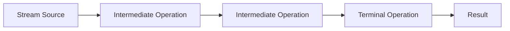
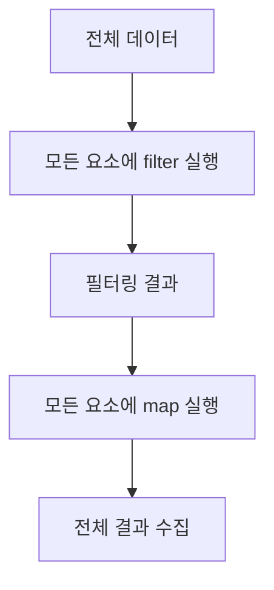
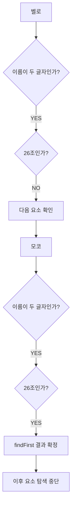
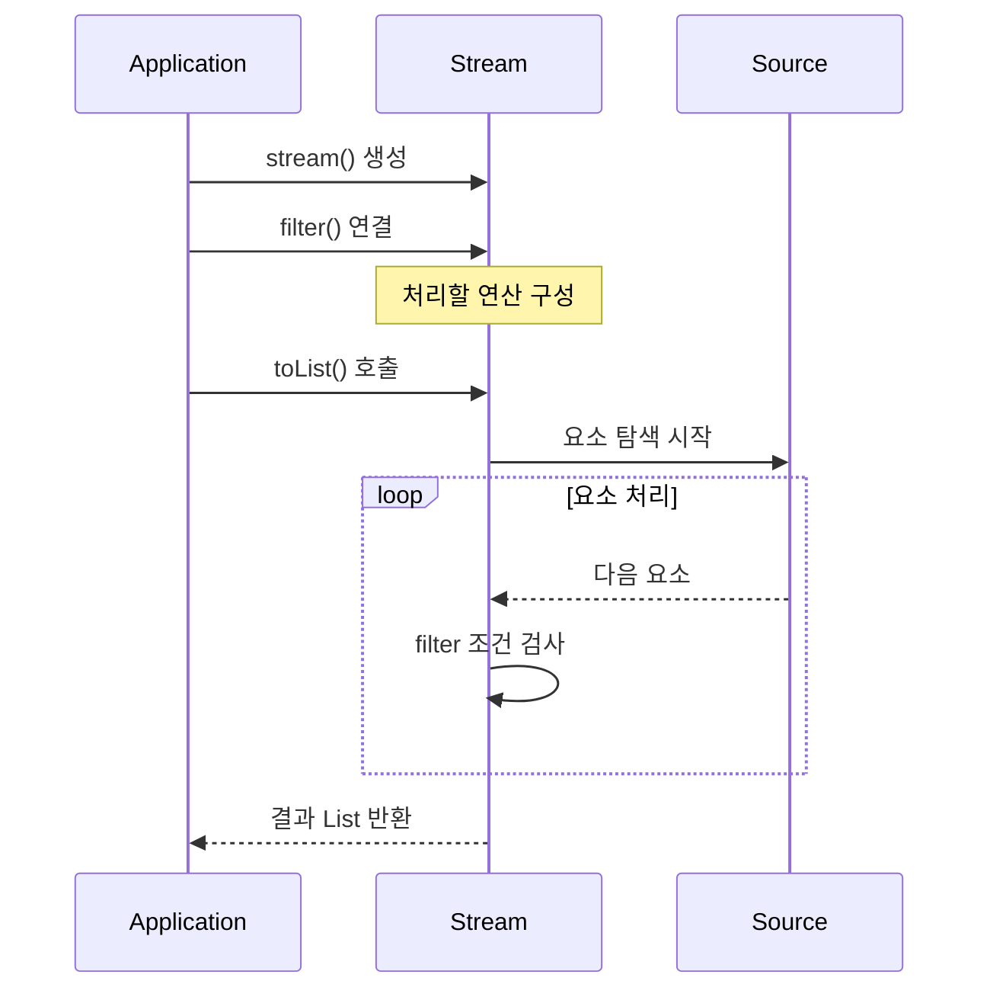
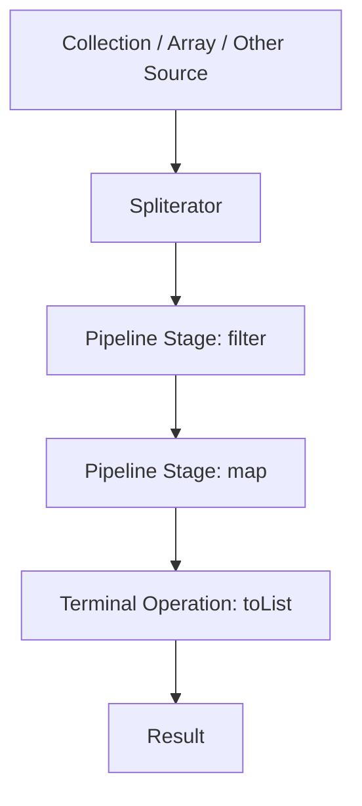
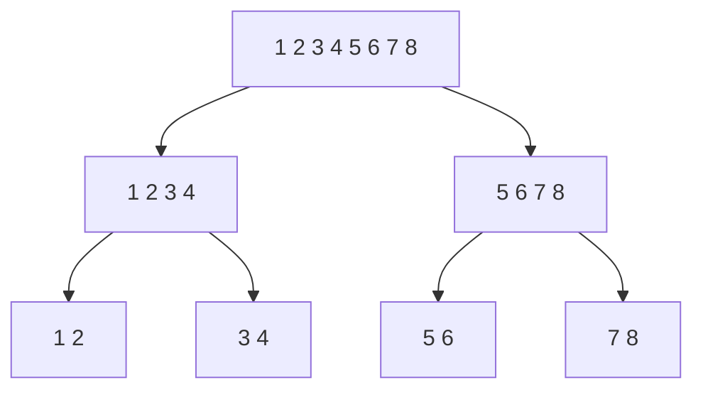
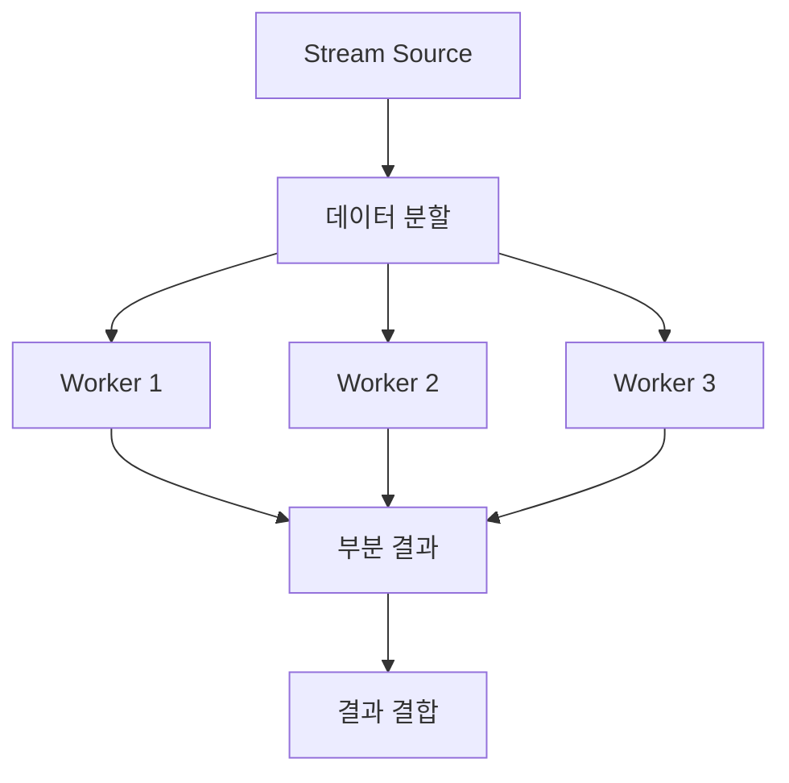
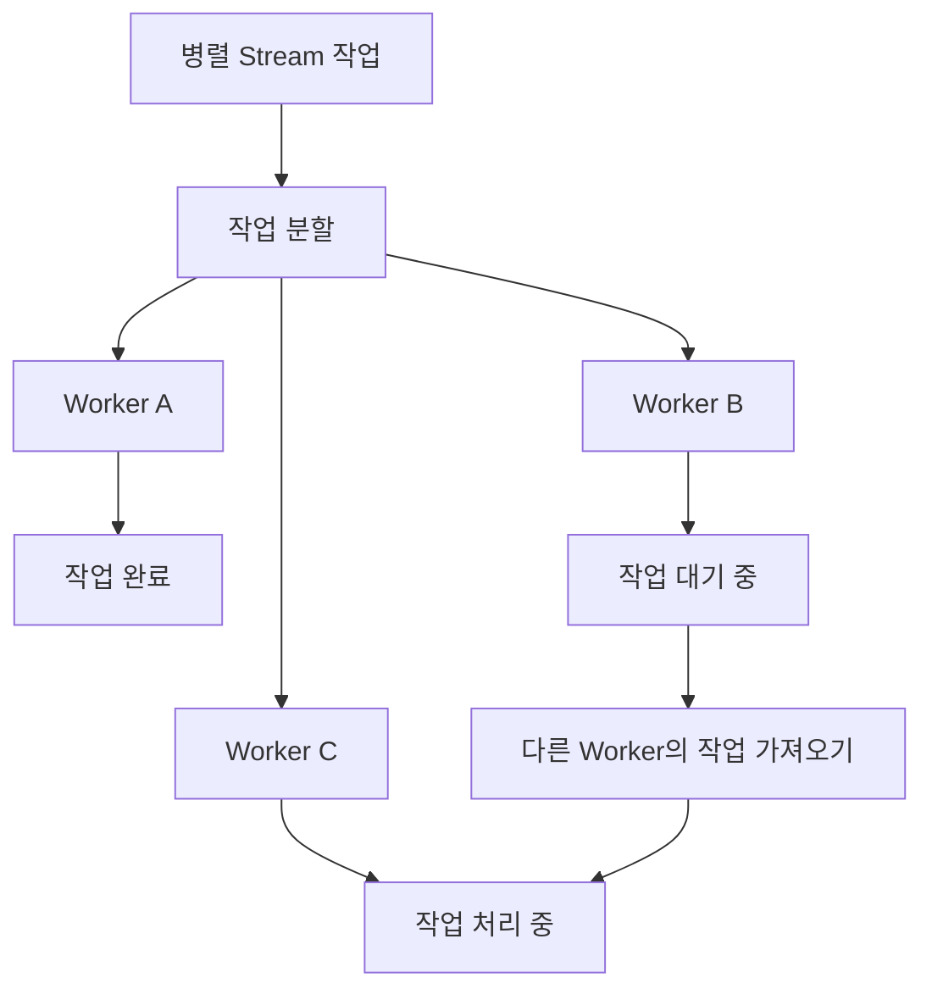

# 모코의 Java Stream API
[https://youtu.be/nsK4TP_uvaY?si=AETi-7dZFMgv7u_q](https://youtu.be/nsK4TP_uvaY?si=AETi-7dZFMgv7u_q)

# 모코의 Java Stream API
* toc
{:toc}

---

### Java Stream API 완벽 이해: 내부 동작 원리, 지연 연산, 단축 평가, 병렬 처리와 성능 최적화

Java에서 컬렉션 데이터를 처리할 때 가장 자주 사용하는 API 중 하나가 Stream API다.

예를 들어 다음과 같은 숫자 목록이 있다고 가정하자.

```java
List<Integer> numbers = List.of(1, 2, 3, 4, 5);
```

이 목록에서 3보다 큰 숫자가 몇 개인지 확인하려고 한다.

가장 먼저 생각할 수 있는 방법은 `for`문을 사용하는 것이다.

```java
int count = 0;

for (Integer number : numbers) {

    if (number > 3) {
        count++;
    }
}

System.out.println(count);
```

실행 결과는 다음과 같다.

```text
2
```

이를 Stream API로 변경하면 다음과 같다.

```java
long count = numbers.stream()
        .filter(number -> number > 3)
        .count();

System.out.println(count);
```

실행 결과는 동일하다.

```text
2
```

하지만 두 코드에는 중요한 차이가 있다.

`for`문은 컬렉션을 순회하면서 조건을 검사하고 결과를 증가시키는 과정을 직접 표현한다.

반면 Stream API는 어떤 데이터를 필터링하고 어떤 결과를 얻을 것인지 표현한다.

즉 Stream API는 **데이터를 처리하는 구체적인 반복 절차보다 수행하려는 작업 자체에 집중하도록 돕는다.**

그렇다면 다음과 같은 의문이 생긴다.

**Stream API는 단순히 코드를 짧게 작성하기 위한 기능일까?**

**Stream API를 사용하면 일반적인 반복문보다 실행 속도가 빨라질까?**

**여러 개의 중간 연산을 연결하면 데이터가 실제로 어떤 순서로 처리될까?**

**`findFirst()`는 모든 요소를 순회한 다음 첫 번째 요소를 반환할까?**

**병렬 스트림을 사용하면 언제나 더 좋은 성능을 얻을 수 있을까?**

이러한 질문에 답하려면 Stream API의 표면적인 문법보다 내부 동작 방식을 이해해야 한다.

특히 다음 개념이 중요하다.

- 선언형 프로그래밍
- Stream Pipeline
- 중간 연산과 최종 연산
- Lazy Evaluation
- 요소별 연산 처리
- Short-Circuit Evaluation
- Stateless와 Stateful 연산
- Stream의 일회성 소비
- Spliterator
- Parallel Stream
- ForkJoinPool
- 성능과 메모리 사용량

각 개념을 순서대로 살펴보자.

---

### 개념

#### Stream API란 무엇인가?

Stream API는 데이터 소스의 요소들을 선언형 방식으로 처리할 수 있도록 Java 8에서 도입된 API다.

주요 패키지는 다음과 같다.

```java
java.util.stream
```

Stream API를 사용하면 컬렉션이나 배열 등의 데이터에 대해 필터링, 변환, 정렬, 집계 등의 작업을 표현할 수 있다.

예를 들어 다음과 같은 데이터가 있다고 가정하자.

```java
List<String> names = List.of(
        "Kim",
        "Jisoo",
        "Park",
        "Seoyeon"
);
```

여기서 이름의 길이가 3보다 큰 사람을 찾고, 이름을 대문자로 변경한 다음 목록으로 반환하고 싶다.

Stream API를 사용하면 다음과 같이 작성할 수 있다.

```java
List<String> result = names.stream()
        .filter(name -> name.length() > 3)
        .map(String::toUpperCase)
        .toList();
```

실행 결과는 다음과 같다.

```text
[JISOO, PARK, SEOYEON]
```

이 코드에는 세 가지 작업이 포함되어 있다.

첫 번째는 조건에 맞는 데이터만 선택하는 것이다.

```java
filter(name -> name.length() > 3)
```

두 번째는 데이터를 변환하는 것이다.

```java
map(String::toUpperCase)
```

세 번째는 처리된 데이터를 목록으로 만드는 것이다.

```java
toList()
```

이러한 작업을 연결한 구조를 **Stream Pipeline**이라고 한다.

---

#### Stream과 Collection은 무엇이 다를까?

Stream을 처음 접하면 Collection과 비슷한 자료구조라고 생각하기 쉽다.

하지만 두 개념은 다르다.

Collection은 데이터를 저장하고 관리하는 역할을 한다.

반면 Stream은 데이터 소스를 처리하는 작업의 흐름을 표현한다.

| 구분 | Collection | Stream |
|---|---|---|
| 주요 목적 | 데이터 저장 및 관리 | 데이터 처리 |
| 데이터 보관 | 요소를 보관 | 일반적으로 요소를 직접 저장하는 자료구조가 아님 |
| 반복 | 외부 반복 | 내부 반복 |
| 재사용 | 일반적으로 반복해서 접근 가능 | 소비한 파이프라인 재사용 불가 |
| 주요 작업 | 추가, 삭제, 조회 | 필터링, 변환, 집계 |
| 실행 방식 | 메서드 호출 시 데이터 조작 | 중간 연산은 지연되고 최종 연산에서 평가 |
| 병렬 처리 | 별도 구현 필요 | 병렬 스트림 지원 |

예를 들어 다음 코드를 살펴보자.

```java
List<Integer> numbers = new ArrayList<>(
        List.of(1, 2, 3, 4, 5)
);
```

`numbers`는 실제 정수 목록을 보관한다.

```java
Stream<Integer> stream = numbers.stream();
```

반면 `stream`은 해당 데이터 소스를 처리하기 위한 Stream 객체다.

Stream은 원본 데이터를 복사해 별도의 컬렉션으로 보관한다는 의미가 아니다.

또 다음 코드를 실행한다고 원본 리스트의 요소가 삭제되지는 않는다.

```java
List<Integer> filtered = numbers.stream()
        .filter(number -> number > 3)
        .toList();
```

원본 데이터는 그대로 유지된다.

```text
numbers = [1, 2, 3, 4, 5]

filtered = [4, 5]
```

물론 Stream 내부에서 가변 객체의 메서드를 호출하거나 원본 컬렉션을 직접 변경하는 코드를 작성하면 부작용이 발생할 수 있다.

따라서 **Stream API가 원본 데이터를 자동으로 불변으로 만들어 주는 것은 아니다.**

---

### 왜 사용하는가?

#### 명령형 프로그래밍과 선언형 프로그래밍

Stream API를 사용하는 주요 이유를 이해하려면 두 가지 프로그래밍 방식을 비교해야 한다.

첫 번째는 명령형 프로그래밍(Imperative Programming)이다.

두 번째는 선언형 프로그래밍(Declarative Programming)이다.

#### 명령형 프로그래밍

명령형 프로그래밍은 어떤 결과를 얻기 위해 수행해야 하는 과정을 직접 작성하는 방식이다.

예를 들어 다음 코드를 살펴보자.

```java
List<Integer> numbers = List.of(1, 2, 3, 4, 5);

int count = 0;

for (int i = 0; i < numbers.size(); i++) {

    int number = numbers.get(i);

    if (number > 3) {
        count++;
    }
}
```

코드에서는 다음 과정을 직접 제어한다.

1. 반복을 시작한다.
2. 인덱스를 증가시킨다.
3. 현재 요소를 가져온다.
4. 조건을 검사한다.
5. 조건을 만족하면 카운트를 증가시킨다.
6. 반복을 종료한다.

즉 **어떻게 처리할 것인가(How)**에 대한 정보가 상세하게 드러난다.

#### 선언형 프로그래밍

동일한 기능을 Stream API로 작성해 보자.

```java
long count = numbers.stream()
        .filter(number -> number > 3)
        .count();
```

이 코드는 다음과 같이 해석할 수 있다.

```text
numbers에서

3보다 큰 숫자만 선택한 다음

개수를 계산한다.
```

반복문을 어떤 방식으로 실행하는지 직접 작성하지 않는다.

대신 수행할 연산을 선언한다.

즉 **무엇을 처리할 것인가(What)**에 집중한다.

이 차이를 비교하면 다음과 같다.

| 구분 | 명령형 방식 | Stream을 활용한 선언형 방식 |
|---|---|---|
| 관심사 | 실행 절차 | 처리할 작업 |
| 반복 제어 | 개발자가 직접 작성 | Stream 내부에서 처리 |
| 임시 변수 | 필요한 경우 직접 관리 | 줄일 수 있음 |
| 작업 연결 | 명시적인 반복과 조건문 | 연산 파이프라인 |
| 복잡한 분기 | 표현하기 쉬움 | 과도하게 사용하면 복잡해질 수 있음 |
| 가독성 | 상황에 따라 좋음 | 데이터 변환 흐름에서 유리할 수 있음 |

여기서 주의해야 할 점이 있다.

Stream API가 항상 더 읽기 좋은 코드를 만드는 것은 아니다.

단순한 반복 처리라면 일반적인 `for`문이 더 명확할 수 있다.

반대로 필터링, 변환, 집계가 연속적으로 등장한다면 Stream을 사용하는 편이 처리 의도를 이해하기 쉬울 수 있다.

결국 Stream API를 사용하는 목적은 단순히 코드를 짧게 만드는 것이 아니라 **데이터 처리 의도를 명확하게 표현하는 것**이다.

---

### 주요 특징

### Stream은 세 가지 단계로 구성된다

Stream Pipeline은 일반적으로 다음 세 가지 단계로 구성된다.

1. Stream Source
2. Intermediate Operation
3. Terminal Operation

구조를 살펴보자.



예를 들어 다음 코드가 있다고 가정하자.

```java
List<String> result = names.stream()
        .filter(name -> name.length() > 3)
        .map(String::toUpperCase)
        .toList();
```

각 단계의 역할은 다음과 같다.

| 단계 | 코드 | 역할 |
|---|---|---|
| Source | `names.stream()` | Stream 생성 |
| Intermediate | `filter()` | 조건에 맞는 요소 선택 |
| Intermediate | `map()` | 요소 변환 |
| Terminal | `toList()` | 결과 목록 생성 |

중간 연산은 없을 수도 있고 여러 개 존재할 수도 있다.

하지만 일반적인 Stream Pipeline에서 실제 결과를 얻으려면 최종 연산이 필요하다.

여기서 중요한 특징이 있다.

**중간 연산을 호출하는 순간 모든 요소에 대해 해당 연산이 실행되는 것은 아니다.**

이것이 Stream API를 이해하기 위한 핵심 개념이다.

---

### 중간 연산(Intermediate Operation)

중간 연산은 Stream을 입력받아 새로운 Stream을 반환하는 연산이다.

대표적으로 다음과 같은 메서드가 있다.

| 중간 연산 | 역할 |
|---|---|
| `filter()` | 조건에 맞는 요소 선택 |
| `map()` | 요소를 다른 값으로 변환 |
| `flatMap()` | 요소를 여러 요소로 확장하고 평탄화 |
| `distinct()` | 중복 제거 |
| `sorted()` | 정렬 |
| `limit()` | 최대 요소 개수 제한 |
| `skip()` | 앞의 일부 요소 건너뛰기 |
| `peek()` | 요소에 대한 동작 수행 |
| `takeWhile()` | 조건이 유지되는 앞부분 선택 |
| `dropWhile()` | 조건이 유지되는 앞부분 제외 |

중간 연산의 가장 중요한 특징은 **지연 연산(Lazy Evaluation)**이다.

예를 들어 다음 코드를 살펴보자.

```java
Stream<Integer> stream = numbers.stream()
        .filter(number -> number > 3)
        .map(number -> number * 2);
```

이 코드는 두 개의 중간 연산을 연결한다.

하지만 아직 최종 연산이 없다.

따라서 일반적인 경우 각 요소에 대한 조건 검사와 변환이 실제로 수행되지 않는다.

중간 연산은 실행할 작업을 파이프라인으로 구성하는 단계라고 이해하면 된다.

---

### 최종 연산(Terminal Operation)

최종 연산은 Stream Pipeline을 소비해 결과를 얻거나 부작용을 수행하는 연산이다.

대표적인 최종 연산은 다음과 같다.

| 최종 연산 | 반환 형태 | 역할 |
|---|---|---|
| `toList()` | List | 결과 목록 생성 |
| `collect()` | 수집 결과 | Collector를 이용한 수집 |
| `count()` | long | 요소 개수 계산 |
| `findFirst()` | Optional | 첫 번째 요소 조회 |
| `findAny()` | Optional | 임의의 요소 조회 |
| `anyMatch()` | boolean | 하나라도 조건을 만족하는지 확인 |
| `allMatch()` | boolean | 모두 조건을 만족하는지 확인 |
| `noneMatch()` | boolean | 조건을 만족하는 요소가 없는지 확인 |
| `reduce()` | 집계 결과 | 요소 결합 및 축약 |
| `forEach()` | void | 각 요소에 대한 동작 수행 |
| `min()` | Optional | 최솟값 조회 |
| `max()` | Optional | 최댓값 조회 |

예를 들어 다음 코드를 살펴보자.

```java
List<Integer> result = numbers.stream()
        .filter(number -> number > 3)
        .map(number -> number * 2)
        .toList();
```

마지막의 `toList()`가 최종 연산이다.

이 시점에 Stream Pipeline의 평가가 시작된다.

하지만 여기서도 주의해야 한다.

**최종 연산이 호출되었다고 반드시 모든 요소에 대해 모든 중간 연산이 실행되는 것은 아니다.**

필요한 결과를 얻기 위해 일부 연산을 생략하거나 탐색을 조기에 종료할 수 있기 때문이다.

---

### Stream은 실제로 어떤 순서로 연산할까?

Stream API를 처음 사용하면 다음과 같은 방식으로 실행된다고 생각하기 쉽다.

```java
List<String> result = names.stream()
        .filter(name -> name.length() > 3)
        .map(String::toUpperCase)
        .toList();
```

먼저 모든 요소에 대해 `filter()`를 실행한다.

그다음 필터링된 모든 요소에 대해 `map()`을 실행한다.

마지막으로 결과를 목록으로 반환한다고 생각하는 것이다.

이를 그림으로 나타내면 다음과 같다.



이러한 이해는 최종 결과를 설명할 때는 도움이 된다.

하지만 일반적인 순차 Stream의 실제 실행 순서를 설명하기에는 정확하지 않다.

`filter()`와 `map()` 같은 상태 비저장 연산들은 보통 요소별로 이어서 처리된다.

즉 첫 번째 요소가 여러 중간 연산을 통과한 다음 두 번째 요소를 처리하는 방식이다.

---

### 요소별 처리 방식 이해하기

다음과 같은 데이터가 있다고 가정하자.

```java
record Crew(String name, int team) {
}

List<Crew> crews = List.of(
        new Crew("벨로", 25),
        new Crew("모코", 26),
        new Crew("가콩", 25),
        new Crew("워니", 26)
);
```

여기에서 다음 조건을 만족하는 첫 번째 사람을 찾으려고 한다.

- 이름이 두 글자다.
- 26조에 속한다.

Stream으로 작성하면 다음과 같다.

```java
Optional<Crew> result = crews.stream()
        .filter(crew -> crew.name().length() == 2)
        .filter(crew -> crew.team() == 26)
        .findFirst();
```

코드상으로는 첫 번째 `filter()` 다음에 두 번째 `filter()`가 위치한다.

하지만 일반적인 순차 실행에서는 다음과 같이 처리된다.

```text
벨로

→ 이름 길이 검사: 통과
→ 26조 검사: 실패

모코

→ 이름 길이 검사: 통과
→ 26조 검사: 통과
→ findFirst 결과 확정

이후 요소

→ 처리할 필요 없음
```

즉 요소 하나가 필요한 중간 연산들을 통과한 뒤 다음 요소로 넘어간다.

이를 구조로 표현하면 다음과 같다.



이러한 동작을 이해하면 Stream이 단순히 컬렉션을 여러 번 반복하는 API가 아니라는 사실을 알 수 있다.

상태 비저장 중간 연산들은 하나의 데이터 처리 흐름으로 결합될 수 있다.

이러한 특성을 연산 융합(Operation Fusion)과 연결해 이해할 수 있다.

다만 이 설명이 모든 Stream Pipeline에 동일하게 적용되는 것은 아니다.

`sorted()`처럼 전체 입력을 확인해야 하는 상태 유지 연산이 포함되면 실행 구조가 달라질 수 있다.

이 차이는 뒤에서 자세히 살펴보자.

---

### 지연 연산(Lazy Evaluation)이란 무엇인가?

지연 연산은 실제 데이터 처리를 필요한 시점까지 미루는 방식이다.

Stream API에서는 중간 연산이 지연된다.

예를 들어 다음 코드를 살펴보자.

```java
List<String> names = List.of(
        "포비",
        "워니",
        "네오"
);

Stream<String> stream = names.stream()
        .filter(name -> {

            System.out.println("filter 호출: " + name);

            return name.equals("워니");
        });
```

이 코드를 실행하면 무엇이 출력될까?

`filter()` 내부에 `System.out.println()`이 있으므로 출력될 것처럼 보일 수 있다.

하지만 일반적인 경우 아무것도 출력되지 않는다.

왜냐하면 아직 최종 연산이 호출되지 않았기 때문이다.

```text
출력 없음
```

Stream을 생성하고 중간 연산을 연결했을 뿐 실제 데이터 탐색은 시작되지 않았다.

이제 다음 코드를 실행한다고 가정하자.

```java
List<String> result = stream.toList();
```

이때 중간 연산이 실행된다.

예상 출력은 다음과 같다.

```text
filter 호출: 포비
filter 호출: 워니
filter 호출: 네오
```

최종 결과는 다음과 같다.

```text
[워니]
```

이 구조는 다음과 같이 이해할 수 있다.



지연 연산이 중요한 이유는 불필요한 작업을 수행하지 않을 수 있기 때문이다.

최종 결과에 필요하지 않은 데이터는 처리하지 않거나 일부 작업을 생략할 수 있다.

---

### filter(), map(), toList()의 실제 실행 순서

이번에는 `filter()`와 `map()`을 함께 사용해 보자.

다음 코드가 있다고 가정하자.

```java
List<String> names = List.of(
        "포비",
        "워니",
        "네오"
);

List<String> result = names.stream()

        .filter(name -> {

            System.out.println("filter 호출: " + name);

            return name.equals("워니");
        })

        .map(name -> {

            System.out.println("map 호출: " + name);

            return name + " 멋있다";
        })

        .toList();
```

실행 결과는 다음과 같다.

```text
filter 호출: 포비
filter 호출: 워니
map 호출: 워니
filter 호출: 네오
```

마지막 결과는 다음과 같다.

```text
[워니 멋있다]
```

왜 이러한 순서로 출력될까?

첫 번째 요소인 `포비`부터 살펴보자.

```text
포비
    ↓
filter 호출
    ↓
조건 불일치
    ↓
map 실행하지 않음
```

두 번째 요소는 `워니`다.

```text
워니
    ↓
filter 호출
    ↓
조건 일치
    ↓
map 호출
    ↓
"워니 멋있다" 생성
```

세 번째 요소는 `네오`다.

```text
네오
    ↓
filter 호출
    ↓
조건 불일치
    ↓
map 실행하지 않음
```

이렇게 각 요소가 연산을 통과하면서 처리된다.

여기서 중요한 점은 `map()`이 전체 요소에 대해 호출되는 것이 아니라는 사실이다.

`filter()`를 통과한 요소에 대해서만 호출된다.

따라서 `filter()`와 `map()`의 위치를 바꾸면 실제 작업량이 달라질 수도 있다.

---

### Short-Circuit Evaluation이란 무엇인가?

Short-Circuit Evaluation은 필요한 결과가 결정되면 이후의 불필요한 처리를 중단할 수 있는 특성이다.

Stream API에서는 단축 평가 또는 단락 평가라고 설명하기도 한다.

대표적인 최종 연산에는 다음과 같은 것들이 있다.

```java
findFirst()
```

```java
findAny()
```

```java
anyMatch()
```

```java
allMatch()
```

```java
noneMatch()
```

예를 들어 다음 코드를 살펴보자.

```java
List<String> names = List.of(
        "포비",
        "워니",
        "네오"
);

Optional<String> result = names.stream()

        .filter(name -> {

            System.out.println("filter 호출: " + name);

            return name.equals("워니");
        })

        .map(name -> {

            System.out.println("map 호출: " + name);

            return name + " 멋있다";
        })

        .findFirst();
```

이번에는 `toList()` 대신 `findFirst()`를 사용했다.

실행 결과는 다음과 같다.

```text
filter 호출: 포비
filter 호출: 워니
map 호출: 워니
```

세 번째 요소인 `네오`에 대한 로그가 출력되지 않았다.

이유는 두 번째 요소인 `워니`에서 이미 결과가 결정되었기 때문이다.

```text
포비
    ↓
조건 불일치
    ↓
다음 요소

워니
    ↓
조건 일치
    ↓
map 실행
    ↓
findFirst 결과 확정
    ↓
이후 요소 탐색 중단
```

이처럼 Stream은 최종 연산의 요구사항에 따라 전체 요소를 처리하지 않고도 결과를 반환할 수 있다.

---

### toList()와 findFirst()는 왜 다르게 동작할까?

두 메서드는 원하는 결과가 다르기 때문이다.

#### toList()

`toList()`는 Stream의 모든 결과 요소를 목록으로 수집한다.

따라서 일반적인 필터링 파이프라인에서는 모든 입력 요소를 확인해야 최종 목록을 만들 수 있다.

```java
List<String> result = names.stream()
        .filter(name -> name.equals("워니"))
        .toList();
```

`워니` 이후에 다른 `워니`가 존재할 수도 있다.

따라서 마지막 요소까지 확인해야 한다.

#### findFirst()

`findFirst()`는 Encounter Order가 정의된 Stream에서 첫 번째 요소를 찾는다.

```java
Optional<String> result = names.stream()
        .filter(name -> name.equals("워니"))
        .findFirst();
```

첫 번째로 조건을 만족하는 요소를 찾았다면 이후 요소를 확인할 필요가 없다.

이러한 차이를 비교하면 다음과 같다.

| 구분 | toList() | findFirst() |
|---|---|---|
| 반환 타입 | List | Optional |
| 목적 | 결과 요소 수집 | 첫 번째 결과 조회 |
| 일반적인 탐색 | 결과 수집에 필요한 요소 처리 | 첫 결과를 찾으면 중단 가능 |
| 단축 평가 | 일반적으로 아님 | 지원 |
| 대표적인 활용 | 목록 변환 | 첫 번째 일치 요소 조회 |

여기서 주의해야 할 점은 `findFirst()`가 모든 상황에서 빠르게 종료되는 것은 아니라는 사실이다.

앞에 `sorted()` 같은 상태 유지 연산이 있다면 첫 번째 결과를 결정하기 위해 전체 데이터를 확인해야 할 수도 있다.

---

### findFirst()와 findAny()의 차이

두 메서드는 모두 요소 하나를 반환한다.

하지만 의미가 다르다.

`findFirst()`는 Encounter Order가 존재하면 그 순서상 첫 번째 요소를 반환한다.

`findAny()`는 어떤 요소든 반환할 수 있다.

예를 들어 다음과 같은 코드가 있다고 가정하자.

```java
List<Integer> numbers = List.of(10, 20, 30, 40, 50);
```

첫 번째 요소를 찾는다.

```java
Optional<Integer> first = numbers.stream()
        .findFirst();
```

결과는 다음과 같다.

```text
Optional[10]
```

반면 다음 코드는 다음과 같다.

```java
Optional<Integer> any = numbers.parallelStream()
        .findAny();
```

이 경우 어떤 요소가 반환될지 보장하지 않는다.

병렬 처리에서는 먼저 결과를 찾은 작업의 요소가 반환될 수 있다.

따라서 다음과 같이 구분할 수 있다.

| 메서드 | 의미 | 순서 보장 |
|---|---|---|
| `findFirst()` | 첫 번째 요소 | Encounter Order가 있으면 보장 |
| `findAny()` | 임의의 요소 | 특정 요소 보장하지 않음 |

만약 어떤 요소가 선택되어도 비즈니스적으로 문제가 없다면 `findAny()`를 고려할 수 있다.

하지만 첫 번째 요소의 의미가 중요하다면 `findFirst()`를 사용해야 한다.

---

### 모든 중간 연산이 요소별로 실행될까?

앞서 `filter()`와 `map()`은 요소별로 이어서 실행될 수 있다고 설명했다.

하지만 모든 중간 연산이 동일하게 동작하는 것은 아니다.

Stream의 중간 연산은 크게 두 가지로 구분할 수 있다.

첫 번째는 Stateless Operation이다.

두 번째는 Stateful Operation이다.

#### Stateless Operation

Stateless Operation은 현재 요소를 처리할 때 다른 요소의 처리 결과를 기억할 필요가 없는 연산이다.

대표적인 예는 다음과 같다.

```java
filter()
```

```java
map()
```

예를 들어 다음 코드를 살펴보자.

```java
numbers.stream()
        .filter(number -> number > 3)
        .map(number -> number * 2)
        .toList();
```

각 요소는 다른 요소의 결과와 관계없이 조건 검사와 변환을 수행할 수 있다.

따라서 일반적인 순차 Stream에서는 요소별로 여러 연산을 이어서 처리하기 쉽다.

#### Stateful Operation

Stateful Operation은 현재 요소를 처리할 때 이전 요소의 정보나 전체 데이터에 대한 정보가 필요한 연산이다.

대표적인 예는 다음과 같다.

```java
sorted()
```

```java
distinct()
```

예를 들어 다음 코드를 살펴보자.

```java
List<Integer> numbers = List.of(5, 1, 4, 2, 3);

List<Integer> result = numbers.stream()
        .sorted()
        .toList();
```

정렬된 첫 번째 요소를 결정하려면 어떻게 해야 할까?

전체 데이터에서 가장 작은 값이 무엇인지 알아야 한다.

따라서 `sorted()`는 일반적으로 전체 입력을 확인하고 정렬 결과를 준비해야 한다.

```text
5, 1, 4, 2, 3
       ↓
전체 요소 확인
       ↓
정렬 수행
       ↓
1, 2, 3, 4, 5
```

이 때문에 다음 코드는 주의가 필요하다.

```java
numbers.stream()
        .sorted()
        .findFirst();
```

`findFirst()`는 단축 평가를 지원한다.

하지만 그 앞의 `sorted()`가 정렬 결과를 만들기 위해 전체 입력을 확인해야 할 수 있다.

따라서 `findFirst()`가 있다는 사실만으로 전체 파이프라인이 항상 일부 요소만 처리한다고 볼 수 없다.

이러한 동작은 Stream의 상태 유지 연산과 단축 평가 연산 사이의 상호작용 때문이다.

---

### sorted().findFirst()와 min()의 차이

다음 코드가 있다고 가정하자.

```java
Optional<Integer> minimum = numbers.stream()
        .sorted()
        .findFirst();
```

가장 작은 값을 찾기 위해 전체 요소를 정렬한다.

하지만 실제로 필요한 것은 가장 작은 값 하나뿐이다.

이 경우 다음과 같이 작성할 수 있다.

```java
Optional<Integer> minimum = numbers.stream()
        .min(Integer::compareTo);
```

두 코드는 같은 값을 반환할 수 있다.

하지만 일반적인 구현에서는 필요한 작업량이 다르다.

| 방식 | 주요 작업 | 일반적인 시간 복잡도 |
|---|---|---|
| `sorted().findFirst()` | 전체 정렬 | O(n log n) |
| `min()` | 최솟값 탐색 | O(n) |

이 예제는 Stream API에서도 **어떤 연산을 선택하느냐에 따라 성능이 크게 달라질 수 있다**는 사실을 보여준다.

단순히 코드를 짧게 작성하는 것보다 필요한 결과에 적합한 연산을 선택하는 것이 중요하다.

---

### Stream은 불필요한 중간 연산을 생략할 수도 있다

Stream의 최적화 특성을 이해할 때 중요한 사례가 있다.

다음 코드를 살펴보자.

```java
List<String> names = List.of(
        "Kim",
        "Lee",
        "Park"
);

long count = names.stream()
        .map(name -> {

            System.out.println("map 호출");

            return name.toUpperCase();
        })
        .count();

System.out.println(count);
```

일반적으로 생각하면 `map()`이 세 번 호출될 것 같다.

하지만 Java 9 이상에서는 이 예제의 `map()` 호출이 생략될 수 있다.

왜 그럴까?

`List`의 크기를 이미 알고 있기 때문이다.

또 `map()`은 일반적으로 요소의 개수를 변경하지 않는다.

따라서 전체 요소를 실제로 변환하지 않아도 `count()`의 결과를 계산할 수 있다.

이 경우 다음과 같은 출력이 가능하다.

```text
3
```

`map 호출`이 한 번도 출력되지 않을 수 있다.

이는 오류가 아니다.

Stream 구현이 최종 결과에 영향을 주지 않는 중간 연산을 생략할 수 있기 때문이다.

중요한 점은 **중간 연산 안에 로그 출력이나 상태 변경 같은 부작용을 넣었다고 해서 반드시 실행되는 것은 아니라는 사실**이다.

Java Stream API 문서에서도 최종 결과에 영향을 미치지 않는 중간 연산이나 단계가 생략될 수 있다고 설명한다.

따라서 `map()` 내부에서 반드시 수행해야 하는 외부 시스템 호출이나 데이터베이스 변경 작업을 실행하는 설계는 신중해야 한다.

---

### Stream의 최적화와 부작용(Side Effect)

다음과 같은 코드를 생각해 보자.

```java
List<String> results = new ArrayList<>();

names.stream()
        .filter(name -> name.length() > 3)
        .forEach(results::add);
```

일반적인 순차 실행에서는 의도한 결과를 얻을 수 있다.

하지만 이렇게 작성하면 Stream 외부에 존재하는 가변 상태를 변경한다.

```java
results.add(name);
```

이 코드를 병렬 스트림으로 변경하면 문제가 발생할 수 있다.

```java
List<String> results = new ArrayList<>();

names.parallelStream()
        .filter(name -> name.length() > 3)
        .forEach(results::add);
```

`ArrayList`는 일반적인 동시 수정에 안전하지 않다.

따라서 데이터 손실이나 예상하지 못한 결과가 발생할 수 있다.

이러한 경우에는 결과를 직접 수집하는 방식이 더 적절하다.

```java
List<String> results = names.parallelStream()
        .filter(name -> name.length() > 3)
        .toList();
```

Stream의 내부 연산이 병렬로 실행되더라도 수집 과정은 Stream 구현이 관리한다.

따라서 직접 공유 리스트를 수정하는 방식보다 안전하게 작성할 수 있다.

다만 **Stream으로 변환했다고 모든 동시성 문제가 자동으로 해결되는 것은 아니다.**

람다 내부에서 공유 가변 객체를 수정하면 여전히 문제가 발생할 수 있다.

---

### 예제

### 지연 연산과 단축 평가를 실제로 확인하기

앞서 설명한 개념을 하나의 Java 프로그램으로 확인해 보자.

Java 17 이상에서 실행할 수 있는 예제다.

`StreamExecutionExample.java`

```java
import java.util.List;
import java.util.Optional;
import java.util.stream.Stream;

public class StreamExecutionExample {

    private static final List<String> NAMES =
            List.of("포비", "워니", "네오");

    public static void main(String[] args) {

        noTerminalOperation();

        collectAll();

        findFirst();
    }

    private static void noTerminalOperation() {

        System.out.println("=== 최종 연산 없음 ===");

        Stream<String> pipeline = NAMES.stream()
                .filter(name -> {

                    System.out.println(
                            "filter 호출: " + name
                    );

                    return name.equals("워니");
                });

        System.out.println("중간 연산 구성 완료");

        // pipeline은 소비되지 않았으므로
        // filter의 본문은 실행되지 않는다.
    }

    private static void collectAll() {

        System.out.println("=== toList() ===");

        List<String> result = NAMES.stream()

                .filter(name -> {

                    System.out.println(
                            "filter 호출: " + name
                    );

                    return name.equals("워니");
                })

                .map(name -> {

                    System.out.println(
                            "map 호출: " + name
                    );

                    return name + " 멋있다";
                })

                .toList();

        System.out.println("result = " + result);
    }

    private static void findFirst() {

        System.out.println("=== findFirst() ===");

        Optional<String> result = NAMES.stream()

                .filter(name -> {

                    System.out.println(
                            "filter 호출: " + name
                    );

                    return name.equals("워니");
                })

                .map(name -> {

                    System.out.println(
                            "map 호출: " + name
                    );

                    return name + " 멋있다";
                })

                .findFirst();

        System.out.println("result = " + result);
    }
}
```

컴파일한다.

```bash
javac --release 17 StreamExecutionExample.java
```

실행한다.

```bash
java StreamExecutionExample
```

실행 결과는 다음과 같다.

```text
=== 최종 연산 없음 ===
중간 연산 구성 완료

=== toList() ===
filter 호출: 포비
filter 호출: 워니
map 호출: 워니
filter 호출: 네오
result = [워니 멋있다]

=== findFirst() ===
filter 호출: 포비
filter 호출: 워니
map 호출: 워니
result = Optional[워니 멋있다]
```

이 결과에서 확인할 수 있는 핵심은 세 가지다.

첫 번째, 최종 연산이 없다면 중간 연산은 평가되지 않는다.

두 번째, 일반적인 순차 Stream의 `filter()`와 `map()`은 요소별로 이어서 실행된다.

세 번째, `findFirst()`는 결과가 결정되면 이후 요소의 탐색을 중단할 수 있다.

이 세 가지를 이해하면 Stream Pipeline의 실행 순서를 훨씬 쉽게 예측할 수 있다.

---

### Stream은 왜 한 번만 사용할 수 있을까?

Stream API에서 중요한 제약 중 하나는 **한 번 소비한 Stream Pipeline을 다시 사용할 수 없다는 것**이다.

예를 들어 다음 코드를 살펴보자.

```java
List<Integer> numbers = List.of(1, 2, 3, 4, 5);

Stream<Integer> stream = numbers.stream();

List<Integer> first = stream.toList();
```

여기까지는 정상적으로 동작한다.

하지만 다음 코드를 다시 실행하면 문제가 발생한다.

```java
List<Integer> second = stream.toList();
```

일반적인 JDK Stream 구현에서는 다음과 같은 예외가 발생한다.

```text
java.lang.IllegalStateException:
stream has already been operated upon or closed
```

왜 이러한 문제가 발생할까?

Stream은 데이터 저장소가 아니라 한 번의 데이터 처리 과정을 표현하는 객체이기 때문이다.

최종 연산으로 파이프라인을 소비한 뒤 동일한 파이프라인을 다시 실행할 수는 없다.

여기서 정확하게 구분해야 하는 개념이 있다.

**Stream을 소비(Consume)하는 것과 명시적으로 닫는(Close) 것은 동일하지 않다.**

`toList()` 같은 최종 연산을 수행하면 Stream Pipeline은 소비된다.

하지만 모든 최종 연산이 `close()`를 자동으로 호출하는 것은 아니다.

따라서 다음과 같이 이해하는 것이 정확하다.

```text
최종 연산 실행
    ↓
Stream Pipeline 소비
    ↓
동일한 Stream 재사용 불가
```

Java 공식 API 문서 역시 Stream은 한 번만 연산해야 하며, 이미 소비되거나 닫힌 Stream의 재사용 시 `IllegalStateException`이 발생할 수 있다고 설명한다.

---

### Stream을 여러 번 사용해야 한다면?

동일한 데이터에 대해 서로 다른 Stream 연산을 수행하고 싶을 수 있다.

예를 들어 숫자 목록에서 짝수 개수와 홀수 개수를 각각 계산한다고 가정하자.

이때 하나의 Stream을 재사용하려고 하면 문제가 발생한다.

```java
Stream<Integer> stream = numbers.stream();

long evenCount = stream
        .filter(number -> number % 2 == 0)
        .count();

// 동일한 stream을 다시 사용하므로 잘못된 코드
long oddCount = stream
        .filter(number -> number % 2 != 0)
        .count();
```

올바른 방법은 원본 컬렉션에서 새로운 Stream을 생성하는 것이다.

```java
long evenCount = numbers.stream()
        .filter(number -> number % 2 == 0)
        .count();

long oddCount = numbers.stream()
        .filter(number -> number % 2 != 0)
        .count();
```

원본 Collection은 그대로 존재한다.

따라서 필요한 만큼 새로운 Stream을 생성할 수 있다.

또 Stream을 생성하는 함수를 전달하는 방식도 가능하다.

```java
Supplier<Stream<Integer>> streamSupplier =
        numbers::stream;
```

사용할 때마다 새로운 Stream을 얻는다.

```java
long evenCount = streamSupplier.get()
        .filter(number -> number % 2 == 0)
        .count();

long oddCount = streamSupplier.get()
        .filter(number -> number % 2 != 0)
        .count();
```

다만 단순한 컬렉션이라면 매번 `numbers.stream()`을 호출하는 방식이 더 직관적일 수 있다.

중요한 것은 Stream 자체를 재사용하는 것이 아니라 **필요할 때 새로운 Stream Pipeline을 생성해야 한다는 점**이다.

---

### Stream을 변수에 저장하면 안 될까?

반드시 그런 것은 아니다.

다음 코드는 문법적으로 문제가 없다.

```java
Stream<Integer> stream = numbers.stream();
```

Stream을 변수에 저장하는 것 자체가 잘못된 것은 아니다.

예를 들어 조건에 따라 파이프라인을 구성하거나 별도 메서드로 Stream을 전달해야 하는 상황에서는 유용할 수 있다.

하지만 일반적인 데이터 처리에서는 다음처럼 메서드 체인으로 작성하는 편이 간결하다.

```java
List<Integer> result = numbers.stream()
        .filter(number -> number > 3)
        .map(number -> number * 2)
        .toList();
```

이 방식은 Stream이 생성되고 소비되는 범위가 명확하다.

반면 Stream을 오래 보관하면 이미 소비한 Stream을 다시 사용하려는 실수가 발생하기 쉽다.

따라서 다음과 같이 구분할 수 있다.

| 상황 | 권장 방식 |
|---|---|
| 단순 데이터 변환 | 메서드 체인 |
| 조건에 따른 파이프라인 구성 | 지역 Stream 변수 활용 가능 |
| 동일 데이터 여러 번 처리 | 새로운 Stream 생성 |
| Stream을 객체 필드로 장기간 보관 | 일반적으로 지양 |
| 파일 기반 Stream | 자원 해제까지 관리 |

특히 Stream을 클래스 필드에 저장해 여러 메서드에서 재사용하는 설계는 피하는 것이 좋다.

---

### Stream.toList()는 어떤 List를 반환할까?

Stream을 사용하면서 자주 발생하는 실수 중 하나는 `toList()`의 반환값을 가변 리스트라고 생각하는 것이다.

Java 16부터 `Stream.toList()`를 사용할 수 있다.

```java
List<String> result = names.stream()
        .filter(name -> name.length() > 3)
        .toList();
```

여기서 반환된 List는 수정할 수 없다.

예를 들어 다음 코드를 실행하면 예외가 발생한다.

```java
result.add("New Member");
```

```text
java.lang.UnsupportedOperationException
```

반면 다음 코드를 살펴보자.

```java
List<String> result = names.stream()
        .collect(Collectors.toList());
```

현재 일반적인 JDK 구현에서는 가변 리스트가 반환될 수 있다.

하지만 `Collectors.toList()`는 결과 List의 가변성을 API 계약으로 보장하지 않는다.

따라서 수정 가능한 `ArrayList`가 필요하다면 명시적으로 작성하는 것이 좋다.

```java
List<String> result = names.stream()
        .filter(name -> name.length() > 3)
        .collect(Collectors.toCollection(ArrayList::new));
```

세 가지를 비교하면 다음과 같다.

| 방식 | 반환 결과의 수정 가능성 |
|---|---|
| `Stream.toList()` | 수정 불가능 |
| `Collectors.toList()` | 가변성 보장 없음 |
| `Collectors.toCollection(ArrayList::new)` | 가변 ArrayList |
| `Collectors.toUnmodifiableList()` | 수정 불가능 |

또 `Stream.toList()`는 `null` 요소를 포함할 수 있다.

반면 `Collectors.toUnmodifiableList()`는 `null` 요소를 허용하지 않는다.

따라서 두 방식이 완전히 동일하다고 생각해서는 안 된다.

---

### 구조

### Stream 내부에서는 어떤 구성 요소가 동작할까?

Stream Pipeline을 조금 더 깊이 이해하려면 내부 구성 요소를 살펴볼 필요가 있다.

대표적으로 다음 개념들이 등장한다.

- Source
- Spliterator
- Pipeline Stage
- Sink
- Terminal Operation

전체 구조를 개념적으로 표현하면 다음과 같다.



이 구조에서 중요한 점은 각 중간 연산이 반드시 별도의 중간 컬렉션을 생성하는 것은 아니라는 사실이다.

일반적인 `filter()`와 `map()` 연산은 파이프라인을 구성하고, 평가 시 요소별 처리를 연결하는 방식으로 구현할 수 있다.

---

### Spliterator란 무엇인가?

`Spliterator`는 Stream이 데이터 소스의 요소를 탐색하는 데 사용하는 핵심 인터페이스다.

이름은 다음 두 단어를 결합한 것이다.

```text
Split + Iterator
```

즉 데이터를 순회하는 기능과 분할하는 기능을 함께 제공한다.

대표적인 메서드는 다음과 같다.

```java
boolean tryAdvance(Consumer<? super T> action);
```

```java
Spliterator<T> trySplit();
```

```java
long estimateSize();
```

```java
int characteristics();
```

각 메서드의 역할은 다음과 같다.

| 메서드 | 역할 |
|---|---|
| `tryAdvance()` | 다음 요소를 처리 |
| `trySplit()` | 처리할 데이터를 분할 |
| `estimateSize()` | 남은 요소 수 추정 |
| `characteristics()` | 데이터 소스의 특성 제공 |

`tryAdvance()`는 순차적인 요소 탐색과 관련된다.

`trySplit()`은 병렬 처리를 위해 작업을 나눌 때 중요하다.

예를 들어 다음과 같은 데이터가 있다고 가정하자.

```text
[1, 2, 3, 4, 5, 6, 7, 8]
```

병렬 처리를 위해 다음과 같이 분할할 수 있다.



각 작업을 병렬로 처리한 뒤 결과를 결합할 수 있다.

이러한 데이터 분할 능력은 병렬 스트림의 성능에 영향을 주는 중요한 요소다.

Java 공식 문서에서도 Spliterator의 분할 능력과 특성이 병렬 Stream의 성능에 영향을 준다고 설명한다.

---

### Sink란 무엇인가?

JDK의 일반적인 Stream 구현에서는 내부적으로 `Sink`와 관련된 구조를 사용한다.

`Sink`는 파이프라인의 각 단계에서 요소를 전달받아 처리하는 역할을 한다.

예를 들어 다음 코드가 있다고 가정하자.

```java
numbers.stream()
        .filter(number -> number > 3)
        .map(number -> number * 2)
        .toList();
```

개념적으로 다음과 같은 흐름을 생각할 수 있다.

```text
Source
    ↓
filter Sink
    ↓
map Sink
    ↓
terminal Sink
```

첫 번째 요소가 전달된다.

```text
number = 1
```

`filter`에서 조건을 검사한다.

```text
1 > 3

false
```

조건을 만족하지 않으므로 다음 단계로 전달하지 않는다.

두 번째 요소 역시 같은 과정을 거친다.

네 번째 요소에 도달했다고 가정하자.

```text
number = 4
```

이번에는 다음과 같이 처리된다.

```text
filter: 4 > 3
    ↓
true
    ↓
map: 4 × 2
    ↓
8
    ↓
terminal에 전달
```

이러한 방식으로 중간 연산들이 연결될 수 있다.

다만 `Sink`와 구체적인 Pipeline 클래스들은 JDK의 내부 구현 세부 사항이다.

모든 Java 구현에서 동일한 내부 구조를 사용해야 한다는 의미는 아니다.

애플리케이션 코드는 공개된 Stream API의 동작 계약에 의존해야 한다.

---

### 병렬 스트림(Parallel Stream)이란 무엇인가?

지금까지 살펴본 예제는 대부분 순차 스트림이다.

순차 스트림은 하나의 처리 흐름에서 요소들을 처리한다.

하지만 Stream API는 병렬 처리도 지원한다.

대표적인 방법은 다음과 같다.

```java
numbers.parallelStream()
```

또는 다음과 같이 작성할 수도 있다.

```java
numbers.stream()
        .parallel()
```

예를 들어 다음 코드를 살펴보자.

```java
long count = numbers.parallelStream()
        .filter(number -> number > 3)
        .count();
```

순차 Stream과 비교하면 변경된 부분은 크지 않다.

하지만 실행 방식은 달라질 수 있다.

병렬 Stream에서는 데이터를 여러 작업으로 분할하고 여러 Thread에서 처리할 수 있다.



이러한 구조는 CPU 집약적인 연산을 대량으로 처리하는 경우 성능 향상에 도움이 될 수 있다.

하지만 병렬 Stream이 항상 순차 Stream보다 빠른 것은 아니다.

---

### 병렬 스트림은 어떤 Thread를 사용할까?

일반적인 JDK의 병렬 Stream 구현은 Fork/Join Framework를 활용한다.

대표적으로 공용 ForkJoinPool인 다음 객체가 관련된다.

```java
ForkJoinPool.commonPool()
```

ForkJoinPool은 작업을 분할하고 여러 Worker Thread에서 실행할 수 있도록 지원한다.

특히 Work-Stealing이라는 작업 분배 전략을 활용한다.

개념적으로 다음과 같다.



한 Worker가 자신의 작업을 끝내면 다른 Worker의 남은 작업을 가져와 처리할 수 있다.

이러한 방식은 작업량을 균등하게 분배하는 데 도움이 된다.

하지만 공용 ForkJoinPool은 애플리케이션의 다른 병렬 작업과 자원을 공유할 수 있다.

따라서 Spring Boot 서버에서 병렬 Stream을 무분별하게 사용하면 다른 작업의 처리 성능에 영향을 줄 수도 있다.

또 병렬 Stream을 호출하는 Thread 자체도 처리에 참여할 수 있으며, 실제 실행 방식은 JDK 구현과 호출 환경에 따라 달라질 수 있다.

---

### 병렬 Stream은 언제 빠를까?

병렬 Stream이 성능을 높이려면 여러 조건이 맞아야 한다.

대표적으로 다음과 같다.

| 조건 | 설명 |
|---|---|
| 충분한 데이터 규모 | 작업을 나누는 비용보다 처리 이점이 커야 함 |
| 높은 연산 비용 | 요소별 작업이 충분히 무거워야 함 |
| 분할하기 좋은 데이터 | Spliterator가 효율적으로 작업을 나눌 수 있어야 함 |
| 독립적인 연산 | 요소 간 상태 의존성이 적어야 함 |
| 결합 가능한 결과 | 부분 결과를 효율적으로 합칠 수 있어야 함 |
| 적절한 CPU 자원 | 실제로 활용할 코어와 실행 여유가 있어야 함 |
| 낮은 동기화 비용 | 공유 자원 경합이 적어야 함 |

예를 들어 다음과 같은 작업을 생각해 보자.

```text
100만 개 데이터

각 요소마다 복잡한 수학 연산

요소 사이에 상태 공유 없음

최종 결과는 합계
```

이러한 상황은 병렬 처리의 이점을 얻을 가능성이 있다.

반면 다음과 같은 상황에서는 병렬 처리가 불리할 수 있다.

```text
데이터 100개

각 요소마다 단순한 문자열 비교

정렬 순서 유지 필요

공유 객체 수정
```

데이터를 나누고 작업을 스케줄링하는 비용이 실제 계산 비용보다 클 수 있기 때문이다.

여기서 중요한 것은 특정 요소 개수를 절대적인 기준으로 삼지 않는 것이다.

예를 들어 데이터가 10,000개 이상이면 병렬 Stream을 사용해야 한다는 규칙은 존재하지 않는다.

각 요소의 처리 비용이 충분히 크다면 더 적은 데이터에서도 도움이 될 수 있다.

반대로 데이터가 수백만 개여도 연산이 매우 가볍다면 순차 처리가 더 빠를 수 있다.

---

### 병렬 스트림은 왜 느려질 수 있을까?

병렬 처리에는 추가 비용이 발생한다.

대표적으로 다음과 같다.

```text
작업 분할 비용

+

작업 스케줄링 비용

+

Thread 간 실행 조율 비용

+

부분 결과 결합 비용

+

메모리 및 캐시 경합
```

예를 들어 다음 코드를 생각해 보자.

```java
long count = numbers.parallelStream()
        .filter(number -> number > 3)
        .count();
```

단순한 조건 검사만 수행한다.

이런 작업에서는 병렬 처리를 위해 발생하는 추가 비용이 실제 연산 비용보다 클 수 있다.

따라서 일반적인 `for`문이나 순차 Stream이 더 빠르게 실행될 가능성이 있다.

또 `sorted()`, `distinct()`, `limit()`처럼 상태나 순서 제약이 있는 연산은 병렬 처리에서 추가 버퍼링과 조정 비용을 발생시킬 수 있다.

---

### 병렬 Stream과 순서 보장

다음 코드를 살펴보자.

```java
List<Integer> numbers = List.of(1, 2, 3, 4, 5);

numbers.parallelStream()
        .forEach(System.out::println);
```

실행 결과의 출력 순서는 보장되지 않는다.

예를 들어 다음과 같은 결과가 나올 수 있다.

```text
3
5
2
1
4
```

병렬 작업이 여러 Thread에서 실행될 수 있기 때문이다.

반면 다음과 같이 작성할 수 있다.

```java
numbers.parallelStream()
        .forEachOrdered(System.out::println);
```

Encounter Order가 정의된 Stream이라면 해당 순서대로 출력하도록 보장한다.

```text
1
2
3
4
5
```

하지만 순서 보장에는 비용이 따를 수 있다.

따라서 순서가 중요하지 않은 작업이라면 불필요한 순서 제약을 추가하지 않는 것이 좋다.

또 다음 메서드를 활용할 수도 있다.

```java
unordered()
```

이 메서드는 Stream의 순서 제약을 완화할 수 있다.

다만 순서가 비즈니스 결과에 영향을 주는 경우에는 사용해서는 안 된다.

예를 들어 결제 이력이나 주문 이벤트의 처리 순서는 단순한 성능 최적화를 위해 임의로 변경해서는 안 된다.

---

### 병렬 Stream에서 공유 가변 상태를 사용하면 안 되는 이유

다음 코드를 살펴보자.

```java
List<Integer> numbers = IntStream.rangeClosed(1, 100_000)
        .boxed()
        .toList();

List<Integer> results = new ArrayList<>();

numbers.parallelStream()
        .forEach(results::add);
```

이 코드는 안전하지 않다.

여러 Thread가 동일한 `ArrayList`에 동시에 `add()`를 호출할 수 있기 때문이다.

그 결과 다음 문제가 발생할 수 있다.

- 일부 요소 누락
- 예상과 다른 데이터 개수
- 내부 상태 불일치
- 실행할 때마다 달라지는 결과

이를 해결하기 위해 무조건 동기화를 추가하는 방식도 좋은 선택이라고 단정할 수 없다.

동기화 비용으로 인해 병렬 처리의 이점이 줄어들 수 있기 때문이다.

대신 Stream이 제공하는 수집 기능을 사용할 수 있다.

```java
List<Integer> results = numbers.parallelStream()
        .map(number -> number * 2)
        .toList();
```

또 합계를 계산하려면 다음과 같이 작성할 수 있다.

```java
long sum = numbers.parallelStream()
        .mapToLong(Integer::longValue)
        .sum();
```

이 방식은 공유 가변 상태를 직접 수정하지 않고 결과를 집계할 수 있다.

---

### Reduce는 병렬 처리에서 왜 중요할까?

`reduce()`는 여러 요소를 하나의 결과로 결합하는 연산이다.

예를 들어 다음과 같다.

```java
int sum = numbers.stream()
        .reduce(0, Integer::sum);
```

개념적으로 다음과 같이 계산한다.

```text
0 + 1 + 2 + 3 + 4 + 5
```

결과는 다음과 같다.

```text
15
```

병렬 처리에서는 작업을 여러 부분으로 나누어 결과를 계산할 수 있다.

```text
작업 A

1 + 2 = 3
```

```text
작업 B

3 + 4 = 7
```

```text
작업 C

5 = 5
```

이제 부분 결과를 결합한다.

```text
3 + 7 + 5 = 15
```

이러한 방식이 올바르게 동작하려면 결합 연산의 성질이 중요하다.

대표적으로 **결합법칙(Associativity)**이 필요하다.

예를 들어 정수 덧셈은 다음 관계를 만족한다.

```text
(a + b) + c = a + (b + c)
```

하지만 뺄셈은 일반적으로 결합법칙을 만족하지 않는다.

```text
(a - b) - c ≠ a - (b - c)
```

따라서 병렬 Stream에서 임의의 연산을 `reduce()`에 전달한다고 항상 순차 처리와 동일한 결과를 얻는 것은 아니다.

결과를 병렬로 결합할 수 있는 연산인지 확인해야 한다.

---

### for문과 Stream 중 무엇이 더 빠를까?

많은 경우 단순 반복문이 Stream보다 적은 오버헤드로 실행될 수 있다.

하지만 모든 상황에서 반드시 빠르다고 단정할 수는 없다.

성능에는 여러 요소가 영향을 준다.

- 데이터 개수
- Collection 종류
- 각 요소의 처리 비용
- Stream Pipeline 길이
- Boxing과 Unboxing
- 객체 생성량
- CPU 코어 수
- JVM 버전
- JIT 컴파일
- GC 동작
- 병렬 처리 여부

예를 들어 다음과 같은 코드를 생각해 보자.

```java
long sum = 0;

for (int number : numbers) {
    sum += number;
}
```

Stream으로 작성하면 다음과 같다.

```java
long sum = numbers.stream()
        .mapToLong(Integer::longValue)
        .sum();
```

두 코드의 실행 속도는 실제 환경에서 측정해야 한다.

또 병렬 Stream을 사용하면 다음과 같이 작성할 수 있다.

```java
long sum = numbers.parallelStream()
        .mapToLong(Integer::longValue)
        .sum();
```

하지만 병렬 Stream도 항상 더 빠른 것은 아니다.

따라서 성능을 비교할 때는 단순히 `System.currentTimeMillis()`를 사용하는 것보다 JVM의 워밍업과 최적화 등을 고려하는 벤치마크 도구를 사용하는 것이 적절하다.

대표적인 도구가 JMH(Java Microbenchmark Harness)다.

OpenJDK에서는 JMH를 JVM 기반 성능 측정을 위한 도구로 제공한다.

---

### 실무에서의 활용

### Spring Boot 백엔드에서 Stream을 활용하는 12가지 방법

Stream은 단순한 컬렉션 변환뿐 아니라 실제 백엔드 서비스의 다양한 영역에서 활용할 수 있다.

하지만 모든 문제를 Stream으로 해결하려고 하면 오히려 성능과 유지보수성이 나빠질 수 있다.

따라서 각 상황에서 Stream이 적절한지 판단하는 것이 중요하다.

#### 1. Entity를 DTO로 변환한다

Spring Boot에서 가장 흔한 사용 사례 중 하나다.

예를 들어 회원 Entity 목록이 있다고 가정하자.

```java
List<Member> members = memberRepository.findAll();
```

이를 API 응답 DTO로 변환한다.

```java
List<MemberResponse> responses = members.stream()
        .map(member -> new MemberResponse(
                member.getId(),
                member.getName()
        ))
        .toList();
```

이 구조는 데이터 변환 의도가 명확하다.

또 변환 로직을 별도 메서드로 분리할 수도 있다.

```java
List<MemberResponse> responses = members.stream()
        .map(MemberResponse::from)
        .toList();
```

다만 Entity에 연관 관계가 존재한다면 주의해야 한다.

DTO로 변환하는 과정에서 지연 로딩이 발생하면 N+1 조회 문제가 나타날 수 있기 때문이다.

---

#### 2. JPA의 N+1 문제를 Stream으로 해결할 수 있을까?

다음 코드를 살펴보자.

```java
List<Order> orders = orderRepository.findAll();

List<OrderResponse> responses = orders.stream()
        .map(order -> new OrderResponse(
                order.getId(),
                order.getMember().getName()
        ))
        .toList();
```

`Order`와 `Member`가 지연 로딩 관계라면 `getMember().getName()`을 호출하는 과정에서 추가 SQL이 발생할 수 있다.

```text
주문 목록 조회: 1회

회원 정보 조회: N회
```

이러한 문제는 Stream 자체와 관계없이 JPA의 영속성 컨텍스트와 연관 관계 로딩 정책에서 발생한다.

따라서 Stream을 사용한다고 N+1 문제가 해결되는 것은 아니다.

필요하다면 다음과 같은 방법을 고려해야 한다.

- Fetch Join
- EntityGraph
- DTO Projection
- Batch Fetching

특히 조회 결과를 DTO로 변환하기만 한다면 데이터베이스에서 필요한 필드를 직접 조회하는 Projection 방식이 유리할 수 있다.

**Stream은 Java 메모리의 데이터 처리 도구이지 SQL 최적화 도구가 아니다.**

---

#### 3. 데이터베이스에서 처리할 작업과 애플리케이션에서 처리할 작업을 구분한다

다음 코드를 살펴보자.

```java
List<Member> members = memberRepository.findAll();

List<Member> activeMembers = members.stream()
        .filter(Member::isActive)
        .toList();
```

이 코드는 모든 회원을 데이터베이스에서 조회한 후 애플리케이션 메모리에서 필터링한다.

회원이 수백만 명이라면 어떻게 될까?

불필요한 데이터가 애플리케이션으로 전달된다.

또 메모리 사용량과 네트워크 비용이 증가할 수 있다.

이 경우에는 데이터베이스에서 필요한 조건을 적용하는 것이 더 적절할 수 있다.

```java
List<Member> activeMembers =
        memberRepository.findByActiveTrue();
```

따라서 다음과 같이 구분할 수 있다.

| 작업 | 우선 고려할 위치 |
|---|---|
| 데이터 조회 조건 | Database |
| Pagination | Database |
| 대량 집계 | Database |
| API 응답 형태 변환 | Application |
| 소량 데이터 후처리 | Application |
| 비즈니스 객체 변환 | Application |

Stream의 문법이 간결하다는 이유로 대량 데이터를 모두 메모리로 가져와 처리하는 설계는 피해야 한다.

---

#### 4. 복잡한 조건을 Predicate로 분리한다

여러 조건으로 데이터를 필터링해야 하는 경우가 있다.

예를 들어 다음 조건이 있다고 가정하자.

```text
활성 회원

AND

성인 회원

AND

이메일 인증 완료
```

조건을 각각 Predicate로 표현할 수 있다.

```java
Predicate<Member> isActive =
        Member::isActive;

Predicate<Member> isAdult =
        member -> member.getAge() >= 19;

Predicate<Member> isEmailVerified =
        Member::isEmailVerified;
```

이제 조건을 조합한다.

```java
Predicate<Member> condition =
        isActive
                .and(isAdult)
                .and(isEmailVerified);
```

Stream에 전달한다.

```java
List<Member> result = members.stream()
        .filter(condition)
        .toList();
```

이 방식은 조건을 재사용하거나 조합해야 하는 경우에 유용하다.

다만 실패 사유를 상세하게 반환해야 하는 도메인 검증이라면 단순한 Predicate보다 별도의 검증 객체를 사용하는 것이 더 적절할 수 있다.

---

#### 5. 중복 데이터를 제거한다

다음과 같은 데이터가 있다고 가정하자.

```java
List<String> countries = List.of(
        "KR",
        "US",
        "KR",
        "JP",
        "US"
);
```

중복을 제거하려면 `distinct()`를 사용할 수 있다.

```java
List<String> result = countries.stream()
        .distinct()
        .toList();
```

결과는 다음과 같다.

```text
[KR, US, JP]
```

`distinct()`는 요소의 동등성 판단에 `equals()`와 `hashCode()`를 활용한다.

따라서 사용자 정의 객체에서 중복 제거를 수행하려면 동등성 정의가 올바른지 확인해야 한다.

또 대량의 데이터를 처리한다면 중복을 기억하기 위한 추가 메모리가 필요할 수 있다.

---

#### 6. 그룹별 데이터를 집계한다

예를 들어 주문 목록을 상태별로 묶는다고 가정하자.

```java
Map<OrderStatus, List<Order>> grouped =
        orders.stream()
                .collect(
                        Collectors.groupingBy(
                                Order::getStatus
                        )
                );
```

이 코드는 주문 상태를 기준으로 주문 목록을 그룹화한다.

```text
PAID

→ 결제 완료 주문 목록
```

```text
CANCELLED

→ 취소 주문 목록
```

그룹별 개수를 계산할 수도 있다.

```java
Map<OrderStatus, Long> counts =
        orders.stream()
                .collect(
                        Collectors.groupingBy(
                                Order::getStatus,
                                Collectors.counting()
                        )
                );
```

이러한 방식은 소량 또는 이미 메모리에 존재하는 데이터의 통계 처리에 유용하다.

하지만 대량의 주문 데이터를 집계한다면 DB의 `GROUP BY`가 더 효율적일 수 있다.

---

#### 7. 첫 번째 일치 요소만 필요하다면 findFirst()를 활용한다

예를 들어 특정 조건을 만족하는 첫 번째 쿠폰을 찾는다고 가정하자.

```java
Optional<Coupon> coupon = coupons.stream()
        .filter(Coupon::isAvailable)
        .findFirst();
```

첫 번째 사용 가능한 쿠폰을 찾으면 이후 요소의 탐색을 중단할 수 있다.

하지만 여기서 중요한 점이 있다.

첫 번째 요소라는 개념이 무엇을 의미하는지 명확해야 한다.

예를 들어 만료일이 가장 빠른 쿠폰을 찾는다면 단순히 `findFirst()`만 사용해서는 안 된다.

데이터의 순서가 만료일 기준으로 정의되어 있어야 한다.

또 전체 정렬이 필요하지 않다면 다음과 같이 최소값을 구할 수도 있다.

```java
Optional<Coupon> coupon = coupons.stream()
        .filter(Coupon::isAvailable)
        .min(Comparator.comparing(Coupon::getExpiresAt));
```

즉 비즈니스 요구사항에 따라 적절한 최종 연산을 선택해야 한다.

---

#### 8. Optional과 Stream을 조합한다

Stream API에서는 Optional을 반환하는 연산이 존재한다.

예를 들어 다음과 같다.

```java
Optional<Member> member = members.stream()
        .filter(Member::isActive)
        .findFirst();
```

Optional은 값이 존재하지 않을 수 있다는 사실을 명시적으로 표현한다.

따라서 결과가 없을 때의 동작을 정의할 수 있다.

```java
Member result = member.orElseThrow(
        () -> new IllegalArgumentException(
                "활성 회원이 없습니다."
        )
);
```

또 여러 Optional 값을 Stream으로 처리해야 한다면 Java 9부터 제공하는 `Optional.stream()`을 활용할 수도 있다.

```java
List<Member> result = optionalMembers.stream()
        .flatMap(Optional::stream)
        .toList();
```

이 방식은 값이 존재하는 Optional의 요소만 추출한다.

---

#### 9. 대량 데이터 처리에서는 메모리 사용량을 고려한다

다음과 같은 코드를 생각해 보자.

```java
List<Order> orders = orderRepository.findAll();

List<OrderResponse> responses = orders.stream()
        .map(OrderResponse::from)
        .toList();
```

주문 데이터가 100만 건이라면 어떻게 될까?

먼저 주문 Entity가 메모리에 적재된다.

이후 DTO 객체들이 생성된다.

마지막으로 결과 List가 만들어진다.

따라서 데이터 규모에 따라 상당한 Heap 메모리가 필요할 수 있다.

Stream을 사용한다고 메모리 사용량이 자동으로 줄어드는 것은 아니다.

이러한 경우에는 다음과 같은 방법을 고려할 수 있다.

- Pagination
- Chunk 단위 처리
- JDBC Streaming
- Spring Batch
- 필요한 필드만 조회
- 데이터 처리 후 참조 해제

특히 Spring Batch에서는 데이터를 일정한 크기의 Chunk로 읽고 처리하는 방식이 대량 데이터 처리에 적합할 수 있다.

반면 단순히 Stream을 사용해 전체 데이터를 `toList()`로 수집하면 결과 데이터 전체를 메모리에 보관하게 된다.

---

#### 10. 파일 기반 Stream은 자원 해제가 필요하다

Stream은 일반적인 컬렉션뿐 아니라 파일에서도 생성할 수 있다.

예를 들어 다음과 같다.

```java
Stream<String> lines = Files.lines(
        Path.of("application.log")
);
```

`Files.lines()`는 파일을 읽는 Stream을 반환한다.

하지만 파일 관련 Stream은 일반적인 List 기반 Stream과 다르다.

파일을 읽기 위한 I/O 자원을 사용할 수 있기 때문이다.

따라서 다음처럼 `try-with-resources`를 사용하는 것이 좋다.

```java
try (Stream<String> lines =
             Files.lines(Path.of("application.log"))) {

    long errorCount = lines
            .filter(line -> line.contains("ERROR"))
            .count();

    System.out.println(errorCount);
}
```

`try-with-resources`를 벗어나면 Stream의 `close()`가 호출된다.

이러한 방식으로 파일 관련 자원을 안전하게 해제할 수 있다.

여기서 다시 중요한 점이 있다.

**모든 Stream이 최종 연산 후 자동으로 닫히는 것은 아니다.**

Collection이나 배열 기반 Stream은 일반적으로 별도의 자원 해제가 필요하지 않다.

하지만 I/O 자원을 사용하는 Stream은 적절한 종료 처리가 필요하다.

---

#### 11. 병렬 Stream으로 외부 API를 무분별하게 호출하지 않는다

다음과 같은 코드를 생각해 보자.

```java
List<PaymentResult> results = payments.parallelStream()
        .map(paymentClient::approve)
        .toList();
```

여러 결제 승인 요청을 병렬로 처리하는 코드다.

하지만 실제 결제 시스템에서는 위험할 수 있다.

대표적으로 다음과 같은 문제가 있다.

- 외부 PG의 Rate Limit 초과
- 동시 요청량 급증
- HTTP Connection Pool 고갈
- Timeout 증가
- 재시도에 따른 중복 결제 가능성
- 처리 순서 불명확
- 공용 Thread Pool 자원 경합

특히 결제 API는 단순한 CPU 연산이 아니다.

네트워크 I/O와 외부 시스템의 응답을 기다리는 작업이다.

이러한 작업을 병렬 Stream으로 처리한다고 무조건 좋은 성능을 얻는 것은 아니다.

오히려 외부 시스템에 순간적으로 많은 요청을 보내 장애를 유발할 수 있다.

따라서 외부 API 호출에서는 다음과 같은 방식을 우선 검토해야 한다.

- 명시적인 Executor
- 동시 실행 수 제한
- Bulkhead
- Rate Limiter
- Timeout
- Circuit Breaker
- 멱등성
- 메시지 큐 기반 비동기 처리

병렬 Stream은 간단하게 병렬 처리를 시작할 수 있지만 동시성 제어와 장애 격리 정책을 정교하게 구성하기 위한 범용적인 대체재는 아니다.

---

#### 12. 성능 최적화는 측정 결과를 기준으로 결정한다

다음과 같은 상황을 생각해 보자.

```java
List<Long> result = numbers.parallelStream()
        .map(this::expensiveCalculation)
        .toList();
```

요소별 계산 비용이 크다면 병렬 처리가 도움이 될 수 있다.

하지만 정확한 성능은 실제 실행 환경에 따라 달라진다.

따라서 다음과 같은 순서로 접근하는 것이 좋다.

```text
1. 현재 성능 측정

2. 병목 구간 확인

3. 순차 Stream과 병렬 Stream 비교

4. CPU 및 메모리 사용량 확인

5. GC와 Thread 경합 확인

6. 실제 운영 환경과 유사한 조건에서 재측정
```

특히 단순한 반복문을 병렬 Stream으로 변경하는 것만으로 성능 문제가 해결된다고 기대해서는 안 된다.

실제로는 DB 조회나 네트워크 호출이 전체 응답 시간의 대부분을 차지할 수도 있다.

이러한 경우 Stream 처리 방식보다 데이터베이스 쿼리와 외부 의존성의 응답 시간을 개선하는 것이 더 효과적일 수 있다.

---

### 추가 심화: Java 버전에 따라 Stream API는 어떻게 발전했을까?

Stream API는 Java 8에서 처음 도입되었다.

이후 Java 버전이 발전하면서 다양한 기능이 추가되었다.

| Java 버전 | 주요 변화 |
|---|---|
| Java 8 | Stream API 최초 도입 |
| Java 9 | `takeWhile()`, `dropWhile()`, `Stream.ofNullable()`, `Stream.iterate()` 확장 |
| Java 12 | `Collectors.teeing()` |
| Java 16 | `Stream.toList()`, `mapMulti()` |
| Java 24 | Stream Gatherers 정식 도입 |

각 기능을 간단히 살펴보자.

---

### Java 9: takeWhile()과 dropWhile()

`takeWhile()`은 조건이 유지되는 앞부분의 요소를 선택한다.

예를 들어 다음 코드를 살펴보자.

```java
List<Integer> numbers = List.of(
        1, 2, 3, 7, 4, 5
);

List<Integer> result = numbers.stream()
        .takeWhile(number -> number < 5)
        .toList();
```

결과는 다음과 같다.

```text
[1, 2, 3]
```

여기서 중요한 점은 `filter()`와 다르다는 것이다.

`takeWhile()`은 조건을 만족하는 앞부분을 선택한다.

처음으로 조건을 만족하지 않는 요소를 만나면 이후 요소를 포함하지 않는다.

반면 `filter()`는 전체 요소 중 조건을 만족하는 값을 선택한다.

```java
List<Integer> result = numbers.stream()
        .filter(number -> number < 5)
        .toList();
```

결과는 다음과 같다.

```text
[1, 2, 3, 4]
```

따라서 두 메서드는 서로 다른 의미를 가진다.

`dropWhile()`은 조건이 유지되는 앞부분을 건너뛰고 나머지 요소를 반환한다.

```java
List<Integer> result = numbers.stream()
        .dropWhile(number -> number < 5)
        .toList();
```

결과는 다음과 같다.

```text
[7, 4, 5]
```

이러한 동작은 Encounter Order가 존재하는 Stream에서 특히 명확하게 이해할 수 있다.

---

### Java 12: Collectors.teeing()

`teeing()`은 하나의 Stream을 두 개의 Collector로 동시에 수집한 후 결과를 결합하는 기능이다.

예를 들어 다음과 같은 숫자 목록이 있다고 가정하자.

```java
List<Integer> numbers = List.of(10, 20, 30, 40);
```

합계와 개수를 함께 계산하고 싶다.

다음과 같이 작성할 수 있다.

```java
record Summary(long count, int sum) {
}

Summary summary = numbers.stream()
        .collect(
                Collectors.teeing(
                        Collectors.counting(),
                        Collectors.summingInt(Integer::intValue),
                        Summary::new
                )
        );
```

결과는 다음과 같다.

```text
Summary[count=4, sum=100]
```

이 방식은 동일한 Stream 데이터를 이용해 서로 다른 집계 결과를 얻은 뒤 결합할 때 활용할 수 있다.

---

### Java 16: mapMulti()

`mapMulti()`는 하나의 입력 요소에서 0개 이상의 출력 요소를 생성할 수 있는 중간 연산이다.

예를 들어 다음과 같은 중첩 목록이 있다고 가정하자.

```java
List<List<Integer>> groups = List.of(
        List.of(1, 2),
        List.of(3, 4)
);
```

이를 하나의 Stream으로 평탄화할 수 있다.

```java
List<Integer> result = groups.stream()
        .<Integer>mapMulti((group, consumer) -> {

            for (Integer value : group) {
                consumer.accept(value);
            }
        })
        .toList();
```

결과는 다음과 같다.

```text
[1, 2, 3, 4]
```

기존에는 다음과 같이 작성할 수도 있다.

```java
List<Integer> result = groups.stream()
        .flatMap(List::stream)
        .toList();
```

`mapMulti()`는 상황에 따라 중간 Stream 객체 생성 부담을 줄이거나 변환 구조를 명확하게 표현하는 데 도움이 될 수 있다.

다만 모든 경우에 `flatMap()`보다 빠르다고 단정할 수는 없다.

---

### Java 24: Stream Gatherers

Java 24에서는 Stream Gatherers가 정식 기능으로 도입되었다.

Gatherers는 기존 Stream API에서 표현하기 어려웠던 중간 연산을 확장할 수 있도록 한다.

대표적으로 다음과 같은 기능을 제공한다.

- 고정 크기 그룹 생성
- 슬라이딩 윈도우
- 누적 상태 계산
- 사용자 정의 중간 연산

예를 들어 데이터를 세 개씩 묶는다고 가정하자.

```java
List<List<Integer>> result = Stream.of(
        1, 2, 3, 4, 5, 6, 7
)
        .gather(Gatherers.windowFixed(3))
        .toList();
```

결과는 다음과 같다.

```text
[[1, 2, 3], [4, 5, 6], [7]]
```

이러한 기능은 기존의 `map()`, `filter()`, `flatMap()`으로 표현하기 복잡했던 데이터 처리 작업에 유용할 수 있다.

다만 `Gatherers`는 Java 24부터 사용할 수 있으므로 Java 17이나 Java 21 환경에서는 그대로 사용할 수 없다.

---

### Stream을 사용할 때 자주 발생하는 오해

| 오해 | 정확한 이해 |
|---|---|
| Stream은 데이터를 저장하는 자료구조다 | Stream은 데이터 처리 파이프라인을 표현한다 |
| Stream은 항상 for문보다 빠르다 | 연산과 실행 환경에 따라 다르다 |
| Stream은 항상 for문보다 느리다 | 병렬 처리나 최적화 등으로 유리할 수 있는 경우도 있다 |
| 중간 연산은 작성한 순서대로 전체 요소에 적용된다 | 일반적인 Stateless 연산은 요소별로 이어서 처리될 수 있다 |
| filter()를 호출하면 즉시 데이터가 필터링된다 | 중간 연산은 지연된다 |
| 최종 연산을 호출하면 모든 람다가 반드시 실행된다 | 단축 평가와 최적화로 생략될 수 있다 |
| findFirst()는 항상 전체 데이터를 탐색한다 | 결과를 찾으면 탐색을 중단할 수 있다 |
| findFirst()는 항상 일부 데이터만 검사한다 | 앞선 상태 유지 연산 때문에 전체 입력이 필요할 수도 있다 |
| Stream은 여러 번 사용할 수 있다 | 소비한 파이프라인은 재사용할 수 없다 |
| 최종 연산은 Stream을 자동으로 close한다 | 소비와 명시적인 close는 다르다 |
| Stream.toList()는 ArrayList를 반환한다 | 구체적인 구현 타입이 보장되지 않는다 |
| Stream.toList() 결과는 수정할 수 있다 | 수정할 수 없는 List를 반환한다 |
| parallelStream()은 항상 성능이 좋다 | 병렬 처리 오버헤드로 느려질 수 있다 |
| 병렬 Stream은 항상 순서를 유지한다 | 연산에 따라 실행 순서가 보장되지 않는다 |
| Stream을 사용하면 동시성 문제가 해결된다 | 공유 가변 상태를 사용하면 여전히 문제가 발생할 수 있다 |
| Stream을 사용하면 DB 조회도 최적화된다 | Java 메모리의 처리와 DB 쿼리 최적화는 별개의 문제다 |

---

### 정리

Java Stream API는 Java 8에서 도입된 데이터 처리 API다.

Stream은 Collection이나 배열 등의 데이터 소스를 기반으로 필터링, 변환, 정렬, 집계 등의 작업을 수행할 수 있도록 한다.

Stream API를 사용하는 가장 중요한 이유는 선언형 방식으로 데이터 처리 의도를 표현할 수 있다는 점이다.

기존의 반복문은 반복 제어와 조건 검사, 결과 저장 과정을 직접 작성한다.

반면 Stream API는 어떤 데이터를 선택하고 어떻게 변환하며 어떤 결과를 얻을 것인지 선언한다.

이러한 방식은 여러 데이터 처리 작업을 연결할 때 가독성을 높일 수 있다.

하지만 단순한 반복 작업에서는 일반적인 `for`문이 더 명확할 수 있다.

따라서 Stream을 항상 사용하는 것이 좋은 설계는 아니다.

Stream의 내부 동작에서 가장 중요한 특징은 지연 연산이다.

Stream Pipeline은 Source, Intermediate Operation, Terminal Operation으로 구성된다.

Source는 데이터를 제공한다.

Intermediate Operation은 데이터를 어떻게 처리할지 정의한다.

Terminal Operation은 파이프라인을 소비해 결과를 반환하거나 부작용을 수행한다.

중간 연산은 호출되는 즉시 전체 데이터에 적용되지 않는다.

실제 데이터 처리는 일반적으로 최종 연산이 실행될 때 시작된다.

또 `filter()`와 `map()` 같은 상태 비저장 중간 연산들은 일반적인 순차 Stream에서 요소별로 이어서 실행될 수 있다.

따라서 첫 번째 요소가 여러 중간 연산을 통과한 후 다음 요소를 처리하는 방식으로 동작할 수 있다.

이러한 특징은 불필요한 중간 컬렉션 생성을 줄이고 데이터 처리 효율을 높이는 데 도움이 된다.

하지만 모든 중간 연산이 동일한 방식으로 실행되는 것은 아니다.

`sorted()`와 같은 상태 유지 연산은 전체 입력을 확인해야 할 수 있다.

따라서 상태 유지 연산이 포함되면 파이프라인의 처리 방식과 메모리 사용량이 달라질 수 있다.

또 Stream은 단축 평가를 지원한다.

대표적으로 `findFirst()`, `findAny()`, `anyMatch()` 등이 있다.

이러한 연산은 필요한 결과가 결정되면 이후 요소를 처리하지 않고 종료할 수 있다.

예를 들어 `findFirst()`는 첫 번째 일치 요소를 찾으면 이후 요소를 탐색하지 않을 수 있다.

반면 `toList()`는 결과 목록을 생성하기 위해 일반적으로 필요한 전체 요소를 확인한다.

이러한 차이는 Stream Pipeline의 실행 성능에 영향을 준다.

Stream의 또 다른 특징은 일회성 소비다.

최종 연산으로 소비한 Stream Pipeline은 다시 사용할 수 없다.

동일한 데이터를 다시 처리하려면 원본 Collection에서 새로운 Stream을 생성해야 한다.

여기서 Stream의 소비와 `close()`를 구분해야 한다.

모든 최종 연산이 Stream을 자동으로 닫는 것은 아니다.

특히 `Files.lines()`처럼 I/O 자원을 사용하는 Stream은 `try-with-resources` 등을 이용해 자원을 해제해야 한다.

Stream 내부에서는 Spliterator가 중요한 역할을 한다.

Spliterator는 요소를 탐색하고 분할하는 기능을 제공한다.

특히 `trySplit()`은 병렬 처리에서 작업을 나누는 데 활용된다.

일반적인 JDK 구현에서는 Stream Pipeline의 각 단계를 연결하기 위해 내부적인 Sink 구조도 사용한다.

이러한 구조를 통해 여러 중간 연산을 하나의 처리 흐름으로 결합할 수 있다.

Stream API는 병렬 처리도 지원한다.

`parallelStream()`이나 `parallel()`을 사용하면 병렬 Stream을 구성할 수 있다.

일반적인 JDK 구현에서는 ForkJoinPool을 활용해 여러 작업을 병렬로 수행할 수 있다.

하지만 병렬 Stream이 항상 순차 Stream보다 빠른 것은 아니다.

병렬 처리에는 작업 분할과 스케줄링, 결과 결합 등의 추가 비용이 발생한다.

또 `sorted()`, `distinct()` 같은 상태 유지 연산이나 순서 보장 요구사항은 병렬 처리의 효율을 떨어뜨릴 수 있다.

따라서 데이터 규모와 요소별 처리 비용, 분할 가능성, CPU 자원 등을 고려해야 한다.

특히 Spring Boot 백엔드에서는 병렬 Stream을 외부 API 호출에 무분별하게 사용하지 않도록 주의해야 한다.

병렬 Stream은 일반적으로 CPU 중심의 독립적인 연산에 적합할 수 있다.

반면 네트워크 I/O와 외부 서비스 연동에서는 별도의 동시성 제한과 Timeout, Circuit Breaker 등의 장애 대응 전략이 필요할 수 있다.

또 Stream을 사용한다고 데이터베이스 조회가 자동으로 최적화되는 것은 아니다.

JPA Entity를 Stream으로 변환하는 과정에서 연관 객체에 접근하면 N+1 조회 문제가 발생할 수 있다.

대량 데이터를 모두 조회한 뒤 Stream으로 처리하면 애플리케이션의 메모리 사용량도 증가할 수 있다.

따라서 데이터베이스에서 처리해야 하는 작업과 애플리케이션에서 처리해야 하는 작업을 구분하는 것이 중요하다.

마지막으로 Stream API는 Java 버전이 발전하면서 다양한 기능이 추가되었다.

Java 9에서는 `takeWhile()`과 `dropWhile()` 등이 추가되었다.

Java 12에서는 `Collectors.teeing()`이 도입되었다.

Java 16에서는 `Stream.toList()`와 `mapMulti()`가 추가되었다.

Java 24에서는 Stream Gatherers가 정식 기능으로 도입되었다.

따라서 사용 중인 Java 버전에 따라 사용할 수 있는 Stream API가 다를 수 있다.

핵심 개념을 정리하면 다음과 같다.

| 개념 | 핵심 의미 |
|---|---|
| Stream API | 선언형 데이터 처리 API |
| Collection | 데이터를 저장하고 관리하는 자료구조 |
| Stream Pipeline | 데이터 소스와 연산을 연결한 처리 흐름 |
| Stream Source | 데이터를 제공하는 소스 |
| Intermediate Operation | Stream을 반환하는 중간 연산 |
| Terminal Operation | Stream을 소비해 결과를 얻는 연산 |
| Lazy Evaluation | 필요한 시점까지 실제 처리를 지연 |
| Operation Fusion | 여러 연산을 요소별 처리 흐름으로 결합 |
| Short-Circuit Evaluation | 결과가 결정되면 불필요한 처리 중단 |
| Stateless Operation | 다른 요소의 처리 상태를 유지할 필요가 없는 연산 |
| Stateful Operation | 이전 요소 또는 전체 데이터의 정보가 필요한 연산 |
| filter() | 조건에 맞는 요소 선택 |
| map() | 요소 변환 |
| flatMap() | 요소 확장 및 평탄화 |
| sorted() | 정렬 |
| distinct() | 중복 제거 |
| findFirst() | 첫 번째 요소 조회 |
| findAny() | 임의의 요소 조회 |
| toList() | 수정할 수 없는 결과 List 생성 |
| collect() | Collector를 이용한 결과 수집 |
| reduce() | 요소들을 하나의 결과로 결합 |
| Spliterator | 데이터 탐색 및 분할 |
| Sink | Stream 파이프라인 내부의 요소 처리 구성 요소 |
| Parallel Stream | 병렬 데이터 처리 |
| ForkJoinPool | 분할 작업을 병렬로 실행하는 Thread Pool |
| Work-Stealing | 다른 Worker의 작업을 가져오는 분배 방식 |
| Encounter Order | Stream에서 정의된 요소의 순서 |
| Non-Interference | 처리 중 데이터 소스를 부적절하게 변경하지 않는 특성 |
| Side Effect | 외부 상태 변경 등의 부작용 |
| Boxing / Unboxing | 기본형과 Wrapper 타입 사이의 변환 |
| JMH | JVM 성능 벤치마크 도구 |
| Stream Gatherers | 사용자 정의 중간 연산을 지원하는 기능 |

결국 Stream API를 잘 사용하기 위해서는 단순히 여러 메서드를 외우는 것보다 **파이프라인이 언제 실행되고, 각 요소가 어떤 순서로 처리되며, 어떤 조건에서 처리가 생략되거나 중단될 수 있는지** 이해하는 것이 중요하다.

이러한 원리를 이해하면 Stream을 사용해야 하는 상황과 일반적인 반복문을 사용해야 하는 상황을 더 정확하게 구분할 수 있다.

#### 한 줄 요약

**Java Stream API는 선언형 방식으로 데이터를 처리하는 API로, 중간 연산을 지연시키고 최종 연산 시 파이프라인을 평가한다. 일반적인 순차 Stream에서는 상태 비저장 중간 연산이 요소별로 연결되어 실행되며, `findFirst()` 같은 단축 평가 연산은 불필요한 탐색을 중단할 수 있다. 병렬 Stream은 특정 조건에서 성능을 높일 수 있지만 항상 빠른 것은 아니므로 데이터 규모, 연산 비용, 공유 상태, 실행 환경을 고려해 사용해야 한다.**
