# 뭉치의 Git의 동작 원리
[https://youtu.be/wcnjGlz3W4Y?si=vFsm6o7QCGMQ6M5S](https://youtu.be/wcnjGlz3W4Y?si=vFsm6o7QCGMQ6M5S)

# 뭉치의 Git의 동작 원리
* toc
{:toc}

---

### Git 동작 원리 완벽 이해: Working Directory, Staging Area, Repository와 파일의 4가지 상태

백엔드 개발을 하면서 Git은 거의 매일 사용하는 도구다.

새로운 기능을 개발하면 `git add`로 변경 사항을 추가하고, `git commit`으로 작업을 기록한 다음, `git push`로 원격 저장소에 반영한다.

일반적인 작업 흐름은 다음과 같다.

```bash
git add .
git commit -m "Add payment validation"
git push origin main
```

명령어 자체는 어렵지 않다.

하지만 Git을 사용하다 보면 다양한 상황을 마주하게 된다.

예를 들어 다음과 같은 질문이 생길 수 있다.

**`git add`는 파일을 어디에 저장하는 것일까?**

**`git commit`은 현재 작업 디렉터리의 모든 파일을 저장하는 것일까?**

**이미 `git add`를 실행한 파일을 다시 수정하면 어떤 버전이 커밋될까?**

**`git status`는 어떤 기준으로 Modified와 Staged를 구분할까?**

**`git reset`, `git restore`, `git checkout`은 무엇이 다를까?**

이러한 질문에 답하려면 Git 명령어를 단순히 외우는 것보다 Git이 내부적으로 파일의 변경 사항을 관리하는 구조를 이해해야 한다.

Git의 핵심 동작 원리는 크게 두 가지로 구분해 이해할 수 있다.

첫 번째는 **세 가지 영역(Working Directory, Staging Area, Repository)**이다.

두 번째는 **파일의 네 가지 상태(Untracked, Unmodified, Modified, Staged)**이다.

여기에 Git의 스냅샷 저장 방식과 내부 객체 구조까지 이해하면 대부분의 Git 명령어가 왜 그렇게 동작하는지 설명할 수 있다.

---

### 개념

#### Git이란 무엇인가?

Git은 소스 코드와 파일의 변경 이력을 관리하는 **분산 버전 관리 시스템(Distributed Version Control System, DVCS)**이다.

여기서 버전 관리란 파일이나 프로젝트가 시간에 따라 어떻게 변경되었는지 기록하고 관리하는 것을 의미한다.

예를 들어 주문 서비스에 다음과 같은 기능이 추가되었다고 가정하자.

```text
1차 개발

주문 생성 기능 구현
```

```text
2차 개발

주문 취소 기능 추가
```

```text
3차 개발

주문 취소 시 재고 복구 기능 추가
```

프로젝트는 시간이 지나면서 계속 변경된다.

그런데 세 번째 개발 과정에서 문제가 발생했다고 가정하자.

주문 취소 시 재고 복구 로직이 잘못 구현되어 재고 수량이 두 번 증가하는 버그가 발생했다.

이때 Git을 사용하면 이전 버전과 현재 버전의 차이를 확인할 수 있다.

또 문제가 발생한 변경 이력을 추적하거나 이전 상태로 복구할 수 있다.

Git이 제공하는 대표적인 기능은 다음과 같다.

| 기능 | 설명 |
|---|---|
| 변경 이력 관리 | 파일이 언제 어떻게 변경되었는지 기록 |
| 버전 복구 | 이전 상태를 확인하거나 복원 |
| 변경 사항 비교 | 버전 사이의 차이 확인 |
| 협업 | 여러 개발자의 작업 통합 |
| 브랜치 관리 | 독립적인 개발 흐름 구성 |
| 병합 | 서로 다른 작업 내역 통합 |
| 변경 추적 | 특정 코드가 언제, 누구에 의해 변경되었는지 확인 |

여기서 중요한 점은 Git이 단순히 파일을 백업하는 도구가 아니라는 것이다.

**Git은 프로젝트의 변경 이력을 구조화해 저장하고, 여러 개발자가 동일한 프로젝트를 안전하게 변경할 수 있도록 지원하는 시스템이다.**

---

### 왜 버전 관리 시스템이 필요할까?

버전 관리 시스템이 없다고 가정해 보자.

개발자는 파일을 수정할 때마다 별도의 복사본을 만들어 관리할 수 있다.

예를 들어 다음과 같은 구조다.

```text
order-service/
├── OrderService.java
├── OrderService_backup.java
├── OrderService_final.java
├── OrderService_final2.java
└── OrderService_really_final.java
```

처음에는 간단해 보인다.

하지만 프로젝트가 커지면 여러 문제가 발생한다.

첫 번째 문제는 어떤 파일이 최신 버전인지 확인하기 어렵다는 것이다.

두 번째 문제는 특정 버전에서 무엇이 변경되었는지 확인하기 어렵다는 것이다.

세 번째 문제는 여러 개발자가 동시에 파일을 수정했을 때 변경 사항을 합치기 어렵다는 것이다.

네 번째 문제는 파일이 삭제되거나 저장 장치에 장애가 발생하면 이력을 잃을 수 있다는 것이다.

이러한 문제를 해결하기 위해 버전 관리 시스템이 발전해 왔다.

버전 관리 시스템은 크게 다음과 같이 구분할 수 있다.

| 구분 | 방식 | 대표적인 도구 |
|---|---|---|
| 로컬 버전 관리 | 한 컴퓨터에서 변경 이력 관리 | RCS |
| 중앙 집중식 버전 관리 | 중앙 서버에서 변경 이력 관리 | CVS, SVN |
| 분산 버전 관리 | 각 개발자가 저장소와 이력을 보유 | Git, Mercurial |

이 차이를 이해하면 Git이 왜 분산 저장소 구조를 채택했는지 알 수 있다.

---

### 버전 관리 시스템의 발전

#### 1. 로컬 버전 관리 시스템(Local VCS)

초기에는 개발자가 자신의 컴퓨터에 파일의 여러 버전을 보관하는 방식으로 변경 이력을 관리했다.

이러한 작업을 체계화하기 위해 로컬 버전 관리 시스템이 등장했다.

대표적인 도구가 RCS(Revision Control System)다.

RCS는 파일의 변경 내역을 관리하고 필요할 때 과거 버전을 복원할 수 있도록 지원한다.

예를 들어 다음과 같이 생각할 수 있다.

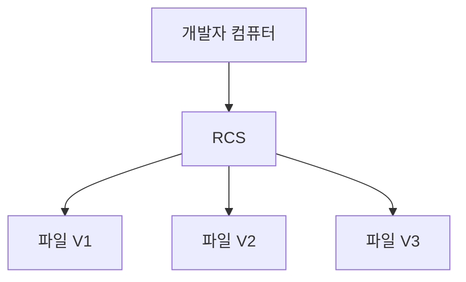

RCS는 파일의 변경 차이를 활용해 버전을 관리할 수 있다.

장점은 간단하다.

개발자는 과거 버전을 확인하고 이전 상태로 복원할 수 있다.

하지만 중요한 한계가 존재한다.

변경 이력이 로컬 컴퓨터에만 있다면 컴퓨터에 장애가 발생했을 때 이력을 잃을 위험이 있다.

또 여러 개발자가 같은 프로젝트를 협업하는 데도 한계가 있다.

참고로 RCS를 최초의 모든 버전 관리 시스템이라고 단정하는 것은 정확하지 않다. RCS는 대표적인 초기 로컬 버전 관리 도구 중 하나다.

---

#### 2. 중앙 집중식 버전 관리 시스템(CVCS)

로컬 버전 관리 시스템의 협업 문제를 해결하기 위해 중앙 집중식 버전 관리 시스템이 널리 사용되었다.

대표적인 도구는 CVS와 SVN이다.

중앙 집중식 방식에서는 서버가 프로젝트의 변경 이력을 관리한다.

각 개발자는 중앙 서버에 접근해 파일을 가져오거나 변경 사항을 반영한다.

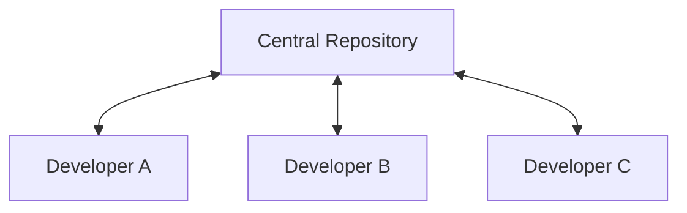

이 구조에서는 개발자들이 동일한 중앙 저장소를 사용한다.

따라서 협업과 변경 이력의 중앙 관리가 쉬워진다.

하지만 중앙 서버에 대한 의존성이 높아진다.

예를 들어 중앙 서버에 장애가 발생하면 어떻게 될까?

개발자는 로컬에서 코드를 수정할 수는 있다.

하지만 중앙 서버와 통신해야 하는 작업은 수행할 수 없게 된다.

또 서버의 변경 이력이 손실되고 별도의 백업이 없다면 심각한 문제가 발생할 수 있다.

따라서 중앙 서버가 협업과 이력 관리의 중요한 장애 지점이 된다.

---

#### 3. 분산 버전 관리 시스템(DVCS)

분산 버전 관리 시스템은 이러한 중앙 서버 의존성을 줄이기 위한 구조다.

대표적인 도구가 Git이다.

분산 버전 관리 시스템에서는 각 개발자가 저장소의 변경 이력을 로컬에 보유할 수 있다.

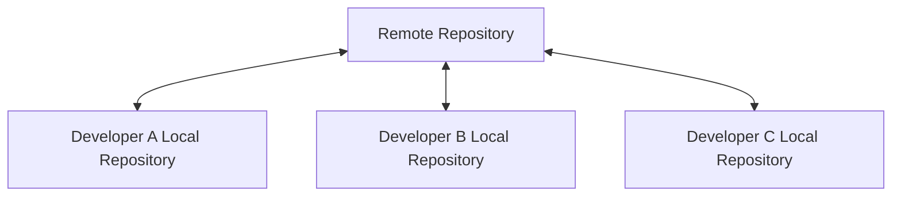

Git의 일반적인 `clone` 작업은 단순히 최신 파일만 가져오는 작업이 아니다.

저장소의 변경 이력과 객체 정보도 가져온다.

따라서 로컬 저장소에서 다음 작업을 수행할 수 있다.

```bash
git log
```

```bash
git diff
```

```bash
git commit
```

이러한 작업은 일반적으로 원격 서버와 통신할 필요가 없다.

반면 다음 작업은 원격 저장소와 데이터를 주고받을 수 있다.

```bash
git fetch
```

```bash
git push
```

따라서 인터넷 연결이 끊기더라도 로컬에서 새로운 커밋을 생성하고 이력을 확인할 수 있다.

다만 `--depth`를 사용하는 Shallow Clone이나 부분 클론(Partial Clone)처럼 일부 이력과 객체만 가져오는 방식도 존재한다.

따라서 모든 Git Clone이 반드시 전체 이력을 완전하게 복제한다고 생각해서는 안 된다.

이러한 버전 관리 방식의 차이는 Git 공식 문서에서도 설명하고 있다.

---

### Git은 어떻게 탄생했을까?

Git은 2005년 리누스 토르발스(Linus Torvalds)에 의해 개발되었다.

당시 Linux Kernel 프로젝트에서는 BitKeeper라는 분산 버전 관리 시스템을 사용하고 있었다.

하지만 2005년 BitKeeper를 제공하는 회사와 Linux 개발 커뮤니티 사이의 관계가 악화되면서 기존의 무료 사용 조건이 철회되었다.

이에 따라 Linux Kernel 개발을 위한 새로운 버전 관리 시스템이 필요해졌다.

이 과정에서 Git이 탄생했다.

Git의 초기 설계 목표에는 다음과 같은 요소들이 포함되어 있었다.

- 빠른 실행 속도
- 단순한 구조
- 분산 환경 지원
- 수많은 브랜치를 활용하는 개발 방식 지원
- Linux Kernel처럼 규모가 큰 프로젝트의 효율적인 관리

특히 Git은 단순히 기존 버전 관리 도구와 동일한 기능을 구현하는 데 그치지 않았다.

**변경 이력을 저장하는 방식 자체를 효율적으로 설계했다.**

이러한 설계의 핵심이 스냅샷(Snapshot) 기반 저장 방식이다.

---

### Git의 핵심 개념: 스냅샷(Snapshot)

Git을 이해할 때 중요한 개념 중 하나가 스냅샷이다.

스냅샷은 특정 시점의 프로젝트 상태를 나타내는 정보다.

예를 들어 다음과 같은 프로젝트가 있다고 가정하자.

```text
order-service/
├── OrderController.java
├── OrderService.java
└── OrderRepository.java
```

첫 번째 커밋에서는 다음 상태를 저장했다고 가정하자.

```text
Commit A

OrderController.java   V1
OrderService.java      V1
OrderRepository.java   V1
```

이후 `OrderService.java`를 수정한다.

```text
Commit B

OrderController.java   V1
OrderService.java      V2
OrderRepository.java   V1
```

Git은 새로운 커밋을 만들 때 프로젝트의 전체 상태를 나타내는 스냅샷을 기록한다.

여기서 중요한 점이 있다.

**Git이 새로운 커밋마다 모든 파일의 내용을 물리적으로 중복 저장하는 것은 아니다.**

변경되지 않은 파일은 이미 저장된 Git 객체를 다시 참조할 수 있다.

예를 들어 다음과 같은 구조다.

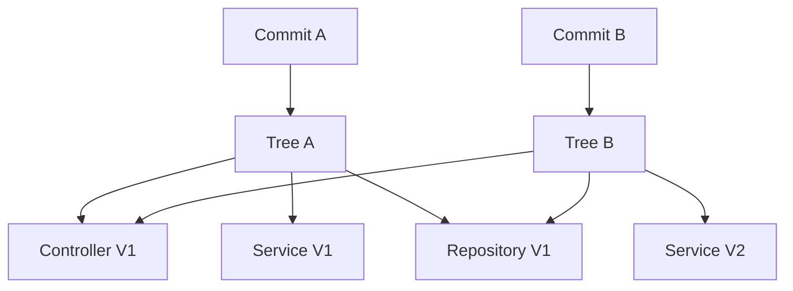

`OrderController.java`와 `OrderRepository.java`는 변경되지 않았다.

따라서 두 커밋이 같은 파일 내용 객체를 참조할 수 있다.

반면 `OrderService.java`는 수정되었으므로 새로운 내용 객체가 만들어진다.

즉 Git은 논리적으로 프로젝트의 전체 스냅샷을 관리하면서 저장된 객체를 재사용하는 구조다.

이것이 Git을 단순한 파일 복사 시스템이나 변경 차이만을 기록하는 시스템으로 이해해서는 안 되는 이유다.

---

### Git의 동작 원리: 세 가지 영역

이제 Git의 가장 중요한 구조를 살펴보자.

Git은 일반적인 작업 과정에서 다음 세 가지 영역을 중심으로 동작한다.

1. Working Directory
2. Staging Area
3. Repository

각 영역의 관계는 다음과 같다.

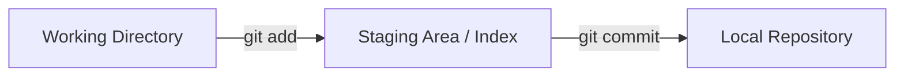

각 영역의 역할을 정리하면 다음과 같다.

| 영역 | 다른 이름 | 역할 |
|---|---|---|
| Working Directory | Working Tree | 실제 파일을 수정하는 작업 공간 |
| Staging Area | Index | 다음 커밋에 포함할 파일 상태를 준비하는 공간 |
| Repository | Local Repository | 커밋과 Git 객체를 보관하는 저장소 |

이 세 가지 영역을 이해하면 `git add`, `git commit`, `git restore`, `git reset` 등의 동작을 쉽게 설명할 수 있다.

---

### Working Directory란 무엇인가?

Working Directory는 개발자가 실제 파일을 수정하는 작업 공간이다.

예를 들어 다음과 같은 프로젝트가 있다고 가정하자.

```text
order-service/
├── src/
│   └── main/
│       └── java/
│           └── OrderService.java
├── build.gradle
└── README.md
```

개발자는 이 디렉터리에서 파일을 생성하거나 수정한다.

예를 들어 `OrderService.java`를 수정한다.

```java
public class OrderService {

    public void createOrder() {
        System.out.println("주문 생성");
    }
}
```

이때 변경된 내용은 Working Directory에 존재한다.

하지만 아직 다음 커밋에 포함할 변경 사항으로 지정한 것은 아니다.

즉 다음 두 개념은 다르다.

**파일을 수정하는 것과 커밋할 내용을 선택하는 것은 별도의 작업이다.**

Working Directory에서는 다음과 같은 작업이 이루어진다.

- 파일 생성
- 파일 수정
- 파일 삭제
- 코드 실행
- 테스트
- 빌드

개발자가 IDE에서 확인하는 대부분의 프로젝트 파일은 Working Directory에 존재한다.

---

### Staging Area란 무엇인가?

Staging Area는 다음 커밋에 포함할 내용을 준비하는 영역이다.

다른 이름으로 Index라고도 한다.

예를 들어 다음 파일을 생성했다고 가정하자.

```text
Person.java
```

```java
public class Person {

    private String name;
}
```

이 파일을 다음 커밋에 포함하고 싶다면 다음 명령어를 실행한다.

```bash
git add Person.java
```

이 명령어는 현재 `Person.java`의 내용을 Staging Area에 반영한다.

중요한 점은 Staging Area가 단순히 파일을 임시로 복사해 두는 별도 폴더가 아니라는 것이다.

Git의 Index는 다음 커밋에 포함할 파일의 경로, 객체 식별자, 파일 모드 등의 정보를 관리한다.

일반적인 Git 저장소에서는 `.git/index` 파일에 이러한 정보가 저장된다.

또 `git add`를 실행하는 과정에서 파일 내용에 대응하는 Blob 객체가 Git 객체 저장소에 기록될 수 있다.

따라서 개념적으로는 다음과 같이 이해할 수 있다.

```text
Working Directory

Person.java의 현재 내용
        ↓
      git add
        ↓
Staging Area

다음 커밋에 사용할 Person.java의 내용과 정보
```

Staging Area는 다음 커밋의 스냅샷을 미리 구성하는 공간이라고 생각하면 된다.

---

### Repository란 무엇인가?

Repository는 Git이 변경 이력과 객체를 저장하는 공간이다.

일반적인 로컬 Git 저장소에서는 `.git` 디렉터리가 중요한 역할을 한다.

예를 들어 다음과 같은 구조다.

```text
order-service/
├── .git/
├── src/
├── build.gradle
└── README.md
```

`.git` 디렉터리에는 Git의 변경 이력과 참조 정보, 설정 등이 저장된다.

대표적인 구성 요소는 다음과 같다.

```text
.git/
├── HEAD
├── config
├── objects/
├── refs/
└── index
```

다만 `.git/index`는 아직 생성되지 않았을 수도 있고, 참조 정보의 실제 저장 방식도 Git 설정에 따라 달라질 수 있다.

여기서 중요한 것은 다음과 같다.

**Repository는 GitHub 같은 원격 저장소만을 의미하지 않는다.**

개발자 컴퓨터에 존재하는 로컬 저장소도 Repository다.

따라서 다음 명령어는 원격 서버에 데이터를 업로드하는 명령어가 아니다.

```bash
git commit -m "Add Person class"
```

이 명령어는 로컬 저장소에 새로운 커밋을 기록한다.

원격 저장소로 변경 사항을 전송하는 작업은 `git push`와 같은 별도의 명령어를 통해 수행한다.

---

### git init은 무엇을 생성할까?

Git 저장소를 생성할 때 사용하는 명령어는 다음과 같다.

```bash
git init
```

이 명령어는 현재 디렉터리에 Git 저장소를 초기화한다.

브랜치 이름을 명시하고 싶다면 다음과 같이 작성할 수 있다.

```bash
git init -b main
```

여기서는 기본 브랜치 이름을 `main`으로 설정한다.

이제 다음과 같은 구조가 생성된다.

```text
my-project/
└── .git/
```

`.git` 내부에는 Git 객체와 참조 정보 등을 저장하기 위한 구조가 준비된다.

다만 이 시점에 커밋이 존재하는 것은 아니다.

또 Working Directory, Staging Area, Repository라는 세 가지 개념이 반드시 각각 별도의 물리적 디렉터리로 만들어진다는 의미도 아니다.

Working Directory는 실제 프로젝트의 작업 파일이 있는 공간이다.

Repository는 일반적으로 `.git` 내부에 구성된다.

Staging Area는 주로 Git Index를 통해 구현된다.

초기 저장소에서는 아직 커밋되지 않은 브랜치를 가리키는 `HEAD`만 준비된 상태일 수 있다.

실제 Git 공식 문서에서도 `git init`을 빈 저장소를 생성하는 명령어로 설명한다.

---

### git add는 내부적으로 무엇을 할까?

다음 코드를 작성했다고 가정하자.

```java
public class Person {

    private String name;
}
```

파일을 생성한 다음 다음 명령어를 실행한다.

```bash
git add Person.java
```

Git은 현재 Working Directory에 있는 `Person.java`의 내용을 다음 커밋에 포함하도록 Index에 반영한다.

이 과정을 조금 더 정확하게 설명하면 다음과 같다.

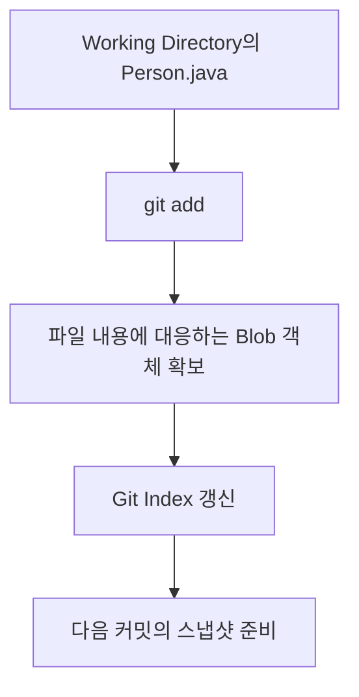

여기서 중요한 사실이 있다.

`git add`는 단순히 파일에 Staged라는 표시만 추가하는 명령어가 아니다.

**현재 파일의 내용을 다음 커밋에 사용하도록 Index를 갱신하는 명령어다.**

따라서 `git add` 이후 파일을 다시 수정하면 Index에 기록된 내용과 Working Directory의 내용이 달라질 수 있다.

이 차이는 Git의 상태 관리에서 매우 중요한 역할을 한다.

---

### git commit은 내부적으로 무엇을 할까?

이제 다음 명령어를 실행한다고 가정하자.

```bash
git commit -m "Add Person class"
```

Git은 현재 Index를 기준으로 새로운 커밋을 생성한다.

이때 개념적으로 다음 작업이 수행된다.

첫 번째, Index에 기록된 파일 구조를 바탕으로 Tree 객체를 구성한다.

두 번째, 해당 Tree를 참조하는 Commit 객체를 생성한다.

세 번째, Commit 객체에 작성자, 커밋 작성자, 시간, 메시지, 부모 커밋 등의 정보를 기록한다.

네 번째, 현재 브랜치가 새로운 Commit 객체를 가리키도록 참조를 갱신한다.

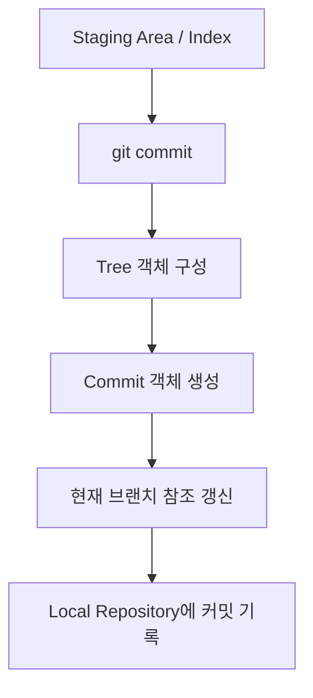

여기서 주의할 점이 있다.

**`git commit`이 실행되었다고 Working Directory를 다시 체크아웃하는 것은 아니다.**

일반적인 커밋 과정에서 Git은 Index에 준비된 상태를 새로운 커밋으로 기록하고 브랜치 참조를 이동시킨다.

Working Directory에 아직 Staging하지 않은 변경 사항이 있다면 해당 변경은 그대로 남을 수 있다.

이 원리를 이해하면 같은 파일에 Staged와 Modified 상태가 동시에 나타나는 이유도 설명할 수 있다.

---

### 파일의 네 가지 상태

Git에서 파일의 상태는 기본적으로 다음 네 가지 개념으로 설명할 수 있다.

- Untracked
- Unmodified
- Modified
- Staged

먼저 개념을 정리해 보자.

| 상태 | 의미 | 추적 여부 |
|---|---|---|
| Untracked | Git이 아직 추적하지 않는 파일 | 추적하지 않음 |
| Unmodified | 마지막 기록된 상태와 비교해 변경이 없는 파일 | Tracked |
| Modified | 추적 중인 파일이 수정된 상태 | Tracked |
| Staged | 다음 커밋에 포함할 변경 사항이 Index에 반영된 상태 | Tracked |

여기서 Tracked는 Git이 추적하는 파일을 의미한다.

Untracked는 아직 Git이 추적하지 않는 파일이다.

네 가지 상태의 기본적인 전환은 다음과 같다.

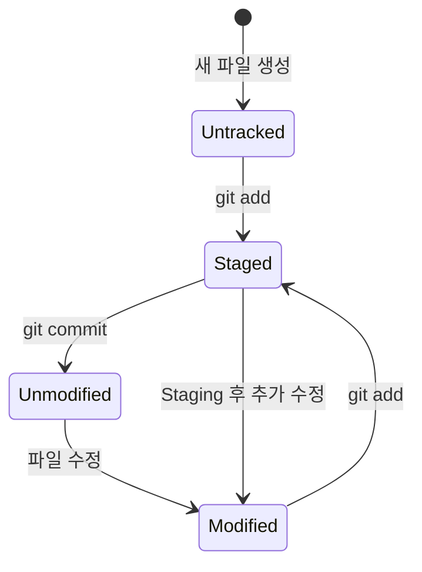

이 다이어그램은 파일의 일반적인 작업 흐름을 단순화한 것이다.

실제로 Git의 상태는 HEAD, Index, Working Directory 사이의 비교 결과로 결정되므로 한 파일에 여러 변경 상태가 동시에 나타날 수도 있다.

이제 각 상태를 직접 확인해 보자.

---

### Untracked 상태

Untracked는 Git이 아직 추적하지 않는 파일을 의미한다.

예를 들어 새로운 파일을 생성했다고 가정하자.

```text
Person.java
```

아직 `git add`를 실행하지 않았다.

이때 다음 명령어로 상태를 확인할 수 있다.

```bash
git status
```

다음과 같은 결과가 나타날 수 있다.

```text
Untracked files:
  Person.java
```

이는 Git이 해당 파일을 발견했지만 아직 다음 커밋에 포함할 대상으로 지정하지 않았다는 의미다.

여기서 중요한 점이 있다.

Untracked 파일도 Working Directory에는 실제로 존재한다.

단지 Git의 현재 커밋이나 Index에 포함되어 있지 않을 뿐이다.

이제 다음 명령어를 실행한다.

```bash
git add Person.java
```

그러면 Git은 해당 파일을 추적하기 시작하고, 다음 커밋에 포함할 내용으로 준비한다.

---

### Staged 상태

Staged는 다음 커밋에 포함할 변경 사항이 준비된 상태다.

앞서 다음 명령어를 실행했다.

```bash
git add Person.java
```

이후 상태를 확인한다.

```bash
git status
```

다음과 같은 결과가 나타날 수 있다.

```text
Changes to be committed:
  new file: Person.java
```

여기서 `Changes to be committed`는 다음 커밋에 포함될 변경 사항이라는 의미다.

즉 `Person.java`의 현재 Index 버전이 다음 커밋에 사용될 준비가 되었다.

이 상태에서 다음 명령어를 실행한다.

```bash
git commit -m "Add Person class"
```

그러면 Index에 준비된 파일 상태를 바탕으로 새로운 커밋이 생성된다.

---

### Unmodified 상태

Unmodified는 추적 중인 파일에 변경 사항이 없는 상태를 의미한다.

방금 새로운 커밋을 생성했다고 가정하자.

```bash
git commit -m "Add Person class"
```

이후 파일을 수정하지 않았다면 Working Directory와 Index, HEAD의 파일 내용이 일치한다.

다시 상태를 확인한다.

```bash
git status
```

일반적으로 다음과 같은 결과가 나타날 수 있다.

```text
On branch main
nothing to commit, working tree clean
```

이 메시지는 현재 작업 상태에서 커밋할 변경 사항이 없다는 의미다.

여기서 `HEAD`는 현재 체크아웃한 커밋을 가리키는 참조다.

따라서 개념적으로 다음 관계가 성립한다.

```text
HEAD의 Person.java

=

Index의 Person.java

=

Working Directory의 Person.java
```

세 위치의 파일 내용이 동일하므로 변경 사항이 없다.

---

### Modified 상태

이번에는 `Person.java`를 수정해 보자.

기존 코드가 다음과 같다고 가정하자.

```java
public class Person {

    private String name;
}
```

이제 나이 필드를 추가한다.

```java
public class Person {

    private String name;

    private int age;
}
```

파일을 저장한 다음 상태를 확인한다.

```bash
git status
```

다음과 같은 결과가 나타날 수 있다.

```text
Changes not staged for commit:
  modified: Person.java
```

Git은 파일이 수정되었다는 사실을 확인했다.

하지만 아직 수정된 내용을 Index에 반영하지 않았다.

따라서 해당 변경 사항은 Modified 상태다.

이제 다음 명령어를 실행하면 수정된 내용이 Staging된다.

```bash
git add Person.java
```

---

### Staged와 Modified가 동시에 존재할 수 있을까?

가능하다.

이 부분은 Git의 상태 관리를 이해하는 데 매우 중요하다.

하나의 파일에 대해 Staged와 Modified가 동시에 나타날 수 있다.

왜 그런지 구체적인 예제를 살펴보자.

#### 1단계: 최초 커밋된 파일

다음 코드가 있다고 가정하자.

```java
public class Person {

    private String name;
}
```

이 파일은 이미 커밋되어 있다.

따라서 현재 상태는 Unmodified다.

#### 2단계: age 필드 추가

다음과 같이 수정한다.

```java
public class Person {

    private String name;

    private int age;
}
```

이제 Working Directory가 변경되었다.

다음 명령어를 실행한다.

```bash
git add Person.java
```

현재 Index에는 `age` 필드가 포함된 버전이 기록된다.

#### 3단계: email 필드 추가

그런데 커밋하기 전에 파일을 다시 수정했다.

```java
public class Person {

    private String name;

    private int age;

    private String email;
}
```

중요한 점은 두 번째 수정 이후 `git add`를 다시 실행하지 않았다는 것이다.

이제 세 영역의 내용이 서로 다르다.

| 영역 | Person.java 내용 |
|---|---|
| HEAD | name 필드 |
| Index | name, age 필드 |
| Working Directory | name, age, email 필드 |

이 구조를 그림으로 표현하면 다음과 같다.

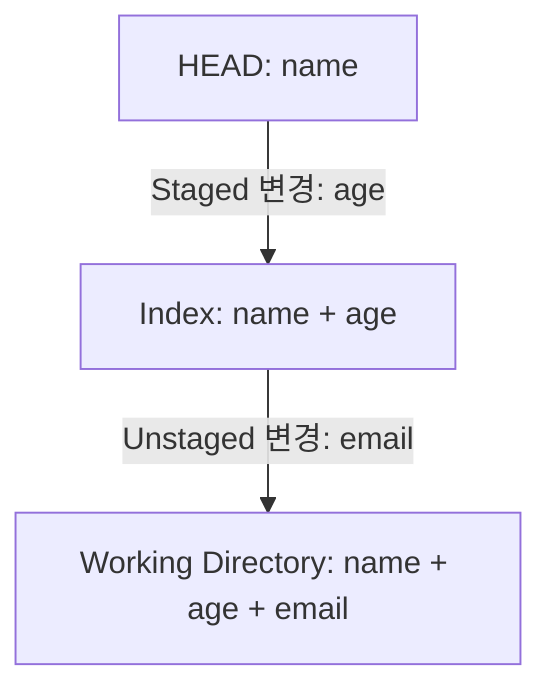

이 상태에서 다음 명령어를 실행한다.

```bash
git status --short
```

실행 결과는 다음과 같다.

```text
MM Person.java
```

`MM`은 두 가지 변경 상태가 존재한다는 의미다.

첫 번째 `M`은 Index와 HEAD 사이에 변경이 있다는 뜻이다.

두 번째 `M`은 Working Directory와 Index 사이에 변경이 있다는 뜻이다.

즉 다음과 같은 상태다.

```text
HEAD → Index

Modified
```

```text
Index → Working Directory

Modified
```

그래서 하나의 파일에 Staged와 Unstaged 변경이 동시에 존재할 수 있다.

이 상태에서 커밋을 실행하면 어떤 버전이 저장될까?

---

### git commit은 어떤 버전을 저장할까?

앞선 상태를 다시 살펴보자.

```text
HEAD

name
```

```text
Index

name
age
```

```text
Working Directory

name
age
email
```

이때 다음 명령어를 실행한다.

```bash
git commit -m "Add age field"
```

Git은 Index를 기준으로 커밋을 생성한다.

따라서 커밋에 포함되는 내용은 다음과 같다.

```java
public class Person {

    private String name;

    private int age;
}
```

`email` 필드는 포함되지 않는다.

왜냐하면 `email` 필드가 추가된 이후에는 `git add`를 다시 실행하지 않았기 때문이다.

즉 다음 관계를 기억해야 한다.

**`git commit`은 일반적으로 현재 Working Directory의 모든 변경 사항을 저장하는 것이 아니라, Index에 준비된 스냅샷을 기록한다.**

따라서 커밋 전에 어떤 변경 사항이 Staged되어 있는지 확인하는 것이 중요하다.

---

### git status는 어떻게 파일 상태를 판단할까?

이제 Git의 상태 판단 원리를 조금 더 깊이 살펴보자.

Git은 대표적으로 세 위치의 상태를 비교한다.

첫 번째는 HEAD다.

두 번째는 Index다.

세 번째는 Working Directory다.


각 비교가 의미하는 것은 다음과 같다.

| 비교 대상 | 확인하는 내용 |
|---|---|
| HEAD ↔ Index | 다음 커밋에 포함될 변경 사항 |
| Index ↔ Working Directory | 아직 Staging하지 않은 변경 사항 |
| Index ↔ 미추적 파일 | 새로 추가할 수 있는 파일 |

이러한 구조를 이해하면 `git status`의 결과를 쉽게 해석할 수 있다.

특히 다음 명령어가 유용하다.

```bash
git status --short
```

이 명령어는 파일 상태를 간결하게 표시한다.

대표적인 결과는 다음과 같다.

```text
?? Person.java
```

```text
A  Person.java
```

```text
 M Person.java
```

```text
M  Person.java
```

```text
MM Person.java
```

각 결과의 의미를 정리하면 다음과 같다.

| 출력 | 의미 |
|---|---|
| `??` | Untracked |
| `A ` | 새 파일이 Staged됨 |
| ` M` | Working Directory만 수정됨 |
| `M ` | 수정 사항이 Staged됨 |
| `MM` | Staged 변경과 Unstaged 변경이 동시에 존재 |
| ` D` | 추적 중인 파일이 Working Directory에서 삭제됨 |
| `D ` | 삭제가 Staged됨 |

여기서 공백도 의미가 있다.

첫 번째 문자는 Index의 상태를 나타낸다.

두 번째 문자는 Working Directory의 상태를 나타낸다.

따라서 다음 두 결과는 서로 다르다.

```text
M  Person.java
```

```text
 M Person.java
```

첫 번째는 커밋할 변경 사항이 준비되었다는 의미다.

두 번째는 아직 Staging하지 않은 변경 사항이 있다는 의미다.

Git 공식 문서에서도 `git status`가 Index와 HEAD, Working Directory와 Index 사이의 차이를 확인한다고 설명한다.

---

### git diff는 무엇을 비교할까?

Git에서 파일 변경 사항을 비교할 때 사용하는 대표적인 명령어가 `git diff`다.

하지만 `git diff`는 옵션에 따라 비교 대상이 달라진다.

이 부분을 이해하려면 앞서 살펴본 세 영역을 기억해야 한다.

```text
HEAD

↓

Index

↓

Working Directory
```

대표적인 명령어는 다음과 같다.

```bash
git diff
```

```bash
git diff --staged
```

```bash
git diff HEAD
```

각 명령어의 차이를 살펴보자.

#### git diff

```bash
git diff
```

이 명령어는 기본적으로 Working Directory와 Index의 차이를 확인한다.

즉 아직 Staging하지 않은 변경 사항을 보여준다.

앞선 예제에서 `email` 필드를 추가한 후 다음 명령어를 실행했다고 가정하자.

```bash
git diff -- Person.java
```

다음과 비슷한 결과가 나타난다.

```diff
+    private String email;
```

이 결과는 현재 Working Directory에는 존재하지만 Index에는 없는 변경 사항이다.

#### git diff --staged

```bash
git diff --staged
```

이 명령어는 Index와 HEAD 사이의 변경 사항을 확인한다.

즉 다음 커밋에 포함될 변경 사항을 보여준다.

앞선 예제에서는 다음 변경이 표시된다.

```diff
+    private int age;
```

`--staged` 대신 `--cached`를 사용할 수도 있다.

```bash
git diff --cached
```

두 옵션은 같은 의미로 사용할 수 있다.

#### git diff HEAD

```bash
git diff HEAD
```

이 명령어는 HEAD와 현재 Working Directory 사이의 차이를 확인한다.

따라서 앞선 예제에서는 다음 두 변경이 모두 포함될 수 있다.

```diff
+    private int age;
+    private String email;
```

정리하면 다음과 같다.

| 명령어 | 비교 대상 |
|---|---|
| `git diff` | Index ↔ Working Directory |
| `git diff --staged` | HEAD ↔ Index |
| `git diff --cached` | HEAD ↔ Index |
| `git diff HEAD` | HEAD ↔ Working Directory |

이 구조를 이해하면 Git의 변경 상태를 훨씬 정확하게 확인할 수 있다.

---

### Git의 내부 구조: Blob, Tree, Commit

지금까지 Git의 작업 영역과 파일 상태를 살펴봤다.

이제 Git이 실제로 데이터를 어떻게 저장하는지 알아보자.

Git 저장소는 여러 종류의 객체를 사용한다.

대표적으로 다음 네 가지가 있다.

| 객체 | 역할 |
|---|---|
| Blob | 파일의 내용 저장 |
| Tree | 파일 이름과 디렉터리 구조 표현 |
| Commit | 특정 Tree와 부모 커밋 등 메타데이터 저장 |
| Tag | 특정 Git 객체를 가리키는 태그 객체 |

이 중 가장 중요한 객체는 Blob, Tree, Commit이다.

---

### Blob 객체란 무엇인가?

Blob은 파일의 내용을 저장하는 Git 객체다.

예를 들어 다음 파일이 있다고 가정하자.

`Person.java`

```java
public class Person {

    private String name;
}
```

Git은 파일의 내용을 바탕으로 Blob 객체를 만들 수 있다.

이때 중요한 사실이 있다.

**Blob은 일반적으로 파일 이름을 저장하지 않는다.**

Blob의 주요 역할은 파일 내용 자체를 저장하는 것이다.

따라서 서로 다른 파일 이름이더라도 내용이 동일하다면 같은 Blob 객체를 참조할 수 있다.

예를 들어 다음과 같은 파일들이 있다고 가정하자.

```text
a.txt

b.txt
```

두 파일의 내용이 완전히 동일하다.

```text
Hello Git
```

그러면 두 파일은 동일한 내용의 Blob 객체를 참조할 수 있다.

이러한 구조는 중복된 파일 내용을 효율적으로 관리하는 데 도움이 된다.

---

### Tree 객체란 무엇인가?

Tree는 디렉터리 구조를 표현하는 객체다.

Blob이 파일 내용을 저장한다면 Tree는 해당 파일이 어떤 이름으로 어떤 위치에 존재하는지 나타낸다.

예를 들어 다음과 같은 프로젝트 구조를 생각해 보자.

```text
project/
├── README.md
└── src/
    └── Person.java
```

Git은 이 구조를 Tree 객체들을 통해 표현할 수 있다.

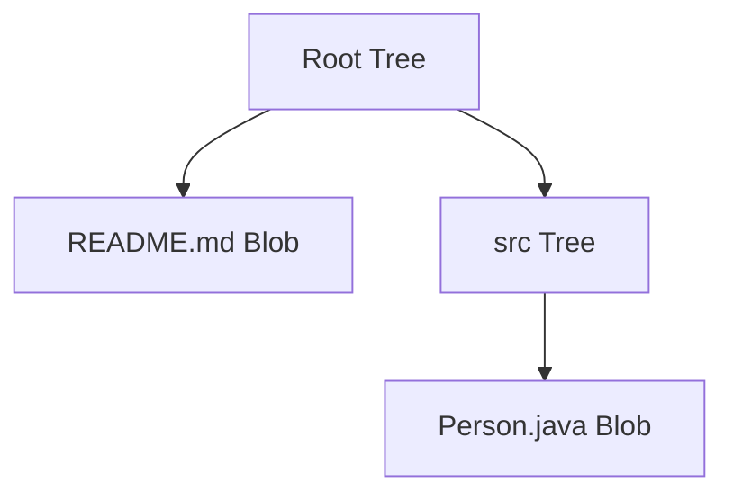

Tree는 각 항목의 이름, 파일 모드, 객체 식별자 등의 정보를 포함한다.

따라서 Git은 Blob과 Tree를 조합해 특정 시점의 프로젝트 파일 구조를 표현한다.

이 구조가 Git의 스냅샷 저장 방식과 연결된다.

---

### Commit 객체란 무엇인가?

Commit은 특정 시점의 프로젝트 스냅샷과 관련된 정보를 기록하는 객체다.

대표적으로 다음 정보를 포함한다.

- Tree 객체
- 부모 Commit 객체
- Author
- Committer
- 작성 시각
- Commit Message

일반적인 커밋 객체의 개념적인 구조는 다음과 같다.

```text
Commit
├── Tree
├── Parent Commit
├── Author
├── Committer
└── Message
```

예를 들어 다음과 같은 커밋 이력이 있다고 가정하자.

```text
Commit A
    ↓
Commit B
    ↓
Commit C
```

각 커밋은 자신의 부모 커밋을 참조할 수 있다.

따라서 Git은 커밋 객체의 참조 관계를 이용해 변경 이력을 관리한다.

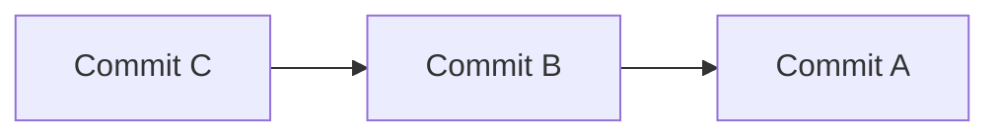

Merge Commit처럼 부모가 둘 이상인 경우도 있다.

이처럼 Git의 커밋 이력은 단순한 일렬의 목록이 아니라 방향성을 가진 그래프 구조로 표현할 수 있다.

이 구조는 Git의 브랜치와 병합 동작을 이해할 때 중요하다.

Git 공식 문서에서는 Blob과 Tree, Commit 객체를 통해 Git의 데이터 저장 구조를 설명한다.

---

### Git 객체는 어떻게 식별할까?

Git은 객체의 내용에 기반한 식별자를 사용한다.

이를 Content-Addressable Storage라고 한다.

대표적인 Git 저장소에서는 SHA-1 기반 객체 식별자를 사용해 왔다.

SHA-1 객체 식별자는 일반적으로 40자리의 16진수 문자열로 표현된다.

예를 들어 다음과 같은 형태다.

```text
f4a2c9...
```

다만 현재 Git은 SHA-256 객체 형식도 지원한다.

따라서 모든 Git 저장소의 객체 식별자가 반드시 SHA-1이라고 생각해서는 안 된다.

핵심은 Git이 객체의 내용에 기반한 식별 방식을 사용한다는 점이다.

이 덕분에 동일한 내용의 객체를 재사용할 수 있다.

또 객체 간 참조 관계를 통해 커밋 이력을 구성할 수 있다.

---

### 실습: Git의 내부 동작 직접 확인하기

이제 실제 Git 명령어를 이용해 세 가지 영역과 네 가지 상태를 확인해 보자.

다음 실습은 새로운 테스트 디렉터리에서 수행한다.

기존 프로젝트에 영향을 주지 않도록 별도의 디렉터리를 사용한다.

#### 1단계: Git 저장소 생성

먼저 새로운 디렉터리를 만든다.

```bash
mkdir git-internals-demo
```

디렉터리로 이동한다.

```bash
cd git-internals-demo
```

Git 저장소를 초기화한다.

```bash
git init -b main
```

실행하면 현재 디렉터리에 `.git` 저장소가 생성된다.

Git 저장소의 최상위 경로를 확인할 수 있다.

```bash
git rev-parse --show-toplevel
```

이 명령어는 현재 Git Working Tree의 최상위 경로를 출력한다.

이제 현재 상태를 확인한다.

```bash
git status
```

아직 커밋이 존재하지 않으므로 최초 커밋 이전 상태가 표시된다.

---

#### 2단계: Git 사용자 정보 설정

커밋을 생성하기 위해 사용자 정보를 설정한다.

```bash
git config user.name "Git Example"
```

```bash
git config user.email "git-example@example.com"
```

이 설정은 현재 저장소에 적용된다.

`--global` 옵션을 사용하면 사용자 환경의 전역 Git 설정에 적용된다.

여기서는 기존 설정에 영향을 주지 않도록 저장소 단위로 설정한다.

---

#### 3단계: 새로운 파일 생성

`Person.java` 파일을 만든다.

```bash
cat > Person.java <<'EOF'
public class Person {
    private String name;
}
EOF
```

이 명령어는 다음 내용의 파일을 생성한다.

```java
public class Person {
    private String name;
}
```

이제 상태를 확인한다.

```bash
git status --short
```

실행 결과는 다음과 같다.

```text
?? Person.java
```

파일이 Untracked 상태다.

---

#### 4단계: Staging Area에 추가

다음 명령어를 실행한다.

```bash
git add Person.java
```

이제 상태를 다시 확인한다.

```bash
git status --short
```

실행 결과는 다음과 같다.

```text
A  Person.java
```

파일이 다음 커밋에 포함되도록 준비되었다.

여기서 Index에 기록된 정보를 확인할 수도 있다.

```bash
git ls-files --stage
```

실행 결과는 다음과 같은 형식이다.

```text
100644 <Blob 객체 ID> 0    Person.java
```

각 항목의 의미는 다음과 같다.

| 항목 | 의미 |
|---|---|
| `100644` | 일반적인 파일 모드 |
| Blob 객체 ID | Index에서 참조하는 파일 내용 객체 |
| `0` | 일반적인 병합 완료 상태의 Index Stage |
| `Person.java` | 파일 경로 |

여기서 `git ls-files --stage`는 현재 Index가 어떤 파일 내용 객체를 참조하는지 확인할 수 있는 명령어다.

---

#### 5단계: 최초 커밋 생성

다음 명령어를 실행한다.

```bash
git commit -m "Add Person class"
```

이제 최초 커밋이 생성된다.

상태를 확인한다.

```bash
git status --short
```

변경 사항이 없다면 아무것도 출력되지 않는다.

커밋 이력도 확인할 수 있다.

```bash
git log --oneline
```

다음과 같은 결과가 나타난다.

```text
<Commit ID> Add Person class
```

Commit ID의 실제 값은 실행 환경에 따라 달라진다.

---

#### 6단계: Git 객체 확인

이제 커밋 객체를 확인해 보자.

```bash
git cat-file -p HEAD
```

이 명령어는 현재 HEAD가 가리키는 Git 객체의 내용을 확인한다.

다음과 같은 구조가 출력된다.

```text
tree <Tree Object ID>
author Git Example <git-example@example.com> ...
committer Git Example <git-example@example.com> ...

Add Person class
```

여기서 `tree`는 현재 커밋이 참조하는 프로젝트 스냅샷의 최상위 Tree 객체를 의미한다.

다음 명령어를 실행하면 현재 커밋의 파일 구조를 확인할 수 있다.

```bash
git ls-tree HEAD
```

다음과 같은 형식의 결과가 나타난다.

```text
100644 blob <Blob Object ID>    Person.java
```

즉 현재 Commit이 Tree를 참조하고, Tree가 Blob을 참조하는 구조다.

파일 내용 자체를 확인할 수도 있다.

```bash
git show HEAD:Person.java
```

실행 결과는 다음과 같다.

```java
public class Person {
    private String name;
}
```

이 명령어는 Working Directory의 파일을 읽는 것이 아니다.

현재 HEAD 커밋에 기록된 `Person.java`의 내용을 출력한다.

따라서 Working Directory에서 파일을 수정하더라도 HEAD에 기록된 내용을 별도로 확인할 수 있다.

---

#### 7단계: 파일 수정

이제 다음 명령어를 사용해 필드를 추가한다.

```bash
sed -i '/private String name;/a\    private int age;' Person.java
```

위 명령어는 GNU `sed` 기준의 예제다. macOS의 기본 `sed`에서는 `-i` 사용 방식이 다를 수 있으므로 파일을 편집기로 직접 수정해도 된다.

파일 내용은 다음과 같다.

```java
public class Person {
    private String name;
    private int age;
}
```

이제 상태를 확인한다.

```bash
git status --short
```

실행 결과는 다음과 같다.

```text
 M Person.java
```

Working Directory에 변경 사항이 있지만 아직 Staging하지 않았다는 의미다.

변경 내용을 확인한다.

```bash
git diff
```

다음과 비슷한 결과가 출력된다.

```diff
+    private int age;
```

---

#### 8단계: 수정 사항 Staging

다음 명령어를 실행한다.

```bash
git add Person.java
```

다시 상태를 확인한다.

```bash
git status --short
```

실행 결과는 다음과 같다.

```text
M  Person.java
```

수정된 내용이 Staging되었다.

이제 다음 명령어를 실행한다.

```bash
git diff --staged
```

다음 변경이 표시된다.

```diff
+    private int age;
```

반면 다음 명령어는 별다른 결과를 출력하지 않을 수 있다.

```bash
git diff
```

현재 Working Directory와 Index가 동일하기 때문이다.

---

#### 9단계: Staging 이후 다시 수정

이번에는 `email` 필드를 추가한다.

```java
public class Person {
    private String name;
    private int age;
    private String email;
}
```

수정한 뒤 `git add`를 다시 실행하지 않는다.

이제 상태를 확인한다.

```bash
git status --short
```

실행 결과는 다음과 같다.

```text
MM Person.java
```

이제 Staged 변경과 Unstaged 변경이 동시에 존재한다.

다음 명령어는 Index와 Working Directory의 차이를 보여준다.

```bash
git diff
```

```diff
+    private String email;
```

다음 명령어는 HEAD와 Index의 차이를 보여준다.

```bash
git diff --staged
```

```diff
+    private int age;
```

두 결과가 서로 다르다는 점이 중요하다.

이제 다음 명령어를 실행하면 `age` 필드만 커밋에 포함된다.

```bash
git commit -m "Add age field"
```

반면 `email` 필드는 Working Directory에 남아 있다.

커밋 이후 다음 명령어로 확인할 수 있다.

```bash
git status --short
```

예상 결과는 다음과 같다.

```text
 M Person.java
```

즉 커밋을 생성했다고 모든 변경 사항이 사라지는 것은 아니다.

**Git은 Index에 준비된 변경 사항만 새로운 커밋에 반영한다.**

---

### HEAD란 무엇인가?

Git의 세 가지 영역을 이해했다면 `HEAD`도 알아야 한다.

`HEAD`는 현재 체크아웃한 위치를 나타내는 특별한 참조다.

일반적인 브랜치 작업에서는 현재 브랜치를 가리킨다.

예를 들어 다음과 같은 커밋 이력이 있다고 가정하자.

```text
A --- B --- C

            ↑
           main
            ↑
           HEAD
```

여기서 `main` 브랜치는 Commit C를 가리킨다.

`HEAD`는 현재 체크아웃한 `main` 브랜치를 가리킨다.

따라서 `HEAD`를 통해 현재 커밋을 참조할 수 있다.

다음 명령어를 실행하면 현재 HEAD가 가리키는 커밋의 식별자를 확인할 수 있다.

```bash
git rev-parse HEAD
```

이 명령어는 현재 커밋의 객체 식별자를 출력한다.

또 다음 명령어는 현재 HEAD에서 한 단계 이전의 부모 커밋을 의미한다.

```text
HEAD~1
```

다음은 두 단계 이전의 첫 번째 부모를 따라간 커밋이다.

```text
HEAD~2
```

이 개념은 이전 커밋을 비교하거나 복구할 때 자주 사용된다.

---

### HEAD, Index, Working Directory의 관계

지금까지 살펴본 내용을 조금 다른 관점에서 정리해 보자.

Git은 다음 세 가지 상태를 비교하고 조작하는 시스템으로 이해할 수 있다.

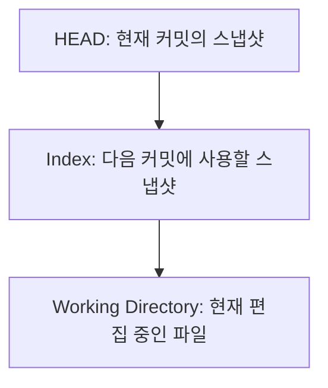

각각의 의미는 다음과 같다.

| 영역 | 역할 |
|---|---|
| HEAD | 현재 커밋의 스냅샷 |
| Index | 다음 커밋에 사용할 스냅샷 |
| Working Directory | 실제 개발자가 수정하는 파일 |

이 관계를 이해하면 Git 명령어를 특정 영역을 변경하는 작업으로 해석할 수 있다.

예를 들어 다음과 같다.

```bash
git add Person.java
```

Working Directory의 내용을 Index에 반영한다.

```bash
git commit
```

Index를 기준으로 새로운 커밋을 생성하고 현재 브랜치를 이동시킨다.

```bash
git restore Person.java
```

기본적으로 Index의 내용을 Working Directory에 복원한다.

```bash
git restore --staged Person.java
```

기본적으로 HEAD의 내용을 Index에 복원한다.

이처럼 Git의 동작은 세 영역 사이의 데이터 이동과 비교로 이해할 수 있다.

Git 공식 문서에서도 이러한 구조를 HEAD, Index, Working Directory라는 세 가지 Tree의 관점에서 설명한다.

---

### git restore는 어떻게 동작할까?

`git restore`는 Working Directory나 Index의 파일 내용을 특정 상태로 복원하는 명령어다.

먼저 다음 명령어를 살펴보자.

```bash
git restore Person.java
```

이 명령어는 기본적으로 Index의 내용을 Working Directory에 복원한다.

따라서 Staging하지 않은 변경 사항을 버릴 때 사용할 수 있다.

하지만 주의해야 한다.

**Working Directory의 변경 내용이 사라질 수 있다.**

예를 들어 다음 상태라고 가정하자.

```text
HEAD

name
```

```text
Index

name
age
```

```text
Working Directory

name
age
email
```

여기서 다음 명령어를 실행한다.

```bash
git restore Person.java
```

그러면 Working Directory가 Index의 상태로 복원된다.

```text
Working Directory

name
age
```

`email` 필드는 사라진다.

반면 `age` 필드는 Index에 존재하므로 유지된다.

---

### git restore --staged는 무엇이 다를까?

이번에는 다음 명령어를 실행한다.

```bash
git restore --staged Person.java
```

이 명령어는 기본적으로 HEAD의 내용을 Index에 복원한다.

즉 Staging된 변경 사항을 취소한다.

하지만 Working Directory의 파일 내용은 유지된다.

예를 들어 다음 상태라고 가정하자.

```text
HEAD

name
```

```text
Index

name
age
```

```text
Working Directory

name
age
email
```

`git restore --staged Person.java`를 실행하면 다음과 같이 된다.

```text
HEAD

name
```

```text
Index

name
```

```text
Working Directory

name
age
email
```

즉 Staging만 취소된다.

현재 작성 중인 코드는 그대로 유지된다.

이 차이는 매우 중요하다.

| 명령어 | 변경되는 영역 |
|---|---|
| `git restore file` | Working Directory |
| `git restore --staged file` | Index |
| `git restore --source=HEAD --staged --worktree file` | Index와 Working Directory |

마지막 명령어는 두 영역 모두 HEAD 상태로 복원할 수 있으므로 특히 주의해야 한다.

Git 공식 문서에서도 `git restore`의 기본 복원 대상과 `--staged`, `--worktree` 옵션의 차이를 설명한다.

---

### git reset은 어떻게 동작할까?

`git reset`은 Git을 사용하면서 혼동하기 쉬운 명령어 중 하나다.

특히 다음 세 가지 옵션의 차이를 알아야 한다.

```bash
git reset --soft
```

```bash
git reset --mixed
```

```bash
git reset --hard
```

세 옵션의 차이는 어떤 영역까지 변경하는지에 있다.

| 옵션 | 브랜치 참조 이동 | Index 변경 | Working Directory 변경 |
|---|---|---|---|
| `--soft` | O | X | X |
| `--mixed` | O | O | X |
| `--hard` | O | O | O |

위 표는 커밋을 지정해 실행하는 일반적인 `git reset` 동작을 기준으로 한다.

#### git reset --soft

다음 명령어를 살펴보자.

```bash
git reset --soft HEAD~1
```

이 명령어는 현재 브랜치를 이전 커밋으로 이동시킨다.

하지만 Index와 Working Directory는 유지한다.

따라서 커밋 이력을 다시 정리하거나 여러 커밋을 하나로 합칠 때 활용할 수 있다.

#### git reset --mixed

다음 명령어를 살펴보자.

```bash
git reset --mixed HEAD~1
```

이 명령어는 현재 브랜치를 이전 커밋으로 이동시키고 Index도 해당 상태로 갱신한다.

하지만 Working Directory의 파일은 그대로 유지한다.

즉 커밋과 Staging을 취소하면서 현재 파일 수정 내용은 유지하려는 경우에 사용할 수 있다.

`--mixed`는 커밋 단위 `git reset`의 기본 동작이다.

#### git reset --hard

다음 명령어를 살펴보자.

```bash
git reset --hard HEAD~1
```

이 명령어는 브랜치 참조와 Index, Working Directory를 모두 지정한 커밋 상태에 맞춘다.

따라서 커밋되지 않은 변경 사항이 사라질 수 있다.

특히 아직 한 번도 커밋하지 않은 수정 내용은 Git으로 복구하기 어려울 수 있다.

**`git reset --hard`는 현재 작업 내용을 버려도 되는지 확인한 뒤 사용해야 한다.**

---

### git reset과 git revert는 무엇이 다를까?

두 명령어 모두 이전 상태와 관련된 작업을 수행하지만 목적이 다르다.

`git reset`은 브랜치 참조를 이동시키는 방식으로 이력을 변경할 수 있다.

반면 `git revert`는 특정 커밋의 변경 효과를 되돌리는 새로운 커밋을 만든다.

예를 들어 다음 이력이 있다고 가정하자.

```text
A --- B --- C
            ↑
           main
```

Commit C에서 문제가 발생했다.

`git reset --hard HEAD~1`을 실행하면 다음과 같이 브랜치가 이동한다.

```text
A --- B
      ↑
     main
```

반면 다음 명령어를 실행하면 다음과 같다.

```bash
git revert HEAD
```

새로운 되돌리기 커밋이 생성된다.

```text
A --- B --- C --- D
                  ↑
                 main
```

Commit D는 Commit C의 변경 효과를 되돌리는 내용을 기록한다.

따라서 이미 여러 개발자가 공유하는 브랜치에 반영된 변경을 취소해야 한다면 `git revert`가 더 안전한 선택이 될 수 있다.

반대로 아직 로컬에서만 작업한 커밋을 정리할 때는 `git reset`을 사용할 수 있다.

---

### 실무에서의 활용

### Git의 동작 원리를 활용한 12가지 개발 전략

Git의 내부 구조를 이해했다면 실제 개발 과정에서 더 안전하고 효율적으로 사용할 수 있다.

특히 백엔드 개발에서는 여러 파일을 동시에 수정하거나 긴급 장애를 복구하고, 여러 브랜치를 관리하는 상황이 자주 발생한다.

이러한 상황에서 활용할 수 있는 전략들을 살펴보자.

#### 1. 커밋 전에 Staging된 변경 사항을 반드시 확인한다

다음 명령어는 모든 변경 사항을 확인하는 명령어가 아니다.

```bash
git diff
```

아직 Staging하지 않은 변경 사항을 확인한다.

실제 다음 커밋에 포함될 변경을 확인하려면 다음 명령어가 필요하다.

```bash
git diff --staged
```

따라서 커밋 직전에는 다음 순서로 확인하는 것이 좋다.

```bash
git status
```

```bash
git diff --staged
```

```bash
git commit -m "..."
```

이렇게 하면 의도하지 않은 파일이나 디버깅 코드가 포함되는 문제를 줄일 수 있다.

---

#### 2. git add .를 무조건 사용하지 않는다

다음 명령어는 편리하다.

```bash
git add .
```

하지만 현재 경로를 기준으로 여러 변경 사항을 한 번에 Staging한다.

예를 들어 다음 파일들이 변경되었다고 가정하자.

```text
PaymentService.java

PaymentController.java

application-local.yml

debug.log
```

결제 로직만 커밋하려고 했는데 로컬 설정이나 디버깅 파일까지 포함될 수 있다.

따라서 필요한 파일만 선택적으로 Staging하는 방법을 고려할 수 있다.

```bash
git add PaymentService.java
```

```bash
git add PaymentController.java
```

또 변경된 코드의 일부만 선택적으로 추가할 수도 있다.

```bash
git add -p
```

이 명령어는 변경 내용을 Hunk 단위로 확인하면서 Staging할 수 있도록 한다.

---

#### 3. 하나의 파일에서도 일부 변경만 커밋한다

예를 들어 `PaymentService.java`에서 두 가지 작업을 동시에 했다고 가정하자.

첫 번째는 결제 검증 로직 수정이다.

두 번째는 로그 메시지 개선이다.

두 작업은 서로 다른 목적을 가진다.

하지만 같은 파일을 수정했다.

이때 다음 명령어를 사용할 수 있다.

```bash
git add -p PaymentService.java
```

Git은 변경된 부분을 보여주고 어떤 Hunk를 Staging할지 선택할 수 있도록 한다.

따라서 하나의 파일에서도 서로 다른 변경 사항을 별도 커밋으로 분리할 수 있다.

이 방식은 코드 리뷰와 이력 추적에 유용하다.

특히 하나의 커밋이 하나의 변경 목적을 표현하도록 관리하고 싶을 때 도움이 된다.

---

#### 4. 파일 삭제도 Git의 변경 상태라는 사실을 이해한다

파일을 삭제했다고 가정하자.

```bash
rm Person.java
```

Git은 파일이 삭제되었다는 사실을 확인할 수 있다.

다음 명령어를 실행한다.

```bash
git status --short
```

다음과 같은 결과가 나타날 수 있다.

```text
 D Person.java
```

삭제가 아직 Staging되지 않았다는 의미다.

삭제를 다음 커밋에 포함하려면 다음과 같이 실행할 수 있다.

```bash
git add -u
```

또는 다음 명령어를 사용할 수도 있다.

```bash
git rm Person.java
```

`git rm`은 일반적으로 파일을 Working Directory와 Index에서 제거하는 작업을 수행한다.

따라서 삭제 역시 새로운 버전의 변경 사항으로 기록할 수 있다.

---

#### 5. .gitignore를 정확하게 이해한다

Java와 Spring Boot 프로젝트에서는 빌드 결과나 로컬 설정 파일을 Git에서 추적하지 않도록 설정하는 경우가 많다.

예를 들어 다음과 같다.

`.gitignore`

```gitignore
.gradle/
build/
out/
.idea/
*.log
.env
```

이 설정은 해당 패턴에 일치하는 Untracked 파일이 일반적인 Git 추적 대상에 포함되지 않도록 한다.

하지만 이미 Git이 추적하고 있는 파일에는 기대한 방식으로 적용되지 않을 수 있다.

예를 들어 `application-local.yml`이 이미 커밋되어 있다고 가정하자.

이후 `.gitignore`에 다음 내용을 추가한다.

```gitignore
application-local.yml
```

이것만으로 기존 추적이 중단되지는 않는다.

파일은 여전히 Git의 추적 대상이다.

추적을 중단하려면 다음과 같이 실행할 수 있다.

```bash
git rm --cached application-local.yml
```

이 명령어는 Index에서 파일을 제거하지만 Working Directory의 파일은 유지한다.

이후 커밋하면 다음 버전부터 추적 대상에서 제외할 수 있다.

다만 주의해야 한다.

**이전에 커밋한 파일의 내용이 과거 Git 이력에서 자동으로 삭제되는 것은 아니다.**

특히 비밀번호나 API Key 같은 비밀 정보가 커밋되었다면 단순히 `.gitignore`에 추가하는 것으로 문제가 해결되지 않는다.

해당 자격 증명은 폐기하거나 교체하는 등 별도의 보안 조치가 필요하다.

---

#### 6. git commit을 원격 업로드로 이해하지 않는다

다음 명령어는 로컬 커밋을 생성한다.

```bash
git commit -m "Add order validation"
```

반면 다음 명령어는 원격 저장소로 로컬의 변경 이력을 전송한다.

```bash
git push origin main
```

따라서 로컬에서 여러 커밋을 생성한 뒤 한 번에 Push할 수도 있다.

```text
Local Repository

A → B → C → D
```

```text
Remote Repository

A
```

이 상태에서 Push하면 원격 저장소가 새로운 커밋들을 받을 수 있다.

```text
Remote Repository

A → B → C → D
```

물론 원격 브랜치가 이미 변경되었다면 먼저 이력 차이를 조정해야 할 수 있다.

중요한 점은 **Commit과 Push는 서로 다른 작업**이라는 사실이다.

---

#### 7. git fetch와 git pull을 구분한다

원격 저장소의 변경 사항을 가져올 때 다음 명령어를 사용할 수 있다.

```bash
git fetch origin
```

이 명령어는 원격 저장소의 변경 이력과 원격 추적 참조 등을 갱신한다.

일반적으로 현재 Working Directory의 파일을 바로 병합하지는 않는다.

반면 다음 명령어는 다음과 같다.

```bash
git pull
```

일반적으로 `fetch` 이후 병합 또는 Rebase 작업까지 수행하는 명령어다.

따라서 원격 변경 사항을 먼저 확인하고 싶다면 `git fetch`를 사용할 수 있다.

예를 들어 다음과 같이 확인할 수 있다.

```bash
git fetch origin
```

```bash
git log --oneline --graph --decorate HEAD..origin/main
```

두 번째 명령어는 로컬 HEAD에는 없고 `origin/main`에서 도달할 수 있는 커밋을 확인할 때 사용할 수 있다.

이러한 방식은 원격 변경을 현재 브랜치에 반영하기 전에 검토하는 데 도움이 된다.

---

#### 8. 브랜치는 파일 복사본이 아니라 커밋 참조라는 사실을 이해한다

Git 브랜치를 단순히 프로젝트 폴더를 복사하는 기능으로 이해하기 쉽다.

하지만 Git의 브랜치는 일반적으로 특정 Commit을 가리키는 참조다.

예를 들어 다음과 같다.

```text
A --- B --- C
            ↑
           main
```

새 브랜치를 생성한다.

```bash
git switch -c feature/order
```

이제 다음과 같은 상태로 이해할 수 있다.

```text
A --- B --- C
            ↑
           main
            ↑
       feature/order
```

새 브랜치에서 커밋을 생성하면 다음과 같이 변화한다.

```text
A --- B --- C
            │
            └── D
                ↑
           feature/order
```

`main`은 여전히 Commit C를 가리킨다.

`feature/order`는 Commit D를 가리킨다.

즉 새로운 브랜치를 만들었다고 기존 프로젝트 전체를 별도의 저장소에 복사하는 것은 아니다.

이러한 구조 덕분에 Git은 브랜치를 효율적으로 생성하고 관리할 수 있다.

---

#### 9. 복구할 때 어떤 영역을 되돌릴지 먼저 결정한다

Git에서 실수했을 때 무조건 `reset --hard`를 실행하는 것은 위험하다.

먼저 무엇을 되돌리고 싶은지 결정해야 한다.

| 원하는 작업 | 사용할 수 있는 명령어 |
|---|---|
| Staging 취소 | `git restore --staged file` |
| Working Directory 변경 취소 | `git restore file` |
| 마지막 커밋 메시지 수정 | `git commit --amend` |
| 로컬 커밋 취소, 변경 내용 Staged 유지 | `git reset --soft HEAD~1` |
| 로컬 커밋 취소, 변경 내용 파일에 유지 | `git reset --mixed HEAD~1` |
| 공유된 커밋의 변경 효과 취소 | `git revert <commit>` |
| 특정 파일의 과거 버전 확인 | `git show <commit>:<file>` |

특히 되돌리기 명령어는 HEAD, Index, Working Directory 중 어떤 영역을 변경하는지 이해하고 사용해야 한다.

---

#### 10. git reflog를 이용해 이전 HEAD 이동 기록을 확인한다

Git에서는 브랜치 이동이나 Reset 작업을 수행하면서 이전 위치를 잃어버리는 경우가 있다.

이때 `git reflog`가 도움이 될 수 있다.

```bash
git reflog
```

이 명령어는 로컬 저장소에서 HEAD 등의 참조가 어떻게 이동했는지 기록을 확인할 수 있도록 한다.

예를 들어 다음과 같은 상황이 있다고 가정하자.

```bash
git reset --hard HEAD~1
```

이 명령어로 브랜치를 이전 커밋으로 이동했다.

그런데 원래 커밋으로 돌아가고 싶다면 `git reflog`에서 이전 커밋 식별자를 확인할 수 있다.

```bash
git reflog
```

확인한 커밋을 기준으로 새 브랜치를 만드는 방식도 가능하다.

```bash
git branch recovered-work <commit-id>
```

이 방식은 원래 커밋을 참조하는 브랜치를 다시 만드는 데 사용할 수 있다.

다만 `reflog`가 모든 작업 내용을 무조건 복구해 주는 것은 아니다.

특히 한 번도 Git 객체로 기록되지 않은 Working Directory의 변경 내용은 복구하지 못할 수 있다.

또 Reflog와 관련 객체는 보존 기간 및 Garbage Collection 정책에 영향을 받는다.

따라서 `reflog`는 유용한 복구 수단이지만 영구 백업을 대체하지는 않는다.

---

#### 11. Merge Conflict는 Index의 특별한 상태라는 점을 이해한다

Git에서 서로 다른 브랜치의 변경 사항을 병합하다 보면 충돌이 발생할 수 있다.

예를 들어 다음 명령어를 실행한다고 가정하자.

```bash
git merge feature/order
```

동일한 파일의 변경 내용을 Git이 자동으로 통합하지 못하면 Merge Conflict가 발생할 수 있다.

이때 Index는 일반적인 Stage 0 상태가 아니라 여러 단계의 정보를 보관할 수 있다.

대표적으로 다음과 같다.

| Stage | 의미 |
|---|---|
| Stage 1 | 공통 조상 버전 |
| Stage 2 | 현재 작업 측 버전 |
| Stage 3 | 병합 대상 측 버전 |

다음 명령어로 확인할 수 있다.

```bash
git ls-files --stage
```

충돌 중인 파일에 대해 여러 Stage가 나타날 수 있다.

충돌을 해결하고 `git add`를 실행하면 해결된 결과가 일반적인 Index 상태로 반영된다.

이처럼 Staging Area는 단순히 커밋할 파일 목록만 저장하는 공간이 아니다.

병합 과정에서도 중요한 역할을 한다.

---

#### 12. 좋은 커밋은 변경 목적이 명확해야 한다

Git의 기술적인 구조를 이해하는 것도 중요하지만 실제 협업에서는 커밋을 어떤 단위로 나누는지도 중요하다.

예를 들어 다음 변경 사항을 하나의 커밋에 모두 포함했다고 가정하자.

```text
결제 금액 검증 수정

Redis 캐시 설정 변경

로그 메시지 수정

코드 포맷팅 변경
```

이러한 커밋은 나중에 변경 이력을 확인하기 어렵게 만든다.

특정 변경만 되돌리는 작업도 복잡해질 수 있다.

반면 다음처럼 변경 목적을 분리하면 관리하기 쉽다.

```text
Commit A

Fix payment amount validation
```

```text
Commit B

Configure Redis cache expiration
```

```text
Commit C

Improve payment error logging
```

각 커밋이 하나의 논리적인 변경 목적을 표현한다.

이 방식은 다음 작업에 도움이 된다.

- 코드 리뷰
- 변경 이력 분석
- 버그 원인 추적
- 특정 변경만 되돌리기
- Cherry-pick
- Hotfix 관리

따라서 Staging Area를 단순히 Commit 전에 거치는 단계로 생각하기보다 **좋은 커밋을 구성하기 위한 변경 사항 선택 도구**로 활용하는 것이 좋다.

---

### 추가 심화: Git의 동작 원리를 이해할 때 중요한 개념

#### Git은 변경된 파일만 저장할까?

Git은 논리적으로 프로젝트의 스냅샷을 기록한다.

하지만 저장 공간을 효율적으로 사용하기 위해 변경되지 않은 Blob 객체를 재사용할 수 있다.

또 Packfile에서는 객체를 효율적으로 압축하고 경우에 따라 Delta Compression을 활용할 수 있다.

따라서 Git은 단순히 모든 파일을 매번 복사하는 시스템도 아니고, 모든 버전을 반드시 파일 간 변경 차이만으로 저장하는 시스템도 아니다.

**스냅샷 중심의 데이터 모델과 내부 저장 최적화를 구분해야 한다.**

#### git add를 실행하면 커밋이 생성될까?

그렇지 않다.

`git add`는 Index를 갱신한다.

이 과정에서 파일 내용에 대응하는 Blob 객체가 객체 저장소에 기록될 수 있지만, 새로운 Commit 객체가 생성되는 것은 아니다.

새로운 커밋을 만들려면 `git commit`이 필요하다.

#### git commit을 실행하면 모든 변경 사항이 저장될까?

일반적인 `git commit`은 Index에 준비된 내용을 기준으로 커밋을 생성한다.

따라서 아직 Staging되지 않은 변경 사항은 포함되지 않는다.

다만 `git commit -a`처럼 추적 중인 파일의 변경을 자동으로 Staging하는 옵션도 있다.

이 경우에도 새롭게 생성된 Untracked 파일이 자동으로 모두 포함되는 것은 아니다.

#### git status는 파일을 어떻게 구분할까?

기본적으로 HEAD, Index, Working Directory 사이의 차이를 확인한다.

따라서 하나의 파일이 Staged이면서 동시에 Working Directory에서 Modified 상태일 수 있다.

#### Staging Area는 반드시 거쳐야 할까?

일반적인 커밋은 Index를 기준으로 생성된다.

하지만 Git은 `git commit -a`처럼 일부 Staging 과정을 간략화하는 명령어를 제공한다.

따라서 개발자가 항상 명시적으로 `git add`를 실행해야 하는 것은 아니다.

다만 Index라는 개념 자체가 사라지는 것은 아니다.

---

### Git의 전체 동작 흐름

지금까지 살펴본 내용을 하나의 구조로 정리해 보자.

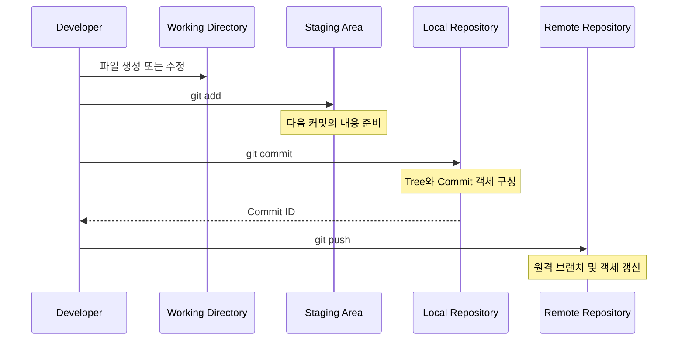

이 구조를 통해 각 명령어가 수행하는 역할을 명확하게 이해할 수 있다.

```text
파일 수정

↓

Working Directory 변경

↓

git add

↓

Index 갱신

↓

git commit

↓

로컬 커밋 생성

↓

git push

↓

원격 저장소에 변경 이력 전송
```

그리고 각 단계 사이의 상태를 `git status`와 `git diff`를 이용해 확인할 수 있다.

---

### 자주 혼동하는 Git 개념 비교

| 혼동하기 쉬운 개념 | 정확한 설명 |
|---|---|
| Git과 GitHub | Git은 버전 관리 시스템, GitHub는 Git 저장소 호스팅 및 협업 서비스 |
| Working Directory와 Repository | Working Directory는 실제 작업 파일, Repository는 Git 객체와 이력 저장소 |
| Staging Area와 Commit | Staging은 다음 커밋 준비, Commit은 변경 이력 기록 |
| git add와 git commit | Index 갱신과 커밋 생성 |
| git commit과 git push | 로컬 커밋 생성과 원격 전송 |
| git fetch와 git pull | 원격 데이터 가져오기와 현재 브랜치 통합 작업 |
| Modified와 Staged | Working Directory의 변경과 Index에 준비된 변경 |
| git diff와 git diff --staged | Index ↔ Working Directory, HEAD ↔ Index |
| git restore와 git reset | 파일 내용 복원과 참조 및 상태 재설정 |
| git reset과 git revert | 이력 참조 이동과 되돌리기 커밋 생성 |
| 브랜치와 프로젝트 복사 | 브랜치는 일반적으로 커밋을 가리키는 참조 |
| Snapshot과 Delta | 논리적인 커밋 모델과 물리적인 저장 최적화 |

---

### 정리

Git은 소스 코드와 파일의 변경 이력을 관리하는 분산 버전 관리 시스템이다.

Git이 등장하기 전에는 로컬 버전 관리 시스템과 중앙 집중식 버전 관리 시스템이 널리 사용되었다.

로컬 버전 관리 시스템은 개발자 컴퓨터에서 파일의 변경 이력을 관리할 수 있었다.

하지만 여러 개발자가 협업하기 어렵고 로컬 저장 장치에 장애가 발생하면 이력을 잃을 위험이 있었다.

중앙 집중식 버전 관리 시스템은 중앙 서버를 통해 변경 이력을 관리하며 협업 문제를 개선했다.

하지만 중앙 서버에 대한 의존성이 높아 서버 장애가 발생하면 협업과 버전 관리 작업에 영향을 받을 수 있었다.

이러한 문제를 보완하는 방식 중 하나가 분산 버전 관리 시스템이다.

Git은 대표적인 분산 버전 관리 시스템이다.

개발자는 로컬 저장소에서 커밋 이력을 관리할 수 있으며, 원격 서버와 통신하지 않고도 다양한 Git 작업을 수행할 수 있다.

Git은 2005년 Linux Kernel 개발을 위한 새로운 버전 관리 시스템으로 등장했다.

Git의 중요한 설계 특징 중 하나는 스냅샷 기반 저장 방식이다.

Git은 특정 시점의 프로젝트 상태를 스냅샷으로 관리한다.

하지만 커밋마다 모든 파일 내용을 물리적으로 중복 저장하는 것은 아니다.

변경되지 않은 파일의 내용 객체를 재사용할 수 있다.

Git의 기본적인 작업 구조는 세 가지 영역으로 설명할 수 있다.

첫 번째는 Working Directory다.

Working Directory는 개발자가 실제 파일을 수정하는 공간이다.

두 번째는 Staging Area다.

Staging Area는 다음 커밋에 포함할 내용을 준비하는 공간이며 Index라고도 한다.

세 번째는 Repository다.

Repository는 Git의 커밋과 객체, 참조 정보 등을 저장하는 공간이다.

개발자는 Working Directory에서 파일을 수정한다.

이후 `git add`를 사용해 현재 파일의 내용을 Index에 반영한다.

그리고 `git commit`을 실행해 Index에 준비된 상태를 새로운 커밋으로 기록한다.

이러한 구조를 이해하면 Git의 네 가지 파일 상태도 설명할 수 있다.

Untracked는 Git이 아직 추적하지 않는 파일을 의미한다.

Unmodified는 추적 중인 파일에 변경 사항이 없는 상태다.

Modified는 파일이 수정되었지만 해당 변경이 아직 Staging되지 않은 상태다.

Staged는 다음 커밋에 포함할 변경 사항이 Index에 준비된 상태다.

하지만 이 네 가지 상태를 반드시 서로 완전히 독립적인 상태라고 생각해서는 안 된다.

하나의 파일에서도 Staged 변경과 Unstaged 변경이 동시에 존재할 수 있다.

예를 들어 파일을 수정한 뒤 `git add`를 실행하고 다시 파일을 수정하면 Index와 Working Directory의 내용이 달라진다.

이때 `git status --short`에서는 `MM`과 같은 상태가 나타날 수 있다.

첫 번째 문자는 Index와 HEAD 사이의 상태를 의미한다.

두 번째 문자는 Working Directory와 Index 사이의 상태를 의미한다.

따라서 Git의 파일 상태는 HEAD, Index, Working Directory를 비교하는 관점에서 이해하는 것이 가장 정확하다.

또 이러한 구조를 기반으로 `git diff`의 동작도 이해할 수 있다.

`git diff`는 일반적으로 Index와 Working Directory의 차이를 확인한다.

`git diff --staged`는 HEAD와 Index의 차이를 확인한다.

`git diff HEAD`는 HEAD와 Working Directory의 차이를 확인한다.

이 관계를 이해하면 다음 커밋에 어떤 변경 사항이 포함되는지 정확하게 확인할 수 있다.

Git의 내부 저장 구조에서도 중요한 개념이 존재한다.

Blob은 파일 내용을 저장한다.

Tree는 파일 이름과 디렉터리 구조를 표현한다.

Commit은 특정 Tree와 부모 커밋, 작성자 및 메시지 등의 정보를 기록한다.

이러한 객체들이 서로 참조하는 구조로 Git의 변경 이력이 관리된다.

또 Git은 객체의 내용에 기반한 식별자를 사용한다.

대표적으로 SHA-1 기반 객체 식별자를 사용해 왔으며 SHA-256 객체 형식도 지원한다.

이러한 구조 덕분에 Git은 동일한 내용의 객체를 재사용하고 스냅샷을 효율적으로 관리할 수 있다.

마지막으로 Git의 동작 원리를 이해하면 되돌리기 명령어도 쉽게 구분할 수 있다.

`git restore`는 Working Directory나 Index의 파일 내용을 복원할 때 사용한다.

`git reset`은 브랜치 참조와 Index, Working Directory를 재설정할 수 있다.

`git revert`는 기존 변경을 되돌리는 새로운 커밋을 생성한다.

따라서 명령어를 실행하기 전에 어떤 영역을 변경하려는 것인지 먼저 결정해야 한다.

특히 `git reset --hard`처럼 Working Directory의 내용을 변경하는 명령어는 커밋되지 않은 작업을 잃을 수 있으므로 주의해야 한다.

핵심 개념을 정리하면 다음과 같다.

| 개념 | 핵심 의미 |
|---|---|
| VCS | Version Control System |
| DVCS | Distributed Version Control System |
| Git | 분산 버전 관리 시스템 |
| Snapshot | 특정 시점의 프로젝트 상태 |
| Working Directory | 실제 작업 파일이 존재하는 공간 |
| Staging Area | 다음 커밋에 포함할 내용을 준비하는 공간 |
| Index | Staging Area의 내부적인 표현 |
| Repository | Git 객체와 변경 이력 저장소 |
| HEAD | 현재 체크아웃한 위치를 나타내는 참조 |
| Tracked | Git이 추적 중인 파일 |
| Untracked | Git이 추적하지 않는 파일 |
| Unmodified | 변경되지 않은 상태 |
| Modified | 수정되었지만 Staging하지 않은 변경 |
| Staged | Index에 준비된 변경 |
| Blob | 파일 내용 객체 |
| Tree | 디렉터리 구조 객체 |
| Commit | 프로젝트 스냅샷과 메타데이터 |
| Tag | 특정 Git 객체를 식별하는 참조 또는 태그 객체 |
| git init | Git 저장소 초기화 |
| git add | Index 갱신 |
| git commit | 새로운 커밋 생성 |
| git status | 변경 상태 확인 |
| git diff | 영역 사이의 변경 사항 비교 |
| git restore | 파일 내용 복원 |
| git reset | 참조 및 상태 재설정 |
| git revert | 되돌리기 커밋 생성 |
| git fetch | 원격 저장소의 변경 이력 가져오기 |
| git pull | 원격 변경 가져오기 및 통합 |
| git push | 로컬 변경 이력 원격 전송 |
| git reflog | 로컬 참조 이동 이력 확인 |
| git ls-files --stage | Index에 기록된 파일 정보 확인 |
| git cat-file | Git 객체 내용 확인 |
| git ls-tree | Tree 객체의 파일 구조 확인 |

결국 Git을 잘 사용하기 위해서는 단순히 명령어를 많이 외우는 것보다 **현재 변경 사항이 어느 영역에 존재하고, 각 명령어가 어떤 영역을 변경하며, 커밋이 어떤 데이터를 기준으로 생성되는지**를 이해하는 것이 중요하다.

이러한 원리를 이해하면 복잡한 Git 상태도 쉽게 분석할 수 있고, 변경 사항을 되돌리는 작업도 더 안전하게 수행할 수 있다.

#### 한 줄 요약

**Git은 Working Directory, Staging Area(Index), Repository라는 세 가지 영역을 중심으로 파일의 변경 이력을 관리한다. `git add`는 현재 파일의 내용을 Index에 반영하고, `git commit`은 Index를 기준으로 새로운 스냅샷을 기록한다. 파일의 Untracked, Unmodified, Modified, Staged 상태는 HEAD, Index, Working Directory 사이의 비교를 통해 이해할 수 있으며, Git의 내부 저장 구조는 Blob, Tree, Commit 객체의 참조 관계를 기반으로 동작한다.**
