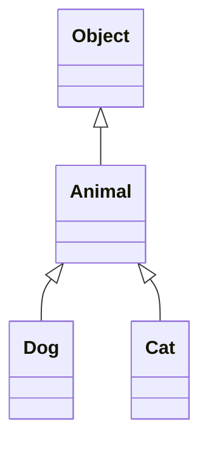
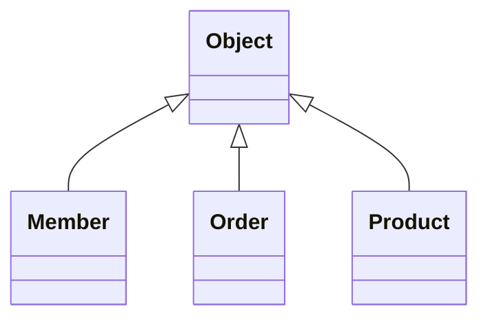
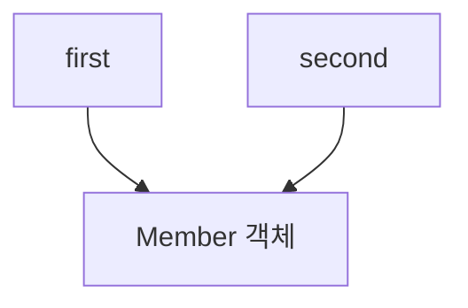
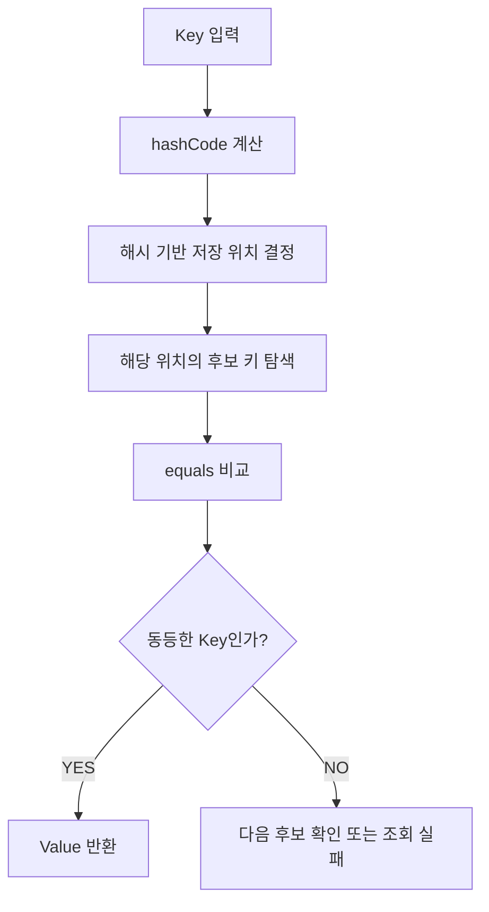
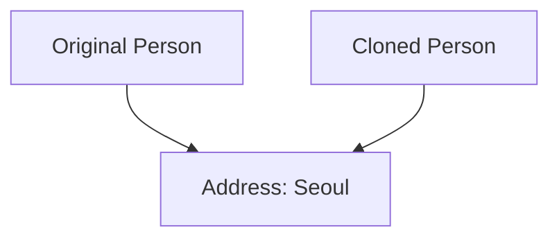

# 모다의 자바 Object 클래스 알고쓰기
[https://youtu.be/rqMGT225nzQ?si=v5GKr6_p1Xc1fHBU](https://youtu.be/rqMGT225nzQ?si=v5GKr6_p1Xc1fHBU)

# 모다의 자바 Object 클래스 알고쓰기
* toc
{:toc}

---

### Java Object 클래스 완벽 이해: equals(), hashCode(), toString(), 다형성과 객체 동등성

Java에서 클래스를 작성할 때 다음과 같은 코드를 자주 사용한다.

```java
public class Member {

    private Long id;

    private String name;
}
```

이 클래스에는 별도의 상속 관계를 선언하지 않았다.

그렇다면 `Member` 클래스는 어떤 클래스도 상속하지 않는 것일까?

그렇지 않다.

Java에서 일반적인 클래스는 명시적인 부모 클래스가 없다면 `java.lang.Object`를 상속한다.

따라서 앞선 코드는 개념적으로 다음과 같은 상속 관계를 가진다.

```java
public class Member extends Object {

    private Long id;

    private String name;
}
```

이러한 구조 덕분에 `Member` 클래스에는 직접 선언하지 않은 메서드들이 존재한다.

대표적으로 다음과 같다.

```java
member.equals(other);
```

```java
member.hashCode();
```

```java
member.toString();
```

```java
member.getClass();
```

이 메서드들은 `Member` 클래스에서 직접 작성하지 않았지만 사용할 수 있다.

모두 `Object` 클래스에 정의되어 있기 때문이다.

그런데 여기서 중요한 질문이 생긴다.

**Java는 왜 모든 클래스의 최상위에 Object라는 공통 부모 클래스를 두었을까?**

단순히 모든 객체가 공통으로 사용할 메서드를 제공하기 위해서일까?

또 다음과 같은 코드를 생각해 보자.

```java
Member first = new Member(1L, "Kim");

Member second = new Member(1L, "Kim");
```

두 객체는 동일한 회원 정보를 가지고 있다.

그렇다면 다음 코드는 어떤 결과를 반환할까?

```java
System.out.println(first.equals(second));
```

기본 구현에서는 `false`가 반환된다.

두 객체의 필드 값이 같더라도 서로 다른 객체로 생성되었기 때문이다.

하지만 개발자가 `equals()`를 재정의하면 결과를 `true`로 만들 수 있다.

이때 반드시 함께 고려해야 하는 메서드가 `hashCode()`다.

`equals()`만 재정의하고 `hashCode()`를 그대로 두면 HashMap이나 HashSet에서 예상하지 못한 문제가 발생할 수 있다.

즉 Object 클래스는 단순히 공통 메서드를 제공하는 것을 넘어 **객체들이 Java의 다양한 API와 일관된 규칙으로 상호작용할 수 있도록 하는 공통 계약**을 제공한다.

이번에는 이러한 Object 클래스의 존재 이유부터 각 메서드의 설계 의도, 오버라이딩 규약, 실무 활용 방법까지 살펴보자.

---

### 개념

#### Object 클래스란 무엇인가?

`Object`는 Java 클래스 계층 구조의 최상위 클래스다.

패키지는 다음과 같다.

```java
java.lang.Object
```

Java에서 일반적인 클래스는 Object를 직접 또는 간접적으로 상속한다.

예를 들어 다음과 같은 클래스가 있다고 가정하자.

```java
public class Animal {
}
```

```java
public class Dog extends Animal {
}
```

```java
public class Cat extends Animal {
}
```

상속 관계는 다음과 같다.



`Dog`와 `Cat`은 직접적으로 Object를 상속한다고 선언하지 않았다.

하지만 부모 클래스인 `Animal`이 Object를 상속하므로 결국 Object의 하위 클래스가 된다.

따라서 다음 코드가 가능하다.

```java
Dog dog = new Dog();

Object object = dog;
```

또 다음 코드도 가능하다.

```java
Cat cat = new Cat();

Object object = cat;
```

서로 다른 클래스의 객체를 Object 타입의 변수에 대입할 수 있는 것이다.

여기서 중요한 점은 **Object가 모든 Java 타입을 의미하는 것은 아니라는 사실**이다.

Java의 타입은 크게 기본형과 참조형으로 구분할 수 있다.

| 구분 | 예시 | Object와의 관계 |
|---|---|---|
| 기본형 | `int`, `long`, `boolean` | Object를 상속하지 않음 |
| 일반 클래스 | `String`, `Member` | Object를 직접 또는 간접 상속 |
| 배열 | `int[]`, `String[]` | Object로 다룰 수 있는 참조형 |
| Enum | `OrderStatus` | Enum을 통해 Object 상속 |
| Record | `MemberResponse` | Record를 통해 Object 상속 |
| 인터페이스 | `Runnable` | 인터페이스 자체가 Object를 상속하는 것은 아님 |

예를 들어 다음 코드를 살펴보자.

```java
Object value = 10;
```

기본형 `int`를 Object 변수에 직접 저장하는 것처럼 보인다.

하지만 실제로는 오토박싱이 적용된다.

개념적으로 다음과 같다.

```java
Object value = Integer.valueOf(10);
```

`Integer`는 참조형이므로 Object 타입으로 다룰 수 있다.

이러한 차이는 Java의 타입 시스템을 이해할 때 중요하다.

---

### 왜 Object 클래스가 필요할까?

Object 클래스의 존재 이유는 크게 두 가지 관점에서 이해할 수 있다.

첫 번째는 **모든 객체에 공통 기능과 규약을 제공하는 것**이다.

두 번째는 **서로 다른 객체를 공통 타입으로 다룰 수 있도록 다형성을 제공하는 것**이다.

두 가지를 각각 살펴보자.

#### 1. 모든 객체에 공통 기능 제공

Java에서는 객체의 종류와 관계없이 공통적으로 필요할 수 있는 기능들이 있다.

예를 들어 다음과 같다.

- 두 객체가 같은지 비교하기
- 객체의 해시 코드 구하기
- 객체를 문자열로 표현하기
- 객체의 런타임 클래스 정보 조회하기
- 객체 복제하기
- 객체의 모니터를 이용해 스레드 협력하기

이러한 기능을 모든 클래스에서 각각 정의해야 한다면 어떻게 될까?

개발자는 새로운 클래스를 만들 때마다 비슷한 메서드를 반복해서 작성해야 할 것이다.

```java
public class Member {

    public boolean equalsMember(Member other) {
        // 회원 비교
    }

    public String memberToString() {
        // 회원 정보 출력
    }
}
```

```java
public class Order {

    public boolean equalsOrder(Order other) {
        // 주문 비교
    }

    public String orderToString() {
        // 주문 정보 출력
    }
}
```

이 방식에는 문제가 있다.

클래스마다 메서드 이름과 사용 방식이 달라진다.

따라서 공통 API에서 객체들을 일관되게 처리하기 어려워진다.

Object 클래스는 이러한 문제를 해결한다.

```java
public boolean equals(Object obj)
```

```java
public int hashCode()
```

```java
public String toString()
```

모든 일반적인 클래스가 이러한 메서드를 상속하므로, 객체의 종류와 관계없이 동일한 메서드 이름으로 공통 기능을 사용할 수 있다.

이것이 Object 클래스가 제공하는 첫 번째 가치다.

---

#### 2. 모든 객체를 공통 타입으로 다룰 수 있도록 지원

다음과 같은 클래스가 있다고 가정하자.

```java
public class Member {
}
```

```java
public class Order {
}
```

```java
public class Product {
}
```

세 클래스 사이에는 별도의 상속 관계가 없다.

하지만 다음 코드는 가능하다.

```java
Object member = new Member();

Object order = new Order();

Object product = new Product();
```

모두 Object의 하위 타입이기 때문이다.

이를 그림으로 표현하면 다음과 같다.



이러한 특성은 다양한 Java API에서 활용된다.

대표적인 예가 다음 메서드다.

```java
System.out.println(Object obj);
```

이 메서드는 Object 타입의 매개변수를 받는다.

따라서 다양한 객체를 출력할 수 있다.

```java
System.out.println(new Member());

System.out.println(new Order());

System.out.println(new Product());
```

물론 `println()`에는 기본형이나 `String` 등을 받는 오버로드도 존재한다.

하지만 `println(Object)`만 살펴보더라도 Object가 제공하는 다형성을 이해할 수 있다.

---

### System.out.println()은 객체를 어떻게 출력할까?

다음 코드를 생각해 보자.

```java
public class Member {

    private final String name;

    public Member(String name) {
        this.name = name;
    }
}
```

이제 객체를 생성한다.

```java
Member member = new Member("Kim");
```

객체를 출력한다.

```java
System.out.println(member);
```

기본적인 `toString()` 구현을 사용하는 경우 다음과 비슷한 결과가 나타난다.

```text
Member@5e2de80c
```

왜 이러한 문자열이 출력될까?

`println(Object)`는 객체를 문자열로 변환하는 과정에서 `String.valueOf(Object)`를 활용한다.

`String.valueOf(Object)`는 개념적으로 다음과 같이 동작한다.

```java
public static String valueOf(Object obj) {

    return obj == null
            ? "null"
            : obj.toString();
}
```

즉 객체가 null이 아니라면 `toString()`을 호출한다.

여기서 중요한 점이 있다.

**실제로 호출되는 `toString()`은 객체의 런타임 타입에서 결정된 구현이다.**

예를 들어 다음과 같이 오버라이딩했다고 가정하자.

```java
public class Member {

    private final String name;

    public Member(String name) {
        this.name = name;
    }

    @Override
    public String toString() {
        return "Member{name='" + name + "'}";
    }
}
```

이제 다시 실행한다.

```java
System.out.println(new Member("Kim"));
```

결과는 다음과 같다.

```text
Member{name='Kim'}
```

`println(Object)`의 코드를 수정하지 않았지만 객체의 출력 방식이 달라졌다.

이것이 다형성이다.

Object가 `toString()`이라는 공통 메서드를 제공하고, 각 클래스가 이를 재정의할 수 있기 때문에 가능한 일이다.

---

### Object 클래스의 주요 메서드

Object에는 여러 공통 메서드가 정의되어 있다.

Java 26 기준으로 대표적인 메서드를 정리하면 다음과 같다.

| 메서드 | 역할 | 오버라이딩 가능 여부 |
|---|---|---|
| `equals(Object)` | 객체의 동등성 비교 | 가능 |
| `hashCode()` | 해시 코드 반환 | 가능 |
| `toString()` | 문자열 표현 반환 | 가능 |
| `getClass()` | 런타임 클래스 정보 반환 | 불가능 (`final`) |
| `clone()` | 객체 복제 지원 | 가능 |
| `wait()` | 객체 모니터에서 대기 | 불가능 (`final`) |
| `notify()` | 대기 중인 스레드 하나를 깨움 | 불가능 (`final`) |
| `notifyAll()` | 대기 중인 스레드들을 깨움 | 불가능 (`final`) |
| `finalize()` | 과거 객체 정리 관련 콜백 | 재정의 지양, 제거 예정 |

여기서 `finalize()`에 관한 설명은 정확히 구분해야 한다.

Java 26에서도 `Object.finalize()` 메서드는 API에 남아 있지만 **Deprecated for Removal**, 즉 향후 제거 대상으로 지정되어 있다.

따라서 이미 제거되었다고 설명하는 것도 정확하지 않고, 계속 사용해도 되는 정상적인 자원 정리 방법으로 소개하는 것도 적절하지 않다.

현재는 자원 정리에 `AutoCloseable`과 `try-with-resources` 등을 사용하는 것이 권장된다.

이제 주요 메서드들의 동작을 살펴보자.

---

### equals(): 객체의 동일성과 동등성

Java에서 두 객체를 비교할 때 중요한 두 가지 개념이 있다.

첫 번째는 동일성(Identity)이다.

두 번째는 동등성(Equality)이다.

이 둘은 비슷해 보이지만 서로 다른 개념이다.

#### 동일성(Identity)이란?

동일성은 두 참조 변수가 **동일한 객체를 가리키는지**를 의미한다.

Java에서는 참조형에 대해 `==` 연산자를 사용해 확인할 수 있다.

예를 들어 다음과 같다.

```java
Member first = new Member("Kim");

Member second = first;
```

두 변수는 동일한 객체를 참조한다.

```java
System.out.println(first == second);
```

결과는 다음과 같다.

```text
true
```

메모리 참조 관계를 개념적으로 표현하면 다음과 같다.



`first`와 `second`는 서로 다른 참조 변수이지만 같은 객체를 가리킨다.

따라서 동일성이 성립한다.

---

#### 동등성(Equality)이란?

동등성은 서로 다른 객체라도 **논리적으로 같은 값을 가지고 있다고 판단할 수 있는지**를 의미한다.

예를 들어 다음과 같다.

```java
Member first = new Member("Kim");

Member second = new Member("Kim");
```

두 객체는 각각 `new`를 통해 생성되었다.

따라서 서로 다른 객체다.

```java
System.out.println(first == second);
```

결과는 다음과 같다.

```text
false
```

하지만 두 객체는 동일한 이름을 가지고 있다.

만약 회원 이름을 기준으로 동등성을 판단한다면 두 객체를 같은 값으로 취급할 수도 있다.

바로 이런 상황에서 `equals()`를 재정의할 수 있다.

---

### Object.equals()의 기본 구현

Object 클래스의 기본적인 `equals()`는 참조 동일성을 비교한다.

개념적으로 다음과 같다.

```java
public boolean equals(Object obj) {
    return this == obj;
}
```

즉 두 참조가 동일한 객체를 가리킬 때만 `true`를 반환한다.

따라서 다음 코드를 살펴보자.

```java
Member first = new Member("Kim");

Member second = new Member("Kim");
```

`Member`에서 `equals()`를 재정의하지 않았다면 다음 결과가 나타난다.

```java
System.out.println(first.equals(second));
```

```text
false
```

반면 다음 코드는 `true`를 반환한다.

```java
Member first = new Member("Kim");

Member second = first;

System.out.println(first.equals(second));
```

```text
true
```

Object의 기본 `equals()`는 가장 엄격한 동일성 비교를 제공한다.

하지만 모든 도메인에서 이 방식이 적절한 것은 아니다.

예를 들어 금액, 좌표, 이메일 주소, ISBN처럼 값 자체가 중요한 객체라면 서로 다른 인스턴스라도 같은 값으로 판단해야 할 수 있다.

이 경우 `equals()`를 재정의한다.

---

### equals()를 오버라이딩하는 방법

다음과 같은 `Crew` 클래스가 있다고 가정하자.

```java
public class Crew {

    private final String name;

    public Crew(String name) {
        this.name = name;
    }
}
```

이 클래스는 회원의 이름을 가지고 있다.

여기서는 예제를 단순화하기 위해 이름이 같으면 같은 Crew로 판단한다고 가정한다.

실제 서비스에서 사람을 이름만으로 식별하는 것은 적절하지 않을 수 있다.

동명이인이 존재할 수 있기 때문이다.

이제 `equals()`를 재정의해 보자.

```java
import java.util.Objects;

public final class Crew {

    private final String name;

    public Crew(String name) {
        this.name = Objects.requireNonNull(name);
    }

    @Override
    public boolean equals(Object obj) {

        if (this == obj) {
            return true;
        }

        if (obj == null || getClass() != obj.getClass()) {
            return false;
        }

        Crew other = (Crew) obj;

        return name.equals(other.name);
    }
}
```

이 코드에는 여러 검사가 포함되어 있다.

단순히 다음 한 줄만 작성하지 않은 이유는 무엇일까?

```java
return name.equals(other.name);
```

`equals()`에는 반드시 지켜야 하는 일반적인 규약이 존재하기 때문이다.

이러한 규약을 지키지 않으면 Java의 다른 API에서도 예상하지 못한 문제가 발생할 수 있다.

---

### equals()의 다섯 가지 규약

`equals()`를 재정의할 때는 다음 다섯 가지 규약을 지켜야 한다.

| 규약 | 의미 |
|---|---|
| Reflexive | 반사성 |
| Symmetric | 대칭성 |
| Transitive | 추이성 |
| Consistent | 일관성 |
| Non-null | null과 비교하면 false |

각 규약을 구체적으로 살펴보자.

#### 1. 반사성(Reflexive)

객체는 자기 자신과 같아야 한다.

```java
Crew crew = new Crew("Kim");

System.out.println(crew.equals(crew));
```

결과는 다음과 같아야 한다.

```text
true
```

수식으로 표현하면 다음과 같다.

```text
x.equals(x) == true
```

모든 null이 아닌 객체에 대해 성립해야 한다.

따라서 다음 코드는 이러한 조건을 빠르게 처리한다.

```java
if (this == obj) {
    return true;
}
```

---

#### 2. 대칭성(Symmetric)

두 객체를 비교하는 순서를 바꾸어도 결과가 같아야 한다.

예를 들어 다음과 같다.

```java
Crew first = new Crew("Kim");

Crew second = new Crew("Kim");
```

다음 두 결과는 같아야 한다.

```java
first.equals(second);
```

```java
second.equals(first);
```

즉 다음 관계가 성립해야 한다.

```text
x.equals(y) == y.equals(x)
```

대칭성을 위반하면 컬렉션이나 다른 API에서 비교 방향에 따라 결과가 달라질 수 있다.

특히 상속 구조에서 `equals()`를 재정의할 때 대칭성을 위반하기 쉽다.

---

#### 3. 추이성(Transitive)

세 객체가 있을 때 다음 관계가 성립해야 한다.

```text
A == B

B == C

그러면 A == C
```

이를 `equals()`로 표현하면 다음과 같다.

```text
a.equals(b) == true

b.equals(c) == true

그러면 a.equals(c) == true
```

예를 들어 다음과 같다.

```java
Crew a = new Crew("Kim");

Crew b = new Crew("Kim");

Crew c = new Crew("Kim");
```

세 객체 모두 같은 이름을 가지므로 서로 동등하게 판단되어야 한다.

추이성은 특히 객체의 상속 관계와 추가 필드를 이용해 동등성을 정의할 때 주의해야 하는 규약이다.

---

#### 4. 일관성(Consistent)

객체의 동등성 판단에 사용하는 정보가 변경되지 않았다면 여러 번 비교해도 결과가 같아야 한다.

예를 들어 다음과 같다.

```java
Crew first = new Crew("Kim");

Crew second = new Crew("Kim");
```

반복해서 비교한다.

```java
System.out.println(first.equals(second));

System.out.println(first.equals(second));

System.out.println(first.equals(second));
```

동등성 판단에 영향을 미치는 상태가 변경되지 않았다면 결과는 계속 같아야 한다.

```text
true
true
true
```

따라서 `equals()` 내부에서 현재 시간이나 난수처럼 호출할 때마다 달라질 수 있는 정보를 무분별하게 사용하면 안 된다.

외부 API 호출이나 변경 가능한 전역 상태에 의존하는 것도 피하는 것이 좋다.

---

#### 5. null 비교(Non-null)

null이 아닌 객체는 null과 같지 않아야 한다.

```java
Crew crew = new Crew("Kim");

System.out.println(crew.equals(null));
```

결과는 다음과 같아야 한다.

```text
false
```

따라서 다음 코드를 통해 null을 검사할 수 있다.

```java
if (obj == null) {
    return false;
}
```

다만 Java 16 이상에서는 패턴 매칭 `instanceof`를 활용해 타입 검사와 캐스팅을 간결하게 작성할 수도 있다.

---

### instanceof를 사용한 equals() 구현

Java 17에서는 다음과 같이 작성할 수 있다.

```java
import java.util.Objects;

public final class Crew {

    private final String name;

    public Crew(String name) {
        this.name = Objects.requireNonNull(name);
    }

    @Override
    public boolean equals(Object obj) {

        if (this == obj) {
            return true;
        }

        if (!(obj instanceof Crew other)) {
            return false;
        }

        return name.equals(other.name);
    }
}
```

다음 코드가 핵심이다.

```java
if (!(obj instanceof Crew other)) {
    return false;
}
```

이 코드는 객체가 `Crew` 타입인지 검사한다.

타입이 맞으면 `other`라는 변수로 사용할 수 있다.

따라서 별도의 명시적인 캐스팅을 줄일 수 있다.

이 예제에서는 `Crew`가 `final` 클래스이므로 하위 클래스가 추가되는 문제도 발생하지 않는다.

하지만 상속을 허용하는 클래스에서는 `instanceof`와 `getClass()` 중 어떤 방식을 선택할지 더 신중하게 판단해야 한다.

---

### getClass()와 instanceof의 차이

두 방식은 비슷해 보이지만 의미가 다르다.

#### getClass()

```java
getClass() == other.getClass()
```

두 객체의 실제 런타임 클래스가 정확히 같은지 비교한다.

하위 클래스까지 같은 타입으로 취급하지 않는다.

#### instanceof

```java
other instanceof Member
```

해당 객체가 Member 타입으로 취급될 수 있는지 검사한다.

따라서 Member의 하위 클래스 인스턴스도 조건을 만족할 수 있다.

두 방식을 비교하면 다음과 같다.

| 방식 | 비교 기준 | 특징 |
|---|---|---|
| `getClass()` | 정확한 런타임 클래스 | 하위 클래스와 구분 |
| `instanceof` | 타입 호환성 | 하위 클래스도 허용 가능 |

그렇다면 어떤 방식이 더 좋을까?

정답은 클래스의 설계에 따라 달라진다.

상속을 허용하지 않는 Value Object라면 두 방식 모두 고려할 수 있다.

하지만 상속을 허용하는 클래스에서는 `equals()`의 대칭성과 추이성을 보장할 수 있도록 설계해야 한다.

또 Hibernate의 지연 로딩 프록시처럼 런타임에 프록시 하위 타입이 생성되는 환경에서는 단순히 `getClass()`로 비교하면 예상하지 못한 결과가 발생할 수 있다.

따라서 JPA Entity의 동등성은 일반적인 Value Object와 구분해서 설계하는 것이 좋다.

---

### hashCode(): 객체의 해시 코드

`hashCode()`는 객체에 대한 정수형 해시 코드를 반환하는 메서드다.

메서드의 형태는 다음과 같다.

```java
public int hashCode()
```

여기서 중요한 점이 있다.

**hashCode는 객체의 메모리 주소가 아니다.**

기본 Object의 `hashCode()`는 객체의 동일성과 관련된 해시 코드를 제공한다.

하지만 Java 명세는 반환값이 실제 메모리 주소여야 한다고 규정하지 않는다.

따라서 다음 설명은 정확하지 않다.

```text
hashCode() = 객체의 메모리 주소
```

더 정확한 설명은 다음과 같다.

```text
hashCode()

= 객체에 대한 int형 해시 값
```

`System.identityHashCode()` 역시 객체의 실제 메모리 주소를 반환하는 API가 아니다.

해당 객체가 `hashCode()`를 재정의하지 않았을 때의 기본 해시 코드와 같은 의미의 값을 반환한다.

JVM이 객체의 해시 코드를 어떻게 생성하고 관리하는지는 구현에 따라 달라질 수 있다.

따라서 해시 코드를 포인터나 주소처럼 사용해서는 안 된다.

---

### hashCode()는 왜 필요할까?

해시 코드는 주로 해시 기반 자료구조에서 사용된다.

대표적으로 다음과 같다.

```java
HashMap
```

```java
HashSet
```

이러한 자료구조는 객체를 효율적으로 저장하고 조회하기 위해 해시 코드를 활용한다.

예를 들어 다음과 같은 HashMap이 있다고 가정하자.

```java
Map<String, Integer> scores = new HashMap<>();
```

데이터를 저장한다.

```java
scores.put("Kim", 100);
```

조회한다.

```java
scores.get("Kim");
```

HashMap은 키의 해시 코드를 활용해 해당 키가 저장되어 있을 가능성이 있는 위치를 찾는다.

그리고 필요한 경우 `equals()`를 이용해 실제 키의 동등성을 확인한다.

개념적인 흐름은 다음과 같다.



실제 HashMap에서는 해시 값의 가공과 버킷 인덱스 계산, 충돌 처리 등의 과정이 추가된다.

하지만 핵심 원리는 같다.

**hashCode는 탐색 범위를 좁히는 데 사용되고, equals는 논리적인 동등성을 판단하는 데 사용된다.**

---

### equals()와 hashCode()의 관계

`equals()`를 재정의했다면 `hashCode()`도 함께 재정의해야 한다.

왜 그럴까?

두 메서드 사이에는 중요한 규약이 존재하기 때문이다.

```text
a.equals(b) == true

이면

a.hashCode() == b.hashCode()
```

즉 논리적으로 동등한 두 객체는 반드시 같은 해시 코드를 반환해야 한다.

하지만 반대 방향은 성립하지 않는다.

```text
a.hashCode() == b.hashCode()
```

라고 해서 반드시 다음이 성립하지는 않는다.

```text
a.equals(b) == true
```

서로 다른 객체가 동일한 해시 코드를 반환할 수 있기 때문이다.

이를 해시 충돌(Hash Collision)이라고 한다.

두 규칙을 정리하면 다음과 같다.

| 조건 | 규약 |
|---|---|
| `equals()`가 true | `hashCode()`는 반드시 같아야 함 |
| `hashCode()`가 같음 | `equals()`는 true일 수도, false일 수도 있음 |
| `equals()`가 false | `hashCode()`가 달라야 하는 것은 아님 |
| `hashCode()`가 다름 | 정상적인 구현에서는 `equals()`가 true일 수 없음 |

이 규약을 지키지 않으면 HashMap이나 HashSet에서 문제가 발생할 수 있다.

---

### equals()만 재정의하면 어떤 문제가 발생할까?

다음 클래스를 생각해 보자.

```java
import java.util.Objects;

public final class Crew {

    private final String name;

    public Crew(String name) {
        this.name = Objects.requireNonNull(name);
    }

    @Override
    public boolean equals(Object obj) {

        if (this == obj) {
            return true;
        }

        if (!(obj instanceof Crew other)) {
            return false;
        }

        return name.equals(other.name);
    }
}
```

이 클래스는 `equals()`만 재정의했다.

`hashCode()`는 재정의하지 않았다.

이제 다음과 같이 사용한다고 가정하자.

```java
Crew first = new Crew("Kim");

Crew second = new Crew("Kim");
```

동등성을 비교한다.

```java
System.out.println(first.equals(second));
```

결과는 다음과 같다.

```text
true
```

그런데 HashSet에 저장하면 어떻게 될까?

```java
Set<Crew> crews = new HashSet<>();

crews.add(first);
```

다음 코드를 실행한다.

```java
System.out.println(crews.contains(second));
```

개발자는 `true`를 기대할 수 있다.

두 객체는 `equals()` 기준으로 동등하기 때문이다.

하지만 기본 `hashCode()`가 서로 다른 값을 반환하면 `HashSet`은 다른 해시 위치를 탐색하게 된다.

따라서 `false`를 반환할 수 있다.

```text
false
```

중요한 점은 이 결과가 항상 `false`라고 보장되는 것은 아니라는 사실이다.

서로 다른 객체라도 우연히 같은 해시 코드를 가질 수 있다.

핵심 문제는 결과의 우연성이 아니라 **클래스가 equals와 hashCode의 규약을 위반했다는 것**이다.

---

### hashCode()를 올바르게 재정의하는 방법

앞선 `Crew` 클래스에 `hashCode()`를 추가해 보자.

```java
import java.util.Objects;

public final class Crew {

    private final String name;

    public Crew(String name) {
        this.name = Objects.requireNonNull(name);
    }

    @Override
    public boolean equals(Object obj) {

        if (this == obj) {
            return true;
        }

        if (!(obj instanceof Crew other)) {
            return false;
        }

        return name.equals(other.name);
    }

    @Override
    public int hashCode() {
        return name.hashCode();
    }
}
```

이제 `equals()`와 `hashCode()`가 같은 필드인 `name`을 기준으로 동작한다.

따라서 이름이 같은 두 객체는 동일한 해시 코드를 반환한다.

```java
Crew first = new Crew("Kim");

Crew second = new Crew("Kim");
```

```java
System.out.println(first.equals(second));
```

```text
true
```

```java
System.out.println(
        first.hashCode() == second.hashCode()
);
```

```text
true
```

HashSet에도 사용할 수 있다.

```java
Set<Crew> crews = new HashSet<>();

crews.add(first);

System.out.println(crews.contains(second));
```

결과는 다음과 같다.

```text
true
```

`HashSet`은 두 객체를 논리적으로 동등한 요소로 판단할 수 있다.

이것이 `equals()`와 `hashCode()`를 함께 재정의해야 하는 이유다.

---

### Objects.hash()는 무엇인가?

Java는 여러 필드를 이용해 해시 코드를 계산할 수 있도록 유틸리티 메서드를 제공한다.

대표적으로 다음과 같다.

```java
Objects.hash(...)
```

예를 들어 다음 클래스가 있다고 가정하자.

```java
public final class Product {

    private final String code;

    private final String country;
}
```

상품 코드와 국가 코드가 같으면 동등하다고 판단할 수 있다.

이 경우 다음과 같이 작성할 수 있다.

```java
@Override
public int hashCode() {
    return Objects.hash(code, country);
}
```

`Objects.hash()`는 여러 값을 이용해 해시 코드를 계산한다.

하지만 여기서 중요한 점이 있다.

**Objects.hash()가 특별하게 충돌이 없는 해시 코드를 보장하는 것은 아니다.**

또 가변 필드를 전달하면 해당 필드가 변경되었을 때 해시 코드도 변경될 수 있다.

따라서 `hashCode()`의 구현 방식보다 먼저 **어떤 필드를 동등성 판단에 사용할 것인지** 결정해야 한다.

---

### List.contains()는 equals()를 어떻게 활용할까?

이번에는 HashSet이 아니라 List를 살펴보자.

다음과 같은 `Crew` 클래스가 있다고 가정하자.

```java
public final class Crew {

    private final String name;

    public Crew(String name) {
        this.name = name;
    }

    @Override
    public boolean equals(Object obj) {

        if (this == obj) {
            return true;
        }

        if (!(obj instanceof Crew other)) {
            return false;
        }

        return Objects.equals(name, other.name);
    }

    @Override
    public int hashCode() {
        return Objects.hashCode(name);
    }
}
```

이제 목록을 생성한다.

```java
List<Crew> crews = new ArrayList<>();

crews.add(new Crew("Kim"));
```

다음과 같이 객체를 조회한다.

```java
boolean exists = crews.contains(
        new Crew("Kim")
);
```

결과는 다음과 같다.

```text
true
```

서로 다른 인스턴스인데도 List에서 해당 객체를 찾을 수 있다.

이유는 `contains()`의 동등성 판단이 `equals()`의 규약을 기반으로 하기 때문이다.

일반적인 `ArrayList` 구현에서는 요소들을 탐색하면서 동등한 요소가 존재하는지 확인한다.

따라서 `equals()`를 올바르게 재정의하면 List의 다른 API에서도 동일한 동등성 기준을 활용할 수 있다.

여기서 중요한 차이를 정리해 보자.

| 컬렉션 | 동등성 판단 |
|---|---|
| ArrayList | 요소의 equals 기반 |
| HashSet | hashCode와 equals 기반 |
| HashMap | Key의 hashCode와 equals 기반 |
| TreeSet | 일반적으로 Comparator 또는 Comparable의 비교 결과 기반 |
| TreeMap | 일반적으로 Comparator 또는 Comparable의 비교 결과 기반 |

즉 모든 컬렉션이 반드시 동일한 방식으로 `equals()`와 `hashCode()`를 사용하는 것은 아니다.

특히 정렬 기반 컬렉션에서는 비교 순서의 일관성도 중요하다.

---

### Object 메서드를 재정의하면 Java API 전체에 어떤 영향을 줄까?

다음 상황을 생각해 보자.

개발자가 직접 새로운 비교 메서드를 만들었다.

```java
public boolean isSameCrew(Crew other) {
    return this.name.equals(other.name);
}
```

이 메서드는 두 Crew를 비교할 수 있다.

하지만 다음 코드에서는 자동으로 사용되지 않는다.

```java
crews.contains(new Crew("Kim"));
```

왜 그럴까?

`List.contains()`는 개발자가 만든 `isSameCrew()`라는 메서드를 알지 못하기 때문이다.

반면 `equals()`를 재정의하면 Java의 여러 API에서 해당 동등성 규약을 사용할 수 있다.

이것이 Object 메서드 오버라이딩의 중요한 가치다.

**개발자가 정의한 객체의 의미를 Java가 제공하는 공통 API에 일관되게 반영할 수 있다.**

따라서 Object 메서드를 재정의한다는 것은 단순히 기존 메서드의 실행 결과를 바꾸는 작업이 아니다.

객체가 Java 생태계에서 어떤 의미로 비교되고 표현될 것인지 정의하는 작업이다.

---

### toString(): 객체를 문자열로 표현하기

`toString()`은 객체의 문자열 표현을 반환하는 메서드다.

기본 구현은 개념적으로 다음과 같다.

```java
public String toString() {

    return getClass().getName()
            + "@"
            + Integer.toHexString(hashCode());
}
```

따라서 다음 코드를 실행하면 다음과 같은 결과가 나타날 수 있다.

```java
Crew crew = new Crew("Kim");

System.out.println(crew);
```

```text
Crew@5e2de80c
```

여기서 `@` 뒤에 나타나는 값은 해시 코드의 16진수 표현이다.

메모리 주소를 그대로 출력하는 것이라고 단정해서는 안 된다.

기본 `toString()`은 객체를 구분하는 데 어느 정도 도움이 될 수 있다.

하지만 실제 비즈니스 정보를 확인하기에는 불편하다.

따라서 필요에 따라 재정의할 수 있다.

---

### toString()을 재정의하는 방법

다음과 같은 주문 객체가 있다고 가정하자.

```java
public final class Order {

    private final Long id;

    private final String status;

    public Order(Long id, String status) {
        this.id = id;
        this.status = status;
    }

    @Override
    public String toString() {

        return "Order{" +
                "id=" + id +
                ", status='" + status + '\'' +
                '}';
    }
}
```

이제 다음 코드를 실행한다.

```java
Order order = new Order(100L, "PAID");

System.out.println(order);
```

결과는 다음과 같다.

```text
Order{id=100, status='PAID'}
```

이러한 출력은 디버깅과 로그 분석에 도움이 된다.

하지만 실제 백엔드 시스템에서는 주의할 점이 있다.

**toString()에 모든 필드를 무조건 포함해서는 안 된다.**

예를 들어 다음과 같은 필드가 있다고 가정하자.

```java
private String password;

private String accessToken;

private String cardNumber;
```

이러한 필드를 `toString()`에 포함하면 로그에 민감한 정보가 남을 수 있다.

또 JPA Entity의 연관 객체를 `toString()`에 포함하면 지연 로딩이나 순환 참조 문제가 발생할 수도 있다.

따라서 실무에서는 필요한 정보만 안전하게 출력하도록 설계하는 것이 중요하다.

---

### getClass(): 런타임 클래스 정보 조회

`getClass()`는 객체의 실제 런타임 클래스 정보를 반환한다.

메서드의 형태는 다음과 같다.

```java
public final Class<?> getClass()
```

여기서 중요한 키워드는 `final`이다.

`getClass()`는 하위 클래스에서 오버라이딩할 수 없다.

예를 들어 다음 코드를 살펴보자.

```java
Object member = new Member();
```

변수의 선언 타입은 Object다.

하지만 실제 객체의 런타임 타입은 Member다.

```java
System.out.println(member.getClass().getName());
```

결과는 다음과 같다.

```text
Member
```

이때 `getClass()`는 변수의 선언 타입이 아니라 실제 객체의 런타임 클래스를 반환한다.

```text
변수 선언 타입 = Object

실제 객체 타입 = Member

getClass() 결과 = Member.class
```

이 기능은 Reflection과 함께 활용할 수 있다.

예를 들어 다음과 같다.

```java
Class<?> clazz = member.getClass();
```

```java
System.out.println(clazz.getSimpleName());
```

```java
System.out.println(clazz.getSuperclass());
```

`Class` 객체를 통해 클래스 이름과 부모 클래스, 구현 인터페이스, 메서드 등의 정보를 확인할 수 있다.

Spring Framework와 Hibernate 같은 프레임워크에서도 런타임 타입 정보가 중요한 역할을 한다.

다만 프록시 객체를 사용하는 환경에서는 `getClass()`가 개발자가 작성한 원본 클래스가 아니라 프록시 클래스를 반환할 수 있다는 점에 주의해야 한다.

---

### clone(): 객체 복제

`clone()`은 객체 복제를 지원하는 메서드다.

Object에 정의된 메서드의 형태는 다음과 같다.

```java
protected Object clone()
        throws CloneNotSupportedException
```

여기서 주의할 점이 있다.

Object에 `clone()`이 존재한다고 해서 모든 객체를 자유롭게 복제할 수 있는 것은 아니다.

Object의 기본 `clone()` 구현은 객체가 `Cloneable`을 지원하는지 확인한다.

지원하지 않는다면 `CloneNotSupportedException`을 발생시킨다.

또 일반적인 기본 `clone()` 동작은 얕은 복사(Shallow Copy)다.

즉 객체의 필드 값을 복사하지만, 참조 필드가 가리키는 내부 객체까지 자동으로 깊게 복사하지는 않는다.

---

### 얕은 복사와 깊은 복사

다음과 같은 클래스가 있다고 가정하자.

```java
public class Address {

    private String city;

    public Address(String city) {
        this.city = city;
    }

    public void setCity(String city) {
        this.city = city;
    }

    public String getCity() {
        return city;
    }
}
```

그리고 Address를 참조하는 Person 클래스가 있다.

```java
public class Person implements Cloneable {

    private Address address;

    public Person(Address address) {
        this.address = address;
    }

    public Address getAddress() {
        return address;
    }

    @Override
    public Person clone() {

        try {
            return (Person) super.clone();
        } catch (CloneNotSupportedException e) {
            throw new AssertionError(e);
        }
    }
}
```

이제 객체를 생성하고 복제한다.

```java
Person original = new Person(
        new Address("Seoul")
);

Person copied = original.clone();
```

두 Person 객체는 서로 다르다.

```java
System.out.println(original == copied);
```

```text
false
```

하지만 내부 Address 객체는 공유한다.

```java
System.out.println(
        original.getAddress() == copied.getAddress()
);
```

```text
true
```

이를 그림으로 표현하면 다음과 같다.



따라서 다음 코드를 실행하면 어떻게 될까?

```java
copied.getAddress().setCity("Busan");
```

원본 객체가 참조하는 Address도 변경된다.

```java
System.out.println(
        original.getAddress().getCity()
);
```

```text
Busan
```

이것이 얕은 복사의 특징이다.

복제된 객체가 내부의 가변 객체를 공유하기 때문이다.

---

### 복사 생성자를 사용하는 방법

실무에서는 `clone()`보다 복사 생성자나 정적 팩터리 메서드를 사용하는 방식이 더 명확한 경우가 많다.

예를 들어 다음과 같이 작성할 수 있다.

```java
public class Person {

    private final Address address;

    public Person(Address address) {

        this.address = new Address(
                address.getCity()
        );
    }

    public Person(Person source) {

        this.address = new Address(
                source.address.getCity()
        );
    }

    public Address getAddress() {
        return new Address(address.getCity());
    }
}
```

이 코드는 Address 객체를 새로 생성한다.

따라서 원본과 복사본의 내부 상태를 분리할 수 있다.

다만 이것은 Address가 단순히 `city`라는 필드만 가지고 있다는 가정에 기반한다.

실제 객체가 복잡한 가변 참조를 가진다면 필요한 범위까지 복사해야 한다.

즉 깊은 복사는 단순히 `new`를 한 번 더 호출하는 것이 아니라 **공유되어서는 안 되는 가변 상태를 어디까지 복제할 것인지 결정하는 문제**다.

---

### wait(), notify(), notifyAll(): 객체 모니터와 스레드 협력

Object에는 멀티스레드 환경에서 사용되는 메서드들도 존재한다.

대표적으로 다음과 같다.

```java
wait()
```

```java
notify()
```

```java
notifyAll()
```

이 메서드들은 객체의 모니터(Monitor)를 이용한 스레드 협력과 관련된다.

예를 들어 어떤 작업이 완료될 때까지 다른 스레드가 기다려야 한다고 가정하자.

이때 `wait()`를 이용해 객체 모니터에서 대기할 수 있다.

또 다른 스레드는 `notify()`나 `notifyAll()`로 대기 중인 스레드에 신호를 보낼 수 있다.

다만 이 메서드들은 일반적으로 해당 객체의 모니터를 소유한 상태에서 호출해야 한다.

예를 들어 다음과 같다.

```java
private final Object lock = new Object();

private boolean ready = false;

public void awaitReady() throws InterruptedException {

    synchronized (lock) {

        while (!ready) {
            lock.wait();
        }
    }
}
```

신호를 보내는 쪽은 다음과 같이 작성할 수 있다.

```java
public void markReady() {

    synchronized (lock) {

        ready = true;

        lock.notifyAll();
    }
}
```

여기서 중요한 부분은 다음과 같다.

```java
while (!ready) {
    lock.wait();
}
```

`if`가 아니라 `while`을 사용하는 이유는 깨어난 이후에도 조건을 다시 검사해야 하기 때문이다.

Java에서는 Spurious Wakeup이 발생할 수 있으며, 신호를 받은 시점과 실제로 모니터를 다시 획득하는 시점도 다를 수 있다.

또 `notifyAll()`을 호출했다고 대기 중인 스레드가 즉시 실행되는 것은 아니다.

깨어난 스레드는 모니터를 다시 획득해야 실행을 계속할 수 있다.

실무에서는 이러한 저수준 메서드를 직접 구현하기보다 `BlockingQueue`, `CountDownLatch`, `ReentrantLock`, `Condition` 같은 동시성 도구를 활용하는 편이 적절한 경우가 많다.

---

### Object 타입은 언제 사용해야 할까?

Object는 모든 일반적인 Java 객체를 공통 타입으로 다룰 수 있다는 장점이 있다.

하지만 이러한 유연성이 항상 좋은 것은 아니다.

다음 코드를 살펴보자.

```java
Object value = "Hello";
```

이 코드는 정상이다.

```java
Object value = 100;
```

이 코드도 정상이다.

```java
Object value = new Member();
```

이 역시 정상이다.

하지만 Object 타입으로 선언하면 컴파일러는 해당 객체가 어떤 구체적인 타입인지 알 수 없다.

예를 들어 다음 코드를 살펴보자.

```java
Object value = "Hello";
```

아래 코드는 컴파일되지 않는다.

```java
value.length();
```

Object에는 `length()` 메서드가 없기 때문이다.

따라서 다음과 같이 캐스팅해야 한다.

```java
String text = (String) value;

System.out.println(text.length());
```

하지만 실제 객체가 String이 아니라면 문제가 발생한다.

```java
Object value = 100;

String text = (String) value;
```

이 코드는 런타임에 `ClassCastException`이 발생한다.

즉 Object 타입은 다양한 객체를 받을 수 있지만, 구체적인 타입 정보를 활용하기 위해 다운캐스팅하는 과정에서 런타임 오류가 발생할 수 있다.

---

### Object와 제네릭의 차이

다음과 같은 메서드가 있다고 가정하자.

```java
public Object findValue() {
    return "Hello";
}
```

호출자는 반환된 객체를 사용하기 위해 캐스팅해야 할 수 있다.

```java
String value = (String) findValue();
```

반면 제네릭을 사용하면 구체적인 타입 관계를 표현할 수 있다.

```java
public <T> T first(List<T> values) {
    return values.get(0);
}
```

사용한다.

```java
List<String> names = List.of("Kim", "Lee");

String name = first(names);
```

이 방식에서는 컴파일러가 제네릭 타입 정보를 활용해 타입 안정성을 검사할 수 있다.

두 방식을 비교하면 다음과 같다.

| 구분 | Object | Generic |
|---|---|---|
| 다양한 타입 수용 | 가능 | 가능 |
| 구체적인 타입 관계 표현 | 제한적 | 가능 |
| 명시적 캐스팅 | 필요할 수 있음 | 줄일 수 있음 |
| 컴파일 시점 타입 검사 | 제한적 | 상대적으로 강함 |
| 잘못된 타입 사용 | 런타임에 발견할 수 있음 | 컴파일 시점에 발견할 가능성이 높음 |
| 대표적인 사용처 | 범용 API, Reflection | 컬렉션, 공통 자료구조, 범용 알고리즘 |

따라서 단순히 여러 타입을 받을 수 있다는 이유로 Object를 무분별하게 사용해서는 안 된다.

**타입 사이의 관계가 명확하다면 제네릭이나 적절한 인터페이스를 사용하는 편이 좋다.**

---

### Object를 매개변수로 받는 API의 주의사항

다음 코드를 살펴보자.

```java
List<String> names = new ArrayList<>();

names.add("Kim");
```

목록에서 값을 제거한다.

```java
boolean removed = names.remove("Kim");
```

정상적으로 동작한다.

그런데 다음 코드를 실행하면 어떻게 될까?

```java
boolean removed = names.remove(100);
```

여기에는 주의할 점이 있다.

`List`에는 다음 두 메서드가 존재한다.

```java
remove(int index)
```

```java
remove(Object o)
```

따라서 위 코드는 `remove(Object)`가 아니라 `remove(int)`를 호출한다.

목록 크기가 충분하지 않다면 `IndexOutOfBoundsException`이 발생할 수 있다.

반면 다음과 같이 작성하면 Object를 인수로 받는 메서드를 선택할 수 있다.

```java
boolean removed = names.remove(
        Integer.valueOf(100)
);
```

일반적인 `ArrayList<String>`에서는 일치하는 요소가 없으므로 `false`를 반환한다.

이 예제에서 확인할 수 있는 중요한 사실은 다음과 같다.

**Object 타입을 받는 API는 잘못된 타입의 인수를 컴파일 시점에 반드시 차단하지는 않는다.**

다만 모든 컬렉션에서 잘못된 타입을 전달하면 단순히 `false`가 반환되는 것은 아니다.

자료구조의 구현과 비교 방식에 따라 `ClassCastException` 등이 발생할 수도 있다.

따라서 API의 매개변수 타입이 Object라고 해서 모든 타입의 값을 의미 있게 처리한다는 뜻은 아니다.

---

### 실무에서의 활용

### Object 클래스의 규약을 활용한 12가지 백엔드 설계 전략

Object의 동작 원리를 이해했다면 이를 실제 백엔드 시스템의 설계와 연결할 수 있다.

특히 결제, 회원, 주문, 쿠폰, 정산 등의 도메인에서는 객체의 동등성을 어떻게 정의하느냐에 따라 시스템의 동작이 달라질 수 있다.

다음은 실무에서 중요하게 고려해야 하는 설계 전략이다.

#### 1. 객체의 동일성과 비즈니스 동등성을 구분한다

가장 먼저 결정해야 하는 것은 객체를 어떤 기준으로 같다고 판단할 것인지다.

예를 들어 다음과 같은 결제 객체가 있다고 가정하자.

```java
public class Payment {

    private Long id;

    private String transactionId;

    private BigDecimal amount;
}
```

여기서 두 Payment 객체가 같다는 의미는 무엇일까?

가능한 기준이 여러 가지 존재한다.

첫 번째는 Java 객체의 참조가 같은 경우다.

두 번째는 데이터베이스 PK가 같은 경우다.

세 번째는 외부 PG의 거래 식별자가 같은 경우다.

네 번째는 결제 금액과 다른 필드들이 같은 경우다.

이 기준들은 서로 다른 의미를 가진다.

예를 들어 결제 금액이 같더라도 동일한 결제라고 판단할 수는 없다.

또 데이터베이스 PK가 아직 생성되지 않은 객체도 존재할 수 있다.

따라서 도메인 객체의 `equals()`를 구현하기 전에 다음 질문을 해야 한다.

**이 도메인에서 두 객체가 같다는 것은 정확히 무엇을 의미하는가?**

단순히 모든 필드를 비교하는 방식보다 비즈니스 식별 기준을 먼저 정하는 것이 중요하다.

---

#### 2. 불변 Value Object에서 equals()와 hashCode()를 활용한다

금액이나 좌표, 상품 코드처럼 값 자체가 중요한 객체는 Value Object로 표현할 수 있다.

예를 들어 다음과 같은 금액 객체가 있다고 가정하자.

```java
import java.math.BigDecimal;
import java.util.Currency;
import java.util.Objects;

public final class Money {

    private final BigDecimal amount;

    private final Currency currency;

    public Money(
            BigDecimal amount,
            Currency currency
    ) {
        this.amount = Objects.requireNonNull(amount);
        this.currency = Objects.requireNonNull(currency);
    }

    public BigDecimal getAmount() {
        return amount;
    }

    public Currency getCurrency() {
        return currency;
    }

    @Override
    public boolean equals(Object obj) {

        if (this == obj) {
            return true;
        }

        if (!(obj instanceof Money other)) {
            return false;
        }

        return amount.compareTo(other.amount) == 0
                && currency.equals(other.currency);
    }

    @Override
    public int hashCode() {

        return Objects.hash(
                amount.stripTrailingZeros(),
                currency
        );
    }
}
```

이 클래스는 금액과 통화를 기준으로 동등성을 판단한다.

여기서는 `BigDecimal.compareTo()`를 사용하므로 다음 두 값은 동등하게 취급한다.

```java
new BigDecimal("10.0")
```

```java
new BigDecimal("10.00")
```

따라서 `hashCode()`에서도 동일한 의미가 유지되도록 정규화한 값을 사용한다.

이처럼 **equals에서 사용하는 동등성 기준과 hashCode에서 사용하는 계산 기준은 일치해야 한다.**

또 Money는 불변 객체로 설계했다.

불변 객체는 생성 후 동등성 판단에 사용하는 필드가 변경되지 않으므로 해시 기반 컬렉션의 키로 활용하기에 유리하다.

---

#### 3. Java Record로 Value Object를 간결하게 표현한다

Java 16부터 Record가 정식 기능으로 도입되었다.

Record는 데이터를 중심으로 하는 클래스를 간결하게 표현할 수 있다.

예를 들어 다음과 같다.

```java
public record ProductCode(
        String code,
        String country
) {
}
```

Record는 컴포넌트를 기반으로 다음과 같은 메서드를 자동으로 제공한다.

```java
equals()
```

```java
hashCode()
```

```java
toString()
```

따라서 다음과 같이 사용할 수 있다.

```java
ProductCode first =
        new ProductCode("P001", "KR");

ProductCode second =
        new ProductCode("P001", "KR");
```

```java
System.out.println(first.equals(second));
```

결과는 다음과 같다.

```text
true
```

```java
System.out.println(
        first.hashCode() == second.hashCode()
);
```

결과는 다음과 같다.

```text
true
```

Record는 데이터 중심의 객체에서 반복적인 코드를 줄일 수 있다는 장점이 있다.

하지만 주의할 점도 있다.

**Record가 모든 내부 상태의 깊은 불변성을 자동으로 보장하는 것은 아니다.**

Record 컴포넌트로 가변 List를 전달하면 해당 List가 외부에서 변경될 가능성이 있다.

따라서 필요하다면 생성자에서 방어적 복사를 적용해야 한다.

또 Record의 자동 생성 `equals()`는 컴포넌트 값을 기반으로 하므로, 별도의 정규화나 도메인 동등성 규칙이 필요하다면 직접 설계해야 한다.

---

#### 4. HashMap의 Key에는 변경되지 않는 값을 사용한다

다음과 같은 클래스를 생각해 보자.

```java
public class CouponKey {

    private String code;

    public CouponKey(String code) {
        this.code = code;
    }

    public void setCode(String code) {
        this.code = code;
    }

    @Override
    public boolean equals(Object obj) {

        if (this == obj) {
            return true;
        }

        if (!(obj instanceof CouponKey other)) {
            return false;
        }

        return Objects.equals(code, other.code);
    }

    @Override
    public int hashCode() {
        return Objects.hashCode(code);
    }
}
```

이 객체를 HashMap의 Key로 사용한다고 가정하자.

```java
Map<CouponKey, Integer> coupons = new HashMap<>();

CouponKey key = new CouponKey("WELCOME");

coupons.put(key, 1000);
```

이제 키의 상태를 변경한다.

```java
key.setCode("NEW");
```

그다음 조회한다.

```java
Integer amount = coupons.get(key);
```

이때 정상적으로 조회되지 않을 수 있다.

왜 그럴까?

HashMap에 저장될 때 사용한 해시 코드와 현재 객체의 해시 코드가 달라졌기 때문이다.

```text
저장 당시

code = WELCOME

hashCode = A
```

```text
변경 이후

code = NEW

hashCode = B
```

HashMap은 변경된 해시 코드를 기준으로 다른 저장 위치를 탐색할 수 있다.

따라서 원래 저장된 값을 찾지 못할 수 있다.

이 문제를 방지하려면 동등성과 해시 코드 계산에 사용하는 필드를 불변으로 유지하는 것이 좋다.

**HashMap과 HashSet의 키 또는 요소로 사용하는 객체는 저장된 이후 해시 코드가 변경되지 않도록 설계해야 한다.**

---

#### 5. JPA Entity의 equals()는 Value Object와 구분한다

JPA Entity는 일반적인 Value Object보다 동등성 설계가 복잡하다.

예를 들어 다음과 같은 Entity가 있다고 가정하자.

```java
@Entity
public class Member {

    @Id
    @GeneratedValue
    private Long id;

    private String name;
}
```

이 Entity는 데이터베이스에서 생성하는 ID를 사용한다.

객체를 처음 생성하면 ID가 없을 수 있다.

```java
Member member = new Member();
```

```text
id = null
```

이후 영속화되면 ID가 할당된다.

```text
id = 100
```

그런데 `hashCode()`를 ID를 기반으로 계산했다면 어떻게 될까?

객체를 생성했을 때와 영속화한 이후의 해시 코드가 달라질 수 있다.

이 상태에서 Entity를 HashSet에 저장했다면 조회 문제가 발생할 수 있다.

또 Hibernate는 지연 로딩을 위해 프록시 객체를 사용할 수 있다.

따라서 같은 데이터베이스 행을 나타내더라도 실제 Java 런타임 클래스가 달라질 수 있다.

이러한 이유로 JPA Entity의 동등성 설계에서는 다음 요소를 고려해야 한다.

- 영속성 컨텍스트의 객체 동일성
- 데이터베이스 식별자
- ID 생성 시점
- 프록시 객체
- 영속 상태와 준영속 상태
- 해시 기반 컬렉션 사용 여부

Hibernate 공식 문서에서도 Entity의 `equals()`와 `hashCode()`에는 유일한 정답이 없으며, 변경 가능한 필드나 데이터베이스에서 생성되는 식별자를 해시 코드에 사용하는 경우 주의해야 한다고 설명한다.

특히 안정적인 자연 키(Natural Key)가 존재한다면 이를 동등성 기준으로 활용하는 방법을 고려할 수 있다.

하지만 모든 Entity에 적절한 자연 키가 존재하는 것은 아니므로 도메인별 판단이 필요하다.

---

#### 6. Lombok의 @Data를 JPA Entity에 무분별하게 사용하지 않는다

Lombok은 반복적인 Java 코드를 줄여주는 라이브러리다.

대표적인 어노테이션 중 하나가 `@Data`다.

```java
@Data
@Entity
public class Member {

    @Id
    @GeneratedValue
    private Long id;

    private String name;
}
```

`@Data`는 Getter, Setter뿐 아니라 `equals()`, `hashCode()`, `toString()` 등도 생성한다.

이로 인해 문제가 발생할 수 있다.

예를 들어 Entity의 변경 가능한 필드가 `equals()`와 `hashCode()`에 포함되면 해시 기반 컬렉션에서 문제가 발생할 수 있다.

또 연관 관계 필드가 포함되면 객체 비교나 문자열 출력 과정에서 지연 로딩이 발생할 수 있다.

양방향 연관 관계에서는 순환 참조로 이어질 가능성도 있다.

따라서 JPA Entity에서는 어떤 메서드가 자동 생성되는지 명확히 확인해야 한다.

예를 들어 다음과 같이 필요한 어노테이션만 사용할 수 있다.

```java
@Getter
@NoArgsConstructor(access = AccessLevel.PROTECTED)
@Entity
public class Member {

    @Id
    @GeneratedValue
    private Long id;

    private String name;
}
```

물론 이 코드도 동등성 전략을 완성한 것은 아니다.

핵심은 Entity의 동등성 기준을 자동 생성 도구에 무조건 맡기지 않는 것이다.

---

#### 7. toString()을 로그 출력용으로 사용할 때 민감 정보를 제외한다

다음과 같은 클래스가 있다고 가정하자.

```java
public class PaymentRequest {

    private String transactionId;

    private String cardNumber;

    private String accessToken;
}
```

모든 필드를 포함하는 `toString()`을 생성했다고 가정하자.

이후 다음과 같이 로그를 남긴다.

```java
log.info("Payment request: {}", request);
```

이 경우 카드번호나 인증 토큰이 로그에 기록될 수 있다.

이는 보안 문제로 이어질 수 있다.

따라서 로그를 위한 문자열 표현은 다음과 같은 방식으로 설계할 수 있다.

```java
@Override
public String toString() {

    return "PaymentRequest{" +
            "transactionId='" + transactionId + '\'' +
            ", cardNumber='****'" +
            ", accessToken='[REDACTED]'" +
            '}';
}
```

이렇게 하면 디버깅에 필요한 정보는 남기면서 민감 정보 노출을 줄일 수 있다.

다만 문자열 표현에서 값을 마스킹한다고 모든 로그 유출이 방지되는 것은 아니다.

다른 로깅 경로나 직렬화 과정에서도 동일한 정보가 출력될 수 있으므로 전체 로그 정책과 함께 관리해야 한다.

---

#### 8. 객체 비교에는 Objects.equals()를 활용한다

다음 코드를 살펴보자.

```java
String first = null;

String second = "Kim";
```

다음 코드는 예외가 발생한다.

```java
first.equals(second);
```

`first`가 null이기 때문이다.

이러한 상황에서 `Objects.equals()`를 사용할 수 있다.

```java
Objects.equals(first, second);
```

결과는 다음과 같다.

```text
false
```

두 값이 모두 null이면 어떻게 될까?

```java
Objects.equals(null, null);
```

결과는 다음과 같다.

```text
true
```

`Objects.equals()`는 null을 고려한 동등성 비교를 제공한다.

개념적으로 다음과 같이 동작한다.

```java
public static boolean equals(Object a, Object b) {

    return a == b
            || (a != null && a.equals(b));
}
```

따라서 여러 필드를 비교할 때 사용할 수 있다.

```java
@Override
public boolean equals(Object obj) {

    if (this == obj) {
        return true;
    }

    if (!(obj instanceof Member other)) {
        return false;
    }

    return Objects.equals(id, other.id)
            && Objects.equals(name, other.name);
}
```

다만 이 예제는 null 비교 방법을 보여주기 위한 것이다.

실제 Entity에서 ID와 이름을 모두 동등성 기준으로 사용해야 한다는 의미는 아니다.

어떤 필드를 비교할지는 별도로 결정해야 한다.

---

#### 9. 배열의 equals()와 hashCode()는 별도로 이해한다

Java 배열도 Object로 다룰 수 있다.

하지만 배열의 기본 동등성은 요소 전체의 값 비교와 다르다.

예를 들어 다음과 같다.

```java
int[] first = {1, 2, 3};

int[] second = {1, 2, 3};
```

다음 코드를 실행한다.

```java
System.out.println(first.equals(second));
```

결과는 다음과 같다.

```text
false
```

서로 다른 배열 객체이기 때문이다.

배열의 요소를 비교하려면 다음과 같이 작성할 수 있다.

```java
Arrays.equals(first, second);
```

결과는 다음과 같다.

```text
true
```

다차원 배열에서는 다음 메서드를 고려할 수 있다.

```java
Arrays.deepEquals(first, second);
```

물론 매개변수는 적절한 참조형 배열 구조여야 한다.

해시 코드 역시 배열 요소 기준으로 계산하려면 다음 메서드를 사용할 수 있다.

```java
Arrays.hashCode(array);
```

```java
Arrays.deepHashCode(array);
```

따라서 배열을 Value Object의 필드로 사용하는 경우에는 기본 `Objects.equals()`만으로 원하는 동등성이 구현되는지 반드시 확인해야 한다.

---

#### 10. equals()를 오버라이딩할 때 상속 구조를 고려한다

다음과 같은 클래스가 있다고 가정하자.

```java
public class Point {

    private final int x;

    private final int y;
}
```

이 클래스는 좌표를 나타낸다.

이제 색상 정보가 추가된 하위 클래스가 있다고 가정하자.

```java
public class ColorPoint extends Point {

    private final String color;
}
```

Point는 `x`, `y`가 같으면 같은 객체라고 판단한다.

반면 ColorPoint는 `x`, `y`, `color`까지 같아야 같은 객체라고 판단한다고 가정하자.

이러한 상황에서는 동등성 규약을 지키기 어려운 경우가 발생한다.

예를 들어 다음과 같은 비교가 일어날 수 있다.

```text
Point → ColorPoint

true
```

```text
ColorPoint → Point

false
```

이 경우 대칭성을 위반한다.

따라서 상속을 허용하는 클래스에서 동등성을 정의할 때는 추가 필드를 포함하는 방식이 기존 부모 클래스의 규약을 깨지 않는지 확인해야 한다.

일반적인 Value Object라면 상속보다 합성을 사용하거나 `final` 클래스로 선언하는 방법도 고려할 수 있다.

---

#### 11. 클래스별 동등성 전략을 명시적으로 문서화한다

실무에서는 모든 도메인 객체가 같은 동등성 기준을 가지지 않는다.

예를 들어 다음과 같다.

| 객체 | 동등성 기준 예시 |
|---|---|
| Money | 금액과 통화 |
| ProductCode | 상품 코드와 국가 |
| EmailAddress | 정규화된 이메일 값 |
| Coupon | 도메인 식별자 |
| Payment | 결제 식별자 또는 거래 식별 정책 |
| Order | 주문 식별자 |
| Coordinate | 좌표 값 |

이러한 기준을 명확히 하지 않으면 다른 개발자가 같은 객체를 다른 방식으로 비교할 수 있다.

예를 들어 한 서비스에서는 결제 객체의 ID를 비교하고, 다른 서비스에서는 결제 금액과 상태를 비교한다면 비즈니스 로직의 일관성이 깨질 수 있다.

따라서 중요한 도메인 객체는 동등성 기준을 명시적으로 정의하는 것이 좋다.

이는 단순한 구현 세부 사항이 아니라 도메인 모델의 계약이다.

---

#### 12. equals()와 hashCode()를 단위 테스트로 검증한다

객체의 동등성을 구현했다면 테스트를 작성해야 한다.

예를 들어 `Crew` 클래스의 동등성을 테스트한다고 가정하자.

```java
@Test
void 같은_이름을_가진_Crew는_동등하다() {

    Crew first = new Crew("Kim");

    Crew second = new Crew("Kim");

    assertEquals(first, second);
}
```

해시 코드도 검증한다.

```java
@Test
void 동등한_Crew는_같은_해시코드를_가진다() {

    Crew first = new Crew("Kim");

    Crew second = new Crew("Kim");

    assertEquals(
            first.hashCode(),
            second.hashCode()
    );
}
```

HashSet에서도 확인할 수 있다.

```java
@Test
void 동등한_Crew는_HashSet에서_같은_요소로_취급된다() {

    Set<Crew> crews = new HashSet<>();

    crews.add(new Crew("Kim"));

    assertTrue(
            crews.contains(new Crew("Kim"))
    );
}
```

이러한 테스트를 작성하면 `equals()`와 `hashCode()`의 일관성을 확인할 수 있다.

추가로 다음 경우도 검증하는 것이 좋다.

- 자기 자신과 비교
- null과 비교
- 다른 타입과 비교
- 동일한 값의 객체 비교
- 서로 다른 값의 객체 비교
- 대칭성
- 추이성
- 반복 비교의 일관성
- 해시 기반 컬렉션에서의 동작

특히 HashMap이나 HashSet의 키로 사용할 객체는 컬렉션에서의 실제 동작까지 테스트하는 것이 유용하다.

---

### 추가 심화: Object 클래스와 함께 알아야 할 개념

#### IdentityHashMap

일반적인 HashMap은 키의 `equals()`와 `hashCode()`를 기반으로 동등성을 판단한다.

반면 `IdentityHashMap`은 객체의 참조 동일성을 기반으로 키를 비교한다.

즉 다음 개념에 더 가깝다.

```java
first == second
```

따라서 두 객체가 `equals()` 기준으로 동등하더라도 서로 다른 참조라면 별개의 키로 취급할 수 있다.

이러한 특성은 객체 그래프 탐색이나 참조 동일성이 중요한 특수한 상황에서 활용할 수 있다.

하지만 일반적인 비즈니스 데이터 저장소를 대체하는 용도로 사용하는 것은 적절하지 않을 수 있다.

---

#### System.identityHashCode()

`System.identityHashCode()`는 객체가 `hashCode()`를 재정의했는지와 관계없이 기본 객체 동일성 관점의 해시 코드를 반환한다.

예를 들어 다음과 같다.

```java
Crew crew = new Crew("Kim");
```

```java
System.out.println(crew.hashCode());
```

```java
System.out.println(
        System.identityHashCode(crew)
);
```

첫 번째 값은 Crew가 재정의한 `hashCode()` 결과일 수 있다.

두 번째 값은 기본 객체 동일성 관점의 해시 코드다.

하지만 여기서도 중요한 점이 있다.

**identityHashCode 역시 메모리 주소나 객체의 고유한 전역 식별자가 아니다.**

서로 다른 객체에서 같은 값이 나올 가능성도 있다.

---

#### Objects.toString()

`Objects.toString()`은 null을 고려한 문자열 변환을 제공한다.

예를 들어 다음과 같다.

```java
Object value = null;
```

```java
System.out.println(
        Objects.toString(value)
);
```

결과는 다음과 같다.

```text
null
```

기본값을 지정할 수도 있다.

```java
Objects.toString(value, "UNKNOWN");
```

결과는 다음과 같다.

```text
UNKNOWN
```

이 메서드는 null이 발생할 수 있는 데이터를 문자열로 표현할 때 유용하다.

---

#### Objects.requireNonNull()

`Objects.requireNonNull()`은 null을 허용하지 않는 객체의 계약을 명확하게 표현한다.

예를 들어 다음과 같다.

```java
public Member(String name) {

    this.name = Objects.requireNonNull(
            name,
            "name must not be null"
    );
}
```

null이 전달되면 `NullPointerException`이 발생한다.

이 방식은 생성 시점에 잘못된 상태를 차단하는 데 도움이 된다.

다만 비즈니스 검증 실패를 모두 `NullPointerException`으로 처리해야 하는 것은 아니다.

API 입력 검증이나 도메인 정책 위반은 적절한 예외와 오류 응답으로 구분할 필요가 있다.

---

#### Object와 Serializable

Object를 상속한다고 자동으로 직렬화가 가능한 것은 아니다.

Java의 기본 객체 직렬화에서는 별도의 `Serializable` 계약이 존재한다.

따라서 다음 두 개념을 구분해야 한다.

```text
Object 상속

≠

Serializable 구현
```

또 Spring Boot에서 사용하는 Jackson JSON 직렬화는 Java 기본 직렬화와 다른 방식으로 동작한다.

따라서 Object의 `toString()`을 재정의했다고 JSON 직렬화 결과가 그 문자열로 자동 변경되는 것은 아니다.

이는 객체의 문자열 표현과 직렬화 형식이 서로 다른 개념이기 때문이다.

---

### Object 클래스에서 자주 발생하는 오해

| 오해 | 정확한 이해 |
|---|---|
| Object는 모든 Java 타입의 부모다 | 기본형은 Object를 상속하지 않는다 |
| 모든 클래스는 명시적으로 Object를 상속해야 한다 | 일반적인 클래스는 자동으로 Object를 상속한다 |
| equals()는 기본적으로 필드 값을 비교한다 | Object 기본 구현은 참조 동일성을 비교한다 |
| `==`와 equals()는 항상 같은 의미다 | 참조 동일성과 논리적 동등성은 다르다 |
| hashCode는 객체의 메모리 주소다 | int형 해시 코드이며 메모리 주소가 아니다 |
| hashCode가 같으면 같은 객체다 | 해시 충돌이 발생할 수 있다 |
| equals()만 재정의하면 된다 | hashCode()도 함께 재정의해야 한다 |
| HashSet은 equals()만 사용한다 | 해시 코드와 동등성 비교를 활용한다 |
| List와 Set은 동일한 방식으로 검색한다 | 구현 방식에 차이가 있다 |
| toString()은 모든 객체 필드를 자동으로 출력한다 | 기본 구현은 클래스 이름과 해시 코드 형태다 |
| getClass()는 변수의 선언 타입을 반환한다 | 실제 런타임 클래스 정보를 반환한다 |
| clone()은 항상 깊은 복사를 수행한다 | Object의 기본 clone은 얕은 복사다 |
| Object를 상속하면 모든 객체를 복제할 수 있다 | Cloneable 등 추가 조건이 필요하다 |
| finalize()는 현재 Java에서 정상적으로 사용하는 자원 정리 방식이다 | 제거 예정이며 사용을 지양해야 한다 |
| Object 타입을 사용하면 타입 검사가 필요 없다 | 런타임 캐스팅 문제가 발생할 수 있다 |
| Object가 항상 제네릭보다 유연하고 좋다 | 제네릭은 타입 관계와 안정성을 제공한다 |
| JPA Entity는 ID만으로 equals와 hashCode를 작성하면 된다 | ID 생성 시점, 프록시, 영속 상태를 고려해야 한다 |
| Record는 모든 필드를 깊은 불변 상태로 만든다 | 가변 참조 컴포넌트는 별도 관리가 필요하다 |

---

### 정리

Object는 Java 클래스 계층 구조의 최상위 클래스다.

일반적인 Java 클래스는 직접 또는 간접적으로 Object를 상속한다.

이러한 구조는 크게 두 가지 목적을 가진다.

첫 번째는 모든 객체에 공통 기능과 규약을 제공하는 것이다.

두 번째는 서로 다른 객체를 공통 타입으로 다룰 수 있도록 다형성을 제공하는 것이다.

Object에는 `equals()`, `hashCode()`, `toString()`, `getClass()`, `clone()` 등의 메서드가 정의되어 있다.

이러한 메서드는 객체의 비교와 출력, 복제, 런타임 타입 정보 조회 등을 위한 공통 기능을 제공한다.

특히 `equals()`는 객체의 동등성을 판단하는 데 중요한 역할을 한다.

Object의 기본 `equals()`는 참조 동일성을 비교한다.

하지만 개발자는 도메인의 요구사항에 맞게 논리적인 동등성을 정의할 수 있다.

이때 반사성, 대칭성, 추이성, 일관성, null 비교 규약을 지켜야 한다.

또 `equals()`를 재정의했다면 `hashCode()`도 함께 재정의해야 한다.

논리적으로 동등한 객체는 반드시 같은 해시 코드를 반환해야 하기 때문이다.

이 규약은 HashMap과 HashSet 같은 해시 기반 컬렉션에서 중요하게 활용된다.

하지만 해시 코드가 같다고 반드시 동등한 객체인 것은 아니다.

해시 충돌이 발생할 수 있기 때문이다.

또 `hashCode()`는 객체의 메모리 주소를 의미하지 않는다.

Java는 해시 코드의 구현 방식을 특정 메모리 주소 표현으로 제한하지 않는다.

`toString()`은 객체를 문자열로 표현하는 메서드다.

기본 구현은 클래스 이름과 해시 코드를 조합한 형태의 문자열을 반환한다.

하지만 개발자가 재정의하면 객체의 의미 있는 정보를 출력하도록 만들 수 있다.

이러한 특성은 로그와 디버깅에서 유용하다.

다만 개인정보와 인증 정보 같은 민감한 데이터를 무조건 출력해서는 안 된다.

`getClass()`는 객체의 실제 런타임 클래스 정보를 반환한다.

이 메서드는 `final`이므로 오버라이딩할 수 없다.

Reflection과 프레임워크의 런타임 타입 분석에서 중요한 역할을 한다.

`clone()`은 객체 복제를 지원한다.

하지만 Object의 기본 복제 동작은 얕은 복사이며, 모든 객체가 자유롭게 복제되는 것은 아니다.

따라서 가변 참조를 포함하는 객체에서는 깊은 복사나 복사 생성자를 고려해야 한다.

또 Object에는 `wait()`, `notify()`, `notifyAll()`과 같은 스레드 협력 메서드도 존재한다.

이 메서드들은 객체의 모니터를 기반으로 동작한다.

하지만 복잡한 동시성 처리를 직접 구현해야 한다면 Java가 제공하는 고수준 동시성 도구를 우선 고려하는 것이 좋다.

실무에서 특히 중요한 부분은 Object의 동등성 규약을 도메인 설계와 연결하는 것이다.

예를 들어 금액이나 상품 코드처럼 값 자체가 중요한 객체는 Value Object로 표현할 수 있다.

반면 JPA Entity는 데이터베이스 식별자와 영속성 컨텍스트, 프록시 객체 등의 영향을 고려해야 한다.

또 HashMap과 HashSet의 키로 사용하는 객체는 동등성 판단에 사용하는 필드가 변경되지 않도록 설계하는 것이 좋다.

Java Record는 데이터 중심 객체의 `equals()`, `hashCode()`, `toString()`을 자동으로 제공하므로 Value Object에 유용할 수 있다.

하지만 Record 역시 내부의 가변 참조까지 자동으로 깊은 불변 상태로 만드는 것은 아니다.

마지막으로 Object 타입을 무분별하게 사용하는 것도 주의해야 한다.

Object는 다양한 객체를 받을 수 있다는 장점이 있다.

하지만 구체적인 타입 정보가 부족해 다운캐스팅 과정에서 런타임 오류가 발생할 수 있다.

따라서 타입 관계가 명확하다면 제네릭이나 적절한 인터페이스를 사용하는 편이 좋다.

핵심 개념을 정리하면 다음과 같다.

| 개념 | 핵심 의미 |
|---|---|
| Object | Java 클래스 계층의 최상위 클래스 |
| Identity | 참조 동일성 |
| Equality | 논리적 동등성 |
| equals() | 객체 동등성 비교 |
| hashCode() | 객체의 해시 코드 |
| toString() | 객체의 문자열 표현 |
| getClass() | 실제 런타임 클래스 정보 |
| clone() | 객체 복제 지원 |
| Cloneable | 기본 clone 동작을 지원하기 위한 인터페이스 |
| Shallow Copy | 참조 필드가 가리키는 객체를 공유할 수 있는 복사 |
| Deep Copy | 필요한 내부 가변 상태까지 분리하는 복사 |
| Reflexive | 반사성 |
| Symmetric | 대칭성 |
| Transitive | 추이성 |
| Consistent | 일관성 |
| Hash Collision | 서로 다른 값에서 같은 해시 코드가 발생하는 현상 |
| HashMap | 해시 기반 Key-Value 자료구조 |
| HashSet | 해시 기반 Set |
| IdentityHashMap | 참조 동일성을 기반으로 키를 비교하는 Map |
| Objects.equals() | null을 고려한 동등성 비교 |
| Objects.hash() | 여러 값을 이용한 해시 코드 계산 |
| Objects.requireNonNull() | null 허용 여부 검증 |
| Value Object | 값으로 식별하는 객체 |
| Entity | 식별성을 중심으로 관리하는 도메인 객체 |
| Record | 데이터 중심 객체를 간결하게 정의하는 Java 기능 |
| Generic | 타입 관계를 표현하는 Java의 제네릭 기능 |
| ClassCastException | 잘못된 타입 캐스팅 시 발생하는 예외 |

결국 Object 클래스를 이해하는 핵심은 단순히 모든 클래스의 부모라는 사실을 아는 것이 아니다.

**Java가 왜 모든 객체에 공통 메서드를 제공하는지, 그 메서드들이 어떤 규약을 가지고 있으며, 개발자가 해당 규약을 재정의했을 때 Java의 다른 API에 어떤 영향을 주는지** 이해하는 것이 중요하다.

이러한 원리를 이해하면 객체의 동등성을 더 정확하게 설계할 수 있고, HashMap과 HashSet의 예상하지 못한 동작을 방지할 수 있으며, JPA Entity와 Value Object의 차이도 더 명확하게 이해할 수 있다.

#### 한 줄 요약

**Java Object는 모든 일반적인 클래스의 최상위 부모로서 객체의 동등성 비교, 해시 코드, 문자열 표현, 런타임 타입 정보 등 공통 기능과 규약을 제공한다. 개발자는 `equals()`, `hashCode()`, `toString()` 등을 재정의해 객체의 의미를 표현할 수 있지만, 특히 `equals()`와 `hashCode()`의 규약을 반드시 지켜야 한다. 이러한 규약은 HashMap, HashSet, List 같은 Java API와 일관된 동작을 보장하는 기반이 되며, 실무에서는 Value Object, JPA Entity, 불변 객체와 연결해 설계해야 한다.**
