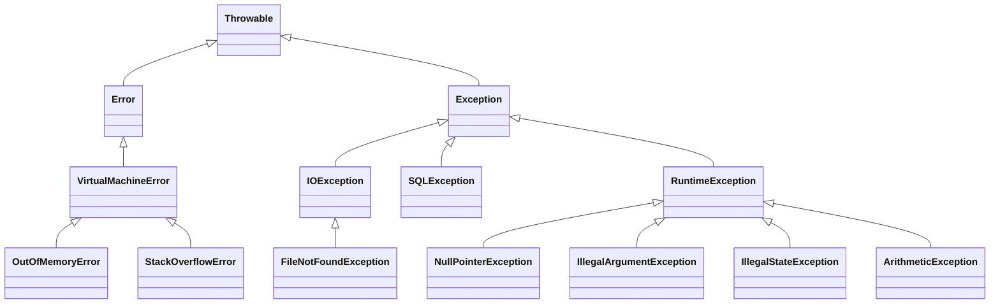
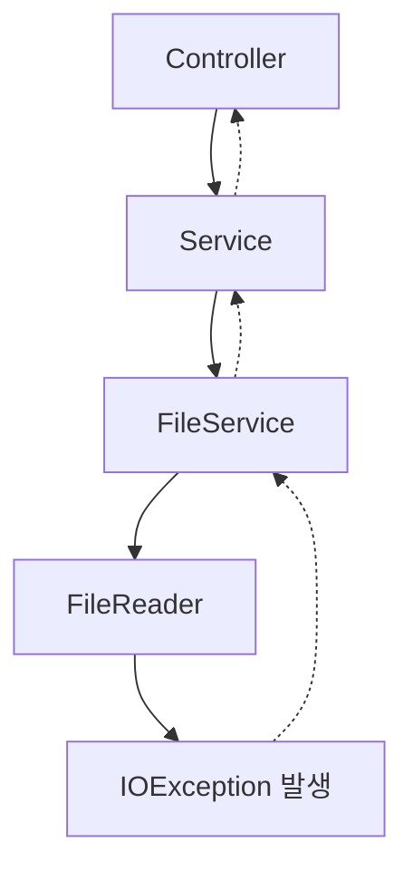
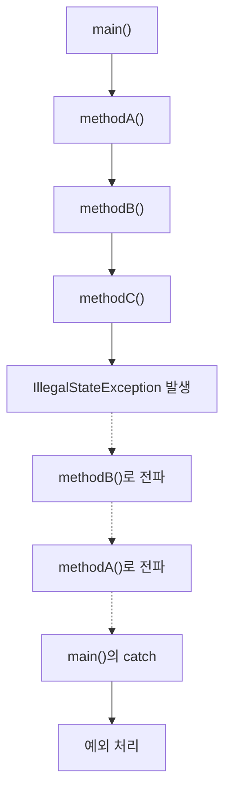
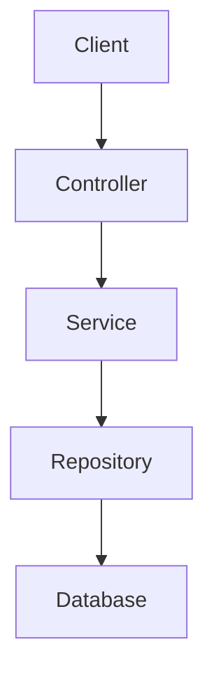
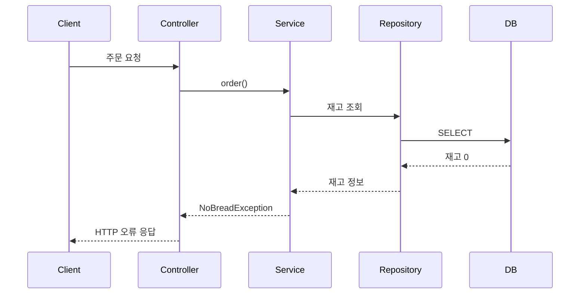
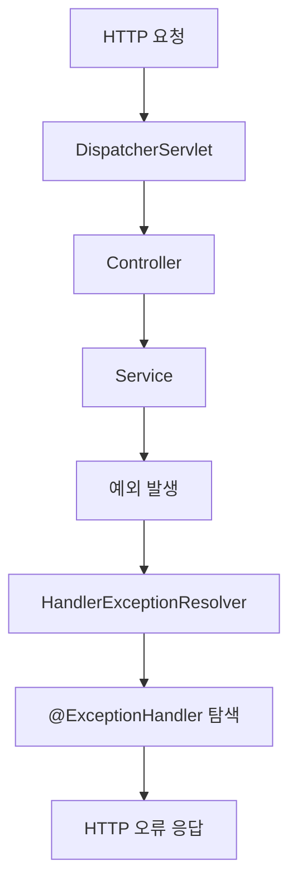

# 메이의 예외(Exception)
[https://youtu.be/F-XkE9oM9hI?si=qrQQF_LRqHS1EWup](https://youtu.be/F-XkE9oM9hI?si=qrQQF_LRqHS1EWup)
# 메이의 예외(Exception)
* toc
{:toc}

---

### Java 예외 처리 완벽 이해: Checked·Unchecked Exception, throw·throws, try-catch와 Spring Boot 예외 설계

Java 애플리케이션을 개발하다 보면 예상하지 못한 상황이 발생한다.

파일을 읽으려고 했는데 파일이 존재하지 않을 수도 있고, 데이터베이스 연결이 끊어질 수도 있다. 사용자가 잘못된 값을 전달하거나 비즈니스 규칙을 위반하는 요청을 보낼 수도 있다.

이러한 상황을 적절하게 처리하지 않으면 애플리케이션이 잘못된 데이터를 생성하거나 의도하지 않은 결과를 반환할 수 있다.

예를 들어 샌드위치 주문 서비스를 개발한다고 가정하자.

사용자는 다음과 같은 샌드위치를 주문했다.

- 빵: 허니오트
- 치즈: 슈레드
- 제외할 야채: 할라피뇨

그런데 허니오트 빵의 재고가 없는 상황이다.

이때 단순히 빵을 `null`로 설정하고 샌드위치를 생성하면 어떻게 될까?

```java
public class Sandwich {

    private String bread;

    private String cheese;

    public Sandwich(String bread, String cheese) {
        this.bread = bread;
        this.cheese = cheese;
    }
}
```

다음과 같은 코드가 실행될 수 있다.

```java
String bread = null;

Sandwich sandwich = new Sandwich(
        bread,
        "SHREDDED"
);
```

Java 문법상으로는 문제가 없다.

하지만 비즈니스 관점에서는 문제가 있다.

사용자는 샌드위치를 주문했는데 빵이 없는 상품이 생성되었기 때문이다.

이 상황에서 필요한 것은 단순히 프로그램 실행을 계속하는 것이 아니다.

**정상적으로 처리할 수 없는 이유를 명확하게 알리고, 잘못된 상태의 객체가 생성되지 않도록 해야 한다.**

Java는 이러한 상황을 처리하기 위해 예외(Exception)라는 메커니즘을 제공한다.

예를 들어 다음과 같이 작성할 수 있다.

```java
if (bread == null) {
    throw new IllegalArgumentException(
            "샌드위치에는 빵이 필요합니다."
    );
}
```

예외가 발생하면 정상적인 실행 흐름이 중단되고 예외를 처리할 수 있는 위치로 제어가 이동한다.

이를 통해 애플리케이션은 잘못된 상태를 감지하고 적절한 방식으로 대응할 수 있다.

하지만 예외 처리를 제대로 활용하려면 단순히 `try-catch` 문법을 아는 것만으로는 부족하다.

다음과 같은 질문에 답할 수 있어야 한다.

**Error와 Exception은 무엇이 다를까?**

**Checked Exception과 Unchecked Exception은 왜 구분할까?**

**`throw`와 `throws`는 어떤 차이가 있을까?**

**예외가 발생했을 때 메서드 호출 스택에서는 어떤 일이 일어날까?**

**`finally`는 정말 모든 상황에서 실행될까?**

**커스텀 예외는 언제 만들어야 할까?**

**Spring Boot에서는 예외를 어느 계층에서 처리하는 것이 좋을까?**

**예외가 발생하면 데이터베이스 트랜잭션은 반드시 롤백될까?**

이러한 개념을 순서대로 살펴보자.

---

### 개념

#### 예외(Exception)란 무엇인가?

예외는 프로그램 실행 중 발생한 정상적인 처리 흐름을 방해하는 상황을 객체로 표현한 것이다.

Java에서 예외가 발생하면 해당 예외 객체가 던져진다.

이를 예외 발생 또는 예외 던지기(Throwing an Exception)라고 한다.

예를 들어 다음 코드를 살펴보자.

```java
public int divide(int a, int b) {
    return a / b;
}
```

정상적인 값을 전달하면 문제가 없다.

```java
divide(10, 2);
```

결과는 다음과 같다.

```text
5
```

하지만 다음과 같이 호출하면 어떻게 될까?

```java
divide(10, 0);
```

정수 나눗셈에서 0으로 나누는 연산이 발생한다.

Java는 이 상황에서 `ArithmeticException`을 발생시킨다.

```text
java.lang.ArithmeticException: / by zero
```

예외가 발생하면 해당 위치에서 정상적인 실행을 계속하지 않는다.

대신 예외를 처리할 수 있는 `catch` 블록을 찾거나 호출자에게 예외를 전파한다.

이것이 Java 예외 처리의 기본적인 동작이다.

단, 부동소수점 연산은 다르게 동작할 수 있다.

예를 들어 다음 코드는 `ArithmeticException`을 발생시키지 않는다.

```java
double result = 10.0 / 0.0;

System.out.println(result);
```

결과는 다음과 같다.

```text
Infinity
```

따라서 예외가 발생하는 조건은 연산과 데이터 타입에 따라 달라질 수 있다.

---

### Java 예외의 최상위 클래스는 Throwable이다

Java에서 예외와 오류는 `Throwable`을 중심으로 계층 구조를 가진다.

`Throwable`은 Java에서 던질 수 있는 객체들의 최상위 클래스다.

주요 하위 클래스는 다음과 같다.



이 구조에서 중요한 점은 `Error`와 `Exception`이 모두 `Throwable`의 하위 클래스라는 것이다.

하지만 각각의 목적은 다르다.

| 구분 | Error | Exception |
|---|---|---|
| 목적 | 심각한 오류나 복구가 어려운 상황 표현 | 애플리케이션에서 발생할 수 있는 예외 상황 표현 |
| 대표 사례 | `OutOfMemoryError`, `StackOverflowError` | `IOException`, `SQLException`, `IllegalArgumentException` |
| 일반적인 처리 | 애플리케이션 수준에서 복구하기 어려운 경우가 많음 | 상황에 따라 처리·복구·전파 가능 |
| 컴파일러의 처리 강제 | 없음 | Checked Exception에 한해 존재 |
| 일반적인 권장 방식 | 무분별하게 잡지 않음 | 책임이 있는 계층에서 처리 |

여기서 주의할 점이 있다.

**Error는 절대로 처리할 수 없고 Exception은 반드시 복구할 수 있다는 의미는 아니다.**

일부 Error는 특수한 상황에서 처리할 수 있다.

반대로 일부 Exception은 애플리케이션에서 복구하기 어려울 수 있다.

이 구분은 주로 오류의 성격과 일반적인 처리 책임을 나타낸다.

Java 언어 명세에서도 `Error`를 일반적인 예외 처리 대상과 구분하고 있다.

---

### Error란 무엇인가?

`Error`는 일반적으로 애플리케이션이 정상적으로 복구하기 어려운 심각한 문제를 나타낸다.

대표적인 예외 상황을 살펴보자.

#### OutOfMemoryError

JVM이 필요한 메모리를 확보하지 못하는 상황에서 발생할 수 있다.

예를 들어 다음과 같은 코드가 있다고 가정하자.

```java
List<byte[]> data = new ArrayList<>();

while (true) {
    data.add(new byte[1024 * 1024]);
}
```

이 코드는 반복적으로 메모리를 할당하고 객체에 대한 참조를 유지한다.

JVM에 충분한 메모리가 없다면 `OutOfMemoryError`가 발생할 수 있다.

다만 메모리 부족은 단순히 Java Heap에만 국한되지 않는다.

JVM의 메모리 영역이나 네이티브 자원 등의 상태에 따라 다양한 원인이 존재할 수 있다.

이러한 상황에서 단순히 다음과 같이 처리한다고 문제가 해결되지는 않는다.

```java
try {
    process();
} catch (OutOfMemoryError error) {
    System.out.println("메모리가 부족합니다.");
}
```

메모리 부족의 근본적인 원인이 해결되지 않았기 때문이다.

또 오류를 처리하는 코드 자체도 메모리가 필요할 수 있다.

따라서 일반적인 애플리케이션 로직에서는 `OutOfMemoryError`를 잡아 정상적인 서비스 처리를 계속하려고 하기보다 메모리 사용량과 장애 원인을 분석하는 것이 중요하다.

#### StackOverflowError

스레드의 호출 스택이 감당할 수 있는 범위를 초과할 때 발생할 수 있다.

예를 들어 종료 조건이 없는 재귀 호출이 있다고 가정하자.

```java
public void recursive() {
    recursive();
}
```

이 메서드는 자기 자신을 계속 호출한다.

```text
recursive()
    ↓
recursive()
    ↓
recursive()
    ↓
recursive()
    ↓
...
```

호출이 반복되면서 스택 사용량이 증가한다.

결국 스택의 한계를 초과하면 `StackOverflowError`가 발생할 수 있다.

이러한 문제는 재귀 종료 조건이나 호출 구조를 개선해야 해결할 수 있다.

즉 Error의 핵심은 단순히 메시지를 출력하는 것이 아니라 **시스템이 왜 정상적으로 동작할 수 없는 상태가 되었는지 분석하는 것**이다.

---

### Exception이란 무엇인가?

`Exception`은 애플리케이션 실행 과정에서 발생할 수 있는 다양한 예외 상황을 표현한다.

예를 들어 다음과 같은 상황에서 발생할 수 있다.

- 파일이 존재하지 않는다.
- 파일을 읽는 과정에서 문제가 발생한다.
- 데이터베이스 작업에 실패한다.
- 요청한 데이터가 존재하지 않는다.
- 잘못된 인수가 전달된다.
- 객체가 유효하지 않은 상태다.
- 비즈니스 규칙을 만족하지 않는다.

여기서 중요한 점은 **모든 Exception이 개발자의 논리적 실수에서만 발생하는 것은 아니라는 사실**이다.

예를 들어 `IOException`은 개발자가 올바른 코드를 작성했더라도 파일 시스템이나 외부 환경의 문제로 발생할 수 있다.

또 사용자가 품절된 상품을 주문하는 상황은 프로그램의 버그가 아니라 정상적으로 발생할 수 있는 비즈니스 실패다.

따라서 Exception은 다음 두 가지 관점에서 이해할 수 있다.

첫 번째는 예상하지 못한 기술적 문제다.

두 번째는 정상적인 비즈니스 흐름에서 처리할 수 없는 조건이다.

두 상황 모두 예외를 통해 표현할 수 있지만 처리 방법은 달라질 수 있다.

---

### 왜 사용하는가?

#### 예외 처리가 필요한 이유

예외 처리를 사용하는 가장 중요한 이유는 **잘못된 상태로 프로그램을 계속 실행하지 않도록 하고, 실패에 대한 책임을 명확하게 전달하기 위해서**다.

앞서 샌드위치 주문 상황을 다시 생각해 보자.

사용자는 허니오트 빵을 선택했다.

하지만 해당 빵의 재고가 없다.

이때 서비스는 다음 두 가지 방식 중 하나로 동작할 수 있다.

첫 번째는 재고가 없다는 사실을 무시하고 주문을 진행하는 것이다.

```java
String bread = null;

Sandwich sandwich = new Sandwich(
        bread,
        "SHREDDED"
);
```

이 방식은 기술적으로 객체를 생성할 수 있다.

하지만 잘못된 비즈니스 결과를 만들어 낸다.

두 번째는 재고가 없다는 사실을 감지하고 주문을 중단하는 것이다.

```java
if (stock <= 0) {
    throw new NoBreadException(
            "허니오트 빵의 재고가 없습니다."
    );
}
```

이 경우 예외가 발생하므로 정상적인 주문 생성 흐름을 계속 진행하지 않는다.

그리고 예외를 전달받은 계층에서 적절한 대응을 수행할 수 있다.

예를 들어 사용자에게 다음과 같이 안내할 수 있다.

```text
선택하신 허니오트 빵은 현재 품절되었습니다.

다른 빵을 선택해 주세요.
```

이것이 예외 처리의 핵심적인 목적이다.

**실패를 숨기지 않고, 올바른 위치에서 적절하게 처리하도록 만드는 것**이다.

---

#### 예외 처리와 조건문은 무엇이 다를까?

모든 실패 상황을 반드시 예외로 표현해야 하는 것은 아니다.

예를 들어 다음과 같은 코드가 있다고 가정하자.

```java
boolean available = stock > 0;
```

단순히 재고가 있는지 확인하는 기능이라면 `boolean`을 반환하는 것으로 충분할 수 있다.

```java
if (!available) {
    return false;
}
```

반면 주문 생성 과정에서 재고 부족으로 인해 작업을 완료할 수 없다면 예외가 적절할 수 있다.

```java
public Sandwich order(Bread bread) {

    if (!hasStock(bread)) {
        throw new NoBreadException(bread);
    }

    return createSandwich(bread);
}
```

두 방식을 비교하면 다음과 같다.

| 상황 | 적절한 방식 |
|---|---|
| 특정 조건을 확인하는 조회 | `boolean`, `Optional` 등 |
| 결과가 없을 수 있는 정상적인 조회 | `Optional` 등 |
| 작업을 완료할 수 없는 비즈니스 실패 | 도메인 예외 고려 |
| 외부 시스템 장애 | 예외 전파·변환·복구 전략 |
| 복구 가능한 일시적 실패 | 제한적인 재시도 고려 |
| 프로그래밍 오류 | 원인 수정 및 실패 전파 |

중요한 것은 예외를 모든 분기 처리의 대체재로 사용하는 것이 아니다.

**예외는 정상적인 처리 계약을 완료할 수 없는 상황을 표현하는 수단으로 활용해야 한다.**

---

### 주요 특징

### Checked Exception과 Unchecked Exception

Java의 Exception은 크게 두 가지로 구분할 수 있다.

첫 번째는 Checked Exception이다.

두 번째는 Unchecked Exception이다.

두 가지의 가장 중요한 차이는 **컴파일러가 예외의 처리 또는 선언을 요구하는지 여부**다.

여기서 반드시 구분해야 할 개념이 있다.

Checked Exception은 컴파일 시점에 발생하는 예외가 아니다.

Unchecked Exception만 런타임에 발생하는 것도 아니다.

**두 종류 모두 실제 예외 객체는 프로그램 실행 중 발생할 수 있다.**

차이는 컴파일 시점에 예외 처리를 검사하는지에 있다.

Java 언어 명세는 이러한 기능을 Compile-Time Checking of Exceptions라고 정의한다.

---

### Checked Exception이란 무엇인가?

Checked Exception은 컴파일러가 예외의 처리 또는 전파 선언을 요구하는 예외다.

일반적으로 `Exception`을 상속하지만 `RuntimeException`은 상속하지 않는 클래스들이 이에 해당한다.

대표적인 예시는 다음과 같다.

```java
IOException
```

```java
FileNotFoundException
```

```java
SQLException
```

```java
InterruptedException
```

Checked Exception이 발생할 수 있는 메서드를 호출한다면 개발자는 해당 예외를 처리하거나 호출자에게 전파한다고 선언해야 한다.

예를 들어 다음 코드를 살펴보자.

```java
import java.io.IOException;

public class FileReaderExample {

    public void readFile() {
        throw new IOException("파일 읽기 실패");
    }
}
```

이 코드는 컴파일되지 않는다.

`IOException`은 Checked Exception이기 때문이다.

컴파일러는 다음과 같은 오류를 발생시킨다.

```text
unreported exception IOException;
must be caught or declared to be thrown
```

즉 컴파일러는 개발자에게 다음 두 가지 방법 중 하나를 선택하도록 요구한다.

첫 번째는 `try-catch`로 예외를 처리하는 것이다.

두 번째는 `throws`로 호출자에게 예외가 전달될 수 있다고 선언하는 것이다.

---

#### 방법 1. try-catch로 처리하기

```java
import java.io.IOException;

public class FileReaderExample {

    public void readFile() {

        try {
            throw new IOException("파일 읽기 실패");
        } catch (IOException e) {
            System.out.println(e.getMessage());
        }
    }
}
```

실행하면 다음과 같이 출력된다.

```text
파일 읽기 실패
```

예외가 발생했지만 해당 메서드 내부에서 처리했다.

따라서 호출자에게 예외가 그대로 전파되지 않는다.

물론 `catch` 내부에서 다시 예외를 던지도록 작성할 수도 있다.

---

#### 방법 2. throws로 전파 선언하기

```java
import java.io.IOException;

public class FileReaderExample {

    public void readFile() throws IOException {
        throw new IOException("파일 읽기 실패");
    }
}
```

이번에는 `throws IOException`을 선언했다.

이렇게 하면 메서드 내부에서 Checked Exception을 직접 잡지 않아도 컴파일할 수 있다.

하지만 여기서 중요한 점이 있다.

**`throws`는 예외를 처리하는 것이 아니다.**

예외가 호출자에게 전달될 수 있다는 사실을 메서드 계약으로 선언하는 것이다.

따라서 호출하는 쪽에서 처리하거나 다시 전파해야 한다.

```java
public void execute() {

    try {
        readFile();
    } catch (IOException e) {
        System.out.println("파일 작업을 완료하지 못했습니다.");
    }
}
```

이처럼 Checked Exception은 호출자에게 해당 예외를 고려하도록 요구한다.

---

### Checked Exception의 장점과 단점

Checked Exception의 가장 큰 장점은 예외를 무심코 누락하는 상황을 줄일 수 있다는 것이다.

예를 들어 파일 I/O 작업에서 `IOException`이 발생할 수 있다는 사실을 메서드 선언에서 확인할 수 있다.

```java
public String read() throws IOException
```

이러한 선언은 메서드의 실패 가능성을 드러낸다.

하지만 단점도 존재한다.

예외가 발생한 곳과 처리해야 하는 곳 사이에 여러 메서드가 존재하면 전파 선언이 반복될 수 있다.

예를 들어 다음과 같은 구조다.



`FileReader`에서 `IOException`이 발생한다고 가정하자.

중간 계층이 예외를 처리하지 않는다면 여러 메서드에 `throws IOException`이 필요할 수 있다.

```java
public String readFile() throws IOException {
    // 파일 읽기
}
```

```java
public String loadFile() throws IOException {
    return readFile();
}
```

```java
public String execute() throws IOException {
    return loadFile();
}
```

이렇게 Checked Exception은 메서드의 예외 계약을 명확하게 제공하지만, 계층이 깊어지면 선언이 전파되는 부담이 발생할 수 있다.

또 모든 호출자가 실질적으로 복구할 수 있는 것은 아니다.

따라서 Checked Exception을 사용할 때는 **호출자가 해당 예외에 대해 의미 있는 대응을 할 수 있는지** 고려하는 것이 중요하다.

---

### Unchecked Exception이란 무엇인가?

Unchecked Exception은 컴파일러가 명시적인 예외 처리를 강제하지 않는 예외다.

Java에서 대표적인 Unchecked Exception은 `RuntimeException`과 그 하위 클래스다.

또 `Error`와 그 하위 클래스 역시 컴파일 시점의 예외 처리 검사를 받지 않는 Unchecked 계열이다.

하지만 일반적으로 Checked Exception과 Unchecked Exception을 비교할 때는 `Exception` 계층 내부의 Checked Exception과 `RuntimeException`을 비교하는 경우가 많다.

대표적인 RuntimeException은 다음과 같다.

```java
NullPointerException
```

```java
IllegalArgumentException
```

```java
IllegalStateException
```

```java
ArithmeticException
```

```java
IndexOutOfBoundsException
```

예를 들어 다음 코드를 살펴보자.

```java
public class ValidationExample {

    public void validate(int age) {

        if (age < 0) {
            throw new IllegalArgumentException(
                    "나이는 음수일 수 없습니다."
            );
        }
    }
}
```

이 코드는 `throws`를 선언하지 않아도 컴파일할 수 있다.

`IllegalArgumentException`이 `RuntimeException`의 하위 클래스이기 때문이다.

호출하는 쪽에서도 반드시 `try-catch`를 작성할 필요는 없다.

```java
validate(-1);
```

하지만 실행 과정에서 예외가 발생한다.

```text
java.lang.IllegalArgumentException:
나이는 음수일 수 없습니다.
```

즉 Unchecked Exception은 예외를 무시해도 안전하다는 의미가 아니다.

**컴파일러가 처리를 강제하지 않을 뿐, 적절한 예외 처리 전략은 여전히 필요하다.**

---

### Checked Exception과 Unchecked Exception 비교

| 구분 | Checked Exception | Unchecked Exception |
|---|---|---|
| 대표적인 상속 구조 | `Exception` 하위, `RuntimeException` 제외 | `RuntimeException` 및 하위 클래스 |
| 컴파일 시점 처리 검사 | 적용 | 적용되지 않음 |
| `try-catch` 또는 `throws` | 처리 또는 선언 필요 | 필수 아님 |
| 실제 예외 발생 시점 | 런타임 | 런타임 |
| 대표 사례 | `IOException`, `SQLException` | `IllegalArgumentException`, `NullPointerException` |
| 주요 장점 | 실패 가능성을 호출자에게 명시 | 예외 전파 선언 부담 감소 |
| 주요 단점 | 전파 선언 증가 가능 | 호출자가 실패 가능성을 놓칠 수 있음 |
| 일반적인 사용 관점 | 호출자가 복구를 시도할 수 있는 상황 | 호출자의 계약 위반, 잘못된 상태, 도메인 실패 등 |

여기서 한 가지 주의할 점이 있다.

Checked Exception이라고 반드시 복구 가능한 것은 아니다.

Unchecked Exception이라고 반드시 복구 불가능한 것도 아니다.

예외를 어떤 종류로 설계할지는 호출자가 무엇을 할 수 있는지, API의 계약을 어떻게 표현할지에 따라 결정해야 한다.

---

### throw와 throws의 차이

Java 예외 처리에서 가장 자주 혼동하는 두 가지 키워드가 있다.

`throw`와 `throws`다.

이 둘은 역할이 완전히 다르다.

#### throw

`throw`는 실제로 예외 객체를 던지는 명령어다.

예를 들어 다음과 같다.

```java
throw new IllegalArgumentException(
        "잘못된 인수입니다."
);
```

이 코드가 실행되면 해당 위치에서 예외가 발생한다.

현재 메서드의 정상적인 실행 흐름이 중단된다.

#### throws

`throws`는 메서드가 특정 예외를 호출자에게 전달할 수 있다는 사실을 선언한다.

```java
public void readFile() throws IOException {
    // 파일 읽기
}
```

`throws`를 선언했다고 해당 메서드가 반드시 예외를 발생시키는 것은 아니다.

또 `throws` 자체가 예외를 발생시키는 것도 아니다.

예외가 발생할 가능성이 있음을 메서드의 계약에 표시하는 것이다.

두 키워드를 비교하면 다음과 같다.

| 구분 | throw | throws |
|---|---|---|
| 사용 위치 | 메서드나 블록 내부 | 메서드 선언부 |
| 역할 | 실제 예외 발생 | 예외 전파 가능성 선언 |
| 사용 대상 | 예외 객체 | 예외 타입 |
| 실행 흐름 | 예외 전파 시작 | 실행 흐름 자체에 직접 영향 없음 |
| 예시 | `throw new IOException()` | `throws IOException` |

실제 코드에서는 두 키워드를 함께 사용할 수 있다.

```java
public void execute() throws IOException {

    throw new IOException(
            "외부 파일을 읽을 수 없습니다."
    );
}
```

이 코드에서 `throw`는 실제 예외를 발생시킨다.

`throws`는 해당 Checked Exception이 호출자에게 전파될 수 있음을 선언한다.

---

### 예외가 발생하면 내부적으로 어떤 일이 일어날까?

Java 예외 처리의 핵심을 이해하려면 예외 전파(Exception Propagation)를 알아야 한다.

다음과 같은 코드가 있다고 가정하자.

```java
public class ExceptionPropagationExample {

    public static void main(String[] args) {

        try {
            methodA();
        } catch (IllegalStateException e) {
            System.out.println("main에서 예외 처리");
        }
    }

    private static void methodA() {
        methodB();
    }

    private static void methodB() {
        methodC();
    }

    private static void methodC() {
        throw new IllegalStateException(
                "처리할 수 없는 상태"
        );
    }
}
```

메서드 호출 순서는 다음과 같다.

```text
main()
    ↓
methodA()
    ↓
methodB()
    ↓
methodC()
```

`methodC()`에서 예외가 발생한다.

```java
throw new IllegalStateException(
        "처리할 수 없는 상태"
);
```

이때 Java는 현재 위치에서 해당 예외를 처리할 수 있는 코드를 찾는다.

`methodC()`에는 `catch`가 없다.

따라서 호출자인 `methodB()`로 예외가 전파된다.

`methodB()`에도 `catch`가 없다.

이제 `methodA()`로 전파된다.

`methodA()`에도 예외 처리 코드가 없다.

마지막으로 `main()`에 도달한다.

여기에는 다음 코드가 존재한다.

```java
catch (IllegalStateException e) {
    System.out.println("main에서 예외 처리");
}
```

따라서 이 위치에서 예외를 처리한다.

실행 결과는 다음과 같다.

```text
main에서 예외 처리
```

예외 전파 구조는 다음과 같다.



이 과정에서 Java는 호출 스택을 따라 예외 처리 위치를 찾는다.

이를 Stack Unwinding과 연결해 이해할 수 있다.

예외가 전파되는 동안 해당 호출에서 정상적으로 실행하던 이후 코드는 건너뛰게 된다.

또 필요한 경우 `finally` 블록이나 자원 정리 과정이 수행된다.

이러한 동작 때문에 예외를 처리하는 위치를 신중하게 선택해야 한다.

---

### try-catch를 이용한 예외 처리

가장 기본적인 예외 처리 방법은 `try-catch`다.

구조는 다음과 같다.

```java
try {
    // 예외가 발생할 수 있는 작업
} catch (Exception e) {
    // 예외 처리
}
```

`try` 내부에서 예외가 발생하면 해당 예외를 처리할 수 있는 `catch` 블록을 찾는다.

예를 들어 다음 코드를 살펴보자.

```java
public class ExceptionHandlingExample {

    public static void main(String[] args) {

        try {
            int result = 10 / 0;

            System.out.println(result);
        } catch (ArithmeticException e) {
            System.out.println(
                    "0으로 나눌 수 없습니다."
            );
        }

        System.out.println("프로그램 계속 실행");
    }
}
```

실행 결과는 다음과 같다.

```text
0으로 나눌 수 없습니다.
프로그램 계속 실행
```

여기서 중요한 점은 `catch`가 예외를 처리했다는 것이다.

따라서 정상적인 제어 흐름이 `try-catch` 다음으로 이어진다.

반면 해당 예외를 처리할 수 있는 코드가 없다면 예외는 호출자에게 전파된다.

최종적으로 처리되지 않은 예외가 스레드의 실행을 종료시키는 상황까지 이어질 수 있다.

---

### 여러 catch 블록을 사용할 수 있을까?

가능하다.

서로 다른 예외를 구분해 처리할 수 있다.

예를 들어 다음과 같다.

```java
try {
    process();
} catch (IllegalArgumentException e) {
    System.out.println("잘못된 입력값입니다.");
} catch (IllegalStateException e) {
    System.out.println("현재 상태에서 처리할 수 없습니다.");
}
```

이 방식은 예외의 종류에 따라 서로 다른 대응을 수행할 수 있다는 장점이 있다.

하지만 예외의 상속 관계를 고려해야 한다.

예를 들어 다음 코드는 올바르지 않다.

```java
try {
    process();
} catch (RuntimeException e) {
    System.out.println("런타임 예외");
} catch (IllegalArgumentException e) {
    System.out.println("잘못된 인수");
}
```

`IllegalArgumentException`은 `RuntimeException`의 하위 클래스다.

따라서 첫 번째 `catch`에서 이미 처리할 수 있는 예외다.

두 번째 `catch`에는 도달할 수 없으므로 컴파일 오류가 발생한다.

올바른 순서는 더 구체적인 예외부터 작성하는 것이다.

```java
try {
    process();
} catch (IllegalArgumentException e) {
    System.out.println("잘못된 인수");
} catch (RuntimeException e) {
    System.out.println("기타 런타임 예외");
}
```

이렇게 하면 특정 예외를 우선 처리하고 나머지 예외를 상위 타입으로 처리할 수 있다.

---

### Multi-Catch란 무엇인가?

Java 7부터는 여러 예외를 하나의 `catch` 블록에서 처리할 수 있다.

예를 들어 다음과 같다.

```java
try {
    process();
} catch (IOException | SQLException e) {
    System.out.println("작업 처리 실패");
}
```

`IOException`과 `SQLException`을 같은 방식으로 처리하고 싶을 때 유용하다.

하지만 Multi-Catch에서는 상속 관계가 있는 예외 타입을 동시에 나열할 수 없다.

예를 들어 다음 코드는 컴파일되지 않는다.

```java
catch (IOException | FileNotFoundException e) {
    // 컴파일 오류
}
```

`FileNotFoundException`은 `IOException`의 하위 클래스이기 때문이다.

따라서 다음처럼 작성하면 된다.

```java
catch (IOException e) {
    // FileNotFoundException도 처리 가능
}
```

---

### finally란 무엇인가?

`finally`는 `try-catch`의 실행 결과와 관계없이 자원 정리 등의 작업을 수행하도록 하는 블록이다.

예를 들어 다음 코드를 살펴보자.

```java
public class FinallyExample {

    public static void main(String[] args) {

        try {
            System.out.println("try 시작");

            throw new IllegalStateException(
                    "문제 발생"
            );

        } catch (IllegalStateException e) {
            System.out.println("catch 실행");

        } finally {
            System.out.println("finally 실행");
        }
    }
}
```

실행 결과는 다음과 같다.

```text
try 시작
catch 실행
finally 실행
```

`try`에서 예외가 발생했다.

이후 `catch`에서 해당 예외를 처리했다.

마지막으로 `finally`가 실행되었다.

일반적으로 `finally`는 예외 발생 여부와 관계없이 실행되므로 자원 정리에 활용할 수 있다.

하지만 다음과 같이 이해하는 것은 정확하지 않다.

**`finally`는 어떤 상황에서도 반드시 실행된다.**

실제로는 JVM이 비정상적으로 종료되거나 프로세스가 강제로 종료되는 등의 상황에서 실행되지 않을 수 있다.

예를 들어 `Runtime.getRuntime().halt()`는 JVM을 강제로 종료할 수 있으며 정상적인 종료 절차를 수행하지 않는다.

따라서 `finally`는 일반적인 Java 제어 흐름에서 자원 정리를 보장하기 위한 메커니즘이지, 모든 시스템 장애에서도 실행되는 절대적인 보장 장치는 아니다.

---

### finally에서 return을 사용하면 위험한 이유

`finally` 내부에서 `return`을 사용하는 것은 피하는 것이 좋다.

예를 들어 다음 코드를 살펴보자.

```java
public static int calculate() {

    try {
        return 10;
    } finally {
        return 20;
    }
}
```

이 메서드의 반환값은 무엇일까?

실행 결과는 다음과 같다.

```text
20
```

`try`에서 `10`을 반환하려고 했지만 `finally`의 `return`이 최종 결과를 바꿨다.

더 위험한 상황도 있다.

```java
public static int calculate() {

    try {
        throw new IllegalStateException(
                "계산 실패"
        );
    } finally {
        return 20;
    }
}
```

이 경우 `finally`의 `return`으로 인해 기존 예외가 가려질 수 있다.

즉 실패 원인이 정상적인 반환값으로 덮어써질 수 있다.

따라서 `finally`는 주로 자원 정리 등의 목적으로 사용하고, `return`이나 예외를 새롭게 발생시키는 로직을 불필요하게 작성하지 않는 것이 좋다.

---

### try-with-resources란 무엇인가?

Java에서는 파일이나 네트워크 연결 등 사용 후 정리가 필요한 자원이 존재한다.

대표적인 예시는 다음과 같다.

- 파일 스트림
- 파일 Reader
- JDBC Connection
- JDBC Statement
- JDBC ResultSet
- 네트워크 Socket

이러한 자원은 작업이 끝난 뒤 적절하게 해제해야 한다.

과거에는 `finally`를 활용해 자원을 정리하는 코드를 작성하는 경우가 많았다.

예를 들어 다음과 같다.

```java
BufferedReader reader = null;

try {
    reader = Files.newBufferedReader(
            Path.of("example.txt")
    );

    String line = reader.readLine();

    System.out.println(line);

} finally {
    if (reader != null) {
        reader.close();
    }
}
```

이 코드는 자원 해제라는 목적을 수행한다.

하지만 문제가 있다.

자원 해제 코드가 반복된다.

또 자원이 여러 개라면 예외 발생 상황을 고려한 정리 코드가 더욱 복잡해질 수 있다.

이러한 문제를 개선하기 위해 Java 7에서 `try-with-resources`가 도입되었다.

```java
try (BufferedReader reader =
             Files.newBufferedReader(
                     Path.of("example.txt")
             )) {

    String line = reader.readLine();

    System.out.println(line);
}
```

이 방식은 `try` 구문에서 자원을 선언한다.

그리고 `try` 블록이 종료될 때 해당 자원의 `close()`가 자동으로 호출된다.

따라서 개발자가 별도의 `finally` 블록에서 자원을 해제하는 코드를 반복해서 작성할 필요가 줄어든다.

Java 공식 문서에서는 `try-with-resources`를 `AutoCloseable` 자원을 안전하게 관리하기 위한 기능으로 설명한다.

---

### AutoCloseable이란 무엇인가?

`try-with-resources`에서 자동으로 관리할 수 있는 자원은 `AutoCloseable` 인터페이스를 구현해야 한다.

인터페이스의 핵심 메서드는 다음과 같다.

```java
public interface AutoCloseable {

    void close() throws Exception;
}
```

이 인터페이스를 구현한 객체는 `try-with-resources`에서 자동 종료 대상으로 사용할 수 있다.

예를 들어 직접 자원 클래스를 만들어 보자.

```java
public class MyResource implements AutoCloseable {

    public MyResource() {
        System.out.println("자원 생성");
    }

    public void execute() {
        System.out.println("작업 실행");
    }

    @Override
    public void close() {
        System.out.println("자원 해제");
    }
}
```

이제 사용한다.

```java
public class ResourceExample {

    public static void main(String[] args) {

        try (MyResource resource = new MyResource()) {

            resource.execute();
        }
    }
}
```

실행 결과는 다음과 같다.

```text
자원 생성
작업 실행
자원 해제
```

`try` 블록을 벗어나면 자동으로 `close()`가 호출된다.

여러 자원을 선언한 경우에는 일반적으로 선언의 역순으로 닫힌다.

```java
try (
        ResourceA a = new ResourceA();
        ResourceB b = new ResourceB()
) {
    // 작업
}
```

종료 순서는 다음과 같다.

```text
ResourceB.close()

↓

ResourceA.close()
```

이러한 동작은 여러 자원 사이에 의존 관계가 있을 때 중요할 수 있다.

---

### try-with-resources에서 close()도 실패하면 어떻게 될까?

이 부분은 예외 처리를 깊이 이해할 때 중요한 개념이다.

다음 상황을 생각해 보자.

첫 번째, 자원을 사용하던 도중 예외가 발생했다.

두 번째, 자원을 정리하는 `close()`에서도 예외가 발생했다.

그렇다면 어떤 예외가 호출자에게 전달될까?

Java는 `try-with-resources`에서 Suppressed Exception이라는 메커니즘을 제공한다.

예를 들어 다음 코드를 살펴보자.

```java
import java.io.IOException;

public class SuppressedExceptionExample {

    static class MyResource implements AutoCloseable {

        @Override
        public void close() throws IOException {
            throw new IOException("자원 해제 실패");
        }
    }

    public static void main(String[] args) {

        try (MyResource resource = new MyResource()) {

            throw new IllegalStateException(
                    "비즈니스 작업 실패"
            );

        } catch (Exception e) {

            System.out.println(
                    "대표 예외: " + e.getMessage()
            );

            for (Throwable suppressed : e.getSuppressed()) {

                System.out.println(
                        "Suppressed: " + suppressed.getMessage()
                );
            }
        }
    }
}
```

실행 결과는 다음과 같다.

```text
대표 예외: 비즈니스 작업 실패
Suppressed: 자원 해제 실패
```

이 상황에서 핵심 예외는 비즈니스 작업 실패다.

자원 해제 실패는 Suppressed Exception으로 보관된다.

이렇게 하면 `close()`에서 발생한 예외 때문에 원래의 실패 원인이 사라지는 문제를 줄일 수 있다.

Suppressed Exception은 다음 메서드로 확인할 수 있다.

```java
getSuppressed()
```

Java 공식 문서에서도 자원 처리 중 발생한 예외와 자원 종료 중 발생한 예외를 구분하는 방식을 설명한다.

---

### Java에서 자주 사용하는 예외의 종류

Java 표준 라이브러리에는 다양한 예외 클래스가 존재한다.

이 중 백엔드 개발에서 자주 마주치는 예외들을 정리해 보자.

| 예외 | 구분 | 주요 발생 상황 |
|---|---|---|
| `FileNotFoundException` | Checked | 파일을 열려고 했으나 파일이 존재하지 않는 등의 상황 |
| `IOException` | Checked | 파일 및 스트림 I/O 실패 |
| `SQLException` | Checked | JDBC 데이터베이스 작업 실패 |
| `InterruptedException` | Checked | 대기 중인 스레드가 인터럽트됨 |
| `ClassNotFoundException` | Checked | 지정한 클래스를 찾지 못함 |
| `NullPointerException` | Unchecked | null 참조를 부적절하게 사용 |
| `IllegalArgumentException` | Unchecked | 잘못된 인수 전달 |
| `IllegalStateException` | Unchecked | 현재 객체 상태에서 작업을 수행할 수 없음 |
| `ArithmeticException` | Unchecked | 정수 나눗셈의 0 나누기 등 |
| `IndexOutOfBoundsException` | Unchecked | 유효하지 않은 인덱스 접근 |
| `NumberFormatException` | Unchecked | 문자열을 숫자로 변환하지 못함 |
| `ClassCastException` | Unchecked | 잘못된 타입 캐스팅 |
| `NoSuchElementException` | Unchecked | 존재하지 않는 요소 접근 |
| `UnsupportedOperationException` | Unchecked | 지원하지 않는 작업 실행 |

각 예외를 조금 더 살펴보자.

#### FileNotFoundException

파일을 열려고 했지만 파일이 존재하지 않는 등의 상황에서 발생할 수 있다.

```java
FileInputStream input =
        new FileInputStream("missing.txt");
```

파일이 없다면 `FileNotFoundException`이 발생할 수 있다.

이 예외는 `IOException`의 하위 클래스다.

따라서 다음과 같이 처리할 수 있다.

```java
try {
    FileInputStream input =
            new FileInputStream("missing.txt");

} catch (IOException e) {
    System.out.println("파일을 열 수 없습니다.");
}
```

#### IOException

파일이나 스트림 등 I/O 작업에서 발생하는 예외를 표현한다.

예를 들어 파일 읽기 실패, 연결 종료, 데이터 입출력 실패 등이 있다.

단순히 파일이 존재하지 않을 때만 사용하는 예외는 아니다.

#### SQLException

JDBC 작업 중 데이터베이스 관련 오류가 발생했을 때 사용된다.

예를 들어 다음과 같은 상황에서 발생할 수 있다.

- SQL 실행 실패
- 제약 조건 위반
- 데이터베이스 연결 문제
- JDBC 드라이버에서 보고한 오류

다만 Spring에서는 JDBC나 JPA 관련 예외를 `DataAccessException` 계층으로 변환해 제공하는 경우가 많다.

`DataAccessException`은 Unchecked Exception이다.

따라서 순수 JDBC와 Spring 데이터 접근 기술에서는 예외 계층이 다를 수 있다.

#### NullPointerException

null 참조를 부적절하게 사용하는 경우 발생한다.

```java
String name = null;

System.out.println(name.length());
```

#### IllegalArgumentException

메서드의 인수로 잘못된 값이 전달된 경우 사용할 수 있다.

```java
public void register(int age) {

    if (age < 0) {
        throw new IllegalArgumentException(
                "나이는 음수일 수 없습니다."
        );
    }
}
```

#### IllegalStateException

인수 자체보다 현재 객체의 상태가 작업을 수행하기에 적절하지 않은 경우 사용할 수 있다.

```java
public void cancel(Order order) {

    if (order.isShipped()) {
        throw new IllegalStateException(
                "배송 완료된 주문은 취소할 수 없습니다."
        );
    }
}
```

다만 실제 서비스에서는 이러한 상황을 도메인 전용 예외로 표현하는 편이 더 명확할 수도 있다.

---

### 예제

### 커스텀 예외(Custom Exception)란 무엇인가?

커스텀 예외는 개발자가 특정한 상황을 표현하기 위해 직접 정의한 예외 클래스다.

예를 들어 샌드위치 주문 서비스에서 빵의 재고가 부족한 상황을 생각해 보자.

다음과 같이 기본 예외를 사용할 수 있다.

```java
throw new IllegalArgumentException(
        "허니오트 빵의 재고가 없습니다."
);
```

하지만 이 예외는 잘못된 인수가 전달되었다는 일반적인 의미를 가진다.

현재 상황은 조금 다르다.

사용자가 존재하는 빵을 정상적으로 선택했지만 재고가 없는 것이다.

즉 단순한 입력값 오류가 아니라 비즈니스 상태에 따른 주문 실패다.

이러한 상황은 별도의 예외로 표현할 수 있다.

```java
public class NoBreadException extends RuntimeException {

    public NoBreadException(String breadName) {

        super(
                breadName + " 빵의 재고가 없습니다."
        );
    }
}
```

이제 재고가 부족한 경우 다음과 같이 발생시킬 수 있다.

```java
if (stock <= 0) {
    throw new NoBreadException("허니오트");
}
```

이 코드는 예외 이름만으로도 실패 원인을 이해하기 쉽다.

또 `NoBreadException`을 처리하는 코드에서 다른 예외와 구분할 수 있다.

---

### 커스텀 예외를 사용하는 장점

커스텀 예외에는 다음과 같은 장점이 있다.

#### 첫 번째, 실패 원인을 명확하게 표현할 수 있다

다음 코드를 비교해 보자.

```java
throw new RuntimeException(
        "주문 실패"
);
```

```java
throw new NoBreadException(
        "허니오트"
);
```

두 번째 코드는 어떤 상황에서 실패했는지 더 명확하게 표현한다.

#### 두 번째, 예외별로 다른 처리를 수행할 수 있다

```java
try {
    sandwichService.order(request);

} catch (NoBreadException e) {

    System.out.println(
            "다른 빵을 선택해 주세요."
    );
}
```

특정 비즈니스 실패에 대해 별도의 대응을 정의할 수 있다.

#### 세 번째, 예외에 추가적인 정보를 포함할 수 있다

예외 메시지만 관리하는 것이 아니라 오류 코드나 대상 식별자를 함께 저장할 수도 있다.

```java
public class NoBreadException extends RuntimeException {

    private final String breadCode;

    public NoBreadException(String breadCode) {

        super("선택한 빵의 재고가 없습니다.");

        this.breadCode = breadCode;
    }

    public String getBreadCode() {
        return breadCode;
    }
}
```

이렇게 하면 예외 처리 계층에서 오류 메시지를 파싱하지 않고도 빵 코드를 확인할 수 있다.

예외 메시지는 사람에게 설명하기 위한 정보이고, 오류 코드는 프로그램이 실패 유형을 식별하기 위한 정보라는 점에서 구분할 수 있다.

---

### 커스텀 예외의 단점

커스텀 예외가 항상 좋은 것은 아니다.

모든 실패 상황을 별도의 예외 클래스로 만든다면 클래스 수가 지나치게 증가할 수 있다.

예를 들어 다음과 같은 구조를 생각해 보자.

```text
exception/
├── NoBreadException.java
├── NoCheeseException.java
├── NoVegetableException.java
├── NoSauceException.java
├── NoCookieException.java
└── NoDrinkException.java
```

이렇게 예외가 많아지면 다음 문제가 발생할 수 있다.

- 예외 클래스 관리 비용 증가
- 중복된 예외 처리 로직 증가
- 예외 계층 복잡도 증가
- 유사한 예외들의 의미가 불명확해짐

따라서 다음 기준으로 판단할 수 있다.

**실패를 별도로 식별하거나 처리해야 할 이유가 있는가?**

이 질문에 답할 수 있다면 커스텀 예외를 만드는 가치가 있다.

반면 별도의 처리가 필요하지 않고 Java 표준 예외로 충분히 의미를 표현할 수 있다면 기본 예외를 활용할 수도 있다.

---

### 샌드위치 주문 시스템 예제

지금까지 살펴본 개념을 하나의 프로그램에 적용해 보자.

이 예제에서는 다음 요구사항을 구현한다.

- 사용자는 빵과 치즈를 선택할 수 있다.
- 특정 야채를 제외할 수 있다.
- 빵의 재고가 없으면 주문을 생성하지 않는다.
- 재고 부족 상황은 커스텀 예외로 표현한다.
- 사용자에게 다른 빵을 선택하도록 안내한다.

Java 17 이상에서 실행할 수 있는 예제다.

`SandwichDemo.java`

```java
import java.util.EnumMap;
import java.util.List;
import java.util.Map;
import java.util.Objects;

public class SandwichDemo {

    enum Bread {
        HONEY_OAT,
        WHITE
    }

    record Sandwich(
            Bread bread,
            String cheese,
            List<String> excludedVegetables
    ) {
        Sandwich {
            Objects.requireNonNull(bread);
            Objects.requireNonNull(cheese);

            excludedVegetables = List.copyOf(
                    excludedVegetables
            );
        }
    }

    static class NoBreadException extends RuntimeException {

        private final Bread bread;

        public NoBreadException(Bread bread) {

            super(
                    bread + " 빵의 재고가 없습니다."
            );

            this.bread = bread;
        }

        public Bread getBread() {
            return bread;
        }
    }

    static class SandwichService {

        private final Map<Bread, Integer> stocks =
                new EnumMap<>(Bread.class);

        public SandwichService() {

            stocks.put(Bread.HONEY_OAT, 0);

            stocks.put(Bread.WHITE, 10);
        }

        public Sandwich order(
                Bread bread,
                String cheese,
                List<String> excludedVegetables
        ) {

            int stock = stocks.getOrDefault(
                    bread,
                    0
            );

            if (stock <= 0) {
                throw new NoBreadException(bread);
            }

            stocks.put(bread, stock - 1);

            return new Sandwich(
                    bread,
                    cheese,
                    excludedVegetables
            );
        }
    }

    public static void main(String[] args) {

        SandwichService service =
                new SandwichService();

        try {

            Sandwich sandwich = service.order(
                    Bread.HONEY_OAT,
                    "SHREDDED",
                    List.of("JALAPENO")
            );

            System.out.println(
                    "주문 완료: " + sandwich
            );

        } catch (NoBreadException e) {

            System.out.println(
                    e.getMessage()
            );

            System.out.println(
                    "다른 빵을 선택해 주세요."
            );
        }
    }
}
```

컴파일한다.

```bash
javac --release 17 SandwichDemo.java
```

실행한다.

```bash
java SandwichDemo
```

실행 결과는 다음과 같다.

```text
HONEY_OAT 빵의 재고가 없습니다.
다른 빵을 선택해 주세요.
```

이 코드에서 중요한 부분은 다음과 같다.

```java
if (stock <= 0) {
    throw new NoBreadException(bread);
}
```

재고가 없는 경우 예외를 발생시킨다.

따라서 아래 코드는 실행되지 않는다.

```java
stocks.put(bread, stock - 1);

return new Sandwich(
        bread,
        cheese,
        excludedVegetables
);
```

즉 재고가 없는 상황에서 잘못된 주문 객체를 반환하지 않는다.

그리고 예외를 처리하는 쪽에서는 실패 이유를 알 수 있다.

```java
catch (NoBreadException e) {

    System.out.println(
            "다른 빵을 선택해 주세요."
    );
}
```

이러한 구조는 예외를 통해 비즈니스 실패를 명확하게 표현하는 예시다.

다만 현재 구현은 단일 프로세스에서 예외의 흐름을 확인하기 위한 간단한 예제다.

실제 주문 서비스에서는 여러 요청이 동시에 들어올 수 있으므로 재고 확인과 차감의 원자성을 보장해야 한다.

예를 들어 데이터베이스 조건부 UPDATE, 적절한 잠금, 낙관적 락 등의 동시성 제어를 고려해야 한다.

**예외 처리는 실패를 표현하는 방법이며, 동시성 제어나 데이터 정합성을 자동으로 보장하지는 않는다.**

---

### 구조

### 예외를 어디에서 처리해야 할까?

Java 애플리케이션에는 여러 계층이 존재할 수 있다.

Spring Boot 백엔드 서비스라면 일반적으로 다음과 같은 구조를 생각할 수 있다.



각 계층은 서로 다른 책임을 가진다.

예를 들어 다음과 같다.

| 계층 | 주요 책임 |
|---|---|
| Controller | HTTP 요청과 응답 처리 |
| Service | 비즈니스 로직 수행 |
| Repository | 데이터 접근 |
| Database | 데이터 저장 |

그렇다면 예외가 발생했을 때는 어디에서 처리해야 할까?

핵심은 **그 예외에 대해 의미 있는 대응을 할 수 있는 계층에서 처리하는 것**이다.

예를 들어 Repository에서 데이터베이스 연결 문제가 발생했다고 가정하자.

Repository는 데이터베이스 작업에 실패했다는 사실을 알고 있다.

하지만 사용자에게 어떤 HTTP 응답을 반환해야 하는지는 Repository의 책임이 아니다.

따라서 Repository는 예외를 상위 계층으로 전파할 수 있다.

반대로 Controller는 HTTP 요청을 처리하는 계층이므로 예외를 HTTP 응답으로 변환하는 역할을 담당할 수 있다.

이를 구조로 표현하면 다음과 같다.



여기서 Service는 재고가 없다는 비즈니스 실패를 예외로 표현한다.

Controller 또는 전역 예외 처리 계층은 그 실패를 사용자에게 전달할 HTTP 응답으로 변환한다.

즉 **예외를 발생시키는 책임과 예외를 외부 응답으로 변환하는 책임은 구분할 수 있다.**

---

### Spring Boot의 전역 예외 처리

Spring MVC에서는 `@ExceptionHandler`를 이용해 예외를 처리할 수 있다.

또 `@RestControllerAdvice`를 사용하면 여러 Controller에서 공통적으로 발생하는 예외를 처리할 수 있다.

예를 들어 샌드위치 주문 서비스에서 `NoBreadException`이 발생한다고 가정하자.

다음과 같이 커스텀 예외를 정의한다.

```java
public class NoBreadException extends RuntimeException {

    private final String breadCode;

    public NoBreadException(String breadCode) {

        super("선택한 빵의 재고가 없습니다.");

        this.breadCode = breadCode;
    }

    public String getBreadCode() {
        return breadCode;
    }
}
```

이제 예외 처리 클래스를 작성한다.

다음 예제는 Spring Framework 6 이상에서 사용할 수 있는 `ProblemDetail`을 활용한다.

```java
import org.springframework.http.HttpStatus;
import org.springframework.http.ProblemDetail;
import org.springframework.web.bind.annotation.ExceptionHandler;
import org.springframework.web.bind.annotation.RestControllerAdvice;

@RestControllerAdvice
public class GlobalExceptionHandler {

    @ExceptionHandler(NoBreadException.class)
    public ProblemDetail handleNoBread(
            NoBreadException exception
    ) {

        ProblemDetail problem =
                ProblemDetail.forStatusAndDetail(
                        HttpStatus.CONFLICT,
                        exception.getMessage()
                );

        problem.setTitle("Bread Out Of Stock");

        problem.setProperty(
                "code",
                "BREAD_OUT_OF_STOCK"
        );

        problem.setProperty(
                "breadCode",
                exception.getBreadCode()
        );

        return problem;
    }
}
```

여기서 `@RestControllerAdvice`는 Controller에 공통으로 적용할 예외 처리 로직을 정의한다.

그리고 `@ExceptionHandler`는 특정 예외가 발생했을 때 실행할 메서드를 지정한다.

`ProblemDetail`은 HTTP 오류 응답의 상세 정보를 표현하는 객체다.

위 예제에서는 HTTP 409 Conflict를 선택했다.

정상적인 빵을 선택했지만 현재 재고 상태 때문에 주문을 완료할 수 없는 상황이라는 의미다.

실제 API에서는 재고 부족을 어떤 상태 코드로 표현할지 서비스의 API 계약에 따라 결정해야 한다.

Spring MVC는 `@ExceptionHandler`와 `ProblemDetail`을 이용한 예외 응답 처리를 지원한다.

---

### 전역 예외 처리의 실행 흐름

Spring MVC에서 Controller 처리 중 예외가 발생하면 예외 해결 과정이 수행된다.

대표적으로 `HandlerExceptionResolver`를 통해 적절한 예외 처리 방법을 찾을 수 있다.

이를 단순화하면 다음과 같다.



이러한 구조를 사용하면 Service에서 HTTP 상태 코드나 응답 형식을 직접 관리할 필요가 줄어든다.

Service는 비즈니스 실패를 예외로 표현한다.

전역 예외 처리 계층은 이를 HTTP 오류 응답으로 변환한다.

이 방식은 계층 간 책임을 구분하는 데 도움이 된다.

---

### HTTP 상태 코드와 예외는 어떻게 연결해야 할까?

Spring Boot에서 예외를 처리할 때 모든 예외를 HTTP 500으로 반환하는 것은 좋은 설계가 아니다.

실패 원인에 따라 적절한 상태 코드를 반환해야 한다.

예를 들어 다음과 같이 구분할 수 있다.

| 상황 | HTTP 상태 코드 예시 | 의미 |
|---|---|---|
| 요청값이 잘못됨 | 400 Bad Request | 유효하지 않은 요청 |
| 인증되지 않음 | 401 Unauthorized | 인증 필요 또는 인증 실패 |
| 권한이 부족함 | 403 Forbidden | 접근 권한 없음 |
| 데이터가 존재하지 않음 | 404 Not Found | 요청한 리소스 없음 |
| 현재 상태와 요청이 충돌함 | 409 Conflict | 상태 충돌 |
| 요청은 이해했지만 처리할 수 없음 | 422 Unprocessable Content | 의미적으로 처리할 수 없는 요청 |
| 요청이 너무 많음 | 429 Too Many Requests | 요청량 제한 |
| 서버 내부 오류 | 500 Internal Server Error | 예상하지 못한 서버 오류 |
| 의존 서비스로부터 잘못된 응답을 받음 | 502 Bad Gateway | 게이트웨이 관점의 잘못된 응답 |
| 서비스 일시적 사용 불가 | 503 Service Unavailable | 서비스 사용 불가 |
| 외부 응답 시간 초과 | 504 Gateway Timeout | 게이트웨이 관점의 시간 초과 |

여기서 주의할 점은 Java 예외와 HTTP 상태 코드 사이에 절대적인 일대일 대응 관계가 존재하지 않는다는 것이다.

예를 들어 `IllegalArgumentException`이 발생했다고 모든 상황에서 HTTP 400을 반환해야 하는 것은 아니다.

서버 내부 코드가 잘못된 인수를 전달했다면 그것은 클라이언트의 잘못이 아니라 서버의 프로그래밍 오류일 수 있다.

따라서 예외 클래스 이름만으로 HTTP 상태를 결정하기보다 예외가 발생한 원인과 책임을 고려해야 한다.

---

### 실무에서의 활용

### Spring Boot 백엔드에서 예외 처리를 설계하는 12가지 방법

예외 처리는 단순히 프로그램이 종료되지 않도록 만드는 기술이 아니다.

실제 백엔드 시스템에서는 데이터 정합성과 트랜잭션, 외부 시스템 연동, 보안, 운영 관측성 등 다양한 요소에 영향을 준다.

따라서 예외를 어떻게 발생시키고 처리하느냐에 따라 서비스의 안정성이 달라질 수 있다.

---

#### 1. 비즈니스 예외와 시스템 예외를 구분한다

첫 번째로 중요한 것은 실패의 원인을 구분하는 것이다.

예를 들어 다음 두 상황을 비교해 보자.

첫 번째는 사용자가 품절된 상품을 주문한 상황이다.

두 번째는 데이터베이스 서버에 장애가 발생한 상황이다.

두 상황 모두 주문을 완료하지 못할 수 있다.

하지만 의미는 다르다.

| 구분 | 비즈니스 예외 | 시스템 예외 |
|---|---|---|
| 대표 상황 | 재고 부족, 쿠폰 만료 | DB 장애, 네트워크 오류 |
| 예상 가능성 | 비즈니스 규칙에 따라 예상 가능 | 운영 환경에 따라 발생 |
| 사용자 안내 | 구체적인 실패 사유 제공 가능 | 일반화된 오류 안내 필요 |
| 재시도 | 상태 변경 여부에 따라 판단 | 일시적 장애라면 재시도 고려 |
| 운영 대응 | 일반적인 비즈니스 실패로 관리 | 로그·알림·장애 분석 필요 |

예를 들어 다음과 같은 커스텀 예외를 생각할 수 있다.

```java
public class CouponExpiredException extends RuntimeException {

    public CouponExpiredException(Long couponId) {

        super(
                "쿠폰이 만료되었습니다. couponId=" + couponId
        );
    }
}
```

반면 외부 결제 시스템에 연결하지 못한 상황은 다음과 같이 표현할 수 있다.

```java
public class PaymentGatewayException extends RuntimeException {

    public PaymentGatewayException(
            String message,
            Throwable cause
    ) {
        super(message, cause);
    }
}
```

이렇게 구분하면 실패 원인에 따라 다른 대응 전략을 적용할 수 있다.

---

#### 2. 커스텀 예외에 오류 코드를 부여한다

예외 메시지만을 기준으로 오류를 구분하는 것은 위험하다.

예를 들어 다음과 같은 메시지가 있다고 가정하자.

```text
쿠폰이 만료되었습니다.
```

이 문구는 추후 변경될 수 있다.

```text
사용 기간이 종료된 쿠폰입니다.
```

만약 프론트엔드에서 메시지 문자열을 비교해 처리하고 있다면 문제가 발생할 수 있다.

따라서 사용자에게 보여주는 메시지와 시스템에서 사용하는 오류 코드를 구분하는 것이 좋다.

예를 들어 다음과 같이 작성할 수 있다.

```java
public enum ErrorCode {

    INVALID_REQUEST,

    COUPON_EXPIRED,

    BREAD_OUT_OF_STOCK,

    PAYMENT_FAILED,

    INTERNAL_SERVER_ERROR
}
```

이제 커스텀 예외에 오류 코드를 포함할 수 있다.

```java
public class BusinessException extends RuntimeException {

    private final ErrorCode errorCode;

    public BusinessException(
            ErrorCode errorCode,
            String message
    ) {

        super(message);

        this.errorCode = errorCode;
    }

    public ErrorCode getErrorCode() {
        return errorCode;
    }
}
```

이렇게 하면 예외 처리 계층에서 오류 코드를 기준으로 일관된 응답을 구성할 수 있다.

다만 오류 코드만 있다고 해서 모든 예외를 하나의 거대한 `BusinessException`으로 표현해야 하는 것은 아니다.

별도의 처리 로직이 필요한 경우에는 구체적인 하위 예외 클래스를 정의할 수 있다.

---

#### 3. 예외를 무조건 catch해서 무시하지 않는다

다음 코드를 살펴보자.

```java
try {
    paymentService.approve(payment);
} catch (Exception e) {
    // 아무것도 하지 않음
}
```

이 코드는 위험하다.

결제 승인 과정에서 실패가 발생했지만 예외를 무시하고 있기 때문이다.

상위 계층에서는 결제가 정상적으로 완료되었다고 판단할 수 있다.

특히 결제와 정산 같은 도메인에서는 이러한 문제가 데이터 불일치로 이어질 수 있다.

따라서 예외를 잡았다면 다음 중 하나를 수행해야 한다.

- 복구 가능한 상황이라면 실제로 복구한다.
- 다른 의미의 예외로 변환한다.
- 필요한 정보를 기록한 후 다시 전파한다.
- 명확한 실패 결과를 반환한다.

예를 들어 외부 결제 API에서 예외가 발생했다면 다음과 같이 변환할 수 있다.

```java
try {
    paymentClient.approve(payment);

} catch (IOException e) {

    throw new PaymentGatewayException(
            "결제 승인 시스템 통신에 실패했습니다.",
            e
    );
}
```

이렇게 하면 실패 사실을 숨기지 않으면서 상위 계층에 더 의미 있는 예외를 전달할 수 있다.

---

#### 4. 예외를 변환할 때 원인을 유지한다

다음 코드를 살펴보자.

```java
catch (IOException e) {

    throw new RuntimeException(
            "파일 처리 실패"
    );
}
```

이 코드는 새로운 예외를 발생시킨다.

하지만 원래 발생한 `IOException`을 원인으로 전달하지 않았다.

따라서 원래 예외의 정보를 추적하기 어려워질 수 있다.

더 나은 방식은 다음과 같다.

```java
catch (IOException e) {

    throw new RuntimeException(
            "파일 처리 실패",
            e
    );
}
```

두 번째 인수로 원래 예외를 전달한다.

이렇게 하면 예외의 Cause 관계가 유지된다.

예외 원인은 다음 메서드로 확인할 수 있다.

```java
getCause()
```

예외 체인은 다음과 같이 구성될 수 있다.

```text
PaymentGatewayException
    ↓
IOException
    ↓
SocketException
```

이러한 구조는 장애 분석에 도움이 된다.

특히 외부 API 연동이나 데이터베이스 접근처럼 여러 계층을 거치는 시스템에서 중요하다.

---

#### 5. 예외를 여러 계층에서 중복 로깅하지 않는다

다음과 같은 구조를 생각해 보자.

```text
Repository

↓

Service

↓

Controller
```

Repository에서 예외가 발생했다.

Repository는 예외 로그를 남겼다.

Service도 동일한 예외 로그를 남겼다.

Controller에서도 다시 로그를 남겼다.

이 경우 하나의 실패에 대해 여러 개의 Stack Trace가 기록될 수 있다.

```text
Repository ERROR

Service ERROR

Controller ERROR
```

이러한 방식은 로그를 지나치게 증가시키고 실제 장애 발생 건수를 파악하기 어렵게 만들 수 있다.

따라서 예외를 전파하는 계층에서는 무조건 로그를 남기기보다 로깅 책임을 구분하는 것이 좋다.

예를 들어 다음과 같은 원칙을 생각할 수 있다.

| 상황 | 처리 방식 |
|---|---|
| 단순 예외 전파 | 불필요한 중복 로깅 지양 |
| 예외 변환 | 원인 예외 유지 |
| 정상적인 비즈니스 실패 | 필요에 따라 INFO 또는 구조화된 지표 |
| 예상하지 못한 서버 오류 | ERROR 로그와 Stack Trace |
| 외부 시스템 장애 | 오류 코드, 의존 대상, 요청 식별자 기록 |

특히 실제 운영 환경에서는 요청 ID나 Trace ID를 활용해 하나의 요청에서 발생한 로그를 연결하는 것이 유용하다.

---

#### 6. Checked Exception과 트랜잭션 롤백의 관계를 이해한다

Spring Boot에서 중요한 부분 중 하나가 예외와 트랜잭션의 관계다.

예를 들어 다음과 같은 코드가 있다고 가정하자.

```java
@Transactional
public void createOrder() throws IOException {

    orderRepository.save(order);

    throw new IOException(
            "외부 파일 처리 실패"
    );
}
```

이 메서드는 데이터베이스에 주문을 저장한 뒤 `IOException`을 발생시킨다.

그렇다면 데이터베이스 트랜잭션이 반드시 롤백될까?

그렇지 않다.

Spring Framework의 기본적인 선언적 트랜잭션 설정에서는 일반적으로 다음과 같이 동작한다.

| 발생한 예외 | 기본 롤백 여부 |
|---|---|
| RuntimeException | 롤백 |
| Error | 롤백 |
| Checked Exception | 기본적으로 롤백하지 않음 |

즉 `IOException` 같은 Checked Exception이 발생해 메서드 밖으로 전파되더라도 기본 설정에서는 트랜잭션이 커밋될 수 있다.

이 동작을 이해하지 못하면 데이터 정합성 문제가 발생할 수 있다.

Spring 공식 문서에서도 기본 롤백 규칙을 설명하고 있다.

---

#### 7. rollbackFor를 이용해 롤백 규칙을 명시한다

Checked Exception이 발생했을 때도 롤백해야 한다면 명시적인 규칙을 설정할 수 있다.

예를 들어 다음과 같다.

```java
@Transactional(rollbackFor = IOException.class)
public void createOrder() throws IOException {

    orderRepository.save(order);

    throw new IOException(
            "주문 처리 실패"
    );
}
```

이렇게 하면 `IOException`이 메서드 밖으로 전파되는 경우 롤백 규칙에 따라 트랜잭션이 롤백될 수 있다.

더 넓은 범위의 Checked Exception에 대해 롤백 규칙을 지정할 수도 있다.

```java
@Transactional(rollbackFor = Exception.class)
```

하지만 모든 Checked Exception에서 롤백해야 하는 것은 아니다.

비즈니스 정책에 따라 특정 예외는 트랜잭션을 유지해야 할 수도 있다.

또 중요한 점이 있다.

**예외를 메서드 내부에서 catch한 뒤 정상적으로 반환하면 트랜잭션 프록시가 예외를 관찰하지 못할 수 있다.**

예를 들어 다음과 같다.

```java
@Transactional
public void createOrder() {

    try {
        orderRepository.save(order);

        externalService.execute();

    } catch (RuntimeException e) {

        log.error(
                "외부 서비스 호출 실패",
                e
        );
    }
}
```

이 코드는 RuntimeException을 내부에서 잡고 있다.

따라서 트랜잭션 경계 밖으로 예외가 전달되지 않는다.

이 경우 기본 롤백 규칙만으로는 롤백되지 않을 수 있다.

실제 롤백 동작은 트랜잭션 전파 설정과 중첩 호출, 프록시 적용 여부 등에 따라 달라질 수 있으므로 별도 테스트가 필요하다.

---

#### 8. 예외를 발생시키는 것만으로 데이터 정합성이 보장되지는 않는다

다음과 같은 주문 처리 흐름이 있다고 가정하자.

```text
1. 주문 생성

2. 재고 차감

3. 결제 요청

4. 주문 완료
```

세 번째 단계에서 결제 요청에 실패했다고 가정하자.

이때 RuntimeException을 발생시켰다면 데이터베이스 작업은 트랜잭션 설정에 따라 롤백될 수 있다.

하지만 외부 PG 시스템에서 이미 결제가 처리되었다면 어떻게 될까?

데이터베이스 롤백으로 외부 결제까지 자동 취소되지는 않는다.

왜냐하면 데이터베이스 트랜잭션과 외부 PG 요청은 서로 다른 시스템에서 실행되기 때문이다.

이러한 상황에서는 다음과 같은 설계가 필요할 수 있다.

- 멱등성 키
- 결제 상태 관리
- 재시도 정책
- 보상 트랜잭션
- Outbox Pattern
- 이벤트 기반 상태 동기화

즉 **예외는 실패를 전달하지만 여러 시스템에 걸친 원자성을 자동으로 보장하지 않는다.**

이 점은 결제와 주문, 정산 시스템에서 특히 중요하다.

---

#### 9. 모든 예외에 재시도를 적용하지 않는다

외부 API 요청에 실패하면 재시도를 고려할 수 있다.

하지만 모든 예외가 재시도 대상은 아니다.

예를 들어 다음과 같은 상황을 생각해 보자.

```text
잘못된 사용자 입력

↓

동일한 요청을 다시 보내도 실패
```

이 경우 재시도할 이유가 없다.

반면 일시적인 네트워크 장애라면 재시도 후 성공할 가능성이 있다.

```text
일시적인 연결 실패

↓

짧은 대기

↓

재시도

↓

성공 가능
```

따라서 예외의 성격에 따라 재시도 여부를 구분해야 한다.

| 실패 유형 | 재시도 판단 |
|---|---|
| 잘못된 요청값 | 일반적으로 재시도하지 않음 |
| 쿠폰 만료 | 일반적으로 재시도하지 않음 |
| 재고 부족 | 동일 조건에서는 성공 가능성 낮음 |
| 일시적인 네트워크 오류 | 제한적 재시도 고려 |
| 외부 서비스의 일시적 장애 | 재시도 및 Circuit Breaker 고려 |
| 결제 승인 결과 불명확 | 상태 조회와 멱등성 보장 후 판단 |

특히 결제와 정산처럼 중복 실행이 위험한 작업에서는 재시도 전에 멱등성을 확보해야 한다.

---

#### 10. InterruptedException을 무조건 무시하지 않는다

`InterruptedException`은 스레드의 인터럽트와 관련된 Checked Exception이다.

예를 들어 다음 코드에서 발생할 수 있다.

```java
Thread.sleep(1000);
```

다음과 같이 처리할 수 있다.

```java
try {
    Thread.sleep(1000);

} catch (InterruptedException e) {

    Thread.currentThread().interrupt();

    throw new IllegalStateException(
            "작업이 중단되었습니다.",
            e
    );
}
```

여기서 중요한 부분은 다음과 같다.

```java
Thread.currentThread().interrupt();
```

`InterruptedException`이 발생할 때 인터럽트 상태가 해제되는 일부 대기 메서드에서는, 호출자에게 Checked Exception을 그대로 전파하지 못하는 경우 인터럽트 상태를 복구하는 것이 중요하다.

이렇게 하면 상위 계층이나 실행 환경이 스레드의 중단 요청을 인식할 수 있다.

반대로 다음과 같은 코드는 피하는 것이 좋다.

```java
try {
    Thread.sleep(1000);

} catch (InterruptedException e) {
    // 무시
}
```

이렇게 예외를 무시하면 스레드가 중단 요청을 받았다는 사실이 사라질 수 있다.

특히 배치 작업이나 비동기 처리, 서버 종료 과정에서 문제가 될 수 있다.

---

#### 11. 예외 메시지와 외부 API 응답을 구분한다

다음 코드를 살펴보자.

```java
@ExceptionHandler(Exception.class)
public String handle(Exception e) {
    return e.getMessage();
}
```

이 방식은 위험할 수 있다.

내부 예외 메시지에는 다음과 같은 정보가 포함될 수 있기 때문이다.

- 데이터베이스 쿼리 정보
- 내부 파일 경로
- 서버 설정 정보
- 외부 서비스 주소
- 내부 식별자
- 민감한 요청값

따라서 서버 내부 로그에는 필요한 진단 정보를 기록하되 외부 API에는 안전하게 가공된 메시지를 반환하는 것이 좋다.

예를 들어 다음과 같이 구분할 수 있다.

```text
Internal Log

PaymentGatewayTimeoutException

endpoint=payment-provider

traceId=...

cause=SocketTimeoutException
```

```json
{
  "code": "PAYMENT_TEMPORARILY_UNAVAILABLE",
  "message": "현재 결제를 처리할 수 없습니다. 잠시 후 다시 시도해 주세요."
}
```

이러한 구조는 내부 장애 정보를 보호하면서 사용자에게 필요한 정보를 제공할 수 있다.

---

#### 12. 예외 처리 동작을 테스트로 검증한다

예외 처리는 정상적인 요청보다 테스트가 부족해지기 쉬운 영역이다.

하지만 실제 서비스에서는 실패 상황을 검증하는 테스트가 중요하다.

예를 들어 다음과 같은 메서드가 있다고 가정하자.

```java
public Sandwich order(Bread bread) {

    if (stockRepository.getStock(bread) <= 0) {
        throw new NoBreadException(bread.name());
    }

    return createSandwich(bread);
}
```

재고가 없는 경우 예외가 발생해야 한다.

JUnit 5에서는 다음과 같이 검증할 수 있다.

```java
@Test
void 빵의_재고가_없으면_예외가_발생한다() {

    Bread bread = Bread.HONEY_OAT;

    assertThrows(
            NoBreadException.class,
            () -> sandwichService.order(bread)
    );
}
```

예외 메시지도 검증할 수 있다.

```java
@Test
void 재고_부족_예외에_빵_정보가_포함된다() {

    NoBreadException exception = assertThrows(
            NoBreadException.class,
            () -> sandwichService.order(
                    Bread.HONEY_OAT
            )
    );

    assertEquals(
            "HONEY_OAT",
            exception.getBreadCode()
    );
}
```

실무에서는 단순히 예외가 발생했다는 사실만 확인하는 것으로 충분하지 않을 수 있다.

다음 항목도 함께 검증해야 한다.

| 검증 항목 | 확인 내용 |
|---|---|
| 예외 타입 | 의도한 예외가 발생했는가? |
| 오류 코드 | 클라이언트가 구분할 수 있는 코드인가? |
| HTTP 상태 | 올바른 상태 코드인가? |
| 트랜잭션 | 필요한 데이터가 롤백되었는가? |
| 재고 | 실패한 주문에서 재고가 차감되지 않았는가? |
| 외부 시스템 | 중복 요청이 발생하지 않았는가? |
| 로그 | 필요한 진단 정보가 남는가? |
| 보안 | 민감 정보가 외부에 노출되지 않는가? |

특히 데이터 정합성이 중요한 기능이라면 실패 상황을 중심으로 테스트하는 것이 중요하다.

---

### 추가 심화: 예외 처리에서 자주 발생하는 문제

#### 예외를 정상적인 흐름 제어에 남용하지 않는다

다음 코드를 생각해 보자.

```java
try {
    return members.get(index);
} catch (IndexOutOfBoundsException e) {
    return null;
}
```

이 코드는 목록의 인덱스가 유효하지 않은 상황을 예외로 처리한다.

하지만 단순히 인덱스 범위를 확인하는 것이 목적이라면 명시적인 조건문이 더 적절할 수 있다.

```java
if (index < 0 || index >= members.size()) {
    return Optional.empty();
}

return Optional.of(members.get(index));
```

물론 동시 수정 가능성이 있는 자료구조에서는 조건을 검사한 직후 상태가 바뀔 수 있다.

따라서 모든 상황에서 사전 조건 검사만으로 안전성이 보장되는 것은 아니다.

핵심은 정상적으로 예상되는 분기와 예외적인 실패를 구분하는 것이다.

---

#### 예외를 무조건 RuntimeException으로 감싸지 않는다

다음 코드를 살펴보자.

```java
catch (Exception e) {
    throw new RuntimeException(e);
}
```

이 방식은 Checked Exception을 Unchecked Exception으로 변환한다.

하지만 아무런 의미 없이 모든 예외를 `RuntimeException`으로 변환하면 실패 원인을 이해하기 어려워질 수 있다.

예를 들어 파일 작업에서 발생한 `IOException`이라면 다음처럼 의미를 부여할 수 있다.

```java
catch (IOException e) {

    throw new FileStorageException(
            "파일 저장에 실패했습니다.",
            e
    );
}
```

이렇게 하면 호출자는 어떤 작업에서 문제가 발생했는지 더 쉽게 이해할 수 있다.

다만 예외를 변환할 때는 원래 예외의 원인을 유지하는 것이 중요하다.

---

#### 커스텀 예외를 지나치게 세분화하지 않는다

모든 실패마다 새로운 예외 클래스를 만들면 유지보수 비용이 증가할 수 있다.

예를 들어 다음과 같은 구조다.

```text
InvalidBreadNameException

InvalidBreadCodeException

InvalidBreadSizeException

InvalidBreadOptionException
```

이러한 예외를 모두 별도로 구분해야 할 필요가 없다면 공통 예외와 오류 코드로 관리할 수도 있다.

반면 서로 다른 복구 전략이 필요한 예외라면 구체적인 클래스로 분리하는 것이 유리하다.

따라서 커스텀 예외의 분리 기준은 단순히 오류 메시지가 다른지 여부가 아니라 **실제로 다른 의미와 처리 정책을 가지고 있는지**가 되어야 한다.

---

#### 예외와 로그 레벨을 일대일로 대응시키지 않는다

모든 Exception을 ERROR 로그로 기록해야 하는 것은 아니다.

예를 들어 사용자가 이미 만료된 쿠폰을 사용하려는 상황은 정상적으로 발생할 수 있는 비즈니스 실패다.

이런 상황을 모두 ERROR로 기록하면 실제 시스템 장애를 구분하기 어려워질 수 있다.

반대로 데이터베이스 연결 실패나 예기치 못한 NullPointerException은 운영상 중요한 장애 신호일 수 있다.

따라서 로그 레벨은 예외 클래스 이름보다 실패 원인과 운영상 중요도를 기준으로 결정해야 한다.

---

### 예외 처리 방식 비교

지금까지 살펴본 내용을 정리하면 다음과 같다.

| 방식 | 역할 | 특징 |
|---|---|---|
| `throw` | 예외 발생 | 정상적인 실행 흐름 중단 |
| `throws` | 예외 전파 가능성 선언 | Checked Exception의 계약 표현 |
| `try-catch` | 예외 처리 | 특정 예외를 잡아 대응 |
| `finally` | 정리 작업 | 일반적인 제어 흐름에서 실행 |
| `try-with-resources` | 자원 자동 해제 | AutoCloseable 활용 |
| Custom Exception | 도메인별 실패 표현 | 의미 있는 오류 구분 |
| `@ExceptionHandler` | Spring MVC 예외 처리 | 특정 예외를 HTTP 응답으로 변환 |
| `@RestControllerAdvice` | 전역 예외 처리 | 여러 Controller의 공통 처리 |
| `rollbackFor` | 트랜잭션 롤백 규칙 | Checked Exception 등의 롤백 정책 설정 |
| `getCause()` | 원인 예외 조회 | 예외 체인 추적 |
| `getSuppressed()` | Suppressed Exception 조회 | 자원 해제 실패 등 추가 예외 확인 |
| `assertThrows()` | 예외 테스트 | 실패 조건 검증 |

---

### Java 예외 처리에서 자주 발생하는 오해

| 오해 | 정확한 이해 |
|---|---|
| Checked Exception은 컴파일 시점에 발생한다 | 컴파일 시점에 처리 여부를 검사하며 실제 발생은 런타임이다 |
| Unchecked Exception은 처리하지 않아도 안전하다 | 처리 강제가 없을 뿐 적절한 대응이 필요하다 |
| Error는 절대로 처리할 수 없다 | 일반적으로 복구하기 어렵지만 특수한 처리 가능성은 존재한다 |
| Exception은 모두 프로그래밍 오류다 | I/O 실패나 정상적인 비즈니스 실패도 포함할 수 있다 |
| `throws`는 예외를 처리한다 | 호출자에게 예외 전파 가능성을 선언한다 |
| `throw`와 `throws`는 같다 | 발생과 선언이라는 서로 다른 역할을 가진다 |
| `catch`를 작성하면 문제가 해결된다 | 실제 복구나 적절한 전파가 필요하다 |
| `finally`는 무조건 실행된다 | JVM 강제 종료 등 일부 상황에서는 실행되지 않을 수 있다 |
| `try-with-resources`는 모든 객체에 사용 가능하다 | AutoCloseable 자원에 적용한다 |
| `close()`에서 발생한 예외는 항상 원래 예외를 덮어쓴다 | try-with-resources에서는 Suppressed Exception으로 보관할 수 있다 |
| 모든 실패는 커스텀 예외로 만들어야 한다 | 의미와 처리 정책에 따라 선택해야 한다 |
| 모든 RuntimeException은 HTTP 500이다 | 실패 원인에 따라 적절한 HTTP 응답을 선택해야 한다 |
| RuntimeException이 발생하면 트랜잭션이 무조건 롤백된다 | 예외 전파와 트랜잭션 설정 등에 영향을 받는다 |
| Checked Exception도 기본적으로 자동 롤백된다 | Spring의 기본 롤백 규칙에서는 일반적으로 제외된다 |
| 예외를 잡아 로그만 남기면 충분하다 | 실패 처리 책임과 데이터 정합성을 고려해야 한다 |
| 재시도하면 대부분의 예외가 해결된다 | 일시적인 실패인지, 멱등성이 보장되는지 확인해야 한다 |
| 예외를 많이 잡을수록 안정적인 서비스다 | 잘못된 예외 처리는 실패를 숨길 수 있다 |

---

### 정리

Java 예외 처리는 프로그램 실행 중 발생할 수 있는 실패 상황을 표현하고 적절하게 대응하기 위한 메커니즘이다.

예외를 활용하면 잘못된 상태로 프로그램을 계속 실행하는 것을 방지하고, 실패에 대한 책임을 명확하게 전달할 수 있다.

Java에서 예외와 오류의 최상위 클래스는 `Throwable`이다.

`Throwable`의 주요 하위 클래스로는 `Error`와 `Exception`이 있다.

Error는 일반적으로 JVM이나 시스템 수준에서 발생하는 심각한 문제를 표현한다.

대표적으로 `OutOfMemoryError`와 `StackOverflowError`가 있다.

Exception은 애플리케이션 실행 과정에서 발생할 수 있는 다양한 실패 상황을 표현한다.

Exception은 다시 Checked Exception과 Unchecked Exception으로 구분할 수 있다.

Checked Exception은 컴파일러가 예외의 처리 또는 전파 선언을 요구한다.

대표적으로 `IOException`과 `SQLException`이 있다.

Unchecked Exception은 컴파일러가 명시적인 처리를 강제하지 않는다.

대표적으로 `IllegalArgumentException`, `IllegalStateException`, `NullPointerException` 등이 있다.

여기서 중요한 점은 두 종류의 예외 모두 실제로는 런타임에 발생할 수 있다는 것이다.

Checked와 Unchecked의 차이는 예외 발생 시점이 아니라 컴파일러의 처리 검사 여부에 있다.

Java는 예외를 발생시키기 위해 `throw`를 제공한다.

반면 `throws`는 메서드가 특정 예외를 호출자에게 전달할 수 있다는 사실을 선언한다.

따라서 `throw`와 `throws`는 서로 다른 역할을 가진다.

예외가 발생하면 Java는 현재 위치에서 적절한 예외 처리 코드를 찾는다.

현재 메서드에서 처리하지 못하면 호출자에게 예외가 전파된다.

이 과정에서 Stack Unwinding이 발생할 수 있다.

예외를 직접 처리하려면 `try-catch`를 사용할 수 있다.

`try`에는 예외가 발생할 수 있는 코드를 작성하고, `catch`에는 해당 예외를 처리할 코드를 작성한다.

또 `finally`를 이용해 자원 정리 등의 작업을 수행할 수 있다.

하지만 `finally`가 어떤 상황에서도 반드시 실행되는 것은 아니다.

JVM이 강제로 종료되는 상황 등에서는 실행되지 않을 수 있다.

또 `finally` 내부에서 `return`을 사용하면 원래의 반환값이나 예외를 가릴 수 있으므로 주의해야 한다.

Java 7부터는 `try-with-resources`를 사용할 수 있다.

이 기능은 `AutoCloseable` 자원을 자동으로 정리할 수 있도록 지원한다.

따라서 파일이나 데이터베이스 연결처럼 해제가 필요한 자원을 다룰 때 유용하다.

또 자원을 사용하는 과정과 종료하는 과정에서 모두 예외가 발생하면 Suppressed Exception을 통해 추가적인 예외 정보를 보관할 수 있다.

Java는 다양한 표준 예외를 제공한다.

대표적으로 `IOException`, `SQLException`, `NullPointerException`, `IllegalArgumentException`, `IllegalStateException` 등이 있다.

하지만 비즈니스 상황을 정확하게 표현하기 위해서는 커스텀 예외를 사용할 수도 있다.

예를 들어 샌드위치 주문 서비스에서 빵의 재고가 부족한 경우 `NoBreadException`을 정의할 수 있다.

이러한 방식은 예외 이름만으로도 실패 상황을 이해하기 쉽게 만든다.

또 오류 코드나 대상 식별자 등을 예외에 포함할 수 있다.

하지만 모든 실패 상황마다 커스텀 예외를 만드는 것은 유지보수 비용을 증가시킬 수 있다.

따라서 실제로 구분해야 할 의미와 처리 정책이 존재하는지 판단해야 한다.

Spring Boot에서는 예외 처리 계층을 분리하는 것이 중요하다.

Service는 비즈니스 로직과 실패 조건을 판단한다.

Controller 또는 전역 예외 처리 계층은 해당 실패를 HTTP 오류 응답으로 변환한다.

Spring MVC에서는 `@ExceptionHandler`와 `@RestControllerAdvice`를 통해 이러한 구조를 구현할 수 있다.

또 `ProblemDetail`을 활용해 표준화된 오류 응답을 구성할 수 있다.

여기서 예외 클래스와 HTTP 상태 코드는 반드시 일대일로 대응하지 않는다.

사용자 요청이 잘못된 것인지, 현재 리소스 상태와 충돌하는 것인지, 서버 내부에서 예상하지 못한 오류가 발생한 것인지 구분해야 한다.

또 중요한 부분은 예외와 트랜잭션의 관계다.

Spring의 기본적인 선언적 트랜잭션에서는 RuntimeException과 Error가 전파될 때 롤백이 적용된다.

반면 Checked Exception은 기본적으로 자동 롤백 대상이 아니다.

따라서 필요한 경우 `rollbackFor` 등을 이용해 롤백 규칙을 명시해야 한다.

또 메서드 내부에서 예외를 잡고 정상 반환하면 트랜잭션 처리 계층에서 해당 예외를 관찰하지 못할 수 있다.

따라서 예외를 잡는 위치와 전파 방식도 트랜잭션의 결과에 영향을 줄 수 있다.

외부 API 연동에서도 예외 처리 전략은 중요하다.

특히 결제와 정산 시스템에서는 네트워크 타임아웃이나 외부 API 실패를 어떻게 처리하느냐에 따라 데이터 정합성이 달라질 수 있다.

재시도가 필요한 상황이라면 멱등성 보장 여부를 먼저 확인해야 한다.

또 예외가 발생했다고 데이터베이스 트랜잭션과 외부 시스템 작업이 함께 롤백되는 것은 아니다.

따라서 보상 처리나 상태 동기화, 메시지 기반 복구 전략 등을 별도로 설계해야 할 수 있다.

마지막으로 예외 처리는 반드시 테스트해야 한다.

정상적인 요청만 테스트하는 것으로는 서비스의 안정성을 충분히 확인할 수 없다.

재고 부족과 외부 시스템 장애, 잘못된 입력값, 트랜잭션 롤백, 중복 요청 등의 실패 상황도 검증해야 한다.

핵심 개념을 정리하면 다음과 같다.

| 개념 | 핵심 의미 |
|---|---|
| Throwable | Java 예외와 오류의 최상위 클래스 |
| Error | 일반적으로 복구하기 어려운 심각한 오류 |
| Exception | 애플리케이션에서 발생할 수 있는 실패 상황 |
| Checked Exception | 컴파일러가 처리 또는 선언을 검사하는 예외 |
| Unchecked Exception | 컴파일러가 명시적인 처리를 강제하지 않는 예외 |
| RuntimeException | 대표적인 Unchecked Exception 계층 |
| throw | 실제 예외 발생 |
| throws | 예외 전파 가능성 선언 |
| try | 예외가 발생할 수 있는 코드 영역 |
| catch | 예외 처리 |
| finally | 일반적인 제어 흐름에서 정리 작업 수행 |
| try-with-resources | 자원 자동 해제 |
| AutoCloseable | 자동 종료 가능한 자원 계약 |
| Exception Propagation | 예외 전파 |
| Stack Unwinding | 호출 스택을 따라 예외 처리 위치를 찾는 과정 |
| Custom Exception | 도메인별로 정의한 예외 |
| Cause | 원인 예외 |
| Suppressed Exception | 추가로 발생한 예외를 보관하는 구조 |
| @ExceptionHandler | Spring MVC 예외 처리 |
| @RestControllerAdvice | Controller 공통 예외 처리 |
| ProblemDetail | HTTP 오류 응답 상세 정보 |
| rollbackFor | 트랜잭션 롤백 규칙 설정 |
| Error Code | 프로그램이 실패 유형을 식별하기 위한 코드 |
| Retry | 실패한 작업의 재시도 |
| Idempotency | 동일 요청을 반복해도 의도한 효과가 중복되지 않도록 하는 성질 |

결국 Java 예외 처리를 잘하기 위해서는 단순히 예외를 잡는 방법을 아는 것보다 **실패가 발생한 원인을 정확하게 표현하고, 처리할 책임이 있는 계층에 전달하며, 복구할 수 없는 실패를 숨기지 않는 것**이 중요하다.

예외 처리는 정상적인 기능을 구현하는 작업만큼이나 서비스의 안정성과 신뢰성을 결정하는 중요한 설계 요소다.

#### 한 줄 요약

**Java 예외 처리는 프로그램 실행 중 발생한 실패를 객체로 표현하고 적절한 계층에서 처리하기 위한 메커니즘이다. Checked Exception은 컴파일러가 처리 또는 선언을 검사하지만 Unchecked Exception은 이를 강제하지 않는다. `throw`는 예외를 발생시키고 `throws`는 전파 가능성을 선언한다. 실무에서는 커스텀 예외와 전역 예외 처리, 트랜잭션 롤백, 원인 예외 유지, 재시도와 멱등성 등을 함께 고려해 예외를 설계해야 한다.**
