# 노랑의 Git Objects
[https://youtu.be/K45jv8DbB88?si=JAyUtmkDEvz2ZH9y](https://youtu.be/K45jv8DbB88?si=JAyUtmkDEvz2ZH9y)

# 노랑의 Git Objects
* toc
{:toc}

---

### Git Objects 완벽 이해: Blob, Tree, Commit의 내부 구조와 Git이 변경 이력을 저장하는 원리

Git은 개발 과정에서 발생하는 파일의 변경 이력을 관리하는 분산 버전 관리 시스템이다.

개발자는 다음과 같은 명령어를 사용해 작업한 내용을 기록한다.

```bash
git add .
git commit -m "Add order service"
```

일반적으로 `git add`는 변경된 파일을 Staging Area에 추가하고, `git commit`은 해당 변경 사항을 로컬 저장소에 기록한다고 이해한다.

하지만 여기서 조금 더 깊이 생각해 볼 필요가 있다.

**Git은 커밋을 실제로 어디에 저장할까?**

예를 들어 다음과 같은 프로젝트가 있다고 가정하자.

```text
order-service/
├── OrderController.java
├── OrderService.java
└── OrderRepository.java
```

첫 번째 커밋에서는 세 파일을 저장했다.

두 번째 커밋에서는 `OrderService.java`만 수정했다.

이때 Git은 세 파일을 모두 새로운 파일로 복사해서 저장할까?

아니면 변경된 부분만 별도로 저장할까?

또 Git에서 다음과 같은 문자열을 자주 확인할 수 있다.

```text
a1b2c3d4e5f6...
```

이 문자열은 커밋을 식별하는 해시값이다.

그렇다면 이 해시값은 어떻게 생성되는 것일까?

단순히 커밋을 생성한 순서대로 번호를 부여하는 것일까?

이러한 질문의 답을 이해하려면 Git이 내부적으로 데이터를 저장하는 방식인 **Git Objects**를 알아야 한다.

Git은 커밋 이력을 단순한 텍스트 파일이나 변경 내역의 목록으로만 저장하지 않는다.

파일의 내용과 디렉터리 구조, 커밋 정보를 각각 객체로 만들어 관리한다.

그리고 이 객체들은 서로의 식별자를 참조하면서 하나의 연결 구조를 형성한다.

이것이 Git의 스냅샷 기반 버전 관리가 가능한 핵심 원리다.

---

### 개념

#### Git Objects란 무엇인가?

Git Objects는 Git이 파일 내용과 디렉터리 구조, 커밋 이력 등의 정보를 저장하는 내부 데이터 객체다.

Git은 이러한 객체를 **내용 주소 지정 저장소(Content-Addressable Storage)** 방식으로 관리한다.

내용 주소 지정이란 데이터의 저장 위치를 식별할 때 데이터 내용으로부터 계산한 해시값을 사용하는 방식이다.

일반적인 파일 시스템에서는 파일을 경로와 이름으로 식별한다.

예를 들어 다음과 같다.

```text
/home/user/project/first.txt
```

반면 Git의 객체 저장소에서는 객체 내용으로부터 계산한 식별자를 사용한다.

전통적인 SHA-1 기반 Git 저장소라면 다음과 같은 형태다.

```text
d128796a5a4b31c68f9647ce08ec451cbb550916
```

이 식별자를 Object ID 또는 OID라고 한다.

Git은 Object ID를 통해 특정 객체를 찾는다.

이를 개념적으로 표현하면 다음과 같다.

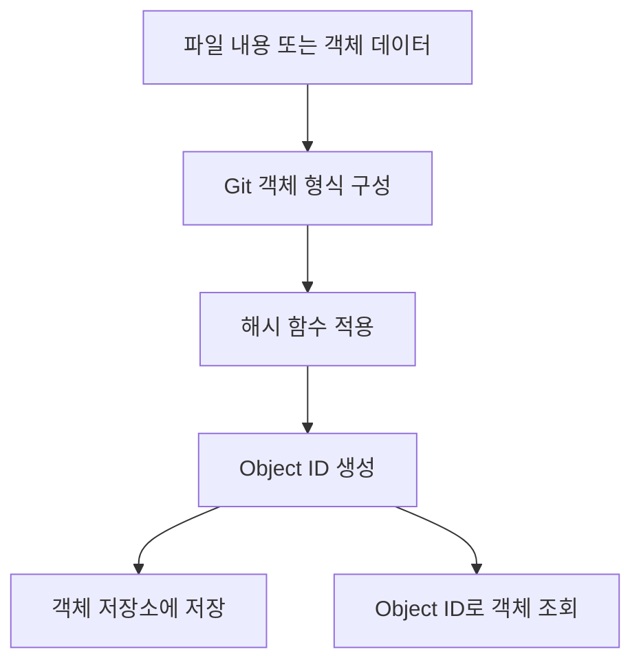

여기서 중요한 특징은 객체의 내용이 달라지면 일반적으로 Object ID도 달라진다는 점이다.

따라서 Git은 객체의 내용을 기준으로 데이터를 식별하고 참조할 수 있다.

이것이 Git Objects를 이해하는 출발점이다.

---

### Git은 왜 객체 기반 저장 구조를 사용할까?

Git이 객체 기반 저장 구조를 사용하는 이유는 단순히 파일을 저장하기 위해서가 아니다.

버전 관리 시스템에서 중요한 것은 다음 세 가지다.

첫 번째, 특정 시점의 프로젝트 상태를 복원할 수 있어야 한다.

두 번째, 변경되지 않은 데이터를 효율적으로 재사용할 수 있어야 한다.

세 번째, 여러 커밋 사이의 관계를 관리할 수 있어야 한다.

예를 들어 다음과 같은 프로젝트가 있다고 가정하자.

```text
project/
├── A.java
├── B.java
└── C.java
```

첫 번째 커밋에서는 모든 파일이 최초 버전이다.

```text
Commit 1

A.java → V1
B.java → V1
C.java → V1
```

두 번째 커밋에서는 `B.java`만 변경되었다.

```text
Commit 2

A.java → V1
B.java → V2
C.java → V1
```

이때 Git은 논리적으로 프로젝트 전체의 스냅샷을 기록한다.

하지만 변경되지 않은 파일 내용까지 매번 별도의 객체로 중복 저장할 필요는 없다.

기존 객체를 재사용하면 된다.

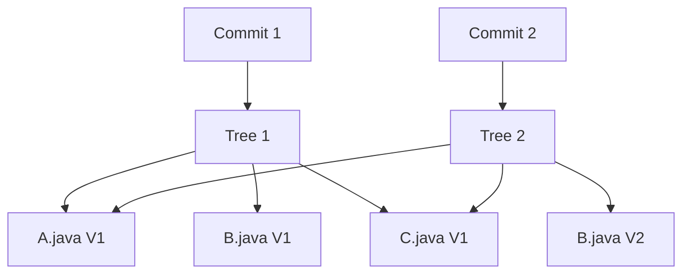

두 커밋은 서로 다른 스냅샷을 가진다.

하지만 변경되지 않은 `A.java`와 `C.java`의 내용 객체는 재사용할 수 있다.

이러한 구조 덕분에 Git은 프로젝트의 변경 이력을 효율적으로 관리할 수 있다.

---

### Git Objects의 종류

Git에는 네 가지 주요 객체 타입이 존재한다.

| 객체 | 역할 |
|---|---|
| Blob | 파일 내용 저장 |
| Tree | 디렉터리 구조와 파일 정보 저장 |
| Commit | 특정 시점의 스냅샷과 커밋 메타데이터 저장 |
| Tag | 객체에 대한 태그 정보 저장 |

이 중 Git의 일반적인 커밋 구조를 이해할 때 가장 중요한 객체는 세 가지다.

**Blob, Tree, Commit**이다.

각 객체의 관계는 다음과 같다.

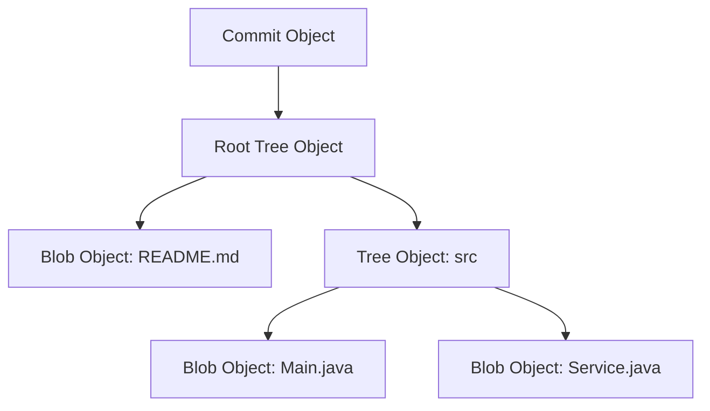

Commit은 Tree를 참조한다.

Tree는 Blob이나 다른 Tree를 참조한다.

Blob은 실제 파일 내용을 저장한다.

이 관계를 이해하면 Git이 프로젝트 전체를 어떻게 표현하는지 알 수 있다.

각 객체를 자세히 살펴보자.

---

### Blob: 파일 내용을 저장하는 객체

Blob은 Binary Large Object의 약자다.

Git에서 Blob은 파일의 내용 자체를 저장하는 객체다.

예를 들어 다음과 같은 파일이 있다고 가정하자.

`first.txt`

```text
우테코 최고
```

Git은 파일 내용을 Blob 객체로 저장할 수 있다.

이때 중요한 점이 있다.

**Blob에는 일반적으로 파일 이름이 포함되지 않는다.**

Blob은 다음 정보를 직접 관리하지 않는다.

- 파일 이름
- 디렉터리 경로
- 파일 실행 권한
- 파일 생성 시각
- 파일 수정 시각

Blob이 저장하는 것은 파일의 내용이다.

따라서 다음과 같은 두 파일이 있다고 가정하자.

```text
first.txt

copy.txt
```

두 파일의 내용이 완전히 동일하다.

```text
Hello Git
```

이 경우 두 파일은 같은 Blob 객체를 참조할 수 있다.

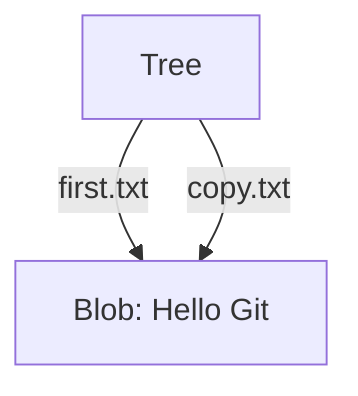

파일 이름은 서로 다르지만 내용이 동일하기 때문이다.

이것이 Git에서 파일 내용 객체를 재사용할 수 있는 이유다.

---

### Tree: 디렉터리 구조를 표현하는 객체

Blob은 파일 내용을 저장한다.

그렇다면 파일 이름과 디렉터리 구조는 어디에 저장할까?

이 역할을 담당하는 것이 Tree다.

Tree는 디렉터리를 표현하는 객체다.

Tree에는 다음과 같은 정보가 포함된다.

- 파일 또는 디렉터리 이름
- 파일 모드
- 참조하는 Git 객체의 식별자

예를 들어 다음과 같은 프로젝트 구조를 생각해 보자.

```text
project/
├── first.txt
└── mydir/
    └── second.txt
```

Git은 이 구조를 다음과 같이 표현할 수 있다.

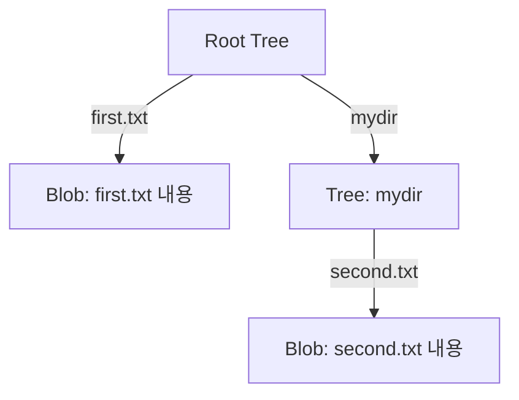

Root Tree는 두 개의 항목을 가지고 있다.

첫 번째는 `first.txt`의 Blob 객체다.

두 번째는 `mydir`을 표현하는 Tree 객체다.

그리고 `mydir` Tree는 `second.txt`의 Blob 객체를 참조한다.

이처럼 Tree는 다른 Tree를 참조할 수 있다.

따라서 Git은 중첩된 디렉터리 구조를 표현할 수 있다.

#### Tree가 관리하는 파일 모드

Tree에는 파일 모드도 포함된다.

대표적인 값은 다음과 같다.

| 모드 | 의미 |
|---|---|
| `100644` | 일반 파일 |
| `100755` | 실행 가능한 일반 파일 |
| `120000` | 심볼릭 링크 |
| `040000` | 디렉터리 |
| `160000` | Git Submodule의 Gitlink |

예를 들어 다음과 같은 결과를 확인할 수 있다.

```text
100644 blob <Object ID> first.txt
040000 tree <Object ID> mydir
```

여기서 첫 번째 열은 파일 모드다.

두 번째 열은 참조 객체의 타입이다.

세 번째 열은 참조 객체의 Object ID다.

마지막은 파일이나 디렉터리 이름이다.

즉 Tree는 파일 시스템의 디렉터리 구조를 Git 객체들 사이의 참조 관계로 표현한다.

---

### Commit: 특정 시점의 스냅샷을 나타내는 객체

Commit은 특정 시점의 프로젝트 상태와 관련된 정보를 기록하는 객체다.

Commit 객체에는 대표적으로 다음과 같은 정보가 포함된다.

| 정보 | 의미 |
|---|---|
| Tree | 해당 커밋의 최상위 디렉터리 스냅샷 |
| Parent | 부모 커밋 |
| Author | 변경 작업의 작성자 |
| Committer | 커밋을 생성한 사람 |
| Timestamp | 작성 및 커밋 시각 |
| Commit Message | 커밋 메시지 |

일반적인 Commit 객체는 다음과 같은 구조를 가진다.

```text
tree <Tree Object ID>
parent <Parent Commit ID>
author <Author> <Timestamp>
committer <Committer> <Timestamp>

Commit Message
```

여기서 중요한 부분은 다음과 같다.

```text
tree <Tree Object ID>
```

Commit 객체는 현재 프로젝트의 스냅샷을 표현하는 최상위 Tree 객체를 참조한다.

또 다음과 같은 정보도 가진다.

```text
parent <Parent Commit ID>
```

이를 통해 이전 커밋과 연결된다.

따라서 Commit 객체는 두 종류의 중요한 참조 관계를 형성한다.

첫 번째는 프로젝트의 파일 구조를 나타내는 Tree와의 관계다.

두 번째는 이전 Commit과의 관계다.

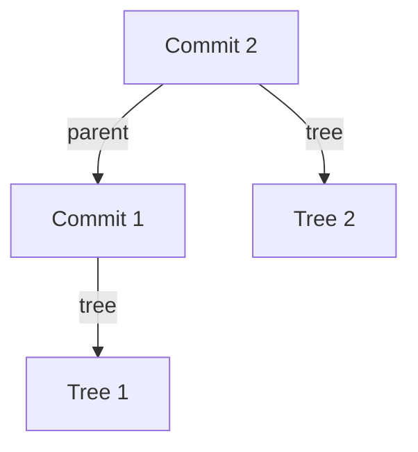

이러한 구조가 Git의 변경 이력 관리의 핵심이다.

---

### Git 저장소는 어떻게 구성될까?

이제 실제 Git 저장소를 생성해 보자.

먼저 새로운 디렉터리를 만든다.

```bash
mkdir git-objects-demo
```

해당 디렉터리로 이동한다.

```bash
cd git-objects-demo
```

Git 저장소를 초기화한다.

```bash
git init -b main
```

이 명령어는 `main`을 초기 브랜치 이름으로 사용하는 Git 저장소를 생성한다.

일반적인 저장소에서는 다음과 같은 구조가 만들어진다.

```text
git-objects-demo/
└── .git/
```

`.git` 디렉터리는 Git의 객체와 참조 정보, 설정 등을 관리하는 중요한 공간이다.

내부를 확인하면 다음과 같은 항목들을 볼 수 있다.

```text
.git/
├── HEAD
├── config
├── description
├── hooks/
├── info/
├── objects/
└── refs/
```

이 구조는 Git 버전이나 저장소 설정에 따라 조금씩 달라질 수 있다.

여기서 주요 항목을 살펴보자.

| 항목 | 역할 |
|---|---|
| `HEAD` | 현재 체크아웃한 위치를 나타내는 참조 |
| `config` | 저장소별 설정 |
| `objects/` | Git 객체 저장소 |
| `refs/` | 브랜치와 태그 등의 참조 정보 |
| `hooks/` | Git 동작과 연계되는 스크립트 |
| `index` | 다음 커밋의 스냅샷을 준비하는 Index |

`index`는 Staging 작업 과정에서 생성될 수 있다.

이번에는 `objects` 디렉터리를 중심으로 살펴본다.

```text
.git/objects/
```

이 디렉터리는 Git이 객체를 저장하는 기본 위치다.

Git 저장소를 초기화한 직후에는 아직 Commit 객체가 존재하지 않는다.

따라서 본격적인 객체 구조를 확인하려면 파일을 추가하고 커밋을 생성해야 한다.

---

### 예제

### 첫 번째 커밋: Blob, Tree, Commit 객체 생성

실제 Git 객체가 어떻게 만들어지는지 단계별로 살펴보자.

실습은 SHA-1 기반의 일반적인 Git 저장소를 기준으로 한다.

먼저 커밋 작성자 정보를 설정한다.

```bash
git config user.name "Git Demo"
```

```bash
git config user.email "git-demo@example.com"
```

이 설정은 현재 저장소에만 적용된다.

이제 첫 번째 파일을 생성한다.

```bash
printf '우테코 최고\n' > first.txt
```

파일의 내용은 다음과 같다.

```text
우테코 최고
```

이제 파일을 Staging Area에 추가한다.

```bash
git add first.txt
```

첫 번째 커밋을 생성한다.

```bash
git commit -m "Add first file"
```

이제 Git은 첫 번째 커밋을 기록했다.

그렇다면 내부에서는 어떤 객체들이 만들어졌을까?

일반적인 초기 저장소에서는 다음 세 객체가 생성된다.

1. `first.txt`의 내용을 저장하는 Blob
2. `first.txt`를 포함하는 Root Tree
3. Root Tree를 참조하는 Commit

구조는 다음과 같다.

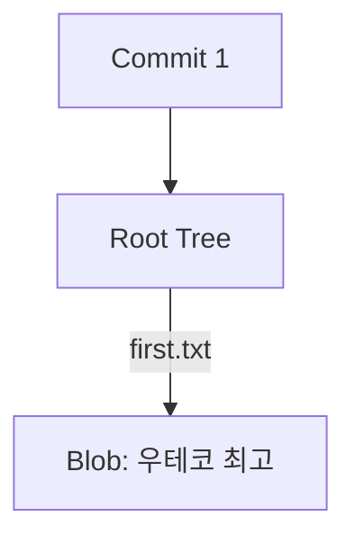

이제 각 객체를 실제 명령어로 확인해 보자.

---

#### 1. Git 객체 파일 확인

다음 명령어를 실행한다.

```bash
find .git/objects -type f
```

초기 저장소에서는 다음과 같은 형태로 객체 파일들이 나타날 수 있다.

```text
.git/objects/xx/xxxxxxxxxxxxxxxxxxxxxxxxxxxxxxxxxxxxxx
.git/objects/yy/yyyyyyyyyyyyyyyyyyyyyyyyyyyyyyyyyyyyyy
.git/objects/zz/zzzzzzzzzzzzzzzzzzzzzzzzzzzzzzzzzzzz
```

여기서 `xx`, `yy`, `zz`는 실제 객체 ID의 앞 두 글자를 나타내는 자리표시자다.

SHA-1 기반 Git 저장소의 Object ID는 40자리 16진수 문자열이다.

Git은 일반적인 Loose Object를 저장할 때 이 값을 다음과 같이 나눈다.

```text
앞의 2자리 → 디렉터리 이름

나머지 38자리 → 파일 이름
```

예를 들어 다음 Object ID가 있다고 가정하자.

```text
d128796a5a4b31c68f9647ce08ec451cbb550916
```

실제 객체 파일의 위치는 다음과 같다.

```text
.git/objects/d1/28796a5a4b31c68f9647ce08ec451cbb550916
```

이렇게 저장하는 이유는 객체 파일을 하나의 디렉터리에 모두 넣지 않고 여러 디렉터리로 분산하기 위해서다.

객체 수가 많아졌을 때 디렉터리 관리 부담을 줄이는 데 도움이 된다.

단, Git은 Packfile이라는 별도의 형식으로 객체들을 묶어서 저장할 수도 있다.

따라서 `.git/objects` 아래에 모든 객체가 각각 독립된 파일로 존재한다고 생각해서는 안 된다.

이 부분은 뒤에서 자세히 살펴본다.

---

#### 2. Commit 객체 확인

현재 커밋의 Object ID를 확인한다.

```bash
git rev-parse HEAD
```

실행 결과는 다음과 같은 형태다.

```text
<Commit Object ID>
```

이 값은 커밋 내용과 메타데이터에 따라 결정되므로 실제 환경마다 달라진다.

이제 다음 명령어를 실행한다.

```bash
git cat-file -t HEAD
```

`-t` 옵션은 객체의 타입을 확인한다.

실행 결과는 다음과 같다.

```text
commit
```

현재 HEAD가 Commit 객체를 가리키고 있다는 의미다.

이제 Commit 객체의 내용을 확인한다.

```bash
git cat-file -p HEAD
```

`-p` 옵션은 객체의 내용을 읽기 쉬운 형태로 출력한다.

다음과 같은 결과가 나타난다.

```text
tree <Tree Object ID>
author Git Demo <git-demo@example.com> <Timestamp>
committer Git Demo <git-demo@example.com> <Timestamp>

Add first file
```

여기서 첫 번째 줄을 살펴보자.

```text
tree <Tree Object ID>
```

현재 커밋이 참조하는 Tree 객체의 식별자다.

그리고 마지막 부분에는 커밋 메시지가 포함되어 있다.

```text
Add first file
```

여기서 한 가지 특징이 있다.

**첫 번째 커밋에는 일반적으로 parent 정보가 존재하지 않는다.**

아직 이전 커밋이 없기 때문이다.

이처럼 부모 커밋이 없는 최초 커밋을 Root Commit이라고 한다.

---

#### 3. Tree 객체 확인

이번에는 Commit이 참조하는 Tree를 확인해 보자.

다음 명령어를 실행한다.

```bash
git rev-parse HEAD^{tree}
```

이 명령어는 HEAD가 참조하는 Tree 객체의 Object ID를 출력한다.

객체 타입을 확인할 수도 있다.

```bash
git cat-file -t HEAD^{tree}
```

실행 결과는 다음과 같다.

```text
tree
```

이제 Tree 객체의 내용을 확인한다.

```bash
git cat-file -p HEAD^{tree}
```

앞서 작성한 파일 내용이 UTF-8이고 줄바꿈이 LF이며 파일 모드가 일반적인 `100644`라면 다음과 같은 결과를 확인할 수 있다.

```text
100644 blob d128796a5a4b31c68f9647ce08ec451cbb550916    first.txt
```

각 항목의 의미는 다음과 같다.

| 항목 | 의미 |
|---|---|
| `100644` | 일반 파일 모드 |
| `blob` | 참조 객체의 타입 |
| `d128796...` | Blob 객체의 Object ID |
| `first.txt` | 파일 이름 |

Tree에는 파일 이름과 Blob 객체의 식별자가 함께 저장된다.

따라서 Git은 파일의 이름과 내용 객체를 연결할 수 있다.

또 다음 명령어로도 Tree의 내용을 확인할 수 있다.

```bash
git ls-tree HEAD
```

이 명령어는 현재 커밋의 최상위 Tree 항목들을 출력한다.

---

#### 4. Blob 객체 확인

이번에는 `first.txt`의 Blob 객체를 확인한다.

파일 경로를 이용해 객체를 지정할 수 있다.

```bash
git rev-parse HEAD:first.txt
```

실행 결과는 다음과 같다.

```text
d128796a5a4b31c68f9647ce08ec451cbb550916
```

객체의 타입을 확인한다.

```bash
git cat-file -t HEAD:first.txt
```

결과는 다음과 같다.

```text
blob
```

이제 실제 내용을 출력한다.

```bash
git cat-file -p HEAD:first.txt
```

실행 결과는 다음과 같다.

```text
우테코 최고
```

여기서 중요한 점을 다시 확인할 수 있다.

Blob에는 `first.txt`라는 파일 이름이 저장되어 있지 않다.

파일의 내용이 저장되어 있다.

파일 이름은 Tree 객체에 포함된다.

따라서 Blob과 Tree는 서로 다른 책임을 가진다.

**Blob은 내용, Tree는 구조를 담당한다.**

---

### Git 객체의 해시값은 어떻게 생성될까?

지금까지 Git이 객체의 내용으로부터 해시값을 생성한다고 설명했다.

그렇다면 실제로 어떤 데이터를 해시 함수에 전달할까?

단순히 파일의 내용만 해싱할까?

정확히는 그렇지 않다.

Git은 객체 타입과 데이터 크기 정보를 포함하는 헤더를 구성한다.

그다음 해당 헤더와 실제 데이터를 결합한 값에 해시 함수를 적용한다.

일반적인 Blob 객체의 해시 계산 구조는 다음과 같다.

```text
blob <데이터의 바이트 크기>\0<실제 데이터>
```

여기서 `\0`은 Null Byte를 의미한다.

예를 들어 다음 파일을 생각해 보자.

```text
hello world
```

파일 내용이 `hello world`이고 마지막에 LF 줄바꿈이 포함되어 있다고 가정한다.

실제 데이터의 크기는 12바이트다.

```text
hello world\n
```

따라서 Git이 해시 계산에 사용하는 데이터는 개념적으로 다음과 같다.

```text
blob 12\0hello world\n
```

이 데이터에 SHA-1을 적용하면 다음 Object ID가 생성된다.

```text
3b18e512dba79e4c8300dd08aeb37f8e728b8dad
```

실제로 확인해 보자.

먼저 파일 내용을 직접 해싱한다.

```bash
printf 'hello world\n' | shasum -a 1
```

결과는 다음과 같다.

```text
22596363b3de40b06f981fb85d82312e8c0ed511
```

그런데 Git의 Blob 객체 ID와 다르다.

왜 그럴까?

Git은 파일 내용만 해싱하는 것이 아니라 객체 헤더까지 포함하기 때문이다.

이번에는 Git 객체 형식으로 해싱한다.

```bash
printf 'blob 12\0hello world\n' | shasum -a 1
```

결과는 다음과 같다.

```text
3b18e512dba79e4c8300dd08aeb37f8e728b8dad
```

Git의 객체 ID와 동일하다.

다음 명령어로도 확인할 수 있다.

```bash
printf 'hello world\n' | git hash-object --stdin
```

실행 결과는 다음과 같다.

```text
3b18e512dba79e4c8300dd08aeb37f8e728b8dad
```

이처럼 Git의 객체 ID는 객체 타입과 크기, 실제 데이터에 기반해 계산된다.

Git 공식 문서에서도 이러한 객체 헤더와 해시 계산 방식을 설명한다.

---

### 같은 내용인데 줄바꿈만 달라도 Object ID가 달라질까?

그렇다.

파일의 내용이 한 바이트라도 달라지면 해시 계산에 사용되는 입력값이 달라진다.

예를 들어 다음 두 명령어를 비교해 보자.

```bash
printf 'hello world' | git hash-object --stdin
```

```bash
printf 'hello world\n' | git hash-object --stdin
```

첫 번째는 줄바꿈이 없다.

두 번째는 마지막에 LF 줄바꿈이 존재한다.

따라서 서로 다른 Object ID가 생성된다.

이러한 특징은 Git에서 줄바꿈 설정이 중요한 이유와도 연결된다.

예를 들어 Windows와 Linux에서 줄바꿈을 다르게 처리하면 내용의 바이트 표현이 달라질 수 있다.

다만 Git은 `.gitattributes`나 `core.autocrlf` 등의 설정에 따라 Working Directory와 저장소 사이에서 줄바꿈 정규화를 수행할 수 있다.

따라서 실제 객체 ID를 확인할 때는 Working Directory의 바이트와 Git에 저장되는 정규화된 내용을 구분해야 한다.

---

### 두 번째 커밋: 새로운 디렉터리와 파일 추가

이제 두 번째 커밋을 생성해 보자.

현재 프로젝트 구조는 다음과 같다.

```text
git-objects-demo/
└── first.txt
```

이번에는 새로운 디렉터리를 만든다.

```bash
mkdir mydir
```

해당 디렉터리에 파일을 생성한다.

```bash
printf 'hello world\n' > mydir/second.txt
```

프로젝트 구조는 다음과 같이 변경된다.

```text
git-objects-demo/
├── first.txt
└── mydir/
    └── second.txt
```

변경 사항을 Staging한다.

```bash
git add mydir/second.txt
```

두 번째 커밋을 생성한다.

```bash
git commit -m "Add second file"
```

이제 내부 객체 구조가 어떻게 달라지는지 살펴보자.

---

#### 1. 두 번째 Commit 객체

다음 명령어를 실행한다.

```bash
git cat-file -p HEAD
```

다음과 같은 형태의 결과를 확인할 수 있다.

```text
tree <New Root Tree ID>
parent <First Commit ID>
author Git Demo <git-demo@example.com> <Timestamp>
committer Git Demo <git-demo@example.com> <Timestamp>

Add second file
```

첫 번째 커밋과 비교하면 새로운 항목이 추가되었다.

```text
parent <First Commit ID>
```

이것은 두 번째 커밋이 첫 번째 커밋을 부모로 참조한다는 의미다.

따라서 Git은 다음과 같은 이력을 표현할 수 있다.

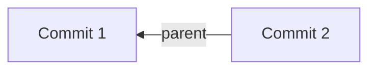

여기서 화살표 방향에 주의해야 한다.

Commit 객체는 자신의 부모 커밋을 참조한다.

즉 최신 Commit이 이전 Commit의 Object ID를 저장하는 구조다.

이러한 관계를 따라가면 이전 변경 이력을 확인할 수 있다.

---

#### 2. 두 번째 Root Tree

이번에는 Tree 객체를 확인한다.

```bash
git ls-tree HEAD
```

결과는 다음과 같은 형태다.

```text
100644 blob d128796a5a4b31c68f9647ce08ec451cbb550916    first.txt
040000 tree <mydir Tree ID>    mydir
```

이전과 비교하면 새로운 Tree 항목이 추가되었다.

```text
040000 tree <mydir Tree ID>    mydir
```

이것은 새로운 디렉터리인 `mydir`을 표현한다.

그런데 첫 번째 파일을 살펴보자.

```text
d128796a5a4b31c68f9647ce08ec451cbb550916
```

첫 번째 커밋에서 사용한 Blob 객체 ID와 동일하다.

왜 그럴까?

`first.txt`의 내용이 변경되지 않았기 때문이다.

따라서 새로운 Blob을 만들 필요가 없다.

기존 Blob을 그대로 참조하면 된다.

이것이 객체 재사용이다.

---

#### 3. mydir Tree 확인

다음 명령어를 실행한다.

```bash
git ls-tree HEAD:mydir
```

결과는 다음과 같다.

```text
100644 blob 3b18e512dba79e4c8300dd08aeb37f8e728b8dad    second.txt
```

여기서는 `second.txt`의 내용을 저장하는 Blob 객체를 확인할 수 있다.

Blob 내용을 출력한다.

```bash
git cat-file -p HEAD:mydir/second.txt
```

실행 결과는 다음과 같다.

```text
hello world
```

따라서 두 번째 커밋의 전체 구조는 다음과 같이 표현할 수 있다.

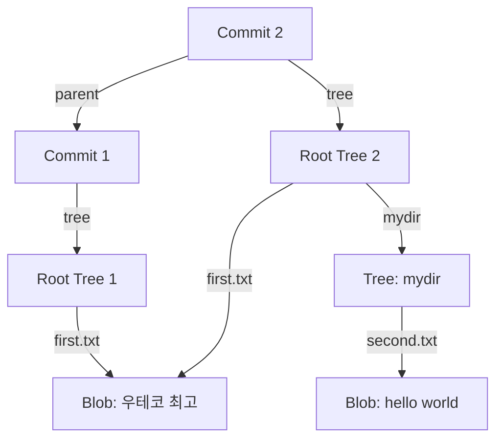

여기서 중요한 부분은 두 Root Tree가 동일한 Blob을 참조한다는 사실이다.

첫 번째 커밋에서 생성한 `first.txt`의 Blob 객체를 두 번째 커밋에서도 재사용하고 있다.

따라서 **Git은 새 커밋을 생성하더라도 변경되지 않은 파일 내용을 다시 저장할 필요가 없다.**

---

### 세 번째 커밋: 기존 파일 수정

이번에는 기존 파일을 수정해 보자.

현재 `first.txt`의 내용은 다음과 같다.

```text
우테코 최고
```

여기에 새로운 줄을 추가한다.

```bash
printf 'Hello git\n' >> first.txt
```

파일의 내용은 다음과 같이 변경된다.

```text
우테코 최고
Hello git
```

변경 사항을 Staging한다.

```bash
git add first.txt
```

세 번째 커밋을 생성한다.

```bash
git commit -m "Update first file"
```

이제 세 번째 커밋의 객체 구조를 확인해 보자.

---

#### 1. 세 번째 Commit 객체

다음 명령어를 실행한다.

```bash
git cat-file -p HEAD
```

다음과 같은 결과가 나타난다.

```text
tree <Third Root Tree ID>
parent <Second Commit ID>
author Git Demo <git-demo@example.com> <Timestamp>
committer Git Demo <git-demo@example.com> <Timestamp>

Update first file
```

이번에도 Parent Commit이 존재한다.

두 번째 커밋을 부모로 참조한다.

따라서 커밋 관계는 다음과 같다.

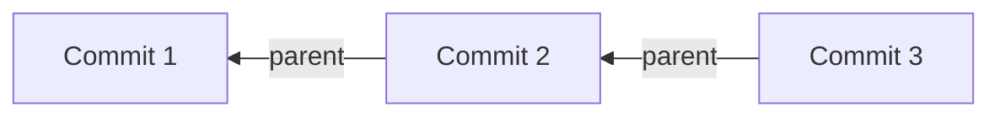

이러한 구조로 Git의 변경 이력이 연결된다.

---

#### 2. 세 번째 Root Tree 확인

이제 다음 명령어를 실행한다.

```bash
git ls-tree HEAD
```

결과는 다음과 같은 형태다.

```text
100644 blob 582e9c111ad17c74077387a3232c60ec7d3da782    first.txt
040000 tree <mydir Tree ID>    mydir
```

여기서 주목할 부분은 `first.txt`의 Blob ID다.

첫 번째와 두 번째 커밋에서는 다음 객체를 사용했다.

```text
d128796a5a4b31c68f9647ce08ec451cbb550916
```

하지만 세 번째 커밋에서는 다음 객체를 사용한다.

```text
582e9c111ad17c74077387a3232c60ec7d3da782
```

Object ID가 달라졌다.

파일의 내용이 변경되었기 때문이다.

반면 `mydir`을 표현하는 Tree는 변경되지 않았다.

따라서 기존 Tree 객체를 그대로 재사용할 수 있다.

이러한 관계를 그림으로 표현하면 다음과 같다.

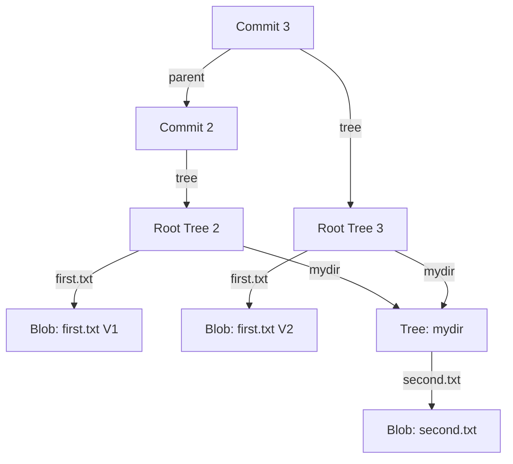

세 번째 커밋에서 달라진 부분은 다음과 같다.

- 새로운 Commit 객체가 생성되었다.
- 새로운 Root Tree 객체가 생성되었다.
- 수정된 `first.txt`의 새로운 Blob 객체가 생성되었다.
- 변경되지 않은 `mydir` Tree는 재사용되었다.
- `second.txt`의 Blob도 재사용되었다.

이것이 Git의 스냅샷 저장 구조다.

---

### 세 번의 커밋에서 생성된 객체 정리

지금까지 세 번의 커밋을 생성했다.

이 과정을 객체 관점에서 정리해 보자.

| 구분 | Commit | Root Tree | 하위 Tree | Blob |
|---|---|---|---|---|
| 첫 번째 커밋 | 신규 | 신규 | 없음 | first.txt V1 신규 |
| 두 번째 커밋 | 신규 | 신규 | mydir 신규 | second.txt 신규 |
| 세 번째 커밋 | 신규 | 신규 | mydir 재사용 | first.txt V2 신규 |

각 커밋에서 새롭게 생성되는 객체와 기존 객체를 구분하면 다음과 같다.

```text
Commit 1
├── Commit 1
├── Root Tree 1
└── Blob: first.txt V1

Commit 2
├── Commit 2
├── Root Tree 2
├── Tree: mydir
├── Blob: second.txt
└── Blob: first.txt V1 재사용

Commit 3
├── Commit 3
├── Root Tree 3
├── Blob: first.txt V2
├── Tree: mydir 재사용
└── Blob: second.txt 재사용
```

이 예제의 기본적인 SHA-1 저장소에서 생성되는 고유한 Git 객체는 다음과 같다.

| 객체 유형 | 고유 객체 수 |
|---|---:|
| Commit | 3 |
| Tree | 4 |
| Blob | 3 |
| 합계 | 10 |

여기서 주의할 점이 있다.

이것은 세 번의 커밋을 생성하면서 필요한 객체만을 기준으로 계산한 결과다.

실제 저장소에는 다른 작업으로 생성한 객체나 추가적인 메타데이터가 존재할 수 있다.

또 Git의 객체 저장 최적화에 따라 물리적인 파일 개수는 달라질 수 있다.

중요한 것은 **커밋의 수와 실제 저장된 Blob 객체의 수가 반드시 비례하지 않는다는 사실**이다.

변경되지 않은 파일은 기존 Blob을 재사용할 수 있기 때문이다.

---

### 구조

### Git은 객체를 어떻게 저장할까?

Git 객체의 저장 구조를 조금 더 자세히 살펴보자.

Git의 기본적인 Loose Object는 다음과 같은 과정을 거쳐 저장된다.

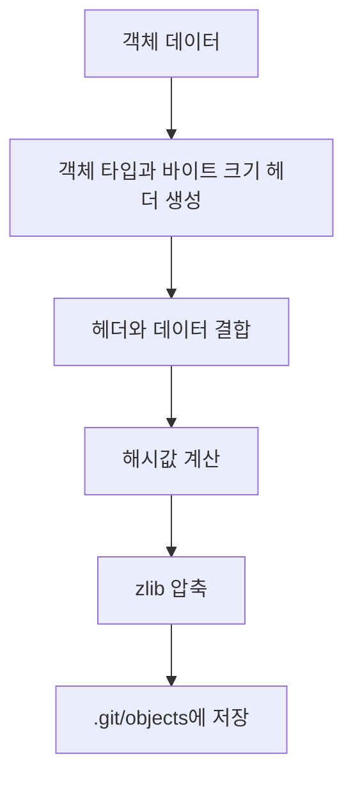

예를 들어 다음 Blob 데이터가 있다고 가정하자.

```text
hello world
```

이때 실제 해시 계산에 사용하는 데이터는 다음과 같다.

```text
blob 12\0hello world\n
```

Git은 이 데이터를 기준으로 Object ID를 계산한다.

그리고 객체 데이터를 zlib으로 압축해 저장한다.

여기서 중요한 차이가 있다.

**객체의 해시값은 압축된 데이터에 대해 계산하는 것이 아니라 압축 전 객체 데이터에 대해 계산한다.**

따라서 저장 방식이 바뀌더라도 논리적인 객체 내용이 같다면 Object ID를 유지할 수 있다.

Git 공식 객체 저장 형식 문서에서도 객체의 타입과 크기를 포함한 데이터에 대해 해시값을 계산하고, 이를 압축해 저장하는 구조를 설명한다.

---

### Loose Object란 무엇인가?

Loose Object는 Git 객체를 각각 독립된 파일로 저장하는 방식이다.

예를 들어 다음과 같은 구조다.

```text
.git/
└── objects/
    ├── d1/
    │   └── 28796a5a4b31c68f9647ce08ec451cbb550916
    ├── 3b/
    │   └── 18e512dba79e4c8300dd08aeb37f8e728b8dad
    └── 58/
        └── 2e9c111ad17c74077387a3232c60ec7d3da782
```

각 파일은 특정 Git 객체를 나타낸다.

다만 객체 파일을 직접 `cat`으로 출력한다고 사람이 읽을 수 있는 텍스트가 나오는 것은 아니다.

Loose Object는 압축되어 있기 때문이다.

따라서 객체 내용을 확인할 때는 다음 명령어를 사용한다.

```bash
git cat-file -p <Object ID>
```

객체 타입을 확인하려면 다음과 같이 사용한다.

```bash
git cat-file -t <Object ID>
```

객체의 압축 전 데이터 크기를 확인하려면 다음 명령어를 사용한다.

```bash
git cat-file -s <Object ID>
```

예를 들어 첫 번째 Blob 객체의 크기를 확인할 수 있다.

```bash
git cat-file -s HEAD~2:first.txt
```

앞서 사용한 UTF-8과 LF 기준의 파일이라면 결과는 다음과 같다.

```text
17
```

여기서 파일 내용은 다음과 같다.

```text
우테코 최고
```

문자 수와 바이트 수는 다르다.

UTF-8에서 한글은 일반적으로 한 글자가 3바이트를 사용한다.

그리고 공백과 줄바꿈도 바이트를 차지한다.

따라서 실제 데이터 크기는 17바이트가 된다.

---

### Packfile이란 무엇인가?

Git 저장소에 객체가 많아지면 어떻게 될까?

모든 객체를 각각 별도의 파일로 저장한다면 파일 개수가 매우 많아질 수 있다.

이러한 문제를 개선하기 위해 Git은 Packfile이라는 저장 형식을 사용한다.

Packfile은 여러 Git 객체를 하나의 파일로 묶어서 저장하는 방식이다.

일반적인 구조는 다음과 같다.

```text
.git/
└── objects/
    └── pack/
        ├── pack-xxxxxxxx.pack
        └── pack-xxxxxxxx.idx
```

여기서 각 파일의 역할은 다음과 같다.

| 파일 | 역할 |
|---|---|
| `.pack` | 여러 Git 객체의 데이터를 저장 |
| `.idx` | Packfile 내부 객체를 빠르게 찾기 위한 인덱스 |

Packfile을 사용하면 다수의 객체를 효율적으로 관리할 수 있다.

또 Git은 Packfile 내부에서 Delta Compression을 활용할 수 있다.

---

### Delta Compression이란 무엇인가?

앞서 Git은 수정된 파일의 새로운 Blob 객체를 만든다고 설명했다.

예를 들어 다음 두 파일이 있다고 가정하자.

첫 번째 버전이다.

```text
Hello Git
```

두 번째 버전이다.

```text
Hello Git
Welcome
```

두 버전은 대부분의 내용이 동일하다.

하지만 Git의 논리적인 객체 모델에서는 서로 다른 Blob이다.

그렇다면 저장 공간을 효율적으로 활용하기 위해 변경된 부분만 저장할 수는 없을까?

Git은 Packfile에서 이러한 최적화를 수행할 수 있다.

이를 Delta Compression이라고 한다.

개념적으로 다음과 같다.

```text
Blob V1

Hello Git
```

```text
Blob V2

V1을 기준으로

"Welcome" 줄 추가
```

이처럼 한 객체를 다른 객체를 기준으로 표현하면 중복된 데이터의 저장 비용을 줄일 수 있다.

다만 중요한 점이 있다.

**Git의 논리적인 객체 모델과 실제 디스크 저장 방식은 서로 구분해야 한다.**

논리적으로는 두 버전이 별도의 Blob 객체다.

물리적으로는 Packfile에서 Delta Compression을 적용해 저장 공간을 최적화할 수 있다.

이 차이를 이해하면 다음 두 설명이 모순되지 않는다는 사실을 알 수 있다.

첫 번째 설명은 다음과 같다.

> Git은 파일이 변경되면 새로운 Blob 객체를 만든다.

두 번째 설명은 다음과 같다.

> Git은 변경된 부분을 활용해 저장 공간을 최적화할 수 있다.

첫 번째는 객체 모델에 대한 설명이다.

두 번째는 물리적인 저장 최적화에 대한 설명이다.

Git 공식 문서에서도 Loose Object와 Packfile, Delta Compression의 관계를 설명한다.

---

### git gc는 무엇을 할까?

Git은 저장소의 객체를 정리하고 최적화하는 기능을 제공한다.

대표적인 명령어가 다음과 같다.

```bash
git gc
```

`gc`는 Garbage Collection을 의미한다.

Git은 이 작업을 통해 필요에 따라 객체를 Packfile로 묶거나 불필요한 데이터를 정리할 수 있다.

현재 객체 저장 상태를 확인하려면 다음 명령어를 사용할 수 있다.

```bash
git count-objects -v
```

출력에는 다음과 같은 정보가 포함될 수 있다.

```text
count: ...
size: ...
in-pack: ...
packs: ...
size-pack: ...
```

주요 항목의 의미는 다음과 같다.

| 항목 | 의미 |
|---|---|
| `count` | Loose Object 개수 |
| `size` | Loose Object가 차지하는 공간 |
| `in-pack` | Packfile에 포함된 객체 수 |
| `packs` | Packfile 개수 |
| `size-pack` | Packfile 관련 저장 공간 |

저장소가 커졌다고 해서 무조건 `git gc`를 수동으로 실행해야 하는 것은 아니다.

Git은 필요한 상황에서 자동 유지보수 작업을 수행할 수 있다.

또 Garbage Collection은 도달 불가능한 객체의 보존 상태에 영향을 줄 수 있다.

따라서 실수로 삭제한 커밋이나 객체를 복구해야 하는 상황이라면 객체 정리 작업을 신중하게 수행해야 한다.

---

### Git은 커밋을 어떻게 연결할까?

지금까지 Commit 객체가 Parent Commit을 참조한다는 사실을 살펴봤다.

이러한 구조는 Git의 커밋 그래프를 이해하는 데 중요하다.

예를 들어 다음과 같은 이력이 있다고 가정하자.

```text
Commit A
    ↓
Commit B
    ↓
Commit C
```

각 Commit 객체는 자신의 부모 커밋을 참조한다.

이를 실제 참조 방향으로 표현하면 다음과 같다.

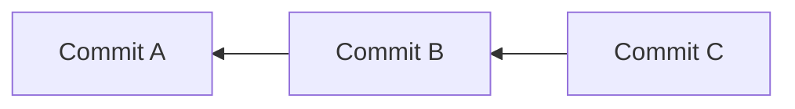

이 구조는 방향성이 있고 순환되지 않는 그래프로 표현할 수 있다.

이를 DAG(Directed Acyclic Graph)라고 한다.

Git은 이러한 커밋 간 참조 관계를 기반으로 변경 이력을 관리한다.

여기서 브랜치도 함께 이해할 필요가 있다.

---

### Branch는 Git Object일까?

Git에서 브랜치는 매우 자주 사용하는 개념이다.

예를 들어 다음과 같다.

```bash
git switch -c feature/order
```

이 명령어는 새로운 브랜치를 생성하고 해당 브랜치로 전환한다.

그렇다면 브랜치도 Blob이나 Tree, Commit처럼 별도의 Git Object일까?

일반적으로 그렇지 않다.

**브랜치는 특정 Commit을 가리키는 참조(Reference)다.**

예를 들어 다음과 같은 이력이 있다고 가정하자.

```text
A --- B --- C
            ↑
           main
```

`main`은 Commit C를 가리킨다.

여기서 새로운 브랜치를 생성한다.

```bash
git switch -c feature/order
```

이제 다음과 같이 표현할 수 있다.

```text
A --- B --- C
            ↑
           main
            ↑
       feature/order
```

새 브랜치에서 Commit D를 생성하면 다음과 같이 변경된다.

```text
A --- B --- C
            │
            └── D
                ↑
           feature/order
```

여기서 Commit D는 Git Object다.

하지만 `feature/order` 브랜치는 Commit D의 Object ID를 가리키는 참조다.

이 차이가 중요하다.

**Git Object는 내용 기반 식별자를 가진 데이터 객체이고, 브랜치는 이동 가능한 참조다.**

따라서 브랜치가 새로운 커밋을 가리키도록 변경되더라도 기존 Commit 객체의 내용이 수정되는 것은 아니다.

---

### HEAD는 Git Object일까?

HEAD 역시 Git Object가 아니다.

HEAD는 현재 체크아웃한 위치를 나타내는 특별한 참조다.

일반적인 브랜치 상태에서는 다음과 같은 구조를 가진다.

```text
HEAD
  ↓
main
  ↓
Commit C
```

실제 저장소에서 확인해 보자.

```bash
cat .git/HEAD
```

일반적인 `main` 브랜치에서는 다음과 같은 결과가 나타난다.

```text
ref: refs/heads/main
```

즉 HEAD는 현재 브랜치를 가리키고 있다.

브랜치는 특정 Commit의 Object ID를 가리킨다.

이 구조를 이해하면 다음 명령어의 의미도 설명할 수 있다.

```bash
git rev-parse HEAD
```

현재 HEAD를 따라가서 Commit 객체의 Object ID를 확인하는 것이다.

다만 Detached HEAD 상태에서는 HEAD가 브랜치가 아니라 Commit을 직접 가리킬 수 있다.

따라서 HEAD와 Branch Reference, Commit Object는 서로 구분해야 한다.

---

### git commit --amend를 실행하면 왜 커밋 ID가 달라질까?

Git Objects를 이해했다면 자주 사용하는 명령어의 동작 원리도 설명할 수 있다.

대표적인 예가 다음 명령어다.

```bash
git commit --amend
```

이 명령어는 마지막 커밋을 수정할 때 사용한다.

예를 들어 다음 커밋이 있다고 가정하자.

```text
Commit A

Message: Add payment servcie
```

메시지에 오탈자가 있다.

이를 수정하고 싶다.

```bash
git commit --amend -m "Add payment service"
```

이렇게 하면 새로운 커밋 메시지가 적용된다.

그런데 한 가지 문제가 발생한다.

**커밋 메시지만 수정했는데 Commit ID까지 달라진다.**

왜 그럴까?

그 이유는 Git의 Commit 객체가 불변적인 내용 기반 객체이기 때문이다.

---

#### Commit ID는 Commit 객체의 내용을 기반으로 계산된다

Commit 객체에는 다음과 같은 정보가 포함된다.

```text
tree <Tree ID>
parent <Parent Commit ID>
author <Author>
committer <Committer>

Commit Message
```

여기서 커밋 메시지는 Commit 객체의 내용이다.

따라서 커밋 메시지를 변경하면 Commit 객체의 내용이 달라진다.

객체의 내용이 달라지면 Object ID도 달라진다.

예를 들어 다음과 같이 생각할 수 있다.

```text
Original Commit

Message: Add payment servcie

Commit ID: AAA
```

수정 이후에는 다음과 같다.

```text
New Commit

Message: Add payment service

Commit ID: BBB
```

두 객체는 서로 다른 Commit 객체다.

Git이 기존 Commit 객체의 내용을 직접 수정하는 것이 아니다.

**기존 커밋을 대신할 새로운 Commit 객체를 생성하는 것이다.**

이러한 동작을 그림으로 표현하면 다음과 같다.

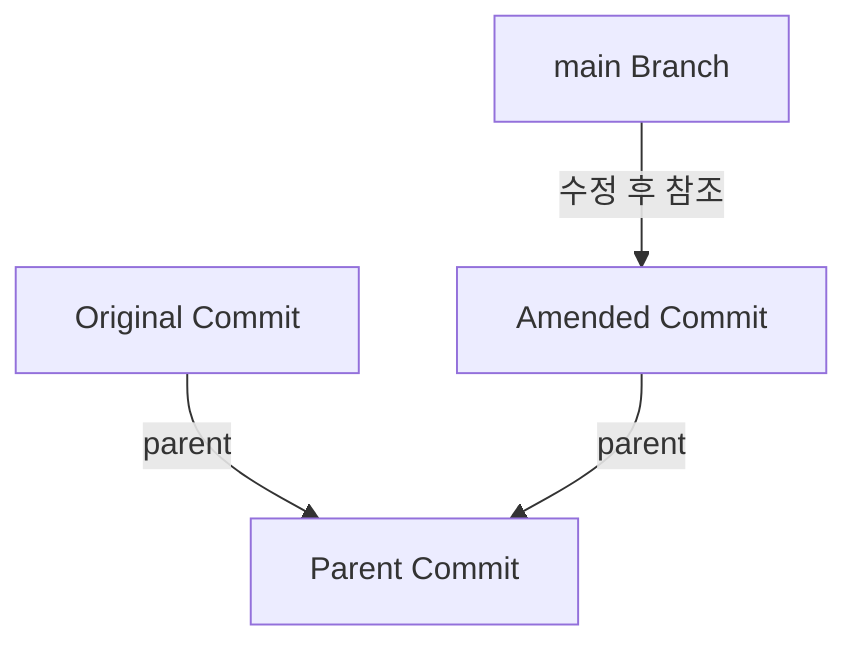

원래 Commit과 수정된 Commit은 같은 부모를 가질 수 있다.

하지만 커밋 메시지나 메타데이터가 달라졌으므로 서로 다른 Object ID를 가진다.

브랜치는 새롭게 생성된 Commit을 가리키도록 변경된다.

---

### amend를 실행하면 Tree 객체도 변경될까?

반드시 그렇지는 않다.

예를 들어 커밋 메시지만 수정했다고 가정하자.

파일의 내용과 디렉터리 구조는 그대로다.

따라서 Tree 객체는 동일할 수 있다.

```text
Original Commit
├── Tree A
├── Parent P
└── Message A
```

```text
Amended Commit
├── Tree A
├── Parent P
└── Message B
```

두 Commit은 같은 Tree를 참조한다.

하지만 커밋 메시지가 다르므로 Commit ID는 달라진다.

실제로 다음과 같이 확인할 수 있다.

먼저 기존 커밋 ID를 저장한다.

```bash
BEFORE=$(git rev-parse HEAD)
```

커밋 메시지를 수정한다.

```bash
git commit --amend -m "Update first file - corrected"
```

새로운 커밋 ID를 저장한다.

```bash
AFTER=$(git rev-parse HEAD)
```

두 값을 출력한다.

```bash
echo "$BEFORE"
```

```bash
echo "$AFTER"
```

일반적으로 서로 다른 Commit ID가 나타난다.

이제 두 커밋의 Tree를 비교한다.

```bash
git rev-parse "${BEFORE}^{tree}"
```

```bash
git rev-parse "${AFTER}^{tree}"
```

커밋 메시지만 변경했고 파일 스냅샷이 동일하다면 두 Tree ID는 같다.

따라서 다음 관계가 성립한다.

```text
Commit ID

서로 다름
```

```text
Tree ID

동일함
```

이것이 Git Objects를 이해하면 알 수 있는 중요한 특징이다.

---

### amend를 실행한 커밋을 Push할 때 주의해야 하는 이유

이제 다음 상황을 생각해 보자.

원격 저장소에 이미 Commit C를 Push했다.

```text
Remote

A --- B --- C
```

로컬에서도 동일한 이력을 가지고 있다.

```text
Local

A --- B --- C
```

그런데 로컬에서 다음 명령어를 실행했다.

```bash
git commit --amend
```

그러면 기존 Commit C를 대신하는 새로운 Commit D가 생성된다.

```text
Local

A --- B --- D
```

하지만 원격 저장소는 여전히 Commit C를 가리키고 있다.

```text
Remote

A --- B --- C
```

두 커밋은 서로 다른 객체다.

따라서 단순히 일반적인 Push를 실행하면 Non-Fast-Forward 오류가 발생할 수 있다.

왜냐하면 로컬 브랜치의 새로운 끝 커밋이 원격의 기존 끝 커밋을 부모 이력으로 포함하지 않기 때문이다.

이 문제를 해결하기 위해 강제 Push를 사용할 수 있지만 주의해야 한다.

```bash
git push --force-with-lease origin feature/order
```

`--force-with-lease`는 알고 있는 원격 참조 상태를 확인해 예기치 않은 변경을 덮어쓰는 위험을 줄이는 옵션이다.

하지만 이미 다른 개발자가 사용하고 있는 커밋의 이력을 변경하는 문제까지 자동으로 해결해 주지는 않는다.

따라서 다음과 같이 구분하는 것이 좋다.

| 상황 | 권장 방식 |
|---|---|
| 아직 Push하지 않은 커밋 | amend 활용 가능 |
| 개인 브랜치의 커밋 | 협업 상황 확인 후 amend 고려 |
| 여러 개발자가 공유한 커밋 | 이력 변경 신중히 검토 |
| 공용 브랜치의 잘못된 변경 취소 | `git revert` 우선 고려 |

핵심은 `amend`가 기존 Commit 객체를 수정하는 명령어가 아니라 **새로운 Commit 객체를 만들어 브랜치의 참조를 변경하는 작업**이라는 점이다.

---

### 추가 심화

### SHA-1과 SHA-256의 차이

Git의 Object ID를 설명할 때 SHA-1을 자주 사용한다.

전통적인 Git 저장소에서는 SHA-1 기반 객체 식별자를 사용한다.

SHA-1의 출력 길이는 160비트다.

이를 16진수로 표현하면 40자리 문자열이 된다.

```text
d128796a5a4b31c68f9647ce08ec451cbb550916
```

하지만 Git이 항상 SHA-1만 사용하는 것은 아니다.

Git은 SHA-256 객체 형식도 지원한다.

SHA-256은 256비트의 해시값을 생성한다.

16진수로 표현하면 64자리 문자열이다.

| 구분 | SHA-1 | SHA-256 |
|---|---|---|
| 해시 길이 | 160비트 | 256비트 |
| 16진수 표현 | 40자리 | 64자리 |
| 전통적인 Git 저장소 | 사용 | 별도 형식으로 지원 |
| 해시 충돌 저항성 | 현대 보안 기준에서 한계 존재 | SHA-1보다 강한 충돌 저항성 |

현재 저장소의 객체 형식을 확인할 수 있다.

```bash
git rev-parse --show-object-format
```

일반적인 SHA-1 저장소에서는 다음과 같이 출력된다.

```text
sha1
```

SHA-256 저장소를 새로 생성하려면 지원되는 Git 환경에서 다음과 같이 실행할 수 있다.

```bash
git init --object-format=sha256
```

다만 SHA-256 형식 저장소를 사용할 때는 Git 클라이언트와 원격 서버의 호환성을 확인해야 한다.

또 한 가지 중요한 점이 있다.

해시 기반 식별자가 있다고 해서 충돌이 수학적으로 불가능한 것은 아니다.

Git은 해시값을 객체 식별에 사용하지만, 해시 함수의 충돌 가능성과 보안 특성은 별도로 고려해야 한다.

---

### Git Object는 정말 변경할 수 없을까?

Git의 객체는 내용으로부터 Object ID를 계산한다.

따라서 기존 객체의 내용을 변경한다면 더 이상 기존 Object ID와 일치하지 않게 된다.

이러한 특성 때문에 Git Object는 논리적으로 불변 객체로 다루어진다.

예를 들어 다음 Commit 객체가 있다고 가정하자.

```text
Commit A

Tree: T1

Message: First commit
```

커밋 메시지를 변경하면 새로운 Commit 객체가 필요하다.

```text
Commit B

Tree: T1

Message: Updated commit
```

즉 객체의 내용 자체를 수정하기보다 새로운 객체를 생성하고 참조를 변경하는 방식이다.

여기서 중요한 구분이 있다.

**Git Object는 불변적으로 관리되지만 Git의 모든 정보가 불변인 것은 아니다.**

예를 들어 브랜치 참조는 변경될 수 있다.

```text
main → Commit A
```

새로운 커밋을 생성하면 다음과 같이 변경된다.

```text
main → Commit B
```

이때 Commit A와 Commit B는 별도의 객체다.

하지만 `main`이라는 참조가 가리키는 대상은 바뀐다.

이러한 구조 덕분에 Git은 객체의 내용 기반 식별 방식을 유지하면서 브랜치를 자유롭게 이동할 수 있다.

---

### Tag 객체는 무엇일까?

지금까지 Blob, Tree, Commit을 중심으로 살펴봤다.

하지만 Git에는 네 번째 객체 타입인 Tag도 존재한다.

Git에서 태그는 특정 시점의 버전을 식별하기 위해 자주 사용한다.

대표적으로 두 종류가 있다.

첫 번째는 Lightweight Tag다.

두 번째는 Annotated Tag다.

#### Lightweight Tag

Lightweight Tag는 특정 Git 객체를 가리키는 참조다.

예를 들어 다음과 같다.

```bash
git tag v1.0.0-light
```

이 태그는 일반적으로 현재 Commit을 가리키는 참조를 생성한다.

별도의 Annotated Tag 객체를 생성하지 않는다.

#### Annotated Tag

Annotated Tag는 태그 정보를 저장하는 별도의 Tag 객체를 생성한다.

예를 들어 다음과 같다.

```bash
git tag -a v1.0.0 -m "First production release"
```

이제 태그 객체의 타입을 확인할 수 있다.

```bash
git cat-file -t refs/tags/v1.0.0
```

실행 결과는 다음과 같다.

```text
tag
```

태그 객체의 내용을 확인한다.

```bash
git cat-file -p refs/tags/v1.0.0
```

다음과 같은 형태가 나타난다.

```text
object <Commit Object ID>
type commit
tag v1.0.0
tagger Git Demo <git-demo@example.com> <Timestamp>

First production release
```

여기서 Annotated Tag는 Commit을 참조한다.

또 태그 이름과 작성자, 메시지 등을 저장한다.

따라서 구조는 다음과 같다.

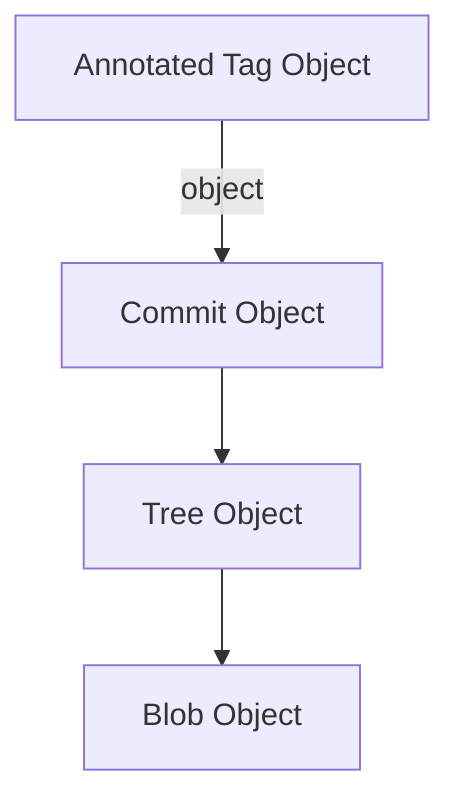

이러한 Tag 객체는 운영 환경의 릴리스 버전을 식별할 때 활용할 수 있다.

예를 들어 다음과 같은 버전 관리에 사용할 수 있다.

```text
v1.0.0

v1.1.0

v2.0.0
```

단, 태그 자체가 배포나 릴리스를 자동으로 수행하는 것은 아니다.

CI/CD 파이프라인과 연결해야 해당 태그를 기준으로 빌드하거나 배포하는 등의 작업을 수행할 수 있다.

Git의 공식 데이터 모델 문서에서도 네 가지 객체 타입과 Reference의 차이를 설명한다.

---

### 실무에서의 활용

### Git Objects의 동작 원리를 활용한 12가지 실무 전략

Git Objects를 이해하면 단순히 내부 구조를 설명하는 것에서 그치지 않는다.

실제로 Git에서 문제가 발생했을 때 원인을 더 정확하게 분석할 수 있다.

또 커밋 관리와 브랜치 전략, 저장소 최적화, 데이터 복구 등에 활용할 수 있다.

#### 1. 특정 커밋이 어떤 파일을 저장하고 있는지 확인한다

특정 커밋의 파일 구조를 확인하고 싶다면 다음 명령어를 사용할 수 있다.

```bash
git ls-tree <Commit ID>
```

하위 디렉터리까지 재귀적으로 확인하려면 다음과 같이 작성한다.

```bash
git ls-tree -r <Commit ID>
```

예를 들어 다음과 같은 결과를 확인할 수 있다.

```text
100644 blob <Blob ID> src/main/java/OrderService.java
100644 blob <Blob ID> src/main/java/PaymentService.java
```

이 명령어는 특정 커밋에서 어떤 파일이 어떤 Blob 객체를 참조하는지 확인할 수 있도록 한다.

따라서 현재 Working Directory의 파일 상태와 관계없이 과거 커밋의 파일 구조를 분석할 수 있다.

---

#### 2. 특정 파일의 과거 내용을 직접 확인한다

특정 커밋에 저장된 파일의 내용을 확인할 수도 있다.

예를 들어 다음과 같다.

```bash
git show <Commit ID>:src/main/java/OrderService.java
```

이 명령어는 해당 커밋에 기록된 파일 내용을 출력한다.

현재 Working Directory의 파일을 변경하지 않는다.

또 Blob 객체를 직접 확인할 수도 있다.

```bash
git cat-file -p <Blob ID>
```

이 방식은 장애가 발생한 시점의 코드와 현재 코드를 비교하거나 특정 기능이 언제 변경되었는지 분석할 때 유용하다.

---

#### 3. 파일 이름만 변경했는데 Blob ID는 그대로일 수 있다

다음과 같은 파일이 있다고 가정하자.

```text
OrderService.java
```

파일 이름을 변경한다.

```bash
git mv OrderService.java OrderApplicationService.java
```

파일의 내용은 변경하지 않았다.

이 경우 새로운 Tree에서는 파일 이름이 달라진다.

하지만 Blob의 내용은 동일하므로 기존 Blob 객체를 재사용할 수 있다.

```text
Before

OrderService.java → Blob A
```

```text
After

OrderApplicationService.java → Blob A
```

즉 파일 이름이 달라졌다고 반드시 새로운 Blob이 필요한 것은 아니다.

이것은 Blob이 파일 이름을 저장하지 않기 때문이다.

여기서 중요한 사실이 하나 더 있다.

Git은 파일의 이름 변경 이력을 별도의 영구적인 Rename Object로 저장하지 않는다.

일반적으로 두 버전을 비교할 때 파일 내용의 유사성을 분석해 이름 변경을 감지한다.

예를 들어 다음 명령어를 사용할 수 있다.

```bash
git diff -M HEAD~1 HEAD
```

`-M`은 Rename Detection을 활성화하는 옵션이다.

이러한 구조를 이해하면 파일 이름 변경과 내용 변경을 별도의 관점에서 분석할 수 있다.

---

#### 4. Git은 빈 디렉터리를 일반적인 파일 구조처럼 추적하지 않는다

다음과 같은 디렉터리를 생성했다고 가정하자.

```bash
mkdir empty-directory
```

이 디렉터리에는 파일이 없다.

이 상태에서 다음 명령어를 실행한다.

```bash
git add .
```

빈 디렉터리 자체는 일반적인 파일처럼 커밋되지 않는다.

왜 그럴까?

Git은 Tree를 통해 디렉터리 구조를 표현하지만 일반적인 작업 흐름에서 파일 항목이 없는 디렉터리를 별도의 추적 대상으로 다루지 않기 때문이다.

따라서 디렉터리를 유지해야 한다면 다음과 같이 파일을 추가할 수 있다.

```bash
touch empty-directory/.gitkeep
```

이제 해당 파일을 Staging한다.

```bash
git add empty-directory/.gitkeep
```

`.gitkeep`은 Git이 공식적으로 특별한 의미를 부여하는 파일 이름은 아니다.

빈 디렉터리를 저장소에 유지하기 위한 관례적인 파일 이름이다.

---

#### 5. 파일의 실행 권한이 변경되면 Tree 내용도 달라질 수 있다

Git은 파일 내용만 관리하는 것이 아니다.

Tree에는 파일 모드도 포함된다.

예를 들어 다음 파일이 있다고 가정하자.

```text
deploy.sh
```

일반 파일 모드는 다음과 같을 수 있다.

```text
100644
```

실행 권한을 부여한다.

```bash
chmod +x deploy.sh
```

Git이 해당 파일 모드 변경을 추적하는 환경이라면 다음과 같이 변경될 수 있다.

```text
100755
```

파일 내용이 같더라도 Tree의 파일 모드 정보가 달라지므로 Tree 객체의 내용이 달라진다.

따라서 새로운 Tree Object ID가 생성될 수 있다.

이러한 특징은 Linux 환경에서 실행되는 배포 스크립트나 Shell Script를 관리할 때 중요하다.

---

#### 6. amend 이후 커밋 ID가 변경되는 이유를 이해한다

커밋 메시지를 수정하거나 Staging된 변경 사항을 마지막 커밋에 포함할 때 `git commit --amend`를 사용할 수 있다.

하지만 amend는 기존 Commit 객체를 직접 수정하지 않는다.

새로운 Commit 객체를 생성한다.

따라서 커밋 ID가 변경될 수 있다.

실무에서는 이를 이해하고 다음 상황을 구분해야 한다.

- 아직 공유하지 않은 로컬 커밋
- 개인 작업 브랜치에만 존재하는 커밋
- 다른 개발자가 이미 사용하고 있는 커밋

특히 공유된 커밋을 수정하면 다른 개발자의 커밋 이력과 충돌할 수 있으므로 신중하게 처리해야 한다.

---

#### 7. Rebase 이후 여러 커밋의 ID가 변경될 수 있는 이유를 이해한다

다음과 같은 커밋 관계를 생각해 보자.

```text
A --- B --- C
```

Commit C는 Commit B를 부모로 참조한다.

Commit B는 Commit A를 부모로 참조한다.

그런데 Rebase 과정에서 Commit B의 내용이나 부모가 변경되었다고 가정하자.

그러면 새로운 Commit B'가 생성될 수 있다.

```text
A --- B'
```

이제 Commit C의 부모도 B'로 변경되어야 한다.

하지만 Commit의 부모 ID는 Commit 객체의 내용에 포함된다.

따라서 부모가 변경되면 Commit C 역시 새로운 Commit C'로 생성되어야 한다.

```text
A --- B' --- C'
```

즉 하나의 커밋이 변경되면 그 커밋을 부모로 참조하는 후속 커밋들의 ID도 달라질 수 있다.

이것이 Rebase가 커밋 이력을 다시 작성하는 작업이라고 설명되는 이유다.

---

#### 8. Git 객체의 유효성을 확인한다

Git은 저장소 객체의 연결 관계와 무결성을 검사하는 명령어를 제공한다.

대표적으로 다음과 같다.

```bash
git fsck
```

이 명령어는 Git 객체 데이터베이스를 검사한다.

예를 들어 다음과 같은 문제를 발견하는 데 도움이 될 수 있다.

- 손상된 객체
- 잘못된 객체 연결
- 도달할 수 없는 객체
- 참조되지 않는 객체

더 자세한 정보를 확인하려면 다음과 같은 옵션을 사용할 수 있다.

```bash
git fsck --full
```

여기서 중요한 점은 모든 도달 불가능한 객체가 반드시 손상된 객체인 것은 아니라는 사실이다.

예를 들어 Rebase나 amend 이후 기존 Commit이 현재 브랜치에서 더 이상 참조되지 않을 수 있다.

하지만 객체 자체가 즉시 삭제되는 것은 아니다.

이러한 객체는 일정 기간 저장소에 남아 있을 수 있다.

---

#### 9. 삭제된 커밋을 reflog로 복구할 수 있다

다음 명령어를 실행했다고 가정하자.

```bash
git reset --hard HEAD~1
```

현재 브랜치를 이전 커밋으로 이동시켰다.

그런데 이전에 존재하던 커밋을 다시 찾아야 한다.

이때 다음 명령어를 사용할 수 있다.

```bash
git reflog
```

`reflog`는 HEAD나 브랜치 참조가 어떻게 이동했는지 기록한 로컬 이력을 확인할 수 있도록 한다.

예를 들어 다음과 같은 결과가 나타날 수 있다.

```text
abc1234 HEAD@{0}: reset: moving to HEAD~1
def5678 HEAD@{1}: commit: Add payment service
```

여기서 이전 Commit의 ID를 확인할 수 있다.

이제 해당 커밋을 가리키는 브랜치를 생성할 수 있다.

```bash
git branch recovery def5678
```

이렇게 하면 해당 커밋을 다시 참조할 수 있다.

다만 `reflog`는 영구적인 백업이 아니다.

보존 기간과 Garbage Collection 정책에 따라 이전 기록이나 객체가 제거될 수 있다.

또 Git이 한 번도 저장하지 않은 Working Directory의 변경 내용까지 복구하는 것은 아니다.

따라서 복구가 필요한 상황에서는 불필요한 정리 작업을 수행하기 전에 현재 저장소 상태를 확인하는 것이 중요하다.

---

#### 10. Git 저장소의 용량이 증가하는 원인을 분석한다

Git 저장소를 오랫동안 사용하면 용량이 증가할 수 있다.

특히 다음과 같은 파일들이 반복해서 커밋되면 문제가 발생할 수 있다.

- 대용량 로그 파일
- 빌드 결과물
- 이미지와 동영상
- 압축 파일
- 데이터베이스 덤프
- 대규모 바이너리 파일

Git은 변경된 파일의 새로운 Blob 객체를 생성할 수 있다.

따라서 대용량 바이너리 파일이 반복해서 변경되면 저장소 크기가 빠르게 증가할 수 있다.

이때 다음 명령어로 객체 저장 상태를 확인할 수 있다.

```bash
git count-objects -v
```

또 Packfile을 분석할 수 있다.

```bash
git verify-pack -v <Pack Index Path>
```

이러한 명령어는 객체의 저장 상태와 크기 등을 분석할 때 유용하다.

대용량 바이너리 파일을 지속적으로 관리해야 하는 프로젝트라면 Git LFS 같은 별도 관리 방식도 검토할 수 있다.

Git LFS는 일반 Git 저장소에는 포인터 파일을 기록하고 대용량 파일의 실제 데이터를 별도로 관리하는 구조를 사용한다.

---

#### 11. 배포 버전을 Annotated Tag로 관리한다

백엔드 서비스에서는 특정 배포 버전이 어떤 Commit을 기준으로 만들어졌는지 추적할 수 있어야 한다.

예를 들어 다음과 같은 버전이 있다고 가정하자.

```text
v1.0.0

v1.1.0

v1.2.0
```

Annotated Tag를 사용하면 각 버전에 설명을 추가할 수 있다.

```bash
git tag -a v1.2.0 -m "Release version 1.2.0"
```

이 태그는 특정 Commit을 참조한다.

CI/CD 파이프라인에서는 이러한 태그를 기준으로 빌드와 배포를 수행하도록 구성할 수 있다.

이렇게 하면 어떤 소스 코드 버전으로 운영 환경이 배포되었는지 추적하기 쉬워진다.

특히 장애 발생 시 현재 운영 중인 버전과 이전 정상 버전을 비교하는 데 도움이 된다.

---

#### 12. Git Object ID를 보안 인증 수단으로 오해하지 않는다

Git의 객체는 내용 기반 식별자를 사용한다.

따라서 객체 내용이 변경되면 일반적으로 다른 Object ID가 생성된다.

하지만 이것만으로 모든 보안 문제가 해결되는 것은 아니다.

예를 들어 공격자가 저장소의 커밋과 참조 정보를 모두 변경할 수 있다면, 새로운 객체 ID를 만들어 변경된 이력을 구성할 수도 있다.

또 Git의 해시값은 객체 내용을 식별하기 위한 것이지 작성자의 신원을 자동으로 검증하는 기능이 아니다.

따라서 다음 개념을 구분해야 한다.

| 개념 | 역할 |
|---|---|
| Object ID | Git 객체의 내용 기반 식별 |
| Commit Author | 커밋에 기록된 작성자 정보 |
| Commit Signature | 서명된 커밋의 진위 확인에 활용 |
| Repository Access Control | 저장소 접근 권한 관리 |

중요한 저장소에서는 커밋 서명과 브랜치 보호 규칙, 접근 권한 관리 등을 함께 고려할 수 있다.

즉 Git의 Content-Addressable Storage는 변경 이력을 관리하는 중요한 기반이지만, 이것만으로 완전한 보안 체계가 만들어지는 것은 아니다.

---

### Git Objects를 이해하기 위한 핵심 명령어 정리

지금까지 사용한 명령어를 목적별로 정리하면 다음과 같다.

| 명령어 | 역할 |
|---|---|
| `git init` | Git 저장소 초기화 |
| `git rev-parse HEAD` | 현재 Commit ID 확인 |
| `git rev-parse HEAD^{tree}` | 현재 커밋의 Root Tree ID 확인 |
| `git rev-parse HEAD:file.txt` | 특정 파일의 Blob ID 확인 |
| `git cat-file -t <ID>` | Git 객체 타입 확인 |
| `git cat-file -p <ID>` | Git 객체 내용 확인 |
| `git cat-file -s <ID>` | Git 객체 데이터 크기 확인 |
| `git ls-tree HEAD` | 현재 커밋의 Tree 내용 확인 |
| `git ls-tree -r HEAD` | 하위 디렉터리를 포함한 Tree 확인 |
| `git hash-object <file>` | 파일 내용에 대한 Blob ID 계산 |
| `git hash-object -w <file>` | Blob 객체를 객체 저장소에 기록 |
| `git write-tree` | 현재 Index를 Tree 객체로 기록 |
| `git commit-tree <Tree ID>` | Tree를 참조하는 Commit 객체 생성 |
| `git count-objects -v` | 객체 저장 상태 확인 |
| `git verify-pack -v` | Packfile 내부 객체 정보 확인 |
| `git gc` | Git 객체 저장소 정리 및 최적화 |
| `git fsck` | 객체 데이터베이스 검사 |
| `git reflog` | 로컬 참조 이동 이력 확인 |
| `git commit --amend` | 마지막 커밋을 대체할 새 커밋 생성 |
| `git tag -a` | Annotated Tag 생성 |

이 명령어들을 이해하면 Git이 단순한 파일 버전 관리 도구가 아니라 객체 데이터베이스와 참조 시스템을 기반으로 동작한다는 사실을 확인할 수 있다.

---

### 정리

Git Objects는 Git이 파일 내용과 디렉터리 구조, 커밋 정보를 저장하는 내부 데이터 객체다.

Git은 내용 기반 식별자를 사용하는 Content-Addressable Storage 구조를 활용한다.

따라서 객체의 내용을 기반으로 Object ID를 계산하고 해당 식별자를 통해 객체를 조회할 수 있다.

Git의 주요 객체 타입은 네 가지다.

첫 번째는 Blob이다.

Blob은 파일의 내용 자체를 저장한다.

파일 이름이나 디렉터리 경로는 Blob에 포함되지 않는다.

두 번째는 Tree다.

Tree는 디렉터리 구조를 표현한다.

Tree에는 파일 이름과 파일 모드, 참조하는 객체의 식별자 등이 포함된다.

또 Tree는 다른 Tree를 참조할 수 있으므로 중첩된 디렉터리 구조를 표현할 수 있다.

세 번째는 Commit이다.

Commit은 특정 시점의 프로젝트 스냅샷과 관련된 정보를 저장한다.

Commit은 Root Tree를 참조한다.

또 부모 커밋을 참조하므로 변경 이력을 연결할 수 있다.

네 번째는 Tag다.

Annotated Tag는 특정 객체를 참조하면서 태그 이름과 작성자, 메시지 등의 정보를 저장한다.

이러한 객체 구조를 통해 Git은 프로젝트의 변경 이력을 관리한다.

특히 Git은 논리적으로 스냅샷 기반 버전 관리를 수행한다.

새로운 커밋을 만들 때마다 프로젝트의 전체 상태를 표현할 수 있지만, 변경되지 않은 파일의 Blob 객체를 다시 저장할 필요는 없다.

기존 객체를 재사용하면 된다.

세 번의 커밋을 통해 이러한 구조를 확인할 수 있다.

첫 번째 커밋에서는 Commit, Tree, Blob이 생성된다.

두 번째 커밋에서는 새로운 디렉터리와 파일이 추가되면서 새로운 Tree와 Blob이 생성된다.

하지만 변경되지 않은 기존 파일의 Blob은 재사용된다.

세 번째 커밋에서는 기존 파일의 내용이 변경되므로 새로운 Blob이 생성된다.

반면 변경되지 않은 하위 디렉터리의 Tree는 재사용될 수 있다.

Git은 이러한 객체들을 Object ID로 연결한다.

전통적인 Git 저장소에서는 SHA-1을 사용해 40자리 16진수 객체 식별자를 생성한다.

하지만 Git은 SHA-256 객체 형식도 지원한다.

또 Git 객체의 해시값은 단순히 파일 내용만으로 계산되는 것이 아니다.

객체 타입과 데이터 크기를 포함한 헤더, 실제 데이터를 결합한 값에 해시 함수를 적용한다.

일반적인 Blob 객체의 해시 계산 구조는 다음과 같다.

```text
blob <size>\0<data>
```

이러한 객체 데이터는 Loose Object 형식으로 저장될 수 있다.

Loose Object에서는 Object ID의 앞 두 자리를 디렉터리 이름으로 사용하고 나머지를 파일 이름으로 사용한다.

또 Git은 Packfile을 사용해 여러 객체를 하나의 파일로 저장할 수 있다.

Packfile에서는 Delta Compression을 통해 저장 공간을 최적화할 수 있다.

따라서 Git의 스냅샷 기반 객체 모델과 실제 디스크 저장 최적화 방식은 구분해야 한다.

Git의 Commit 객체는 부모 커밋을 참조한다.

이러한 관계를 통해 커밋 이력이 그래프 구조로 연결된다.

또 브랜치는 Commit 객체 자체가 아니라 특정 Commit을 가리키는 Reference다.

따라서 새로운 커밋을 생성하면 브랜치가 가리키는 Commit ID가 변경된다.

이러한 구조를 이해하면 `git commit --amend`의 동작도 설명할 수 있다.

`git commit --amend`는 기존 Commit 객체를 직접 수정하는 작업이 아니다.

수정된 내용을 기반으로 새로운 Commit 객체를 생성하고 현재 브랜치의 참조를 변경하는 작업이다.

커밋 메시지나 메타데이터가 달라지면 Commit 객체의 내용이 달라진다.

따라서 새로운 Object ID가 생성된다.

이 때문에 이미 공유된 커밋에 amend를 적용하면 다른 개발자의 이력과 충돌할 수 있다.

Git Objects의 내부 구조를 이해하면 이러한 현상을 단순히 명령어의 부작용으로 생각하지 않고 객체 저장 방식에서 발생하는 자연스러운 결과로 이해할 수 있다.

핵심 개념을 정리하면 다음과 같다.

| 개념 | 핵심 의미 |
|---|---|
| Git Objects | Git의 내부 데이터 객체 |
| Content-Addressable Storage | 내용 기반 식별자를 사용하는 저장 방식 |
| Object ID | 객체 내용으로부터 계산한 식별자 |
| Blob | 파일 내용 |
| Tree | 디렉터리 구조 |
| Commit | 스냅샷과 커밋 메타데이터 |
| Tag | 태그 정보를 저장하는 객체 |
| Parent Commit | 현재 커밋이 참조하는 이전 커밋 |
| Root Commit | 부모 커밋이 없는 최초 커밋 |
| Root Tree | 커밋의 최상위 파일 구조를 나타내는 Tree |
| SHA-1 | 160비트 해시 알고리즘 |
| SHA-256 | 256비트 해시 알고리즘 |
| Loose Object | 객체를 독립된 파일로 저장하는 방식 |
| Packfile | 여러 객체를 묶어서 저장하는 형식 |
| Delta Compression | 객체 간 차이를 활용한 저장 최적화 |
| DAG | 방향성이 있고 순환이 없는 그래프 |
| Reference | Commit 등의 객체를 가리키는 참조 |
| Branch | 이동 가능한 커밋 참조 |
| HEAD | 현재 체크아웃한 위치를 나타내는 참조 |
| git cat-file | Git 객체 조회 |
| git hash-object | Git 객체 해시 계산 및 저장 |
| git ls-tree | Tree 객체 조회 |
| git gc | 객체 저장소 최적화 |
| git fsck | 객체 무결성 검사 |
| git reflog | 참조 이동 이력 확인 |
| git commit --amend | 기존 커밋을 대체하는 새 커밋 생성 |

결국 Git Objects를 이해하는 핵심은 다음 세 가지다.

**첫 번째, Git은 파일의 내용과 디렉터리 구조, 커밋 정보를 서로 다른 객체로 관리한다.**

**두 번째, Git은 객체의 내용을 기반으로 식별자를 생성하고, 객체 간 참조 관계를 통해 프로젝트 스냅샷과 변경 이력을 표현한다.**

**세 번째, Git 객체는 불변적으로 관리되지만 브랜치와 HEAD 같은 참조는 이동할 수 있으므로 새로운 커밋을 만들거나 기존 이력을 재구성할 수 있다.**

이러한 원리를 이해하면 Git의 커밋과 브랜치, Rebase, Amend, Reset 등의 동작을 더 정확하게 이해할 수 있다.

#### 한 줄 요약

**Git은 Blob, Tree, Commit, Tag 객체를 이용해 파일 내용과 디렉터리 구조, 변경 이력을 관리하는 내용 주소 지정 저장소다. Commit은 Tree와 부모 Commit을 참조하고, Tree는 Blob이나 다른 Tree를 참조한다. 변경되지 않은 객체는 재사용할 수 있으며, 객체의 내용이 변경되면 새로운 Object ID가 생성된다. 이러한 구조가 Git의 스냅샷 기반 버전 관리와 효율적인 저장, 커밋 이력 관리의 핵심 원리다.**
