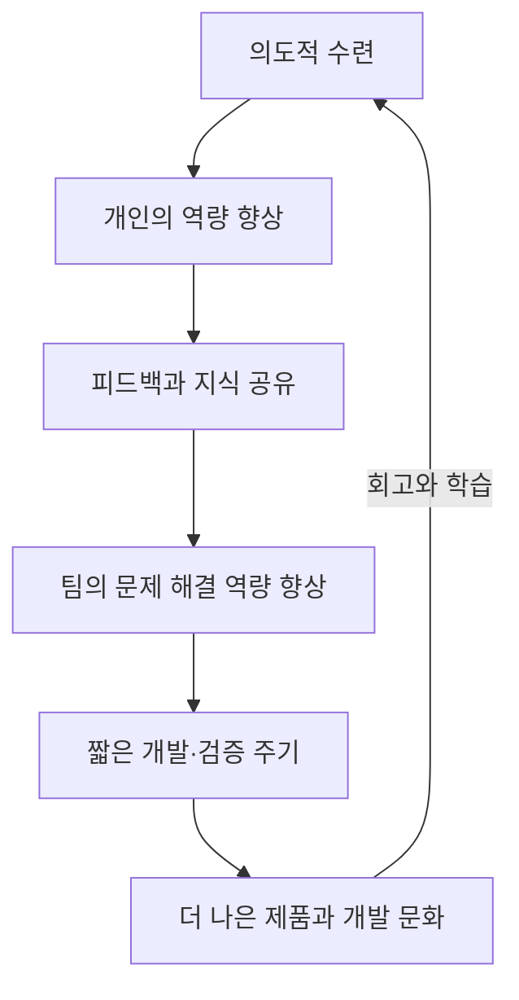
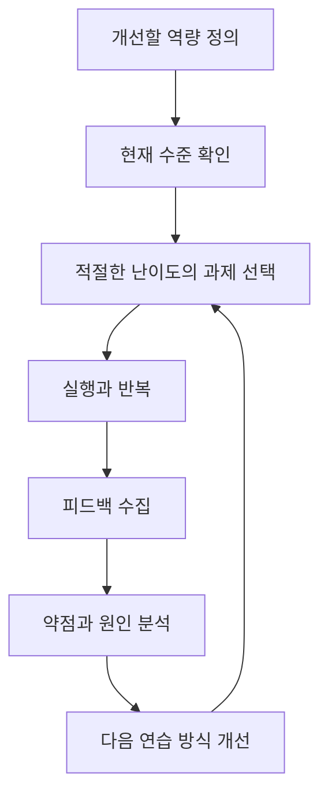
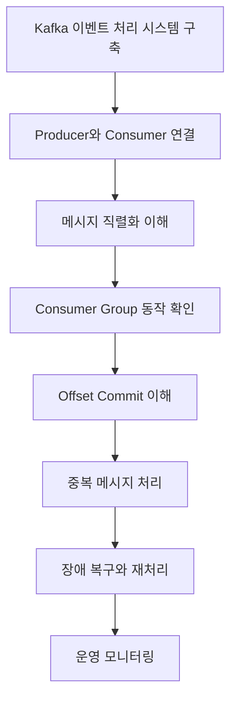
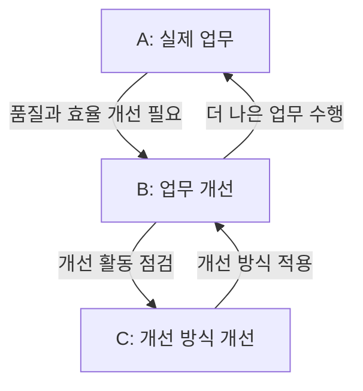
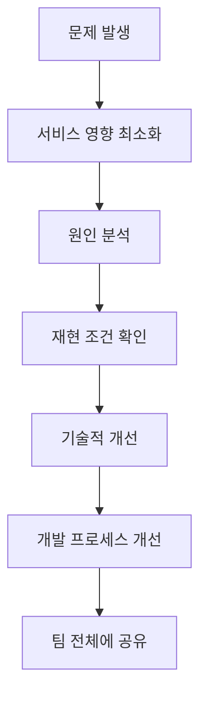
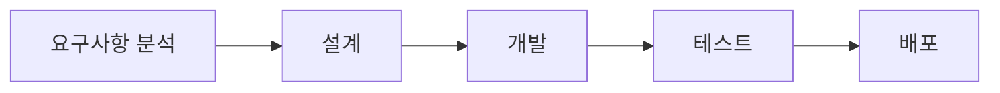
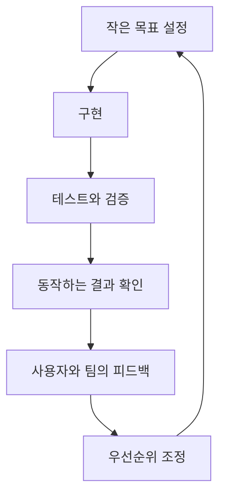
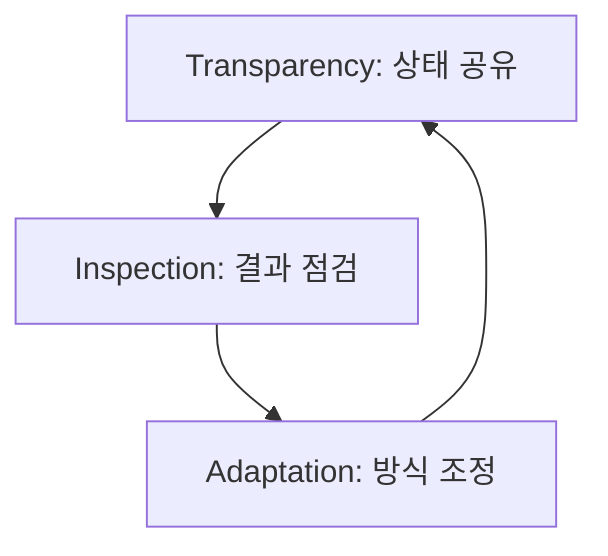
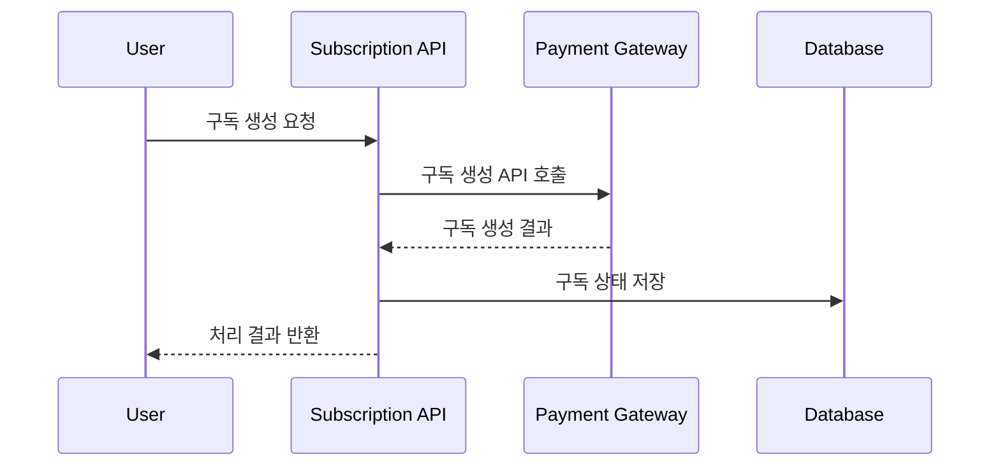
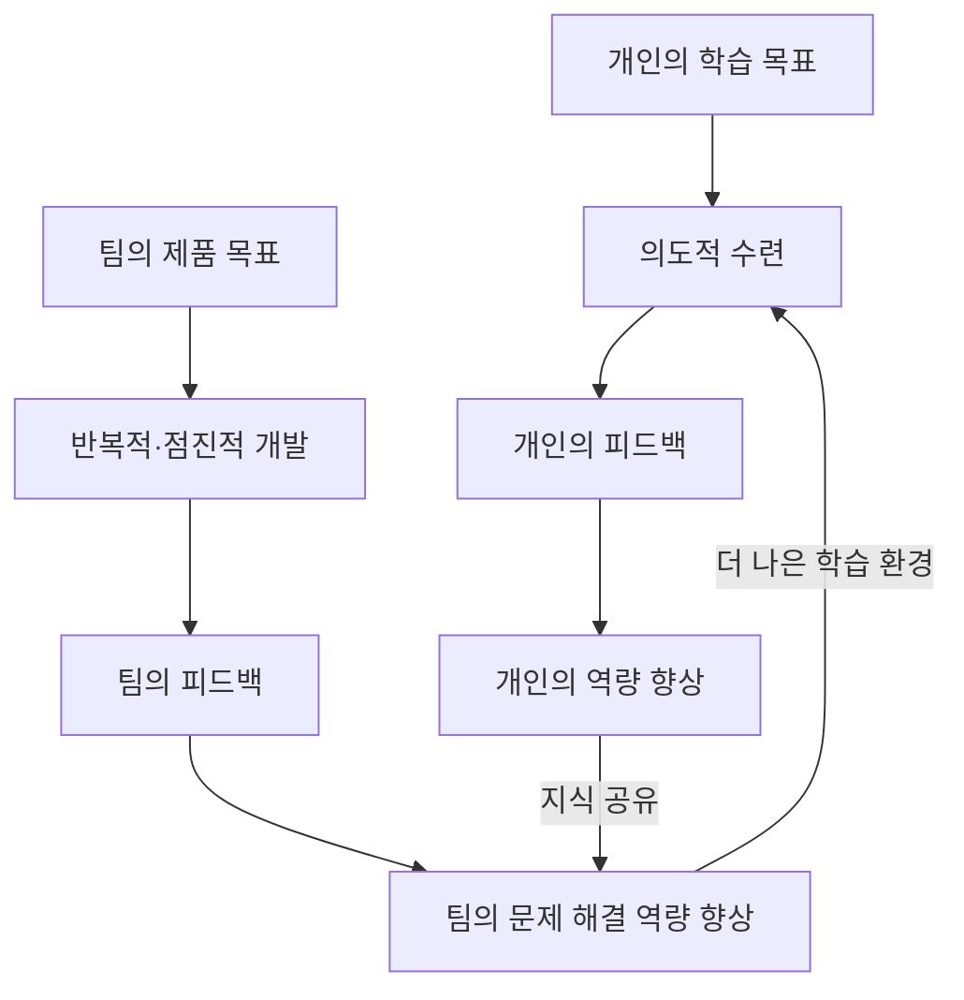

# 로건, 오거스의 함께 자라기
[https://youtu.be/fcRhlBVIJTw?si=ejgJeZX4pLoYsFfE](https://youtu.be/fcRhlBVIJTw?si=ejgJeZX4pLoYsFfE)

# 로건, 오거스의 함께 자라기
* toc
{:toc}

---

### 함께 자라기 완벽 이해: 의도적 수련, 성장 마인드셋, 심리적 안전감, 협력과 애자일 개발 문화

소프트웨어 개발자는 끊임없이 새로운 기술을 학습한다.

Java와 Spring Boot를 익히고, 데이터베이스의 동작 원리를 이해하며, Redis와 Kafka 같은 새로운 기술을 학습한다.

경력이 쌓이면 단순히 새로운 기술을 사용하는 것을 넘어 시스템의 구조를 설계하고, 장애에 대응하며, 다른 개발자와 협력하는 역할도 수행하게 된다.

그런데 여기서 중요한 질문이 생긴다.

**개발 경력이 오래되었다면 반드시 실력이 뛰어난 개발자일까?**

**혼자서 뛰어난 코드를 작성하는 개발자가 많다면 반드시 좋은 개발팀이 만들어질까?**

**개발자가 각자 맡은 업무를 일정에 맞게 완료한다면 프로젝트 전체도 일정에 맞게 끝날까?**

반드시 그렇지는 않다.

개발 경력이 길더라도 비슷한 문제를 같은 방식으로 반복해서 해결한다면 새로운 역량을 얻기 어려울 수 있다.

또 뛰어난 개발자들이 모여 있더라도 지식과 정보를 공유하지 않는다면 같은 문제를 여러 사람이 반복해서 해결할 수도 있다.

프로젝트 일정 역시 개인의 작업 속도뿐 아니라 업무 간 의존성, 협업 방식, 요구사항 변경, 피드백 속도에 영향을 받는다.

따라서 개발자의 성장을 이해하기 위해서는 두 가지 관점을 함께 살펴볼 필요가 있다.

첫 번째는 **개인이 어떻게 성장하는가**이다.

두 번째는 **개인들이 모인 팀이 어떻게 함께 성장하는가**이다.

이러한 관점을 연결하면 다음과 같은 구조를 생각할 수 있다.



이 구조의 핵심은 성장이 일회성으로 끝나지 않는다는 점이다.

개인은 연습하고, 피드백을 받고, 자신의 약점을 개선한다.

팀은 서로의 경험을 공유하고, 잘못된 의사결정에서 배우며, 일하는 방식을 개선한다.

그리고 애자일 개발 방식은 이러한 학습과 피드백이 반복될 수 있도록 업무를 구성하는 데 도움을 준다.

---

### 개념

#### 함께 자라기란 무엇인가?

함께 자라기는 개인의 성장과 팀의 성장을 분리하지 않고 바라보는 관점이다.

개인이 뛰어난 역량을 갖추는 것도 중요하지만, 그 역량이 팀 전체의 성과로 연결되려면 협력과 정보 공유가 필요하다.

반대로 협력적인 조직에 속해 있더라도 개인이 자신의 역량을 개선하려는 노력을 하지 않는다면 지속적인 성장은 어려울 수 있다.

두 관점은 다음과 같이 구분할 수 있다.

| 구분 | 자라기 | 함께 |
|---|---|---|
| 중심 대상 | 개인 | 팀과 조직 |
| 핵심 질문 | 어떻게 실력을 향상시킬 것인가? | 어떻게 서로의 성장을 도울 것인가? |
| 중요한 요소 | 의도적 수련, 메타인지, 피드백 | 심리적 안전감, 협력, 지식 공유 |
| 실패에 대한 관점 | 자신의 약점을 발견하는 기회 | 팀의 시스템을 개선하는 기회 |
| 주요 활동 | 반복 연습, 실험, 회고 | 코드 리뷰, 페어 프로그래밍, 공동 문제 해결 |
| 궁극적인 목적 | 개인의 문제 해결 역량 향상 | 팀 전체의 지속적인 성과 향상 |

여기서 중요한 것은 개인의 성장과 팀의 성장이 서로 영향을 주고받는다는 사실이다.

예를 들어 한 개발자가 데이터베이스 인덱스를 깊이 있게 학습했다고 가정하자.

해당 개발자가 혼자서만 지식을 활용한다면 팀에서 얻을 수 있는 효과는 제한적일 수 있다.

하지만 팀원들과 실행 계획을 분석하는 방법을 공유하고, 공통 성능 점검 기준을 마련한다면 어떨까?

다른 개발자들도 비슷한 문제를 더 빠르게 해결할 수 있게 된다.

개인의 학습이 팀의 역량으로 확장된 것이다.

---

### 자라기: 경험이 많다고 반드시 전문가가 되는 것은 아니다

#### 1만 시간의 법칙에 대한 오해

어떤 분야에서 전문가가 되기 위해서는 오랜 시간이 필요하다는 이야기를 자주 듣는다.

그중 대표적인 개념이 1만 시간의 법칙이다.

하지만 특정 활동을 오랫동안 반복한다고 반드시 전문가가 되는 것은 아니다.

예를 들어 매일 양치질을 한다고 가정하자.

수십 년 동안 반복하더라도 모든 사람이 치아 관리 전문가가 되는 것은 아니다.

개발도 마찬가지다.

다음과 같은 코드를 매일 작성하는 개발자가 있다고 가정하자.

```java
public Member findMember(Long id) {
    return memberRepository.findById(id)
            .orElseThrow(
                    () -> new IllegalArgumentException(
                            "회원이 존재하지 않습니다."
                    )
            );
}
```

이 개발자는 회원 조회 기능을 수백 번 구현할 수 있다.

하지만 단순히 코드를 반복 작성하는 것만으로 다음과 같은 역량이 자동으로 향상되는 것은 아니다.

- 데이터베이스 인덱스를 설계하는 능력
- 트랜잭션 격리 수준을 이해하는 능력
- 대규모 트래픽을 처리하는 능력
- 장애 원인을 분석하는 능력
- 시스템의 확장성을 설계하는 능력

전문성의 향상에는 단순한 반복 이상의 요소가 필요하다.

대표적인 방법이 의도적 수련이다.

---

### 의도적 수련(Deliberate Practice)이란 무엇인가?

의도적 수련은 자신의 능력을 개선하려는 구체적인 목적을 가지고, 약점을 발견하고, 피드백을 통해 수행 방식을 조정하는 연습이다.

단순한 반복과 의도적 수련은 다르다.

예를 들어 다음 두 개발자를 비교해 보자.

**개발자 A**

매일 SQL을 작성한다.

쿼리가 정상적으로 실행되면 작업을 완료한다.

다음 업무에서도 비슷한 방식으로 코드를 작성한다.

**개발자 B**

SQL을 작성한 뒤 실행 계획을 확인한다.

왜 특정 인덱스가 선택되었는지 분석한다.

다른 인덱스를 적용했을 때 실행 계획과 성능이 어떻게 달라지는지 확인한다.

예상과 다른 결과가 나오면 원인을 기록한다.

두 개발자 모두 SQL을 작성한다.

하지만 학습의 구조는 다르다.

| 구분 | 단순 반복 | 의도적 수련 |
|---|---|---|
| 목적 | 작업 완료 | 특정 역량 개선 |
| 실행 방식 | 익숙한 방법 반복 | 약점을 개선하기 위한 시도 |
| 난이도 | 익숙한 수준 유지 | 현재 능력보다 조금 어려운 과제 |
| 피드백 | 성공 여부만 확인 | 결과와 원인 분석 |
| 개선 | 상황에 따라 우연히 발생 | 개선 과정을 의식적으로 설계 |
| 학습 결과 | 경험 축적 | 경험을 통해 역량 개선 추구 |

의도적 수련은 다음과 같은 흐름으로 구성할 수 있다.



이 과정에서 중요한 것은 단순히 더 많은 시간을 투자하는 것이 아니다.

**무엇을 개선할지 명확하게 정하고, 실제 수행 결과를 확인하면서 연습을 조정하는 것**이다.

---

### 의도적 수련의 핵심 조건

#### 1. 명확한 목적이 있어야 한다

다음과 같은 학습 목표를 생각해 보자.

> Java를 더 잘하고 싶다.

이 목표는 방향은 있지만 구체적이지 않다.

무엇을 개선해야 하는지 판단하기 어렵기 때문이다.

반면 다음과 같은 목표는 더 구체적이다.

> HashMap의 내부 동작을 이해하고, 해시 충돌과 리사이징이 발생하는 조건을 설명할 수 있도록 학습한다.

또는 다음과 같이 설정할 수 있다.

> Spring Boot 애플리케이션에서 발생하는 느린 SQL을 실행 계획으로 분석하고, 개선 전후의 실행 시간을 비교할 수 있도록 연습한다.

구체적인 목표는 다음 행동을 결정하기 쉽게 만든다.

- 어떤 내용을 학습해야 하는가?
- 어떤 코드를 작성해야 하는가?
- 어떤 실험을 수행해야 하는가?
- 무엇을 기준으로 개선 여부를 판단할 것인가?

좋은 학습 목표는 결과를 확인할 수 있어야 한다.

예를 들어 다음과 같다.

| 모호한 목표 | 구체적인 목표 |
|---|---|
| Java를 공부한다 | JVM의 GC 동작 원리를 설명하고 GC 로그를 분석한다 |
| Redis를 공부한다 | Cache Aside 구조를 구현하고 캐시 장애 상황을 검증한다 |
| Kafka를 공부한다 | Consumer 재처리 상황에서 멱등성을 보장한다 |
| DB 성능을 공부한다 | 실행 계획을 비교해 특정 쿼리의 병목 원인을 분석한다 |
| 테스트를 잘 작성한다 | 외부 API 실패, 타임아웃, 중복 요청 테스트를 추가한다 |

이렇게 목표를 구체화하면 학습이 단순한 지식 습득에서 실제 문제 해결 역량의 향상으로 이어질 가능성이 높아진다.

---

#### 2. 자신의 수준에 맞는 난이도를 선택해야 한다

학습 과정에서는 현재 실력과 과제의 난이도 사이의 관계가 중요하다.

너무 쉬운 과제는 새로운 학습을 유도하기 어렵다.

반대로 현재 능력으로 감당하기 어려운 과제는 어디서부터 시작해야 할지 판단하기 어렵게 만들 수 있다.

이를 다음과 같이 구분할 수 있다.

| 현재 역량 대비 난이도 | 나타날 수 있는 상태 | 필요한 조정 |
|---|---|---|
| 지나치게 쉬움 | 지루함 | 도전 과제 추가 |
| 적절하게 어려움 | 집중과 몰입 | 현재 수준 유지하며 피드백 |
| 지나치게 어려움 | 불안과 혼란 | 과제 분해 또는 지원 확보 |

이러한 관계는 몰입(Flow)을 이해하는 데 도움이 된다.

다만 몰입이 발생하는 난이도가 모든 사람에게 동일하게 정해져 있는 것은 아니다.

개인의 숙련도와 목표의 명확성, 피드백 환경 등에 따라 달라질 수 있다.

따라서 중요한 것은 **현재 자신의 수준에 맞게 과제의 난이도를 조절하는 것**이다.

---

### 과제가 너무 쉬울 때는 어떻게 해야 할까?

예를 들어 Spring Boot에서 CRUD API를 구현하는 일이 익숙한 개발자가 있다고 가정하자.

단순히 Controller와 Service, Repository를 작성하는 작업만 반복한다면 새로운 도전이 부족할 수 있다.

이때 다음과 같은 제약을 추가할 수 있다.

첫 번째는 테스트를 먼저 작성하는 것이다.

```text
기존 목표

회원 등록 API 구현
```

```text
개선된 목표

회원 등록 API 구현
+
실패 케이스를 먼저 테스트로 정의
+
중복 요청을 처리하는 정책 검증
```

두 번째는 성능 조건을 추가하는 것이다.

```text
기존 목표

상품 조회 API 구현
```

```text
개선된 목표

상품 조회 API 구현
+
실행 계획 분석
+
캐시 적용 전후 성능 비교
```

세 번째는 기술적인 제약을 추가하는 것이다.

예를 들어 익숙한 도구를 일부 제한하고 내부 동작을 직접 확인할 수 있다.

다만 실제 운영 업무에서 생산성을 떨어뜨리는 방식으로 제한할 필요는 없다.

이러한 연습은 통제된 학습 환경에서 활용하는 것이 적절하다.

핵심은 **익숙한 업무를 새로운 학습 과제로 바꾸는 것**이다.

---

### 과제가 너무 어려울 때는 어떻게 해야 할까?

이번에는 Kafka를 처음 사용하는 개발자가 있다고 가정하자.

그런데 다음과 같은 요구사항을 한 번에 구현해야 한다.

> Kafka 기반 비동기 이벤트 처리 시스템을 구축하고, 장애 복구와 순서 보장, 중복 처리, 재처리까지 구현한다.

처음부터 전체 시스템을 구현하려 한다면 복잡도가 지나치게 높을 수 있다.

이럴 때는 문제를 작은 단위로 분해하는 것이 효과적이다.



처음에는 메시지를 보내고 받는 기능만 구현한다.

다음으로 Consumer Group을 확인한다.

이후 Offset Commit의 동작 원리를 이해한다.

그다음 중복 메시지와 장애 복구를 구현한다.

이처럼 복잡한 문제를 작은 단위로 분해하면 현재 수준에서 해결할 수 있는 과제를 만들 수 있다.

테스트 주도 개발(TDD) 역시 작은 실패와 성공의 반복을 통해 문제 해결 범위를 줄이는 데 활용할 수 있다.

---

### 메타인지(Metacognition)가 중요한 이유

메타인지는 자신의 지식과 능력, 사고 과정을 인식하고 점검하는 능력이다.

쉽게 말하면 다음 질문에 답할 수 있는 능력이다.

**나는 무엇을 알고 있는가?**

**나는 무엇을 모르는가?**

**내가 이해했다고 생각하는 내용은 실제로 설명하거나 적용할 수 있는가?**

개발 과정에서 메타인지가 부족하면 자신의 역량을 정확하게 판단하기 어렵다.

예를 들어 개발자가 다음과 같이 생각한다고 가정하자.

> Redis를 사용해 봤으므로 Redis를 잘 알고 있다.

하지만 다음과 같은 질문에 답하기 어렵다면 어떨까?

- Redis 장애가 발생하면 애플리케이션은 어떻게 동작하는가?
- Cache Aside 방식에서 캐시와 DB의 데이터가 불일치하면 어떻게 처리하는가?
- Redis Cluster에서 키가 분산되는 방식은 무엇인가?
- TTL이 동시에 만료되면 어떤 문제가 발생하는가?
- 캐시를 적용하기 전과 후의 성능 차이는 어떻게 측정하는가?

Redis를 사용한 경험은 있지만 내부 동작과 운영 설계에는 부족한 부분이 있을 수 있다.

이러한 차이를 인식하는 것이 메타인지다.

실무에서는 다음과 같은 방법으로 활용할 수 있다.

| 질문 | 확인하려는 내용 |
|---|---|
| 이 기술의 동작 원리를 설명할 수 있는가? | 개념 이해 |
| 직접 구현할 수 있는가? | 적용 능력 |
| 장애 상황을 예상할 수 있는가? | 운영 이해 |
| 다른 방법과 비교할 수 있는가? | 설계 판단 |
| 선택한 이유를 설명할 수 있는가? | 의사결정 능력 |
| 다른 사람에게 전달할 수 있는가? | 지식 구조화 |

단순히 기술을 사용했다는 사실보다 어디까지 이해하고 있는지 구분하는 것이 중요하다.

---

### ABC 작업: 일하면서 성장하는 구조

개발자가 성장하기 위해서는 업무를 수행하는 것만으로 충분하지 않을 수 있다.

업무를 개선하는 활동과 개선 방식 자체를 돌아보는 활동이 필요하다.

이를 A, B, C 작업으로 구분해 볼 수 있다.

#### A 작업: 실제 업무 수행

A 작업은 본래 수행해야 하는 업무다.

예를 들어 다음과 같다.

- 회원 API 구현
- 결제 기능 개발
- 배치 작업 구현
- 장애 대응
- 데이터베이스 쿼리 작성

#### B 작업: A 작업을 개선하는 활동

B 작업은 업무의 품질과 효율을 높이기 위한 활동이다.

예를 들어 다음과 같다.

- 테스트 자동화
- 코드 리뷰
- 성능 측정
- 공통 코드 개선
- 개발 가이드 작성

#### C 작업: B 작업을 개선하는 활동

C 작업은 개선 활동 자체를 더 효과적으로 만드는 활동이다.

예를 들어 다음과 같다.

- 코드 리뷰 방식에 대한 회고
- 테스트 작성 기준 개선
- 문서화 프로세스 개선
- 반복되는 장애 원인 분석
- 팀의 협업 방식 개선

이 관계를 표현하면 다음과 같다.



예를 들어 구독 결제 시스템을 개발한다고 가정하자.

**A 작업**

PayPal 구독 결제 API를 구현한다.

**B 작업**

Webhook 중복 수신 테스트를 추가하고, 실패 상황을 재현하는 테스트 도구를 만든다.

**C 작업**

장애가 발생했을 때 어떤 테스트가 누락되었는지 회고하고, 이후 모든 외부 결제 연동에 공통으로 적용할 테스트 기준을 만든다.

이렇게 하면 하나의 프로젝트에서 얻은 경험이 다음 프로젝트의 개발 품질에도 영향을 줄 수 있다.

---

### 성장 마인드셋: 실수를 예방하는 것과 관리하는 것

개발 과정에서 실수를 완전히 제거하는 것은 현실적으로 어렵다.

복잡한 시스템에서는 예상하지 못한 조건과 요구사항이 계속 발생하기 때문이다.

그렇다면 실수를 어떻게 바라보는 것이 좋을까?

두 가지 관점을 비교해 볼 수 있다.

첫 번째는 실수를 가능한 한 드러내지 않으려는 태도다.

두 번째는 실수가 발생했을 때 원인을 분석하고 개선하는 태도다.

| 구분 | 실수 회피 중심 | 실수 관리 중심 |
|---|---|---|
| 실수에 대한 인식 | 자신의 능력 부족을 드러내는 사건 | 개선할 부분을 발견하는 사건 |
| 실수 발생 시 | 방어적 대응 가능성 | 원인 분석과 해결 |
| 피드백 | 비판으로 받아들이기 쉬움 | 개선 정보로 활용 |
| 새로운 기술 | 완벽하게 이해한 후 시도 | 통제된 환경에서 실험 |
| 중요한 목표 | 실수하지 않는 모습 | 같은 문제가 반복되지 않는 구조 |

여기서 오해하지 말아야 할 부분이 있다.

**실수 관리가 중요하다는 것은 실수를 예방할 필요가 없다는 의미가 아니다.**

특히 결제와 정산, 개인정보, 인증 같은 중요한 시스템에서는 사전 검증과 예방이 필수적이다.

다만 예방 활동을 수행하더라도 모든 실패를 완전히 제거할 수는 없으므로, 실패를 발견하고 복구하며 재발을 방지하는 능력도 갖춰야 한다.

---

### 실수를 관리하는 개발 문화

예를 들어 운영 서버에서 데이터베이스 쿼리 성능 문제가 발생했다고 가정하자.

특정 API의 응답 시간이 평소보다 크게 증가했다.

이때 개발자 개인에게만 원인을 돌린다면 다음과 같은 대응이 이루어질 수 있다.

```text
문제 발생

↓

담당자 확인

↓

왜 이런 코드를 작성했는지 추궁

↓

담당자 수정

↓

업무 종료
```

하지만 이 방식에서는 같은 문제가 다시 발생할 수 있다.

더 나은 접근은 다음과 같다.



예를 들어 분석 결과 다음과 같은 사실을 발견했다고 가정하자.

- 인덱스가 없는 컬럼을 기준으로 조회했다.
- 데이터 증가량을 충분히 고려하지 않았다.
- 개발 환경의 데이터가 실제 운영 환경보다 지나치게 적었다.
- 배포 전 쿼리 성능을 확인하는 기준이 없었다.

이제 단순히 인덱스를 추가하는 것에서 끝내지 않는다.

운영 데이터 규모를 고려한 성능 검증 기준을 만들고, 중요한 쿼리의 실행 계획을 코드 리뷰에서 확인하도록 개선할 수 있다.

이렇게 하면 개인의 실수가 팀 전체의 학습으로 연결된다.

---

### 함께: 뛰어난 개인이 모이면 반드시 뛰어난 팀이 될까?

개인의 능력이 뛰어나다고 팀의 성과가 자동으로 높아지는 것은 아니다.

팀의 성과는 개인의 역량뿐 아니라 팀원들이 서로 어떻게 상호작용하는지에 영향을 받는다.

예를 들어 다음과 같은 개발팀이 있다고 가정하자.

- 개발자 A는 Java에 능숙하다.
- 개발자 B는 데이터베이스에 능숙하다.
- 개발자 C는 클라우드 인프라에 능숙하다.
- 개발자 D는 메시징 시스템에 능숙하다.

각자가 뛰어난 전문성을 가지고 있다.

하지만 서로의 작업을 공유하지 않는다면 어떨까?

개발자 A는 데이터베이스 문제를 해결하지 못해 시간을 소비한다.

개발자 B는 인프라 설정 문제로 작업이 지연된다.

개발자 C는 메시지 처리 문제를 처음부터 분석한다.

팀 안에 문제를 해결할 수 있는 사람이 존재하지만 정보가 연결되지 않는다.

반대로 팀원들이 적극적으로 협력한다면 다른 결과를 기대할 수 있다.

개발자 B가 A의 쿼리 문제를 함께 분석한다.

개발자 C가 공통 배포 환경을 개선한다.

개발자 D가 메시지 중복 처리 사례를 공유한다.

이러한 협력이 팀의 문제 해결 능력을 높일 수 있다.

---

### 팀(Team)과 작업 그룹(Working Group)의 차이

작업 그룹은 개인이 맡은 업무를 수행하고 그 결과를 모으는 방식에 가깝다.

팀은 공동의 목표를 달성하기 위해 서로의 작업과 의사결정에 영향을 주고받는 방식에 가깝다.

| 구분 | 작업 그룹 | 팀 |
|---|---|---|
| 목표 | 개인 업무 완료 중심 | 공동 목표 달성 |
| 업무 관계 | 상대적으로 독립적 | 상호 의존적 |
| 의사소통 | 필요한 결과 전달 | 지속적인 정보 교환 |
| 피드백 | 제한적일 수 있음 | 상호 피드백 중요 |
| 문제 해결 | 담당자 중심 | 공동 해결 가능 |
| 성과 판단 | 개인별 완료 여부 | 전체 결과와 가치 |

물론 모든 업무가 반드시 높은 수준의 상호 의존성을 요구하는 것은 아니다.

독립적인 업무에서는 작업 그룹 방식도 효율적일 수 있다.

중요한 것은 업무의 성격에 적합한 협업 구조를 선택하는 것이다.

하지만 하나의 제품을 여러 개발자가 함께 설계하고 지속적으로 개선해야 한다면 공동 목표와 정보 공유의 중요성이 커진다.

---

### 좋은 팀을 만드는 다섯 가지 요소

Google은 팀의 효과성에 영향을 주는 요소를 연구한 바 있다.

해당 연구에서 강조된 요소는 다섯 가지다.

1. 심리적 안전감
2. 신뢰성
3. 구조와 명확성
4. 일의 의미
5. 영향력

이 가운데 심리적 안전감은 특히 중요한 요소로 소개되었다.

각 요소를 개발팀의 상황에 적용해 보자.

| 요소 | 의미 | 개발팀 적용 예시 |
|---|---|---|
| 심리적 안전감 | 질문과 실수를 드러내도 대인관계상 불이익을 두려워하지 않는 환경 | 모르는 개념을 자유롭게 질문 |
| 신뢰성 | 서로 약속한 일을 책임감 있게 수행 | 작업 상태와 지연 위험 공유 |
| 구조와 명확성 | 목표와 역할, 책임이 명확함 | API 책임과 완료 기준 정의 |
| 일의 의미 | 수행하는 업무에서 의미를 발견 | 기능이 사용자 문제를 해결한다는 인식 |
| 영향력 | 자신의 일이 실제 변화를 만든다는 믿음 | 성능 개선 효과와 사용자 지표 확인 |

이 다섯 가지 요소는 서로 독립적이라기보다 함께 작용한다.

예를 들어 심리적 안전감이 높더라도 역할과 책임이 불분명하면 프로젝트가 혼란스러울 수 있다.

반대로 업무 절차가 명확하더라도 질문을 하기 어려운 환경이라면 중요한 문제가 늦게 발견될 수 있다.

---

### 심리적 안전감(Psychological Safety)이란 무엇인가?

심리적 안전감은 팀 안에서 질문하거나 실수를 인정하고, 자신의 의견을 제시할 때 조롱이나 부당한 불이익을 걱정하지 않을 수 있는 상태를 의미한다.

예를 들어 개발자가 다음과 같은 상황에 놓였다고 가정하자.

> Redis를 도입하려고 하는데 캐시 정합성 문제가 걱정됩니다. 아직 정확한 해결 방법은 잘 모르겠습니다.

심리적 안전감이 낮은 환경에서는 다음과 같은 반응이 나타날 수 있다.

> 이런 기본적인 것도 모르나요?

이러한 반응이 반복되면 개발자는 질문하는 것을 부담스럽게 느낄 수 있다.

결국 모르는 부분이 있어도 질문하지 않고 혼자 해결하려는 행동으로 이어질 수 있다.

반면 다음과 같은 반응을 생각해 보자.

> 어떤 상황에서 정합성 문제가 발생할 것 같나요? 같이 시나리오를 정리해 보겠습니다.

이러한 대화는 질문을 문제 해결의 출발점으로 만든다.

다만 심리적 안전감은 모든 의견에 동의하거나 성과에 대한 책임을 묻지 않는다는 뜻은 아니다.

**의견에 대해서는 적극적으로 검토하고, 사람에 대해서는 존중하는 환경**에 가깝다.

---

### 심리적 안전감을 높이는 방법

#### 질문을 환영하는 환경 만들기

질문은 단순히 지식이 부족하다는 표현이 아니다.

질문을 통해 팀이 놓치고 있는 위험이나 불명확한 요구사항을 발견할 수도 있다.

예를 들어 다음과 같은 질문을 생각해 보자.

> 결제 Webhook을 두 번 받으면 구독 상태도 두 번 변경되나요?

이 질문은 단순한 궁금증처럼 보일 수 있다.

하지만 실제로는 멱등성 문제를 발견하는 중요한 출발점이 될 수 있다.

따라서 질문을 받은 사람은 다음 내용을 함께 확인하는 것이 좋다.

- 어떤 문제를 해결하려는가?
- 현재 어떤 방식으로 동작하는가?
- 어디까지 확인했는가?
- 어떤 부분이 불확실한가?
- 함께 검증할 방법은 무엇인가?

이러한 질문은 상대방을 평가하는 것이 아니라 문제의 맥락을 이해하는 데 목적이 있다.

---

#### 실패 경험을 공유하기

팀에서 실패 경험을 공유하는 시간을 마련할 수도 있다.

예를 들어 다음과 같은 내용을 공유한다.

```text
문제

배치 작업이 중복 실행되었다.

원인

다중 인스턴스에서 동일한 스케줄러가 실행되었다.

영향

일부 통계 데이터가 중복 집계되었다.

개선

분산 환경에서 작업 실행을 제어하는 방법을 적용했다.

추가 조치

재실행과 중복 실행을 검증하는 테스트를 추가했다.
```

이러한 공유의 핵심은 특정 개발자를 평가하는 것이 아니다.

비슷한 문제가 다른 곳에서 반복되지 않도록 만드는 것이다.

---

### 협력은 단순히 의견을 주고받는 것이 아니다

팀에서 협력한다는 것은 단순히 서로 친하게 지내거나 많은 대화를 나누는 것을 의미하지 않는다.

중요한 것은 **공동의 문제를 더 나은 방식으로 해결하기 위해 서로의 지식과 판단을 연결하는 것**이다.

예를 들어 코드 리뷰 상황을 생각해 보자.

다음과 같은 코드가 있다고 가정하자.

```java
public List<Order> findOrders() {
    return orderRepository.findAll();
}
```

리뷰어가 다음과 같이 피드백할 수 있다.

> 전체 데이터를 조회하면 성능이 안 좋습니다.

문제점을 지적한 것이다.

하지만 이 피드백만으로는 어떻게 개선해야 할지 명확하지 않다.

반면 다음과 같이 작성할 수 있다.

> 주문 데이터가 증가하면 전체 조회로 인해 응답 시간과 메모리 사용량이 커질 수 있습니다. 조회 API에 페이지네이션을 적용하고, 자주 사용하는 정렬 조건에 맞춰 인덱스를 검토하면 어떨까요?

두 번째 피드백은 다음 내용을 포함한다.

- 현재 구현의 위험
- 위험이 발생하는 조건
- 개선 가능한 방법
- 추가로 확인해야 할 요소

이러한 피드백은 단순한 지적을 넘어 공동 문제 해결로 이어질 수 있다.

---

### 삼투압적 의사소통(Osmotic Communication)

삼투압적 의사소통은 주변에서 이루어지는 대화를 자연스럽게 접하면서 정보를 얻거나 문제 해결에 참여하는 의사소통 방식이다.

예를 들어 두 개발자가 데이터베이스 문제를 해결하고 있다고 가정하자.

개발자 A가 말한다.

> 특정 쿼리에서 인덱스를 사용하는데도 응답 시간이 느립니다.

개발자 B가 답한다.

> 실행 계획을 확인해 보면 좋겠습니다.

이 대화를 근처에 있던 개발자 C가 듣고 자신의 경험을 공유한다.

> 비슷한 문제가 있었는데 통계 정보가 오래되어 실행 계획이 달라진 적이 있습니다.

이러한 상황에서는 공식적인 회의를 만들지 않아도 지식이 공유된다.

다만 모든 업무 대화를 공개할 필요는 없다.

개인정보와 보안 정보, 집중이 필요한 업무는 별도로 보호해야 한다.

또 원격 근무에서는 이러한 자연스러운 정보 공유가 어려울 수 있으므로 채팅 채널과 기술 공유 공간, 짧은 협업 시간 등을 의도적으로 설계할 필요가 있다.

---

### 프로젝트 일정과 협력의 관계

프로젝트에서 각 개발자가 맡은 작업을 일정에 맞게 완료할 가능성이 높더라도 전체 프로젝트 일정이 지연될 수 있다.

이를 간단한 확률 모델로 이해해 보자.

개발자가 7명 있다고 가정하자.

각 개발자가 자신의 작업을 기한 내에 완료할 확률은 90%다.

또 각 개발자의 작업 완료 여부가 서로 독립적이라고 가정하자.

프로젝트가 완료되려면 7명 모두 자신의 작업을 완료해야 한다.

이때 확률은 다음과 같다.

```text
P(모두 완료)

= 0.9 × 0.9 × 0.9 × 0.9 × 0.9 × 0.9 × 0.9

= 0.9^7

≈ 0.4783

≈ 47.83%
```

개인의 작업 완료 가능성은 90%지만 전원이 완료할 가능성은 약 47.83%다.

물론 실제 프로젝트에서는 업무가 독립적이지 않으며 일정과 리스크도 훨씬 복잡하다.

따라서 이 수치를 실제 프로젝트의 성공 확률로 그대로 적용해서는 안 된다.

중요한 것은 **전체 프로젝트의 완료 가능성이 개인별 완료 가능성과 같지 않다는 점**이다.

---

### 지식 공유가 문제 해결 가능성을 높이는 이유

이번에는 버그를 발견할 가능성을 생각해 보자.

개발자 한 명이 특정 버그를 발견할 확률이 30%라고 가정한다.

7명이 서로 독립적으로 버그를 발견할 수 있다고 가정하자.

이때 7명 모두 버그를 발견할 확률은 다음과 같다.

```text
P(전원 발견)

= 0.3^7

≈ 0.0002187

≈ 0.02187%
```

모든 개발자가 같은 버그를 각각 찾아야 한다면 가능성이 매우 낮다.

하지만 한 사람만 버그를 발견하고 다른 사람에게 정보를 공유할 수 있다면 어떨까?

적어도 한 사람이 버그를 발견할 확률은 다음과 같다.

```text
P(한 명 이상 발견)

= 1 - P(아무도 발견하지 못함)

= 1 - 0.7^7

≈ 0.9176

≈ 91.76%
```

두 상황을 비교하면 다음과 같다.

| 상황 | 단순화한 확률 |
|---|---:|
| 7명 모두 같은 버그를 각자 발견 | 약 0.02% |
| 7명 중 한 명 이상이 버그 발견 | 약 91.76% |

여기서 중요한 점이 있다.

두 확률은 서로 다른 사건을 계산한 것이므로, 단순히 협력을 시작하면 버그 해결률이 해당 비율만큼 증가한다고 해석해서는 안 된다.

다만 이 예제는 지식을 공유했을 때 어떤 변화가 가능한지 보여준다.

**각자가 동일한 문제를 독립적으로 해결해야 하는 구조와, 한 사람이 발견한 해결 방법을 함께 활용하는 구조는 요구되는 조건이 다르다.**

그리고 이 차이는 애자일 개발 방식의 중요한 방향과 연결된다.

---

### 애자일(Agile)이란 무엇인가?

애자일은 변화하는 요구사항과 불확실성에 대응하면서 고객에게 가치 있는 소프트웨어를 지속적으로 제공하기 위한 가치와 원칙이다.

애자일을 단순히 빠르게 개발하는 방식이라고 이해하기 쉽다.

하지만 애자일의 핵심은 무조건 개발 속도를 높이는 것이 아니다.

**작은 단위로 가치를 전달하고, 결과를 확인하고, 피드백에 따라 방향을 조정할 수 있는 능력**에 가깝다.

예를 들어 새로운 구독 결제 시스템을 개발한다고 가정하자.

개발팀은 처음에 다음과 같은 기능을 요구받았다.

- 구독 생성
- 구독 변경
- 구독 취소
- 결제 Webhook 처리
- 관리자 기능
- 통계 기능

처음부터 모든 기능을 완성한 뒤 사용자에게 제공하려고 할 수도 있다.

하지만 개발 도중 다음과 같은 사실이 발견될 수 있다.

- 실제 사용자가 원하는 결제 수단이 다르다.
- 구독 취소 정책이 변경된다.
- 외부 결제 서비스의 API 제약이 발견된다.
- 관리자 화면에 필요한 정보가 예상과 다르다.

이러한 상황에서 처음 수립한 계획만 고집한다면 잘못된 방향으로 많은 시간을 사용할 수 있다.

애자일은 이러한 불확실성을 전제로 한다.

처음부터 모든 것을 정확하게 예측하려 하기보다, 작은 단위로 구현하고 검증하면서 방향을 조정한다.

---

### 애자일이 필요한 이유

전통적인 개발 과정에서는 요구사항을 먼저 확정하고 이후 설계와 구현, 테스트를 진행하는 접근을 사용할 수 있다.

이를 단순화하면 다음과 같다.



이러한 순차적 접근은 요구사항이 안정적이고 작업 범위를 명확하게 정의할 수 있는 상황에서 유용할 수 있다.

하지만 요구사항이 자주 변경되는 제품에서는 다음과 같은 문제가 발생할 수 있다.

첫 번째, 사용자 피드백이 늦게 반영될 수 있다.

두 번째, 잘못된 요구사항을 바탕으로 많은 기능을 개발할 수 있다.

세 번째, 통합 과정에서 예상하지 못한 기술적 문제가 뒤늦게 발견될 수 있다.

네 번째, 프로젝트 후반부에 변경 비용이 크게 증가할 수 있다.

애자일은 이러한 위험을 줄이기 위해 반복적이고 점진적인 개발을 강조한다.



이 구조에서는 개발 결과를 주기적으로 확인한다.

그리고 새로운 정보를 얻을 때마다 다음 작업의 우선순위를 조정할 수 있다.

---

### 애자일 선언문의 네 가지 핵심 가치

2001년에 작성된 애자일 선언문은 네 가지 핵심 가치를 제시한다.

| 가치 | 핵심 의미 |
|---|---|
| 프로세스와 도구보다 개인과 상호작용 | 사람 사이의 효과적인 협력을 중요하게 생각 |
| 포괄적인 문서보다 작동하는 소프트웨어 | 실제 동작하는 결과를 중요한 진척 기준으로 사용 |
| 계약 협상보다 고객과의 협력 | 고객의 피드백을 통해 요구사항을 발전 |
| 계획을 따르기보다 변화에 대응 | 새로운 정보에 따라 방향을 조정 |

여기서 중요한 점은 오른쪽 요소들이 필요 없다는 뜻이 아니라는 것이다.

예를 들어 애자일을 적용한다고 해서 문서를 작성하지 않아도 되는 것은 아니다.

백엔드 시스템에서는 API 명세와 아키텍처 결정 기록, 운영 가이드가 여전히 중요하다.

또 계획을 세우지 않는 것이 아니라 계획을 변경할 수 있는 구조를 만드는 것이다.

애자일 선언문은 이러한 가치의 우선순위를 강조한다.

---

### 애자일의 12가지 원칙

애자일 선언문에는 네 가지 가치와 함께 12가지 원칙이 제시되어 있다.

이를 실무적인 관점에서 정리하면 다음과 같다.

| 원칙 | 핵심 의미 | 개발팀 적용 |
|---|---|---|
| 1. 고객 만족 | 가치 있는 소프트웨어를 빠르고 지속적으로 제공 | 작은 기능부터 배포 |
| 2. 변화 수용 | 개발 후반에도 필요한 요구사항 변경에 대응 | 우선순위 재조정 |
| 3. 잦은 전달 | 동작하는 소프트웨어를 자주 제공 | 짧은 릴리스 주기 |
| 4. 협력 | 비즈니스와 개발 담당자의 지속적인 협력 | 기획·개발·QA 협업 |
| 5. 동기와 신뢰 | 구성원이 일할 수 있는 환경과 지원 제공 | 자율성과 책임 부여 |
| 6. 효과적인 소통 | 이해를 높일 수 있는 직접적 의사소통 | 빠른 문제 공유 |
| 7. 동작하는 결과 | 실제 작동하는 소프트웨어로 진척 판단 | 실행 가능한 기능 검증 |
| 8. 지속 가능한 속도 | 장기간 유지할 수 있는 개발 속도 추구 | 과도한 야근 의존 방지 |
| 9. 기술적 탁월성 | 좋은 설계와 기술적 품질 유지 | 테스트·리팩터링·자동화 |
| 10. 단순성 | 불필요한 작업 최소화 | 과도한 추상화 방지 |
| 11. 자기 조직화 | 팀이 적절한 해결 방식을 스스로 결정 | 기술 선택과 작업 방식 논의 |
| 12. 정기적인 성찰 | 더 효과적으로 일하는 방법을 지속적으로 개선 | 회고와 개선 활동 |

이 원칙들을 살펴보면 공통적인 방향을 확인할 수 있다.

애자일은 단순히 일정을 짧게 나누는 방식이 아니다.

개발 과정에서 얻은 정보를 활용해 더 나은 제품과 작업 방식을 만들어 가는 접근이다.

---

### 애자일과 Scrum, Kanban은 무엇이 다를까?

애자일을 공부하다 보면 Scrum과 Kanban이라는 용어를 자주 접하게 된다.

하지만 세 개념은 동일하지 않다.

| 구분 | Agile | Scrum | Kanban |
|---|---|---|---|
| 개념 | 가치와 원칙 | 업무 수행 프레임워크 | 업무 흐름 관리 방식 |
| 중심 | 변화 대응과 고객 가치 | 반복적인 목표 설정과 검증 | 업무 흐름과 병목 개선 |
| 작업 주기 | 특정 주기를 강제하지 않음 | Sprint 사용 | 지속적 흐름 중심 |
| 역할 정의 | 특정 역할 강제 없음 | Product Owner, Scrum Master, Developers | 특정 역할을 필수로 강제하지 않음 |
| 주요 활동 | 피드백과 지속적인 개선 | 계획·점검·검토·회고 | 작업 시각화와 WIP 제한 |
| 주요 장점 | 유연한 사고방식 | 규칙적인 검증과 개선 | 업무 병목을 파악하기 쉬움 |

즉 애자일은 더 넓은 개념이다.

Scrum과 Kanban은 애자일의 가치와 원칙을 실제 업무에 적용할 때 활용할 수 있는 방식이다.

또 XP(Extreme Programming)처럼 기술적 실천에 초점을 맞추는 접근도 있다.

중요한 것은 **Scrum이나 Kanban을 사용한다고 자동으로 애자일한 조직이 되는 것은 아니라는 사실**이다.

형식적인 회의를 진행하는 것보다 실제로 협력하고 피드백을 반영하는지가 중요하다.

---

### Scrum이란 무엇인가?

Scrum은 복잡한 문제를 해결하면서 점진적으로 가치를 만들어 내기 위한 경량 프레임워크다.

Scrum에서는 일정한 길이의 Sprint를 중심으로 작업을 진행한다.

Sprint는 한 달 이하의 고정된 기간으로 구성된다.

팀은 Sprint 동안 목표를 향해 작업하고 결과를 검토한다.

Scrum은 투명성, 점검, 적응이라는 세 가지 경험적 원칙을 중심으로 동작한다.

| 원칙 | 의미 |
|---|---|
| Transparency | 현재 작업과 결과를 이해할 수 있도록 투명하게 공개 |
| Inspection | 결과와 진행 상태를 정기적으로 점검 |
| Adaptation | 점검 결과에 따라 작업과 방식을 조정 |

이 세 가지는 서로 연결된다.

현재 상태가 투명하지 않다면 정확한 점검이 어렵다.

점검만 하고 실제로 개선하지 않는다면 효과가 제한적이다.

따라서 다음과 같은 순환 구조가 필요하다.



Scrum Guide에서도 경험적 프로세스 관리와 점진적 개발을 중요한 기반으로 설명한다.

---

### Scrum의 세 가지 책임(Accountabilities)

Scrum Team에는 세 가지 책임이 존재한다.

#### Product Owner

Product Owner는 제품의 가치를 극대화하고 Product Backlog를 효과적으로 관리할 책임을 가진다.

예를 들어 구독 결제 시스템을 개발한다면 다음과 같은 문제를 판단한다.

- 어떤 기능이 가장 중요한가?
- 사용자에게 가장 큰 가치를 제공하는 기능은 무엇인가?
- 어떤 기능을 먼저 개발해야 하는가?

#### Scrum Master

Scrum Master는 Scrum이 올바르게 이해되고 활용될 수 있도록 돕는다.

팀의 업무 수행과 개선을 지원하는 역할이다.

단순히 일정이나 회의를 관리하는 사람으로 이해해서는 안 된다.

#### Developers

Developers는 실제 사용 가능한 결과물을 만들어 내는 책임을 가진다.

소프트웨어 개발 프로젝트에서는 백엔드 개발자와 프론트엔드 개발자, 테스트 및 품질 관련 역할을 수행하는 구성원 등이 포함될 수 있다.

중요한 것은 서로 다른 직무가 있어도 공동의 제품 목표를 중심으로 협력한다는 점이다.

---

### Scrum의 다섯 가지 이벤트

Scrum에는 다섯 가지 공식 이벤트가 있다.

Sprint 자체와 Sprint 내부에서 수행되는 네 가지 이벤트다.

| 이벤트 | 목적 |
|---|---|
| Sprint | 일정 기간 동안 가치 있는 결과를 생성 |
| Sprint Planning | Sprint 목표와 수행할 작업 계획 |
| Daily Scrum | 목표에 대한 진행 상황 점검 및 계획 조정 |
| Sprint Review | 결과물을 이해관계자와 검토하고 다음 방향 조정 |
| Sprint Retrospective | 팀의 일하는 방식과 품질 개선 |

이 중 Sprint Review와 Sprint Retrospective를 구분하는 것이 중요하다.

**Sprint Review는 제품과 결과물을 중심으로 검토한다.**

**Sprint Retrospective는 팀이 일하는 방식과 협업 과정을 중심으로 개선한다.**

예를 들어 다음과 같다.

Sprint Review에서는 다음 질문을 다룰 수 있다.

> 새로운 구독 결제 기능이 사용자 요구사항을 충족하는가?

Sprint Retrospective에서는 다음 질문을 다룰 수 있다.

> 외부 결제 API의 제약을 왜 개발 후반부에 발견했으며, 다음에는 어떻게 더 일찍 확인할 수 있을까?

두 활동은 서로 다른 목적을 가진다.

Scrum Guide는 이 이벤트들을 점검과 적응을 위한 공식적인 기회로 정의한다.

---

### Scrum의 세 가지 산출물

Scrum에서는 세 가지 주요 산출물을 사용한다.

| 산출물 | 의미 | 연결되는 약속 |
|---|---|---|
| Product Backlog | 제품 개선에 필요한 작업의 우선순위 목록 | Product Goal |
| Sprint Backlog | 현재 Sprint의 목표와 선택한 작업, 실행 계획 | Sprint Goal |
| Increment | 완료 기준을 충족한 실제 사용 가능한 결과물 | Definition of Done |

예를 들어 구독 시스템의 Product Backlog는 다음과 같을 수 있다.

```text
Product Backlog

1. 구독 생성 API
2. 결제 Webhook 처리
3. 구독 취소 API
4. 결제 실패 복구
5. 관리자 구독 조회
6. 구독 통계
```

첫 번째 Sprint에서는 다음 작업을 선택할 수 있다.

```text
Sprint Backlog

Sprint Goal:
구독 생성의 기본 흐름을 안전하게 검증한다.

- 구독 생성 API
- 외부 결제 승인 연동
- 중복 요청 방지
- 주요 실패 케이스 테스트
```

이 Sprint에서 중요한 것은 모든 기능을 완성하는 것이 아니다.

사용 가능한 결과물을 만들고 실제로 검증하는 것이다.

---

### Kanban이란 무엇인가?

Kanban은 업무의 흐름을 시각화하고 진행 중인 작업을 관리하는 데 초점을 맞추는 방식이다.

대표적으로 다음과 같은 업무 상태를 사용할 수 있다.

```text
To Do

↓

In Progress

↓

Code Review

↓

Done
```

실무에서는 이 구조를 업무 보드로 관리할 수 있다.

| To Do | In Progress | Code Review | Done |
|---|---|---|---|
| 구독 취소 API | Webhook 처리 | 결제 검증 | 구독 생성 |
| 통계 기능 | | | |

여기서 중요한 개념 중 하나가 WIP(Work In Progress)다.

WIP는 현재 진행 중인 작업을 의미한다.

동시에 너무 많은 작업을 진행하면 어떤 문제가 발생할까?

개발자가 여러 작업을 오가면서 집중력이 분산될 수 있다.

또 일부 작업이 완료되지 않은 상태로 오래 남아 있을 수 있다.

예를 들어 한 개발자가 동시에 다섯 개의 작업을 진행한다고 가정하자.

```text
작업 A: 30% 완료

작업 B: 20% 완료

작업 C: 50% 완료

작업 D: 10% 완료

작업 E: 40% 완료
```

모든 작업에 시간을 사용했지만 실제 완료된 작업은 없다.

반면 진행 중인 작업 수를 제한하면 완료에 집중할 수 있다.

```text
작업 A: 완료

작업 B: 완료

작업 C: 진행 중

작업 D: 대기

작업 E: 대기
```

따라서 Kanban에서는 업무 흐름을 시각화하고 진행 중인 작업을 제한하는 방식을 활용할 수 있다.

이는 특정 구간에서 작업이 계속 쌓이는 병목을 발견하는 데에도 도움이 된다.

---

### 애자일을 백엔드 프로젝트에 적용하는 방법

애자일은 추상적인 원칙처럼 보일 수 있다.

하지만 실제 백엔드 개발 과정에도 구체적으로 적용할 수 있다.

예를 들어 글로벌 구독 결제 시스템을 개발한다고 가정하자.

요구사항은 다음과 같다.

- 새로운 결제 수단 추가
- 구독 생성과 변경
- 결제 Webhook 처리
- 결제 상태 동기화
- 관리자 기능
- 장애 복구

이 요구사항을 처음부터 하나의 거대한 개발 작업으로 진행할 수도 있다.

하지만 이러한 접근에서는 외부 시스템의 제약이나 설계 문제가 개발 후반부에 발견될 수 있다.

따라서 작은 검증 단위로 나누어 진행할 수 있다.

---

#### 1단계: 가장 중요한 위험부터 확인한다

처음에는 전체 기능을 구현하기보다 가장 불확실한 부분을 찾아야 한다.

예를 들어 다음과 같은 질문이 있을 수 있다.

- 외부 PG는 어떤 인증 방식을 사용하는가?
- 결제 승인 결과는 동기 응답으로 확인할 수 있는가?
- Webhook 이벤트가 중복 전달될 수 있는가?
- 이벤트 순서가 항상 보장되는가?
- 결제 성공 이후 내부 DB 저장에 실패하면 어떻게 되는가?

이러한 내용을 초기에 확인하면 이후 설계의 위험을 줄일 수 있다.

이 과정에서는 간단한 기술 검증용 코드를 작성할 수 있다.

```java
public PaymentResult approve(
        PaymentRequest request
) {
    return paymentClient.approve(request);
}
```

다만 기술 검증용 코드를 운영 코드로 전환할 때는 인증, 예외 처리, 타임아웃, 멱등성, 로깅 등의 요구사항을 별도로 검증해야 한다.

---

#### 2단계: 작은 기능 단위로 구현한다

첫 번째 목표를 다음과 같이 설정할 수 있다.

> 구독 생성 요청을 받고 외부 PG의 승인 결과를 확인할 수 있도록 구현한다.

이 단계에서는 관리자 통계나 복잡한 부가 기능을 모두 개발할 필요가 없다.

대신 핵심 흐름을 먼저 검증한다.



이후 다음 목표를 추가할 수 있다.

> Webhook이 중복 전달되더라도 구독 상태가 중복 변경되지 않도록 한다.

이렇게 하면 하나의 기능에서 발견한 문제를 다음 단계에서 해결할 수 있다.

---

#### 3단계: 테스트와 피드백을 빠르게 반영한다

구독 시스템에서는 정상적인 성공 흐름뿐 아니라 실패 상황도 중요하다.

예를 들어 다음과 같은 시나리오를 테스트할 수 있다.

| 시나리오 | 검증 내용 |
|---|---|
| 정상 구독 생성 | 올바른 상태 저장 |
| 결제 승인 실패 | 실패 상태 처리 |
| Webhook 중복 수신 | 중복 반영 방지 |
| Webhook 순서 변경 | 상태 전이의 정합성 |
| 외부 API 타임아웃 | 결과 불명확 상태 처리 |
| DB 저장 실패 | 재처리 및 복구 가능성 |
| 사용자 중복 요청 | 멱등성 유지 |

초기에 이러한 시나리오를 발견하면 시스템 구조를 더 안전하게 설계할 수 있다.

이것이 짧은 피드백 주기의 장점이다.

---

#### 4단계: 작은 변경을 안전하게 배포한다

애자일의 짧은 전달 주기가 무조건 위험한 배포를 의미하는 것은 아니다.

오히려 짧은 주기를 유지하려면 배포 안정성이 중요하다.

대표적으로 다음과 같은 기술을 활용할 수 있다.

- 자동화 테스트
- CI/CD
- 기능 플래그(Feature Flag)
- 점진적 배포
- 롤백 전략
- 관측성 확보

예를 들어 새로운 결제 수단을 도입할 때 모든 사용자에게 즉시 공개하지 않고 기능 플래그를 활용할 수 있다.

```java
public boolean isNewPaymentEnabled(
        String countryCode
) {
    return featureFlagService.isEnabled(
            "NEW_PAYMENT",
            countryCode
    );
}
```

이를 통해 특정 국가나 사용자 그룹을 대상으로 기능을 검증할 수 있다.

다만 Feature Flag만으로 모든 위험이 사라지는 것은 아니다.

DB 스키마 호환성과 외부 결제 상태, 다중 인스턴스 동작 등도 함께 고려해야 한다.

---

#### 5단계: 실제 결과를 측정한다

애자일에서는 단순히 개발 작업을 완료했다는 사실보다 실제 결과를 확인하는 것이 중요하다.

예를 들어 새로운 구독 기능을 배포했다면 다음과 같은 지표를 확인할 수 있다.

| 지표 | 확인 목적 |
|---|---|
| 구독 생성 성공률 | 정상적인 구독 처리 여부 |
| 결제 승인 실패율 | PG 연동 안정성 |
| Webhook 처리 지연 | 상태 동기화 속도 |
| 중복 이벤트 처리 건수 | 멱등성 관련 운영 상태 |
| API 응답 시간 | 성능 변화 |
| 장애 발생 건수 | 배포 후 안정성 |
| 사용자 이탈률 | 사용자 경험 개선 여부 |

지표가 기대한 결과와 다르다면 원인을 분석한다.

그리고 다음 개발 주기에 개선 작업을 반영한다.

이러한 방식은 계획을 무조건 고수하는 대신 실제 결과에 따라 방향을 조정할 수 있게 한다.

---

### 애자일과 기술적 품질의 관계

애자일을 빠르게 기능을 개발하는 방식으로만 이해하면 중요한 문제가 발생한다.

테스트와 설계를 생략하고 기능을 빠르게 추가할 수 있기 때문이다.

하지만 기술 부채가 계속 증가하면 변경에 대응하기 어려워진다.

예를 들어 테스트가 없는 서비스에서 결제 로직을 변경한다고 가정하자.

개발자는 작은 수정에도 기존 기능이 깨질까 걱정할 수 있다.

이러한 상황에서는 변경에 많은 시간이 필요하다.

반면 테스트와 모듈화가 잘되어 있다면 변경 영향을 확인하기 쉽다.

따라서 **애자일하게 개발하기 위해서는 기술적 품질이 중요하다.**

대표적인 실천 방법을 정리하면 다음과 같다.

| 실천 방법 | 애자일과의 관계 |
|---|---|
| 자동화 테스트 | 변경 결과를 빠르게 검증 |
| TDD | 작은 단위의 구현과 피드백 |
| 지속적 통합(CI) | 통합 문제를 조기에 발견 |
| 지속적 배포(CD) | 작은 변경을 자주 전달 |
| 코드 리뷰 | 팀의 지식 공유와 품질 개선 |
| 리팩터링 | 변경하기 쉬운 구조 유지 |
| Feature Flag | 기능 공개 시점과 배포 시점 분리 |
| 모니터링 | 실제 운영 결과 확인 |

이러한 기술은 모든 애자일 팀에서 반드시 동일하게 사용해야 하는 것은 아니다.

다만 짧은 피드백 주기와 지속적인 변경을 안전하게 유지하는 데 도움이 된다.

---

### 애자일이 항상 좋은 결과를 보장할까?

애자일이라는 이름으로 특정 업무 방식을 도입했다고 반드시 프로젝트가 성공하는 것은 아니다.

예를 들어 다음과 같은 상황을 생각해 보자.

매일 Daily Scrum을 진행한다.

하지만 진행 상황을 보고하는 데만 시간을 사용한다.

Sprint Review를 진행한다.

하지만 실제 제품을 검증하지 않고 완료한 업무 목록만 공유한다.

Sprint Retrospective를 진행한다.

하지만 회고에서 나온 개선 사항을 실제로 적용하지 않는다.

이러한 상황에서는 이벤트를 수행하더라도 기대한 효과를 얻기 어렵다.

애자일에서 중요한 것은 형식이 아니라 다음과 같은 질문에 답하는 것이다.

**우리는 실제로 무엇을 배웠는가?**

**새로운 정보에 따라 무엇을 변경했는가?**

**사용자에게 어떤 가치를 제공했는가?**

**다음 개발 주기에서 무엇을 개선할 것인가?**

이러한 질문에 대한 답을 행동으로 연결할 때 애자일의 가치가 나타난다.

---

### 실무에서의 활용

### 개인과 팀이 함께 성장하기 위한 12가지 실천 전략

지금까지 살펴본 개념을 실제 개발 조직에 적용할 수 있는 방법으로 정리해 보자.

#### 1. 업무마다 하나의 학습 목표를 설정한다

모든 업무를 단순히 완료하는 데 그치지 않고 개선할 역량을 하나 정한다.

예를 들어 다음과 같다.

```text
업무 목표

Redis 캐시 기능 구현
```

```text
학습 목표

캐시 만료와 데이터 정합성 문제를 이해한다.
```

업무와 학습을 연결하면 일상적인 개발 과정에서도 의도적 수련을 수행할 수 있다.

#### 2. 코드 리뷰를 지적보다 문제 해결 중심으로 운영한다

코드 리뷰에서는 문제가 있다는 사실뿐 아니라 그 이유와 개선 방향을 함께 전달한다.

리뷰어가 모든 정답을 제공할 필요는 없다.

함께 검증할 수 있는 질문을 던지는 것도 좋은 방법이다.

#### 3. 새로운 기술의 불확실성을 초기에 검증한다

새로운 기술을 도입할 때는 전체 시스템을 먼저 구현하기보다 핵심적인 위험부터 확인한다.

예를 들어 Kafka를 도입한다면 Consumer 재처리와 메시지 순서 같은 중요한 제약을 먼저 검증한다.

#### 4. 복잡한 작업을 작은 완료 단위로 나눈다

하나의 작업을 지나치게 크게 만들면 진행 상황을 확인하기 어렵다.

또 통합 과정에서 문제가 늦게 발견될 수 있다.

가능하다면 독립적으로 검증할 수 있는 작은 단위로 작업을 분리한다.

#### 5. 기술적인 실패를 팀의 학습 자산으로 만든다

장애가 발생했다면 해결 방법뿐 아니라 실패가 발생한 원인과 재발 방지 방안을 기록한다.

개인의 경험이 팀의 지식으로 남도록 만드는 것이 중요하다.

#### 6. 심리적 안전감과 책임감을 함께 유지한다

질문과 실수에 대해서는 개방적인 태도를 유지한다.

동시에 품질과 일정, 보안에 대한 책임을 명확히 한다.

심리적 안전감은 책임을 없애는 것이 아니라 문제를 더 일찍 드러낼 수 있는 환경을 만든다.

#### 7. 팀의 업무 상태를 투명하게 공유한다

누가 어떤 작업을 수행하고 있으며 어디에서 지연이 발생하는지 확인할 수 있어야 한다.

이를 위해 Jira나 Kanban Board 같은 도구를 활용할 수 있다.

다만 도구 자체보다 정보가 실제로 공유되는지가 중요하다.

#### 8. WIP를 제한해 완료에 집중한다

동시에 너무 많은 작업을 진행하면 완료된 결과를 만들기 어려울 수 있다.

팀의 상황에 맞는 WIP 제한을 설정하고 병목을 확인한다.

#### 9. 기술적 품질을 완료 기준에 포함한다

기능이 동작한다는 사실만으로 완료라고 판단하지 않는다.

필요하다면 다음 내용을 완료 기준에 포함한다.

```text
Definition of Done

- 주요 기능 구현
- 자동화 테스트 통과
- 코드 리뷰 완료
- API 계약 검증
- 필요한 문서 업데이트
- 배포 및 운영 영향 확인
```

이렇게 하면 개발 속도와 품질을 서로 분리해서 생각하지 않게 된다.

#### 10. 회고에서는 실행할 개선 사항을 결정한다

회고에서 문제만 이야기하고 끝내면 실제 변화가 발생하지 않는다.

예를 들어 다음과 같이 작성할 수 있다.

```text
문제

외부 API의 제약을 개발 후반에 발견했다.

개선 방법

새로운 외부 API 도입 시 주요 제약을 먼저 검증한다.

담당

기술 검증 담당 개발자

완료 기준

인증, 타임아웃, 재시도, 멱등성 검증 완료
```

이렇게 하면 회고 결과를 실제 행동으로 연결할 수 있다.

#### 11. 팀의 성과를 단순한 작업량으로만 평가하지 않는다

완료한 작업 개수나 커밋 수만으로 개발팀의 성과를 판단하기는 어렵다.

업무의 난이도와 사용자 가치, 품질, 장애 발생 여부 등을 함께 고려해야 한다.

특히 코드 작성량이 많다고 반드시 좋은 설계를 했다는 의미는 아니다.

오히려 단순한 구조로 문제를 해결하는 것이 더 높은 가치를 제공할 수 있다.

#### 12. 개인의 학습을 팀의 표준으로 확장한다

새롭게 발견한 기술적인 지식을 개인의 경험으로만 남기지 않는다.

예를 들어 장애 분석을 통해 데이터베이스 인덱스 검증의 중요성을 확인했다면 팀의 코드 리뷰 기준에 반영할 수 있다.

또 특정 결제 시스템에서 Webhook 중복 처리 문제를 경험했다면 다음 프로젝트에서는 기본적인 검증 항목으로 추가할 수 있다.

이러한 방식은 개인의 경험을 조직의 역량으로 바꾼다.

---

### 개인의 성장과 애자일은 어떻게 연결될까?

의도적 수련과 애자일은 서로 다른 수준의 활동이지만 공통적인 구조를 가지고 있다.

두 방식 모두 다음 과정을 중요하게 생각한다.

**목표 설정 → 실행 → 피드백 → 개선**

개인의 의도적 수련에서는 다음과 같다.

```text
학습 목표 설정

↓

연습

↓

결과 확인

↓

약점 분석

↓

다음 연습 방식 조정
```

팀의 애자일 개발에서는 다음과 같다.

```text
제품 목표 설정

↓

작은 기능 구현

↓

테스트와 사용자 검증

↓

피드백 확인

↓

다음 개발 방향 조정
```

두 방식은 적용 대상만 다를 뿐 학습을 반복한다는 점에서 연결된다.

이를 하나의 구조로 표현하면 다음과 같다.



개인은 팀에서 새로운 문제를 경험한다.

팀은 개인이 학습한 기술과 경험을 공유받는다.

그리고 팀의 개발 프로세스가 개선되면 개인은 더 좋은 환경에서 다음 문제에 도전할 수 있다.

이것이 개인의 성장과 팀의 성장이 선순환을 만드는 구조다.

---

### 함께 자라기를 실천할 때 주의해야 할 점

#### 모든 실패를 학습이라는 이유로 정당화하지 않는다

실패에서 배우는 것은 중요하다.

하지만 위험을 예측할 수 있었는데도 필요한 검증을 생략한 것은 별도로 개선해야 한다.

특히 운영 시스템에서는 장애의 영향을 최소화하는 설계가 중요하다.

따라서 실수 관리와 실패 예방을 함께 수행해야 한다.

#### 모든 업무에 애자일 프레임워크를 강제하지 않는다

팀의 업무 형태와 요구사항의 불확실성에 따라 적합한 방식이 다를 수 있다.

예를 들어 긴급 장애 대응과 상시 운영 업무가 많은 팀에서는 Kanban 기반의 흐름 관리가 적합할 수 있다.

반면 새로운 제품 기능을 주기적으로 개발하고 검증하는 팀에서는 Scrum이 도움이 될 수 있다.

중요한 것은 프레임워크의 이름보다 실제 업무의 특성이다.

#### 심리적 안전감을 갈등 회피로 오해하지 않는다

심리적 안전감이 높은 팀이라고 어려운 이야기를 하지 않는 것은 아니다.

오히려 기술적인 위험이나 잘못된 설계를 더 적극적으로 드러낼 수 있어야 한다.

의견 차이를 피하기보다 사람을 존중하면서 문제에 대해 깊이 논의하는 것이 중요하다.

#### 협력을 위해 모든 일을 함께할 필요는 없다

모든 작업을 여러 명이 함께 진행하면 오히려 의사결정 비용이 증가할 수도 있다.

독립적으로 처리할 수 있는 업무는 개인이 수행하고, 중요한 설계 판단이나 불확실성이 높은 문제에서는 협력의 비중을 높이는 방식이 적절할 수 있다.

즉 협력의 목표는 사람을 많이 투입하는 것이 아니라 문제를 효과적으로 해결하는 것이다.

---

### 정리

개발자의 성장에는 단순한 경험 축적 이상의 노력이 필요하다.

오랜 시간 동일한 업무를 반복한다고 해서 반드시 전문성이 향상되는 것은 아니다.

자신의 약점을 발견하고, 구체적인 목표를 설정하며, 적절한 난이도의 과제를 수행하고, 피드백을 통해 개선하는 의도적 수련이 중요하다.

이 과정에서 메타인지는 중요한 역할을 한다.

자신이 무엇을 알고 무엇을 모르는지 구분해야 적절한 학습 목표를 설정할 수 있기 때문이다.

또 일상적인 업무를 A, B, C 작업으로 구분해 볼 수 있다.

A는 실제 업무를 수행하는 활동이다.

B는 업무의 품질과 효율을 개선하는 활동이다.

C는 개선 활동 자체를 점검하고 발전시키는 활동이다.

이러한 구조를 활용하면 단순히 업무를 완료하는 것을 넘어 일하는 방식 자체를 개선할 수 있다.

실수에 대한 태도 역시 중요하다.

실수를 완전히 제거하려는 노력만으로는 복잡한 시스템의 모든 문제를 예방할 수 없다.

따라서 예방과 함께 실패를 발견하고, 원인을 분석하고, 복구하며, 재발을 방지하는 능력을 갖춰야 한다.

이러한 학습은 개인의 성장에 도움이 되지만 팀 전체로 확장될 때 더 큰 가치를 만들 수 있다.

팀의 성과는 개인의 능력뿐 아니라 팀원 사이의 협력과 정보 공유에 영향을 받는다.

뛰어난 전문가들이 모여 있더라도 서로 정보를 공유하지 않는다면 같은 문제를 반복해서 해결할 수 있다.

반대로 문제 해결 과정을 공유하고 서로의 지식을 활용한다면 팀 전체의 역량을 높일 수 있다.

좋은 팀을 만드는 중요한 요소로는 심리적 안전감, 신뢰성, 구조와 명확성, 일의 의미, 영향력 등을 생각할 수 있다.

특히 심리적 안전감은 질문하거나 실수를 인정하는 과정에서 대인관계상의 위험을 과도하게 두려워하지 않는 환경을 의미한다.

이는 책임을 없애는 것이 아니라 문제를 더 일찍 발견하고 해결할 수 있는 환경을 만드는 것이다.

협력에서도 단순한 지적보다 공동의 문제 해결이 중요하다.

문제점을 발견했다면 그 이유를 설명하고 대안을 함께 검토하는 방식이 효과적이다.

또 개인의 문제 해결 경험을 팀에 공유하면 같은 문제를 반복해서 해결하는 비용을 줄일 수 있다.

이러한 협력의 가치는 애자일 개발 방식과도 연결된다.

애자일은 빠르게 개발하는 방법만을 의미하지 않는다.

변화하는 요구사항과 불확실성에 대응하면서 가치 있는 소프트웨어를 지속적으로 제공하기 위한 가치와 원칙이다.

애자일 선언문은 개인과 상호작용, 동작하는 소프트웨어, 고객과의 협력, 변화에 대한 대응을 중요하게 생각한다.

이러한 가치를 실제 개발 과정에 적용하기 위해 Scrum이나 Kanban 같은 방식을 활용할 수 있다.

Scrum은 Sprint를 중심으로 목표를 설정하고 결과를 검토하며 개발 방식을 개선한다.

Kanban은 업무 흐름을 시각화하고 진행 중인 작업을 관리하는 데 초점을 맞춘다.

하지만 특정 프레임워크를 사용한다고 자동으로 애자일한 조직이 되는 것은 아니다.

중요한 것은 실제로 결과를 확인하고 피드백을 반영하면서 제품과 개발 과정을 개선하는 것이다.

특히 백엔드 시스템에서는 작은 단위의 기능 개발과 함께 기술적 품질을 유지해야 한다.

자동화 테스트와 지속적 통합, 점진적 배포, 코드 리뷰, 리팩터링 등은 지속적인 변경을 안전하게 만드는 데 도움이 된다.

마지막으로 개인의 의도적 수련과 팀의 애자일 개발은 공통적인 구조를 가진다.

두 방식 모두 목표를 세우고, 실행하고, 피드백을 받고, 개선하는 과정을 반복한다.

개인이 성장하면 팀의 기술적 역량이 높아질 수 있다.

또 협력적인 팀은 개인에게 더 나은 학습 환경과 피드백을 제공할 수 있다.

이러한 상호작용이 반복될 때 개인의 성장과 팀의 성장이 함께 이루어질 수 있다.

핵심 개념을 정리하면 다음과 같다.

| 개념 | 핵심 의미 |
|---|---|
| 함께 자라기 | 개인과 팀의 성장을 연결하는 관점 |
| 의도적 수련 | 구체적인 목표와 피드백을 활용한 역량 개선 |
| 메타인지 | 자신의 지식과 능력 수준을 인식하는 능력 |
| 몰입 | 과제의 난이도와 역량 등이 적절하게 맞을 때 나타날 수 있는 집중 상태 |
| A 작업 | 실제 업무 수행 |
| B 작업 | 업무를 개선하는 활동 |
| C 작업 | 개선 활동을 개선하는 활동 |
| 성장 마인드셋 | 능력이 학습과 노력을 통해 발전할 수 있다는 관점 |
| 실수 관리 | 실패 원인을 분석하고 개선하는 활동 |
| 팀 | 공동 목표를 위해 상호 의존적으로 협력하는 집단 |
| 심리적 안전감 | 질문과 의견 제시, 실수를 드러내는 데 대한 대인관계적 안전감 |
| 지식 공유 | 개인의 경험을 팀 전체의 학습 자산으로 전환 |
| 삼투압적 의사소통 | 주변의 대화를 통해 자연스럽게 정보를 공유하는 방식 |
| Agile | 변화 대응과 지속적인 가치 전달을 위한 가치와 원칙 |
| Agile Manifesto | 애자일의 네 가지 핵심 가치와 12가지 원칙 |
| Iterative Development | 반복적으로 개선하는 개발 방식 |
| Incremental Development | 작은 결과물을 점진적으로 추가하는 개발 방식 |
| Scrum | 반복적인 목표 설정과 점검을 위한 프레임워크 |
| Sprint | Scrum에서 사용하는 고정된 개발 주기 |
| Sprint Planning | Sprint 목표와 작업 계획 수립 |
| Daily Scrum | 목표에 대한 진행 상황 점검과 계획 조정 |
| Sprint Review | 제품 결과물 검토와 다음 방향 조정 |
| Sprint Retrospective | 팀의 업무 방식과 품질 개선 |
| Product Backlog | 제품 개선을 위한 우선순위 작업 목록 |
| Sprint Backlog | Sprint 목표와 선택한 작업, 실행 계획 |
| Increment | 완료 기준을 만족하는 실제 사용 가능한 결과물 |
| Definition of Done | 완료 여부를 판단하기 위한 공통 품질 기준 |
| Kanban | 업무 흐름을 시각화하고 개선하는 방식 |
| WIP | 현재 진행 중인 작업 |
| CI/CD | 지속적인 통합과 배포 자동화 |
| TDD | 테스트를 중심으로 작은 구현과 피드백을 반복하는 방식 |
| Feature Flag | 기능의 공개 여부를 제어하는 방법 |
| Feedback Loop | 실행 결과를 확인하고 개선하는 반복 구조 |

결국 함께 자라기의 핵심은 개인이 혼자서 많은 것을 아는 것에 그치지 않는다.

**자신의 역량을 의도적으로 개선하고, 그 경험을 다른 사람과 공유하며, 팀이 더 나은 방식으로 일할 수 있도록 지속적으로 변화시키는 것**이 중요하다.

애자일 역시 이러한 방향과 연결된다.

애자일의 목적은 단순히 더 많은 업무를 더 빠르게 완료하는 것이 아니라, 팀이 불확실성을 줄이고 피드백을 통해 더 가치 있는 결과를 지속적으로 만들어 가도록 하는 데 있다.

#### 한 줄 요약

**함께 자라기는 의도적 수련과 메타인지를 통해 개인의 역량을 개선하고, 심리적 안전감과 협력을 통해 그 역량을 팀 전체의 성장으로 연결하는 관점이다. 애자일은 이러한 학습과 협력을 개발 과정에 적용하여 작은 단위의 실행, 검증, 피드백, 개선을 반복하는 방식이며, 궁극적으로 개인과 팀이 함께 더 나은 제품을 만들어 가도록 돕는다.**
