# 로치의 트랜잭션 아웃박스 패턴
[https://youtu.be/jmVeyD1_qSk?si=sig3Y4IpdbM1bcKF](https://youtu.be/jmVeyD1_qSk?si=sig3Y4IpdbM1bcKF)

# 로치의 트랜잭션 아웃박스 패턴
* toc
{:toc}

---

### Transactional Outbox & Inbox 패턴 완벽 이해: Dual Write, 분산 트랜잭션, At-Least-Once, 멱등성과 Spring Boot 실무 구현

백엔드 서비스를 개발하다 보면 하나의 비즈니스 작업에서 여러 시스템을 함께 변경해야 하는 상황이 자주 발생한다.

예를 들어 사용자가 게시글을 작성하면 다음 두 작업이 실행되어야 한다.

첫 번째는 게시글을 데이터베이스에 저장하는 것이다.

두 번째는 해당 사용자를 팔로우하는 사람들에게 새로운 게시글이 등록되었다는 알림을 보내는 것이다.

일반적인 처리 흐름은 다음과 같다.

```text
사용자 게시글 작성
        ↓
게시글 DB 저장
        ↓
알림 시스템 호출
        ↓
팔로워에게 알림 발송
```

구현 자체는 어렵지 않아 보인다.

Spring Boot에서 `@Transactional`을 사용하고 게시글 저장과 알림 발송을 하나의 메서드에서 처리하면 될 것 같다.

예를 들어 다음과 같다.

```java
@Service
@RequiredArgsConstructor
public class PostService {

    private final PostRepository postRepository;
    private final NotificationClient notificationClient;

    @Transactional
    public void createPost(CreatePostRequest request) {

        Post post = Post.create(
                request.authorId(),
                request.content()
        );

        postRepository.save(post);

        notificationClient.sendPostCreated(post);
    }
}
```

이 코드는 다음 두 작업을 수행한다.

1. 게시글 저장
2. 외부 알림 시스템 호출

두 작업이 모두 성공하면 정상적으로 종료된다.

그런데 외부 알림 시스템에서 장애가 발생한다면 어떻게 될까?

데이터베이스에 게시글은 저장되었지만 알림이 전송되지 않을 수도 있다.

반대로 알림은 발송되었지만 데이터베이스 트랜잭션이 롤백될 수도 있다.

이처럼 하나의 비즈니스 작업이 서로 다른 시스템에 걸쳐 있을 때는 단순한 로컬 트랜잭션만으로 일관성을 보장하기 어렵다.

이 문제를 **Dual Write Problem**이라고 한다.

Transactional Outbox 패턴은 이러한 문제를 해결하기 위해 등장한 설계 방식이다.

핵심은 외부 시스템을 호출하는 작업을 데이터베이스 트랜잭션에 직접 포함하는 것이 아니다.

**비즈니스 데이터와 외부 시스템에 전달할 이벤트를 동일한 데이터베이스 트랜잭션에 기록하고, 실제 전달은 별도의 Worker가 수행하도록 분리하는 것**이다.

이를 이해하기 위해 먼저 분산 시스템에서 발생하는 Dual Write 문제부터 살펴보자.

---

### 개념

### Dual Write란 무엇인가?

Dual Write는 하나의 비즈니스 작업을 처리하면서 서로 다른 시스템에 두 번 이상의 쓰기 작업을 수행하는 상황을 의미한다.

예를 들어 다음과 같은 작업들이 있다.

| 비즈니스 작업 | 첫 번째 쓰기 | 두 번째 쓰기 |
|---|---|---|
| 게시글 작성 | 게시글 DB 저장 | 알림 시스템에 이벤트 전달 |
| 주문 생성 | 주문 DB 저장 | 메시지 브로커에 이벤트 발행 |
| 결제 완료 | 결제 상태 변경 | 회원 서비스에 구독 활성화 요청 |
| 회원 가입 | 회원 DB 저장 | 이메일 발송 요청 |
| 상품 등록 | 상품 DB 저장 | 검색 인덱스 갱신 |
| 쿠폰 사용 | 쿠폰 상태 변경 | 통계 시스템에 이벤트 전송 |

공통점은 하나의 비즈니스 작업에 두 개 이상의 시스템이 참여한다는 것이다.

예를 들어 게시글 작성 과정을 구조로 표현하면 다음과 같다.

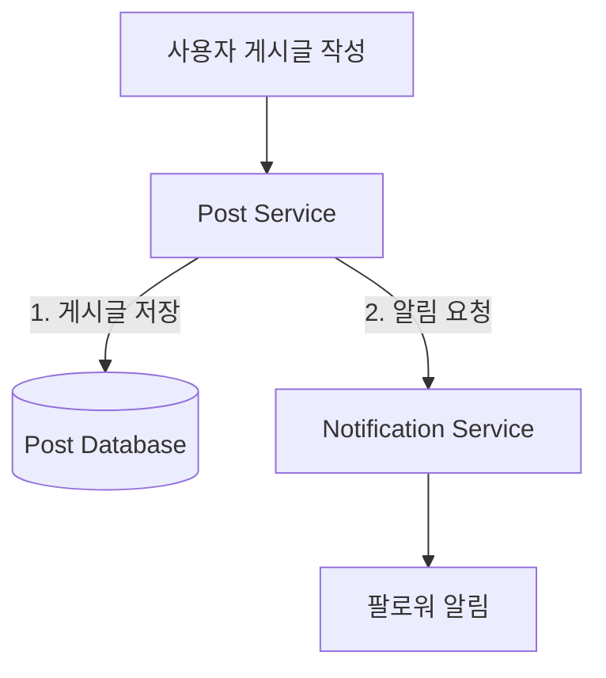

Post Service는 데이터베이스와 외부 알림 시스템을 모두 변경해야 한다.

그런데 여기에는 문제가 있다.

**데이터베이스 트랜잭션은 외부 알림 시스템까지 자동으로 제어하지 못한다.**

이것이 Dual Write 문제의 출발점이다.

---

### 데이터베이스 트랜잭션은 무엇을 보장할까?

Transactional Outbox 패턴을 이해하려면 먼저 데이터베이스 트랜잭션의 원자성(Atomicity)을 알아야 한다.

트랜잭션은 여러 데이터베이스 작업을 하나의 논리적인 작업 단위로 묶는다.

예를 들어 계좌 이체를 생각해 보자.

A 계좌에서 10,000원을 차감한다.

B 계좌에 10,000원을 추가한다.

두 작업은 함께 성공하거나 함께 실패해야 한다.

```sql
BEGIN;

UPDATE accounts
SET balance = balance - 10000
WHERE id = 1;

UPDATE accounts
SET balance = balance + 10000
WHERE id = 2;

COMMIT;
```

중간에 문제가 발생하면 트랜잭션을 롤백할 수 있다.

```sql
ROLLBACK;
```

이러한 성질을 트랜잭션의 원자성이라고 한다.

하지만 이것은 해당 데이터베이스 트랜잭션이 관리하는 작업에 대한 보장이다.

외부 HTTP API를 호출하거나 메시지 브로커에 이벤트를 발행하는 작업까지 자동으로 롤백하지는 않는다.

예를 들어 다음 코드를 살펴보자.

```java
@Transactional
public void createPost(CreatePostRequest request) {

    Post post = postRepository.save(
            Post.create(request)
    );

    notificationClient.sendPostCreated(post);
}
```

`@Transactional`은 Spring의 트랜잭션 관리자를 통해 데이터베이스 작업을 관리한다.

하지만 `notificationClient.sendPostCreated()`가 호출하는 외부 서비스는 다른 시스템이다.

따라서 다음과 같은 상황이 발생할 수 있다.

```text
DB 트랜잭션 시작
        ↓
게시글 INSERT
        ↓
외부 알림 API 호출
        ↓
알림 발송 성공
        ↓
DB 트랜잭션 롤백
```

데이터베이스에서는 게시글이 사라졌다.

하지만 외부 알림 시스템에서 이미 보낸 알림은 자동으로 취소되지 않는다.

**로컬 트랜잭션의 원자성과 여러 시스템 사이의 원자성은 서로 다른 문제다.**

---

### 왜 사용하는가?

### 첫 번째 방법: 하나의 트랜잭션에서 DB 저장과 외부 API 호출

가장 먼저 생각할 수 있는 방법은 게시글 저장과 알림 발송을 하나의 `@Transactional` 메서드에서 처리하는 것이다.

```java
@Transactional
public void createPost(CreatePostRequest request) {

    Post post = postRepository.save(
            Post.create(request)
    );

    notificationClient.sendPostCreated(post);
}
```

실행 순서는 다음과 같다.

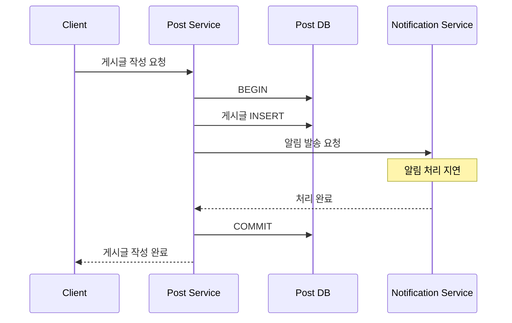

여기서 외부 알림 시스템의 응답이 느려진다고 가정하자.

알림 처리에 10초가 필요하다면 Post Service는 그동안 응답을 기다린다.

그런데 게시글을 저장하는 트랜잭션은 아직 종료되지 않았다.

일반적인 JDBC 트랜잭션 환경에서는 사용 중인 데이터베이스 커넥션이 트랜잭션에 연결되어 있고, 획득한 잠금도 종류에 따라 커밋 또는 롤백 시점까지 유지될 수 있다.

따라서 다음과 같은 문제가 발생할 수 있다.

- 데이터베이스 커넥션 점유 시간 증가
- 트랜잭션 유지 시간 증가
- 행 잠금 유지 시간 증가
- 다른 요청의 DB 작업 지연
- 커넥션 풀 고갈 위험 증가
- 외부 시스템 장애의 내부 서비스 전파

특히 높은 트래픽을 처리하는 서비스라면 문제가 커질 수 있다.

예를 들어 DB 커넥션 풀의 최대 크기가 20이라고 가정하자.

외부 API 호출이 10초 동안 지연되고, 여러 요청이 동시에 해당 메서드에 진입하면 DB 커넥션이 장시간 점유될 수 있다.

결국 게시글 작성과 관계없는 다른 DB 작업에도 영향을 줄 수 있다.

이 문제는 단순한 성능 저하가 아니다.

**외부 시스템의 장애가 내부 데이터베이스의 가용성까지 영향을 미치는 장애 전파 문제**다.

#### 핵심 문제

외부 API 호출이 데이터베이스 트랜잭션의 성공 여부를 결정하는 구조이기 때문에 외부 시스템의 상태가 내부 시스템에 직접적인 영향을 준다.

또 알림이 성공한 뒤 DB 커밋에 실패하면 시스템 간 불일치가 발생할 수 있다.

따라서 외부 API 호출을 로컬 데이터베이스 트랜잭션 안에서 수행하는 것만으로는 Dual Write 문제를 해결할 수 없다.

---

### 두 번째 방법: DB를 먼저 커밋하고 알림을 발송한다

외부 API의 응답을 기다리는 동안 DB 트랜잭션을 유지하는 것이 문제라면 트랜잭션을 먼저 종료하면 될 것 같다.

```java
public void createPost(CreatePostRequest request) {

    Post post = postCommandService.save(request);

    notificationClient.sendPostCreated(post);
}
```

여기서 `postCommandService.save()`는 별도의 Spring Bean에 정의된 `@Transactional` 메서드라고 가정한다.

실행 순서는 다음과 같다.

```text
DB 트랜잭션 시작
        ↓
게시글 저장
        ↓
DB COMMIT
        ↓
외부 알림 API 호출
```

이렇게 하면 외부 API 호출을 기다리는 동안 게시글 저장 트랜잭션을 유지할 필요가 없다.

그런데 새로운 문제가 발생한다.

#### DB 커밋 후 서버가 종료되면 어떻게 될까?

다음 상황을 생각해 보자.

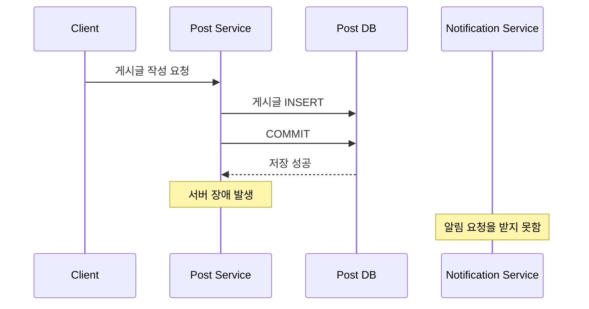

게시글은 이미 데이터베이스에 저장되었다.

하지만 서버가 종료되면서 알림 발송 요청은 실행되지 않았다.

결과적으로 다음과 같은 상태가 된다.

| 시스템 | 상태 |
|---|---|
| Post DB | 게시글 저장 성공 |
| Notification Service | 알림 요청 없음 |
| 사용자 | 게시글 작성 |
| 팔로워 | 알림을 받지 못함 |

이미 커밋된 데이터베이스 작업은 알림 발송 실패를 이유로 자동 롤백할 수 없다.

더 큰 문제는 애플리케이션이 재시작되더라도 **어떤 알림을 발송하지 못했는지 알 수 있는 기록이 없을 수 있다는 것**이다.

따라서 단순히 DB를 먼저 커밋하는 방식도 안전하지 않다.

---

### 세 번째 방법: 알림을 먼저 발송하고 DB에 저장한다

이번에는 순서를 반대로 변경해 보자.

```text
외부 알림 API 호출
        ↓
알림 발송 성공
        ↓
DB 트랜잭션 시작
        ↓
게시글 저장
        ↓
DB COMMIT
```

이 방법에서는 게시글을 저장하기 전에 알림을 발송한다.

그러면 게시글이 저장된 이후 알림 요청이 누락되는 문제는 줄일 수 있을 것 같다.

하지만 반대 방향의 불일치가 발생할 수 있다.

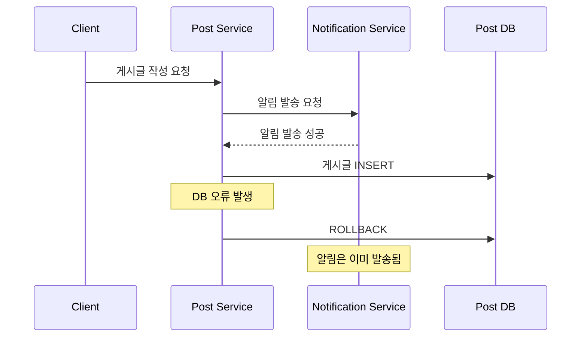

외부 알림 시스템은 정상적으로 알림을 발송했다.

하지만 게시글 저장 과정에서 장애가 발생했다.

따라서 게시글은 데이터베이스에 존재하지 않는다.

결과적으로 팔로워는 존재하지 않는 게시글에 대한 알림을 받게 된다.

**작업의 순서를 변경하면 불일치가 발생하는 방향이 바뀔 뿐, Dual Write 문제 자체는 해결되지 않는다.**

---

### 세 가지 접근 방식 비교

| 구현 방식 | 장점 | 주요 문제 |
|---|---|---|
| DB 트랜잭션 안에서 외부 API 호출 | 구현이 단순함 | 긴 트랜잭션, 장애 전파, 외부 작업 롤백 불가 |
| DB 커밋 후 외부 API 호출 | 트랜잭션 유지 시간 감소 | 커밋 후 장애 시 이벤트 유실 |
| 외부 API 호출 후 DB 저장 | 외부 작업을 먼저 수행 | DB 실패 시 잘못된 외부 작업 발생 |

이 문제의 근본적인 원인은 두 작업이 서로 다른 시스템에서 실행된다는 사실이다.

각 시스템은 자체적인 성공과 실패 시점을 가진다.

따라서 별도의 분산 트랜잭션 프로토콜이나 보완 설계 없이 하나의 로컬 DB 트랜잭션으로 원자성을 보장할 수 없다.

이러한 문제를 해결하는 대표적인 방법이 Transactional Outbox 패턴이다.

---

### Transactional Outbox 패턴이란 무엇인가?

Transactional Outbox 패턴은 **비즈니스 데이터의 변경과 외부로 전달할 메시지의 기록을 동일한 로컬 데이터베이스 트랜잭션으로 처리하는 패턴**이다.

그리고 실제 메시지 발행은 별도의 Worker 또는 Message Relay가 수행한다.

여기서 중요한 것은 두 가지다.

첫 번째는 비즈니스 데이터와 이벤트 기록이 원자적으로 저장된다는 것이다.

두 번째는 외부 시스템 호출을 비즈니스 트랜잭션에서 분리한다는 것이다.

구조는 다음과 같다.

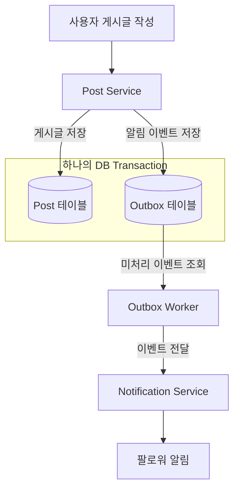

이 구조에서 Post Service는 외부 알림 시스템을 직접 호출하지 않는다.

대신 데이터베이스에 다음 두 가지 데이터를 저장한다.

```text
Post 테이블

새로운 게시글
```

```text
Outbox 테이블

새로운 게시글이 작성되었으므로
팔로워에게 알림이 필요하다는 이벤트
```

두 작업은 같은 데이터베이스 트랜잭션에서 수행한다.

따라서 다음 조건이 성립한다.

**게시글 저장이 커밋되면 Outbox 이벤트도 함께 저장된다.**

**게시글 저장이 롤백되면 Outbox 이벤트도 함께 롤백된다.**

이것이 Transactional Outbox의 가장 중요한 특징이다.

---

### Transactional Outbox의 동작 원리

Transactional Outbox 패턴은 일반적으로 다음 단계로 동작한다.

#### 1단계: 사용자가 게시글을 작성한다

사용자가 새로운 게시글을 작성한다.

```http
POST /api/posts
Content-Type: application/json
```

```json
{
  "authorId": 100,
  "content": "새로운 게시글입니다."
}
```

#### 2단계: 게시글과 Outbox 이벤트를 함께 저장한다

Post Service는 데이터베이스 트랜잭션을 시작한다.

그리고 게시글을 저장한다.

```sql
INSERT INTO posts (
    author_id,
    content
)
VALUES (
    100,
    '새로운 게시글입니다.'
);
```

이후 Outbox 테이블에도 이벤트를 기록한다.

```sql
INSERT INTO outbox_events (
    id,
    event_type,
    aggregate_id,
    payload,
    status
)
VALUES (
    '550e8400-e29b-41d4-a716-446655440000',
    'POST_CREATED',
    1000,
    '{"postId":1000,"authorId":100}',
    'PENDING'
);
```

두 작업을 하나의 트랜잭션으로 수행한다.

```sql
BEGIN;

-- 게시글 저장
INSERT INTO posts (...);

-- Outbox 이벤트 저장
INSERT INTO outbox_events (...);

COMMIT;
```

이때 두 작업 중 하나라도 실패하면 전체 트랜잭션을 롤백한다.

따라서 게시글만 저장되고 Outbox 이벤트는 누락되는 상황을 방지할 수 있다.

단, 이러한 보장은 두 테이블이 동일한 로컬 트랜잭션에 참여한다는 전제에서 성립한다.

#### 3단계: Worker가 미처리 이벤트를 조회한다

별도의 Worker가 Outbox 테이블을 확인한다.

```sql
SELECT *
FROM outbox_events
WHERE status = 'PENDING'
ORDER BY created_at;
```

미처리 이벤트가 존재한다면 외부 알림 시스템에 전달한다.

#### 4단계: 외부 시스템으로 이벤트를 전달한다

Worker는 Notification Service에 이벤트를 전송한다.

```text
Outbox Worker
      ↓
Notification Service
```

이때 외부 시스템 호출은 게시글을 저장한 원래 트랜잭션 밖에서 실행된다.

따라서 외부 알림 시스템의 응답 지연이 게시글 저장 트랜잭션을 장시간 유지하도록 만들지 않는다.

#### 5단계: 성공하면 완료 상태로 변경한다

외부 시스템이 이벤트를 정상적으로 접수했다면 Worker는 Outbox 이벤트의 상태를 변경한다.

```sql
UPDATE outbox_events
SET status = 'SENT'
WHERE id = '550e8400-e29b-41d4-a716-446655440000';
```

전송에 실패했다면 이벤트를 다시 시도할 수 있도록 남겨둔다.

이러한 방식으로 시스템은 외부 서비스의 일시적인 장애가 발생하더라도 나중에 메시지를 다시 전달할 수 있다.

---

### Transactional Outbox의 핵심은 이벤트를 먼저 안전하게 기록하는 것이다

Transactional Outbox를 단순히 이벤트를 별도 테이블에 저장하는 방식이라고 이해하기 쉽다.

하지만 중요한 것은 테이블 자체가 아니다.

**비즈니스 데이터 변경과 메시지 발행 의도를 같은 트랜잭션에서 원자적으로 기록한다는 사실**이다.

예를 들어 다음 두 작업을 비교해 보자.

```java
@Transactional
public void createPost() {

    postRepository.save(post);

    outboxRepository.save(event);
}
```

이 구조에서는 두 데이터베이스 저장 작업이 같은 트랜잭션에 참여한다.

반면 다음 코드는 다르다.

```java
public void createPost() {

    postCommandService.save(post);

    outboxCommandService.save(event);
}
```

두 메서드가 각각 독립적인 트랜잭션으로 실행된다면 어떻게 될까?

게시글 저장은 성공했지만 Outbox 저장에 실패할 수 있다.

결국 처음의 Dual Write 문제와 비슷한 문제가 다시 발생한다.

따라서 Outbox 테이블이 존재한다는 사실만으로는 충분하지 않다.

**반드시 비즈니스 데이터와 Outbox 이벤트를 동일한 로컬 트랜잭션으로 저장해야 한다.**

---

### 주요 특징

### Transactional Outbox가 보장하는 것과 보장하지 않는 것

Transactional Outbox는 분산 시스템의 데이터 정합성을 높이는 데 유용하다.

하지만 모든 문제를 해결하는 것은 아니다.

특히 다음 세 가지를 구분해야 한다.

1. 비즈니스 데이터와 이벤트 기록의 원자성
2. 외부 시스템으로의 이벤트 전달
3. 외부 시스템에서의 비즈니스 처리

이 세 가지는 서로 다른 단계다.

| 구분 | Outbox만으로 가능한 보장 |
|---|---|
| 비즈니스 데이터와 Outbox 기록의 원자성 | 가능 |
| DB 커밋 이후 이벤트 전달 의도의 보존 | 가능 |
| Worker 장애 후 이벤트 재시도 | 복구·재시도 정책을 구현하면 가능 |
| 외부 시스템으로의 무조건적인 전달 성공 | 보장하지 않음 |
| 중복 전달 방지 | 보장하지 않음 |
| Exactly-Once 전달 | 보장하지 않음 |
| 외부 비즈니스 처리의 중복 방지 | 소비자 측 멱등성 필요 |
| 외부 API까지 포함한 원자적 롤백 | 보장하지 않음 |
| 이벤트 순서 보장 | 별도의 순서 제어 설계 필요 |

여기서 중요한 점은 Outbox가 **전달 의도를 안전하게 저장하는 패턴**이라는 것이다.

외부 시스템으로의 전달은 별도의 Worker가 담당한다.

따라서 Worker가 반복적으로 재시도할 수 있는 구조를 만들어야 한다.

또 영구적인 실패를 어떻게 관리할지도 정의해야 한다.

---

### At-Most-Once, At-Least-Once, Exactly-Once란 무엇인가?

메시지 기반 시스템에서는 메시지 전달 보장을 설명하기 위해 다음 세 가지 개념을 사용한다.

- At-Most-Once
- At-Least-Once
- Exactly-Once

각각의 차이를 이해하는 것이 중요하다.

#### At-Most-Once

At-Most-Once는 메시지를 최대 한 번 전달하는 방식이다.

중복 전달은 피할 수 있지만 실패 상황에서 메시지가 유실될 수 있다.

예를 들어 다음과 같다.

```text
메시지 전달 시도
        ↓
네트워크 오류 발생
        ↓
재시도하지 않음
        ↓
메시지 유실 가능
```

이 방식은 중복 전달에 대한 부담이 적지만 메시지 유실을 허용해야 한다.

#### At-Least-Once

At-Least-Once는 메시지를 적어도 한 번 전달하도록 재시도하는 방식이다.

일시적인 장애가 발생하면 메시지를 다시 전달한다.

하지만 같은 메시지가 두 번 이상 전달될 수 있다.

```text
메시지 전달
        ↓
소비자 처리 성공
        ↓
ACK 응답 유실
        ↓
재시도
        ↓
동일 메시지 중복 전달
```

Transactional Outbox는 일반적으로 이러한 전달 모델과 함께 사용된다.

다만 엄밀하게 말하면 Outbox 테이블만으로 At-Least-Once 성공 전달이 자동 보장되는 것은 아니다.

전달 프로세스가 지속적으로 실행되고, 실패한 이벤트가 유실되지 않으며, 필요한 재시도가 계속 이루어진다는 조건이 필요하다.

예를 들어 재시도를 다섯 번 수행한 뒤 이벤트를 영구적으로 폐기한다면 최종 전달을 보장한다고 말할 수 없다.

따라서 재시도 한도에 도달한 이벤트를 별도로 보관하고 수동 또는 자동 복구할 수 있는 구조가 필요하다.

#### Exactly-Once

Exactly-Once는 중복 없이 정확히 한 번 처리되는 성질을 의미한다.

하지만 분산 시스템에서 이 표현을 사용할 때는 주의해야 한다.

다음 세 가지는 서로 다르다.

- 메시지가 네트워크를 통해 정확히 한 번 전달됨
- 메시지 소비 로직이 정확히 한 번 실행됨
- 비즈니스 결과가 정확히 한 번 반영됨

예를 들어 같은 메시지가 두 번 전달되더라도 데이터베이스의 잔액 변경이 한 번만 반영되도록 만들 수 있다.

이 경우 네트워크 전달은 중복되었지만 비즈니스 효과는 한 번만 적용된 것이다.

따라서 실무에서는 Exactly-Once라는 표현만 사용하기보다 **어느 범위에서 중복 없는 처리를 보장하는지** 명확하게 설명하는 것이 좋다.

---

### Outbox를 적용해도 중복 메시지가 발생하는 이유

Transactional Outbox가 이벤트 유실 문제를 줄여주더라도 여전히 해결되지 않는 문제가 있다.

바로 중복 전달이다.

다음 상황을 생각해 보자.

Outbox Worker가 이벤트 100을 조회했다.

이후 Notification Service에 이벤트를 전달했다.

Notification Service는 정상적으로 이벤트를 처리했다.

그리고 성공 응답을 반환했다.

그런데 Outbox Worker가 `SENT` 상태를 저장하기 직전에 장애가 발생했다.

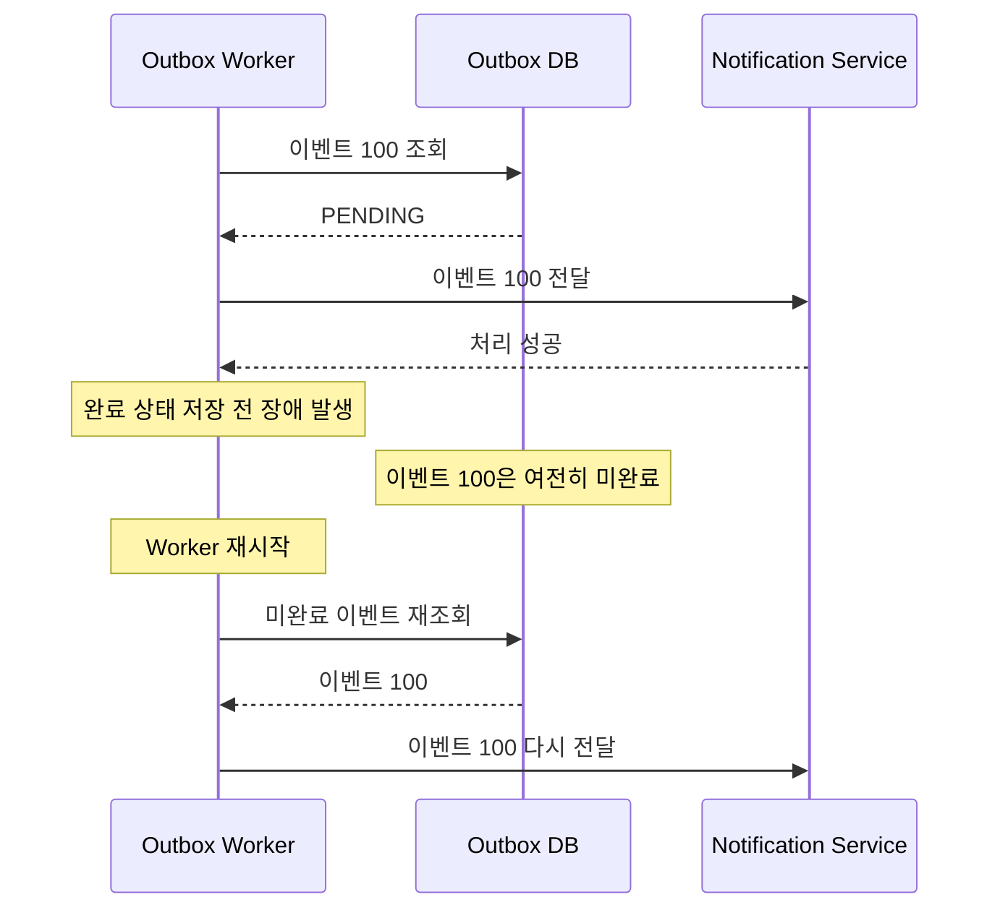

외부 시스템에서는 이미 이벤트를 처리했다.

하지만 Outbox DB에는 처리 완료 사실이 기록되지 않았다.

따라서 Worker가 재시작되면 같은 이벤트를 다시 전송할 수 있다.

이것은 Outbox 구현의 단순한 버그가 아니다.

**외부 시스템의 처리와 Outbox 완료 상태 변경이 서로 다른 트랜잭션이기 때문에 발생하는 구조적인 문제**다.

Transactional Outbox 패턴을 설명하는 Microservices.io와 AWS의 아키텍처 가이드에서도 이러한 중복 전달 가능성과 소비자 멱등성의 필요성을 강조한다.

---

### Transactional Inbox 패턴이란 무엇인가?

Transactional Inbox 패턴은 소비자가 수신한 이벤트의 고유 식별자를 기록하고, 동일한 이벤트가 다시 전달되면 비즈니스 처리를 중복 수행하지 않도록 하는 방식이다.

핵심은 다음 두 작업을 같은 데이터베이스 트랜잭션으로 처리하는 것이다.

1. 처리한 이벤트 ID 기록
2. 해당 이벤트의 비즈니스 데이터 변경

예를 들어 Notification Service가 이벤트를 수신했다고 가정하자.

이벤트는 다음과 같다.

```json
{
  "eventId": "550e8400-e29b-41d4-a716-446655440000",
  "eventType": "POST_CREATED",
  "postId": 1000,
  "authorId": 100
}
```

Notification Service는 먼저 Inbox 테이블에서 해당 이벤트의 처리 여부를 확인한다.

이미 처리한 이벤트라면 비즈니스 작업을 다시 수행하지 않는다.

처리한 적이 없다면 이벤트 ID를 저장하고 알림 작업을 생성한다.

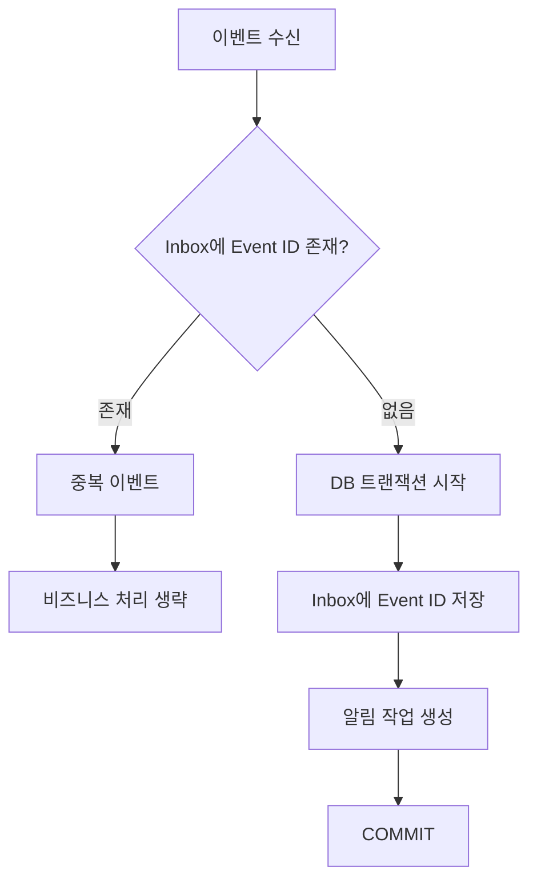

이러한 구조를 통해 소비자는 같은 이벤트가 여러 번 전달되더라도 데이터베이스에 동일한 작업을 중복 반영하지 않도록 만들 수 있다.

여기서 중요한 것은 단순히 이벤트 ID를 조회하는 것만으로는 충분하지 않다는 점이다.

---

### Inbox에서 단순 조회만 사용하면 안 되는 이유

다음 코드를 살펴보자.

```java
if (inboxRepository.existsById(eventId)) {
    return;
}

inboxRepository.save(new InboxEvent(eventId));

notificationRepository.save(notification);
```

처음에는 문제가 없어 보인다.

이미 존재하는 이벤트라면 처리하지 않는다.

그런데 같은 이벤트가 동시에 두 번 전달되면 어떻게 될까?

```text
Consumer A

Inbox 조회 → 없음
```

```text
Consumer B

Inbox 조회 → 없음
```

두 요청 모두 이벤트가 존재하지 않는다고 판단할 수 있다.

따라서 두 요청이 모두 비즈니스 처리를 실행할 가능성이 있다.

이를 Check-Then-Act 경쟁 상태라고 볼 수 있다.

따라서 Inbox에서는 데이터베이스의 고유 제약 조건을 활용하는 것이 중요하다.

예를 들어 다음과 같이 정의할 수 있다.

```sql
CREATE TABLE inbox_events (
    event_id UUID PRIMARY KEY,
    event_type VARCHAR(100) NOT NULL,
    processed_at TIMESTAMPTZ NOT NULL DEFAULT NOW()
);
```

`event_id`가 기본 키이므로 동일한 이벤트 ID를 두 번 저장할 수 없다.

그리고 다음과 같이 원자적인 INSERT를 활용할 수 있다.

```sql
INSERT INTO inbox_events (
    event_id,
    event_type
)
VALUES (
    '550e8400-e29b-41d4-a716-446655440000',
    'POST_CREATED'
)
ON CONFLICT (event_id) DO NOTHING;
```

이 SQL은 같은 이벤트 ID가 존재하면 중복 저장하지 않는다.

여기서 INSERT 결과를 확인하여 실제로 새로운 이벤트가 등록된 경우에만 비즈니스 로직을 실행할 수 있다.

물론 이 작업은 비즈니스 데이터 변경과 같은 트랜잭션에서 수행해야 한다.

Idempotent Consumer 패턴에서도 처리한 메시지 ID와 비즈니스 데이터 변경을 동일한 트랜잭션에서 수행하는 방식을 제시한다.

---

### Transactional Outbox와 Inbox의 전체 구조

두 패턴을 함께 적용하면 다음과 같은 구조가 된다.

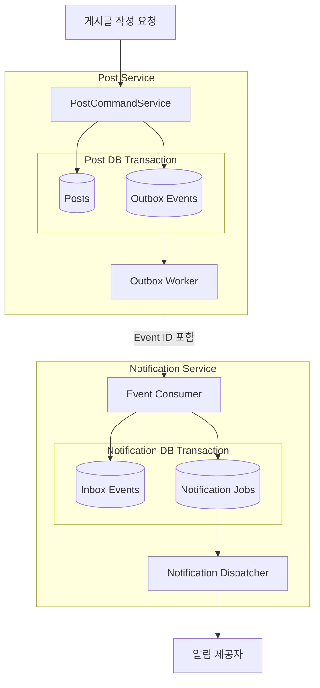

이 구조에서 각 서비스는 자신의 데이터베이스 트랜잭션만 관리한다.

Post Service는 게시글과 Outbox 이벤트를 원자적으로 저장한다.

Notification Service는 Inbox 이벤트와 알림 작업을 원자적으로 저장한다.

서비스 사이에서는 이벤트가 중복 전달될 수 있다.

하지만 소비자는 이벤트 ID를 기준으로 중복 작업 생성을 방지한다.

여기서 중요한 점이 있다.

**Inbox의 트랜잭션은 외부 이메일·SMS·푸시 발송까지 원자적으로 보장하지 않는다.**

예를 들어 Inbox 기록과 이메일 발송을 하나의 메서드에서 수행하더라도 이메일 제공자는 별도의 시스템이다.

따라서 실제 알림 발송까지 안정적으로 처리하려면 추가적인 비동기 작업 관리 또는 Outbox 구조가 필요할 수 있다.

이 차이는 뒤에서 자세히 살펴본다.

---

### 예제

### Spring Boot와 PostgreSQL로 구현하는 Transactional Outbox

이제 실제 Spring Boot 프로젝트에서 Transactional Outbox를 구현해 보자.

예제의 목표는 다음과 같다.

**사용자가 게시글을 작성하면 게시글과 Outbox 이벤트를 동일한 DB 트랜잭션에 저장하고, 별도의 Worker가 Notification Service에 이벤트를 전달한다.**

예제 환경은 다음과 같다.

| 항목 | 기술 |
|---|---|
| Language | Java 17 이상 |
| Framework | Spring Boot 3.2 이상 |
| Database | PostgreSQL |
| Data Access | Spring JDBC |
| HTTP Client | Spring RestClient |
| Scheduling | Spring Scheduling |
| Transaction | Spring Transaction Management |

여기서는 Outbox 동작과 SQL을 명확하게 확인하기 위해 Spring JDBC를 사용한다.

실제 프로젝트에서는 Spring Data JPA와 함께 사용할 수도 있다.

Spring JDBC와 JPA 모두 적절하게 구성하면 같은 로컬 데이터베이스 트랜잭션에 참여할 수 있다.

단, 서로 다른 DataSource나 트랜잭션 관리자를 사용한다면 동일한 트랜잭션으로 처리되지 않을 수 있으므로 주의해야 한다.

---

### 프로젝트 구성

예제는 두 개의 독립적인 서비스로 구성한다.

```text
transactional-outbox-example/
│
├── post-service/
│   ├── src/main/java/
│   │   └── com/example/post/
│   │       ├── PostApplication.java
│   │       ├── PostController.java
│   │       ├── PostCommandService.java
│   │       ├── PostCreatedEvent.java
│   │       ├── OutboxRepository.java
│   │       ├── OutboxWorker.java
│   │       └── NotificationClientConfig.java
│   │
│   └── src/main/resources/
│       ├── application.yml
│       └── schema.sql
│
└── notification-service/
    ├── src/main/java/
    │   └── com/example/notification/
    │       ├── NotificationApplication.java
    │       ├── NotificationController.java
    │       ├── NotificationInboxService.java
    │       └── PostCreatedEvent.java
    │
    └── src/main/resources/
        ├── application.yml
        └── schema.sql
```

두 서비스는 각각 독립적인 데이터베이스를 사용한다고 가정한다.

```text
Post Service
    └── postdb

Notification Service
    └── notificationdb
```

따라서 하나의 데이터베이스 트랜잭션으로 두 서비스의 데이터를 동시에 커밋할 수 없다.

바로 이러한 환경에서 Transactional Outbox와 Inbox 패턴이 유용하다.

---

### 1. Gradle 의존성 구성

Spring Boot 프로젝트에 필요한 의존성을 추가한다.

두 서비스 모두 다음 의존성을 사용한다.

```gradle
dependencies {
    implementation 'org.springframework.boot:spring-boot-starter-web'
    implementation 'org.springframework.boot:spring-boot-starter-jdbc'
    implementation 'org.springframework.boot:spring-boot-starter-validation'

    runtimeOnly 'org.postgresql:postgresql'

    testImplementation 'org.springframework.boot:spring-boot-starter-test'
}
```

각 의존성의 역할은 다음과 같다.

| 의존성 | 역할 |
|---|---|
| spring-boot-starter-web | REST API와 HTTP 통신 |
| spring-boot-starter-jdbc | JdbcTemplate과 DB 접근 |
| spring-boot-starter-validation | 요청값 검증 |
| postgresql | PostgreSQL JDBC Driver |
| spring-boot-starter-test | 테스트 환경 |

위 코드는 Spring Boot Gradle 플러그인과 의존성 관리가 설정된 프로젝트의 `dependencies` 부분이다.

Spring Boot 3.2 이상에서는 `RestClient`를 사용할 수 있다.

---

### 2. Post Service의 데이터베이스 구성

먼저 게시글 테이블을 생성한다.

```sql
CREATE TABLE IF NOT EXISTS posts (
    id BIGINT GENERATED ALWAYS AS IDENTITY PRIMARY KEY,

    author_id BIGINT NOT NULL,

    content TEXT NOT NULL,

    created_at TIMESTAMPTZ NOT NULL DEFAULT NOW()
);
```

다음으로 Outbox 테이블을 생성한다.

```sql
CREATE TABLE IF NOT EXISTS outbox_events (
    id UUID PRIMARY KEY,

    aggregate_type VARCHAR(100) NOT NULL,

    aggregate_id BIGINT NOT NULL,

    event_type VARCHAR(100) NOT NULL,

    payload JSONB NOT NULL,

    status VARCHAR(20) NOT NULL DEFAULT 'PENDING',

    attempt_count INTEGER NOT NULL DEFAULT 0,

    next_attempt_at TIMESTAMPTZ NOT NULL DEFAULT NOW(),

    lease_token UUID,

    lease_until TIMESTAMPTZ,

    created_at TIMESTAMPTZ NOT NULL DEFAULT NOW(),

    sent_at TIMESTAMPTZ,

    CONSTRAINT chk_outbox_status
        CHECK (
            status IN (
                'PENDING',
                'PROCESSING',
                'SENT',
                'DEAD'
            )
        )
);
```

이 테이블에는 여러 컬럼이 존재한다.

각 컬럼의 역할을 살펴보자.

| 컬럼 | 역할 |
|---|---|
| id | 이벤트 고유 식별자 |
| aggregate_type | 이벤트와 관련된 도메인 종류 |
| aggregate_id | 이벤트가 발생한 도메인 객체 ID |
| event_type | 이벤트 종류 |
| payload | 전달할 이벤트 데이터 |
| status | 이벤트 처리 상태 |
| attempt_count | 전송 시도 횟수 |
| next_attempt_at | 다음 재시도 시각 |
| lease_token | 작업을 점유한 Worker의 처리 토큰 |
| lease_until | 작업 점유 만료 시각 |
| created_at | 이벤트 생성 시각 |
| sent_at | 전송 완료 시각 |

여기서 특히 중요한 컬럼은 다음과 같다.

```text
id
status
attempt_count
next_attempt_at
lease_token
lease_until
```

이 컬럼들은 이벤트의 중복 처리와 장애 복구를 제어하는 데 사용한다.

실제 서비스에서는 조회 성능을 위해 인덱스도 구성할 수 있다.

```sql
CREATE INDEX IF NOT EXISTS idx_outbox_pending
ON outbox_events (
    next_attempt_at,
    created_at
)
WHERE status = 'PENDING';
```

이 인덱스는 미처리 이벤트 중 재시도 가능한 이벤트를 조회하는 데 도움이 될 수 있다.

또 Worker가 점유한 뒤 장애로 중단된 작업을 찾기 위한 인덱스도 고려할 수 있다.

```sql
CREATE INDEX IF NOT EXISTS idx_outbox_processing
ON outbox_events (
    lease_until
)
WHERE status = 'PROCESSING';
```

인덱스의 실제 효과는 데이터 분포와 처리량, 실행 계획에 따라 달라질 수 있다.

---

### 3. Event 객체 정의

게시글 생성 이벤트를 정의한다.

```java
package com.example.post;

import java.util.UUID;

public record PostCreatedEvent(
        UUID eventId,
        String eventType,
        Long postId,
        Long authorId,
        int schemaVersion
) {
}
```

이벤트에는 고유 식별자인 `eventId`가 포함되어 있다.

이 값은 소비자가 중복 이벤트를 판단하는 데 사용한다.

예를 들어 다음과 같은 JSON으로 변환될 수 있다.

```json
{
  "eventId": "550e8400-e29b-41d4-a716-446655440000",
  "eventType": "POST_CREATED",
  "postId": 1000,
  "authorId": 100,
  "schemaVersion": 1
}
```

여기서 중요한 것은 이벤트 ID를 언제 생성하는가이다.

**이벤트 ID는 Outbox에 이벤트를 기록할 때 한 번 생성하고, 재전송할 때도 같은 값을 사용해야 한다.**

Worker가 이벤트를 다시 보낼 때마다 새로운 UUID를 생성한다면 소비자는 동일한 이벤트의 재전송이라는 사실을 구분하기 어려워진다.

따라서 이벤트의 고유 식별자는 이벤트의 전체 생명주기 동안 유지되어야 한다.

---

### 4. 게시글과 Outbox 이벤트를 같은 트랜잭션에 저장한다

이제 가장 중요한 부분이다.

게시글을 저장하는 서비스 메서드에서 Outbox 이벤트도 함께 저장한다.

```java
package com.example.post;

import com.fasterxml.jackson.core.JsonProcessingException;
import com.fasterxml.jackson.databind.ObjectMapper;
import org.springframework.jdbc.core.JdbcTemplate;
import org.springframework.stereotype.Service;
import org.springframework.transaction.annotation.Transactional;

import java.util.UUID;

@Service
public class PostCommandService {

    private final JdbcTemplate jdbcTemplate;
    private final ObjectMapper objectMapper;

    public PostCommandService(
            JdbcTemplate jdbcTemplate,
            ObjectMapper objectMapper
    ) {
        this.jdbcTemplate = jdbcTemplate;
        this.objectMapper = objectMapper;
    }

    @Transactional
    public Long createPost(
            Long authorId,
            String content
    ) {

        Long postId = jdbcTemplate.queryForObject(
                """
                INSERT INTO posts (
                    author_id,
                    content
                )
                VALUES (?, ?)
                RETURNING id
                """,
                Long.class,
                authorId,
                content
        );

        UUID eventId = UUID.randomUUID();

        PostCreatedEvent event = new PostCreatedEvent(
                eventId,
                "POST_CREATED",
                postId,
                authorId,
                1
        );

        String payload = toJson(event);

        jdbcTemplate.update(
                """
                INSERT INTO outbox_events (
                    id,
                    aggregate_type,
                    aggregate_id,
                    event_type,
                    payload,
                    status
                )
                VALUES (
                    ?,
                    'POST',
                    ?,
                    'POST_CREATED',
                    CAST(? AS JSONB),
                    'PENDING'
                )
                """,
                eventId,
                postId,
                payload
        );

        return postId;
    }

    private String toJson(PostCreatedEvent event) {

        try {
            return objectMapper.writeValueAsString(event);

        } catch (JsonProcessingException e) {

            throw new IllegalStateException(
                    "이벤트 직렬화에 실패했습니다.",
                    e
            );
        }
    }
}
```

이 코드에서 가장 중요한 부분은 다음과 같다.

```java
@Transactional
public Long createPost(
        Long authorId,
        String content
)
```

그리고 메서드 내부의 두 가지 INSERT다.

첫 번째는 게시글 저장이다.

```java
jdbcTemplate.queryForObject(
        """
        INSERT INTO posts (
            author_id,
            content
        )
        VALUES (?, ?)
        RETURNING id
        """,
        Long.class,
        authorId,
        content
);
```

두 번째는 Outbox 이벤트 저장이다.

```java
jdbcTemplate.update(
        """
        INSERT INTO outbox_events (
            id,
            aggregate_type,
            aggregate_id,
            event_type,
            payload,
            status
        )
        VALUES (
            ?,
            'POST',
            ?,
            'POST_CREATED',
            CAST(? AS JSONB),
            'PENDING'
        )
        """,
        eventId,
        postId,
        payload
);
```

두 작업은 같은 트랜잭션에서 실행된다.

따라서 다음과 같은 결과를 기대할 수 있다.

| 게시글 INSERT | Outbox INSERT | 최종 결과 |
|---|---|---|
| 성공 | 성공 | 함께 커밋 |
| 성공 | 실패 | 함께 롤백 |
| 실패 | 실행되지 않음 | 함께 롤백 |
| 성공 | 성공했지만 커밋 실패 | 둘 다 커밋되지 않음 |

이러한 구조에서는 게시글만 저장되고 Outbox 이벤트가 누락되는 상황을 방지할 수 있다.

단, 실제로 같은 트랜잭션을 사용하는지는 Spring의 트랜잭션 관리 구성에 따라 달라질 수 있다.

또 `@Transactional`은 일반적인 Spring 프록시 기반 환경에서 프록시를 거치는 호출에 적용되므로, 같은 객체 내부에서 자기 자신을 호출하는 경우와 같은 프록시 적용 조건도 고려해야 한다.

---

### 5. 게시글 생성 API 구현

Controller를 작성한다.

```java
package com.example.post;

import jakarta.validation.Valid;
import jakarta.validation.constraints.NotBlank;
import jakarta.validation.constraints.NotNull;
import org.springframework.http.ResponseEntity;
import org.springframework.web.bind.annotation.*;

import java.net.URI;

@RestController
@RequestMapping("/api/posts")
public class PostController {

    private final PostCommandService postCommandService;

    public PostController(
            PostCommandService postCommandService
    ) {
        this.postCommandService = postCommandService;
    }

    public record CreatePostRequest(
            @NotNull Long authorId,
            @NotBlank String content
    ) {
    }

    @PostMapping
    public ResponseEntity<Void> create(
            @Valid @RequestBody CreatePostRequest request
    ) {

        Long postId = postCommandService.createPost(
                request.authorId(),
                request.content()
        );

        return ResponseEntity.created(
                URI.create("/api/posts/" + postId)
        ).build();
    }
}
```

이 예제에서는 Outbox 동작에 집중하기 위해 `authorId`를 요청 데이터로 받았다.

실제 서비스에서는 클라이언트가 전달한 작성자 ID를 그대로 신뢰하지 않고 인증된 사용자 정보에서 작성자를 결정해야 한다.

이제 다음 요청을 보낸다.

```bash
curl -i \
  -X POST http://localhost:8080/api/posts \
  -H "Content-Type: application/json" \
  -d '{
    "authorId": 100,
    "content": "새로운 게시글입니다."
  }'
```

정상적으로 처리되면 다음과 같은 응답을 받을 수 있다.

```http
HTTP/1.1 201 Created
Location: /api/posts/1
```

이 명령어는 Post Service에 게시글 생성 요청을 전송한다.

서버는 게시글과 Outbox 이벤트를 하나의 트랜잭션으로 저장한다.

따라서 응답이 반환된 시점에는 알림이 이미 발송되었다는 의미가 아니라, **게시글과 알림 이벤트가 데이터베이스에 안전하게 기록되었다는 의미**로 이해해야 한다.

실제 서비스의 API 응답 정책은 이러한 비동기 처리 특성을 고려해 설계해야 한다.

---

### 6. 데이터베이스 저장 결과 확인

PostgreSQL에서 게시글 데이터를 확인한다.

```sql
SELECT *
FROM posts;
```

결과는 다음과 같은 형태다.

```text
id | author_id | content
---+-----------+-------------------------
1  | 100       | 새로운 게시글입니다.
```

이제 Outbox 테이블을 확인한다.

```sql
SELECT
    id,
    event_type,
    aggregate_id,
    status,
    attempt_count
FROM outbox_events;
```

Worker가 아직 이벤트를 처리하지 않았다면 다음과 같은 결과를 확인할 수 있다.

```text
event_type  | aggregate_id | status  | attempt_count
------------+--------------+---------+--------------
POST_CREATED| 1            | PENDING | 0
```

게시글과 Outbox 이벤트가 함께 저장되었다.

이제 Worker는 Outbox 이벤트를 외부 시스템으로 전달할 수 있다.

---

### 7. Outbox Worker를 구현한다

Outbox Worker의 역할은 다음과 같다.

1. 전송 가능한 이벤트 조회
2. 처리할 이벤트 점유
3. 외부 시스템으로 전송
4. 성공 시 완료 상태 변경
5. 실패 시 재시도 정보 기록

가장 단순한 방법은 다음과 같다.

```java
@Scheduled(fixedDelay = 1000)
public void publish() {

    // 미처리 이벤트 조회

    // 외부 시스템 호출

    // 성공하면 완료 처리
}
```

하지만 실제 서비스에서는 Worker가 여러 개 실행될 수 있다.

예를 들어 애플리케이션 인스턴스가 세 개라면 세 인스턴스에서 같은 Worker가 동작할 수 있다.

이때 각 Worker가 동일한 이벤트를 조회하면 중복 전송이 발생할 가능성이 커진다.

따라서 **미처리 이벤트 조회와 작업 점유를 원자적으로 수행하는 구조**가 필요하다.

---

### 다중 Worker 환경에서 발생하는 동시성 문제

다음 상황을 생각해 보자.

```text
Outbox Event 100

status = PENDING
```

두 Worker가 동시에 이벤트를 조회한다.

```text
Worker A

SELECT → Event 100
```

```text
Worker B

SELECT → Event 100
```

이후 두 Worker가 모두 외부 시스템으로 이벤트를 전송한다.

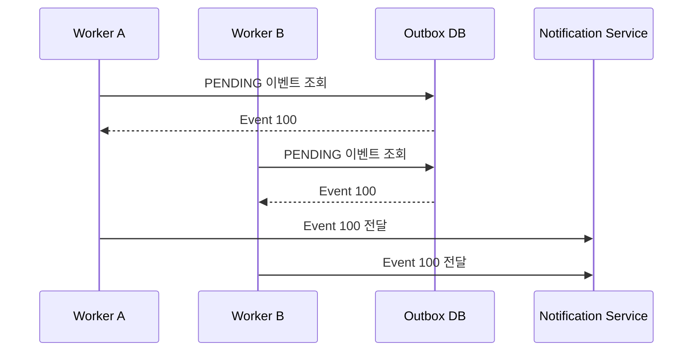

이러한 상황을 줄이기 위해 PostgreSQL에서는 `FOR UPDATE SKIP LOCKED`를 활용할 수 있다.

PostgreSQL 공식 문서에서도 `SKIP LOCKED`를 여러 소비자가 작업 큐와 유사한 테이블을 처리하면서 잠금 경합을 줄이는 용도로 사용할 수 있다고 설명한다.

---

### FOR UPDATE SKIP LOCKED란 무엇인가?

`FOR UPDATE`는 조회한 행에 대해 갱신을 위한 잠금을 확보한다.

`SKIP LOCKED`는 다른 트랜잭션이 잠근 행을 기다리지 않고 건너뛰도록 한다.

예를 들어 다음과 같다.

```sql
SELECT id
FROM outbox_events
WHERE status = 'PENDING'
ORDER BY created_at
LIMIT 10
FOR UPDATE SKIP LOCKED;
```

다만 이 SQL만 실행하고 잠금을 해제한 뒤 외부 시스템을 호출하면 작업 점유가 유지되지 않는다.

일반적으로 작업을 조회하고 상태를 변경하는 과정을 하나의 짧은 트랜잭션으로 처리해야 한다.

예를 들어 다음과 같은 구조를 사용할 수 있다.

```text
트랜잭션 시작
        ↓
미처리 이벤트 조회 및 잠금
        ↓
PROCESSING 상태로 변경
        ↓
트랜잭션 커밋
        ↓
외부 시스템 호출
```

이렇게 하면 외부 시스템 호출 중에 DB 행 잠금을 유지할 필요가 없다.

대신 이벤트의 `PROCESSING` 상태와 점유 만료 시각을 이용해 작업 소유권을 관리한다.

---

### Lease를 이용한 작업 점유

Lease는 Worker가 일정 시간 동안 작업을 점유하도록 만드는 방식이다.

예를 들어 다음과 같은 상태를 생각해 보자.

```text
Event 100

status = PROCESSING

lease_until = 12:00:30
```

Worker가 12:00:00에 작업을 점유했다.

점유 만료 시각은 12:00:30이다.

정상적으로 처리했다면 `SENT`로 상태를 변경한다.

하지만 Worker가 장애로 종료되었다면 어떻게 될까?

12:00:30 이후에는 다른 Worker가 해당 작업을 다시 점유할 수 있다.

즉 Lease를 사용하면 Worker 장애로 작업이 영구적으로 `PROCESSING` 상태에 머무르는 문제를 줄일 수 있다.

다만 Lease가 만료된 뒤에도 원래 Worker가 살아 있을 수 있다.

이 경우 두 Worker가 동시에 같은 외부 작업을 수행할 가능성이 있다.

따라서 Lease는 중복 전송을 완전히 제거하는 방법이 아니다.

**Worker의 복구 가능성을 높이는 방법이며, 소비자 측 멱등성은 여전히 필요하다.**

---

### 8. Outbox Repository 구현

이제 실제 SQL과 Java 코드를 작성해 보자.

먼저 Worker가 조회할 이벤트를 표현하는 객체를 정의한다.

```java
package com.example.post;

import java.util.UUID;

public record ClaimedOutboxEvent(
        UUID id,
        String payload,
        UUID leaseToken,
        int attemptCount
) {
}
```

다음으로 Repository를 구현한다.

```java
package com.example.post;

import org.springframework.jdbc.core.JdbcTemplate;
import org.springframework.stereotype.Repository;

import java.util.List;
import java.util.UUID;

@Repository
public class OutboxRepository {

    private final JdbcTemplate jdbcTemplate;

    public OutboxRepository(JdbcTemplate jdbcTemplate) {
        this.jdbcTemplate = jdbcTemplate;
    }

    public List<ClaimedOutboxEvent> claim(int limit) {

        String sql = """
            WITH candidates AS (
                SELECT id
                FROM outbox_events
                WHERE (
                    status = 'PENDING'
                    AND next_attempt_at <= NOW()
                )
                OR (
                    status = 'PROCESSING'
                    AND lease_until < NOW()
                )
                ORDER BY created_at, id
                LIMIT ?
                FOR UPDATE SKIP LOCKED
            )
            UPDATE outbox_events o
            SET
                status = 'PROCESSING',
                lease_token = gen_random_uuid(),
                lease_until = NOW() + INTERVAL '30 seconds',
                attempt_count = attempt_count + 1
            FROM candidates c
            WHERE o.id = c.id
            RETURNING
                o.id,
                o.payload::text AS payload,
                o.lease_token,
                o.attempt_count
            """;

        return jdbcTemplate.query(
                sql,
                (rs, rowNum) -> new ClaimedOutboxEvent(
                        rs.getObject("id", UUID.class),
                        rs.getString("payload"),
                        rs.getObject("lease_token", UUID.class),
                        rs.getInt("attempt_count")
                ),
                limit
        );
    }

    public int markSent(
            UUID eventId,
            UUID leaseToken
    ) {

        return jdbcTemplate.update(
                """
                UPDATE outbox_events
                SET
                    status = 'SENT',
                    sent_at = NOW(),
                    lease_token = NULL,
                    lease_until = NULL
                WHERE id = ?
                  AND lease_token = ?
                  AND status = 'PROCESSING'
                """,
                eventId,
                leaseToken
        );
    }

    public int markFailed(
            UUID eventId,
            UUID leaseToken,
            int attemptCount
    ) {

        String nextStatus =
                attemptCount >= 5
                        ? "DEAD"
                        : "PENDING";

        long delaySeconds = Math.min(
                300L,
                1L << Math.min(attemptCount, 8)
        );

        return jdbcTemplate.update(
                """
                UPDATE outbox_events
                SET
                    status = ?,
                    next_attempt_at =
                        NOW() + (? * INTERVAL '1 second'),
                    lease_token = NULL,
                    lease_until = NULL
                WHERE id = ?
                  AND lease_token = ?
                  AND status = 'PROCESSING'
                """,
                nextStatus,
                delaySeconds,
                eventId,
                leaseToken
        );
    }
}
```

이 코드는 세 가지 핵심 작업을 담당한다.

첫 번째는 `claim()`이다.

미처리 이벤트를 조회하고 작업 점유 상태로 변경한다.

두 번째는 `markSent()`다.

이벤트 전송 성공을 기록한다.

세 번째는 `markFailed()`다.

이벤트 전송 실패 시 재시도 정보를 갱신한다.

여기서 중요한 부분을 살펴보자.

---

### claim()의 핵심 동작

`claim()`에서 사용하는 SQL은 다음 흐름을 가진다.

```text
처리 가능한 이벤트 조회
        ↓
FOR UPDATE SKIP LOCKED
        ↓
조회한 이벤트의 상태 변경
        ↓
PROCESSING
        ↓
Lease Token 생성
        ↓
Lease 만료 시각 설정
        ↓
조회 결과 반환
```

이 작업은 하나의 SQL 문장으로 실행되므로 PostgreSQL에서 원자적으로 처리할 수 있다.

각 Worker는 다른 Worker가 점유하고 있는 행을 건너뛰도록 동작한다.

따라서 동일한 미처리 이벤트를 동시에 점유하는 상황을 줄일 수 있다.

하지만 앞서 설명한 것처럼 Lease 만료나 외부 호출 결과의 불확실성 때문에 중복 전송 가능성은 여전히 존재한다.

---

### leaseToken이 필요한 이유

단순히 `PROCESSING` 상태만 사용하면 다음과 같은 문제가 발생할 수 있다.

Worker A가 이벤트를 점유한다.

이후 외부 API 호출이 지연된다.

Lease가 만료되자 Worker B가 같은 이벤트를 다시 점유한다.

그런데 Worker A가 뒤늦게 전송을 완료하고 `SENT` 상태로 변경하려고 한다.

이때 아무 조건 없이 업데이트하면 Worker B의 처리 상태를 덮어쓸 수 있다.

따라서 Worker가 작업을 점유할 때 생성한 고유 토큰을 함께 확인한다.

```sql
UPDATE outbox_events
SET status = 'SENT'
WHERE id = ?
  AND lease_token = ?
  AND status = 'PROCESSING';
```

이 방식은 오래된 Worker가 다른 Worker의 작업 상태를 잘못 갱신하는 문제를 줄이는 데 도움이 된다.

다만 외부 시스템에 이미 발생한 부작용까지 취소하는 것은 아니다.

따라서 실제 메시지 처리의 중복 방지는 소비자 측에서도 구현해야 한다.

---

### 9. Notification Client 구현

이제 외부 알림 시스템으로 이벤트를 전송하는 HTTP Client를 구성한다.

Spring의 `RestClient`를 사용한다.

```java
package com.example.post;

import org.springframework.beans.factory.annotation.Value;
import org.springframework.context.annotation.Bean;
import org.springframework.context.annotation.Configuration;
import org.springframework.http.client.SimpleClientHttpRequestFactory;
import org.springframework.web.client.RestClient;

import java.time.Duration;

@Configuration
public class NotificationClientConfig {

    @Bean
    public RestClient notificationRestClient(
            RestClient.Builder builder,
            @Value("${notification.base-url}") String baseUrl
    ) {

        SimpleClientHttpRequestFactory factory =
                new SimpleClientHttpRequestFactory();

        factory.setConnectTimeout(Duration.ofSeconds(2));

        factory.setReadTimeout(Duration.ofSeconds(3));

        return builder
                .baseUrl(baseUrl)
                .requestFactory(factory)
                .build();
    }
}
```

여기서는 두 가지 타임아웃을 설정했다.

| 옵션 | 의미 |
|---|---|
| Connect Timeout | 연결을 수립하기 위해 기다리는 시간 |
| Read Timeout | 응답 데이터를 읽는 과정에서 기다리는 시간 |

실제 HTTP Client의 타임아웃 적용 범위는 사용하는 구현체에 따라 달라질 수 있다.

특히 Read Timeout이 항상 요청의 전체 실행 시간을 엄격하게 제한하는 것은 아니므로 전체 요청 마감 시간이나 재시도 정책도 별도로 검토해야 한다.

Spring Framework의 `SimpleClientHttpRequestFactory`는 연결 및 읽기 타임아웃 설정을 지원한다.

---

### 10. Outbox Worker 구현

이제 주기적으로 이벤트를 조회하고 전송하는 Worker를 작성한다.

```java
package com.example.post;

import org.springframework.http.MediaType;
import org.springframework.scheduling.annotation.Scheduled;
import org.springframework.stereotype.Component;
import org.springframework.web.client.RestClient;

import java.util.List;

@Component
public class OutboxWorker {

    private final OutboxRepository outboxRepository;
    private final RestClient notificationRestClient;

    public OutboxWorker(
            OutboxRepository outboxRepository,
            RestClient notificationRestClient
    ) {
        this.outboxRepository = outboxRepository;
        this.notificationRestClient = notificationRestClient;
    }

    @Scheduled(
            fixedDelayString = "${outbox.poll-delay-ms:500}"
    )
    public void publish() {

        List<ClaimedOutboxEvent> events =
                outboxRepository.claim(1);

        for (ClaimedOutboxEvent event : events) {

            try {

                notificationRestClient.post()
                        .uri("/internal/events/posts")
                        .contentType(MediaType.APPLICATION_JSON)
                        .body(event.payload())
                        .retrieve()
                        .toBodilessEntity();

                outboxRepository.markSent(
                        event.id(),
                        event.leaseToken()
                );

            } catch (Exception exception) {

                outboxRepository.markFailed(
                        event.id(),
                        event.leaseToken(),
                        event.attemptCount()
                );
            }
        }
    }
}
```

이 Worker는 다음과 같이 동작한다.

```text
주기적으로 실행
        ↓
Outbox 이벤트 점유
        ↓
Notification Service 호출
        ↓
성공?
   ├── YES → SENT
   └── NO  → PENDING 또는 DEAD
```

여기서 외부 API 호출에는 게시글을 저장했던 DB 트랜잭션이 유지되지 않는다.

`claim()`은 짧은 DB 작업으로 이벤트를 점유한다.

이후 외부 API 호출을 실행한다.

그리고 성공 여부에 따라 별도의 DB 작업으로 상태를 갱신한다.

따라서 외부 시스템의 응답 지연이 게시글 저장 트랜잭션을 장시간 점유하는 문제를 줄일 수 있다.

이 예제에서는 흐름을 명확하게 보여주기 위해 한 번에 하나의 이벤트만 처리한다.

실제 고처리량 시스템에서는 배치 처리와 병렬성, 작업 점유 시간을 함께 설계해야 한다.

또 로그와 예외 정보를 추가로 기록해 실패 원인을 추적할 수 있도록 해야 한다.

**재시도 한도에 도달한 이벤트는 `DEAD` 상태로 남는다. 이 예제는 이벤트를 자동으로 폐기하지 않지만, 운영 환경에서는 별도의 재처리 절차가 필요하다.**

---

### 11. Scheduling 활성화

Spring Boot 애플리케이션에서 Scheduling을 활성화한다.

```java
package com.example.post;

import org.springframework.boot.SpringApplication;
import org.springframework.boot.autoconfigure.SpringBootApplication;
import org.springframework.scheduling.annotation.EnableScheduling;

@SpringBootApplication
@EnableScheduling
public class PostApplication {

    public static void main(String[] args) {
        SpringApplication.run(
                PostApplication.class,
                args
        );
    }
}
```

`@EnableScheduling`은 `@Scheduled`가 적용된 메서드를 주기적으로 실행할 수 있도록 한다.

---

### 12. Post Service 설정

`application.yml`에 데이터베이스와 외부 서비스 주소를 설정한다.

```yaml
server:
  port: 8080

spring:
  datasource:
    url: jdbc:postgresql://localhost:5432/postdb
    username: app
    password: app

  sql:
    init:
      mode: always

notification:
  base-url: http://localhost:8081

outbox:
  poll-delay-ms: 500
```

여기서 설정한 데이터베이스 계정은 로컬 개발 환경을 위한 예시다.

실제 운영 환경에서는 비밀번호를 설정 파일에 직접 저장하지 않고 별도의 비밀 정보 관리 방식을 사용하는 것이 좋다.

각 설정의 의미는 다음과 같다.

| 설정 | 의미 |
|---|---|
| server.port | Post Service 실행 포트 |
| datasource.url | PostgreSQL 연결 주소 |
| sql.init.mode | SQL 초기화 실행 설정 |
| notification.base-url | Notification Service 주소 |
| outbox.poll-delay-ms | Outbox 조회 주기 |

여기까지 구현하면 Post Service는 게시글과 이벤트를 같은 트랜잭션에 저장하고, Worker가 외부 알림 시스템으로 이벤트를 전달하는 구조를 갖추게 된다.

다만 실제 이벤트 처리를 완료하려면 소비자 서비스에서도 멱등성을 보장해야 한다.

이제 Transactional Inbox를 구현해 보자.

---

### Transactional Inbox 구현

### 1. Notification Service 데이터베이스 구성

Notification Service는 별도의 데이터베이스를 사용한다.

먼저 Inbox 테이블을 생성한다.

```sql
CREATE TABLE IF NOT EXISTS inbox_events (
    event_id UUID PRIMARY KEY,

    event_type VARCHAR(100) NOT NULL,

    processed_at TIMESTAMPTZ NOT NULL DEFAULT NOW()
);
```

다음으로 알림 작업 테이블을 생성한다.

```sql
CREATE TABLE IF NOT EXISTS notification_jobs (
    id BIGINT GENERATED ALWAYS AS IDENTITY PRIMARY KEY,

    event_id UUID NOT NULL UNIQUE,

    post_id BIGINT NOT NULL,

    author_id BIGINT NOT NULL,

    status VARCHAR(20) NOT NULL DEFAULT 'PENDING',

    created_at TIMESTAMPTZ NOT NULL DEFAULT NOW()
);
```

두 테이블의 역할은 다르다.

| 테이블 | 역할 |
|---|---|
| inbox_events | 이미 처리한 이벤트 식별 |
| notification_jobs | 실제 알림 처리를 위한 작업 기록 |

여기서 중요한 점은 Notification Service가 이벤트를 받자마자 실제 이메일이나 푸시 알림을 발송하지 않는다는 것이다.

먼저 **알림을 처리해야 한다는 작업을 데이터베이스에 기록한다.**

이후 별도의 Dispatcher가 실제 발송을 수행하도록 구성할 수 있다.

이렇게 해야 Inbox와 비즈니스 데이터 변경을 동일한 로컬 트랜잭션으로 처리할 수 있다.

---

### 2. Notification Service 이벤트 객체

Post Service에서 전달한 이벤트 형식과 동일한 구조를 사용한다.

```java
package com.example.notification;

import java.util.UUID;

public record PostCreatedEvent(
        UUID eventId,
        String eventType,
        Long postId,
        Long authorId,
        int schemaVersion
) {
}
```

이벤트 ID는 Post Service에서 생성한 값을 그대로 전달받는다.

동일한 이벤트가 재전송되더라도 이 값은 변경되지 않아야 한다.

---

### 3. Inbox Service 구현

이제 이벤트를 수신하고 중복 처리를 방지하는 서비스를 작성한다.

```java
package com.example.notification;

import org.springframework.jdbc.core.JdbcTemplate;
import org.springframework.stereotype.Service;
import org.springframework.transaction.annotation.Transactional;

@Service
public class NotificationInboxService {

    private final JdbcTemplate jdbcTemplate;

    public NotificationInboxService(JdbcTemplate jdbcTemplate) {
        this.jdbcTemplate = jdbcTemplate;
    }

    @Transactional
    public void accept(PostCreatedEvent event) {

        int inserted = jdbcTemplate.update(
                """
                INSERT INTO inbox_events (
                    event_id,
                    event_type
                )
                VALUES (?, ?)
                ON CONFLICT (event_id) DO NOTHING
                """,
                event.eventId(),
                event.eventType()
        );

        if (inserted == 0) {
            return;
        }

        jdbcTemplate.update(
                """
                INSERT INTO notification_jobs (
                    event_id,
                    post_id,
                    author_id,
                    status
                )
                VALUES (?, ?, ?, 'PENDING')
                """,
                event.eventId(),
                event.postId(),
                event.authorId()
        );
    }
}
```

이 코드의 핵심은 다음 부분이다.

```java
int inserted = jdbcTemplate.update(
        """
        INSERT INTO inbox_events (
            event_id,
            event_type
        )
        VALUES (?, ?)
        ON CONFLICT (event_id) DO NOTHING
        """,
        event.eventId(),
        event.eventType()
);
```

이벤트 ID를 Inbox에 저장한다.

만약 이미 같은 이벤트 ID가 존재한다면 INSERT되지 않는다.

그 결과 `inserted`는 0이 된다.

```java
if (inserted == 0) {
    return;
}
```

이미 처리한 이벤트라고 판단하고 비즈니스 로직을 실행하지 않는다.

반대로 처음 수신한 이벤트라면 다음 코드가 실행된다.

```java
jdbcTemplate.update(
        """
        INSERT INTO notification_jobs (
            event_id,
            post_id,
            author_id,
            status
        )
        VALUES (?, ?, ?, 'PENDING')
        """,
        event.eventId(),
        event.postId(),
        event.authorId()
);
```

알림 작업을 저장한다.

여기서 중요한 점은 두 작업이 동일한 `@Transactional` 메서드 안에 있다는 것이다.

따라서 알림 작업 저장에 실패하면 Inbox 이벤트 기록도 함께 롤백된다.

이후 동일한 이벤트가 다시 전달되면 정상적으로 처리할 수 있다.

---

### Inbox와 비즈니스 작업을 같은 트랜잭션에 저장해야 하는 이유

다음 상황을 생각해 보자.

Inbox 이벤트 ID를 먼저 저장했다.

그다음 알림 작업을 저장하려고 했다.

그런데 알림 작업 저장에 실패했다.

```text
Inbox INSERT 성공
        ↓
Notification Job INSERT 실패
```

만약 서로 다른 트랜잭션이었다면 어떤 문제가 발생할까?

Inbox에는 이미 이벤트를 처리했다고 기록되어 있다.

하지만 실제 알림 작업은 생성되지 않았다.

이후 동일한 이벤트가 다시 전달되어도 Inbox에서 중복 이벤트로 판단하고 무시할 수 있다.

결국 알림 작업이 영구적으로 누락될 수 있다.

따라서 다음 두 작업은 같은 트랜잭션이어야 한다.

```text
Inbox에 Event ID 기록
        +
Notification Job 생성
```

이것이 Transactional Inbox 패턴의 핵심이다.

---

### 4. Notification Controller 구현

이제 Post Service의 Worker가 호출할 API를 작성한다.

```java
package com.example.notification;

import org.springframework.http.ResponseEntity;
import org.springframework.web.bind.annotation.*;

@RestController
@RequestMapping("/internal/events")
public class NotificationController {

    private final NotificationInboxService inboxService;

    public NotificationController(
            NotificationInboxService inboxService
    ) {
        this.inboxService = inboxService;
    }

    @PostMapping("/posts")
    public ResponseEntity<Void> receive(
            @RequestBody PostCreatedEvent event
    ) {

        inboxService.accept(event);

        return ResponseEntity.ok().build();
    }
}
```

이 API는 이벤트를 수신한다.

그리고 Inbox Service를 호출한다.

Inbox Service는 이벤트 ID와 알림 작업을 같은 데이터베이스 트랜잭션에 저장한다.

처리가 정상적으로 완료되면 HTTP 200을 반환한다.

여기서 HTTP 200의 의미를 명확하게 정의해야 한다.

이 예제에서 HTTP 200은 다음을 의미한다.

**Notification Service가 이벤트를 안전하게 접수하고 알림 작업을 데이터베이스에 기록했다.**

실제 팔로워에게 이메일이나 푸시 알림이 전달되었다는 뜻은 아니다.

실제 알림 발송은 별도 Dispatcher의 책임이다.

이러한 구분은 비동기 시스템에서 중요하다.

---

### 5. Notification Service 설정

`application.yml`을 작성한다.

```yaml
server:
  port: 8081

spring:
  datasource:
    url: jdbc:postgresql://localhost:5432/notificationdb
    username: app
    password: app

  sql:
    init:
      mode: always
```

Post Service와 다른 데이터베이스를 사용한다.

따라서 Post Service의 트랜잭션과 Notification Service의 트랜잭션은 서로 독립적이다.

---

### 6. 중복 이벤트를 직접 검증하기

이제 동일한 이벤트를 두 번 전달한다고 가정하자.

첫 번째 요청은 다음과 같다.

```bash
curl -i \
  -X POST http://localhost:8081/internal/events/posts \
  -H "Content-Type: application/json" \
  -d '{
    "eventId": "550e8400-e29b-41d4-a716-446655440000",
    "eventType": "POST_CREATED",
    "postId": 1000,
    "authorId": 100,
    "schemaVersion": 1
  }'
```

정상적으로 처리되면 HTTP 200을 반환한다.

이제 Notification DB에서 Inbox를 확인한다.

```sql
SELECT *
FROM inbox_events;
```

결과는 다음과 같은 형태다.

```text
event_id                               | event_type
---------------------------------------+-------------
550e8400-e29b-41d4-a716-446655440000 | POST_CREATED
```

알림 작업도 확인한다.

```sql
SELECT *
FROM notification_jobs;
```

```text
id | event_id                               | post_id | status
---+----------------------------------------+---------+---------
1  | 550e8400-e29b-41d4-a716-446655440000   | 1000    | PENDING
```

이제 같은 요청을 다시 실행한다.

```bash
curl -i \
  -X POST http://localhost:8081/internal/events/posts \
  -H "Content-Type: application/json" \
  -d '{
    "eventId": "550e8400-e29b-41d4-a716-446655440000",
    "eventType": "POST_CREATED",
    "postId": 1000,
    "authorId": 100,
    "schemaVersion": 1
  }'
```

같은 이벤트 ID가 이미 Inbox에 존재한다.

따라서 알림 작업을 다시 생성하지 않는다.

다시 조회하면 `notification_jobs`에는 여전히 하나의 작업만 존재해야 한다.

이렇게 하면 동일한 이벤트가 반복 전달되더라도 데이터베이스에 동일한 알림 작업이 중복으로 생성되지 않도록 만들 수 있다.

---

### Inbox가 외부 이메일 발송까지 Exactly-Once로 보장할까?

여기서 반드시 이해해야 하는 한계가 있다.

앞서 구현한 Inbox는 알림 작업을 DB에 중복 생성하지 않도록 만든다.

하지만 실제 이메일 발송에는 새로운 문제가 존재한다.

예를 들어 다음 코드를 생각해 보자.

```java
@Transactional
public void process(Event event) {

    inboxRepository.save(event.id());

    emailClient.send(event);
}
```

이 코드는 Inbox 이벤트 ID를 저장한 다음 이메일을 발송한다.

그런데 이메일 발송에 성공한 직후 DB 커밋에 실패한다면 어떻게 될까?

Inbox 기록은 롤백된다.

하지만 이메일은 이미 발송되었다.

이후 이벤트가 다시 전달되면 이메일이 중복 발송될 수 있다.

반대로 Inbox를 먼저 커밋하고 이메일을 발송하는 방식도 문제가 있다.

커밋 직후 서버가 종료되면 이메일 발송이 누락될 수 있기 때문이다.

즉 **Inbox는 외부 시스템으로의 Dual Write 문제를 자동으로 제거하지 못한다.**

이를 해결하려면 다음과 같은 구조를 고려할 수 있다.

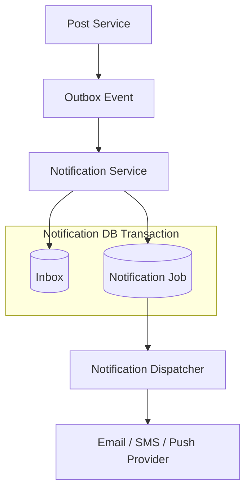

Notification Service는 Inbox와 알림 작업을 원자적으로 저장한다.

그리고 별도의 Dispatcher가 실제 알림을 발송한다.

이 구조에서도 실제 발송 성공과 완료 상태 기록 사이에는 중복 가능성이 남는다.

따라서 다음과 같은 보완이 필요할 수 있다.

- 외부 알림 제공자가 지원하는 멱등성 키
- 발송 요청의 고유 식별자
- 제공자 측 중복 제거 기능
- 발송 결과 조회 API
- 발송 상태 관리
- 장애 복구 및 재처리 정책

중요한 것은 **DB 내부의 정확히 한 번 반영과 실제 외부 발송의 정확히 한 번 수행을 구분하는 것**이다.

---

### 구조

### Polling과 CDC의 차이

Transactional Outbox에서 Worker가 이벤트를 발견하는 방법은 크게 두 가지로 구분할 수 있다.

첫 번째는 Polling이다.

두 번째는 CDC(Change Data Capture)다.

---

### Polling 방식

Polling은 Worker가 일정한 주기로 Outbox 테이블을 조회하는 방식이다.

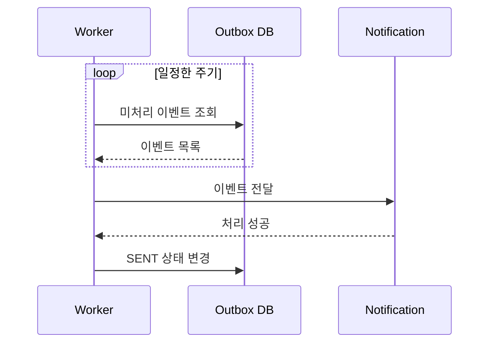

예를 들어 1초마다 Outbox를 조회하도록 설정할 수 있다.

```java
@Scheduled(fixedDelay = 1000)
public void publish() {

    // 미처리 이벤트 조회
}
```

#### Polling의 장점

구현이 비교적 단순하다.

기존 데이터베이스와 Spring Boot만으로도 구현할 수 있다.

별도의 CDC 인프라가 필요하지 않다.

또 이벤트 처리 상태와 재시도 정보를 직접 관리하기 쉽다.

#### Polling의 단점

새로운 이벤트가 생성되더라도 다음 조회 시점까지 기다려야 할 수 있다.

처리할 이벤트가 없어도 주기적인 조회가 발생한다.

이벤트 수가 많아지면 조회와 상태 갱신에 따른 DB 부하가 증가할 수 있다.

또 다중 Worker 환경에서는 이벤트 점유와 재시도, 중복 처리를 고려해야 한다.

다만 Polling이 항상 느린 것은 아니다.

조회 주기를 짧게 설정하고 배치 처리와 적절한 인덱스를 구성하면 충분한 처리량을 확보할 수 있는 경우도 있다.

따라서 Polling의 적합성은 실제 처리량과 지연 시간 요구사항에 따라 판단해야 한다.

---

### CDC(Change Data Capture) 방식

CDC는 데이터베이스의 변경 사항을 감지해 외부 시스템으로 전달하는 방식이다.

대표적으로 Debezium 같은 도구를 활용할 수 있다.

PostgreSQL을 사용한다면 WAL(Write-Ahead Log) 기반의 변경 정보를 활용하는 구조를 구성할 수 있다.

개념적인 흐름은 다음과 같다.

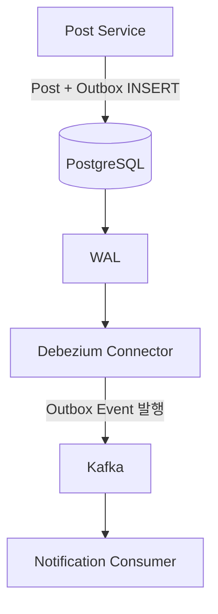

Post Service는 게시글과 Outbox 이벤트를 같은 트랜잭션에 저장한다.

이후 CDC Connector가 DB 변경 로그를 읽는다.

Outbox 이벤트가 커밋되었다는 사실을 확인하면 메시지 브로커에 이벤트를 발행한다.

이렇게 하면 애플리케이션이 Outbox 테이블을 주기적으로 조회하지 않아도 된다.

Debezium은 Outbox Event Router를 제공하며, Outbox 테이블의 변경 이벤트를 메시지 브로커에 전달하는 구성을 지원한다.

---

### Polling과 CDC 비교

| 구분 | Polling | CDC |
|---|---|---|
| 이벤트 감지 | 주기적인 테이블 조회 | DB 변경 로그 감지 |
| 구현 복잡도 | 비교적 낮음 | 비교적 높음 |
| 추가 인프라 | 적을 수 있음 | CDC Connector 등 필요 |
| 지연 시간 | 조회 주기의 영향을 받음 | 낮은 지연 시간 구현에 유리 |
| DB 부하 | 반복 조회와 상태 갱신 | 변경 로그 처리 및 복제 관련 부하 |
| 처리량 | 배치와 병렬 처리에 따라 확장 | 높은 처리량에 유리한 경우가 많음 |
| 장애 복구 | 재시도 상태 직접 관리 | Connector Offset 및 복구 관리 |
| 운영 난이도 | 상대적으로 단순 | Connector와 로그 보존 등 관리 필요 |
| 적합한 환경 | 비교적 단순한 비동기 서비스 | 이벤트 규모가 크고 CDC 인프라가 있는 환경 |

CDC를 사용한다고 장애 복구가 자동으로 해결되는 것은 아니다.

실제 운영에서는 다음 사항을 고려해야 한다.

- CDC Connector의 장애
- 데이터베이스 로그 보존 기간
- PostgreSQL Replication Slot 관리
- Connector Offset 관리
- Kafka 장애
- 이벤트 중복 발행
- 스키마 변경
- 이벤트 순서

따라서 CDC를 선택할 때는 단순히 Polling보다 빠른지 여부뿐 아니라 운영 복잡도도 고려해야 한다.

---

### Debezium Outbox Event Router

Debezium을 사용하면 Outbox 이벤트를 Kafka 메시지로 변환하는 구성을 만들 수 있다.

대표적으로 다음과 같은 정보를 사용한다.

```text
id

aggregatetype

aggregateid

type

payload
```

각 필드의 역할은 다음과 같다.

| 필드 | 의미 |
|---|---|
| id | 이벤트의 고유 식별자 |
| aggregatetype | 이벤트가 발생한 도메인 종류 |
| aggregateid | 도메인 객체 식별자 |
| type | 이벤트 종류 |
| payload | 이벤트 데이터 |

예를 들어 다음 이벤트를 생각할 수 있다.

```json
{
  "id": "550e8400-e29b-41d4-a716-446655440000",
  "aggregatetype": "Post",
  "aggregateid": "1000",
  "type": "PostCreated",
  "payload": {
    "postId": 1000,
    "authorId": 100
  }
}
```

여기서 `aggregateid`는 Kafka 메시지의 Key를 결정하는 데 활용할 수 있다.

같은 Aggregate의 이벤트를 같은 Partition으로 전달하도록 구성하면 해당 Partition 내부에서 순서 보장을 활용할 수 있다.

하지만 이것만으로 모든 이벤트의 전역 순서가 보장되는 것은 아니다.

이벤트가 서로 다른 Partition으로 분산될 수 있고, 여러 서비스가 독립적으로 처리할 수도 있기 때문이다.

따라서 순서가 중요한 도메인에서는 별도의 설계가 필요하다.

---

### 메시지 순서 보장은 어떻게 해야 할까?

Transactional Outbox에서 자주 놓치는 문제 중 하나가 이벤트 순서다.

예를 들어 구독 서비스에서 다음 이벤트가 발생했다고 가정하자.

```text
SubscriptionCreated

↓

SubscriptionActivated

↓

SubscriptionCancelled
```

정상적인 비즈니스 흐름에서는 위 순서대로 상태가 변경되었다.

그런데 메시지가 다음과 같이 처리된다면 어떻게 될까?

```text
SubscriptionCancelled

↓

SubscriptionActivated
```

구독이 취소된 이후 다시 활성화된 것처럼 처리될 수 있다.

이러한 문제는 실제 데이터 정합성에 영향을 줄 수 있다.

따라서 이벤트 순서가 중요한 경우 다음 사항을 고려해야 한다.

#### 첫 번째, Aggregate ID를 기준으로 이벤트를 분류한다

같은 구독에서 발생한 이벤트라면 동일한 Aggregate ID를 사용한다.

예를 들어 다음과 같다.

```text
aggregateType = SUBSCRIPTION

aggregateId = 1000
```

Kafka에서는 이 값을 메시지 Key로 활용할 수 있다.

#### 두 번째, 이벤트에 버전 정보를 포함한다

예를 들어 다음과 같다.

```json
{
  "eventId": "550e8400-e29b-41d4-a716-446655440000",
  "aggregateType": "SUBSCRIPTION",
  "aggregateId": 1000,
  "version": 3,
  "eventType": "SUBSCRIPTION_CANCELLED"
}
```

소비자는 이벤트 버전을 확인해 이미 처리한 오래된 이벤트인지 판단할 수 있다.

#### 세 번째, 순서 제약을 명확하게 정의한다

모든 이벤트가 전역적으로 동일한 순서로 처리될 필요는 없다.

예를 들어 서로 다른 사용자의 게시글 작성 이벤트는 순서가 중요하지 않을 수 있다.

반면 하나의 구독 상태를 변경하는 이벤트는 순서가 중요할 수 있다.

따라서 다음을 구분해야 한다.

**전역 순서가 필요한가?**

**동일 Aggregate 내부의 순서만 보장하면 되는가?**

**순서가 달라도 최종 결과가 동일하도록 설계할 수 있는가?**

여기서 주의할 점은 Outbox 테이블에 `created_at`을 저장하고 정렬하는 것만으로 커밋 순서가 엄격하게 보장되지는 않는다는 사실이다.

동시 트랜잭션과 다중 Worker, 재시도 상황을 함께 고려해야 한다.

---

### Outbox와 Kafka를 함께 사용할 때 고려할 점

Transactional Outbox는 Kafka와 자주 함께 사용된다.

일반적인 구조는 다음과 같다.

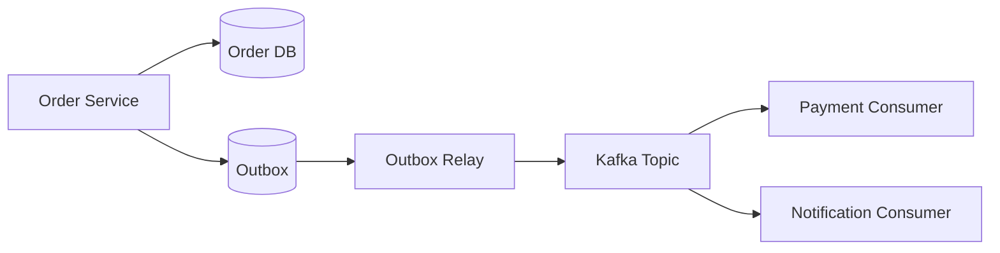

여기서 중요한 것은 Kafka를 사용한다고 Dual Write 문제가 자동으로 해결되는 것은 아니라는 사실이다.

예를 들어 다음과 같은 코드가 있다고 가정하자.

```java
@Transactional
public void createOrder() {

    orderRepository.save(order);

    kafkaTemplate.send(
            "order-created",
            event
    );
}
```

이 코드는 데이터베이스 저장과 Kafka 발행을 수행한다.

하지만 일반적인 로컬 DB 트랜잭션만으로 두 시스템의 원자성을 보장할 수는 없다.

Kafka Producer의 전송 성공과 DB 커밋은 서로 다른 사건이기 때문이다.

Kafka의 트랜잭션 기능도 Kafka 내부의 원자적 메시지 처리와 같은 보장 범위를 이해해야 한다.

이를 외부 데이터베이스나 PG 호출까지 포함하는 범용 분산 트랜잭션으로 해석해서는 안 된다.

따라서 DB 변경과 Kafka 이벤트 발행의 일관성이 중요하다면 Transactional Outbox를 고려할 수 있다.

---

### Azure Service Bus와 Outbox를 함께 사용한다면?

Azure Service Bus에서도 같은 원칙을 적용할 수 있다.

예를 들어 구독 결제 시스템을 생각해 보자.

```text
Payment Service

↓

결제 상태 저장

↓

Membership Service에 이벤트 전달
```

결제가 성공하면 Payment Service는 결제 상태를 데이터베이스에 기록한다.

그리고 Membership Service에 구독 활성화 이벤트를 전달해야 한다.

단순히 다음과 같이 구현하면 문제가 발생할 수 있다.

```java
@Transactional
public void completePayment() {

    paymentRepository.save(payment);

    serviceBusSender.sendMessage(event);
}
```

데이터베이스 저장과 Azure Service Bus 발행은 서로 다른 시스템의 작업이다.

따라서 로컬 DB 트랜잭션만으로 함께 커밋하거나 롤백할 수 없다.

Outbox를 적용하면 다음과 같이 구성할 수 있다.

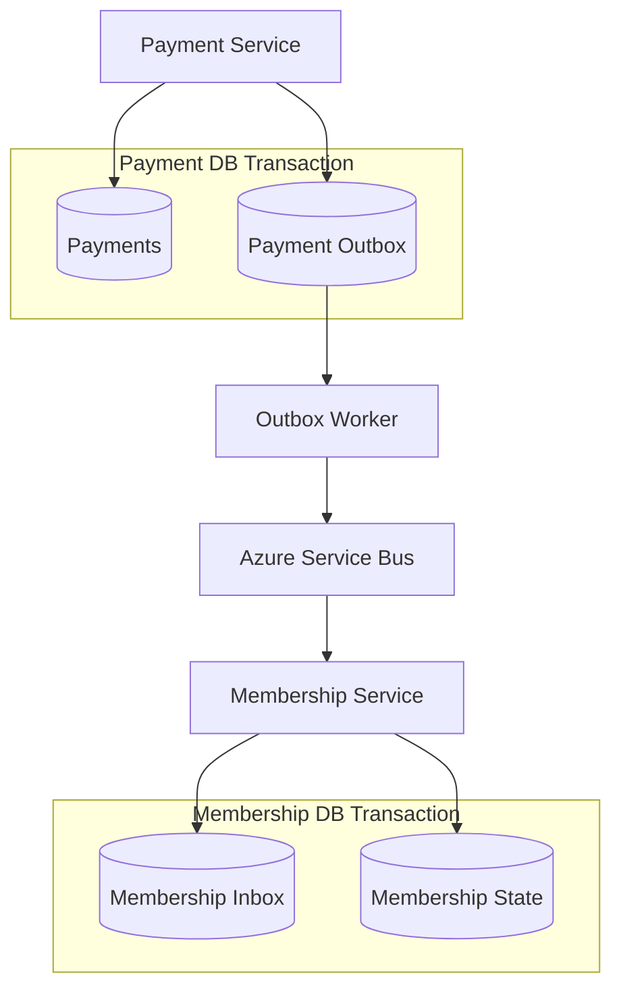

Payment Service는 결제 상태 변경과 Outbox 이벤트 저장을 원자적으로 처리한다.

Worker는 Azure Service Bus에 이벤트를 발행한다.

Membership Service는 이벤트를 소비한다.

그리고 Inbox를 통해 같은 이벤트가 중복 처리되지 않도록 관리한다.

여기서 Azure Service Bus의 메시지 중복 감지 기능을 활용할 수도 있다.

하지만 브로커의 중복 감지 기능과 소비자 비즈니스 로직의 멱등성은 서로 다른 문제다.

브로커가 중복 메시지를 일부 제거하더라도 소비자가 처리 후 ACK 전에 장애를 겪는 등의 상황을 고려해야 한다.

따라서 중요도가 높은 결제·구독 시스템에서는 소비자 측 멱등성도 별도로 설계하는 것이 좋다.

---

### Outbox와 Saga 패턴의 차이

Transactional Outbox를 이해하다 보면 Saga 패턴과 혼동하기 쉽다.

두 패턴은 모두 분산 시스템의 데이터 정합성과 관련이 있다.

하지만 해결하는 문제가 다르다.

#### Transactional Outbox

Transactional Outbox는 비즈니스 데이터 변경과 메시지 발행 사이의 원자성 문제를 해결한다.

예를 들어 다음과 같다.

```text
주문 저장
+
주문 생성 이벤트 기록
```

이 두 작업을 같은 로컬 트랜잭션으로 처리한다.

#### Saga

Saga는 여러 서비스에 걸쳐 발생하는 비즈니스 트랜잭션을 관리하는 패턴이다.

예를 들어 다음과 같다.

```text
주문 생성
    ↓
재고 예약
    ↓
결제 승인
    ↓
배송 준비
```

각 단계는 서로 다른 서비스에서 실행될 수 있다.

중간 단계가 실패하면 이전 작업을 취소하거나 보상하는 과정이 필요할 수 있다.

따라서 두 패턴의 역할은 다음과 같이 구분할 수 있다.

| 구분 | Transactional Outbox | Saga |
|---|---|---|
| 해결하려는 문제 | DB 변경과 이벤트 발행의 일관성 | 여러 서비스에 걸친 비즈니스 처리 |
| 주요 관심사 | 이벤트 유실 방지 | 분산 비즈니스 상태 관리 |
| 핵심 구조 | 비즈니스 테이블 + Outbox | 여러 로컬 트랜잭션과 보상 작업 |
| 외부 시스템 호출 | 별도 Relay가 담당 | 여러 단계로 실행 |
| 함께 사용 | 가능 | Outbox를 활용할 수 있음 |

즉 Saga의 각 단계에서 이벤트를 안정적으로 발행하기 위해 Outbox를 사용할 수 있다.

이 둘은 대체 관계가 아니라 함께 사용할 수 있는 패턴이다.

---

### @TransactionalEventListener와 Outbox의 차이

Spring에서는 `@TransactionalEventListener`를 사용할 수 있다.

예를 들어 다음과 같다.

```java
@Transactional
public void createPost() {

    Post post = postRepository.save(...);

    applicationEventPublisher.publishEvent(
            new PostCreatedEvent(...)
    );
}
```

이후 다음과 같이 이벤트를 처리할 수 있다.

```java
@TransactionalEventListener(
        phase = TransactionPhase.AFTER_COMMIT
)
public void handle(PostCreatedEvent event) {

    notificationClient.send(event);
}
```

이 코드는 데이터베이스 트랜잭션이 커밋된 뒤 이벤트 리스너를 실행하도록 구성한 것이다.

하지만 이것만으로 Transactional Outbox와 동일한 전달 보장을 제공하지는 않는다.

예를 들어 다음 상황을 생각해 보자.

```text
게시글 DB 커밋 성공
        ↓
이벤트 리스너 실행 전 프로세스 종료
        ↓
알림 이벤트 전달 누락
```

이벤트가 별도의 영속 저장소에 기록되지 않았다면 프로세스 종료 이후 복구할 근거가 없을 수 있다.

즉 `AFTER_COMMIT`은 트랜잭션이 커밋된 이후 실행하는 시점을 제공하지만, 이벤트를 영속적으로 저장하고 재전송하는 기능을 자동으로 제공하지는 않는다.

또 Spring 공식 문서에서는 `AFTER_COMMIT` 시점에 트랜잭션 리소스가 여전히 접근 가능하더라도 추가 데이터 변경이 기존 트랜잭션에 커밋되지 않을 수 있다는 점을 설명한다. 따라서 해당 시점에서 별도의 DB 작업을 수행할 때는 트랜잭션 경계를 주의해서 설계해야 한다.

두 방식을 비교하면 다음과 같다.

| 구분 | @TransactionalEventListener | Transactional Outbox |
|---|---|---|
| 주요 역할 | 트랜잭션 상태에 따라 이벤트 처리 | 이벤트 발행 의도 영속화 |
| 구현 복잡도 | 비교적 낮음 | 상대적으로 높음 |
| 이벤트 저장 | 기본적으로 별도 저장 없음 | Outbox DB 저장 |
| 프로세스 종료 후 복구 | 별도 설계 필요 | 저장된 이벤트 기반 복구 |
| 재시도 | 별도 구현 필요 | Worker에서 구현 가능 |
| 중복 처리 | 별도 고려 필요 | 별도 고려 필요 |
| 적합한 상황 | 단순한 후처리, 내부 이벤트 | 중요한 외부 이벤트 전달 |

따라서 단순한 후처리라면 `@TransactionalEventListener`만으로 충분할 수 있다.

반면 결제 상태 동기화처럼 메시지 유실이 중요한 문제라면 Transactional Outbox가 더 적합할 수 있다.

---

### 실무에서의 활용

### Transactional Outbox를 운영 환경에 적용할 때 고려해야 할 12가지 전략

Transactional Outbox는 구현 자체보다 운영 환경에서의 실패 처리가 중요하다.

Outbox 테이블과 Worker만 만들었다고 해서 안정적인 메시징 시스템이 완성되는 것은 아니다.

실제로는 다양한 장애 상황과 운영 요구사항을 고려해야 한다.

---

#### 1. 메시지 ID를 한 번만 생성하고 재사용한다

이벤트 ID는 메시지의 정체성을 나타내는 식별자다.

따라서 Outbox에 기록할 때 생성하고 재전송 과정에서도 동일한 값을 사용해야 한다.

예를 들어 다음과 같다.

```text
최초 이벤트

eventId = E100
```

```text
첫 번째 전송

eventId = E100
```

```text
두 번째 전송

eventId = E100
```

이렇게 해야 소비자가 같은 이벤트의 재전송을 구분할 수 있다.

재시도마다 새로운 UUID를 생성하면 멱등성 처리가 어려워질 수 있다.

---

#### 2. 비즈니스 데이터와 이벤트를 반드시 같은 트랜잭션에 저장한다

Outbox 패턴의 가장 중요한 조건이다.

다음 두 작업이 하나의 로컬 트랜잭션에서 실행되어야 한다.

```text
주문 상태 변경

Outbox 이벤트 저장
```

서로 다른 데이터베이스에 저장하거나 독립적인 트랜잭션으로 처리한다면 원자성을 보장할 수 없다.

따라서 `@Transactional`이 실제로 적용되는지, 같은 DataSource를 사용하는지, 예외 발생 시 롤백되는지 확인해야 한다.

특히 Spring에서 Checked Exception은 기본적으로 롤백 대상이 아닐 수 있으므로 예외와 롤백 정책을 함께 검토해야 한다.

---

#### 3. Outbox Worker에서 외부 API 호출을 장시간 DB 트랜잭션으로 감싸지 않는다

Outbox를 사용하는 주요 이유 중 하나는 외부 시스템 호출과 로컬 비즈니스 트랜잭션을 분리하는 것이다.

그런데 Worker에서 다음과 같이 작성한다면 문제가 다시 발생할 수 있다.

```java
@Transactional
public void process() {

    OutboxEvent event = repository.findPending();

    externalClient.send(event);

    repository.markSent(event);
}
```

외부 API 호출을 기다리는 동안 Worker의 DB 트랜잭션이 유지될 수 있다.

이는 Outbox를 도입한 목적 중 하나와 충돌한다.

따라서 일반적으로 다음과 같이 분리하는 것이 좋다.

```text
짧은 트랜잭션으로 이벤트 점유
        ↓
DB 트랜잭션 종료
        ↓
외부 시스템 호출
        ↓
짧은 트랜잭션으로 결과 저장
```

이렇게 하면 외부 시스템의 지연이 DB 커넥션과 잠금에 미치는 영향을 줄일 수 있다.

---

#### 4. 다중 Worker의 동시성을 제어한다

서비스가 여러 인스턴스로 실행될 수 있다면 Worker도 여러 개 실행될 수 있다.

따라서 동일한 이벤트를 여러 Worker가 동시에 점유하지 않도록 관리해야 한다.

대표적으로 다음 방법을 고려할 수 있다.

- `FOR UPDATE SKIP LOCKED`
- Lease 기반 작업 점유
- 분산 락
- 파티션 기반 Worker 분배

다만 분산 락을 사용한다고 모든 중복 전송이 방지되는 것은 아니다.

외부 호출 성공 후 상태 기록 전에 장애가 발생하는 문제는 여전히 존재한다.

따라서 Worker의 동시성 제어와 소비자 멱등성은 함께 고려해야 한다.

---

#### 5. 재시도 정책을 명확하게 정의한다

외부 시스템 호출이 실패했다고 무조건 즉시 재시도하는 것은 위험하다.

외부 시스템이 장애 상태라면 반복적인 요청이 오히려 부하를 증가시킬 수 있기 때문이다.

따라서 Exponential Backoff와 Jitter를 활용할 수 있다.

예를 들어 다음과 같다.

```text
1차 실패

2초 후 재시도
```

```text
2차 실패

4초 후 재시도
```

```text
3차 실패

8초 후 재시도
```

```text
4차 실패

16초 후 재시도
```

여기에 임의의 지연 시간을 추가하면 여러 Worker가 동시에 재시도하는 상황을 완화할 수 있다.

이것이 Jitter다.

다만 다음과 같은 실패는 재시도해도 해결되지 않을 수 있다.

- 존재하지 않는 리소스
- 잘못된 이벤트 형식
- 지원하지 않는 이벤트 버전
- 인증 정보 오류
- 영구적으로 거부된 요청

따라서 실패의 종류에 따라 재시도 가능 여부를 구분해야 한다.

---

#### 6. Dead Letter 상태와 재처리 절차를 마련한다

일정 횟수 이상 재시도했지만 계속 실패하는 이벤트가 있다고 가정하자.

예를 들어 다음과 같다.

```text
Event 100

attempt_count = 5

status = DEAD
```

이벤트를 무한정 재시도하면 지속적인 부하가 발생할 수 있다.

반대로 이벤트를 삭제하면 중요한 메시지가 유실될 수 있다.

따라서 재시도 한도에 도달한 이벤트는 별도의 상태나 저장소로 분리할 수 있다.

이후 운영자가 실패 원인을 확인하고 재처리할 수 있도록 만든다.

예를 들어 다음과 같은 운영 기능을 고려할 수 있다.

```text
실패 이벤트 조회

↓

실패 원인 확인

↓

재처리 가능 여부 판단

↓

필요한 데이터 수정

↓

재처리 요청

↓

성공 여부 확인
```

중요한 것은 Dead Letter 상태가 곧 메시지를 포기한다는 뜻은 아니라는 점이다.

최종적으로 어떤 방식으로 복구하거나 종료할지 운영 정책을 마련해야 한다.

---

#### 7. Inbox에는 데이터베이스 UNIQUE 제약을 사용한다

Inbox에서 단순히 이벤트의 존재 여부를 조회하는 것만으로는 동시 요청을 안전하게 처리하기 어렵다.

따라서 이벤트 ID에 고유 제약을 설정하는 것이 중요하다.

```sql
CREATE TABLE inbox_events (
    event_id UUID PRIMARY KEY,
    processed_at TIMESTAMPTZ NOT NULL DEFAULT NOW()
);
```

그리고 이벤트 ID 기록과 비즈니스 데이터 변경을 같은 트랜잭션에서 처리한다.

이렇게 하면 동일한 이벤트가 동시에 전달되더라도 데이터베이스의 원자적인 제약을 활용해 중복 처리를 방지할 수 있다.

다만 하나의 이벤트를 여러 독립적인 소비자가 처리해야 한다면 `event_id`만으로 충분하지 않을 수 있다.

예를 들어 다음과 같은 구조를 고려할 수 있다.

```sql
CREATE TABLE inbox_events (
    consumer_name VARCHAR(100) NOT NULL,
    event_id UUID NOT NULL,
    processed_at TIMESTAMPTZ NOT NULL DEFAULT NOW(),

    PRIMARY KEY (
        consumer_name,
        event_id
    )
);
```

이 경우 소비자별로 이벤트 처리 여부를 구분할 수 있다.

---

#### 8. 이벤트 스키마 버전을 관리한다

이벤트 구조는 시간이 지나면서 변경될 수 있다.

예를 들어 처음에는 다음과 같은 이벤트를 사용했다고 가정하자.

```json
{
  "eventType": "POST_CREATED",
  "postId": 1000
}
```

이후 작성자 정보가 필요해졌다.

```json
{
  "eventType": "POST_CREATED",
  "postId": 1000,
  "authorId": 100
}
```

이때 기존 소비자가 새로운 이벤트를 정상적으로 처리할 수 있는지 확인해야 한다.

반대로 이미 Outbox에 저장된 오래된 이벤트를 새 버전의 소비자가 처리해야 할 수도 있다.

따라서 이벤트에 버전 정보를 포함하거나 스키마 레지스트리 등의 방식으로 호환성을 관리할 수 있다.

```json
{
  "eventType": "POST_CREATED",
  "schemaVersion": 2,
  "postId": 1000,
  "authorId": 100
}
```

중요한 것은 이벤트의 Producer와 Consumer가 항상 동시에 배포되는 것은 아니라는 사실이다.

따라서 이벤트 계약은 버전 간 호환성을 고려해야 한다.

---

#### 9. Outbox 테이블의 데이터 증가를 관리한다

Outbox 테이블에는 이벤트가 계속 저장된다.

예를 들어 하루에 100만 개의 이벤트가 발생한다고 가정하자.

30일 동안 모든 이벤트를 보관하면 3,000만 개의 이벤트가 누적될 수 있다.

이러한 데이터 증가를 관리하지 않으면 다음 문제가 발생할 수 있다.

- 테이블 크기 증가
- 인덱스 크기 증가
- 조회 성능 저하
- 백업 비용 증가
- VACUUM 부담 증가
- 디스크 사용량 증가

따라서 완료된 이벤트를 정리하는 정책이 필요하다.

예를 들어 다음과 같은 정책을 고려할 수 있다.

```text
PENDING

처리 대기 중이므로 보관
```

```text
PROCESSING

Worker가 처리 중이므로 보관
```

```text
SENT

일정 기간 보관 후 삭제 또는 아카이빙
```

```text
DEAD

원인 분석과 재처리 완료 전까지 보관
```

단, CDC를 사용하는 경우에는 Connector가 변경 사항을 안전하게 처리했는지 확인한 뒤 정리해야 한다.

또 감사 추적이나 규정상 보존 요구사항이 있다면 별도의 보관 정책을 적용해야 한다.

---

#### 10. 이벤트 전달 지연과 적체를 모니터링한다

Outbox 패턴을 도입하면 메시지 전달이 비동기적으로 이루어진다.

따라서 사용자의 요청이 성공했다고 모든 후속 작업이 완료된 것은 아니다.

예를 들어 게시글 저장은 성공했지만 알림 전송이 계속 지연될 수 있다.

이러한 문제를 확인하기 위해 다음 지표를 수집할 수 있다.

| 지표 | 의미 |
|---|---|
| Pending Event Count | 대기 중인 이벤트 수 |
| Processing Event Count | 처리 중인 이벤트 수 |
| Dead Event Count | 재시도 한도에 도달한 이벤트 수 |
| Event Delivery Latency | 이벤트 생성부터 전달 완료까지의 시간 |
| Oldest Pending Event Age | 가장 오래 대기 중인 이벤트의 경과 시간 |
| Retry Count | 이벤트 재시도 횟수 |
| Delivery Failure Rate | 이벤트 전송 실패율 |
| Worker Throughput | 단위 시간당 처리 이벤트 수 |
| Inbox Duplicate Count | 소비자가 감지한 중복 이벤트 수 |

예를 들어 다음 상황을 생각해 보자.

```text
Pending Event Count = 100
```

처음에는 문제가 없어 보일 수 있다.

하지만 다음과 같은 상태라면 어떨까?

```text
Pending Event Count = 100,000
```

그리고 가장 오래된 이벤트가 30분 동안 처리되지 않았다면 이벤트 전달이 지연되고 있을 가능성이 있다.

따라서 단순히 Worker가 실행 중인지 확인하는 것보다 이벤트 적체와 지연 시간을 함께 모니터링해야 한다.

---

#### 11. 장애 상황을 테스트로 검증한다

Transactional Outbox는 정상적인 상황보다 장애 상황에서 가치가 드러나는 패턴이다.

따라서 정상적인 메시지 전송 테스트만으로는 충분하지 않다.

다음과 같은 상황을 검증해야 한다.

| 장애 상황 | 기대하는 동작 |
|---|---|
| 게시글 저장 실패 | Outbox도 롤백 |
| Outbox 저장 실패 | 게시글도 롤백 |
| DB 커밋 후 서버 종료 | Outbox 이벤트 보존 |
| Worker 실행 중 장애 | Lease 만료 후 재처리 |
| 외부 알림 시스템 장애 | 재시도 상태 유지 |
| 외부 처리 성공 후 Worker 장애 | 동일 이벤트 재전송 가능 |
| 동일 이벤트 재전송 | Inbox에서 중복 처리 방지 |
| Inbox 저장 후 비즈니스 작업 실패 | 전체 롤백 |
| 동일 이벤트 동시 수신 | DB UNIQUE 제약으로 중복 방지 |
| 재시도 한도 초과 | Dead Letter 상태로 관리 |
| CDC Connector 장애 | 복구 후 미처리 변경 사항 전송 |
| 이벤트 순서 변경 | 버전·상태 전이 정책에 따라 처리 |

특히 다음 테스트는 중요하다.

**외부 시스템의 처리는 성공했지만 Worker가 완료 상태를 기록하기 전에 종료되는 상황**이다.

이 상황은 Outbox에서 중복 전달이 발생하는 대표적인 실패 지점이다.

따라서 이 장애를 재현하고 Inbox에서 중복 비즈니스 처리가 발생하지 않는지 검증해야 한다.

---

#### 12. 사용자에게 비동기 처리 상태를 명확하게 전달한다

Transactional Outbox를 적용하면 사용자 요청의 성공과 외부 후속 작업의 완료 시점이 달라진다.

예를 들어 게시글 작성 요청이 성공했다고 가정하자.

이 시점에는 게시글과 Outbox 이벤트가 저장되었다.

하지만 팔로워에게 알림이 실제로 발송되었는지는 별도의 문제다.

따라서 사용자에게 제공하는 응답의 의미를 명확하게 정의해야 한다.

예를 들어 다음과 같이 구분할 수 있다.

```text
게시글 작성 완료

게시글 저장 성공
```

```text
알림 처리 대기

Outbox 이벤트 저장 성공
```

```text
알림 처리 완료

Notification Service에서 작업 접수
```

```text
실제 알림 발송 완료

외부 알림 제공자의 결과 확인
```

이러한 상태는 서로 다르다.

특히 결제와 정산처럼 중요한 비즈니스에서는 이러한 구분이 더욱 중요하다.

예를 들어 결제 성공과 구독 활성화 완료를 동일한 상태로 취급하면 실제 데이터 정합성을 확인하기 어려울 수 있다.

따라서 후속 작업의 완료 여부가 중요하다면 상태 조회 API나 이벤트 기반 상태 동기화, 사용자 알림 등을 함께 설계해야 한다.

---

### 추가 심화: Transactional Outbox에서 자주 발생하는 설계 실수

#### Outbox 이벤트를 저장한 뒤 같은 요청에서 외부 시스템을 다시 호출하는 경우

다음과 같은 코드를 생각해 보자.

```java
@Transactional
public void createPost() {

    postRepository.save(post);

    outboxRepository.save(event);

    notificationClient.send(event);
}
```

Outbox 이벤트를 저장했지만 외부 API도 같은 트랜잭션 안에서 직접 호출하고 있다.

이 경우 외부 API의 지연과 장애가 여전히 데이터베이스 트랜잭션에 영향을 줄 수 있다.

또 직접 호출이 성공한 뒤 트랜잭션이 롤백되는 문제도 남는다.

따라서 Outbox의 역할과 외부 시스템 호출을 분리해야 한다.

---

#### Worker가 이벤트를 전송하기 전에 완료 처리하는 경우

다음 흐름을 생각해 보자.

```text
Outbox 이벤트 조회
        ↓
SENT 상태 저장
        ↓
외부 시스템 호출
```

이 방식은 위험하다.

`SENT`로 변경한 뒤 서버가 종료되면 외부 시스템에는 이벤트가 전달되지 않는다.

하지만 DB에서는 이미 완료된 이벤트라고 판단한다.

따라서 이벤트가 유실될 수 있다.

일반적으로 외부 시스템의 접수 성공을 확인한 뒤 완료 상태로 변경해야 한다.

다만 이 경우에도 완료 상태 저장 전에 장애가 발생하면 중복 전달될 수 있다.

이것이 At-Least-Once 전달 모델에서 중복을 허용하고 소비자 멱등성을 사용하는 이유다.

---

#### 모든 실패를 무한정 재시도하는 경우

외부 시스템 장애가 오래 지속되면 이벤트가 계속 누적될 수 있다.

이때 재시도를 무조건 반복하면 장애를 더욱 악화시킬 수 있다.

따라서 다음 항목을 함께 고려해야 한다.

- 재시도 횟수
- 재시도 간격
- Exponential Backoff
- Jitter
- Circuit Breaker
- 이벤트 적체 모니터링
- Dead Letter 관리

외부 시스템이 장기간 사용 불가능한 상황이라면 재시도 속도를 제한하는 것이 필요할 수 있다.

---

#### Inbox에 이벤트 ID만 기록하고 외부 작업을 직접 수행하는 경우

다음과 같은 코드를 생각해 보자.

```java
@Transactional
public void process(Event event) {

    inboxRepository.save(event.id());

    paymentClient.approve(event);
}
```

이 코드에서는 Inbox 기록과 외부 결제 승인 요청을 하나의 로컬 DB 트랜잭션으로 묶으려 한다.

하지만 외부 PG 시스템의 결제 승인은 데이터베이스 트랜잭션에 포함되지 않는다.

따라서 다음과 같은 상황이 발생할 수 있다.

```text
PG 결제 승인 성공
        ↓
DB 트랜잭션 롤백
        ↓
Inbox 기록 사라짐
        ↓
이벤트 재전송
        ↓
중복 결제 승인 위험
```

이를 해결하려면 결제 요청의 멱등성 키와 외부 결제 상태 조회, 별도의 작업 상태 관리 등이 필요하다.

**Transactional Inbox가 보장하는 것은 동일한 로컬 트랜잭션 안에서 처리하는 비즈니스 데이터 변경의 중복 방지이지, 모든 외부 작업의 Exactly-Once 실행이 아니다.**

---

### Transactional Outbox와 Inbox 비교

| 구분 | Transactional Outbox | Transactional Inbox |
|---|---|---|
| 적용 위치 | Producer | Consumer |
| 주요 목적 | 이벤트 발행 의도 유실 방지 | 중복 이벤트 처리 방지 |
| 저장 정보 | 외부로 전달할 이벤트 | 이미 처리한 이벤트 ID |
| 트랜잭션 대상 | 비즈니스 데이터 + Outbox | Inbox 기록 + 비즈니스 데이터 |
| 핵심 문제 | Dual Write | Duplicate Processing |
| 주요 실패 상황 | DB 커밋 후 이벤트 전송 전 장애 | 이벤트 중복 전달 |
| 대표 구현 | Outbox Table + Worker | Inbox Table + UNIQUE 제약 |
| 외부 시스템 작업 | 별도 Worker 실행 | 별도 발송·처리 구조 필요할 수 있음 |
| 핵심 보장 | 이벤트 전달 의도의 영속성 | 로컬 비즈니스 효과의 멱등성 |
| 한계 | 중복 이벤트 전송 가능 | 외부 시스템의 Exactly-Once 보장 불가 |

두 패턴은 서로 다른 문제를 해결한다.

Transactional Outbox는 이벤트가 누락되는 문제를 줄인다.

Transactional Inbox는 동일한 이벤트가 여러 번 전달되어 비즈니스 작업이 중복 실행되는 문제를 줄인다.

따라서 중요한 이벤트 기반 시스템에서는 두 패턴을 함께 사용하는 것이 유용할 수 있다.

---

### Transactional Outbox를 도입할지 판단하는 기준

모든 비동기 작업에 Outbox가 필요한 것은 아니다.

Outbox는 이벤트 전달의 신뢰성을 높이지만 구현과 운영 복잡도도 증가시킨다.

따라서 다음 기준으로 판단할 수 있다.

| 상황 | Outbox 도입 필요성 |
|---|---|
| 단순한 내부 로그 기록 | 낮을 수 있음 |
| 실패해도 무방한 부가 통계 | 요구사항에 따라 판단 |
| 중요한 알림 발송 요청 | 고려할 가치가 있음 |
| 주문 생성 이벤트 | 높음 |
| 결제 완료 이벤트 | 높음 |
| 구독 상태 동기화 | 높음 |
| 정산 이벤트 | 높음 |
| 재고 차감 이벤트 | 높음 |
| 검색 인덱스 갱신 | 재구축 가능성과 지연 허용 범위에 따라 판단 |

예를 들어 단순한 방문 통계 이벤트가 누락되어도 서비스에 큰 영향을 주지 않는다면 Outbox의 운영 비용이 과도할 수 있다.

반면 결제 완료 이벤트가 누락되어 회원의 구독 권한이 활성화되지 않는다면 중요한 문제가 될 수 있다.

따라서 다음 질문이 중요하다.

**이 이벤트가 누락되면 어떤 비즈니스 문제가 발생하는가?**

**나중에 누락 여부를 발견하고 복구할 수 있는가?**

**메시지 중복이 발생했을 때 어떤 문제가 생기는가?**

**이벤트 전달 지연을 어느 정도 허용할 수 있는가?**

이러한 질문에 대한 답을 바탕으로 Outbox와 Inbox, 메시지 브로커, 재시도 정책 등을 결정하는 것이 좋다.

---

### 정리

Transactional Outbox 패턴은 데이터베이스 변경과 외부 시스템 호출이 함께 발생하는 상황에서 데이터 정합성을 높이기 위한 설계 방식이다.

일반적인 백엔드 서비스에서는 하나의 비즈니스 작업이 여러 시스템에 걸쳐 실행되는 경우가 많다.

예를 들어 게시글을 작성하면 게시글을 데이터베이스에 저장하고 팔로워에게 알림을 발송해야 한다.

하지만 게시글 저장과 알림 발송은 서로 다른 시스템에서 실행된다.

따라서 하나의 로컬 데이터베이스 트랜잭션만으로 두 작업의 원자성을 보장할 수 없다.

이러한 문제를 Dual Write Problem이라고 한다.

Dual Write 문제를 해결하기 위해 단순히 작업 순서를 변경하는 것만으로는 충분하지 않다.

DB를 먼저 커밋하고 외부 시스템을 호출하면 커밋 이후 장애가 발생했을 때 외부 작업이 누락될 수 있다.

반대로 외부 시스템을 먼저 호출하면 외부 작업은 성공했지만 DB 저장이 실패할 수 있다.

또 외부 API 호출을 DB 트랜잭션 안에서 실행하면 외부 시스템의 지연이나 장애가 내부 데이터베이스의 가용성에 영향을 줄 수 있다.

Transactional Outbox는 이러한 문제를 해결하기 위해 비즈니스 데이터 변경과 외부로 전달할 이벤트를 동일한 데이터베이스 트랜잭션에 저장한다.

예를 들어 게시글 생성 시 Post 테이블과 Outbox 테이블을 함께 변경한다.

두 작업은 모두 성공하거나 모두 롤백된다.

이후 별도의 Worker가 Outbox 테이블에서 미처리 이벤트를 조회해 외부 시스템으로 전달한다.

이러한 방식은 외부 시스템 호출을 원래의 비즈니스 트랜잭션에서 분리한다.

또 서버 장애가 발생하더라도 Outbox에 기록된 이벤트를 이용해 나중에 전송을 재시도할 수 있다.

하지만 Transactional Outbox가 모든 문제를 해결하는 것은 아니다.

Worker가 외부 시스템으로 이벤트를 정상적으로 전달했지만 완료 상태를 기록하기 전에 장애가 발생하면 동일한 이벤트가 다시 전달될 수 있다.

따라서 Transactional Outbox는 중복 전달 가능성을 고려해야 한다.

이러한 전달 방식을 At-Least-Once와 연결해 이해할 수 있다.

다만 실제로 최소 한 번의 성공적인 전달을 보장하려면 Worker의 지속적인 실행과 재시도, 장애 복구, 메시지 보존 정책 등이 필요하다.

중복 전달 문제를 해결하기 위해 소비자 측에서는 Transactional Inbox 패턴을 사용할 수 있다.

Transactional Inbox는 수신한 이벤트의 고유 식별자를 저장하고, 같은 이벤트가 다시 전달되면 비즈니스 로직을 중복 실행하지 않도록 한다.

이때 이벤트 ID 기록과 비즈니스 데이터 변경을 동일한 데이터베이스 트랜잭션에서 수행하는 것이 중요하다.

또 동시 요청에 안전하게 대응하기 위해 이벤트 ID에 고유 제약을 적용하는 것이 좋다.

이를 통해 동일한 이벤트가 여러 번 전달되더라도 로컬 데이터베이스의 비즈니스 효과를 중복 적용하지 않도록 만들 수 있다.

하지만 Inbox가 모든 외부 작업의 Exactly-Once 실행을 보장하는 것은 아니다.

예를 들어 이메일 발송이나 PG 결제 승인처럼 외부 시스템을 호출하는 작업은 별도의 트랜잭션에서 실행된다.

따라서 외부 작업의 중복 실행까지 방지하려면 별도의 멱등성 키와 상태 조회, 작업 기록, 복구 전략 등이 필요하다.

Transactional Outbox의 이벤트 전달 방식에는 Polling과 CDC가 있다.

Polling은 Worker가 주기적으로 Outbox 테이블을 조회하는 방식이다.

구현이 비교적 간단하지만 조회 주기에 따른 지연과 데이터베이스 부하를 고려해야 한다.

CDC는 데이터베이스의 변경 로그를 읽어 이벤트를 전달하는 방식이다.

대표적으로 Debezium을 활용할 수 있다.

CDC는 낮은 지연 시간과 높은 처리량에 유리할 수 있지만 Connector 운영과 로그 보존, 장애 복구 등을 관리해야 한다.

또 운영 환경에서는 다중 Worker의 동시성 제어가 중요하다.

PostgreSQL의 `FOR UPDATE SKIP LOCKED`를 활용하면 여러 Worker가 서로 다른 이벤트를 점유하도록 구현할 수 있다.

여기에 Lease를 적용하면 Worker 장애 이후 다른 Worker가 작업을 다시 처리할 수 있다.

하지만 Lease가 만료된 뒤에도 이전 Worker가 실행되고 있을 수 있으므로 중복 전송 가능성은 여전히 고려해야 한다.

따라서 소비자 측 멱등성은 필수적인 설계 요소다.

이벤트 순서도 중요한 문제다.

예를 들어 구독 생성, 활성화, 취소 이벤트가 잘못된 순서로 처리되면 구독 상태가 일치하지 않을 수 있다.

따라서 이벤트에 Aggregate ID와 버전 정보를 포함하거나 메시지 브로커의 순서 보장 기능을 활용하는 방법을 고려할 수 있다.

다만 모든 이벤트에 전역 순서가 필요한 것은 아니다.

비즈니스 요구사항에 따라 필요한 순서 보장 범위를 정의해야 한다.

Transactional Outbox는 Kafka나 Azure Service Bus 같은 메시징 시스템과도 함께 사용할 수 있다.

특히 결제와 구독, 주문, 정산 시스템에서는 데이터베이스 변경과 이벤트 발행의 일관성이 중요하다.

이러한 시스템에서는 Outbox를 활용해 중요한 이벤트의 유실 가능성을 줄이고, Inbox를 활용해 중복 이벤트로 인한 비즈니스 상태 변경을 방지할 수 있다.

또 Saga 패턴과 함께 사용해 여러 서비스에 걸친 비즈니스 프로세스를 구성할 수도 있다.

반면 Spring의 `@TransactionalEventListener`는 트랜잭션의 커밋 시점과 이벤트 실행 시점을 연결하는 기능이며, 별도의 이벤트 영속화와 재전송 기능을 자동으로 제공하지 않는다.

따라서 중요한 외부 이벤트의 전달 보장이 필요하다면 Transactional Outbox와의 차이를 이해해야 한다.

마지막으로 Transactional Outbox를 운영 환경에 적용하려면 구현뿐 아니라 다음 사항을 함께 고려해야 한다.

- 재시도와 Backoff 정책
- Dead Letter 관리
- Outbox 데이터 정리
- 이벤트 스키마 버전 관리
- 메시지 순서 보장
- 다중 Worker 동시성 제어
- Inbox 멱등성
- 외부 시스템의 멱등성
- 이벤트 적체 모니터링
- 장애 복구 테스트
- 데이터 보존 정책
- 비동기 처리 상태 관리

핵심 개념을 정리하면 다음과 같다.

| 개념 | 핵심 의미 |
|---|---|
| Dual Write | 하나의 비즈니스 작업에서 여러 시스템에 쓰기 수행 |
| Local Transaction | 단일 데이터베이스에서 관리하는 트랜잭션 |
| Distributed Transaction | 여러 시스템에 걸친 트랜잭션 |
| Transactional Outbox | 비즈니스 변경과 이벤트 기록을 원자적으로 저장하는 패턴 |
| Outbox Table | 외부로 전달할 이벤트를 저장하는 테이블 |
| Message Relay | 저장된 이벤트를 외부 시스템으로 전달하는 구성요소 |
| Polling | 주기적인 조회로 이벤트를 발견하는 방식 |
| CDC | 데이터베이스 변경 로그를 감지하는 방식 |
| Debezium | CDC를 구현하는 데 사용할 수 있는 플랫폼 |
| WAL | PostgreSQL의 변경 기록 로그 |
| At-Most-Once | 최대 한 번 전달하는 방식 |
| At-Least-Once | 재시도를 통해 적어도 한 번 전달하도록 하는 방식 |
| Exactly-Once | 정해진 범위에서 중복 없이 정확히 한 번 처리되는 성질 |
| Transactional Inbox | 이벤트 ID와 비즈니스 변경을 원자적으로 저장하는 패턴 |
| Idempotency | 동일한 작업을 반복해도 비즈니스 결과가 중복 반영되지 않는 성질 |
| Event ID | 이벤트의 고유 식별자 |
| Aggregate ID | 이벤트가 발생한 도메인 객체의 식별자 |
| FOR UPDATE SKIP LOCKED | 잠금된 행을 건너뛰며 작업을 조회하는 방식 |
| Lease | 일정 시간 동안 작업 점유를 관리하는 방식 |
| Exponential Backoff | 재시도 간격을 점진적으로 늘리는 방식 |
| Jitter | 재시도 시점에 임의 지연을 추가하는 방식 |
| Dead Letter | 정상적으로 처리하지 못한 이벤트를 분리해 관리하는 방식 |
| Event Ordering | 이벤트 처리 순서 보장 |
| Schema Versioning | 이벤트 구조의 버전과 호환성 관리 |
| Saga | 여러 서비스의 비즈니스 트랜잭션을 관리하는 패턴 |
| Eventual Consistency | 여러 시스템의 상태가 시간이 지나면서 일치하도록 만드는 모델 |
| @TransactionalEventListener | 트랜잭션 상태에 따라 이벤트 리스너를 실행하는 Spring 기능 |

결국 Transactional Outbox 패턴의 핵심은 외부 시스템과 하나의 트랜잭션을 만드는 것이 아니다.

**외부 시스템으로 전달해야 할 작업을 먼저 데이터베이스에 안전하게 기록하고, 실제 전송은 독립적인 프로세스가 수행하도록 만드는 것**이다.

그리고 중복 전달이 발생할 수 있다는 사실을 인정하고 Transactional Inbox와 멱등성 설계를 통해 비즈니스 데이터가 중복 변경되지 않도록 만드는 것이 중요하다.

이러한 구조를 이해하면 게시글 알림뿐 아니라 주문, 결제, 구독, 쿠폰, 정산 등 다양한 분산 시스템에서 데이터 정합성과 장애 복구를 더 체계적으로 설계할 수 있다.

#### 한 줄 요약

**Transactional Outbox는 비즈니스 데이터 변경과 이벤트 기록을 동일한 데이터베이스 트랜잭션에 저장하여 Dual Write로 인한 이벤트 유실 문제를 줄이는 패턴이다. 하지만 Worker의 장애와 재시도로 동일한 이벤트가 여러 번 전달될 수 있으므로 소비자 측에서는 Transactional Inbox와 멱등성 처리가 필요하다. Outbox와 Inbox를 함께 사용하면 분산 시스템에서 이벤트를 안정적으로 전달하고 로컬 비즈니스 데이터의 중복 변경을 방지할 수 있지만, 외부 시스템까지 포함한 전역적인 Exactly-Once 실행을 자동으로 보장하는 것은 아니다.**
