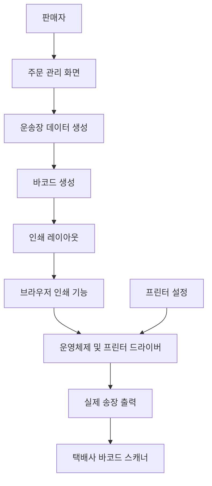
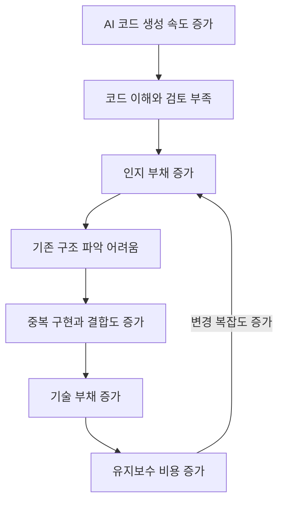
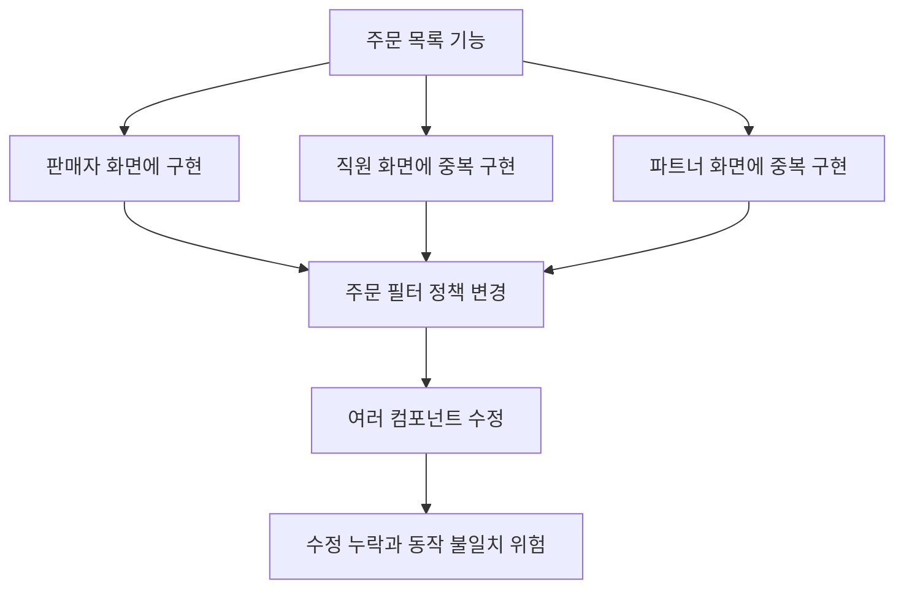
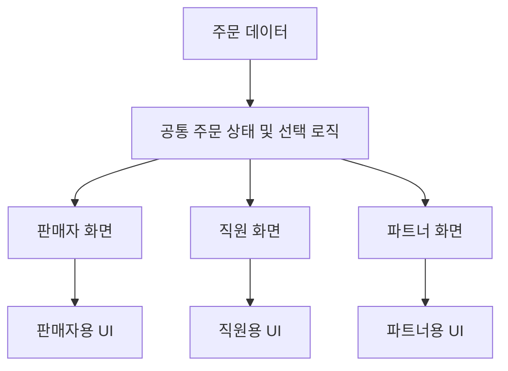
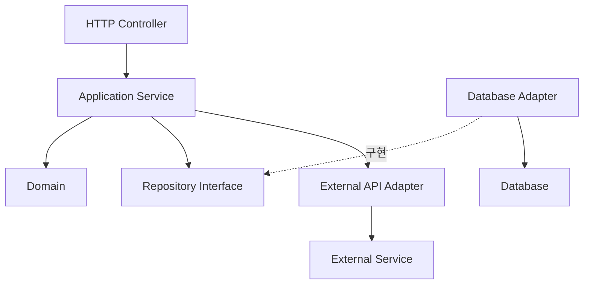
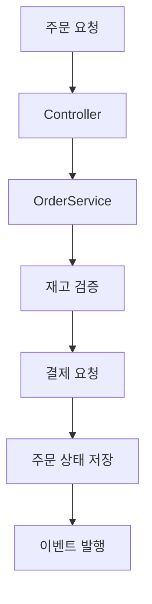
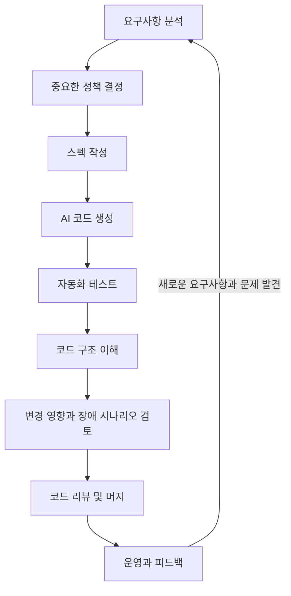
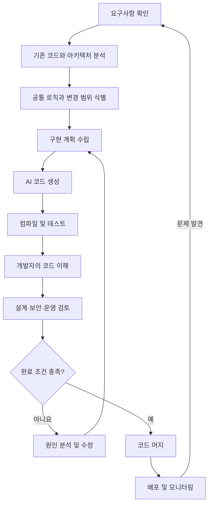
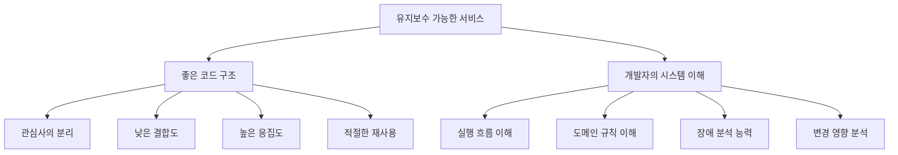

# 이스타의 바이브코딩으로 매출은 냈지만, 개발이 더 어려워졌다
[https://youtu.be/S0Lktb9ugbI?si=qXzLQiMoFd3LboR2](https://youtu.be/S0Lktb9ugbI?si=qXzLQiMoFd3LboR2)

# 이스타의 바이브코딩으로 매출은 냈지만, 개발이 더 어려워졌다
* toc
{:toc}

---

### 바이브 코딩의 진짜 문제: 인지 부채, 코드 이해, 유지보수성과 AI 시대의 소프트웨어 설계

AI 코딩 도구가 발전하면서 소프트웨어를 개발하는 방식이 빠르게 변화하고 있다.

과거에는 서비스를 만들기 위해 프로그래밍 언어와 프레임워크, 데이터베이스, 서버 환경 등 다양한 기술을 직접 학습해야 했다.

하지만 이제는 구현하고 싶은 기능을 자연어로 설명하고 AI가 작성한 코드를 실행하는 방식으로도 상당한 수준의 서비스를 개발할 수 있다.

예를 들어 다음과 같이 요청할 수 있다.

> 온라인 쇼핑몰 판매자가 주문을 관리하고 택배 송장을 출력할 수 있는 서비스를 만들어 줘.

AI는 이러한 요구사항을 기반으로 여러 기능을 생성할 수 있다.

- 주문 목록 조회
- 주문 상태 변경
- 배송 준비 처리
- 택배 송장 출력
- 운송장 번호 등록
- 사용자 로그인
- 주문 관리 화면

이러한 기능을 직접 구현하려면 상당한 시간이 필요할 수 있다.

하지만 AI를 활용하면 초기 구현에 필요한 시간을 줄일 수 있다.

이를 통해 개발 경험이 많지 않은 사람도 아이디어를 빠르게 제품으로 구현하고 실제 사용자에게 제공할 가능성이 높아졌다.

그런데 여기서 중요한 질문이 하나 있다.

**AI가 만들어 준 서비스를 실제 사용자가 사용하기 시작하면 어떤 문제가 발생할까?**

처음에는 문제가 없어 보일 수 있다.

기능이 정상적으로 실행되고, 화면도 잘 표시되며, 테스트 데이터에서는 예상한 결과가 나올 수 있다.

하지만 실제 서비스에서는 개발 과정에서 예상하지 못한 상황이 발생한다.

사용자의 컴퓨터 환경이 다를 수 있다.

외부 서비스의 응답 형식이 변경될 수도 있다.

새로운 요구사항이 추가되면서 기존 코드의 구조가 적절하지 않다는 사실을 발견할 수도 있다.

또 여러 사용자가 동시에 기능을 실행하면서 예상하지 못한 동시성 문제가 발생할 수도 있다.

이때 서비스를 만든 개발자가 내부 동작을 제대로 이해하지 못한다면 어떻게 될까?

AI에게 오류를 수정해 달라고 요청할 수는 있다.

하지만 문제가 어디서 발생했는지 모르기 때문에 적절한 질문조차 하기 어려울 수 있다.

또 AI가 새로운 코드를 생성해 문제를 해결했다고 하더라도 실제로 무엇이 변경되었는지 이해하지 못할 수 있다.

이러한 상황이 반복되면 코드의 양은 증가하지만 개발자가 이해하는 시스템의 범위는 충분히 넓어지지 않을 수 있다.

결국 다음과 같은 문제가 발생한다.

**서비스를 만드는 속도와 서비스를 이해하고 유지보수할 수 있는 능력 사이에 격차가 생기는 것이다.**

이러한 문제를 이해하기 위해서는 바이브 코딩과 인지 부채, 유지보수성, 소프트웨어 아키텍처를 함께 살펴볼 필요가 있다.

---

### 개념

#### 바이브 코딩(Vibe Coding)이란 무엇인가?

바이브 코딩은 개발자가 자연어로 의도와 요구사항을 전달하고, AI가 생성한 코드를 활용해 소프트웨어를 구현하는 개발 방식을 가리키는 표현이다.

일반적으로 개발자가 모든 코드를 직접 작성하기보다 AI에게 기능 구현과 수정 작업을 맡기는 방식과 연결된다.

예를 들어 다음과 같이 요청할 수 있다.

> React로 주문 목록 화면을 만들어 줘. 주문 상태에 따라 필터링할 수 있고, 선택한 주문을 배송 준비 상태로 변경할 수 있어야 해.

AI는 요청을 분석해 컴포넌트와 상태 관리 로직, API 호출 코드 등을 생성할 수 있다.

개발자는 결과를 확인하고 추가적인 요청을 전달한다.

```text
기능 요청
    ↓
AI 코드 생성
    ↓
실행 결과 확인
    ↓
추가 요구사항 전달
    ↓
AI 코드 수정
    ↓
기능 완성
```

이러한 방식의 가장 큰 장점은 초기 개발 속도다.

기존에는 직접 작성해야 했던 반복적인 코드를 빠르게 생성할 수 있고, 익숙하지 않은 기술을 사용하더라도 기본 구조를 만드는 데 도움을 받을 수 있다.

하지만 바이브 코딩을 하나의 고정된 개발 절차로 정의하기는 어렵다.

코드를 거의 읽지 않고 결과 중심으로 개발하는 방식도 있고, AI가 작성한 코드를 개발자가 적극적으로 검토하고 개선하는 방식도 존재한다.

따라서 중요한 것은 AI를 사용하는지 여부가 아니다.

**AI가 작성한 코드를 개발자가 어느 정도 이해하고 통제하고 있는지**가 핵심이다.

---

### 왜 사용하는가?

#### 바이브 코딩의 가장 큰 장점은 빠른 실행이다

새로운 서비스를 개발할 때 가장 어려운 부분 중 하나는 아이디어를 실제로 동작하는 제품으로 만드는 것이다.

예를 들어 온라인 쇼핑몰 판매자를 위한 주문 자동화 서비스를 개발한다고 가정하자.

판매자는 여러 쇼핑몰에서 발생한 주문을 처리해야 한다.

일반적인 업무 흐름은 다음과 같을 수 있다.

```text
쇼핑몰 주문 확인
        ↓
주문 데이터 다운로드
        ↓
재고 확인
        ↓
배송 준비 상태 변경
        ↓
택배사 양식으로 데이터 변환
        ↓
운송장 출력
        ↓
상품 포장
        ↓
운송장 번호 등록
```

여러 쇼핑몰을 사용하는 판매자라면 이러한 작업을 반복해야 한다.

특히 각 쇼핑몰과 택배사가 서로 다른 데이터 형식을 사용한다면 수작업이 증가할 수 있다.

이러한 문제를 해결하기 위해 다음과 같은 서비스를 만들 수 있다.

> 판매자가 버튼 하나만 클릭하면 주문 확인부터 운송장 출력과 배송 정보 등록까지 자동으로 처리한다.

이 서비스에는 다양한 기술이 필요하다.

- 외부 쇼핑몰 API 연동
- 주문 데이터 변환
- 재고 조회
- 배송 상태 관리
- 운송장 생성
- 프린터 연동
- 사용자 인증
- 오류 처리

모든 기능을 직접 구현한다면 초기 개발 기간이 길어질 수 있다.

하지만 AI를 활용하면 반복적인 코드와 화면을 빠르게 구현할 수 있다.

그리고 초기 제품을 사용자에게 제공해 실제 수요를 검증할 수 있다.

이러한 점에서 바이브 코딩은 MVP(Minimum Viable Product) 개발과 연결된다.

MVP는 제품의 핵심 가설을 검증하기 위해 필요한 최소한의 기능을 갖춘 제품이다.

여기서 중요한 것은 다음과 같다.

**초기 제품을 빠르게 만드는 것은 목적 자체가 아니라 사용자 문제와 제품의 가치를 검증하기 위한 수단이다.**

다만 실제 사용자에게 서비스를 제공하는 순간부터는 개발 과정과 다른 문제가 시작된다.

사용자가 돈을 지불하고 서비스를 사용한다면 운영 안정성과 오류 대응, 데이터 보호, 유지보수 가능성에 대한 책임도 발생하기 때문이다.

---

### 바이브 코딩에서 발생하는 첫 번째 문제: 코드를 이해하지 못하는 상태

#### 기능이 동작한다고 시스템을 이해한 것은 아니다

택배 송장 출력 기능을 개발했다고 가정하자.

AI는 주문 데이터를 기반으로 송장 화면을 생성하고 인쇄 기능을 구현했다.

개발 환경에서는 정상적으로 동작했다.

하지만 실제 판매자의 컴퓨터에서 송장을 출력하자 바코드가 정상적으로 인식되지 않는 문제가 발생했다.

이는 단순한 화면 오류가 아니다.

택배사는 송장의 바코드를 스캔해 배송 정보를 확인할 수 있기 때문이다.

바코드가 정상적으로 인식되지 않으면 배송 업무에 직접적인 영향을 줄 수 있다.

개발자는 이 문제를 해결해야 한다.

그런데 다음과 같은 상황이라면 어떨까?

- 인쇄 기능이 어떤 파일에서 구현되었는지 모른다.
- 브라우저에서 어떤 방식으로 인쇄 명령을 전달하는지 모른다.
- 바코드를 이미지로 생성하는지 SVG로 생성하는지 모른다.
- 송장 크기가 어디에서 결정되는지 모른다.
- 프린터 설정과 애플리케이션 코드의 관계를 모른다.

이러한 상태에서는 문제를 정확하게 진단하기 어렵다.

결국 AI에게 다음과 같이 반복해서 요청할 수 있다.

> 바코드가 제대로 인쇄되지 않아. 수정해 줘.

AI가 바코드 크기를 변경할 수도 있다.

CSS를 수정할 수도 있다.

새로운 라이브러리를 추가할 수도 있다.

하지만 실제 문제는 사용자 컴퓨터에 저장된 용지 설정일 수 있다.

이 경우 코드 수정은 문제 해결에 도움이 되지 않는다.

오히려 기존에 정상적으로 동작하던 출력 기능에 새로운 문제가 발생할 수도 있다.

여기서 중요한 사실을 발견할 수 있다.

**문제를 해결하려면 먼저 문제가 발생한 위치와 책임 범위를 구분할 수 있어야 한다.**

---

### 장애를 해결하려면 시스템의 경계를 이해해야 한다

운송장 출력 기능을 단순히 하나의 버튼으로 생각하기 쉽다.

하지만 실제로는 여러 구성요소가 연결되어 있다.



사용자는 버튼을 한 번 클릭한다.

하지만 내부적으로는 여러 단계가 실행된다.

각 단계에는 서로 다른 실패 원인이 존재한다.

| 단계 | 발생할 수 있는 문제 |
|---|---|
| 주문 데이터 조회 | 잘못된 주문 정보 |
| 운송장 데이터 생성 | 주소나 배송 정보 누락 |
| 바코드 생성 | 잘못된 바코드 데이터 또는 규격 |
| 인쇄 레이아웃 | 크기, 위치, 여백 오류 |
| 브라우저 인쇄 | 배율 또는 페이지 설정 문제 |
| 프린터 드라이버 | 용지 크기나 출력 옵션 불일치 |
| 실제 프린터 | 해상도, 인쇄 품질, 용지 문제 |
| 바코드 스캔 | 바코드 규격, 대비, 크기 등의 문제 |

따라서 출력 문제가 발생했다고 무조건 바코드 생성 코드를 수정해서는 안 된다.

먼저 문제를 분류해야 한다.

예를 들어 다음과 같은 질문을 순서대로 확인할 수 있다.

1. 생성된 바코드 데이터가 올바른가?
2. 화면에서는 바코드가 정상적으로 보이는가?
3. PDF로 저장하면 정상적으로 출력되는가?
4. 인쇄 미리보기에서 크기와 위치가 올바른가?
5. 실제 출력 용지의 크기와 프린터 설정이 일치하는가?
6. 다른 프린터에서도 동일한 문제가 발생하는가?
7. 출력된 바코드가 규격에 맞는가?

이러한 방식으로 문제를 좁혀 나가면 원인을 더 빠르게 발견할 수 있다.

---

### 인쇄 문제는 코드와 사용자 환경이 함께 영향을 미친다

브라우저 기반 인쇄에서는 애플리케이션이 출력 레이아웃에 영향을 줄 수 있다.

예를 들어 CSS의 `@media print`와 `@page`를 활용해 인쇄용 스타일과 페이지 크기를 정의할 수 있다.

```css
@media print {
    .print-button {
        display: none;
    }

    .shipping-label {
        width: 100mm;
        height: 150mm;
    }
}

@page {
    size: 100mm 150mm;
    margin: 0;
}
```

이 코드는 출력 대상의 크기와 페이지 설정을 정의하는 예시다.

하지만 실제 출력 결과는 브라우저와 운영체제, 프린터 드라이버, 장치 설정 등에 영향을 받을 수 있다.

또 `@page` 설정만으로 모든 프린터에서 물리적인 출력 크기가 정확하게 보장되는 것은 아니다.

브라우저와 인쇄 환경의 지원 범위를 함께 확인해야 한다.

MDN에서도 인쇄용 CSS와 페이지 크기 설정 방법을 설명하고 있다.

따라서 인쇄 장애를 해결하려면 코드만 확인하는 것이 아니라 전체 출력 경로를 이해해야 한다.

특히 바코드는 단순히 사람이 보기 좋은 이미지가 아니다.

스캐너가 읽을 수 있는 규격과 품질이 중요하다.

따라서 실제 업무에서 사용하는 송장 용지와 프린터, 스캐너를 이용한 검증도 필요하다.

이 사례에서 얻을 수 있는 핵심 교훈은 다음과 같다.

**코드가 올바른지 확인하는 능력과 시스템이 어떻게 동작하는지 이해하는 능력은 서로 다르다.**

---

### 인지 부채(Cognitive Debt)란 무엇인가?

인지 부채는 개발자가 시스템을 충분히 이해하지 못한 상태가 누적되면서 향후 문제 해결과 유지보수에 추가적인 비용이 발생하는 현상을 설명하는 개념이다.

예를 들어 AI를 사용해 다음 기능을 개발했다고 가정하자.

```text
1일 차

회원 기능 개발
```

```text
2일 차

상품 기능 개발
```

```text
3일 차

주문 기능 개발
```

```text
4일 차

결제 기능 개발
```

```text
5일 차

배송 기능 개발
```

AI는 계속해서 새로운 코드를 생성한다.

프로젝트의 기능도 증가한다.

그런데 개발자가 실제로 이해한 내용은 다음과 같다면 어떨까?

```text
회원 기능: 대략적인 동작 이해

상품 기능: 일부 코드만 확인

주문 기능: 내부 구조를 모름

결제 기능: AI가 작성한 코드 그대로 사용

배송 기능: 동작 결과만 확인
```

서비스의 기능은 증가했지만 개발자가 이해하는 시스템의 범위는 충분히 증가하지 않았다.

이러한 격차가 커지면 미래의 변경 작업이 어려워질 수 있다.

예를 들어 결제 기능을 변경해야 할 때 다음과 같은 질문에 답하기 어렵다.

- 어떤 클래스가 결제 상태를 관리하는가?
- 외부 API 호출은 어디에서 발생하는가?
- 트랜잭션 범위는 어디까지인가?
- 결제가 실패하면 어떤 데이터가 저장되는가?
- 중복 요청은 어떻게 처리되는가?
- 오류 발생 시 어떤 로그를 확인해야 하는가?

결국 작은 기능을 수정하기 위해 전체 코드를 다시 분석해야 할 수 있다.

이것이 인지 부채가 유지보수 비용으로 드러나는 과정이다.

AI 기반 개발에서 개발자의 코드 이해 부족과 유지보수성 문제를 연구하는 논의도 이루어지고 있다. 다만 인지 부채를 측정하는 단일한 표준이 확립되었다고 보기는 어렵고, AI 활용이 언제나 이해도 저하로 이어진다고 단정할 수도 없다.

---

### 인지 부채와 기술 부채의 차이

인지 부채는 기술 부채(Technical Debt)와 관련이 있지만 동일한 개념은 아니다.

기술 부채는 단기적인 개발 편의나 제약으로 인해 미래에 추가적인 변경 비용이 발생하는 상태를 설명한다.

예를 들어 다음과 같은 상황이 기술 부채에 해당할 수 있다.

- 중복된 비즈니스 로직
- 지나치게 결합된 클래스
- 테스트하기 어려운 구조
- 복잡한 조건문
- 일관되지 않은 예외 처리
- 오래된 의존성

반면 인지 부채는 개발자가 시스템을 이해하지 못하는 상태에 더 초점을 맞춘다.

두 개념을 비교하면 다음과 같다.

| 구분 | 기술 부채 | 인지 부채 |
|---|---|---|
| 핵심 문제 | 코드와 시스템 구조의 개선 필요성 | 시스템에 대한 이해 부족 |
| 주요 원인 | 설계 타협, 중복, 복잡도 증가 | 이해하지 않은 코드 수용, 맥락 부족 |
| 대표 현상 | 수정할 코드가 많음 | 어디를 수정해야 할지 모름 |
| 주요 영향 | 변경 비용과 결함 위험 증가 | 분석·진단·의사결정 비용 증가 |
| 해결 방법 | 리팩터링, 테스트, 설계 개선 | 코드 이해, 문서화, 시스템 분석 |
| 관계 | 인지 부채를 증가시킬 수 있음 | 기술 부채를 발견하지 못하게 만들 수 있음 |

예를 들어 다음과 같은 상황을 생각해 보자.

AI가 주문 조회 기능을 세 개의 서로 다른 컴포넌트에 중복 구현했다.

이것은 기술 부채가 될 수 있다.

그런데 개발자가 해당 코드가 중복되어 있다는 사실조차 모른다면 어떨까?

인지 부채도 함께 존재하는 것이다.

따라서 두 부채는 서로 영향을 줄 수 있다.



여기서 중요한 점은 AI를 사용하면 반드시 기술 부채가 증가한다는 의미가 아니라는 것이다.

AI는 오히려 코드 분석과 리팩터링, 테스트 작성에 도움을 줄 수도 있다.

문제는 AI가 만든 결과를 이해하고 관리하는 과정이 생략될 때 발생할 가능성이 커진다.

---

### 인지 부채가 위험한 이유

인지 부채는 처음에는 쉽게 드러나지 않을 수 있다.

서비스가 정상적으로 실행되기 때문이다.

하지만 시간이 지나면서 세 가지 문제로 나타날 수 있다.

#### 첫 번째, 장애 원인을 찾기 어렵다

서비스가 정상적으로 동작할 때는 내부 구조를 몰라도 사용에 문제가 없을 수 있다.

하지만 장애가 발생하면 문제가 달라진다.

어떤 기능이 어느 외부 시스템과 연결되어 있는지 알아야 한다.

어떤 로그를 확인해야 하는지도 알아야 한다.

또 문제가 발생한 계층을 구분할 수 있어야 한다.

이러한 이해가 없다면 장애 대응 시간이 길어질 수 있다.

#### 두 번째, 새로운 기능을 추가하기 어렵다

기존 시스템의 구조를 이해하지 못하면 이미 구현된 기능을 찾기 어렵다.

예를 들어 주문 상태 변경 기능이 존재하는데도 AI에게 새로운 주문 상태 변경 기능을 생성하도록 요청할 수 있다.

결과적으로 비슷한 기능이 여러 곳에 만들어질 수 있다.

이것은 중복 코드와 유지보수 비용 증가로 이어질 수 있다.

#### 세 번째, 기술적인 의사결정을 하기 어렵다

서비스가 성장하면 새로운 요구사항이 나타난다.

예를 들어 다음과 같다.

- 다중 사용자 권한
- 결제 수단 추가
- 주문 처리량 증가
- 비동기 이벤트 처리
- 외부 시스템 연동
- 운영 자동화

이때 기존 아키텍처를 이해하지 못하면 어떤 구조를 확장해야 하는지 판단하기 어렵다.

결국 AI가 제안하는 구조를 검토할 기준도 부족해질 수 있다.

**인지 부채의 위험은 단순히 코드를 읽지 못하는 것이 아니라, 시스템을 개선하기 위한 판단 능력이 제한된다는 점이다.**

---

### 바이브 코딩에서 발생하는 두 번째 문제: 기능 확장과 코드 중복

이번에는 주문 관리 서비스에 새로운 요구사항이 추가되는 상황을 살펴보자.

기존 서비스는 쇼핑몰 판매자가 사용하는 시스템이다.

판매자는 주문 목록을 조회하고 배송 상태를 변경하며 매출 정보도 확인할 수 있다.

그런데 다음 두 가지 요구사항이 추가되었다.

**첫 번째 요구사항**

직원이 서비스를 사용할 수 있도록 하되 매출과 같은 민감한 정보는 볼 수 없게 한다.

직원은 새로운 주문을 확인하고 배송 준비 작업만 수행할 수 있어야 한다.

**두 번째 요구사항**

외부 파트너사가 주문 정보를 확인할 수 있도록 별도의 화면을 제공한다.

단, 파트너사는 허용된 주문만 조회할 수 있어야 한다.

기존 주문 목록 화면에 이러한 기능을 추가하려면 어떻게 해야 할까?

가장 단순한 방법은 새로운 화면을 만드는 것이다.

예를 들어 다음과 같이 구성할 수 있다.

```text
components/
├── SellerOrderList.tsx
├── StaffOrderList.tsx
└── PartnerOrderList.tsx
```

각 화면을 독립적으로 개발하는 것이다.

초기에는 빠르게 구현할 수 있다.

하지만 시간이 지나면 문제가 발생할 수 있다.

세 화면이 동일한 주문 조회와 필터링 로직을 중복으로 가지고 있기 때문이다.

---

### 코드 중복이 유지보수 비용을 증가시키는 과정

기존 주문 목록에서 주문 상태를 필터링하는 기능이 있다고 가정하자.

```typescript
const filteredOrders = orders.filter(
    (order) => order.status === selectedStatus
);
```

판매자 화면에서도 사용한다.

직원 화면에서도 사용한다.

파트너 화면에서도 사용한다.

그런데 새로운 요구사항이 추가되었다.

> 배송 취소 상태의 주문도 별도로 필터링할 수 있어야 한다.

이제 세 화면을 모두 수정해야 할 수 있다.

```text
SellerOrderList 수정

StaffOrderList 수정

PartnerOrderList 수정
```

만약 한 화면의 수정이 누락되면 어떻게 될까?

동일한 기능인데 화면에 따라 다른 결과가 나타날 수 있다.

또 버그가 발견되면 여러 곳을 확인해야 한다.

이러한 문제가 반복되면 코드 변경 비용이 증가한다.



이 문제를 해결하기 위해 필요한 개념이 관심사의 분리다.

---

### 관심사의 분리(Separation of Concerns)

#### 관심사의 분리란 무엇인가?

관심사의 분리는 서로 다른 책임을 가진 코드를 적절하게 구분하는 설계 원칙이다.

예를 들어 주문 목록 화면을 구현한다고 가정하자.

이 화면에는 여러 종류의 로직이 존재한다.

첫 번째는 주문 데이터를 가져오는 로직이다.

두 번째는 주문을 필터링하거나 선택하는 로직이다.

세 번째는 데이터를 화면에 표시하는 로직이다.

네 번째는 버튼과 테이블을 어디에 배치할지 결정하는 로직이다.

이러한 책임을 하나의 컴포넌트에 모두 작성할 수 있다.

하지만 기능이 복잡해질수록 변경하기 어려워질 수 있다.

따라서 다음과 같이 구분할 수 있다.

| 관심사 | 주요 역할 |
|---|---|
| 데이터 조회 | API 호출과 데이터 수신 |
| 도메인 로직 | 주문 상태와 비즈니스 규칙 |
| 상태 관리 | 필터, 선택 상태 등 |
| UI 표현 | 테이블, 카드, 배지 |
| 레이아웃 | 화면 내 요소 배치 |
| 권한 | 사용자별 접근 가능한 데이터와 작업 |

각 관심사는 변경되는 이유가 다르다.

예를 들어 주문 필터링 정책이 변경되었다고 해서 버튼의 색상까지 수정할 필요는 없다.

반대로 테이블 디자인이 변경되었다고 주문 조회 API를 수정할 필요도 없다.

**변경되는 이유가 다른 코드는 적절한 경계를 통해 분리하는 것이 유지보수에 유리할 수 있다.**

---

### 무엇을 보여줄지, 어떻게 보여줄지, 어디에 배치할지

화면 개발에서 요구사항의 변경을 세 가지 관점으로 구분해 볼 수 있다.

#### 1. 무엇을 보여줄 것인가?

어떤 데이터를 사용자에게 제공할지 결정한다.

예를 들어 다음과 같다.

- 주문 번호
- 주문 상태
- 수령인
- 상품 정보
- 매출 금액
- 배송 정보

사용자 권한에 따라 표시할 데이터가 달라질 수 있다.

#### 2. 어떻게 보여줄 것인가?

데이터를 어떤 형태로 표현할지 결정한다.

예를 들어 다음과 같다.

- 테이블
- 카드
- 목록
- 상태 배지
- 체크박스
- 버튼

동일한 주문 데이터를 서로 다른 UI로 표현할 수 있다.

#### 3. 어디에 배치할 것인가?

화면에서 요소를 어떤 위치에 배치할지 결정한다.

예를 들어 다음과 같다.

- 상단 필터 영역
- 왼쪽 사이드바
- 중앙 주문 목록
- 오른쪽 상세 패널
- 하단 일괄 처리 버튼

이 세 가지 관점을 분리하면 동일한 기능을 여러 화면에 활용하기 쉬워질 수 있다.



물론 모든 화면을 완전히 동일한 컴포넌트로 만들어야 한다는 의미는 아니다.

서로 다른 부분은 분리하고, 실제로 공통인 부분을 재사용하는 것이 중요하다.

---

### 헤드리스 패턴(Headless Pattern)

#### 헤드리스 패턴이란 무엇인가?

헤드리스 패턴은 컴포넌트의 동작과 상태 관리 로직을 특정한 시각적 표현으로부터 분리하는 접근 방식이다.

일반적인 UI 컴포넌트는 다음 요소를 함께 포함할 수 있다.

```text
상태 관리
+
이벤트 처리
+
데이터 가공
+
UI 렌더링
+
스타일
```

반면 헤드리스 방식에서는 핵심 동작을 별도로 분리할 수 있다.

```text
공통 동작과 상태 관리
        ↓
다양한 UI 표현
```

예를 들어 주문 목록에서 공통으로 필요한 기능은 다음과 같을 수 있다.

- 주문 상태 필터링
- 주문 선택
- 전체 선택
- 선택 해제

반면 화면의 표현은 다를 수 있다.

판매자는 테이블 형태를 선호할 수 있다.

직원은 빠르게 작업할 수 있도록 단순한 목록을 사용할 수 있다.

파트너사는 제한된 정보만 표시하는 카드 형태를 사용할 수 있다.

이 경우 공통 동작을 재사용하면서 UI 표현을 다르게 구성할 수 있다.

React Aria도 동작 로직을 훅으로 제공하고 이를 다양한 표현 컴포넌트와 결합하는 방식을 지원한다.

---

### React로 구현하는 헤드리스 패턴

다음과 같은 주문 데이터가 있다고 가정하자.

```typescript
type OrderStatus =
    | "NEW"
    | "PREPARING"
    | "SHIPPED";

interface Order {
    id: string;
    recipientName: string;
    status: OrderStatus;
}
```

이제 주문 선택과 필터링을 담당하는 공통 훅을 작성한다.

`useOrderSelection.ts`

```typescript
import { useMemo, useState } from "react";

type OrderStatus =
    | "NEW"
    | "PREPARING"
    | "SHIPPED";

interface Order {
    id: string;
    recipientName: string;
    status: OrderStatus;
}

export function useOrderSelection<T extends Order>(
    orders: T[]
) {
    const [selectedStatus, setSelectedStatus] =
        useState<OrderStatus | "ALL">("ALL");

    const [selectedIds, setSelectedIds] =
        useState<Set<string>>(() => new Set());

    const filteredOrders = useMemo(() => {
        if (selectedStatus === "ALL") {
            return orders;
        }

        return orders.filter(
            (order) => order.status === selectedStatus
        );
    }, [orders, selectedStatus]);

    const toggleSelection = (orderId: string) => {
        setSelectedIds((previous) => {
            const next = new Set(previous);

            if (next.has(orderId)) {
                next.delete(orderId);
            } else {
                next.add(orderId);
            }

            return next;
        });
    };

    const clearSelection = () => {
        setSelectedIds(new Set());
    };

    return {
        selectedStatus,
        setSelectedStatus,
        selectedIds,
        filteredOrders,
        toggleSelection,
        clearSelection
    };
}
```

이 훅은 화면의 디자인을 결정하지 않는다.

테이블을 사용할지, 카드 형태를 사용할지 알 필요가 없다.

오직 다음 동작을 담당한다.

- 주문 필터링
- 선택 상태 관리
- 선택 상태 변경
- 선택 초기화

이제 화면에서는 해당 훅을 활용할 수 있다.

```tsx
function StaffOrderList({
    orders
}: {
    orders: Order[];
}) {
    const {
        filteredOrders,
        selectedIds,
        toggleSelection
    } = useOrderSelection(orders);

    return (
        <ul>
            {filteredOrders.map((order) => (
                <li key={order.id}>
                    <input
                        type="checkbox"
                        checked={selectedIds.has(order.id)}
                        onChange={() =>
                            toggleSelection(order.id)
                        }
                        aria-label={`${order.id} 주문 선택`}
                    />

                    <span>{order.recipientName}</span>
                    <span>{order.status}</span>
                </li>
            ))}
        </ul>
    );
}
```

이 컴포넌트는 직원용 화면을 담당한다.

하지만 주문 선택과 필터링 로직을 새로 구현할 필요는 없다.

공통 훅을 재사용하면 된다.

판매자용 화면도 같은 훅을 활용할 수 있다.

```tsx
function SellerOrderList({
    orders
}: {
    orders: Order[];
}) {
    const {
        filteredOrders,
        selectedIds,
        toggleSelection
    } = useOrderSelection(orders);

    return (
        <table>
            <thead>
                <tr>
                    <th>선택</th>
                    <th>주문 번호</th>
                    <th>수령인</th>
                    <th>상태</th>
                </tr>
            </thead>

            <tbody>
                {filteredOrders.map((order) => (
                    <tr key={order.id}>
                        <td>
                            <input
                                type="checkbox"
                                checked={selectedIds.has(order.id)}
                                onChange={() =>
                                    toggleSelection(order.id)
                                }
                                aria-label={`${order.id} 주문 선택`}
                            />
                        </td>

                        <td>{order.id}</td>
                        <td>{order.recipientName}</td>
                        <td>{order.status}</td>
                    </tr>
                ))}
            </tbody>
        </table>
    );
}
```

두 화면의 디자인은 다르다.

하지만 주문 선택과 필터링 로직은 재사용한다.

따라서 필터링 로직에 문제가 발생하면 공통 훅을 중심으로 수정할 수 있다.

---

### 헤드리스 패턴을 무조건 적용해야 할까?

헤드리스 패턴은 유용하지만 모든 컴포넌트에 적용해야 하는 것은 아니다.

예를 들어 화면 하나에서만 사용되는 단순한 버튼이 있다고 가정하자.

이 버튼의 클릭 처리와 UI를 별도의 훅으로 분리할 필요는 없을 수 있다.

오히려 작은 기능을 여러 파일로 나누면서 구조가 복잡해질 수도 있다.

따라서 다음과 같은 기준으로 판단할 수 있다.

| 상황 | 헤드리스 패턴 검토 |
|---|---|
| 여러 화면에서 동일한 동작 사용 | 적합 |
| UI는 다르지만 상태 관리가 동일 | 적합 |
| 테스트하기 어려운 상태 로직이 존재 | 유용할 수 있음 |
| 특정 화면에서만 사용하는 단순한 UI | 분리 필요성이 낮을 수 있음 |
| 로직보다 디자인 변경이 대부분 | 공통 UI 컴포넌트만으로 충분할 수 있음 |
| 도메인 정책이 화면마다 실제로 다름 | 무리한 공통화 주의 |

중요한 것은 재사용을 위해 모든 코드를 추상화하는 것이 아니다.

**실제로 동일한 책임을 수행하는 부분을 찾아 적절한 수준으로 공통화하는 것**이다.

---

### 재사용 가능한 코드와 추상화의 관계

개발자는 중복 코드가 발생하면 공통화를 고려한다.

하지만 코드를 공통화하는 것과 좋은 추상화를 만드는 것은 같은 의미가 아니다.

예를 들어 판매자와 파트너사의 주문 목록을 공통 컴포넌트로 만들었다고 가정하자.

그런데 다음과 같은 속성이 필요해졌다.

```tsx
<OrderList
    isSeller={true}
    isPartner={false}
    isStaff={false}
    showRevenue={true}
    showShippingButton={true}
    showPartnerCode={false}
/>
```

이러한 방식은 초기에는 간단해 보일 수 있다.

하지만 역할과 기능이 증가하면 조건문이 계속 추가될 수 있다.

```typescript
if (isSeller) {
    // 판매자 처리
}

if (isPartner) {
    // 파트너 처리
}

if (isStaff) {
    // 직원 처리
}
```

결국 하나의 컴포넌트가 여러 화면의 요구사항을 모두 이해해야 하는 구조가 될 수 있다.

이러한 구조는 변경하기 어려워질 수 있다.

따라서 다음과 같이 구분하는 것이 좋다.

**공통 동작은 재사용한다.**

**서로 다른 제품 동작은 분리한다.**

**시각적인 차이는 표현 계층에서 처리한다.**

이러한 원칙은 컴포넌트뿐 아니라 백엔드 아키텍처에도 적용할 수 있다.

---

### 백엔드에서도 동일한 문제가 발생한다

프론트엔드에서는 화면에 여러 책임이 결합되면 재사용이 어려워질 수 있다.

백엔드에서도 동일한 문제가 발생한다.

예를 들어 주문 조회 API를 구현한다고 가정하자.

처음에는 판매자만 사용하는 서비스였다.

따라서 다음과 같이 구현했다.

```java
public List<Order> getOrders(Long sellerId) {

    return orderRepository.findBySellerId(sellerId);
}
```

이후 직원과 파트너사의 요구사항이 추가되었다.

개발자는 다음과 같이 구현할 수 있다.

```java
public List<Order> getOrders(
        Long userId,
        String userType
) {

    if ("SELLER".equals(userType)) {
        return orderRepository.findBySellerId(userId);
    }

    if ("STAFF".equals(userType)) {
        return orderRepository.findByStaffId(userId);
    }

    if ("PARTNER".equals(userType)) {
        return orderRepository.findByPartnerId(userId);
    }

    throw new IllegalArgumentException(
            "지원하지 않는 사용자 유형입니다."
    );
}
```

이 코드는 간단한 예시지만 구조적인 문제를 보여준다.

사용자 유형에 따라 조회 로직이 달라진다.

새로운 사용자 유형이 추가되면 기존 메서드를 수정해야 한다.

또 어떤 데이터를 반환할 수 있는지에 대한 권한 정책까지 함께 관리한다면 복잡도가 더욱 증가할 수 있다.

따라서 역할별로 달라지는 정책과 공통적인 주문 조회 기능을 구분할 필요가 있다.

여기서 중요한 것은 단순히 클래스를 여러 개로 분리하는 것이 아니다.

**어떤 책임이 공통이고 어떤 책임이 달라지는지 먼저 판단해야 한다.**

---

### 인증(Authentication)과 인가(Authorization)를 구분해야 한다

사용자별로 다른 주문 정보를 보여주는 기능에서는 보안도 중요하다.

예를 들어 직원에게 매출 정보를 보여주지 않아야 한다고 가정하자.

가장 단순한 방법은 프론트엔드에서 매출 영역을 숨기는 것이다.

```tsx
{userRole === "SELLER" && (
    <RevenueSummary />
)}
```

하지만 이 방식만으로는 충분하지 않다.

사용자가 직접 API를 호출하면 숨겨진 데이터를 조회할 수 있을 가능성이 있기 때문이다.

따라서 서버에서도 접근 권한을 검증해야 한다.

여기서 두 가지 개념을 구분할 필요가 있다.

**인증(Authentication)**은 사용자가 누구인지 확인하는 과정이다.

**인가(Authorization)**는 해당 사용자가 특정 데이터나 기능에 접근할 수 있는지 판단하는 과정이다.

예를 들어 다음과 같은 정책을 정의할 수 있다.

| 사용자 | 주문 조회 | 배송 처리 | 매출 조회 | 정산 조회 |
|---|---|---|---|---|
| 판매자 | 자신의 주문 | 허용 | 허용 | 허용 |
| 직원 | 소속 판매자의 허용된 주문 | 허용된 범위 | 불가 | 불가 |
| 파트너사 | 자신에게 배정된 주문 | 계약에 따른 범위 | 불가 | 불가 |

이 정책은 프론트엔드 화면 표시뿐 아니라 백엔드 API에도 적용되어야 한다.

OWASP 역시 접근 통제를 서버에서 검증하고 최소 권한 원칙과 기본 거부 정책을 적용할 것을 권장한다.

---

### 권한별 DTO를 분리해야 하는 이유

다음과 같은 주문 엔티티가 있다고 가정하자.

```java
public class Order {

    private Long id;

    private String recipientName;

    private String address;

    private BigDecimal paymentAmount;

    private BigDecimal settlementAmount;

    private OrderStatus status;
}
```

직원에게는 매출과 정산 금액을 보여주면 안 된다.

이때 주문 엔티티 전체를 API 응답으로 반환한 뒤 프론트엔드에서 필요한 필드만 숨긴다면 문제가 발생할 수 있다.

데이터가 이미 클라이언트로 전달되었기 때문이다.

따라서 사용자에게 허용된 정보만 응답해야 한다.

예를 들어 다음과 같이 DTO를 분리할 수 있다.

```java
public record StaffOrderResponse(
        Long orderId,
        String recipientName,
        String address,
        OrderStatus status
) {
}
```

판매자용 DTO는 다음과 같이 구성할 수 있다.

```java
public record SellerOrderResponse(
        Long orderId,
        String recipientName,
        String address,
        BigDecimal paymentAmount,
        BigDecimal settlementAmount,
        OrderStatus status
) {
}
```

이렇게 하면 응답 모델에서 역할별로 노출할 데이터를 구분할 수 있다.

하지만 DTO를 분리했다고 권한 검증이 완료되는 것은 아니다.

예를 들어 파트너사가 다른 파트너사에 배정된 주문 ID를 전달할 수 있다.

따라서 다음과 같은 검증도 필요하다.

```text
요청 사용자 확인
        ↓
사용자 역할 확인
        ↓
요청한 주문의 소유 관계 확인
        ↓
허용된 데이터만 조회
        ↓
역할에 맞는 DTO 반환
```

즉 프론트엔드에서 화면을 분리하는 문제와 백엔드에서 데이터 접근 권한을 검증하는 문제는 서로 연결되어 있지만 책임은 다르다.

---

### 시스템 아키텍처에서도 관심사를 분리해야 한다

백엔드 서비스에서 관심사의 분리를 적용하면 다음과 같은 구조를 생각할 수 있다.



각 계층은 서로 다른 책임을 가진다.

| 계층 | 주요 책임 |
|---|---|
| Controller | HTTP 요청과 응답 처리 |
| Application Service | 유스케이스 실행과 흐름 조정 |
| Domain | 비즈니스 규칙과 상태 |
| Repository Interface | 데이터 접근 추상화 |
| Database Adapter | 실제 DB 접근 구현 |
| External API Adapter | 외부 시스템 통신 |

이러한 구조는 변경이 발생했을 때 영향 범위를 줄이는 데 도움이 될 수 있다.

예를 들어 외부 배송 API가 변경되었다고 가정하자.

외부 API의 요청과 응답 형식은 바뀔 수 있다.

하지만 주문 상태 전이 규칙까지 반드시 변경해야 하는 것은 아니다.

따라서 외부 API와 도메인 로직을 분리하면 변경 범위를 제한하기 쉬워진다.

이러한 원칙은 헥사고날 아키텍처나 클린 아키텍처 등에서도 중요한 설계 방향으로 활용된다.

다만 작은 서비스에 모든 추상화 계층을 처음부터 적용할 필요는 없다.

프로젝트의 복잡도와 변경 가능성을 고려해 적절한 구조를 선택해야 한다.

---

### AI가 작성한 코드를 이해해야 하는 이유

AI가 생성한 코드를 이해해야 하는 이유를 단순히 검증 때문이라고 생각하기 쉽다.

물론 검증은 중요하다.

AI가 잘못된 코드나 보안에 취약한 코드를 생성했는지 확인해야 하기 때문이다.

하지만 코드 이해에는 또 다른 목적이 있다.

**문제가 발생했을 때 어디를 확인해야 하는지 알기 위해서다.**

예를 들어 주문 처리 기능에서 오류가 발생했다고 가정하자.

다음과 같은 흐름을 알고 있다면 문제를 분석할 수 있다.



이제 결제가 성공했는데 주문 상태가 갱신되지 않았다는 문제가 발생했다고 가정하자.

개발자는 다음과 같은 질문을 할 수 있다.

- 결제 요청이 실제로 성공했는가?
- 결제 응답을 정상적으로 수신했는가?
- DB 저장 작업에서 예외가 발생했는가?
- 트랜잭션이 롤백되었는가?
- 이벤트 발행 과정에서 문제가 발생했는가?
- 재처리 로직이 존재하는가?

시스템 구조를 이해하면 이러한 질문을 순서대로 검증할 수 있다.

반대로 내부 흐름을 모른다면 AI에게 막연하게 오류 수정을 요청하게 될 수 있다.

그 결과 문제를 해결하기까지 여러 번의 시행착오가 발생할 수 있다.

따라서 코드 이해의 핵심적인 가치는 다음과 같다.

**현재 코드가 올바른지 판단하는 능력뿐 아니라, 미래의 문제를 진단하고 변경할 수 있는 능력을 확보하는 것이다.**

---

### 내가 설명할 수 없는 코드는 머지하지 않는다

AI가 작성한 코드를 이해하기 위한 실천적인 기준으로 다음 원칙을 사용할 수 있다.

**내가 설명할 수 없는 코드는 머지하지 않는다.**

여기서 모든 코드의 내부 구현을 한 줄씩 암기해야 한다는 의미는 아니다.

대신 중요한 구조와 동작을 설명할 수 있어야 한다.

예를 들어 다음 질문에 답할 수 있는지 확인할 수 있다.

| 질문 | 확인하려는 내용 |
|---|---|
| 이 기능은 어떤 문제를 해결하는가? | 목적 이해 |
| 요청은 어떤 계층을 거치는가? | 실행 흐름 이해 |
| 데이터는 어디에서 저장되는가? | 상태 관리 이해 |
| 외부 시스템과 어디에서 통신하는가? | 의존성 이해 |
| 실패하면 어떻게 처리하는가? | 예외 및 장애 처리 이해 |
| 동시 요청이 발생하면 어떻게 되는가? | 데이터 정합성 이해 |
| 어떤 테스트가 존재하는가? | 검증 범위 이해 |
| 요구사항이 변경되면 어디를 수정해야 하는가? | 유지보수성 이해 |
| 보안상 중요한 검증은 어디에서 수행하는가? | 인증·인가 이해 |
| 배포 이후 어떻게 문제를 확인하는가? | 운영 가능성 이해 |

이러한 질문에 답할 수 있다면 최소한 중요한 변경과 장애를 분석하기 위한 기본적인 이해를 갖추었다고 볼 수 있다.

물론 시스템 전체의 세부사항을 한 사람이 모두 이해하는 것은 현실적으로 어려울 수 있다.

따라서 이해의 범위는 변경의 중요도와 시스템의 위험도에 따라 달라질 수 있다.

예를 들어 단순한 화면 색상 변경과 결제 처리 로직 변경을 동일한 수준으로 검토할 필요는 없다.

---

### 코드의 이해도를 어떻게 확인할까?

AI가 작성한 코드를 읽었다고 해서 반드시 이해한 것은 아니다.

따라서 이해 여부를 확인할 수 있는 기준이 필요하다.

대표적으로 다음 세 가지 방법을 사용할 수 있다.

#### 첫 번째, 실행 흐름을 설명한다

예를 들어 다음 질문에 답해 본다.

> 사용자가 주문 버튼을 클릭하면 어떤 메서드가 어떤 순서로 실행되는가?

단순히 메서드 이름을 나열하는 것이 아니다.

어떤 상태가 변경되고, 어떤 외부 시스템을 호출하며, 실패하면 어떤 경로로 처리되는지 설명할 수 있어야 한다.

#### 두 번째, 변경 위치를 예측한다

다음 요구사항이 추가되었다고 가정하자.

> 결제 실패 시 주문 상태를 PAYMENT_FAILED로 변경해야 한다.

이 요구사항을 구현하려면 어떤 클래스를 수정해야 할까?

어떤 테스트를 추가해야 할까?

어떤 DB 변경이 필요할까?

이러한 질문에 답할 수 있다면 시스템 구조를 이해하고 있을 가능성이 높다.

#### 세 번째, 장애 상황을 분석한다

다음 문제가 발생했다고 가정하자.

> 외부 결제 API는 성공을 반환했지만 내부 구독 상태는 변경되지 않았다.

이때 확인해야 할 로그와 데이터, 메시지 큐의 상태를 설명할 수 있어야 한다.

이러한 방법은 단순한 코드 읽기보다 실제 유지보수 능력에 가까운 이해를 검증하는 데 도움이 된다.

---

### AI에게 코드 설명을 요청하는 방법

AI는 코드 생성뿐 아니라 코드 이해를 돕는 도구로도 활용할 수 있다.

예를 들어 다음과 같은 요청을 사용할 수 있다.

> 현재 주문 처리 기능의 실행 흐름을 Controller부터 데이터베이스 저장까지 설명해 줘. 각 단계에서 호출하는 메서드와 변경되는 상태, 외부 의존성을 구분해 줘.

또는 다음과 같이 요청할 수 있다.

> 이 코드에서 발생할 수 있는 실패 상황을 분석해 줘. 네트워크 타임아웃, DB 저장 실패, 중복 요청, 동시성 문제를 중심으로 설명하고 현재 구현에서 대응하지 못하는 부분을 찾아 줘.

기능 변경 전에 다음과 같이 요청할 수도 있다.

> 주문 상태를 추가할 예정이야. 기존 코드에서 영향을 받는 클래스와 테스트를 먼저 찾아 줘. 아직 코드는 수정하지 마.

이러한 방식은 AI를 코드 작성 도구뿐 아니라 시스템 분석 도구로 활용하는 접근이다.

다만 AI가 설명한 내용도 실제 코드와 일치하는지 확인해야 한다.

**AI에게 설명을 들었다는 사실과 개발자가 스스로 설명할 수 있다는 사실은 구분해야 한다.**

---

### 앞서 살펴본 SDD와 인지 부채의 관계

스펙 주도 개발(SDD)은 구현해야 할 요구사항과 기대 동작을 명확하게 정의하는 접근 방식이다.

반면 인지 부채 관리는 생성된 코드와 시스템을 개발자가 이해하고 유지보수할 수 있는 상태로 만드는 데 초점을 맞춘다.

두 접근은 서로 연결할 수 있다.

예를 들어 AI에게 다음과 같이 요청했다고 가정하자.

> 구독 결제 기능을 구현해 줘.

이 요청에는 많은 결정이 빠져 있다.

- 결제 성공 조건
- 실패 시 상태 전이
- 재시도 정책
- 중복 결제 방지
- Webhook 처리
- 데이터베이스 트랜잭션 범위

SDD를 활용하면 이러한 정책을 명확하게 정의할 수 있다.

이후 AI가 해당 명세를 기준으로 코드를 생성한다.

하지만 코드가 생성된 뒤에는 다른 문제가 남는다.

개발자가 실제 구현 구조를 이해하고 있는가?

따라서 다음과 같은 흐름을 만들 수 있다.



이 구조에서 SDD는 무엇을 구현해야 하는지 명확하게 만든다.

자동화 테스트는 구현이 정의된 요구사항을 충족하는지 검증한다.

코드 이해와 리뷰는 향후 시스템을 유지보수할 수 있는지를 확인하는 데 도움을 준다.

즉 **SDD와 인지 부채 관리는 서로 다른 위험을 줄이는 보완적인 접근**이다.

---

### 실무에서의 활용

### AI 기반 개발에서 인지 부채를 줄이는 12가지 실천 전략

AI를 적극적으로 활용하면서도 유지보수 가능한 서비스를 만들기 위해서는 개발 과정에 몇 가지 기준을 마련할 필요가 있다.

여기서는 코드 이해와 설계, 운영 안정성을 중심으로 12가지 전략을 살펴본다.

#### 1. AI에게 코드를 생성하기 전에 기존 구조를 분석하게 한다

새로운 기능을 구현할 때 곧바로 코드를 생성하도록 요청하지 않는다.

먼저 관련된 코드를 찾아 기존 구조를 분석하도록 한다.

예를 들어 다음과 같이 요청할 수 있다.

> 현재 프로젝트에서 주문 목록을 조회하고 필터링하는 기능을 찾아 줘. 관련 컴포넌트와 훅, API 호출 코드를 정리하고 중복된 로직이 있는지 분석해 줘. 아직 코드는 변경하지 마.

이렇게 하면 이미 존재하는 기능을 중복으로 구현할 가능성을 줄일 수 있다.

또 새로운 기능이 기존 구조에 어떤 영향을 미치는지 먼저 확인할 수 있다.

핵심은 **구현 전에 탐색하는 과정**을 개발 흐름에 포함하는 것이다.

---

#### 2. 생성된 코드의 실행 흐름을 설명하게 한다

AI가 새로운 기능을 구현했다면 어떤 코드를 작성했는지 설명하도록 요청한다.

예를 들어 다음과 같다.

> 이번 변경에서 요청이 처리되는 흐름을 설명해 줘. Controller, Service, Repository, 외부 API 호출 순서와 각 단계의 책임을 정리해 줘.

이후 개발자가 설명을 읽고 실제 코드를 확인한다.

중요한 부분은 직접 실행해 볼 수도 있다.

이렇게 하면 코드를 단순히 수용하는 것보다 시스템을 이해하는 데 도움이 된다.

특히 다음 기능에서는 이러한 검토가 중요하다.

- 결제
- 주문
- 인증
- 정산
- 재고
- 비동기 이벤트 처리

---

#### 3. 중요한 코드는 작은 단위로 생성한다

하나의 프롬프트로 수십 개의 파일을 생성하도록 요청하면 변경 내용을 이해하기 어려울 수 있다.

예를 들어 주문 시스템 전체를 한 번에 구현하는 대신 다음과 같이 나눌 수 있다.

```text
1단계: 주문 도메인 모델

2단계: 주문 생성 로직

3단계: 재고 검증

4단계: 결제 연동

5단계: 실패 처리

6단계: 테스트

7단계: 운영 로그와 지표
```

각 단계에서 변경된 코드를 확인하고 다음 단계로 진행한다.

이러한 방식은 변경 범위를 제한하고 이해에 필요한 부담을 줄이는 데 도움이 된다.

다만 모든 작업을 지나치게 작은 단위로 분리하면 오히려 작업 관리 비용이 증가할 수 있다.

따라서 하나의 의미 있는 기능을 검증할 수 있는 크기로 나누는 것이 좋다.

---

#### 4. 코드 생성과 코드 검토를 구분한다

AI에게 기능을 구현하도록 요청한 뒤 바로 머지하는 방식은 위험할 수 있다.

따라서 다음과 같은 과정을 구분할 수 있다.

```text
코드 생성
    ↓
변경 파일 확인
    ↓
실행 흐름 이해
    ↓
테스트 실행
    ↓
설계 및 보안 검토
    ↓
머지
```

특히 다음 사항은 별도로 확인하는 것이 좋다.

- 불필요한 의존성 추가 여부
- 기존 코드와 중복 여부
- 예외 처리 누락 여부
- 데이터베이스 트랜잭션 범위
- 인증·인가 검증
- 로그에 민감 정보가 포함되는지 여부

이렇게 하면 AI의 빠른 구현 속도를 활용하면서도 검토 과정을 유지할 수 있다.

---

#### 5. 기존 코드와 동일한 책임을 가진 로직을 재사용한다

새로운 화면이나 기능을 개발할 때 기존 코드와 공통된 부분이 있는지 확인한다.

예를 들어 다음과 같은 주문 화면이 있다고 가정하자.

```text
판매자 주문 화면

직원 주문 화면

파트너 주문 화면
```

세 화면은 디자인이 다를 수 있다.

하지만 다음 동작은 공통일 수 있다.

- 주문 상태 필터링
- 주문 선택
- 정렬
- 페이지네이션

이 경우 공통 동작을 별도의 훅이나 서비스로 분리할 수 있다.

반면 역할별로 다른 권한 정책은 별도로 관리해야 한다.

중요한 것은 단순히 비슷한 코드를 하나로 합치는 것이 아니다.

**동일한 책임을 가진 부분을 찾아 재사용하는 것**이다.

---

#### 6. UI와 비즈니스 로직을 분리한다

프론트엔드에서는 화면의 시각적 표현과 상태 관리 로직을 분리할 수 있다.

예를 들어 다음과 같이 구성할 수 있다.

```text
features/orders/
├── hooks/
│   └── useOrderSelection.ts
│
├── components/
│   ├── SellerOrderList.tsx
│   ├── StaffOrderList.tsx
│   └── PartnerOrderList.tsx
│
├── api/
│   └── orderClient.ts
│
└── types/
    └── order.ts
```

이 구조에서는 주문 선택과 필터링 로직을 공통으로 사용할 수 있다.

화면의 표현은 각 컴포넌트가 담당한다.

다만 모든 컴포넌트를 무조건 헤드리스 구조로 만들어야 하는 것은 아니다.

변경 가능성과 재사용 필요성을 기준으로 판단하는 것이 좋다.

---

#### 7. 프론트엔드의 권한 분리를 백엔드에서도 검증한다

직원에게 매출 정보를 숨기기 위해 프론트엔드에서 컴포넌트를 렌더링하지 않을 수 있다.

하지만 서버에서도 해당 사용자가 매출 데이터를 조회할 수 없는지 확인해야 한다.

예를 들어 다음과 같은 테스트가 필요할 수 있다.

```text
Given:
직원 권한으로 로그인한다.

When:
판매자 매출 조회 API를 요청한다.

Then:
HTTP 403을 반환한다.
```

또 파트너사가 다른 파트너사의 주문을 조회할 수 없는지도 검증해야 한다.

이는 단순한 역할 기반 권한 검사뿐 아니라 리소스 소유 관계를 확인하는 문제다.

따라서 권한을 화면 표시 여부로만 판단하지 않아야 한다.

---

#### 8. 장애를 재현할 수 있는 방법을 마련한다

운영 환경에서 문제가 발생했을 때 가장 어려운 상황 중 하나는 오류를 재현할 수 없는 경우다.

예를 들어 송장 출력 문제가 발생했다면 다음 정보를 확인할 수 있다.

- 운영체제
- 브라우저
- 프린터 모델
- 프린터 드라이버
- 용지 크기
- 인쇄 배율
- 실제 출력 결과
- 바코드 생성 데이터

이러한 정보를 바탕으로 문제를 재현할 수 있는 환경을 마련하면 원인 분석에 도움이 된다.

외부 API 장애라면 타임아웃이나 오류 응답을 재현할 수 있는 테스트 환경을 만들 수 있다.

데이터베이스 문제라면 관련 데이터와 실행 계획을 확인할 수 있다.

핵심은 장애가 발생했을 때 무작정 코드를 수정하는 것이 아니라 **문제를 재현하고 원인을 좁혀 나가는 것**이다.

---

#### 9. 중요한 외부 의존성의 책임 범위를 문서화한다

서비스는 다양한 외부 시스템에 의존할 수 있다.

예를 들어 다음과 같다.

```text
쇼핑몰 API

택배사 API

프린터

결제 시스템

데이터베이스

메시지 브로커
```

이러한 의존성의 경계를 이해하지 못하면 장애 원인을 잘못 판단할 수 있다.

따라서 다음 내용을 정리해 두면 도움이 된다.

| 항목 | 확인 내용 |
|---|---|
| 외부 의존성 | 어떤 시스템을 호출하는가? |
| 요청 방식 | HTTP, 메시지, 파일 등 |
| 타임아웃 | 얼마나 기다리는가? |
| 실패 처리 | 예외를 어떻게 전파하는가? |
| 재시도 | 어떤 조건에서 다시 실행하는가? |
| 멱등성 | 중복 요청을 어떻게 처리하는가? |
| 모니터링 | 어떤 지표로 장애를 확인하는가? |
| 책임 범위 | 우리 시스템이 제어할 수 있는 부분은 어디까지인가? |

이러한 정보는 장애 대응뿐 아니라 새로운 기능 개발에도 도움이 된다.

---

#### 10. AI가 작성한 테스트의 품질을 별도로 확인한다

AI는 테스트 코드를 빠르게 생성할 수 있다.

하지만 테스트가 존재한다는 사실만으로 충분하지 않다.

예를 들어 다음과 같은 테스트가 있다고 가정하자.

```java
@Test
void 주문_생성에_성공한다() {

    Order order = orderService.create(request);

    assertNotNull(order);
}
```

이 테스트는 주문 객체가 null이 아니라는 사실만 확인한다.

하지만 실제 주문 생성 기능에서는 다음을 검증해야 할 수 있다.

- 주문 금액 계산
- 재고 차감
- 중복 주문 방지
- 결제 실패 처리
- 트랜잭션 롤백
- 주문 상태 전이

따라서 테스트를 검토할 때는 다음 질문이 필요하다.

**이 테스트가 실제로 어떤 비즈니스 규칙을 보장하는가?**

단순히 테스트 코드의 개수보다 중요한 검증 조건이 포함되어 있는지 확인해야 한다.

---

#### 11. 인지 부채를 발견할 수 있는 지표를 만든다

인지 부채를 정확한 숫자 하나로 측정하기는 어렵다.

하지만 몇 가지 지표를 활용해 간접적으로 파악할 수 있다.

예를 들어 다음과 같다.

| 지표 | 확인하려는 문제 |
|---|---|
| 변경 영향 분석에 필요한 시간 | 구조 이해의 어려움 |
| 장애 원인 파악 시간(MTTD와 구분한 진단 시간) | 시스템 이해도와 관측성 |
| 변경 후 재작업 비율 | 요구사항과 구현 이해 부족 |
| 유사 기능의 중복 구현 건수 | 기존 코드 탐색 부족 |
| 코드 리뷰에서 발견한 구조적 문제 | 설계 품질 |
| 핵심 기능의 담당자 의존도 | 지식 집중 |
| 주요 기능의 문서 및 테스트 유무 | 운영 지식 확보 |
| 새 개발자의 기능 수정 소요 시간 | 코드베이스 이해 비용 |

다만 이러한 지표는 인지 부채만을 측정하는 것은 아니다.

시스템 복잡도와 업무 난이도, 테스트 환경 등 다양한 요인의 영향을 받을 수 있다.

따라서 단일 지표로 개발자의 역량을 평가하기보다 개선 방향을 찾는 데 활용하는 것이 좋다.

---

#### 12. AI 사용량보다 시스템을 통제할 수 있는 능력을 높인다

AI를 많이 사용하는 것 자체가 문제가 되는 것은 아니다.

반대로 AI를 적게 사용하는 것이 반드시 좋은 개발 방식인 것도 아니다.

중요한 것은 AI를 활용하면서 시스템에 대한 통제력을 유지하는 것이다.

예를 들어 다음 두 상황을 비교해 보자.

**상황 A**

AI가 모든 기능을 구현했다.

개발자는 코드 구조를 이해하지 못한다.

장애가 발생하면 AI에게 오류 수정을 반복 요청한다.

**상황 B**

AI가 반복적인 코드를 구현했다.

개발자는 핵심 구조와 실행 흐름을 이해한다.

장애가 발생하면 원인을 분석하고 필요한 변경을 AI에게 요청한다.

두 상황 모두 AI를 사용한다.

하지만 시스템에 대한 통제력은 다르다.

상황 B에서는 개발자가 해결해야 할 문제를 정의할 수 있다.

또 AI가 제안한 해결 방법이 적절한지 판단할 수 있다.

따라서 AI 활용의 목표를 다음과 같이 설정할 수 있다.

**AI가 코드를 작성하는 속도를 높이는 동시에, 개발자가 시스템을 이해하고 개선할 수 있는 능력도 함께 유지한다.**

---

### AI 기반 개발의 좋은 코드 리뷰 기준

AI가 작성한 코드를 리뷰할 때는 단순히 문법적인 오류만 확인해서는 안 된다.

다음과 같은 관점으로 검토할 수 있다.

| 관점 | 주요 질문 |
|---|---|
| 정확성 | 요구사항을 올바르게 구현했는가? |
| 이해도 | 실행 흐름을 설명할 수 있는가? |
| 재사용성 | 기존 코드를 활용했는가? |
| 결합도 | 서로 다른 책임이 지나치게 연결되어 있지 않은가? |
| 응집도 | 관련된 책임이 적절하게 모여 있는가? |
| 테스트 | 중요한 실패 조건을 검증하는가? |
| 보안 | 인증·인가와 민감 정보 보호가 적용되어 있는가? |
| 성능 | 불필요한 조회나 반복 작업이 없는가? |
| 동시성 | 중복 요청이나 경쟁 상태에 대응하는가? |
| 운영성 | 장애 발생 시 원인을 확인할 수 있는가? |
| 변경 용이성 | 새로운 요구사항을 어디에서 수정해야 하는가? |
| 문서화 | 중요한 기술적 결정과 제약이 기록되어 있는가? |

이러한 기준은 AI가 작성한 코드에만 적용되는 것은 아니다.

사람이 작성한 코드에도 동일하게 적용할 수 있다.

다만 AI 기반 개발에서는 코드 생성 속도가 빠르기 때문에 검토 과정이 상대적으로 뒤처지지 않도록 관리하는 것이 중요하다.

---

### AI와 함께 개발할 때의 권장 워크플로

지금까지 살펴본 개념을 하나의 개발 과정으로 정리해 보자.



이 워크플로에서 중요한 부분은 코드 생성 이후의 과정이다.

AI는 코드를 작성할 수 있다.

자동화된 도구는 테스트를 실행할 수 있다.

하지만 개발자는 중요한 구조와 설계 의도를 이해해야 한다.

또 실제 서비스 운영에서 발생할 수 있는 위험을 검토해야 한다.

이러한 과정을 통해 코드 생성과 시스템 이해 사이의 격차를 줄일 수 있다.

---

### 인지 부채와 유지보수성을 함께 관리해야 한다

서비스의 유지보수성을 높이기 위해서는 두 가지 관점을 함께 고려해야 한다.

첫 번째는 코드의 구조다.

두 번째는 개발자의 이해 수준이다.

코드의 구조가 아무리 좋아도 개발자가 이를 이해하지 못하면 변경이 어려울 수 있다.

반대로 개발자가 시스템을 잘 이해하고 있더라도 코드의 결합도가 지나치게 높고 중복이 많다면 변경 비용이 커질 수 있다.

따라서 다음과 같은 균형이 필요하다.



이 두 관점은 서로 연결되어 있다.

좋은 구조는 시스템을 이해하기 쉽게 만든다.

시스템을 잘 이해하는 개발자는 더 나은 구조를 설계할 수 있다.

따라서 지속적인 성장을 위해서는 코드의 품질과 개발자의 이해도를 함께 관리해야 한다.

---

### 바이브 코딩을 활용할 때 자주 발생하는 오해

| 오해 | 정확한 이해 |
|---|---|
| AI가 코드를 생성하면 개발자는 내부 구조를 몰라도 된다 | 운영과 유지보수를 위해 핵심 구조를 이해해야 한다 |
| 기능이 동작하면 구현이 완성된 것이다 | 실제 사용자 환경과 실패 상황도 검증해야 한다 |
| 오류가 발생하면 무조건 코드 문제다 | 사용자 환경과 외부 시스템의 문제일 수도 있다 |
| AI에게 반복해서 수정 요청하면 결국 해결된다 | 문제의 원인을 잘못 판단하면 불필요한 변경이 반복될 수 있다 |
| 테스트가 통과하면 운영에서도 안전하다 | 테스트 환경과 실제 운영 환경은 다를 수 있다 |
| AI가 작성한 코드가 많을수록 생산성이 높다 | 코드 양보다 사용자 가치와 유지보수 비용이 중요하다 |
| 공통 컴포넌트가 많을수록 좋은 설계다 | 잘못된 추상화는 오히려 결합도를 높일 수 있다 |
| UI를 숨기면 권한 검증이 완료된다 | 백엔드에서도 데이터 접근을 검증해야 한다 |
| 헤드리스 패턴을 사용하면 모든 중복이 사라진다 | 공통 동작과 실제로 다른 정책을 구분해야 한다 |
| 코드 리뷰는 AI가 작성한 오류를 찾는 과정이다 | 구조와 변경 가능성, 운영 위험도 검토해야 한다 |
| 인지 부채와 기술 부채는 같다 | 코드 구조의 문제와 시스템 이해의 문제는 구분할 수 있다 |
| AI를 적게 사용해야 개발 실력이 향상된다 | AI를 활용하면서도 이해와 판단 능력을 유지하는 것이 중요하다 |
| 개발자는 모든 코드를 완벽하게 알아야 한다 | 변경과 운영에 필요한 핵심 구조를 이해하는 것이 현실적인 목표다 |
| 좋은 아키텍처는 처음부터 복잡하게 설계해야 한다 | 요구사항과 변경 가능성에 맞는 적절한 추상화가 중요하다 |
| 서비스가 작으면 유지보수성은 중요하지 않다 | 작은 서비스도 실제 사용자가 생기면 운영 책임이 발생한다 |

---

### 정리

바이브 코딩은 AI를 활용해 소프트웨어를 빠르게 개발할 수 있도록 돕는 방식이다.

자연어로 요구사항을 전달하면 AI가 코드를 생성하므로 반복적인 구현 작업을 줄일 수 있다.

특히 초기 MVP를 개발하거나 새로운 아이디어를 빠르게 검증하는 데 유용할 수 있다.

하지만 서비스를 빠르게 만드는 것과 안정적으로 운영하고 유지보수하는 것은 서로 다른 문제다.

실제 사용자가 서비스를 사용하기 시작하면 개발 과정에서 예상하지 못한 문제가 발생할 수 있다.

예를 들어 운송장 출력 기능에서는 애플리케이션 코드뿐 아니라 브라우저와 운영체제, 프린터 드라이버, 실제 출력 장치 등이 결과에 영향을 미칠 수 있다.

따라서 문제가 발생했을 때 어떤 계층에 원인이 있는지 구분할 수 있어야 한다.

이러한 분석 능력은 단순히 AI에게 오류 수정을 요청하는 것만으로 확보되지는 않는다.

시스템의 실행 흐름과 외부 의존성, 각 구성요소의 책임을 이해해야 한다.

또 AI 기반 개발에서는 코드의 양과 개발자의 이해 수준 사이에 격차가 발생할 수 있다.

AI가 새로운 코드를 계속 생성하더라도 개발자가 해당 코드를 충분히 이해하지 못한다면 미래의 변경과 장애 대응이 어려워질 수 있다.

이러한 문제를 인지 부채라는 개념으로 설명할 수 있다.

인지 부채는 개발자가 시스템을 충분히 이해하지 못한 상태가 누적되면서 유지보수에 추가적인 비용이 발생하는 현상이다.

이는 기술 부채와 관련이 있지만 동일한 개념은 아니다.

기술 부채는 주로 코드와 시스템 구조의 개선 필요성에 초점을 맞춘다.

반면 인지 부채는 시스템에 대한 개발자의 이해 부족에 초점을 맞춘다.

두 부채는 서로 영향을 줄 수 있다.

예를 들어 기존 시스템을 이해하지 못하면 이미 구현된 기능을 중복으로 작성할 수 있다.

이러한 중복은 기술 부채를 증가시키고 이후 변경을 더욱 어렵게 만들 수 있다.

따라서 AI 기반 개발에서는 코드의 구조와 개발자의 이해도를 함께 관리해야 한다.

이를 위한 중요한 원칙 중 하나가 관심사의 분리다.

관심사의 분리는 서로 다른 책임을 가진 코드를 적절하게 구분하는 설계 원칙이다.

프론트엔드에서는 데이터 조회와 상태 관리, UI 표현, 레이아웃을 분리할 수 있다.

특히 헤드리스 패턴을 활용하면 공통 동작을 특정한 UI 표현으로부터 분리할 수 있다.

예를 들어 판매자와 직원, 파트너사가 사용하는 주문 목록은 서로 다른 화면을 가질 수 있다.

하지만 주문 선택이나 상태 필터링처럼 실제로 공통인 동작은 재사용할 수 있다.

이러한 방식은 중복을 줄이고 변경 범위를 제한하는 데 도움이 된다.

다만 모든 컴포넌트를 무조건 추상화해야 하는 것은 아니다.

실제로 동일한 책임을 가진 부분을 찾아 공통화해야 한다.

백엔드에서도 동일한 원칙이 적용된다.

Controller와 Application Service, Domain, Repository, 외부 API Adapter 등을 책임에 따라 구분하면 변경의 영향 범위를 줄이는 데 도움이 될 수 있다.

또 역할별로 제공할 데이터가 다르다면 프론트엔드의 화면 표시뿐 아니라 백엔드에서도 인가 정책을 적용해야 한다.

특히 직원에게 매출 정보를 숨기는 기능을 구현할 때는 UI에서 해당 정보를 표시하지 않는 것으로 충분하지 않다.

서버에서도 요청 사용자의 역할과 데이터 접근 권한을 검증해야 한다.

AI 기반 개발에서 중요한 또 다른 원칙은 코드 이해다.

AI가 작성한 코드가 정상적으로 동작하더라도 개발자는 해당 코드의 주요 실행 흐름을 이해해야 한다.

어떤 계층에서 어떤 작업을 수행하는지, 어떤 외부 시스템에 의존하는지, 실패하면 어떻게 처리되는지 설명할 수 있어야 한다.

이를 위한 실천적인 기준으로 **내가 설명할 수 없는 코드는 머지하지 않는다**는 원칙을 활용할 수 있다.

물론 모든 코드의 세부사항을 암기해야 한다는 의미는 아니다.

변경과 운영에 필요한 핵심 구조를 이해하고 있어야 한다는 의미다.

또 AI는 코드 생성뿐 아니라 코드 분석과 설명, 테스트 작성, 리팩터링에 활용할 수 있다.

기존 코드의 실행 흐름을 설명하도록 요청하거나 새로운 요구사항의 영향 범위를 분석하도록 할 수 있다.

이러한 방식은 AI를 단순한 코드 생성 도구에서 개발자의 이해와 판단을 돕는 도구로 확장하는 접근이다.

마지막으로 AI를 활용한 개발의 목표는 AI 사용량을 줄이는 것이 아니다.

AI의 생산성을 적극적으로 활용하면서도 시스템에 대한 개발자의 통제력을 유지하는 것이 중요하다.

이를 위해서는 요구사항을 명확하게 정의하고, 기존 구조를 분석하며, 코드를 작은 단위로 생성하고, 테스트와 리뷰를 통해 검증해야 한다.

또 생성된 코드의 실행 흐름을 이해하고 장애 상황과 변경 영향을 검토해야 한다.

핵심 개념을 정리하면 다음과 같다.

| 개념 | 핵심 의미 |
|---|---|
| Vibe Coding | 자연어 지시와 AI 코드 생성을 활용하는 개발 방식 |
| MVP | 핵심 가설을 검증하기 위한 최소 기능 제품 |
| Cognitive Debt | 시스템 이해 부족으로 미래에 추가적인 비용이 발생하는 현상 |
| Technical Debt | 코드와 시스템 구조의 개선 필요성으로 발생하는 미래 비용 |
| Code Comprehension | 코드의 구조와 동작을 이해하는 능력 |
| Maintainability | 소프트웨어를 분석하고 수정하며 개선하기 쉬운 성질 |
| Debugging | 오류의 원인을 찾고 분석하는 과정 |
| Root Cause Analysis | 문제의 근본 원인을 분석하는 활동 |
| Separation of Concerns | 서로 다른 책임을 가진 코드를 분리하는 원칙 |
| Headless Pattern | 동작과 상태 관리 로직을 UI 표현과 분리하는 방식 |
| Reusability | 동일한 코드를 여러 상황에서 활용할 수 있는 성질 |
| Coupling | 구성요소 사이의 의존 관계 |
| Cohesion | 하나의 구성요소가 관련된 책임에 집중하는 정도 |
| Abstraction | 공통적인 특성과 동작을 추출하는 설계 방법 |
| Component | 특정 책임을 담당하는 UI 또는 소프트웨어 구성요소 |
| Authentication | 사용자의 신원을 확인하는 과정 |
| Authorization | 사용자의 접근 권한을 검증하는 과정 |
| RBAC | 역할을 기준으로 접근 권한을 관리하는 방식 |
| API Contract | 서비스 간 요청과 응답에 대한 약속 |
| Code Review | 코드의 정확성과 구조, 품질 등을 검토하는 활동 |
| Regression Test | 변경으로 인해 기존 기능이 손상되지 않았는지 검증하는 테스트 |
| SDD | 명세를 기준으로 설계·구현·검증하는 개발 접근 |
| Observability | 시스템의 내부 상태를 외부 신호로 파악할 수 있는 성질 |
| Human Review | 중요한 코드와 설계 결정에 대한 개발자의 검토 |

결국 바이브 코딩에서 가장 중요한 것은 AI가 얼마나 많은 코드를 생성할 수 있는지가 아니다.

**AI가 작성한 코드를 개발자가 얼마나 이해하고, 문제가 발생했을 때 얼마나 정확하게 진단하며, 새로운 요구사항이 생겼을 때 얼마나 안전하게 변경할 수 있는지가 중요하다.**

AI는 소프트웨어를 만드는 속도를 높여줄 수 있다.

하지만 그 속도만큼 개발자의 이해가 자동으로 증가하는 것은 아니다.

따라서 AI를 활용하는 개발자에게 필요한 것은 단순히 더 좋은 프롬프트를 작성하는 능력만이 아니다.

코드를 읽고 구조를 파악하는 능력, 좋은 설계와 나쁜 설계를 구분하는 능력, 장애의 책임 범위를 분석하는 능력, 그리고 시스템의 변경 가능성을 고려하는 능력이 함께 필요하다.

이러한 능력을 갖추었을 때 AI는 단순히 코드를 대신 작성하는 도구를 넘어 개발자의 생산성과 문제 해결 능력을 확장하는 수단이 될 수 있다.

#### 한 줄 요약

**바이브 코딩은 AI를 활용해 빠르게 소프트웨어를 구현할 수 있도록 돕지만, 코드 생성 속도와 개발자의 이해 수준 사이에 격차가 발생하면 인지 부채가 누적될 수 있다. 이를 줄이기 위해서는 AI가 작성한 코드의 실행 흐름과 책임 범위를 이해하고, 관심사의 분리와 적절한 추상화를 통해 유지보수 가능한 구조를 만들어야 한다. 중요한 것은 AI를 덜 사용하는 것이 아니라, AI를 적극적으로 활용하면서도 개발자가 시스템을 이해하고 통제할 수 있는 상태를 유지하는 것이다.**
