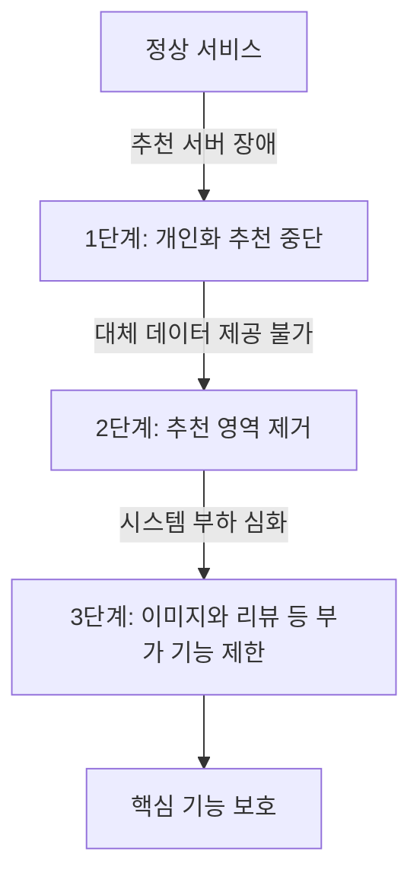
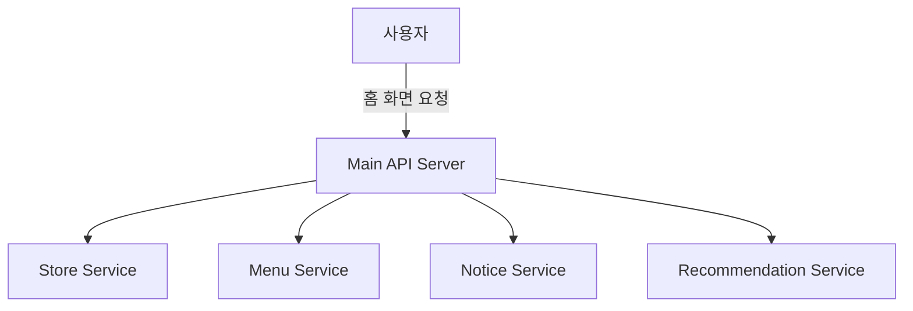
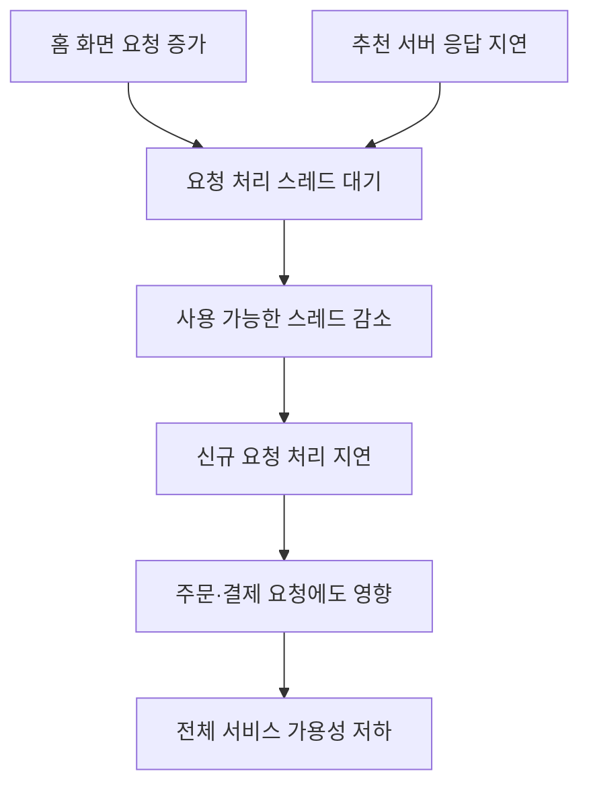
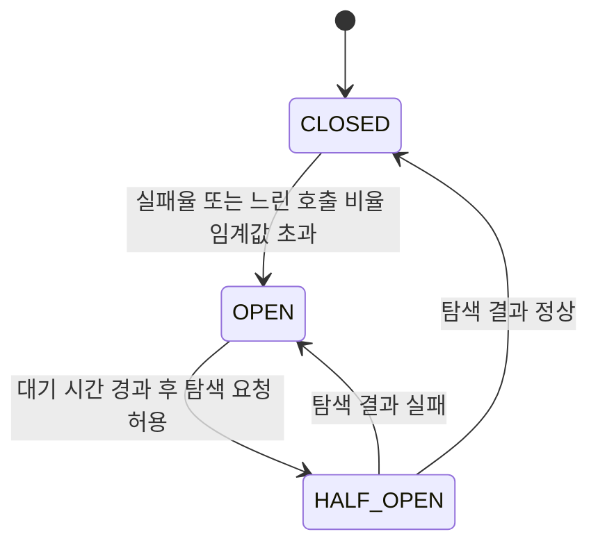
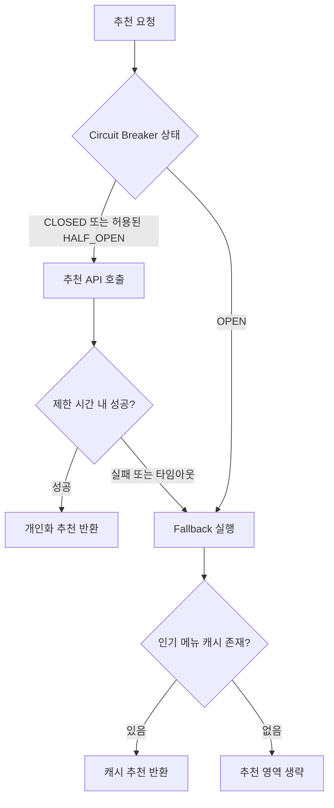
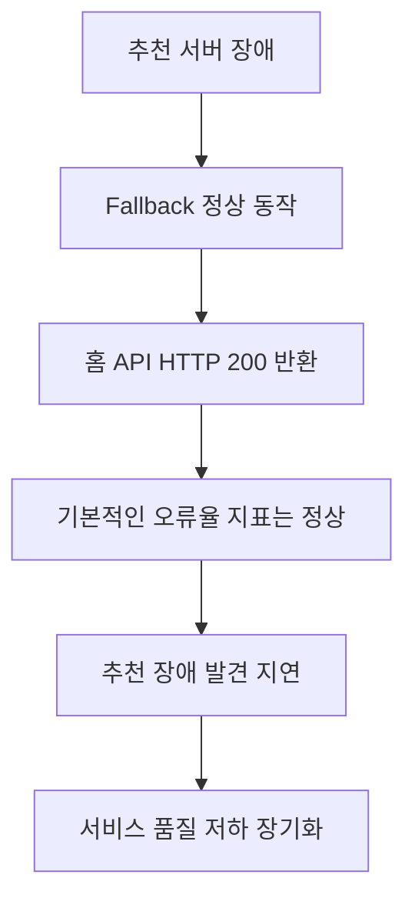
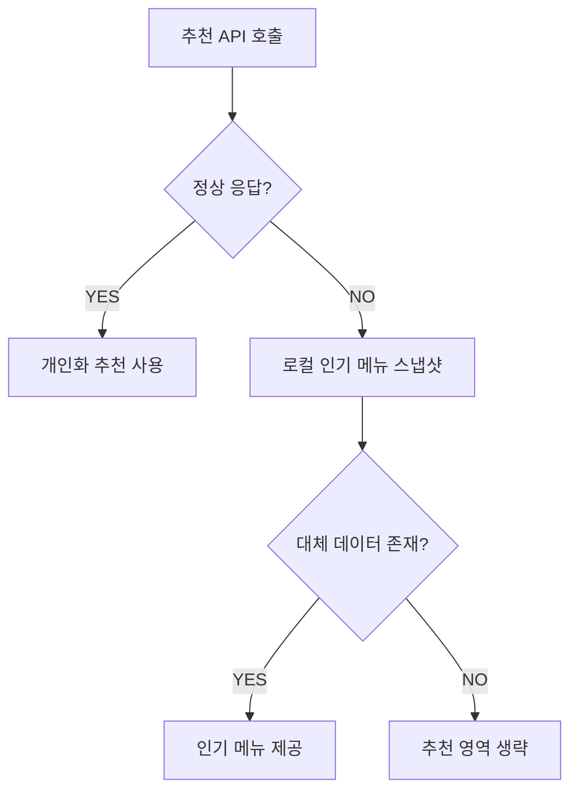
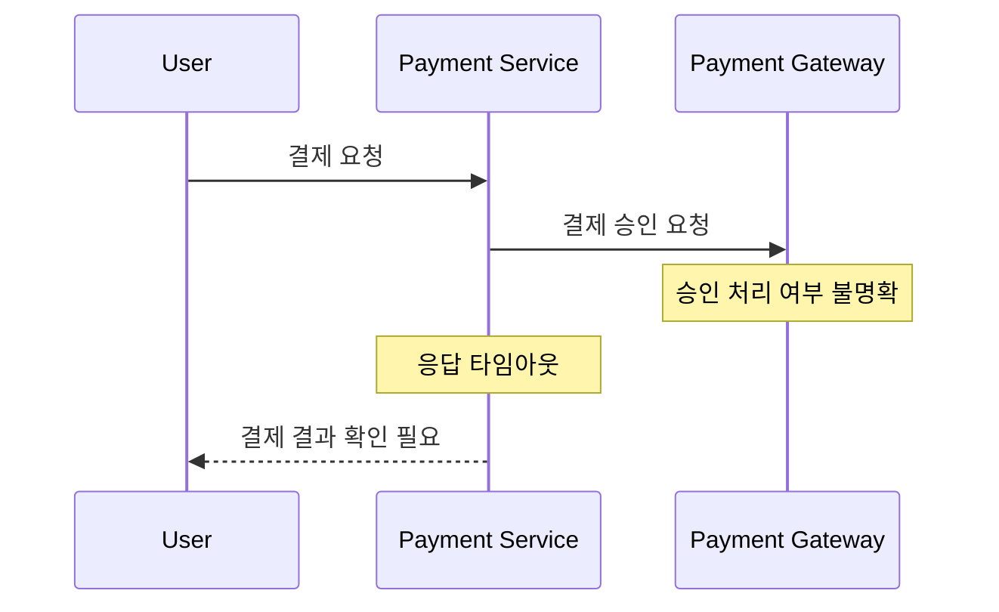
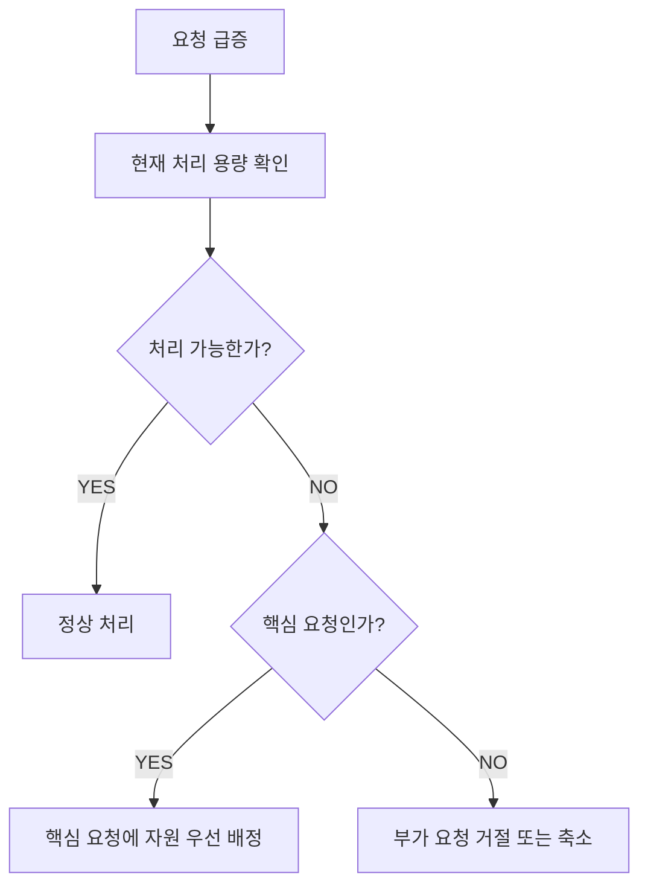
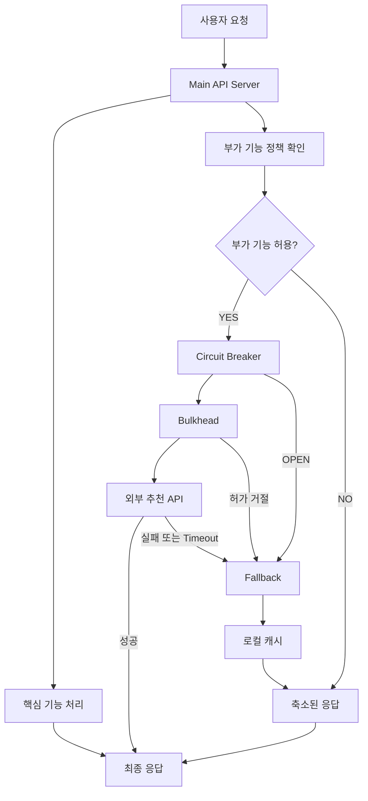

# 소낙눈의 우아한 성능 저하 - 실패를 설계하는 철학
[https://youtu.be/S0Lktb9ugbI?si=qXzLQiMoFd3LboR2](https://youtu.be/S0Lktb9ugbI?si=qXzLQiMoFd3LboR2)

# 소낙눈의 우아한 성능 저하 - 실패를 설계하는 철학
* toc
{:toc}

---

### 우아한 성능 저하(Graceful Degradation) 완벽 이해: Timeout, Fallback, Circuit Breaker와 장애 전파 방지 설계

소프트웨어 시스템을 설계할 때 가장 중요하게 생각하는 요소 중 하나는 안정성이다.

사용자가 언제 요청하더라도 서비스가 정상적으로 동작해야 하고, 장애가 발생하더라도 가능한 한 빠르게 복구할 수 있어야 한다.

그런데 여기서 중요한 질문이 하나 있다.

**서비스에 존재하는 모든 기능을 반드시 동일한 수준으로 보호해야 할까?**

예를 들어 배달 서비스를 생각해 보자.

사용자는 다음과 같은 기능을 사용할 수 있다.

- 가게 검색
- 메뉴 조회
- 주문
- 결제
- 음식 추천
- 리뷰 조회
- 쿠폰 조회
- 인기 메뉴 순위

이 기능들이 모두 중요한 것은 맞다.

하지만 서비스가 정상적으로 동작하기 위해 모든 기능이 반드시 필요한 것은 아니다.

사용자가 치킨을 주문하려는 상황을 생각해 보자.

음식 추천 기능이 동작하지 않더라도 사용자는 직접 가게를 검색하고 원하는 메뉴를 주문할 수 있다.

리뷰 이미지가 표시되지 않더라도 메뉴를 선택하고 결제할 수 있다.

반면 주문 기능이나 결제 기능이 동작하지 않는다면 어떨까?

사용자는 실제로 음식을 구매할 수 없게 된다.

이처럼 서비스에는 **반드시 유지해야 하는 핵심 기능과 상황에 따라 일시적으로 축소할 수 있는 부가 기능**이 존재한다.

물론 핵심 기능과 부가 기능을 구분하는 기준은 비즈니스에 따라 달라진다.

예를 들어 쿠폰 자체가 서비스의 핵심 경쟁력이라면 쿠폰 기능을 단순한 부가 기능으로 취급할 수 없다.

또 이미 쿠폰을 적용한 주문에서 할인 금액을 잘못 계산하는 것은 허용할 수 없는 문제다.

따라서 장애 상황에서 무엇을 포기할 수 있는지는 기술적인 판단 이전에 비즈니스 정책에 따라 결정되어야 한다.

여기서 또 다른 질문이 생긴다.

**추천 기능이 고장 났다는 이유로 주문이나 결제 기능까지 중단된다면 어떻게 될까?**

실제 분산 시스템에서는 충분히 발생할 수 있는 상황이다.

추천 서비스의 응답이 지연되면서 메인 서버의 요청 처리 스레드가 점유될 수 있다.

이러한 상황이 반복되면 메인 서버가 새로운 요청을 처리할 자원을 확보하지 못할 수 있다.

결국 추천 기능의 장애가 주문과 결제 기능까지 영향을 미치게 된다.

이것을 장애 전파(Failure Propagation)라고 한다.

이러한 문제를 방지하기 위한 중요한 설계 전략이 **우아한 성능 저하(Graceful Degradation)**다.

우아한 성능 저하는 시스템의 일부 기능이 실패하거나 자원이 부족해졌을 때 전체 서비스를 중단하는 대신, 상대적으로 덜 중요한 기능의 품질이나 제공 범위를 의도적으로 줄여 핵심 기능을 유지하는 전략이다.

핵심은 단순히 기능을 중단하는 것이 아니다.

**어떤 상황에서 어떤 기능을 포기하고, 어떤 기능을 끝까지 보호할 것인지 미리 설계하는 것**이다.

---

### 개념

#### 우아한 성능 저하란 무엇인가?

우아한 성능 저하(Graceful Degradation)는 시스템의 일부 구성요소에 문제가 발생하더라도 전체 서비스를 즉시 중단하지 않고 제한된 기능이나 낮아진 품질로 서비스를 계속 제공하는 설계 방식이다.

예를 들어 동영상 스트리밍 서비스를 생각해 보자.

사용자가 고화질 영상을 시청하고 있다.

그런데 갑자기 네트워크 속도가 느려졌다.

이때 두 가지 방법을 선택할 수 있다.

첫 번째는 영상을 중단하는 것이다.

```text
고화질 영상 재생
        ↓
네트워크 속도 저하
        ↓
영상 재생 중단
```

두 번째는 화질을 낮추는 것이다.

```text
4K 영상 재생
        ↓
네트워크 속도 저하
        ↓
1080p 영상 재생
        ↓
네트워크 상태 추가 악화
        ↓
720p 영상 재생
```

두 번째 방식에서는 영상의 품질은 낮아졌지만 사용자가 원하는 핵심 기능인 영상 시청은 계속할 수 있다.

이것이 우아한 성능 저하를 이해하기 쉬운 사례다.

백엔드 서비스에서도 동일한 접근을 사용할 수 있다.

예를 들어 배달 서비스에서 추천 시스템에 장애가 발생했다고 가정하자.

정상적인 상황에서는 개인화 추천 결과를 제공한다.

추천 서버에 문제가 발생하면 캐시에 저장된 인기 메뉴를 대신 보여준다.

캐시에서도 추천 데이터를 가져올 수 없다면 추천 영역을 생략한다.

서비스 전체의 부하가 심각해지면 이미지나 리뷰처럼 상대적으로 비용이 큰 부가 기능을 제한한다.

그렇더라도 가게 조회, 메뉴 선택, 주문, 결제와 같은 핵심적인 흐름은 최대한 유지한다.



이러한 전략은 클라우드 아키텍처에서도 사용된다.

AWS Well-Architected Framework에서는 일부 의존성이 실패하더라도 핵심 기능을 계속 제공하도록 강한 의존성을 완화하는 방식을 Graceful Degradation의 중요한 목표로 설명한다.

---

### 왜 사용하는가?

### 모든 기능의 성공을 요구하면 전체 서비스가 취약해질 수 있다

하나의 요청을 처리하기 위해 여러 서비스의 응답이 필요한 상황을 생각해 보자.

사용자가 배달 서비스의 홈 화면에 접속하면 서버는 다음 정보를 조회한다.

1. 가게 정보
2. 메뉴 정보
3. 공지사항
4. 개인화 추천

각 정보는 서로 다른 서비스에서 조회할 수 있다.



이때 Main API Server가 모든 서비스의 응답을 기다린다고 가정하자.

가게 정보 조회는 성공했다.

메뉴 정보 조회도 성공했다.

공지사항 조회도 성공했다.

그런데 추천 서버에서 응답이 오지 않는다.

그러면 사용자는 어떻게 될까?

추천 결과를 포함해야만 응답을 완성할 수 있는 구조라면 나머지 작업이 성공했더라도 전체 응답이 지연될 수 있다.

심지어 추천 서버의 장애가 장시간 지속되면 Main API Server의 자원까지 고갈될 수 있다.

#### 여러 의존성이 결합될수록 가용성이 낮아지는 문제

가상의 시스템을 생각해 보자.

각 서비스가 정상적으로 응답할 확률을 99%라고 가정한다.

또 계산을 단순화하기 위해 각 서비스의 실패가 서로 독립적이라고 가정한다.

네 개의 서비스가 모두 성공해야 홈 화면을 제공할 수 있다면 전체 성공 확률은 다음과 같다.

```text
P(전체 성공)

= P(A 성공)
× P(B 성공)
× P(C 성공)
× P(D 성공)

= 0.99⁴

≈ 96.06%
```

각 서비스의 성공 확률은 99%지만 네 개의 서비스가 모두 성공해야 하는 상황에서는 전체 성공 확률이 약 96.06%가 된다.

물론 실제 서비스에서는 장애가 독립적으로 발생하지 않는다.

공통 데이터베이스나 네트워크, 인프라를 사용한다면 장애가 서로 연관될 수도 있다.

따라서 위 계산은 실제 가용성을 예측한 수치가 아니라 **여러 의존성의 성공을 모두 요구하는 구조가 가진 취약성을 설명하기 위한 예시**다.

그런데 추천과 공지사항을 선택적인 의존성으로 변경하면 어떨까?

```text
필수 조건

가게 정보 조회 성공
+
메뉴 정보 조회 성공
```

```text
선택 조건

공지사항 조회 성공 여부

추천 조회 성공 여부
```

이제 추천 서비스가 실패하더라도 핵심 화면을 제공할 수 있다.

이처럼 필수 의존성과 선택적 의존성을 구분하면 일부 장애가 전체 서비스의 실패로 이어지는 것을 줄일 수 있다.

---

### 장애가 전파되는 이유: 느린 응답이 자원을 고갈시킨다

우아한 성능 저하를 이해하려면 장애 전파가 발생하는 과정을 알아야 한다.

예를 들어 Spring MVC 기반의 동기식 서버를 생각해 보자.

일반적인 Servlet 요청 처리에서는 요청을 처리하는 동안 스레드가 사용된다.

이때 서버가 외부 추천 API를 동기적으로 호출하면 해당 스레드는 외부 API의 결과를 기다리게 된다.

```java
public HomeResponse getHome() {

    Store store = storeService.getStore();

    List<Menu> menus = menuService.getMenus();

    List<Recommendation> recommendations =
            recommendationClient.getRecommendations();

    return new HomeResponse(
            store,
            menus,
            recommendations
    );
}
```

이 코드에서는 추천 API의 응답을 기다리는 동안 메서드를 완료할 수 없다.

만약 추천 API가 5초 동안 응답하지 않는다면 해당 요청 처리 스레드는 그 시간 동안 점유될 수 있다.

#### 동시 요청이 증가하면 어떻게 될까?

다음과 같은 서버가 있다고 가정하자.

```text
Tomcat 요청 처리 스레드 최대 수

200개
```

추천 서버에서 응답이 오지 않는다.

동시에 많은 사용자가 홈 화면을 요청한다.



이 상황에서 문제는 추천 기능에만 존재한다.

하지만 추천 기능을 처리하는 스레드와 핵심 요청을 처리하는 스레드가 동일한 자원 풀을 사용한다면 서비스 전체에 영향을 줄 수 있다.

특히 다음 조건이 겹치면 위험성이 커진다.

- 외부 API의 응답 지연
- 긴 타임아웃
- 높은 동시 요청 수
- 제한 없는 재시도
- 공통 스레드 풀 사용
- 커넥션 풀 고갈
- 요청 대기열 증가

Google SRE에서는 이러한 장애 전파를 Cascading Failure로 설명하며, 응답할 수 없는 의존성을 계속 기다리기보다 적절한 시점에 빠르게 실패시키는 전략과 부하 제한이 중요하다고 강조한다.

---

### 완전히 실패하는 것보다 느리게 실패하는 것이 위험할 수 있다

외부 서비스에서 즉시 오류를 반환하는 경우를 생각해 보자.

```text
추천 API 호출
    ↓
즉시 HTTP 503 반환
    ↓
Fallback 실행
    ↓
홈 화면 반환
```

이 경우 서버는 비교적 빠르게 요청을 처리할 수 있다.

반면 외부 서비스가 응답하지 않는다면 어떨까?

```text
추천 API 호출
    ↓
응답 대기
    ↓
응답 대기
    ↓
응답 대기
    ↓
타임아웃
    ↓
Fallback 실행
```

결국 Fallback을 실행하더라도 이미 상당한 시간이 소모되었다.

동시에 여러 요청이 발생한다면 대기 중인 요청들이 서버 자원을 계속 점유할 수 있다.

따라서 다음 두 가지는 구분해야 한다.

| 상황 | 주요 문제 |
|---|---|
| 즉시 실패 | 기능을 제공하지 못함 |
| 느리게 실패 | 기능 실패와 함께 서버 자원을 장시간 점유 |
| 느린 요청이 대량 발생 | 스레드·커넥션·대기열 고갈 가능 |
| 느린 요청에 무제한 재시도 | 하위 시스템의 부하 확대 |

여기서 중요한 것은 실패가 발생했다는 사실보다 **실패가 발생하는 동안 얼마나 많은 자원을 소비하는가**이다.

단, 모든 느린 응답이 즉각적인 오류보다 반드시 더 위험한 것은 아니다.

시스템의 동시성 모델과 자원 제한, 타임아웃, 요청량에 따라 영향이 달라진다.

예를 들어 비동기 I/O나 Virtual Thread를 사용하는 환경에서는 플랫폼 스레드의 점유 방식이 다를 수 있다.

그렇더라도 외부 연결, 메모리, 데이터베이스 커넥션, 동시 실행 수 등의 자원은 여전히 제한되어 있다.

따라서 프로그래밍 모델과 관계없이 자원 고갈에 대한 방어 설계가 필요하다.

---

### 우아한 성능 저하의 핵심: 의도한 순서대로 기능을 포기한다

Graceful Degradation에서 가장 중요한 것은 장애 상황에서의 우선순위다.

모든 기능을 끝까지 유지하려고 하면 오히려 전체 서비스가 중단될 수 있다.

따라서 장애 상황에서 어떤 기능을 먼저 포기할지 미리 정의해야 한다.

예를 들어 배달 서비스의 기능을 다음과 같이 분류할 수 있다.

| 기능 | 중요도 | 장애 시 처리 전략 |
|---|---|---|
| 가게 검색 | 핵심 | 가능한 범위에서 유지 |
| 메뉴 조회 | 핵심 | 정확한 데이터 제공 필요 |
| 주문 생성 | 핵심 | 데이터 정합성 보장 |
| 결제 | 핵심 | 결과 불명확 시 성공으로 처리하지 않음 |
| 개인화 추천 | 부가 | 인기 메뉴로 대체 |
| 인기 순위 | 부가 | 캐시 데이터 사용 또는 생략 |
| 리뷰 이미지 | 부가 | 이미지 표시 제한 |
| 공지사항 | 정책에 따라 결정 | 캐시 또는 생략 |
| 쿠폰 추천 | 상황에 따라 결정 | 추천 기능만 생략 가능 |

이 표에서 중요한 점은 부가 기능이라는 이유로 항상 제거할 수 있는 것은 아니라는 사실이다.

예를 들어 쿠폰 추천 영역을 숨기는 것은 가능할 수 있다.

하지만 사용자가 이미 적용한 쿠폰의 할인 금액을 계산하지 않고 결제를 진행하는 것은 별개의 문제다.

따라서 기능의 중요도는 단순한 화면 구성 요소가 아니라 **비즈니스 불변식과 데이터 정합성 요구사항을 기준으로 판단해야 한다.**

---

### 단계별 성능 저하 전략 설계

우아한 성능 저하는 단계적으로 적용할 수 있다.

예를 들어 다음 네 가지 상태를 정의해 보자.

#### 0단계: 정상 상태

모든 기능을 정상적으로 제공한다.

```text
개인화 추천

리뷰와 이미지

인기 메뉴

가게 정보

메뉴 조회

주문

결제
```

추천 서버와 이미지 서비스, 리뷰 서비스가 모두 정상적으로 동작한다.

사용자는 가장 풍부한 정보를 제공받는다.

#### 1단계: 개인화 추천을 인기 메뉴로 대체

추천 서버의 응답이 느려지거나 장애가 발생했다.

이때 개인화 추천을 계속 기다리지 않는다.

대신 로컬 캐시나 별도의 안정적인 저장소에 보관된 인기 메뉴를 제공한다.

```text
개인화 추천 실패
        ↓
인기 메뉴 캐시 조회
        ↓
인기 메뉴 TOP 10 제공
```

사용자에게 제공되는 기능의 품질은 다소 낮아졌다.

하지만 추천 영역 자체는 유지할 수 있다.

#### 2단계: 추천 영역 자체를 제거

추천 서버뿐 아니라 대체 데이터도 사용할 수 없는 상황이다.

또는 전체 서버 부하가 높아져 캐시 조회와 추천 영역 구성조차 부담이 되는 상황일 수 있다.

이때 추천 영역을 아예 생략한다.

```text
가게 정보 제공

메뉴 정보 제공

추천 영역 생략

주문 기능 유지

결제 기능 유지
```

추천 기능은 사라졌지만 사용자는 여전히 음식을 주문할 수 있다.

#### 3단계: 핵심 기능 중심의 생존 모드

서비스 전체의 부하가 심각해졌다.

이때는 이미지나 리뷰처럼 상대적으로 비용이 큰 부가 기능을 제한한다.

```text
가게 검색

메뉴 조회

주문

결제
```

다만 주문과 결제 역시 자원이 무한하지 않기 때문에 반드시 모든 요청을 성공시킬 수 있는 것은 아니다.

이 단계에서는 핵심 기능에 자원을 우선 배정하고, 처리할 수 없는 요청은 명확하게 거절하는 전략까지 필요할 수 있다.

#### 단계별 전략 비교

| 단계 | 추천 | 리뷰 | 이미지 | 주문 | 결제 |
|---|---|---|---|---|---|
| 정상 | 개인화 추천 | 제공 | 제공 | 제공 | 제공 |
| 1단계 | 인기 메뉴 캐시 | 제공 | 제공 | 제공 | 제공 |
| 2단계 | 생략 | 제공 | 제공 | 제공 | 제공 |
| 3단계 | 생략 | 제한 | 제한 | 우선 보호 | 우선 보호 |

여기서 가장 중요한 원칙은 다음과 같다.

**시스템의 품질은 단계적으로 낮추되, 핵심 비즈니스 기능을 위한 자원은 최대한 보호한다.**

---

### 우아한 성능 저하를 구현하는 세 가지 핵심 기술

Graceful Degradation은 하나의 라이브러리를 추가한다고 자동으로 구현되는 기능이 아니다.

여러 장애 대응 기술을 조합해야 한다.

그중 중요한 세 가지는 다음과 같다.

1. Timeout
2. Fallback
3. Circuit Breaker

각 기술의 책임은 서로 다르다.

| 기술 | 해결하려는 문제 | 핵심 역할 |
|---|---|---|
| Timeout | 외부 서비스가 응답하지 않음 | 기다리는 시간 제한 |
| Fallback | 원래 기능을 사용할 수 없음 | 미리 정의한 대체 동작 제공 |
| Circuit Breaker | 장애가 발생한 서비스를 계속 호출함 | 장애 상태를 감지하고 호출 차단 |

이 세 가지는 함께 사용하면 더 효과적일 수 있다.

---

### Timeout이란 무엇인가?

Timeout은 특정 작업을 완료하기 위해 기다리는 시간을 제한하는 방식이다.

예를 들어 추천 API의 응답을 최대 500ms까지 기다린다고 가정하자.

```text
추천 API 호출
        ↓
500ms 이내 응답?
        ├── YES → 추천 결과 사용
        └── NO  → 타임아웃 처리
```

이렇게 하면 응답하지 않는 추천 서버를 무한정 기다리지 않아도 된다.

#### Timeout이 필요한 이유

외부 서비스는 다양한 이유로 응답이 지연될 수 있다.

- 네트워크 장애
- DNS 문제
- 외부 서버의 스레드 고갈
- 데이터베이스 락 경합
- 커넥션 풀 고갈
- GC 지연
- 외부 서비스의 과부하

문제는 호출자가 외부 시스템의 내부 상태를 직접 제어할 수 없다는 점이다.

따라서 외부 서비스의 응답이 언제 올지 무한정 기다리는 구조는 위험하다.

Timeout은 기다리는 시간을 제한해 이러한 위험을 줄인다.

#### Timeout은 무조건 짧게 설정하면 좋을까?

그렇지는 않다.

타임아웃이 지나치게 짧으면 정상적인 요청도 실패로 처리할 수 있다.

반대로 타임아웃이 지나치게 길면 장애 상황에서 자원을 오랫동안 점유할 수 있다.

따라서 다음 요소를 함께 고려해야 한다.

- 외부 API의 평소 응답 시간
- P95, P99 응답 시간
- 사용자 요청의 전체 허용 시간
- 다른 의존성의 응답 시간
- 재시도 여부
- 네트워크 지연
- 서비스의 중요도

특히 추천처럼 부가적인 기능에 5초의 타임아웃을 적용하는 것은 전체 응답 시간 목표에 따라 지나치게 길 수 있다.

예를 들어 홈 API의 목표 응답 시간이 800ms라면 추천 API만 5초를 기다리는 설계는 적절하지 않다.

**각 의존성의 타임아웃은 전체 요청의 시간 예산을 기준으로 설계해야 한다.**

---

### Timeout에도 여러 종류가 있다

HTTP 통신에서는 단순히 하나의 Timeout만 존재하는 것이 아니다.

| 종류 | 의미 |
|---|---|
| Connect Timeout | 외부 서버와 연결을 수립하기 위해 기다리는 시간 |
| Read Timeout | 연결된 서버에서 데이터를 읽는 과정의 대기 시간 |
| Connection Pool Acquisition Timeout | 커넥션 풀에서 연결을 확보하기 위해 기다리는 시간 |
| Overall Request Deadline | 요청 전체가 완료되어야 하는 제한 시간 |
| TimeLimiter | 비동기 작업 등의 실행 결과를 기다리는 시간을 제한하는 도구 |

각 Timeout은 제한하는 범위가 다르다.

예를 들어 Connect Timeout을 200ms로 설정했다고 해서 전체 HTTP 요청이 반드시 200ms 이내에 종료되는 것은 아니다.

연결 수립 이후 응답을 기다리는 시간이 추가될 수 있기 때문이다.

또 Read Timeout만으로 요청 전체의 실행 시간이 엄격하게 제한된다고 단정할 수도 없다.

따라서 사용하는 HTTP Client의 타임아웃 동작을 확인해야 한다.

Spring의 `RestClient`는 HTTP 요청을 동기적으로 수행하는 클라이언트이며, 실제 네트워크 타임아웃은 기반 HTTP Client의 설정을 통해 제어할 수 있다.

---

### Fallback이란 무엇인가?

Fallback은 원래 기능을 정상적으로 수행할 수 없을 때 미리 준비된 대체 동작을 실행하는 방식이다.

예를 들어 추천 서버에서 장애가 발생했다고 가정하자.

일반적인 구현은 다음과 같을 수 있다.

```java
public List<Recommendation> getRecommendations() {

    return recommendationClient.getRecommendations();
}
```

외부 API에서 예외가 발생하면 호출한 곳으로 예외가 전파된다.

만약 이 예외를 그대로 홈 API까지 전파한다면 전체 요청이 실패할 수 있다.

반면 Fallback을 적용하면 다음과 같이 처리할 수 있다.

```java
public List<Recommendation> getRecommendations() {

    try {
        return recommendationClient.getRecommendations();

    } catch (RecommendationServiceException e) {
        return popularMenuCache.getPopularMenus();
    }
}
```

추천 API 호출에 실패하더라도 인기 메뉴를 대신 반환한다.

사용자는 완전한 개인화 추천은 받지 못하지만 대체 정보를 제공받는다.

#### 대표적인 Fallback 방식

Fallback은 반드시 대체 데이터를 반환하는 방식만 의미하지 않는다.

다음과 같은 전략을 사용할 수 있다.

| Fallback 방식 | 설명 | 예시 |
|---|---|---|
| Cached Data | 이전에 저장한 데이터 제공 | 인기 메뉴 캐시 |
| Default Value | 미리 정의한 기본값 제공 | 기본 추천 목록 |
| Stale Data | 최신은 아니지만 허용 가능한 데이터 제공 | 최근 공지 목록 |
| Feature Omission | 부가 기능 생략 | 추천 영역 제거 |
| Alternative Dependency | 다른 의존성 사용 | 보조 데이터 소스 조회 |
| Graceful Error | 명확한 실패 응답 | 결제 결과 확인 불가 안내 |

여기서 주의해야 할 점이 있다.

**Fallback을 제공한다는 이유로 잘못된 데이터를 반환해서는 안 된다.**

예를 들어 추천 결과는 오래된 인기 메뉴를 제공해도 괜찮을 수 있다.

하지만 결제 성공 여부나 현재 계좌 잔액처럼 정확성이 중요한 데이터에 임의의 기본값을 반환하는 것은 위험하다.

따라서 Fallback은 기술적 편의가 아니라 비즈니스 정책에 따라 설계해야 한다.

---

### Circuit Breaker란 무엇인가?

Circuit Breaker는 외부 서비스의 실패가 반복될 때 해당 서비스에 대한 호출을 일시적으로 차단하는 패턴이다.

전자제품의 누전 차단기를 생각하면 이해하기 쉽다.

전기 회로에 문제가 발생했을 때 차단기가 전류를 차단한다.

소프트웨어에서도 비슷한 방식으로 동작한다.

외부 서비스가 계속 실패한다면 더 이상 해당 서비스를 호출하지 않고 즉시 실패하도록 만든다.

```text
정상 상태

외부 API 호출 허용
        ↓
실패 증가
        ↓
Circuit Breaker OPEN
        ↓
외부 API 호출 차단
        ↓
Fallback 실행
```

이때 중요한 것은 Circuit Breaker가 외부 서비스의 장애를 직접 복구하는 것이 아니라는 점이다.

**장애가 발생한 서비스에 불필요한 요청을 계속 전달하지 않도록 보호하는 역할**을 한다.

---

### Circuit Breaker의 세 가지 상태

Circuit Breaker는 일반적으로 다음 세 가지 상태를 가진다.

- CLOSED
- OPEN
- HALF_OPEN



각 상태를 자세히 살펴보자.

#### CLOSED

CLOSED는 정상 상태다.

외부 서비스 호출을 허용한다.

호출 결과를 기록하면서 실패율과 느린 호출 비율을 계산할 수 있다.

예를 들어 최근 10번의 요청을 관찰한다고 가정하자.

```text
성공
성공
실패
성공
실패
실패
성공
실패
실패
실패
```

총 10번 중 6번이 실패했다.

실패율은 60%다.

Circuit Breaker의 실패율 임계값을 60%로 설정했다면 OPEN 상태로 전환될 수 있다.

단, 설정한 최소 호출 수를 충족해야 한다.

#### OPEN

OPEN은 차단 상태다.

외부 서비스에 실제 요청을 보내지 않는다.

대신 즉시 호출을 거절한다.

```text
추천 API 호출 시도
        ↓
Circuit Breaker 확인
        ↓
OPEN
        ↓
실제 네트워크 호출 생략
        ↓
Fallback 실행
```

이렇게 하면 이미 장애가 발생한 외부 서비스를 계속 호출하면서 타임아웃을 기다리는 비용을 줄일 수 있다.

#### HALF_OPEN

HALF_OPEN은 복구 여부를 확인하는 상태다.

OPEN 상태에서 일정한 시간이 지난 뒤 제한된 수의 요청을 허용한다.

예를 들어 최대 2개의 탐색 요청을 허용할 수 있다.

```text
Circuit Breaker OPEN
        ↓
15초 경과
        ↓
HALF_OPEN
        ↓
탐색 요청 2개 허용
        ↓
결과 확인
```

탐색 요청이 정상적으로 처리되면 CLOSED로 전환될 수 있다.

반대로 계속 실패한다면 다시 OPEN 상태로 돌아간다.

단, Resilience4j에서는 설정에 따라 일정 시간이 지난 뒤 자동으로 HALF_OPEN으로 전환하거나, 대기 시간이 지난 후 새로운 호출이 발생했을 때 전환하도록 구성할 수 있다.

---

### Circuit Breaker를 적용할 때 자주 발생하는 오해

#### 실패가 한 번 발생하면 즉시 OPEN이 되는가?

그렇지 않다.

Resilience4j에서는 다음과 같은 설정을 사용할 수 있다.

```yaml
resilience4j:
  circuitbreaker:
    instances:
      recommendation:
        slidingWindowType: COUNT_BASED
        slidingWindowSize: 10
        minimumNumberOfCalls: 10
        failureRateThreshold: 60
```

각 설정의 의미는 다음과 같다.

| 설정 | 의미 |
|---|---|
| slidingWindowType | 호출 결과를 계산하는 윈도우 방식 |
| slidingWindowSize | 최근 몇 번의 호출을 관찰할지 결정 |
| minimumNumberOfCalls | 실패율 계산을 시작하기 위한 최소 호출 수 |
| failureRateThreshold | 차단 상태로 전환할 실패율 임계값 |

이 설정에서는 최소 10번의 호출이 기록되어야 실패율을 판단한다.

따라서 처음 3번의 요청이 모두 실패했다고 즉시 OPEN으로 전환되는 것은 아니다.

#### Circuit Breaker가 동시 요청 수도 제한하는가?

그렇지 않다.

Circuit Breaker는 실패율이나 느린 호출 비율 등을 바탕으로 호출 허용 여부를 결정한다.

반면 동시에 실행할 수 있는 요청 수를 제한하는 기능은 별도의 Bulkhead 같은 방식으로 구성해야 한다.

예를 들어 Circuit Breaker가 CLOSED 상태일 때 수백 개의 요청이 동시에 들어올 수도 있다.

CLOSED라는 사실이 동시 요청 수가 안전하다는 의미는 아니다.

따라서 다음 역할을 구분해야 한다.

**Circuit Breaker는 실패한 의존성에 대한 호출을 차단한다.**

**Bulkhead는 특정 의존성이 사용할 수 있는 동시 실행 자원을 제한한다.**

---

### 느린 호출도 Circuit Breaker의 판단 기준이 될 수 있다

Circuit Breaker는 반드시 예외 발생 여부만으로 동작하지 않는다.

Resilience4j에서는 응답 시간이 특정 기준을 초과한 호출을 느린 호출로 판단할 수 있다.

예를 들어 다음과 같이 설정할 수 있다.

```yaml
resilience4j:
  circuitbreaker:
    instances:
      recommendation:
        slidingWindowSize: 10
        minimumNumberOfCalls: 10

        failureRateThreshold: 60

        slowCallDurationThreshold: 500ms
        slowCallRateThreshold: 60
```

이 설정에서는 응답 시간이 500ms를 초과하면 느린 호출로 분류한다.

그리고 느린 호출의 비율이 임계값에 도달하면 Circuit Breaker가 OPEN으로 전환될 수 있다.

예를 들어 다음 상황을 생각해 보자.

```text
최근 호출 10개

정상 응답 4개
느린 응답 6개
```

모든 요청이 HTTP 200을 반환했다고 가정하자.

그렇더라도 6개의 응답 시간이 500ms를 초과했다면 느린 호출 비율이 60%가 된다.

따라서 Circuit Breaker가 OPEN으로 전환될 수 있다.

이는 느린 응답이 서버 자원 고갈의 원인이 될 수 있다는 점에서 중요한 기능이다.

Resilience4j는 실패율뿐 아니라 Slow Call Rate를 기준으로 Circuit Breaker를 OPEN 상태로 전환하는 기능을 제공한다.

---

### Timeout, Fallback, Circuit Breaker를 함께 사용하면 어떻게 될까?

이제 세 가지 기술을 함께 적용해 보자.



정상적인 상황에서는 추천 API를 호출한다.

추천 API가 정상 응답하면 개인화 추천을 제공한다.

응답이 늦어져 Timeout이 발생하면 Fallback을 실행한다.

이러한 실패가 반복되어 Circuit Breaker가 OPEN이 되면 더 이상 추천 API를 호출하지 않는다.

대신 즉시 Fallback을 실행한다.

이 구조는 서로 다른 문제를 단계적으로 해결한다.

| 단계 | 보호 방식 |
|---|---|
| 외부 서비스가 느림 | Timeout |
| 외부 서비스가 실패함 | Fallback |
| 외부 서비스가 계속 실패함 | Circuit Breaker |
| 동시 요청이 너무 많음 | Bulkhead |
| 전체 시스템이 과부하 상태 | Load Shedding 및 단계별 기능 제한 |

---

### Bulkhead란 무엇인가?

Bulkhead는 하나의 기능이나 외부 의존성이 사용할 수 있는 자원을 제한하여 장애가 다른 기능으로 확산되는 것을 줄이는 패턴이다.

선박의 격벽을 생각하면 이해하기 쉽다.

선박 내부에 격벽이 있다면 특정 구역에 물이 들어와도 다른 구역까지 침수되는 것을 늦출 수 있다.

소프트웨어에서도 같은 원리를 적용할 수 있다.

예를 들어 Main API Server의 모든 요청이 하나의 공통 스레드 풀을 사용한다고 가정하자.

추천 서비스에서 장애가 발생했다.

추천 요청이 스레드를 계속 점유한다.

결국 주문과 결제 요청을 처리할 스레드가 부족해질 수 있다.

이를 방지하기 위해 추천 서비스의 동시 실행 수를 제한할 수 있다.

```text
전체 요청 처리 자원
        │
        ├── 핵심 기능
        │    ├── 가게 조회
        │    ├── 주문
        │    └── 결제
        │
        └── 추천 기능
             └── 최대 동시 호출 10개
```

추천 기능에서 많은 요청이 발생하더라도 동시에 외부 API를 호출하는 수를 제한한다.

제한을 초과한 요청은 빠르게 실패시키고 Fallback으로 전환할 수 있다.

다만 Semaphore 기반 Bulkhead는 동시 실행 허가 수를 제한하는 방식이며 별도의 물리적인 스레드 풀을 만들어 격리하는 것은 아니다.

별도 실행 자원을 사용하는 Thread Pool Bulkhead와 구분해야 한다.

Resilience4j는 두 방식을 모두 지원한다.

---

### Timeout, Circuit Breaker, Bulkhead의 차이

| 항목 | Timeout | Circuit Breaker | Bulkhead |
|---|---|---|---|
| 목적 | 대기 시간 제한 | 반복적인 실패에 대한 호출 차단 | 동시 실행 자원 제한 |
| 판단 기준 | 경과 시간 | 실패율·느린 호출 비율 등 | 동시 실행 수 |
| 외부 호출 차단 | 시간 초과 후 실패 | OPEN 상태에서 사전 차단 | 허가 수 초과 시 차단 |
| 핵심 효과 | 장시간 대기 방지 | 불필요한 장애 요청 감소 | 특정 의존성의 자원 독점 방지 |
| 주의사항 | 너무 짧으면 정상 요청 실패 | 상태 전환과 복구 정책 필요 | 제한값이 작으면 처리량 감소 |

실무에서는 하나만 선택하기보다 필요에 따라 조합한다.

---

### 예제

### Spring Boot와 Resilience4j로 구현하는 우아한 성능 저하

이제 실제 Spring Boot 프로젝트에서 Graceful Degradation을 구현해 보자.

다음 시나리오를 가정한다.

**사용자가 홈 API를 호출하면 기본 메뉴 정보와 개인화 추천 정보를 반환한다.**

기본 메뉴 정보는 반드시 제공해야 한다.

하지만 개인화 추천은 실패해도 대체 데이터를 제공하거나 생략할 수 있다.

요구사항을 다음과 같이 정의한다.

| 기능 | 장애 처리 정책 |
|---|---|
| 기본 메뉴 조회 | 실패하면 정상 응답을 만들지 않음 |
| 개인화 추천 조회 | 외부 API 호출 |
| 개인화 추천 실패 | 인기 메뉴 캐시 반환 |
| 인기 메뉴 캐시도 없음 | 추천 목록 생략 |
| 추천 API 장애 반복 | Circuit Breaker OPEN |
| 추천 동시 호출 증가 | Bulkhead로 제한 |
| Fallback 실행 | 모니터링 지표 기록 |

예제 기술 환경은 다음과 같다.

| 항목 | 버전 또는 기술 |
|---|---|
| Java | 17 |
| Spring Boot | 3.5.16 |
| Resilience4j | 2.4.0 |
| HTTP Client | RestClient |
| Monitoring | Spring Boot Actuator, Micrometer |
| Build | Gradle |

Spring Boot 3.5.16과 Resilience4j 2.4.0은 실제로 배포된 버전이다. Resilience4j의 Spring Boot 3 통합에는 AOP와 Actuator 의존성이 필요하다.

---

#### 1. Gradle 설정

먼저 `build.gradle`을 작성한다.

```gradle
plugins {
    id 'java'
    id 'org.springframework.boot' version '3.5.16'
    id 'io.spring.dependency-management' version '1.1.7'
}

group = 'com.example'
version = '0.0.1-SNAPSHOT'

java {
    toolchain {
        languageVersion = JavaLanguageVersion.of(17)
    }
}

repositories {
    mavenCentral()
}

dependencies {
    implementation 'org.springframework.boot:spring-boot-starter-web'
    implementation 'org.springframework.boot:spring-boot-starter-aop'
    implementation 'org.springframework.boot:spring-boot-starter-actuator'

    implementation 'io.github.resilience4j:resilience4j-spring-boot3:2.4.0'

    runtimeOnly 'io.micrometer:micrometer-registry-prometheus'

    testImplementation 'org.springframework.boot:spring-boot-starter-test'
}

tasks.named('test') {
    useJUnitPlatform()
}
```

각 의존성의 역할은 다음과 같다.

| 의존성 | 역할 |
|---|---|
| spring-boot-starter-web | REST API 개발 |
| spring-boot-starter-aop | Resilience4j 어노테이션의 프록시 적용 |
| spring-boot-starter-actuator | 애플리케이션 상태와 메트릭 확인 |
| resilience4j-spring-boot3 | Circuit Breaker, Bulkhead 등 |
| micrometer-registry-prometheus | Prometheus 형식의 메트릭 노출 |
| spring-boot-starter-test | 테스트 실행 |

`settings.gradle`은 다음과 같이 작성한다.

```gradle
rootProject.name = 'graceful-degradation-example'
```

---

#### 2. application.yml 설정

다음으로 Resilience4j 설정을 추가한다.

```yaml
server:
  port: 8080

spring:
  application:
    name: graceful-degradation-example

recommendation:
  base-url: ${RECOMMENDATION_BASE_URL:http://localhost:8081}

resilience4j:
  circuitbreaker:
    instances:
      recommendation:
        slidingWindowType: COUNT_BASED
        slidingWindowSize: 10
        minimumNumberOfCalls: 10

        failureRateThreshold: 60

        slowCallDurationThreshold: 300ms
        slowCallRateThreshold: 60

        waitDurationInOpenState: 15s
        permittedNumberOfCallsInHalfOpenState: 2
        automaticTransitionFromOpenToHalfOpenEnabled: true

        recordExceptions:
          - org.springframework.web.client.ResourceAccessException
          - org.springframework.web.client.HttpServerErrorException

  bulkhead:
    instances:
      recommendation:
        maxConcurrentCalls: 10
        maxWaitDuration: 0

management:
  endpoints:
    web:
      exposure:
        include:
          - health
          - metrics
          - prometheus
```

이 설정은 추천 기능에만 적용된다.

다른 핵심 기능의 요청을 자동으로 제한하는 설정은 아니다.

주요 설정을 살펴보자.

| 설정 | 의미 |
|---|---|
| slidingWindowSize: 10 | 최근 10개 호출 기준으로 상태 관찰 |
| minimumNumberOfCalls: 10 | 최소 10개 호출 이후 비율 계산 |
| failureRateThreshold: 60 | 실패율 60% 이상이면 차단 가능 |
| slowCallDurationThreshold: 300ms | 300ms 초과 호출을 느린 호출로 판단 |
| slowCallRateThreshold: 60 | 느린 호출 비율이 60% 이상이면 차단 가능 |
| waitDurationInOpenState: 15s | OPEN 상태에서의 대기 시간 |
| permittedNumberOfCallsInHalfOpenState: 2 | 복구 확인을 위한 탐색 호출 수 |
| maxConcurrentCalls: 10 | 추천 기능의 동시 실행 허가 수 |
| maxWaitDuration: 0 | 허가가 없으면 기다리지 않고 즉시 거절 |

여기서 `recordExceptions`는 Circuit Breaker가 실패로 기록할 예외를 제한한다.

예를 들어 추천 서버의 HTTP 500 응답이나 네트워크 I/O 실패를 Circuit Breaker의 실패로 기록할 수 있다.

반면 잘못된 요청값으로 인한 HTTP 400까지 모두 장애로 판단할 필요는 없을 수 있다.

실제 서비스에서는 HTTP 429와 같은 과부하 신호, 인증 실패, 네트워크 오류 등을 어떤 방식으로 분류할지 별도로 결정해야 한다.

**모든 예외를 동일하게 처리하면 정상적인 비즈니스 오류까지 장애로 판단할 수 있으므로 주의해야 한다.**

---

#### 3. 응답 모델 정의

먼저 메뉴 정보를 표현하는 객체를 정의한다.

`MenuItem.java`

```java
package com.example.degradation;

public record MenuItem(
        String id,
        String name
) {
}
```

홈 API의 응답은 다음과 같이 정의한다.

`HomeResponse.java`

```java
package com.example.degradation;

import java.util.List;

public record HomeResponse(
        long storeId,
        List<MenuItem> menus,
        List<MenuItem> recommendations,
        String recommendationMode
) {
}
```

여기서 `recommendationMode`는 추천 결과가 어떤 방식으로 만들어졌는지 나타낸다.

예를 들어 다음 세 가지 값을 사용할 수 있다.

```text
PERSONALIZED

개인화 추천 성공
```

```text
POPULAR_CACHE

인기 메뉴 캐시로 대체
```

```text
HIDDEN

추천 결과 생략
```

실제 서비스에서는 문자열 대신 Enum으로 관리할 수도 있다.

---

#### 4. 핵심 메뉴 조회 서비스

이번 예제에서는 기본 메뉴 정보를 반드시 제공해야 하는 핵심 기능으로 정의한다.

예제에서는 데이터베이스 대신 고정된 데이터를 사용한다.

`CatalogService.java`

```java
package com.example.degradation;

import org.springframework.http.HttpStatus;
import org.springframework.stereotype.Service;
import org.springframework.web.server.ResponseStatusException;

import java.util.List;

@Service
public class CatalogService {

    public List<MenuItem> getMenus(long storeId) {

        if (storeId != 1L) {
            throw new ResponseStatusException(
                    HttpStatus.NOT_FOUND,
                    "존재하지 않는 가게입니다."
            );
        }

        return List.of(
                new MenuItem("M001", "후라이드 치킨"),
                new MenuItem("M002", "양념 치킨"),
                new MenuItem("M003", "간장 치킨")
        );
    }
}
```

이 서비스는 핵심 데이터를 반환한다.

가게가 존재하지 않으면 오류를 발생시킨다.

중요한 점은 다음과 같다.

**핵심 메뉴 조회가 실패했다고 존재하지 않는 메뉴를 임의로 만들어 반환해서는 안 된다.**

정확한 메뉴 정보는 주문과 결제의 근거가 될 수 있기 때문이다.

---

#### 5. 추천 결과의 Fallback 데이터 준비

추천 서버가 장애 상태일 때 사용할 인기 메뉴 정보를 준비한다.

`PopularMenuSnapshot.java`

```java
package com.example.degradation;

import org.springframework.stereotype.Component;

import java.util.List;
import java.util.Map;

@Component
public class PopularMenuSnapshot {

    private final Map<Long, List<MenuItem>> popularMenus =
            Map.of(
                    1L,
                    List.of(
                            new MenuItem("M001", "후라이드 치킨"),
                            new MenuItem("M002", "양념 치킨")
                    )
            );

    public List<MenuItem> getPopularMenus(long storeId) {

        return popularMenus.getOrDefault(
                storeId,
                List.of()
        );
    }
}
```

예제에서는 동작을 쉽게 확인하기 위해 메모리에 고정된 데이터를 사용했다.

실제 서비스에서는 Redis나 로컬 캐시, 사전 생성된 스냅샷 등을 사용할 수 있다.

다만 주의해야 할 점이 있다.

추천용으로 저장한 데이터와 실제 주문에 사용할 데이터는 구분해야 한다.

예를 들어 캐시된 인기 메뉴에 품절 상품이 포함될 수 있다.

따라서 추천 영역에서는 오래된 메뉴가 표시되더라도 실제 주문 단계에서는 현재 판매 가능 여부를 다시 검증해야 한다.

**Fallback 데이터는 부가 정보를 제공하는 용도로 활용하고, 금전 거래와 재고에 영향을 주는 최종 판단은 정확한 데이터로 수행해야 한다.**

---

#### 6. RestClient 설정

이제 외부 추천 API를 호출할 HTTP Client를 구성한다.

`RecommendationClientConfig.java`

```java
package com.example.degradation;

import org.springframework.beans.factory.annotation.Value;
import org.springframework.context.annotation.Bean;
import org.springframework.context.annotation.Configuration;
import org.springframework.http.client.SimpleClientHttpRequestFactory;
import org.springframework.web.client.RestClient;

import java.time.Duration;

@Configuration
public class RecommendationClientConfig {

    @Bean
    public RestClient recommendationRestClient(
            RestClient.Builder builder,
            @Value("${recommendation.base-url}") String baseUrl
    ) {

        SimpleClientHttpRequestFactory factory =
                new SimpleClientHttpRequestFactory();

        factory.setConnectTimeout(
                Duration.ofMillis(200)
        );

        factory.setReadTimeout(
                Duration.ofMillis(400)
        );

        return builder
                .baseUrl(baseUrl)
                .requestFactory(factory)
                .build();
    }
}
```

여기서는 다음과 같이 설정했다.

```text
Connect Timeout

200ms
```

```text
Read Timeout

400ms
```

이 값은 동작을 확인하기 위한 예시다.

실제 운영 환경에서는 외부 API의 응답 시간 분포와 전체 요청의 시간 예산을 기준으로 조정해야 한다.

또 실제 HTTP Client 구현체에 따라 타임아웃의 적용 범위가 다를 수 있다는 점을 고려해야 한다.

---

#### 7. Circuit Breaker와 Bulkhead 적용

이제 추천 API 호출 부분에 Resilience4j를 적용한다.

`RecommendationGateway.java`

```java
package com.example.degradation;

import io.github.resilience4j.bulkhead.annotation.Bulkhead;
import io.github.resilience4j.circuitbreaker.annotation.CircuitBreaker;

import org.springframework.stereotype.Service;
import org.springframework.web.client.RestClient;

import java.util.List;

@Service
public class RecommendationGateway {

    private final RestClient recommendationRestClient;

    public RecommendationGateway(
            RestClient recommendationRestClient
    ) {
        this.recommendationRestClient =
                recommendationRestClient;
    }

    @CircuitBreaker(name = "recommendation")
    @Bulkhead(name = "recommendation")
    public List<MenuItem> getRecommendations(long storeId) {

        MenuItem[] response =
                recommendationRestClient.get()
                        .uri(
                                "/internal/recommendations/{storeId}",
                                storeId
                        )
                        .retrieve()
                        .body(MenuItem[].class);

        if (response == null) {
            return List.of();
        }

        return List.of(response);
    }
}
```

이 코드에서는 두 가지 보호 장치를 사용한다.

```java
@CircuitBreaker(name = "recommendation")
```

추천 서버에서 실패가 반복되면 호출을 차단한다.

```java
@Bulkhead(name = "recommendation")
```

추천 기능의 동시 실행 수를 제한한다.

이 예제의 Bulkhead는 기본값인 Semaphore 방식을 사용한다.

여기서 중요한 점은 Spring AOP의 동작 방식이다.

Resilience4j 어노테이션은 Spring 프록시를 통해 적용된다.

따라서 같은 클래스 내부에서 자기 자신의 메서드를 직접 호출하는 방식에는 AOP가 적용되지 않을 수 있다.

예제에서는 `RecommendationGateway`를 별도 Bean으로 구성하고 다른 서비스에서 호출하도록 설계했다.

---

#### 8. Fallback을 처리하는 HomeService 구현

이제 핵심 메뉴 조회와 추천 조회를 조합한다.

여기서는 Fallback을 `RecommendationGateway` 내부에서 처리하지 않고, 이를 호출하는 `HomeService`에서 처리한다.

이렇게 하면 다음 책임을 구분할 수 있다.

- RecommendationGateway: 외부 추천 API 호출
- HomeService: 추천 실패 시 홈 응답 구성
- PopularMenuSnapshot: 대체 추천 데이터 제공

`HomeService.java`

```java
package com.example.degradation;

import io.github.resilience4j.bulkhead.BulkheadFullException;
import io.github.resilience4j.circuitbreaker.CallNotPermittedException;
import io.micrometer.core.instrument.MeterRegistry;

import org.springframework.stereotype.Service;
import org.springframework.web.client.HttpServerErrorException;
import org.springframework.web.client.ResourceAccessException;

import java.util.List;

@Service
public class HomeService {

    private final CatalogService catalogService;
    private final RecommendationGateway recommendationGateway;
    private final PopularMenuSnapshot popularMenuSnapshot;
    private final MeterRegistry meterRegistry;

    public HomeService(
            CatalogService catalogService,
            RecommendationGateway recommendationGateway,
            PopularMenuSnapshot popularMenuSnapshot,
            MeterRegistry meterRegistry
    ) {
        this.catalogService = catalogService;
        this.recommendationGateway = recommendationGateway;
        this.popularMenuSnapshot = popularMenuSnapshot;
        this.meterRegistry = meterRegistry;
    }

    public HomeResponse getHome(long storeId) {

        List<MenuItem> menus =
                catalogService.getMenus(storeId);

        try {

            List<MenuItem> recommendations =
                    recommendationGateway.getRecommendations(
                            storeId
                    );

            return new HomeResponse(
                    storeId,
                    menus,
                    recommendations,
                    "PERSONALIZED"
            );

        } catch (
                CallNotPermittedException
                | BulkheadFullException
                | ResourceAccessException
                | HttpServerErrorException exception
        ) {

            return createDegradedResponse(
                    storeId,
                    menus
            );
        }
    }

    private HomeResponse createDegradedResponse(
            long storeId,
            List<MenuItem> menus
    ) {

        List<MenuItem> popularMenus =
                popularMenuSnapshot.getPopularMenus(storeId);

        if (!popularMenus.isEmpty()) {

            meterRegistry.counter(
                    "home.degradation.requests",
                    "mode",
                    "POPULAR_CACHE"
            ).increment();

            return new HomeResponse(
                    storeId,
                    menus,
                    popularMenus,
                    "POPULAR_CACHE"
            );
        }

        meterRegistry.counter(
                "home.degradation.requests",
                "mode",
                "HIDDEN"
        ).increment();

        return new HomeResponse(
                storeId,
                menus,
                List.of(),
                "HIDDEN"
        );
    }
}
```

이 코드에서 중요한 부분을 살펴보자.

#### 정상적인 요청

추천 API가 성공하면 다음과 같이 반환한다.

```java
return new HomeResponse(
        storeId,
        menus,
        recommendations,
        "PERSONALIZED"
);
```

#### 추천 API 장애 발생

추천 API에서 타임아웃이나 서버 오류가 발생하면 예외를 처리한다.

```java
catch (
        CallNotPermittedException
        | BulkheadFullException
        | ResourceAccessException
        | HttpServerErrorException exception
)
```

여기에는 다음 상황이 포함된다.

| 예외 | 의미 |
|---|---|
| CallNotPermittedException | Circuit Breaker가 호출 차단 |
| BulkheadFullException | 동시 실행 허가 수 초과 |
| ResourceAccessException | 네트워크 I/O 문제나 타임아웃 등 |
| HttpServerErrorException | 외부 서버의 HTTP 5xx 응답 |

이 예제에서 모든 예외를 `catch (Exception)`으로 처리하지 않은 이유도 중요하다.

프로그래밍 오류나 잘못된 요청으로 발생한 예외까지 무조건 Fallback으로 처리하면 실제 문제를 숨길 수 있기 때문이다.

따라서 장애 대응이 가능한 예외를 명확하게 분류하는 것이 좋다.

#### 인기 메뉴 캐시가 존재하는 경우

다음 코드를 실행한다.

```java
return new HomeResponse(
        storeId,
        menus,
        popularMenus,
        "POPULAR_CACHE"
);
```

개인화 추천은 제공하지 못하지만 대체 데이터를 제공한다.

#### 캐시 데이터도 존재하지 않는 경우

추천 목록을 비워서 반환한다.

```java
return new HomeResponse(
        storeId,
        menus,
        List.of(),
        "HIDDEN"
);
```

핵심 메뉴 정보는 여전히 제공한다.

즉 추천 기능의 장애를 홈 API 전체의 실패로 전파하지 않는다.

---

#### 9. Controller 구현

이제 홈 API를 작성한다.

`HomeController.java`

```java
package com.example.degradation;

import org.springframework.web.bind.annotation.GetMapping;
import org.springframework.web.bind.annotation.PathVariable;
import org.springframework.web.bind.annotation.RequestMapping;
import org.springframework.web.bind.annotation.RestController;

@RestController
@RequestMapping("/api/home")
public class HomeController {

    private final HomeService homeService;

    public HomeController(HomeService homeService) {
        this.homeService = homeService;
    }

    @GetMapping("/{storeId}")
    public HomeResponse getHome(
            @PathVariable long storeId
    ) {

        return homeService.getHome(storeId);
    }
}
```

추천 서비스가 정상적으로 동작하면 개인화 추천 결과를 반환한다.

반면 추천 서비스에서 장애가 발생하면 인기 메뉴 캐시를 제공한다.

대체 데이터도 없으면 추천 목록을 비워서 반환한다.

어느 경우에도 기본 메뉴 조회가 정상이라면 홈 API는 핵심 정보를 제공할 수 있다.

---

#### 10. 애플리케이션 실행 설정

메인 클래스를 작성한다.

`GracefulDegradationApplication.java`

```java
package com.example.degradation;

import org.springframework.boot.SpringApplication;
import org.springframework.boot.autoconfigure.SpringBootApplication;

@SpringBootApplication
public class GracefulDegradationApplication {

    public static void main(String[] args) {

        SpringApplication.run(
                GracefulDegradationApplication.class,
                args
        );
    }
}
```

여기까지 구현하면 추천 서비스의 장애를 격리하고 대체 결과를 반환하는 기본 구조가 완성된다.

---

### 장애 상황을 직접 재현해 보기

이제 실제로 추천 서버가 느려지는 상황을 만들어 보자.

외부 추천 서버를 따로 실행하는 대신 로컬에서 간단한 모의 API를 사용할 수 있다.

단, 이 API는 개발 환경에서만 사용한다.

`MockRecommendationController.java`

```java
package com.example.degradation;

import org.springframework.beans.factory.annotation.Value;
import org.springframework.context.annotation.Profile;
import org.springframework.web.bind.annotation.GetMapping;
import org.springframework.web.bind.annotation.PathVariable;
import org.springframework.web.bind.annotation.RequestMapping;
import org.springframework.web.bind.annotation.RestController;

import java.util.List;

@Profile("demo")
@RestController
@RequestMapping("/internal/recommendations")
public class MockRecommendationController {

    @Value("${demo.recommendation.delay-ms:0}")
    private long delayMillis;

    @GetMapping("/{storeId}")
    public List<MenuItem> getRecommendations(
            @PathVariable long storeId
    ) throws InterruptedException {

        if (delayMillis > 0) {
            Thread.sleep(delayMillis);
        }

        return List.of(
                new MenuItem("M003", "간장 치킨"),
                new MenuItem("M002", "양념 치킨")
        );
    }
}
```

다음으로 `application-demo.yml`을 작성한다.

```yaml
recommendation:
  base-url: http://localhost:8080

demo:
  recommendation:
    delay-ms: 800
```

이 설정에서는 추천 API가 800ms 동안 대기한 뒤 응답한다.

하지만 앞서 설정한 HTTP Client의 Read Timeout은 400ms다.

따라서 일반적인 로컬 실행 환경에서는 추천 API가 타임아웃되어 Fallback이 실행되는 모습을 확인할 수 있다.

#### 애플리케이션 실행

```bash
./gradlew bootRun --args='--spring.profiles.active=demo'
```

이 명령어는 `demo` 프로필을 활성화해 애플리케이션을 실행한다.

이후 홈 API를 호출한다.

```bash
curl -i http://localhost:8080/api/home/1
```

Fallback이 실행되면 다음과 같은 형태의 응답을 확인할 수 있다.

```json
{
  "storeId": 1,
  "menus": [
    {
      "id": "M001",
      "name": "후라이드 치킨"
    },
    {
      "id": "M002",
      "name": "양념 치킨"
    },
    {
      "id": "M003",
      "name": "간장 치킨"
    }
  ],
  "recommendations": [
    {
      "id": "M001",
      "name": "후라이드 치킨"
    },
    {
      "id": "M002",
      "name": "양념 치킨"
    }
  ],
  "recommendationMode": "POPULAR_CACHE"
}
```

여기서 중요한 점은 홈 API가 실패하지 않았다는 사실이다.

개인화 추천은 실패했지만 기본 메뉴는 정상적으로 반환되었다.

또 추천 결과가 실제 개인화 추천이 아니라 캐시 데이터라는 사실을 구분할 수 있다.

반대로 다음과 같이 지연 시간을 제거하면 개인화 추천 응답을 확인할 수 있다.

```bash
./gradlew bootRun --args='--spring.profiles.active=demo --demo.recommendation.delay-ms=0'
```

정상적으로 실행되면 `recommendationMode`가 `PERSONALIZED`로 반환된다.

---

### Circuit Breaker의 상태를 확인하는 방법

Resilience4j는 Spring Boot Actuator와 연동해 Circuit Breaker 메트릭을 제공한다.

다음 요청을 실행해 보자.

```bash
curl http://localhost:8080/actuator/metrics
```

이 명령어는 애플리케이션에서 노출하는 메트릭 이름을 조회한다.

Circuit Breaker 관련 메트릭이 활성화되어 있다면 다음과 같은 이름을 확인할 수 있다.

```text
resilience4j.circuitbreaker.calls

resilience4j.circuitbreaker.state

resilience4j.circuitbreaker.failure.rate
```

특정 Circuit Breaker의 메트릭도 조회할 수 있다.

```bash
curl \
  'http://localhost:8080/actuator/metrics/resilience4j.circuitbreaker.calls?tag=name:recommendation'
```

이 명령어는 `recommendation` Circuit Breaker의 호출 관련 메트릭을 조회한다.

또 Prometheus 형식으로도 메트릭을 확인할 수 있다.

```bash
curl http://localhost:8080/actuator/prometheus
```

Resilience4j는 Circuit Breaker 상태와 호출 결과 등의 메트릭을 Micrometer와 Actuator를 통해 노출할 수 있다.

실제 운영 환경에서는 Actuator 엔드포인트를 외부에 무제한 공개하지 않도록 접근 제어를 적용해야 한다.

---

### Fallback이 정상적으로 동작하면 장애를 감지할 필요가 없을까?

오히려 반대다.

Fallback이 정상적으로 동작할수록 장애를 감지하기 어려워질 수 있다.

예를 들어 추천 서버가 완전히 중단되었다고 가정하자.

하지만 Fallback이 정상적으로 동작한다.

사용자는 인기 메뉴를 계속 제공받는다.

홈 API도 HTTP 200을 반환한다.

운영자가 HTTP 상태 코드만 확인한다면 어떻게 될까?

서비스가 정상적으로 동작하고 있다고 판단할 수 있다.

하지만 실제로는 개인화 추천 기능이 중단된 상태다.

이러한 현상을 **조용한 장애(Silent Failure)** 문제와 연결해 이해할 수 있다.

#### Fallback이 장애를 숨기는 과정



따라서 우아한 성능 저하를 구현할 때는 Fallback 실행 여부를 반드시 관측할 수 있어야 한다.

앞서 구현한 `HomeService`에서도 다음 코드를 추가한 이유가 여기에 있다.

```java
meterRegistry.counter(
        "home.degradation.requests",
        "mode",
        "POPULAR_CACHE"
).increment();
```

이 코드는 인기 메뉴 캐시로 대체한 횟수를 기록한다.

추천 결과를 아예 생략한 경우에도 별도의 메트릭을 기록한다.

이를 통해 HTTP 200 응답만으로는 확인할 수 없는 서비스 품질 저하를 감지할 수 있다.

---

### 우아한 성능 저하를 위한 모니터링 설계

실무에서는 단순히 장애 발생 여부만 확인해서는 안 된다.

현재 서비스가 어떤 품질 단계로 동작하고 있는지도 확인해야 한다.

대표적인 모니터링 지표는 다음과 같다.

| 지표 | 의미 |
|---|---|
| Circuit Breaker State | 현재 차단기 상태 |
| Circuit Breaker Open Count | OPEN 전환 횟수 |
| Dependency Failure Rate | 외부 서비스 실패율 |
| Dependency Slow Call Rate | 느린 호출의 비율 |
| Timeout Count | 타임아웃 발생 횟수 |
| Fallback Count | 대체 동작 실행 횟수 |
| Fallback Rate | 전체 요청 중 Fallback 비율 |
| Bulkhead Rejected Count | 동시 실행 제한으로 거절된 요청 수 |
| Active Requests | 현재 처리 중인 요청 수 |
| Thread Pool Utilization | 요청 처리 자원 사용률 |
| Connection Pool Utilization | HTTP·DB 커넥션 풀 사용률 |
| P95 / P99 Latency | 응답 시간 분포 |
| Core Business Success Rate | 주문·결제 등 핵심 작업의 성공률 |

이 중 특히 중요한 것은 Fallback Rate다.

예를 들어 홈 API의 요청이 10,000건 발생했다고 가정하자.

이 중 8,000건이 Fallback으로 처리되었다.

홈 API는 모두 HTTP 200을 반환했을 수 있다.

하지만 개인화 추천을 정상적으로 제공한 비율은 크게 감소한 상태다.

따라서 단순한 HTTP 오류율만으로는 서비스의 정상 상태를 판단할 수 없다.

**시스템의 가용성과 사용자가 실제로 제공받는 서비스 품질을 구분해야 한다.**

---

### 서비스 품질 단계에 따른 알림 기준

운영 환경에서는 다음과 같은 기준을 사전에 정할 수 있다.

| 상태 | 조건 예시 | 운영 대응 |
|---|---|---|
| 정상 | Fallback 비율이 낮음 | 일반 모니터링 |
| 주의 | Fallback 비율 증가 | 의존성 상태 확인 |
| 경고 | Circuit Breaker OPEN | 담당자 알림 |
| 심각 | 핵심 기능 응답 시간 증가 | 부가 기능 추가 제한 |
| 긴급 | 주문·결제 실패율 증가 | 핵심 경로 보호 및 장애 대응 |

이 기준은 모든 서비스에 동일하게 적용할 수 있는 고정값이 아니다.

실제 트래픽과 SLO(Service Level Objective), 비즈니스 영향 등을 기준으로 조정해야 한다.

또 Fallback 비율이 높더라도 의도적으로 특정 기능을 제한한 상황일 수 있다.

따라서 단순한 임계값뿐 아니라 현재 적용된 성능 저하 정책과 함께 해석하는 것이 좋다.

---

### Fallback도 실패할 수 있다

Fallback을 준비했다고 해서 모든 장애 상황에서 안전한 것은 아니다.

예를 들어 추천 서버 장애 시 Redis에 저장된 인기 메뉴를 반환하도록 설계했다고 가정하자.

```text
개인화 추천 서버
        ↓
장애 발생
        ↓
Redis 캐시 조회
        ↓
Redis 장애
```

이 경우 Fallback 자체도 실패할 수 있다.

특히 추천 서버와 Redis가 같은 네트워크 또는 인프라에 의존한다면 장애가 동시에 발생할 수도 있다.

따라서 Fallback의 가용성은 별도로 고려해야 한다.

예를 들어 다음과 같이 설계할 수 있다.



이 예제에서는 Fallback을 서버 로컬 데이터로 구성했다.

따라서 별도의 네트워크 호출 없이 대체 데이터를 제공할 수 있다.

하지만 로컬 캐시에는 다음과 같은 한계가 있다.

- 인스턴스별 캐시 내용이 다를 수 있음
- 재시작 시 캐시가 초기화될 수 있음
- 오래된 데이터가 제공될 수 있음
- 메모리 사용량이 증가할 수 있음

따라서 캐시 데이터의 갱신 방법과 허용 가능한 데이터의 오래된 정도를 정의해야 한다.

또 Fallback을 위해 새로운 외부 시스템을 호출한다면 그 의존성 역시 장애 전파의 원인이 될 수 있다는 점을 고려해야 한다.

---

### 결제와 주문에서는 Fallback을 신중하게 사용해야 한다

지금까지는 추천 기능을 중심으로 Fallback을 살펴보았다.

하지만 모든 기능에 동일한 전략을 적용할 수는 없다.

특히 결제 시스템에서는 잘못된 Fallback이 심각한 문제를 만들 수 있다.

예를 들어 사용자가 50,000원을 결제했다고 가정하자.

Payment Service는 외부 PG에 결제 승인 요청을 보냈다.

그런데 응답이 오지 않는다.



이때 다음과 같이 처리하면 위험하다.

```java
try {
    return paymentGateway.approve(request);

} catch (Exception e) {
    return PaymentResult.success();
}
```

외부 PG의 응답이 없다는 이유로 결제 성공을 반환하고 있다.

하지만 실제 결제가 성공했는지 확인할 수 없다.

반대로 무조건 결제 실패라고 확정하는 것도 위험할 수 있다.

외부 PG에서는 승인에 성공했지만 네트워크 문제로 응답만 전달되지 않았을 가능성이 있기 때문이다.

따라서 결제처럼 정확성이 중요한 시스템에서는 다음과 같은 상태를 구분할 필요가 있다.

```text
PAYMENT_SUCCESS

결제 성공 확인
```

```text
PAYMENT_FAILED

결제 실패 확인
```

```text
PAYMENT_UNKNOWN

외부 시스템의 처리 결과 불명확
```

이때 `PAYMENT_UNKNOWN`은 실제 결제 상태가 아직 확정되지 않았다는 의미다.

이후 외부 PG의 결제 조회 API나 Webhook, 대사 작업 등을 통해 실제 상태를 확인할 수 있다.

**응답이 없다는 사실만으로 외부 시스템의 작업이 실행되지 않았다고 판단해서는 안 된다.**

AWS Builders' Library에서도 타임아웃이나 오류가 발생했다고 외부 작업의 부작용이 없었다고 단정할 수 없으며, 재시도에는 멱등성 설계가 중요하다고 설명한다.

---

### Fallback과 Fail-Fast의 차이

Fallback과 Fail-Fast는 서로 다른 전략이다.

Fallback은 원래 기능을 수행할 수 없을 때 대체 동작을 제공한다.

반면 Fail-Fast는 더 이상 정상적인 처리를 보장할 수 없는 상황에서 빠르게 실패를 반환하는 방식이다.

| 구분 | Fallback | Fail-Fast |
|---|---|---|
| 목적 | 제한된 기능이라도 제공 | 잘못된 처리를 방지 |
| 주요 상황 | 부가 기능 장애 | 핵심 기능의 정확성을 보장할 수 없음 |
| 응답 | 대체 데이터 또는 축소된 결과 | 명확한 실패 상태 |
| 예시 | 추천 대신 인기 메뉴 제공 | 결제 결과 불명확 상태 안내 |
| 주의사항 | 잘못된 대체 데이터 제공 위험 | 사용자 경험 저하 가능 |

여기서 중요한 점은 다음과 같다.

**빠르게 실패하는 것도 우아한 성능 저하 전략의 일부가 될 수 있다.**

우아한 성능 저하가 반드시 성공 응답을 반환해야 한다는 의미는 아니다.

정확한 처리가 불가능한 상황에서 잘못된 결과를 제공하는 것보다 명확하게 실패를 반환하는 것이 더 안전할 수 있다.

---

### Retry는 언제 사용해야 할까?

외부 서비스 호출에 실패하면 재시도를 적용할 수도 있다.

예를 들어 일시적인 네트워크 오류라면 잠시 후 다시 요청하면 성공할 수 있다.

하지만 Retry를 무조건 적용하면 위험하다.

특히 외부 서비스가 과부하 상태인 경우에는 재시도가 오히려 장애를 악화시킬 수 있다.

```text
외부 서비스 과부하
        ↓
요청 실패 증가
        ↓
호출자들의 재시도 증가
        ↓
외부 서비스 부하 추가 증가
        ↓
실패율 추가 증가
```

이러한 구조는 장애 전파를 심화시킬 수 있다.

따라서 Retry에는 다음과 같은 조건이 필요하다.

- 재시도 가능한 오류인지 구분
- 최대 재시도 횟수 제한
- 재시도 간격 설정
- Exponential Backoff
- Jitter 적용
- 전체 요청 시간 예산 고려
- 멱등성 확인

예를 들어 추천 API가 실패했다고 가정하자.

사용자에게 빠르게 홈 화면을 제공해야 하는 상황이라면 재시도를 여러 번 수행하는 것보다 Fallback을 빠르게 제공하는 것이 더 적절할 수 있다.

반면 백그라운드에서 실행하는 중요 이벤트 처리라면 재시도 정책이 필요할 수 있다.

핵심은 **실패한 작업의 특성과 사용자에게 요구되는 응답 시간을 기준으로 재시도 여부를 결정하는 것**이다.

---

### Load Shedding이란 무엇인가?

Load Shedding은 시스템의 처리 능력을 초과하는 요청이 발생했을 때 일부 요청을 의도적으로 거절해 시스템 전체의 안정성을 보호하는 전략이다.

예를 들어 서버가 초당 1,000개의 요청을 안정적으로 처리할 수 있다고 가정하자.

그런데 갑자기 초당 5,000개의 요청이 들어왔다.

이때 모든 요청을 처리하려고 하면 어떻게 될까?

요청 대기열이 계속 증가할 수 있다.

응답 시간이 길어진다.

메모리와 스레드, 커넥션 등의 자원이 고갈될 수 있다.

결국 전체 서비스가 중단될 수 있다.

반면 일부 요청을 빠르게 거절하면 처리 가능한 요청의 품질을 유지하는 데 도움이 될 수 있다.



다만 Load Shedding을 적용한다고 모든 핵심 요청이 반드시 성공하는 것은 아니다.

핵심 기능 역시 처리 용량의 제한을 받는다.

따라서 우선순위와 동시성 제한, 대기열 크기 등을 함께 설계해야 한다.

Google SRE에서도 과부하 상황에서 일부 작업을 축소하거나 중요도가 낮은 요청을 버리는 방식이 전체 서비스의 연쇄 장애를 방지하는 데 도움이 될 수 있다고 설명한다.

---

### Graceful Degradation과 Load Shedding의 차이

두 개념은 서로 관련이 있지만 중심 목적이 다르다.

| 구분 | Graceful Degradation | Load Shedding |
|---|---|---|
| 핵심 목적 | 기능이나 품질을 낮춰 서비스 유지 | 처리 용량 초과를 방지 |
| 주요 방식 | 대체 데이터, 기능 축소 | 요청 거절, 작업 생략 |
| 사용자 경험 | 일부 기능이 제한됨 | 일부 요청이 거절될 수 있음 |
| 적용 상황 | 의존성 장애, 기능 장애, 자원 부족 | 트래픽 급증, 시스템 과부하 |
| 함께 사용 | 가능 | 가능 |

예를 들어 추천 API를 인기 메뉴 캐시로 대체하는 것은 Graceful Degradation이다.

추천 요청이 너무 많아 일부 요청을 아예 수행하지 않는 것은 Load Shedding에 가깝다.

실제 시스템에서는 두 전략을 함께 사용할 수 있다.

---

### Feature Flag를 활용한 성능 저하 정책

지금까지는 외부 API의 실패를 기준으로 Fallback을 실행했다.

그런데 운영 상황에 따라 특정 기능을 직접 제한해야 할 수도 있다.

예를 들어 추천 API는 정상적으로 동작하고 있다.

하지만 전체 시스템의 CPU 사용률이 높아졌고 주문 응답 시간이 증가했다.

이때 추천 기능을 계속 제공하는 것이 적절할까?

비즈니스 정책에 따라 추천 기능을 일시적으로 비활성화하는 것이 더 나을 수 있다.

이러한 상황에서 Feature Flag를 사용할 수 있다.

예를 들어 다음과 같은 설정을 만들 수 있다.

```yaml
features:
  recommendation:
    enabled: false

  reviews:
    enabled: false

  images:
    enabled: false
```

이 설정은 다음을 의미한다.

```text
추천 기능 비활성화

리뷰 기능 비활성화

이미지 기능 비활성화
```

실제 서비스에서는 설정을 변경한 후 재배포해야 할 수도 있다.

운영 중에 동적으로 변경하려면 별도의 Feature Flag 관리 시스템이나 동적 설정 저장소를 사용할 수 있다.

다만 기능을 비활성화할 때도 중요한 점이 있다.

**화면에서 기능을 숨기는 것과 서버에서 해당 작업을 실제로 수행하지 않는 것은 다르다.**

예를 들어 추천 영역을 프론트엔드에서 숨겼지만 백엔드가 여전히 추천 API를 호출한다면 자원 사용량은 줄어들지 않을 수 있다.

따라서 성능 저하 정책은 실제로 작업량을 줄이는 방향으로 적용해야 한다.

---

### 단계별 기능 제한과 아키텍처를 연결하기

지금까지 살펴본 기술을 하나의 구조로 정리해 보자.



이 구조에서는 여러 보호 장치를 계층적으로 적용한다.

먼저 기능을 수행할 필요가 있는지 판단한다.

기능이 활성화되어 있다면 Circuit Breaker와 Bulkhead를 거쳐 외부 API를 호출한다.

정상적으로 처리되면 결과를 반환한다.

실패하면 Fallback을 실행한다.

Fallback도 수행할 수 없다면 부가 기능을 생략한다.

그러나 핵심 기능은 가능한 한 독립적으로 처리한다.

이러한 구조의 핵심은 **부가 기능의 장애가 핵심 기능의 자원을 고갈시키지 않도록 경계를 만드는 것**이다.

---

### 실무에서의 활용

### 안정적인 Graceful Degradation을 위한 12가지 설계 전략

우아한 성능 저하는 단순히 Fallback 메서드를 작성하는 것으로 끝나지 않는다.

실제 운영 환경에서는 장애의 종류와 비즈니스 영향, 자원 사용량을 함께 고려해야 한다.

다음은 실무에서 적용할 수 있는 주요 전략이다.

#### 1. 기능별 중요도를 먼저 정의한다

기술을 적용하기 전에 기능의 중요도를 구분한다.

예를 들어 다음과 같다.

| 중요도 | 의미 | 예시 |
|---|---|---|
| Critical | 반드시 정확하게 처리해야 하는 기능 | 주문, 결제 |
| Important | 중요하지만 일부 제한을 허용할 수 있는 기능 | 메뉴 검색, 주문 이력 |
| Optional | 장애 시 생략할 수 있는 기능 | 개인화 추천 |
| Decorative | 사용자 경험을 개선하는 부가 요소 | 일부 이미지, 애니메이션 |

이 분류는 모든 서비스에 동일하게 적용할 수 없다.

서비스의 비즈니스 모델에 따라 조정해야 한다.

#### 2. 모든 외부 호출에 명시적인 Timeout을 설정한다

외부 API 호출에서 제한 없이 응답을 기다리는 상황을 방지해야 한다.

특히 다음 호출은 별도로 검토할 필요가 있다.

- HTTP API
- 데이터베이스
- Redis
- 메시지 브로커
- 외부 결제 시스템
- 검색 엔진

단, 모든 의존성에 동일한 Timeout을 적용하는 것은 적절하지 않을 수 있다.

요청의 중요도와 응답 시간 목표를 기준으로 설정해야 한다.

#### 3. Timeout과 재시도 시간을 전체 요청 예산 안에서 관리한다

예를 들어 전체 API의 목표 응답 시간이 1초라고 가정하자.

외부 API의 타임아웃이 800ms다.

여기에 재시도를 두 번 수행하면 전체 요청이 목표 시간을 초과할 수 있다.

따라서 Timeout과 Retry를 각각 독립적으로 설정하는 것만으로는 부족하다.

**전체 요청에 허용된 시간 예산을 기준으로 각 단계의 시간을 배분해야 한다.**

#### 4. Fallback의 데이터 정확성 기준을 정의한다

오래된 데이터를 반환해도 괜찮은 기능과 그렇지 않은 기능을 구분한다.

예를 들어 다음과 같다.

| 데이터 | 오래된 데이터 허용 여부 |
|---|---|
| 인기 메뉴 순위 | 허용 가능 |
| 일반 추천 목록 | 허용 가능 |
| 일부 공지사항 | 정책에 따라 판단 |
| 현재 판매 가격 | 엄격한 검증 필요 |
| 실제 주문 가능 재고 | 최종 단계에서 정확한 검증 필요 |
| 결제 성공 여부 | 추측 불가 |
| 계좌 잔액 | 임의의 대체값 사용 불가 |

Fallback은 기능의 목적에 맞게 선택해야 한다.

#### 5. Circuit Breaker를 서비스별로 분리한다

하나의 Circuit Breaker를 여러 외부 서비스가 함께 사용하면 문제가 발생할 수 있다.

예를 들어 추천 API의 장애 때문에 결제 API 호출까지 차단되어서는 안 된다.

따라서 다음과 같이 분리할 수 있다.

```text
Recommendation Circuit Breaker

Review Circuit Breaker

Payment Gateway Circuit Breaker
```

다만 결제 시스템에 Circuit Breaker를 적용한다면 OPEN 상태에서 어떤 오류를 반환할지, 진행 중인 결제 상태를 어떻게 확인할지 별도의 정책이 필요하다.

#### 6. Bulkhead로 부가 기능의 자원 사용량을 제한한다

Circuit Breaker만으로는 동시 요청 수를 제한할 수 없다.

따라서 부가 기능이 사용할 수 있는 동시 실행 수를 제한하는 것이 좋다.

특히 추천이나 통계처럼 핵심 기능보다 우선순위가 낮은 작업이 주문과 결제의 자원을 모두 점유하지 않도록 설계해야 한다.

#### 7. 무조건적인 Retry를 피한다

외부 시스템이 장애 상태일 때 모든 요청을 반복 재시도하면 부하가 증가할 수 있다.

따라서 재시도 가능한 오류만 구분해야 한다.

또 Exponential Backoff와 Jitter, 최대 재시도 횟수를 함께 적용하는 것이 좋다.

특히 결제나 주문 생성처럼 부작용이 있는 요청은 멱등성 여부를 확인해야 한다.

#### 8. Fallback 실행을 반드시 모니터링한다

Fallback이 정상적으로 동작한다고 장애가 해결된 것은 아니다.

따라서 다음 지표를 확인해야 한다.

- Fallback 실행 횟수
- Circuit Breaker OPEN 횟수
- 외부 API 실패율
- 외부 API 응답 시간
- 부가 기능 제공 비율
- 핵심 기능 성공률

특히 전체 HTTP 성공률이 높더라도 Fallback Rate가 높다면 실제 서비스 품질이 저하되었을 수 있다.

#### 9. Feature Flag로 성능 저하 단계를 제어한다

운영 상황에 따라 부가 기능을 빠르게 비활성화할 수 있도록 설계한다.

예를 들어 다음과 같은 단계가 가능하다.

```text
NORMAL

모든 기능 활성화
```

```text
DEGRADED

일부 부가 기능 제한
```

```text
CRITICAL

핵심 기능 중심 운영
```

다만 동적으로 정책을 변경할 때는 누가 어떤 기준으로 변경할 수 있는지 권한과 운영 절차를 정의해야 한다.

#### 10. 성능 저하 상태에서 실제 작업량이 줄어드는지 검증한다

추천 영역을 숨겼다고 해서 서버 부하가 줄어드는 것은 아니다.

이미 추천 데이터를 조회한 이후 화면에서 숨기는 구조라면 실제 서버 자원은 그대로 사용될 수 있다.

따라서 다음을 확인해야 한다.

- 외부 API 호출이 실제로 생략되는가?
- 불필요한 DB 조회가 중단되는가?
- 이미지 요청량이 감소하는가?
- CPU 사용량이 줄어드는가?
- 요청 처리 시간이 짧아지는가?

**Graceful Degradation의 목적은 화면을 단순하게 만드는 것이 아니라 시스템의 부담을 실제로 줄이면서 핵심 기능을 보호하는 것이다.**

#### 11. 장애 복구 과정도 설계한다

성능 저하 모드로 진입하는 것만큼 중요한 것은 정상 상태로 복귀하는 과정이다.

예를 들어 추천 서버가 복구되었다고 곧바로 모든 요청을 허용하면 어떻게 될까?

갑자기 많은 요청이 몰리면서 다시 장애가 발생할 수 있다.

따라서 다음과 같은 방식으로 복구할 수 있다.

```text
Circuit Breaker OPEN
        ↓
대기 시간 경과
        ↓
HALF_OPEN
        ↓
제한된 탐색 요청
        ↓
정상 동작 확인
        ↓
CLOSED
        ↓
정상 트래픽 복귀
```

또 Feature Flag로 제한했던 기능은 시스템의 부하와 안정성을 확인하면서 단계적으로 다시 활성화할 수 있다.

이러한 접근은 장애 복구 과정에서의 재과부하를 방지하는 데 도움이 된다.

#### 12. 실제 장애를 가정한 테스트를 수행한다

우아한 성능 저하 전략은 정상적인 상황에서만 테스트해서는 충분하지 않다.

다음과 같은 장애 상황을 검증해야 한다.

| 테스트 상황 | 기대하는 동작 |
|---|---|
| 추천 서버 HTTP 500 | Fallback 실행 |
| 추천 서버 응답 지연 | Timeout 이후 Fallback |
| 추천 서버 지속 실패 | Circuit Breaker OPEN |
| Circuit Breaker OPEN | 실제 외부 호출 차단 |
| 추천 동시 호출 증가 | Bulkhead 제한 적용 |
| 인기 메뉴 캐시 없음 | 추천 영역 생략 |
| 추천 기능 비활성화 | 추천 API 호출 자체 생략 |
| 메뉴 조회 실패 | 잘못된 메뉴를 만들어 반환하지 않음 |
| 결제 API 타임아웃 | 성공·실패를 임의로 확정하지 않음 |
| 서버 전체 부하 증가 | 부가 기능 제한 및 핵심 경로 보호 |
| 추천 서버 복구 | HALF_OPEN 탐색 후 정상 복귀 |
| Fallback 장시간 실행 | 모니터링을 통해 품질 저하 감지 |

특히 외부 서비스의 장애뿐 아니라 자원 부족과 트래픽 급증을 함께 테스트하는 것이 중요하다.

이러한 검증을 통해 실제 장애 상황에서 의도한 단계대로 서비스 품질이 낮아지는지 확인할 수 있다.

---

### Graceful Degradation을 적용할 때 고려해야 할 트레이드오프

우아한 성능 저하는 시스템의 안정성을 높일 수 있지만 비용과 한계도 존재한다.

대표적인 트레이드오프를 살펴보자.

| 장점 | 주의해야 할 점 |
|---|---|
| 부가 기능 장애의 전파 감소 | 대체 동작 설계 필요 |
| 핵심 기능 보호 | 기능 중요도에 대한 비즈니스 합의 필요 |
| 사용자에게 제한된 서비스 제공 | 오래된 데이터나 불완전한 결과 제공 가능 |
| 외부 장애 시 자원 절약 | 잘못된 설정은 정상 요청도 차단 가능 |
| 장애 복구 시간 확보 | 복구 정책과 재진입 제어 필요 |
| 전체 서비스 중단 가능성 감소 | 조용한 장애가 장기화될 수 있음 |

특히 다음 세 가지는 중요하다.

#### 첫 번째, 모든 기능에 Fallback이 필요한 것은 아니다

추천 기능과 결제 기능은 서로 다른 정책을 사용해야 한다.

추천은 대체 데이터를 제공할 수 있다.

반면 결제 결과가 불확실한 상황에서는 명확하게 결과 확인이 필요하다고 안내하는 것이 더 안전하다.

#### 두 번째, Fallback을 적용했다고 장애가 해결된 것은 아니다

Fallback은 사용자에게 나타나는 장애의 영향을 줄이는 방법이다.

하지만 외부 시스템 자체의 장애를 복구하는 것은 아니다.

따라서 장애 원인을 분석하고 정상 상태로 복구하는 과정은 별도로 필요하다.

#### 세 번째, 시스템을 보호하려면 실제 자원 사용량을 줄여야 한다

이미 많은 자원을 소비한 뒤 Fallback을 실행한다면 효과가 제한적일 수 있다.

따라서 가능한 한 이른 단계에서 불필요한 작업을 생략해야 한다.

이것이 Timeout, Circuit Breaker, Bulkhead, Load Shedding을 함께 고려해야 하는 이유다.

---

### 정리

우아한 성능 저하(Graceful Degradation)는 시스템에 장애가 발생하거나 자원이 부족해졌을 때 모든 기능을 무조건 유지하려는 대신, 상대적으로 중요도가 낮은 기능을 의도적으로 축소하여 핵심 기능을 보호하는 설계 전략이다.

이러한 전략이 필요한 이유는 분산 시스템에서 장애가 하나의 서비스에만 머무르지 않을 수 있기 때문이다.

예를 들어 배달 서비스에서 추천 시스템에 장애가 발생했다고 가정하자.

추천 API의 응답을 기다리는 동안 Main API Server의 요청 처리 스레드가 점유될 수 있다.

이러한 요청이 증가하면 사용 가능한 스레드와 커넥션이 부족해질 수 있다.

결국 추천 기능의 장애가 주문과 결제 기능까지 영향을 줄 수 있다.

이것은 장애 전파의 대표적인 사례다.

특히 외부 서비스가 완전히 실패하는 상황보다 응답을 장시간 지연시키는 상황이 더 많은 자원을 소비할 수 있다.

따라서 외부 시스템 호출에는 명확한 Timeout을 적용해야 한다.

Timeout은 외부 서비스의 응답을 무한정 기다리지 않도록 제한한다.

하지만 Timeout만으로는 충분하지 않을 수 있다.

외부 서비스에서 장애가 발생했을 때 원래 기능을 대신할 방법도 필요하기 때문이다.

이때 Fallback을 사용할 수 있다.

Fallback은 원래 기능을 수행할 수 없을 때 미리 정의한 대체 동작을 제공하는 방식이다.

예를 들어 개인화 추천이 실패하면 캐시에 저장된 인기 메뉴를 제공할 수 있다.

대체 데이터도 없다면 추천 영역 자체를 생략할 수 있다.

이렇게 하면 추천 기능의 장애가 홈 API 전체의 실패로 이어지는 것을 줄일 수 있다.

하지만 장애가 발생한 외부 서비스를 매번 호출하고 Timeout을 기다리는 것도 비효율적일 수 있다.

이때 Circuit Breaker를 활용할 수 있다.

Circuit Breaker는 외부 서비스의 실패율이나 느린 호출 비율을 관찰한다.

그리고 일정한 기준에 도달하면 OPEN 상태로 전환해 외부 서비스 호출을 차단한다.

OPEN 상태에서는 실제 외부 호출을 수행하지 않고 즉시 실패시킬 수 있다.

이후 일정 시간이 지나면 HALF_OPEN 상태에서 제한된 요청을 허용해 복구 여부를 확인한다.

정상적으로 동작하면 CLOSED 상태로 복귀할 수 있다.

이러한 구조는 장애가 발생한 외부 시스템을 계속 호출하면서 자원을 낭비하는 문제를 줄이는 데 도움이 된다.

다만 Circuit Breaker는 동시 실행 수를 제한하는 기술이 아니다.

따라서 특정 기능이 서버 자원을 지나치게 많이 사용하지 않도록 하려면 Bulkhead를 함께 고려해야 한다.

Bulkhead는 특정 의존성의 동시 실행 수를 제한해 다른 기능으로 장애가 확산되는 것을 줄이는 패턴이다.

또 서버 전체의 처리 용량을 초과하는 요청이 발생하면 Load Shedding을 고려할 수 있다.

Load Shedding은 처리 가능한 범위를 초과하는 요청을 의도적으로 거절해 시스템 전체의 가용성을 보호하는 전략이다.

이러한 기술들은 서로 다른 문제를 해결한다.

Timeout은 대기 시간을 제한한다.

Fallback은 대체 동작을 제공한다.

Circuit Breaker는 장애가 반복되는 서비스의 호출을 차단한다.

Bulkhead는 동시 실행 자원을 제한한다.

Load Shedding은 시스템의 처리 능력을 초과하는 부하를 제한한다.

따라서 안정적인 Graceful Degradation을 구현하려면 상황에 따라 여러 기술을 조합해야 한다.

또 기능을 단계적으로 제한하는 정책도 필요하다.

예를 들어 정상 상태에서는 개인화 추천과 리뷰, 이미지 등을 모두 제공한다.

추천 서버에 장애가 발생하면 인기 메뉴 캐시를 제공한다.

장애가 심화되면 추천 영역을 생략한다.

전체 시스템의 부하가 심각해지면 이미지와 리뷰처럼 비용이 큰 부가 기능을 제한할 수 있다.

이러한 방식으로 핵심적인 주문과 결제 흐름에 자원을 우선 배정할 수 있다.

하지만 모든 기능에 Fallback을 적용해서는 안 된다.

특히 결제와 주문처럼 정확성이 중요한 시스템에서는 잘못된 대체 데이터가 더 큰 문제를 만들 수 있다.

예를 들어 결제 API가 타임아웃되었다고 결제 성공이나 실패를 임의로 확정해서는 안 된다.

외부 PG에서는 결제가 성공했지만 응답만 전달되지 않았을 수 있기 때문이다.

따라서 결과가 불명확한 상황에서는 별도의 상태를 관리하고 실제 처리 결과를 확인하는 전략이 필요하다.

이는 우아한 성능 저하가 반드시 성공 응답을 반환해야 한다는 의미가 아님을 보여준다.

**잘못된 결과를 제공하는 것보다 명확하고 빠르게 실패하는 것이 더 안전한 경우도 있다.**

또 Fallback을 적용할 때는 조용한 장애를 주의해야 한다.

Fallback이 정상적으로 동작하면 사용자에게 HTTP 200 응답을 반환할 수 있다.

하지만 실제로는 개인화 추천 서비스가 장시간 중단된 상태일 수 있다.

따라서 Circuit Breaker 상태와 Timeout 발생 횟수, Fallback 실행 비율, 외부 서비스 응답 시간 등을 함께 모니터링해야 한다.

단순히 HTTP 오류율만으로 서비스의 실제 품질을 판단해서는 안 된다.

마지막으로 중요한 것은 장애 상황에서의 의사결정을 사전에 정의하는 것이다.

장애가 발생한 이후 어떤 기능을 제한할지 결정하려고 하면 대응이 늦어질 수 있다.

따라서 시스템을 설계할 때부터 어떤 기능이 핵심인지, 어떤 기능을 대체할 수 있는지, 어떤 수준까지 품질을 낮출 수 있는지 합의해야 한다.

핵심 개념을 정리하면 다음과 같다.

| 개념 | 핵심 의미 |
|---|---|
| Graceful Degradation | 일부 기능의 품질을 낮춰 핵심 기능을 유지하는 전략 |
| Failure Propagation | 특정 서비스의 장애가 다른 서비스로 확산되는 현상 |
| Cascading Failure | 장애가 연쇄적으로 발생해 시스템 전체에 영향을 주는 상황 |
| Critical Function | 서비스의 핵심적인 비즈니스 기능 |
| Optional Function | 장애 시 생략하거나 축소할 수 있는 기능 |
| Timeout | 작업을 기다리는 시간을 제한하는 방식 |
| Connect Timeout | 외부 서버와의 연결 수립 대기 시간 제한 |
| Read Timeout | 응답 데이터를 읽는 과정의 대기 시간 제한 |
| Fallback | 실패 시 미리 정의한 대체 동작 제공 |
| Fail-Fast | 정상 처리가 불가능한 상황에서 빠르게 실패 |
| Circuit Breaker | 반복적인 장애를 감지해 외부 호출을 차단하는 패턴 |
| CLOSED | Circuit Breaker가 호출을 허용하는 상태 |
| OPEN | Circuit Breaker가 호출을 차단하는 상태 |
| HALF_OPEN | 외부 시스템의 복구 여부를 확인하는 상태 |
| Sliding Window | 최근 호출 결과를 관찰하는 구간 |
| Failure Rate | 호출 중 실패한 비율 |
| Slow Call Rate | 기준 응답 시간을 초과한 호출 비율 |
| Bulkhead | 특정 기능의 동시 실행 자원을 제한하는 패턴 |
| Semaphore Bulkhead | 허가 수를 기준으로 동시 실행을 제한하는 방식 |
| Thread Pool Bulkhead | 별도의 실행 자원과 대기열을 사용하는 격리 방식 |
| Load Shedding | 처리 용량을 초과하는 요청을 의도적으로 제한하는 전략 |
| Retry | 실패한 작업을 다시 시도하는 방식 |
| Exponential Backoff | 재시도 간격을 점진적으로 증가시키는 방식 |
| Jitter | 재시도 시점에 임의 지연을 추가하는 방식 |
| Feature Flag | 기능의 활성화 여부를 제어하는 방법 |
| Silent Failure | 장애가 발생했지만 정상적인 응답 등에 가려 발견이 지연되는 현상 |
| Stale Data | 최신 상태가 아닌 이전 데이터 |
| SLO | 서비스가 달성하려는 성능과 안정성 목표 |
| P95 / P99 Latency | 응답 시간 분포를 파악하는 지표 |
| Observability | 시스템 내부 상태를 외부 신호로 파악할 수 있는 성질 |

결국 우아한 성능 저하의 핵심은 서비스가 절대 실패하지 않도록 만드는 것이 아니다.

복잡한 분산 시스템에서는 외부 서비스 장애와 네트워크 지연, 자원 부족 등의 문제가 언제든지 발생할 수 있다.

이러한 장애 자체를 완전히 제거하기는 어렵다.

하지만 장애가 발생했을 때 어떤 기능을 먼저 제한하고, 어떤 데이터를 대체하며, 어떤 요청을 거절하고, 어떤 핵심 기능을 우선 보호할 것인지는 설계할 수 있다.

**우아한 서비스는 장애가 발생하지 않는 서비스가 아니라, 장애가 발생했을 때도 의도한 방식으로 동작하도록 설계된 서비스다.**

#### 한 줄 요약

**우아한 성능 저하(Graceful Degradation)는 시스템의 일부 기능이 실패하거나 자원이 부족해졌을 때 부가 기능의 품질과 제공 범위를 단계적으로 줄여 핵심 기능을 보호하는 설계 전략이다. Timeout으로 대기 시간을 제한하고, Fallback으로 대체 동작을 제공하며, Circuit Breaker로 반복적인 장애 호출을 차단할 수 있다. 여기에 Bulkhead와 Load Shedding, Feature Flag, 모니터링을 함께 적용하면 장애 전파를 줄이고 서비스의 가용성을 높일 수 있다. 다만 결제와 주문처럼 정확성이 중요한 기능에는 잘못된 Fallback을 제공하기보다 명확한 실패와 결과 확인 절차를 설계해야 하며, 모든 성능 저하 단계와 복구 정책은 비즈니스 요구사항을 기준으로 사전에 정의해야 한다.**
