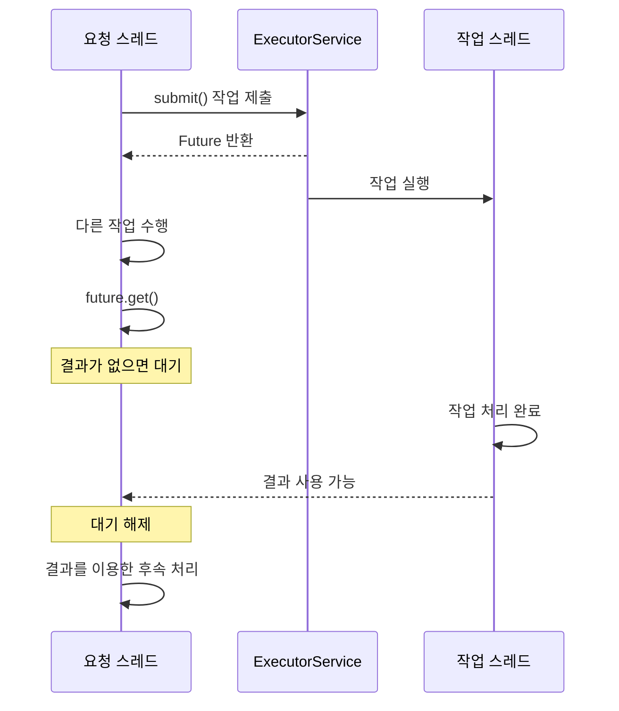
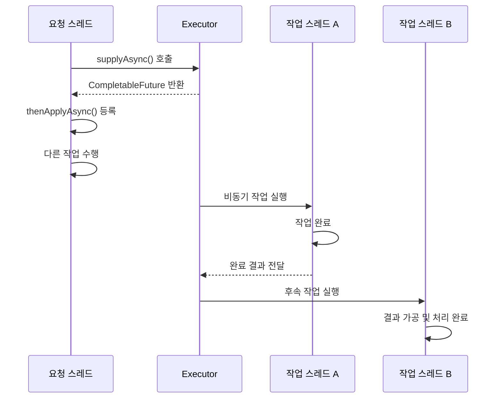
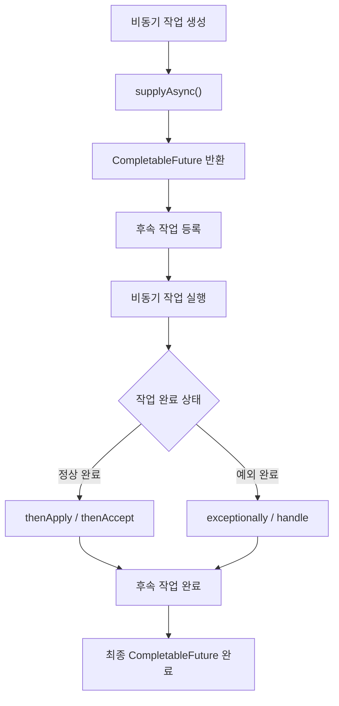
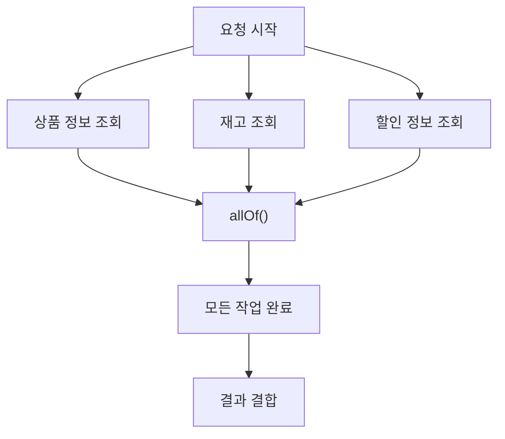
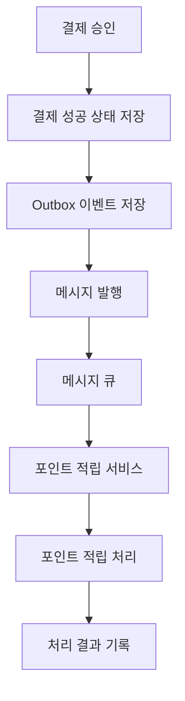

# 로지의 Java의 CompletableFuture
[https://youtu.be/gcAZvQ_YbfQ?si=hBvZBHQZi9Ngy7r-](https://youtu.be/gcAZvQ_YbfQ?si=hBvZBHQZi9Ngy7r-)

# 로지의 Java의 CompletableFuture
* toc
{:toc}

---

### Java의 Future와 CompletableFuture

Java에서 비동기 프로그래밍을 구현할 때 자주 등장하는 개념이 `Future`와 `CompletableFuture`입니다.

일반적인 동기 프로그래밍에서는 하나의 작업이 완료되어야 다음 작업을 실행할 수 있습니다. 반면 비동기 프로그래밍에서는 시간이 오래 걸리는 작업을 별도로 실행하고, 작업이 완료되었을 때 그 결과를 활용할 수 있습니다.

예를 들어 사용자가 상품을 구매하는 상황을 생각해 보겠습니다.

상품을 구매하면 다음과 같은 작업이 발생할 수 있습니다.

1. 결제 승인 요청
2. 결제 결과 확인
3. 사용자 포인트 적립
4. 구매 완료 알림 발송
5. 구매 이력 저장

이러한 작업을 모두 순차적으로 실행한다면 앞선 작업이 끝날 때까지 다음 작업을 시작하지 못합니다.

특히 외부 결제 시스템과 통신하거나 다른 서비스의 API를 호출하는 과정에서는 네트워크 지연이 발생할 수 있습니다.

이때 Java의 `Future`와 `CompletableFuture`를 활용하면 시간이 오래 걸리는 작업을 별도의 스레드에서 처리하고, 결과를 효율적으로 관리할 수 있습니다.

두 기술의 핵심적인 차이는 다음과 같습니다.

- **Future:** 비동기 작업의 결과를 나중에 가져올 수 있도록 합니다.
- **CompletableFuture:** 비동기 작업의 결과뿐 아니라 작업 완료 이후 실행할 후속 작업까지 정의할 수 있습니다.

다만 `CompletableFuture`를 사용한다고 해서 모든 코드가 자동으로 논블로킹 방식으로 실행되는 것은 아닙니다.

어떤 메서드를 사용하는지, 어느 스레드에서 실행되는지, 결과를 어떻게 가져오는지에 따라 실제 동작 방식이 달라집니다.

이 차이를 이해하는 것이 중요합니다.

---

### 개념

#### 1. 동기 처리와 비동기 처리

먼저 `Future`를 이해하기 위해 동기(Synchronous)와 비동기(Asynchronous)의 개념을 살펴보겠습니다.

**동기 처리**

동기 방식에서는 일반적으로 현재 작업이 완료된 후 다음 작업을 실행합니다.

```java
public class SyncExample {

    public static void main(String[] args) {

        String result = processPayment();

        System.out.println("결제 결과: " + result);
        System.out.println("다음 작업 실행");
    }

    private static String processPayment() {

        try {
            Thread.sleep(3000);
        } catch (InterruptedException e) {
            Thread.currentThread().interrupt();
            throw new IllegalStateException(e);
        }

        return "결제 완료";
    }
}
```

실행 결과는 다음과 같습니다.

```text
(약 3초 대기)

결제 결과: 결제 완료
다음 작업 실행
```

`processPayment()`가 완료되기 전까지 호출한 스레드는 다음 코드로 진행하지 못합니다.

실제 서비스에서는 이와 같은 대기 시간이 외부 API 호출, 데이터베이스 접근, 파일 처리 등의 과정에서 발생할 수 있습니다.

**비동기 처리**

비동기 방식에서는 작업을 별도의 실행 흐름에 맡기고, 호출한 스레드는 해당 작업의 완료를 기다리지 않고 다른 작업을 계속할 수 있습니다.

```java
ExecutorService executor = Executors.newSingleThreadExecutor();

try {

    Future<String> future = executor.submit(() -> {

        Thread.sleep(3000);

        return "결제 완료";
    });

    System.out.println("결제 요청 완료");
    System.out.println("다른 작업 실행");

} finally {
    executor.shutdown();
}
```

`submit()`으로 작업을 제출하면 `Future` 객체를 반환받습니다.

이 시점에는 실제 결제가 완료되지 않았을 수 있지만, 호출한 스레드는 작업 결과를 기다리지 않고 다음 코드를 실행할 수 있습니다.

```text
결제 요청 완료
다른 작업 실행
```

여기서 중요한 점은 다음과 같습니다.

**비동기 방식에서는 작업을 요청하는 시점과 작업의 결과를 사용하는 시점을 분리할 수 있습니다.**

그러나 비동기 방식과 논블로킹 방식은 같은 개념이 아닙니다.

#### 2. 비동기와 논블로킹의 차이

비동기와 논블로킹은 함께 사용되는 경우가 많지만 서로 다른 개념입니다.

| 구분 | 의미 | 핵심 |
|---|---|---|
| 동기 | 작업 결과와 이후 처리의 진행이 연결됨 | 결과를 확인하면서 진행 |
| 비동기 | 작업 완료 시점과 이후 처리를 분리할 수 있음 | 완료 결과를 나중에 활용 |
| 블로킹 | 작업이 완료될 때까지 호출한 스레드가 대기 | 스레드 대기 |
| 논블로킹 | 작업이 완료되지 않아도 호출이 반환됨 | 호출 시 스레드 대기를 피함 |

예를 들어 다음 코드를 살펴보겠습니다.

```java
Future<String> future = executor.submit(() -> {
    Thread.sleep(3000);
    return "결제 완료";
});

String result = future.get();
```

`submit()`은 비동기 작업을 제출합니다.

하지만 바로 이어서 실행하는 `future.get()`은 작업이 완료될 때까지 현재 스레드를 대기시킵니다.

즉, **비동기 작업을 시작했더라도 결과를 즉시 기다린다면 호출한 스레드는 블로킹될 수 있습니다.**

이 개념은 `CompletableFuture`를 이해할 때도 동일하게 적용됩니다.

---

### Future

#### 1. Future란?

`Future`는 비동기 작업의 결과를 나타내는 인터페이스입니다.

Java 5부터 제공되었으며, `java.util.concurrent` 패키지에 포함되어 있습니다.

`Future`는 아직 완료되지 않은 작업의 결과를 나중에 가져오기 위한 객체라고 이해할 수 있습니다.

배달음식을 주문하는 상황을 생각하면 이해하기 쉽습니다.

음식을 주문하면 음식이 완성되기 전에 주문번호를 먼저 받습니다.

주문번호를 받았다고 해서 음식이 완성된 것은 아닙니다. 하지만 해당 주문번호를 통해 나중에 음식의 상태를 확인하거나 결과를 받을 수 있습니다.

이때 주문번호가 `Future` 객체에 해당합니다.

| 배달 주문 | Java Future |
|---|---|
| 음식을 주문 | 비동기 작업 제출 |
| 주문번호 발급 | Future 객체 반환 |
| 음식 조리 | 별도 스레드에서 작업 실행 |
| 조리 완료 여부 확인 | isDone() |
| 음식을 받을 때까지 대기 | get() |
| 주문 취소 | cancel() |

다만 실제 `Future`는 주문의 모든 진행 과정을 자동으로 알려주는 객체가 아닙니다.

기본적으로 작업의 완료 여부를 확인하거나 완료된 결과를 가져오는 역할을 수행합니다.

#### 2. Future의 동작 원리

`Future`를 사용하는 일반적인 흐름은 다음과 같습니다.



동작 과정은 다음과 같습니다.

1. 요청 스레드가 `ExecutorService`에 작업을 제출합니다.
2. `ExecutorService`는 작업을 실행하도록 관리합니다.
3. 요청 스레드는 `Future` 객체를 반환받습니다.
4. 실제 작업은 작업 스레드에서 실행됩니다.
5. 요청 스레드는 다른 작업을 수행할 수 있습니다.
6. `get()`을 호출한 시점에 작업이 완료되지 않았다면 대기합니다.
7. 작업이 완료되면 결과를 반환받고 다음 로직을 실행합니다.

핵심은 작업을 제출하는 것과 결과를 가져오는 것이 서로 다른 시점에 이루어진다는 점입니다.

#### 3. Future 사용 예제

```java
import java.util.concurrent.ExecutorService;
import java.util.concurrent.Executors;
import java.util.concurrent.Future;
import java.util.concurrent.TimeUnit;

public class FutureExample {

    public static void main(String[] args) throws Exception {

        ExecutorService executor =
                Executors.newFixedThreadPool(2);

        try {

            Future<String> future = executor.submit(() -> {

                System.out.println("결제 처리 시작");

                Thread.sleep(3000);

                return "결제 성공";
            });

            System.out.println("Future 객체 반환");

            System.out.println("다른 작업 실행");

            String result = future.get();

            System.out.println("결제 결과: " + result);

        } finally {

            executor.shutdown();

            if (!executor.awaitTermination(5, TimeUnit.SECONDS)) {
                executor.shutdownNow();
            }
        }
    }
}
```

실행 결과는 다음과 같습니다.

```text
Future 객체 반환
다른 작업 실행
결제 처리 시작

(약 3초 후)

결제 결과: 결제 성공
```

스레드 스케줄링에 따라 `결제 처리 시작` 메시지의 출력 순서는 달라질 수 있습니다.

이 예제에서 가장 중요한 코드는 다음과 같습니다.

```java
Future<String> future = executor.submit(task);
```

비동기 작업을 제출하고 결과를 나타내는 `Future` 객체를 반환받습니다.

반면 다음 코드는 다르게 동작합니다.

```java
String result = future.get();
```

작업이 완료되지 않았다면 현재 스레드가 대기합니다.

따라서 비동기 작업을 제출했더라도 `get()`을 호출하는 시점에 따라 블로킹이 발생할 수 있습니다.

#### 4. Future의 주요 메서드

| 메서드 | 설명 |
|---|---|
| `get()` | 작업 완료까지 기다린 후 결과 반환 |
| `get(timeout, unit)` | 지정한 시간까지만 대기 |
| `isDone()` | 작업이 완료되었는지 확인 |
| `isCancelled()` | 작업이 취소되었는지 확인 |
| `cancel(boolean)` | 작업 취소 시도 |

예를 들어 `isDone()`을 활용하면 결과를 가져오기 전에 완료 여부를 확인할 수 있습니다.

```java
if (future.isDone()) {

    String result = future.get();

    System.out.println(result);

} else {

    System.out.println("아직 작업 중입니다.");
}
```

또한 다음과 같이 최대 대기 시간을 지정할 수 있습니다.

```java
String result = future.get(3, TimeUnit.SECONDS);
```

3초 이내에 작업이 완료되지 않으면 `TimeoutException`이 발생합니다.

다만 대기 시간이 초과되었다고 해서 백그라운드에서 실행 중인 작업까지 자동으로 취소되는 것은 아닙니다.

작업을 취소해야 한다면 별도의 취소 정책을 구현해야 합니다.

---

### Future의 한계

`Future`는 비동기 작업을 실행하고 결과를 가져오는 데 유용하지만, 복잡한 비동기 흐름을 구성할 때 몇 가지 불편함이 있습니다.

#### 1. get() 호출 시 블로킹 발생

가장 대표적인 문제는 `get()`을 호출했을 때 작업이 완료되지 않았다면 현재 스레드가 대기한다는 점입니다.

```java
Future<String> future = executor.submit(() -> {

    Thread.sleep(5000);

    return "작업 완료";
});

String result = future.get();

System.out.println("다음 작업 실행");
```

작업이 5초 걸린다면 현재 스레드는 결과를 기다리는 동안 다른 코드를 실행할 수 없습니다.

물론 `Future` 자체가 항상 블로킹되는 것은 아닙니다.

`get()`을 호출하지 않고 다른 작업을 수행하거나 `isDone()`으로 완료 여부를 확인할 수도 있습니다.

하지만 이러한 방식은 완료 시점을 반복적으로 확인해야 하는 불편함을 만들 수 있습니다.

특히 여러 비동기 작업을 연결해야 한다면 코드가 복잡해집니다.

#### 2. 비동기 작업의 후속 처리를 연결하기 어려움

결제가 완료되면 포인트를 적립하는 요구사항을 생각해 보겠습니다.

`Future`에서는 일반적으로 다음과 같은 코드를 작성할 수 있습니다.

```java
Future<String> paymentFuture = executor.submit(() -> {

    Thread.sleep(2000);

    return "PAYMENT_SUCCESS";
});

String paymentResult = paymentFuture.get();

if ("PAYMENT_SUCCESS".equals(paymentResult)) {

    System.out.println("포인트 적립");
}
```

이 방식은 결제 완료 후 포인트를 적립할 수 있지만, 포인트 적립 로직을 실행하기 위해 `get()`으로 결과를 가져와야 합니다.

결과가 아직 준비되지 않았다면 현재 스레드는 대기합니다.

`Future` 인터페이스 자체에는 다음과 같은 기능이 없습니다.

- 작업이 완료되면 지정한 함수를 자동으로 실행
- 첫 번째 작업의 결과를 다음 비동기 작업으로 전달
- 여러 비동기 작업의 결과를 결합
- 작업별 예외 처리 흐름 구성

이러한 기능을 구현하려면 별도의 작업 관리 로직이 필요합니다.

#### 3. Checked Exception 처리 필요

`Future.get()`은 다음과 같은 예외를 선언합니다.

```java
V get() throws InterruptedException, ExecutionException;
```

두 예외의 의미는 서로 다릅니다.

**InterruptedException**

결과를 기다리는 스레드가 인터럽트되었을 때 발생할 수 있습니다.

**ExecutionException**

비동기 작업을 실행하는 과정에서 예외가 발생했을 때 해당 예외를 감싸서 전달합니다.

두 예외는 Checked Exception이므로 호출하는 코드에서 처리하거나 상위 호출자로 전파하도록 선언해야 합니다.

```java
try {

    String result = future.get();

    System.out.println(result);

} catch (InterruptedException e) {

    Thread.currentThread().interrupt();

    System.err.println("대기 작업이 중단되었습니다.");

} catch (ExecutionException e) {

    System.err.println(
        "비동기 작업 실패: " + e.getCause().getMessage()
    );
}
```

다만 Checked Exception 자체가 `Future`의 설계 결함이라는 의미는 아닙니다.

Checked Exception은 호출자가 실패와 인터럽트 가능성을 명시적으로 고려하도록 만드는 장점도 있습니다.

문제는 복잡한 비동기 흐름에서 이러한 예외 처리와 결과 수집 코드를 반복해서 작성해야 할 수 있다는 점입니다.

Oracle의 Future API 문서에서도 `get()`의 대기 동작과 예외 처리 방식을 명시하고 있습니다.

---

### CompletableFuture

#### 1. CompletableFuture란?

`CompletableFuture`는 Java 8에서 도입된 비동기 프로그래밍 클래스입니다.

기존 `Future`의 기능을 제공하면서 비동기 작업의 완료 이후 실행할 후속 작업을 선언할 수 있도록 확장되었습니다.

`CompletableFuture`는 다음 두 인터페이스를 구현합니다.

```java
public class CompletableFuture<T>
        implements Future<T>, CompletionStage<T> {
}
```

각 인터페이스의 역할은 다음과 같습니다.

| 인터페이스 | 역할 |
|---|---|
| Future | 비동기 작업 상태 확인 및 결과 조회 |
| CompletionStage | 작업 완료 후 실행할 후속 작업 정의 |
| CompletableFuture | 두 기능을 구현하고 완료 상태를 직접 제어할 수 있는 클래스 |

`CompletionStage`는 비동기 작업 간의 의존 관계를 표현하기 위한 인터페이스입니다.

예를 들어 다음과 같은 흐름을 만들 수 있습니다.

```text
결제 요청
    ↓
결제 완료
    ↓
포인트 적립
    ↓
알림 발송
```

중요한 점은 이러한 작업의 실행 순서를 미리 정의할 수 있다는 것입니다.

이때 모든 단계에서 결과를 직접 기다릴 필요는 없습니다.

앞선 작업이 정상적으로 완료되면 등록된 후속 작업이 실행되도록 구성할 수 있습니다.

이는 단순히 비동기 작업의 결과를 가져오는 것보다 훨씬 유연한 구조입니다.

#### 2. CompletableFuture의 동작 원리

`CompletableFuture`의 핵심은 **후속 작업을 등록하는 시점과 실제 실행하는 시점을 분리하는 것**입니다.



이 과정에서 요청 스레드는 후속 작업이 완료될 때까지 반드시 기다릴 필요가 없습니다.

미리 등록한 작업은 앞선 작업이 완료되었을 때 실행됩니다.

다만 위 그림은 `thenApplyAsync()`와 `Executor`를 사용하는 예시입니다.

`thenApply()`처럼 `Async` 접미사가 없는 메서드는 별도의 스레드에서 실행된다는 보장이 없습니다.

이 차이는 뒤에서 자세히 살펴보겠습니다.

---

### 왜 사용하는가?

#### 1. 결과를 기다리는 코드와 후속 처리 코드를 분리하기 위해

일반적인 `Future` 방식에서는 결과를 가져와야 다음 작업을 실행하기 쉽습니다.

```java
String paymentResult = paymentFuture.get();

processPoint(paymentResult);
```

반면 `CompletableFuture`에서는 작업이 완료되었을 때 실행할 로직을 미리 등록할 수 있습니다.

```java
CompletableFuture
        .supplyAsync(() -> processPayment())
        .thenAccept(result -> processPoint(result));
```

위 코드는 결제 처리 결과를 기다리는 `get()` 호출 없이 후속 작업을 연결합니다.

결제 처리가 정상적으로 완료되면 해당 결과를 이용해 포인트 적립 로직을 실행합니다.

단, 후속 작업이 실행되는 스레드는 사용하는 메서드와 실행 환경에 따라 달라질 수 있습니다.

#### 2. 여러 비동기 작업을 효율적으로 조합하기 위해

상품 상세 화면을 구성하는 상황을 생각해 보겠습니다.

하나의 화면을 반환하기 위해 다음 정보가 필요하다고 가정하겠습니다.

- 상품 기본 정보
- 상품 재고 정보
- 사용자 할인 정보

각 API 호출이 독립적이라면 순차적으로 실행할 필요가 없습니다.

예를 들어 각 작업이 다음과 같은 시간이 걸린다고 가정하겠습니다.

| 작업 | 처리 시간 |
|---|---:|
| 상품 정보 조회 | 300ms |
| 재고 조회 | 400ms |
| 할인 정보 조회 | 500ms |

순차적으로 실행한다면 전체 처리 시간은 약 1,200ms가 됩니다.

하지만 세 작업을 동시에 실행하면 이론적으로 가장 오래 걸리는 작업에 가까운 약 500ms 수준으로 단축할 수 있습니다.

실제 소요 시간은 스레드 풀 대기, 네트워크 지연, 결과 결합 비용 등에 따라 달라집니다.

`CompletableFuture`는 이러한 독립적인 작업을 동시에 실행하고 결과를 결합하는 기능을 제공합니다.

#### 3. 실패 처리 흐름을 유연하게 구성하기 위해

외부 API 호출은 언제든 실패할 수 있습니다.

네트워크 장애, 응답 지연, 시스템 오류 등이 발생하더라도 전체 서비스가 반드시 실패하도록 처리할 필요는 없습니다.

예를 들어 추천 상품 조회가 실패한 경우 기본 추천 목록을 반환할 수 있습니다.

```java
CompletableFuture<List<String>> future =
        CompletableFuture
                .supplyAsync(() -> getRecommendedProducts())
                .exceptionally(ex -> getDefaultProducts());
```

추천 상품 조회에 실패하면 `exceptionally()`에서 대체 결과를 반환합니다.

이러한 방식은 일부 기능의 실패가 전체 서비스의 실패로 이어지는 것을 줄이는 데 활용할 수 있습니다.

다만 결제 승인이나 정산 처리처럼 데이터 정합성이 중요한 작업에서는 단순히 기본값으로 실패를 숨겨서는 안 됩니다.

실패한 작업의 성격에 따라 복구, 재시도, 보상 처리, 실패 전파 등의 전략을 선택해야 합니다.

---

### 주요 특징

#### 1. supplyAsync()와 runAsync()

`CompletableFuture`에서 비동기 작업을 시작하는 대표적인 메서드는 `supplyAsync()`와 `runAsync()`입니다.

두 메서드는 반환값 유무에 따라 구분됩니다.

| 메서드 | 반환 타입 | 특징 |
|---|---|---|
| `supplyAsync()` | `CompletableFuture<T>` | 결과를 반환하는 비동기 작업 |
| `runAsync()` | `CompletableFuture<Void>` | 결과값이 필요 없는 비동기 작업 |

**supplyAsync()**

```java
CompletableFuture<String> future =
        CompletableFuture.supplyAsync(() -> {

            System.out.println("결제 처리");

            return "결제 성공";
        });
```

작업의 실행 결과를 반환할 수 있습니다.

```java
String result = future.join();
```

**runAsync()**

```java
CompletableFuture<Void> future =
        CompletableFuture.runAsync(() -> {

            System.out.println("알림 발송");
        });
```

반환할 결과값이 필요 없는 작업에 사용합니다.

두 메서드 모두 별도의 `Executor`를 지정하지 않으면 기본적으로 `ForkJoinPool.commonPool()`을 사용합니다.

단, 공통 풀의 병렬성 수준이 충분하지 않은 환경에서는 별도 스레드를 사용하는 예외적인 동작이 존재합니다.

또한 원하는 `Executor`를 직접 지정할 수도 있습니다.

```java
ExecutorService executor =
        Executors.newFixedThreadPool(10);

CompletableFuture<String> future =
        CompletableFuture.supplyAsync(() -> {

            return "비동기 처리 완료";

        }, executor);
```

실무에서는 작업 특성에 맞는 `Executor`를 명시적으로 구성하는 것이 유용합니다.

#### 2. thenApply() - 결과를 변환하는 후속 작업

`thenApply()`는 이전 작업의 결과를 받아 다른 값으로 변환할 때 사용합니다.

```java
CompletableFuture<String> future =
        CompletableFuture
                .supplyAsync(() -> 10000)
                .thenApply(amount -> amount + 1000)
                .thenApply(amount -> "최종 금액: " + amount);
```

각 단계에서 다음 작업의 결과가 전달됩니다.

```text
10000
   ↓
11000
   ↓
최종 금액: 11000
```

`thenApply()`는 이전 작업이 정상적으로 완료되었을 때 실행됩니다.

그리고 반환값을 가지므로 다음 단계로 결과를 전달할 수 있습니다.

#### 3. thenAccept() - 결과를 소비하는 후속 작업

`thenAccept()`는 이전 작업의 결과를 사용하지만, 새로운 결과를 반환하지 않을 때 사용합니다.

```java
CompletableFuture<Void> future =
        CompletableFuture
                .supplyAsync(() -> "결제 완료")
                .thenAccept(result -> {

                    System.out.println(result);
                });
```

이전 단계에서 반환된 `"결제 완료"`를 전달받아 출력합니다.

`thenApply()`와의 차이는 반환값 유무입니다.

```java
// 반환값이 있음
thenApply(result -> result + " 처리");

// 반환값이 없음
thenAccept(result -> System.out.println(result));
```

#### 4. thenRun() - 결과와 관계없이 후속 작업 실행

`thenRun()`은 이전 작업의 결과를 사용하지 않고, 정상적으로 완료되었을 때 새로운 작업을 실행합니다.

```java
CompletableFuture<Void> future =
        CompletableFuture
                .supplyAsync(() -> "결제 완료")
                .thenRun(() -> {

                    System.out.println("후속 작업 실행");
                });
```

`thenAccept()`와 달리 이전 단계의 결과값을 전달받지 않습니다.

다만 `thenRun()`은 앞선 작업이 실패했더라도 무조건 실행되는 메서드는 아닙니다.

앞선 단계가 정상적으로 완료되었을 때 실행됩니다.

#### 5. thenCompose() - 비동기 작업 연결

`thenCompose()`는 이전 비동기 작업의 결과를 바탕으로 새로운 비동기 작업을 실행할 때 사용합니다.

예를 들어 결제 승인 이후 포인트 적립 API를 호출하는 상황입니다.

```java
CompletableFuture<String> paymentFuture =
        CompletableFuture.supplyAsync(() -> {

            return "PAYMENT_ID_100";
        });

CompletableFuture<String> resultFuture =
        paymentFuture.thenCompose(paymentId -> {

            return CompletableFuture.supplyAsync(() -> {

                return paymentId + " 포인트 적립 완료";
            });
        });
```

`thenCompose()`는 다음과 같은 순서로 실행됩니다.

```text
결제 요청
   ↓
결제 완료
   ↓
결제 ID 반환
   ↓
포인트 적립 작업 시작
   ↓
포인트 적립 완료
```

여기서 중요한 점은 두 번째 작업이 첫 번째 작업의 결과에 의존한다는 것입니다.

또한 `thenCompose()`는 중첩된 `CompletableFuture`를 하나의 연결된 결과로 다룹니다.

```java
// thenApply를 이용하면 중첩 구조가 될 수 있음
CompletableFuture<CompletableFuture<String>>

// thenCompose는 하나의 비동기 결과로 연결
CompletableFuture<String>
```

따라서 **후속 작업 자체가 비동기 결과를 반환한다면 `thenCompose()`를 사용하는 것이 적합합니다.**

#### 6. thenCombine() - 독립적인 비동기 작업 결합

`thenCompose()`가 순차적인 의존 관계를 연결한다면, `thenCombine()`은 서로 독립적인 비동기 작업의 결과를 결합합니다.

```java
CompletableFuture<Integer> productFuture =
        CompletableFuture.supplyAsync(() -> 10000);

CompletableFuture<Integer> discountFuture =
        CompletableFuture.supplyAsync(() -> 2000);

CompletableFuture<Integer> resultFuture =
        productFuture.thenCombine(
                discountFuture,
                (price, discount) -> price - discount
        );

System.out.println(resultFuture.join());
```

실행 결과는 다음과 같습니다.

```text
8000
```

두 작업은 서로 의존하지 않기 때문에 동시에 실행할 수 있습니다.

두 작업이 정상적으로 완료되면 결과를 결합하는 함수가 실행됩니다.

| 메서드 | 사용 목적 |
|---|---|
| `thenApply()` | 이전 결과를 변환 |
| `thenAccept()` | 이전 결과를 소비 |
| `thenRun()` | 이전 결과 없이 작업 실행 |
| `thenCompose()` | 결과에 의존하는 비동기 작업 연결 |
| `thenCombine()` | 독립적인 두 비동기 작업 결과 결합 |

#### 7. exceptionally() - 실패 시 대체 결과 제공

`exceptionally()`는 앞선 작업이 예외적으로 완료되었을 때 실행됩니다.

```java
CompletableFuture<String> future =
        CompletableFuture
                .supplyAsync(() -> {

                    throw new RuntimeException("외부 API 오류");
                })
                .exceptionally(ex -> {

                    return "기본 응답";
                });
```

실행 흐름은 다음과 같습니다.

```text
비동기 작업 실행
      ↓
예외 발생
      ↓
exceptionally() 실행
      ↓
기본 응답 반환
```

`exceptionally()`는 예외가 발생했을 때 대체 결과를 만들어 정상적인 완료 흐름으로 복구할 수 있습니다.

단, 모든 예외를 무조건 정상 응답으로 변경하는 방식은 위험할 수 있습니다.

특히 금액 처리, 권한 변경, 정산 같은 작업에서는 실패한 사실을 반드시 유지해야 하는 경우가 있습니다.

#### 8. handle() - 성공과 실패를 모두 처리

`handle()`은 작업의 성공 여부와 관계없이 실행됩니다.

```java
CompletableFuture<String> future =
        CompletableFuture
                .supplyAsync(() -> {

                    return "결제 완료";
                })
                .handle((result, ex) -> {

                    if (ex != null) {

                        return "결제 실패";
                    }

                    return result;
                });
```

`handle()`은 결과값과 예외 객체를 모두 전달받습니다.

따라서 성공과 실패에 따라 다른 결과를 반환할 수 있습니다.

#### 9. whenComplete() - 작업 완료 후 부가 처리

`whenComplete()`도 성공과 실패에 관계없이 실행됩니다.

하지만 `handle()`과는 목적이 다릅니다.

```java
CompletableFuture<String> future =
        CompletableFuture
                .supplyAsync(() -> {

                    return "결제 완료";
                })
                .whenComplete((result, ex) -> {

                    if (ex != null) {

                        System.err.println("결제 실패");

                    } else {

                        System.out.println("결제 성공");
                    }
                });
```

`whenComplete()`는 일반적으로 결과를 변환하기보다는 로깅, 모니터링 등 부가적인 작업에 사용합니다.

기존 작업이 실패했다면 원래의 실패가 후속 단계로 전달되는 것이 기본 동작입니다.

다만 `whenComplete()` 내부에서 새로운 예외가 발생하면 최종 예외 전파 결과에 영향을 줄 수 있습니다.

| 메서드 | 성공 시 실행 | 실패 시 실행 | 결과 변환 |
|---|---|---|---|
| `exceptionally()` | X | O | 가능 |
| `handle()` | O | O | 가능 |
| `whenComplete()` | O | O | 기본적으로 기존 결과 유지 |

---

### get()과 join()의 차이

`CompletableFuture`에서는 `get()`과 `join()`을 모두 사용할 수 있습니다.

두 메서드는 작업 결과를 가져온다는 공통점이 있지만 예외 처리 방식에 차이가 있습니다.

#### 1. get()

```java
CompletableFuture<String> future =
        CompletableFuture.supplyAsync(() -> "완료");

try {

    String result = future.get();

} catch (InterruptedException e) {

    Thread.currentThread().interrupt();

} catch (ExecutionException e) {

    e.printStackTrace();
}
```

`get()`은 다음과 같은 Checked Exception을 선언합니다.

- `InterruptedException`
- `ExecutionException`

따라서 호출자가 직접 처리하거나 상위 메서드에 전파하도록 선언해야 합니다.

#### 2. join()

```java
CompletableFuture<String> future =
        CompletableFuture.supplyAsync(() -> "완료");

String result = future.join();
```

`join()`은 Checked Exception을 선언하지 않습니다.

작업이 예외적으로 완료되면 일반적으로 `CompletionException`과 같은 Unchecked Exception을 발생시킵니다.

따라서 반드시 `try-catch`를 작성하지 않아도 컴파일이 가능합니다.

하지만 여기서 반드시 알아야 하는 사실이 있습니다.

**join() 역시 작업이 완료되지 않았다면 현재 스레드를 대기시킵니다.**

즉, `get()`과 `join()`의 핵심 차이는 블로킹 여부가 아니라 예외를 표현하는 방식입니다.

| 구분 | get() | join() |
|---|---|---|
| 제공 위치 | Future, CompletableFuture | CompletableFuture |
| 작업 완료 대기 | O | O |
| 블로킹 가능성 | O | O |
| Checked Exception 선언 | O | X |
| 실패 시 대표 예외 | ExecutionException | CompletionException |
| 대기 중 인터럽트 | InterruptedException 발생 가능 | InterruptedException을 선언하지 않음 |
| 시간 제한 오버로드 | O | X |

`join()`은 Checked Exception을 강제하지 않을 뿐, 예외 처리가 불필요하다는 의미는 아닙니다.

또한 두 메서드 모두 완료된 결과를 가져오는 경우에는 불필요하게 오래 기다리지 않습니다.

따라서 `CompletableFuture`를 활용한 비동기 흐름에서 블로킹을 줄이고 싶다면 마지막에 무조건 `join()`을 호출하기보다 비동기 결과 자체를 다음 단계로 전달하는 구조를 고려해야 합니다.

---

### 예제

#### 1. Future와 CompletableFuture 비교

먼저 동일한 기능을 두 가지 방식으로 구현해 보겠습니다.

요구사항은 다음과 같습니다.

```text
결제 승인
    ↓
포인트 적립
    ↓
완료 결과 반환
```

**Future 방식**

```java
Future<String> paymentFuture =
        executor.submit(() -> {

            Thread.sleep(2000);

            return "결제 완료";
        });

String paymentResult = paymentFuture.get();

Future<String> pointFuture =
        executor.submit(() -> {

            Thread.sleep(1000);

            return paymentResult + " / 포인트 적립 완료";
        });

String finalResult = pointFuture.get();

System.out.println(finalResult);
```

첫 번째 작업의 결과를 가져온 다음 두 번째 작업을 제출합니다.

따라서 두 작업 사이에 `get()`을 이용한 블로킹이 발생할 수 있습니다.

**CompletableFuture 방식**

```java
CompletableFuture<String> resultFuture =
        CompletableFuture
                .supplyAsync(() -> {

                    return "결제 완료";
                }, executor)
                .thenApplyAsync(result -> {

                    return result + " / 포인트 적립 완료";

                }, executor);
```

결제 완료 이후 실행할 포인트 적립 작업을 미리 연결할 수 있습니다.

이 코드를 실행한 요청 스레드는 결과를 기다리는 대신 다른 로직을 수행할 수 있습니다.

```java
System.out.println("다른 작업 수행");
```

실제 결과가 필요한 시점에만 다음과 같이 가져올 수 있습니다.

```java
String result = resultFuture.join();
```

다만 이 코드는 결과를 가져오는 시점에 작업이 완료되지 않았다면 블로킹됩니다.

따라서 비동기 처리를 끝까지 유지하려면 반환 타입을 `CompletableFuture`로 유지하고, 후속 처리 역시 비동기 단계로 연결하는 방법을 고려할 수 있습니다.

#### 2. 실행 가능한 전체 예제

다음 코드는 결제 승인 이후 포인트 적립이 실행되는 과정을 확인할 수 있는 예제입니다.

```java
import java.util.concurrent.CompletableFuture;
import java.util.concurrent.ExecutorService;
import java.util.concurrent.Executors;
import java.util.concurrent.TimeUnit;

public class CompletableFutureExample {

    public static void main(String[] args) {

        ExecutorService executor =
                Executors.newFixedThreadPool(4);

        try {

            CompletableFuture<String> paymentFuture =
                    CompletableFuture.supplyAsync(() -> {

                        System.out.println(
                                "결제 처리 시작: " +
                                Thread.currentThread().getName()
                        );

                        sleep(2000);

                        return "PAYMENT_100";
                    }, executor);

            CompletableFuture<String> resultFuture =
                    paymentFuture.thenApplyAsync(paymentId -> {

                        System.out.println(
                                "포인트 적립 시작: " +
                                Thread.currentThread().getName()
                        );

                        sleep(1000);

                        return paymentId + " 포인트 적립 완료";

                    }, executor);

            resultFuture = resultFuture.whenComplete((result, ex) -> {

                if (ex != null) {

                    System.err.println(
                            "작업 실패: " + ex.getMessage()
                    );

                } else {

                    System.out.println(
                            "최종 작업 완료: " + result
                    );
                }
            });

            System.out.println("비동기 작업 등록 완료");

            System.out.println("메인 스레드에서 다른 작업 실행");

            String result = resultFuture.join();

            System.out.println("최종 결과: " + result);

        } finally {

            executor.shutdown();

            try {

                if (!executor.awaitTermination(
                        5, TimeUnit.SECONDS)) {

                    executor.shutdownNow();
                }

            } catch (InterruptedException e) {

                executor.shutdownNow();

                Thread.currentThread().interrupt();
            }
        }
    }

    private static void sleep(long millis) {

        try {

            Thread.sleep(millis);

        } catch (InterruptedException e) {

            Thread.currentThread().interrupt();

            throw new IllegalStateException(
                    "작업이 중단되었습니다.", e
            );
        }
    }
}
```

실행 결과는 다음과 유사합니다.

```text
비동기 작업 등록 완료
메인 스레드에서 다른 작업 실행

결제 처리 시작: pool-1-thread-1

(약 2초 후)

포인트 적립 시작: pool-1-thread-2

(약 1초 후)

최종 작업 완료: PAYMENT_100 포인트 적립 완료
최종 결과: PAYMENT_100 포인트 적립 완료
```

실제 스레드 이름과 출력 순서는 실행 환경에 따라 달라질 수 있습니다.

코드에서 주목해야 할 부분은 다음과 같습니다.

```java
CompletableFuture.supplyAsync(...)
```

결제 처리를 비동기 작업으로 실행합니다.

```java
paymentFuture.thenApplyAsync(...)
```

결제 결과가 준비되면 포인트 적립 작업을 실행하도록 연결합니다.

```java
resultFuture.whenComplete(...)
```

전체 작업의 성공과 실패를 확인합니다.

이 구조에서는 비동기 작업을 등록하는 것과 실제로 결과를 처리하는 것을 분리할 수 있습니다.

다만 예제의 `join()`은 콘솔 프로그램에서 최종 결과를 확인하기 위해 사용한 것입니다.

웹 애플리케이션에서는 요청 처리 구조에 따라 `CompletableFuture` 자체를 반환하거나 비동기 응답 처리 기능과 연계할 수 있습니다.

---

### 구조

#### 1. CompletableFuture의 실행 흐름

`CompletableFuture`는 이전 작업의 완료 상태에 따라 연결된 후속 작업을 실행합니다.



각 단계의 실행은 앞선 단계의 완료 여부에 따라 결정됩니다.

그런데 여기서 중요한 문제가 하나 있습니다.

**후속 작업은 과연 어느 스레드에서 실행될까요?**

#### 2. thenApply()와 thenApplyAsync()의 차이

다음 두 메서드는 이름이 비슷하지만 실행 방식에 차이가 있습니다.

```java
thenApply()
```

```java
thenApplyAsync()
```

**thenApply()**

`thenApply()`는 후속 작업을 별도의 스레드 풀에 반드시 제출하지는 않습니다.

앞선 작업을 완료한 스레드가 이어서 실행할 수도 있습니다.

또한 앞선 작업이 이미 완료된 상태에서 후속 작업을 등록했다면 등록하는 스레드에서 실행될 수도 있습니다.

```java
CompletableFuture<String> future =
        CompletableFuture.completedFuture("완료");

future.thenApply(result -> {

    System.out.println(
            Thread.currentThread().getName()
    );

    return result;
});
```

이 예제에서는 이미 완료된 `CompletableFuture`에 후속 작업을 등록하므로 일반적으로 호출한 스레드에서 실행됩니다.

**thenApplyAsync()**

`thenApplyAsync()`는 후속 작업을 비동기 실행 방식으로 스케줄링합니다.

```java
CompletableFuture<String> future =
        CompletableFuture.completedFuture("완료");

future.thenApplyAsync(result -> {

    System.out.println(
            Thread.currentThread().getName()
    );

    return result;
});
```

별도의 `Executor`를 지정하지 않으면 일반적으로 `ForkJoinPool.commonPool()`을 이용합니다.

직접 실행 환경을 지정할 수도 있습니다.

```java
future.thenApplyAsync(result -> {

    return result + " 후속 처리";

}, executor);
```

차이를 정리하면 다음과 같습니다.

| 구분 | thenApply() | thenApplyAsync() |
|---|---|---|
| 후속 작업 등록 | O | O |
| 별도 비동기 실행 스케줄링 | 보장하지 않음 | O |
| 실행 스레드 | 완료 스레드 또는 호출 스레드 등 | 지정 Executor 또는 기본 비동기 실행 환경 |
| 실행 환경 지정 | X | O |
| 적합한 작업 | 간단한 결과 변환 | 별도 실행 자원이 필요한 작업 |

`thenApply()`는 별도의 스레드 전환이 필요하지 않은 가벼운 작업에 적합합니다.

반면 오래 걸리는 후속 작업이나 별도의 실행 환경에서 처리해야 하는 작업이라면 `thenApplyAsync()`를 고려할 수 있습니다.

다만 모든 후속 작업에 `Async`를 붙이는 것이 항상 좋은 것은 아닙니다.

불필요한 스케줄링과 스레드 간 전환 비용이 증가할 수 있기 때문입니다.

Oracle API 문서에서도 비동기 접미사가 없는 후속 작업의 실행 스레드는 고정되어 있지 않으며, Async 메서드는 별도의 비동기 실행 정책을 따른다고 설명합니다.

#### 3. 여러 작업을 동시에 실행하는 allOf()

`allOf()`는 여러 개의 `CompletableFuture`가 모두 완료되었을 때 완료되는 새로운 `CompletableFuture`를 반환합니다.

```java
CompletableFuture<String> productFuture =
        CompletableFuture.supplyAsync(() -> "상품 정보");

CompletableFuture<String> stockFuture =
        CompletableFuture.supplyAsync(() -> "재고 정보");

CompletableFuture<String> discountFuture =
        CompletableFuture.supplyAsync(() -> "할인 정보");

CompletableFuture<Void> allFuture =
        CompletableFuture.allOf(
                productFuture,
                stockFuture,
                discountFuture
        );
```

세 작업은 독립적으로 실행될 수 있습니다.

`allFuture`는 세 작업이 모두 완료되면 완료됩니다.

```java
CompletableFuture<String> resultFuture =
        allFuture.thenApply(ignored -> {

            String product = productFuture.join();
            String stock = stockFuture.join();
            String discount = discountFuture.join();

            return product + ", " + stock + ", " + discount;
        });
```

`allOf()`가 정상 완료된 이후에는 각각의 작업도 정상적으로 완료된 상태이므로 `join()`을 통해 결과를 가져올 수 있습니다.

여기서 `allOf()` 자체는 각 작업의 결과를 모아서 반환하지 않습니다.

반환 타입은 `CompletableFuture<Void>`입니다.

따라서 실제 결과가 필요하다면 개별 `CompletableFuture`에서 값을 가져와야 합니다.



이 방식은 여러 독립적인 API 호출을 병렬로 처리해야 하는 상황에서 유용합니다.

단, 작업 중 하나라도 실패하면 `allOf()`로 생성한 결과도 예외적으로 완료됩니다.

#### 4. 먼저 완료된 작업의 결과를 사용하는 anyOf()

`anyOf()`는 여러 작업 중 하나가 완료되면 해당 결과를 이용할 수 있도록 합니다.

```java
CompletableFuture<String> future1 =
        CompletableFuture.supplyAsync(() -> "서버 A 응답");

CompletableFuture<String> future2 =
        CompletableFuture.supplyAsync(() -> "서버 B 응답");

CompletableFuture<Object> result =
        CompletableFuture.anyOf(future1, future2);
```

먼저 완료된 작업의 결과를 반환합니다.

다만 주의할 점이 있습니다.

`anyOf()`는 반드시 먼저 성공한 작업의 결과를 반환하는 것이 아닙니다.

먼저 완료된 작업이 실패했다면 `anyOf()` 역시 예외적으로 완료될 수 있습니다.

또한 나머지 작업을 자동으로 취소하지 않습니다.

따라서 여러 외부 API 중 가장 빠른 응답을 선택하는 구조에 적용할 때는 실패 처리와 불필요한 작업의 자원 사용까지 고려해야 합니다.

---

### 예외 처리 및 타임아웃

#### 1. 비동기 작업에서 예외가 발생하는 경우

다음 코드를 살펴보겠습니다.

```java
CompletableFuture<String> future =
        CompletableFuture.supplyAsync(() -> {

            throw new RuntimeException("결제 API 오류");
        });

String result = future.join();
```

비동기 작업에서 발생한 예외는 `CompletableFuture`의 실패 완료 상태로 전달됩니다.

최종적으로 `join()`을 호출하면 `CompletionException`이 발생할 수 있습니다.

이를 처리하려면 다음과 같이 작성할 수 있습니다.

```java
try {

    String result = future.join();

} catch (CompletionException e) {

    Throwable cause = e.getCause();

    System.err.println(
            "실제 오류: " + cause.getMessage()
    );
}
```

`getCause()`를 통해 실제 작업에서 발생한 예외를 확인할 수 있습니다.

단, 작업의 실패 원인과 예외 종류에 따라 발생하는 예외의 구체적인 형태는 달라질 수 있습니다.

#### 2. orTimeout()을 이용한 타임아웃 처리

외부 API 호출이 너무 오래 걸리는 경우 무한정 기다리지 않도록 제한을 설정할 수 있습니다.

Java 9부터 제공되는 `orTimeout()`을 사용할 수 있습니다.

```java
CompletableFuture<String> future =
        CompletableFuture
                .supplyAsync(() -> {

                    return callExternalApi();

                })
                .orTimeout(3, TimeUnit.SECONDS);
```

3초 이내에 작업이 완료되지 않으면 해당 `CompletableFuture`가 `TimeoutException`으로 예외 완료됩니다.

또한 `completeOnTimeout()`을 사용하면 지정한 시간이 초과되었을 때 기본값으로 완료할 수 있습니다.

```java
CompletableFuture<String> future =
        CompletableFuture
                .supplyAsync(() -> {

                    return callExternalApi();

                })
                .completeOnTimeout(
                        "기본 응답",
                        3,
                        TimeUnit.SECONDS
                );
```

두 메서드의 차이는 다음과 같습니다.

| 메서드 | 타임아웃 발생 시 |
|---|---|
| `orTimeout()` | TimeoutException으로 예외 완료 |
| `completeOnTimeout()` | 지정한 기본값으로 정상 완료 |

중요한 점은 이 메서드들이 **실행 중인 외부 API 호출을 반드시 중단시키는 기능은 아니라는 것**입니다.

완료 상태만 변경되고 실제 네트워크 요청은 계속 실행될 수 있습니다.

따라서 실무에서는 HTTP 클라이언트 자체의 연결 타임아웃과 응답 타임아웃도 함께 설정하는 것이 중요합니다.

---

### 실무에서의 활용

#### 1. 여러 외부 API를 병렬 호출하는 조회 서비스

상품 상세 화면이나 사용자 대시보드처럼 여러 서비스의 데이터를 조합해야 하는 경우 `CompletableFuture`를 활용할 수 있습니다.

예를 들어 상품 정보, 재고, 할인 정책을 각각 다른 서비스에서 조회한다고 가정하겠습니다.

순차적으로 API를 호출하면 전체 응답 시간은 각 요청 시간의 합에 가까워집니다.

반면 독립적인 작업을 동시에 실행하면 전체 응답 시간을 줄일 수 있습니다.

```java
CompletableFuture<Product> productFuture =
        CompletableFuture.supplyAsync(
                () -> productService.getProduct(productId),
                executor
        );

CompletableFuture<Stock> stockFuture =
        CompletableFuture.supplyAsync(
                () -> stockService.getStock(productId),
                executor
        );

CompletableFuture<Discount> discountFuture =
        CompletableFuture.supplyAsync(
                () -> discountService.getDiscount(userId),
                executor
        );
```

이후 `allOf()`로 결과를 결합하면 됩니다.

다만 무조건 병렬 호출한다고 성능이 좋아지는 것은 아닙니다.

실제 처리 시간이 짧은 작업이라면 스레드 관리 비용이 더 커질 수 있습니다.

또한 병렬 요청으로 인해 하위 서비스에 순간적으로 많은 트래픽이 발생할 수 있습니다.

따라서 병렬 처리 대상은 서로 독립적인 작업인지, 처리 시간의 대부분이 네트워크 대기인지, 하위 서비스가 동시 요청을 감당할 수 있는지 등을 고려해 결정해야 합니다.

#### 2. 결제 완료 후 포인트 적립

결제 완료 후 포인트를 적립하는 기능은 후속 작업 연결의 대표적인 사례입니다.

```java
CompletableFuture<PaymentResult> future =
        CompletableFuture.supplyAsync(
                () -> paymentService.pay(request),
                paymentExecutor
        );
```

결제가 완료되면 포인트 적립을 수행하도록 연결할 수 있습니다.

```java
CompletableFuture<PointResult> result =
        future.thenCompose(payment -> {

            return CompletableFuture.supplyAsync(
                    () -> pointService.savePoint(payment),
                    pointExecutor
            );
        });
```

이 구조는 결제 결과를 확인한 이후 포인트를 적립하는 의존 관계를 표현합니다.

그러나 실제 결제 시스템에서는 단순히 비동기 작업을 연결하는 것만으로 데이터 정합성을 보장할 수 없습니다.

예를 들어 결제는 성공했지만 포인트 적립이 실패할 수 있습니다.

이 경우 결제 성공 여부와 포인트 적립 성공 여부를 별도로 관리해야 합니다.

또한 동일한 결제 이벤트가 중복 처리되더라도 포인트가 중복 적립되지 않도록 멱등성을 보장하는 것이 중요합니다.

따라서 중요한 후속 작업은 비동기 메서드 연결 외에도 작업 이력 저장, 실패 재처리, 메시지 큐, Outbox 패턴 등을 함께 고려해야 합니다.

#### 3. 외부 결제 API의 장애 격리

Stripe나 PayPal처럼 외부 결제 시스템과 통신하는 경우 네트워크 지연과 오류에 대비해야 합니다.

`CompletableFuture`를 활용하면 외부 API 요청의 완료 여부에 따라 후속 작업을 구성할 수 있습니다.

예를 들어 결제 상태 조회 요청의 타임아웃을 제한하고, 실패 원인을 기록하는 구조를 만들 수 있습니다.

```java
CompletableFuture<PaymentStatus> future =
        CompletableFuture
                .supplyAsync(
                        () -> paymentClient.getStatus(paymentId),
                        paymentExecutor
                )
                .orTimeout(3, TimeUnit.SECONDS)
                .whenComplete((result, ex) -> {

                    if (ex != null) {

                        log.error(
                                "결제 상태 조회 실패. paymentId={}",
                                paymentId,
                                ex
                        );
                    }
                });
```

다만 결제 승인 요청의 실패와 결제 상태 조회 실패는 다르게 취급해야 합니다.

결제 승인 응답이 타임아웃되었다고 해서 실제 결제까지 실패했다고 단정할 수 없기 때문입니다.

외부 시스템에서는 결제가 성공했지만 네트워크 문제로 응답만 전달되지 않았을 수도 있습니다.

따라서 결제 승인 결과가 불명확하다면 거래 상태 재조회, Webhook 기반 최종 상태 동기화, 멱등키 등을 활용해 실제 거래 상태를 확인해야 합니다.

`CompletableFuture`는 이러한 비동기 흐름을 구성하는 도구이지 금융 거래의 정합성을 자동으로 보장하는 도구는 아닙니다.

#### 4. 추천 서비스 장애 시 기본 데이터 제공

전자상거래 서비스에서 추천 상품 조회 기능은 사용자 경험을 개선하는 데 중요하지만, 추천 시스템이 실패했다고 상품 상세 화면 전체가 실패해야 하는 것은 아닙니다.

이러한 상황에서는 `exceptionally()`를 활용할 수 있습니다.

```java
CompletableFuture<List<Product>> future =
        CompletableFuture
                .supplyAsync(
                        () -> recommendationService.getProducts(userId),
                        executor
                )
                .exceptionally(ex -> {

                    return defaultProductService.getProducts();
                });
```

추천 서비스가 실패하면 기본 상품 목록을 반환할 수 있습니다.

이를 통해 핵심 기능과 부가 기능 사이의 장애 전파를 줄일 수 있습니다.

단, 기본 상품 목록을 조회하는 로직까지 동일한 외부 시스템에 의존한다면 장애 격리 효과가 작아질 수 있습니다.

따라서 실제로는 캐시된 추천 목록이나 사전에 준비한 기본 데이터처럼 안정적으로 제공할 수 있는 대체 수단을 고려하는 것이 좋습니다.

#### 5. 사용자 알림 처리

사용자가 상품을 구매한 뒤 이메일이나 알림을 발송하는 경우에도 비동기 처리를 적용할 수 있습니다.

구매 처리와 알림 발송을 완전히 동기적으로 묶으면 알림 서비스의 지연이 구매 API의 응답 시간에 영향을 줄 수 있습니다.

비동기 방식으로 알림을 처리하면 이러한 결합도를 낮출 수 있습니다.

```java
CompletableFuture.runAsync(() -> {

    notificationService.sendPurchaseNotification(orderId);

}, notificationExecutor);
```

그러나 이 방식에는 중요한 한계가 있습니다.

애플리케이션이 재시작되거나 종료되면 아직 완료되지 않은 작업이 정상적으로 마무리되지 못할 수 있습니다.

또한 데이터베이스 트랜잭션이 커밋되기 전에 알림 작업이 실행되면 실제 구매 확정 이전에 알림이 전달될 위험도 있습니다.

따라서 사용자에게 반드시 전달해야 하는 알림이라면 트랜잭션 커밋 이후 메시지를 발행하고, 메시지 큐 또는 Outbox 패턴 등을 통해 안정적으로 처리하는 구조가 더 적합할 수 있습니다.

#### 6. 대용량 데이터 조회 및 집계

관리자 화면에서 여러 종류의 통계 데이터를 조회해야 하는 경우를 생각해 보겠습니다.

예를 들어 다음과 같은 통계를 동시에 조회해야 할 수 있습니다.

- 오늘의 매출
- 신규 회원 수
- 결제 실패 건수
- 상품별 판매량

각 통계가 서로 독립적인 조회라면 병렬로 실행할 수 있습니다.

다만 데이터베이스 조회를 무조건 병렬화하는 것은 주의해야 합니다.

동시에 실행되는 쿼리가 많아지면 커넥션 풀 사용량이 증가하고, 데이터베이스의 CPU 및 I/O 부하가 커질 수 있습니다.

따라서 대용량 집계에서는 `CompletableFuture`를 이용한 병렬화뿐 아니라 쿼리 실행 계획, 인덱스, 커넥션 풀 크기, 집계 데이터의 캐싱 여부 등을 함께 고려해야 합니다.

특히 실시간 집계가 필수적이지 않은 통계라면 별도의 배치 작업으로 집계 테이블을 구성하는 방법이 더 적합할 수도 있습니다.

#### 7. 여러 외부 시스템 중 가장 빠른 결과 선택

동일한 데이터를 제공하는 외부 시스템이 여러 개 존재한다면 먼저 도착한 응답을 활용하는 구조를 생각해 볼 수 있습니다.

예를 들어 서로 다른 지역에 배치된 조회 서버에서 데이터를 가져오는 경우입니다.

```java
CompletableFuture<String> serverA =
        CompletableFuture.supplyAsync(
                () -> requestServerA(),
                executor
        );

CompletableFuture<String> serverB =
        CompletableFuture.supplyAsync(
                () -> requestServerB(),
                executor
        );

CompletableFuture<Object> result =
        CompletableFuture.anyOf(serverA, serverB);
```

이 방식은 가장 먼저 완료된 작업의 결과를 사용합니다.

하지만 `anyOf()`는 실패한 작업의 완료도 대상으로 처리할 수 있기 때문에 반드시 성공한 응답이 선택된다는 보장은 없습니다.

따라서 실제 서비스에서는 실패를 제외하고 가장 먼저 성공한 응답을 선택하는 정책을 별도로 구현하거나, 후보 요청별 실패 처리 및 타임아웃을 조합해야 합니다.

또한 중복 요청이 외부 서비스에 불필요한 부하를 주지 않는지도 확인해야 합니다.

#### 8. 비동기 작업에 대한 타임아웃 정책 통합

복잡한 서비스에서는 하나의 API 요청이 여러 외부 API를 호출할 수 있습니다.

각 API에 개별적인 타임아웃을 설정하는 것도 중요하지만, 전체 요청의 처리 시간에 대한 제한도 필요합니다.

예를 들어 사용자 요청의 목표 응답 시간이 2초라면 내부에서 실행되는 작업들의 처리 시간을 무제한 허용해서는 안 됩니다.

이를 위해 요청 전체에 대한 시간 예산을 설정하고, 각 외부 API 호출에 적절한 타임아웃을 분배하는 방법을 고려할 수 있습니다.

`CompletableFuture.orTimeout()`은 전체 비동기 작업의 완료 시간을 제한하는 데 활용할 수 있습니다.

다만 논리적인 작업 완료 시간과 실제 네트워크 요청의 중단은 별개의 문제입니다.

따라서 HTTP 클라이언트의 연결 및 응답 타임아웃과 함께 구성해야 자원 고갈을 효과적으로 방지할 수 있습니다.

#### 9. 비동기 작업의 모니터링 및 장애 추적

비동기 작업이 여러 스레드에서 실행되면 장애 발생 시 전체 처리 흐름을 추적하기 어려워질 수 있습니다.

예를 들어 다음과 같은 상황을 생각해 볼 수 있습니다.

```text
주문 요청 수신
    ↓
결제 요청
    ↓
결제 성공
    ↓
포인트 적립 실패
    ↓
최종 처리 실패
```

이때 단순히 `CompletableFuture`의 최종 실패만 기록하면 어떤 단계에서 문제가 발생했는지 확인하기 어려울 수 있습니다.

따라서 각 비동기 작업의 시작 시간, 완료 시간, 예외 발생 여부, 작업 식별자 등을 기록하는 것이 중요합니다.

또한 Spring 기반 애플리케이션에서는 스레드가 변경될 때 MDC와 같은 스레드 로컬 컨텍스트가 자동으로 전달되지 않을 수 있습니다.

따라서 요청 추적 ID나 사용자 컨텍스트가 필요한 경우 명시적인 컨텍스트 전달 방식을 설계해야 합니다.

OpenTelemetry 등의 분산 추적 도구를 활용한다면 비동기 작업 간의 추적 컨텍스트 전파 여부도 함께 확인해야 합니다.

#### 10. 독립적인 스레드 풀을 통한 장애 영향 범위 분리

실무에서는 여러 종류의 비동기 작업을 하나의 스레드 풀에서 처리하는 경우가 있습니다.

예를 들어 다음 작업이 동일한 스레드 풀을 공유한다고 가정하겠습니다.

- 결제 상태 조회
- 이메일 발송
- 상품 정보 조회
- 외부 데이터 수집

이때 외부 데이터 수집 작업이 오랫동안 스레드를 점유하면 다른 작업도 지연될 수 있습니다.

따라서 작업의 특성과 중요도에 따라 별도의 `Executor`를 구성하는 방식을 고려할 수 있습니다.

```java
ExecutorService paymentExecutor =
        Executors.newFixedThreadPool(10);

ExecutorService notificationExecutor =
        Executors.newFixedThreadPool(5);
```

이렇게 실행 자원을 분리하면 특정 작업의 지연이 다른 작업에 미치는 영향을 줄일 수 있습니다.

다만 `newFixedThreadPool()`은 기본적으로 작업 대기 큐가 제한 없이 증가할 수 있는 구조이므로, 운영 환경에서는 큐 크기 제한과 작업 거부 정책도 함께 고려해야 합니다.

특히 외부 API 호출처럼 대기 시간이 긴 작업이라면 스레드 수뿐 아니라 동시에 실행할 수 있는 요청 수까지 제한하는 것이 중요합니다.

#### 11. 테스트에서 비동기 완료 시점을 직접 제어

`CompletableFuture`는 비동기 로직을 테스트할 때도 유용합니다.

예를 들어 외부 API가 완료되는 시점을 직접 제어할 수 있습니다.

```java
CompletableFuture<String> future =
        new CompletableFuture<>();
```

이 시점의 `future`는 아직 완료되지 않은 상태입니다.

```java
System.out.println(future.isDone());
```

실행 결과는 다음과 같습니다.

```text
false
```

이후 테스트 코드에서 원하는 시점에 작업을 완료시킬 수 있습니다.

```java
future.complete("결제 완료");
```

다시 완료 여부를 확인하면 다음과 같습니다.

```java
System.out.println(future.isDone());
```

```text
true
```

실패 상황도 직접 만들 수 있습니다.

```java
CompletableFuture<String> failedFuture =
        new CompletableFuture<>();

failedFuture.completeExceptionally(
        new RuntimeException("결제 실패")
);
```

이러한 방식은 실제 외부 API 호출이나 `Thread.sleep()`에 의존하지 않고 성공과 실패 흐름을 테스트할 때 유용합니다.

특히 후속 작업이 성공 상태에서만 실행되는지, 실패가 올바르게 전달되는지, 예외 복구가 의도대로 수행되는지를 검증할 수 있습니다.

#### 12. CompletableFuture와 메시지 큐의 역할 구분

비동기 프로그래밍을 구현할 때 자주 발생하는 오해 중 하나는 `CompletableFuture`가 메시지 큐를 대체할 수 있다고 생각하는 것입니다.

하지만 두 기술은 목적이 다릅니다.

`CompletableFuture`는 주로 애플리케이션 내부에서 비동기 작업의 완료와 의존 관계를 표현하는 데 사용됩니다.

반면 Kafka, RabbitMQ, Azure Service Bus 같은 메시징 시스템은 서비스 간 메시지 전달과 비동기 작업 분리에 활용됩니다.

예를 들어 다음과 같은 구조를 생각해 볼 수 있습니다.

```text
결제 승인
    ↓
CompletableFuture
    ↓
포인트 적립
```

이 구조는 동일한 애플리케이션 안에서 비동기 후속 작업을 연결하기에 적합합니다.

하지만 애플리케이션이 종료되면 아직 완료되지 않은 후속 작업이 유실될 수 있습니다.

반면 다음과 같이 메시지 큐를 활용하면 애플리케이션 실행과 후속 작업의 처리를 분리할 수 있습니다.



Outbox 패턴을 사용하면 결제 상태와 발행해야 할 이벤트를 같은 데이터베이스 트랜잭션으로 저장하는 구조를 만들 수 있습니다.

이후 별도 프로세스가 이벤트를 메시지 큐로 전달하도록 구성할 수 있습니다.

메시지 큐를 사용하더라도 중복 전달이나 재처리 상황은 발생할 수 있으므로 멱등성 처리가 필요합니다.

두 기술의 차이를 정리하면 다음과 같습니다.

| 구분 | CompletableFuture | 메시지 큐 |
|---|---|---|
| 주요 목적 | 비동기 작업의 완료와 후속 처리 관리 | 시스템 간 비동기 메시지 전달 |
| 작업 실행 위치 | 주로 동일 애플리케이션 내부 | 다른 프로세스 또는 서비스 |
| 재시작 이후 작업 보존 | 자체적으로 보장하지 않음 | 제품과 구성에 따라 지원 |
| 실패 재처리 | 별도 구현 필요 | 재전달·재시도·DLQ 등을 활용 가능 |
| 작업 의존 관계 | 메서드 체이닝으로 표현 | 메시지와 소비자 로직으로 표현 |
| 적합한 상황 | 비동기 API 조합, 병렬 조회 | 서비스 간 이벤트 처리, 안정적인 작업 전달 |

따라서 두 기술은 서로 대체하는 관계라기보다 함께 활용할 수 있는 기술입니다.

---

### CompletableFuture 사용 시 주의사항

#### 1. CompletableFuture를 사용한다고 항상 논블로킹이 되는 것은 아님

```java
CompletableFuture<String> future =
        CompletableFuture.supplyAsync(() -> {

            return callExternalApi();
        });

String result = future.join();
```

이 코드는 비동기 작업을 생성하지만 `join()`에서 결과를 기다릴 수 있습니다.

또한 `callExternalApi()`가 블로킹 I/O를 사용하는 함수라면 실제 작업을 수행하는 스레드는 네트워크 응답을 기다리는 동안 블로킹될 수 있습니다.

따라서 비동기 작업을 실행한다는 사실과 모든 스레드가 논블로킹 방식으로 동작한다는 것은 구분해야 합니다.

#### 2. ForkJoinPool.commonPool() 사용에 주의

기본적인 `supplyAsync()`는 일반적으로 `ForkJoinPool.commonPool()`을 사용합니다.

하지만 외부 API 호출이나 파일 I/O처럼 오랫동안 대기하는 작업을 공통 풀에서 무분별하게 실행하면 다른 작업의 실행에도 영향을 줄 수 있습니다.

따라서 작업의 특성에 따라 적절한 `Executor`를 구성하는 것이 중요합니다.

#### 3. @Transactional의 트랜잭션 컨텍스트는 자동으로 전파되지 않음

Spring의 일반적인 트랜잭션 컨텍스트는 스레드와 연결되어 관리됩니다.

따라서 다음과 같이 별도의 스레드에서 작업을 실행하면 호출한 스레드의 트랜잭션이 자동으로 공유되는 것은 아닙니다.

```java
@Transactional
public void processOrder() {

    orderRepository.save(order);

    CompletableFuture.runAsync(() -> {

        pointService.savePoint(order);
    });
}
```

위 코드에서는 주문 저장 트랜잭션이 커밋되기 전에 포인트 적립 작업이 실행될 수도 있습니다.

또한 비동기 작업이 실패하더라도 원래 트랜잭션이 자동으로 롤백되는 것은 아닙니다.

따라서 트랜잭션이 필요한 작업에서는 비동기 실행과 데이터베이스 트랜잭션의 경계를 명확하게 설계해야 합니다.

#### 4. 작업 취소가 실제 스레드 중단을 보장하지 않음

다음과 같이 작업을 취소할 수 있습니다.

```java
future.cancel(true);
```

그러나 `CompletableFuture.cancel()`은 해당 작업의 완료 상태를 취소 상태로 변경하는 방식입니다.

`CompletableFuture`에서는 `mayInterruptIfRunning` 인자가 실제 실행 중인 스레드를 인터럽트하는 제어 수단으로 사용되지 않습니다.

즉, `cancel(true)`를 호출했다고 해서 이미 실행 중인 네트워크 요청이나 작업이 반드시 중단되는 것은 아닙니다.

따라서 실제 작업의 중단이 필요하다면 별도의 취소 메커니즘을 설계해야 합니다.

#### 5. 비동기 작업의 실패를 반드시 관찰해야 함

`CompletableFuture`는 실행 중 예외가 발생하면 해당 작업을 예외 완료 상태로 만들 수 있습니다.

하지만 결과를 전혀 확인하지 않고 실패를 기록하는 후속 작업도 등록하지 않는다면 실패를 인지하기 어려울 수 있습니다.

특히 결과값이 필요 없는 작업이라고 해서 예외를 무시해서는 안 됩니다.

```java
CompletableFuture
        .runAsync(() -> {

            notificationService.send();

        }, executor)
        .whenComplete((result, ex) -> {

            if (ex != null) {

                log.error("알림 발송 실패", ex);
            }
        });
```

이처럼 실패를 확인할 수 있는 로깅과 모니터링 구조를 함께 구성하는 것이 중요합니다.

다만 로그를 기록하는 것만으로 재처리나 전달 보장이 이루어지는 것은 아닙니다.

작업의 중요도에 따라 영속적인 실패 이력과 재처리 정책을 별도로 마련해야 합니다.

---

### 정리

Java의 `Future`와 `CompletableFuture`는 모두 비동기 작업의 결과를 관리하기 위해 사용됩니다.

하지만 두 기술이 제공하는 기능에는 차이가 있습니다.

`Future`는 비동기 작업의 결과를 나중에 가져올 수 있도록 하는 인터페이스입니다.

작업을 제출한 뒤 다른 작업을 수행할 수 있지만, 결과가 준비되지 않은 상태에서 `get()`을 호출하면 현재 스레드는 작업이 완료될 때까지 대기합니다.

또한 여러 작업의 결과를 연결하거나 예외 처리를 조합하는 기능이 인터페이스 자체에 포함되어 있지 않습니다.

반면 `CompletableFuture`는 `Future`의 기능을 제공하면서 `CompletionStage`를 통해 비동기 작업의 후속 처리를 선언적으로 연결할 수 있습니다.

이를 활용하면 다음과 같은 구조를 구현할 수 있습니다.

- 비동기 작업의 결과 변환
- 작업 완료 이후 후속 작업 실행
- 여러 비동기 작업의 병렬 실행 및 결과 결합
- 비동기 작업의 예외 처리와 대체 결과 제공
- 작업 완료 시간 제한
- 사용자 정의 Executor를 활용한 실행 환경 분리

하지만 반드시 기억해야 하는 점이 있습니다.

**CompletableFuture를 사용한다고 모든 작업이 자동으로 논블로킹이 되거나, 모든 후속 작업이 별도의 스레드에서 실행되는 것은 아닙니다.**

`get()`과 `join()`은 모두 작업 완료를 기다릴 수 있으며, `thenApply()`와 `thenApplyAsync()`는 실행 방식에 차이가 있습니다.

또한 비동기 처리 자체가 데이터 정합성이나 장애 복구를 보장하지는 않습니다.

따라서 실제 서비스에서는 작업의 의존 관계, 실행 스레드, 스레드 풀, 타임아웃, 예외 처리, 트랜잭션 경계 등을 함께 고려해야 합니다.

특히 중요한 후속 작업이라면 단순한 `CompletableFuture` 연결보다 메시지 큐나 Outbox 패턴을 사용하는 것이 더 적합할 수 있습니다.

궁극적으로 `CompletableFuture`의 핵심 가치는 단순히 새로운 스레드에서 작업을 실행하는 것이 아닙니다.

**비동기 작업의 완료 이후 수행할 로직을 미리 정의하고, 여러 작업의 결과와 의존 관계를 유연하게 조합할 수 있다는 점**에 있습니다.

#### 한 줄 요약

`Future`가 비동기 작업의 결과를 나중에 가져오기 위한 인터페이스라면, `CompletableFuture`는 비동기 작업의 완료를 기준으로 후속 처리, 결과 결합, 예외 복구까지 구성할 수 있는 확장된 비동기 프로그래밍 도구입니다.
