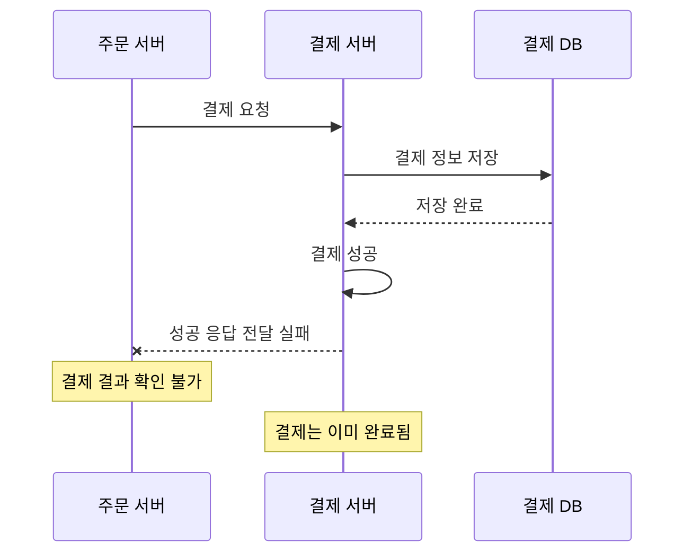
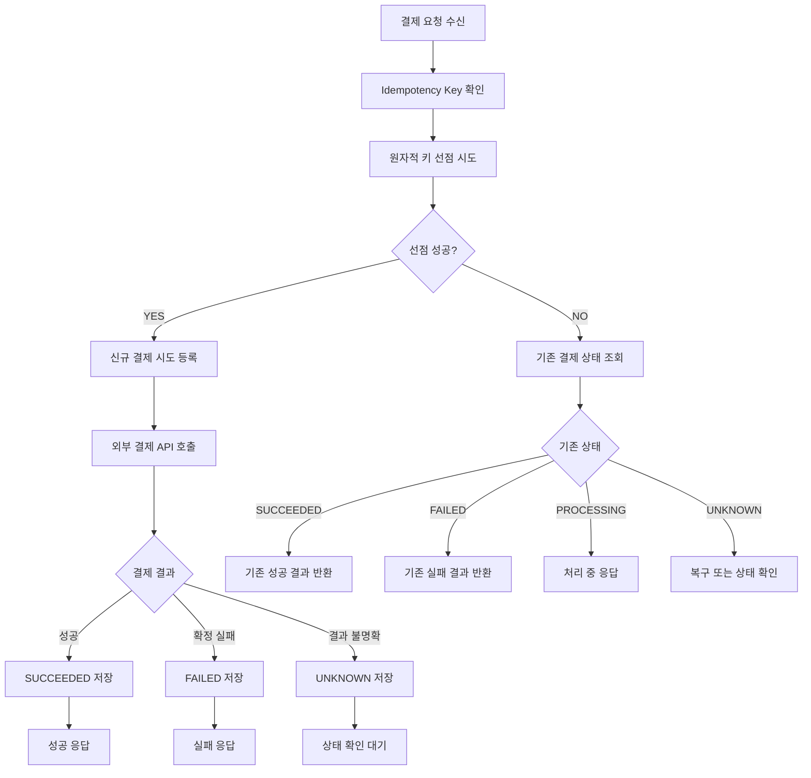
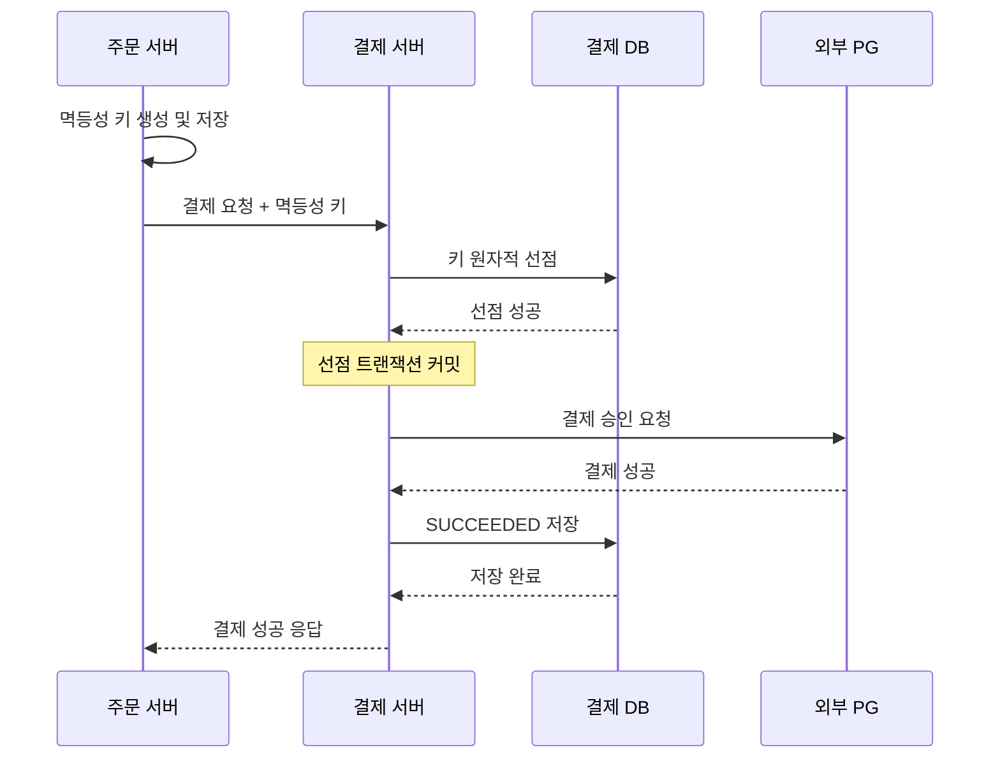
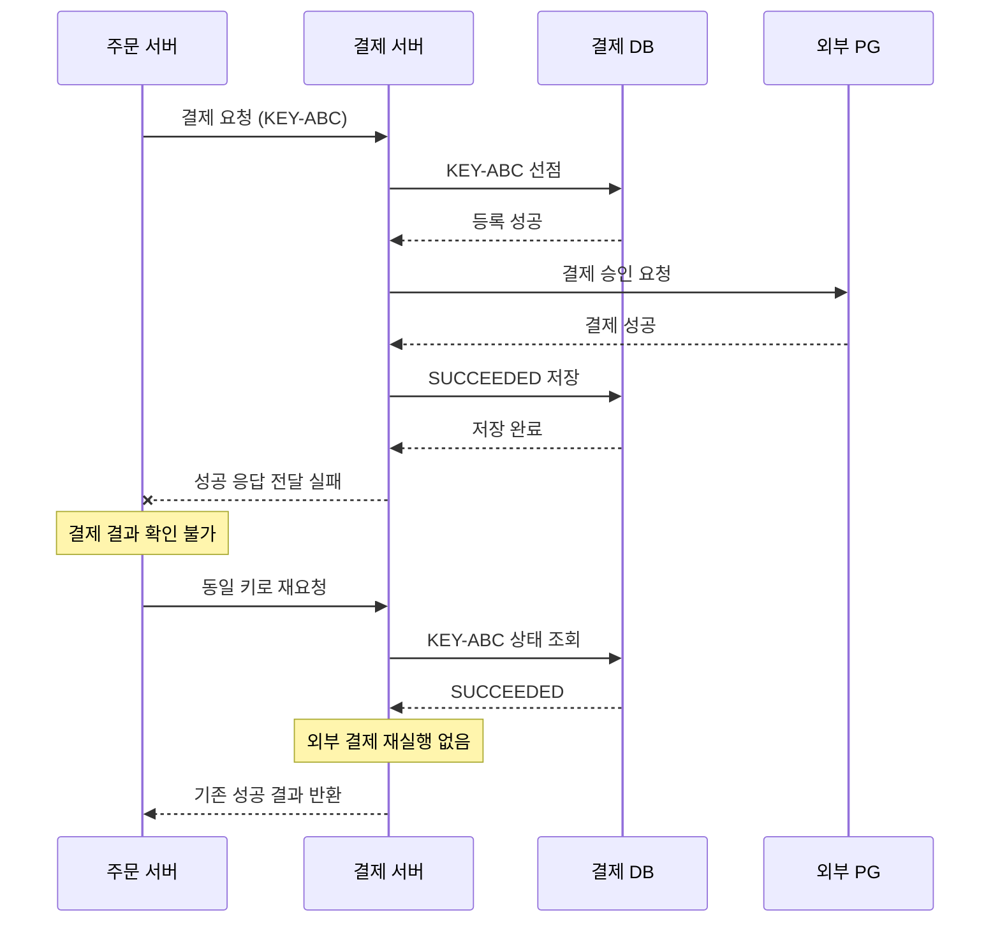
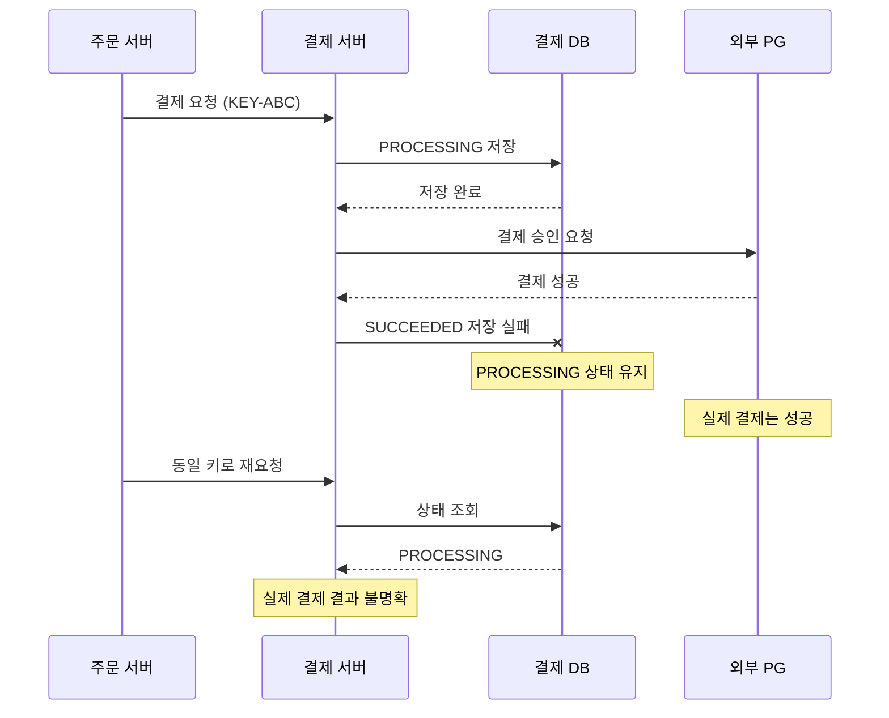
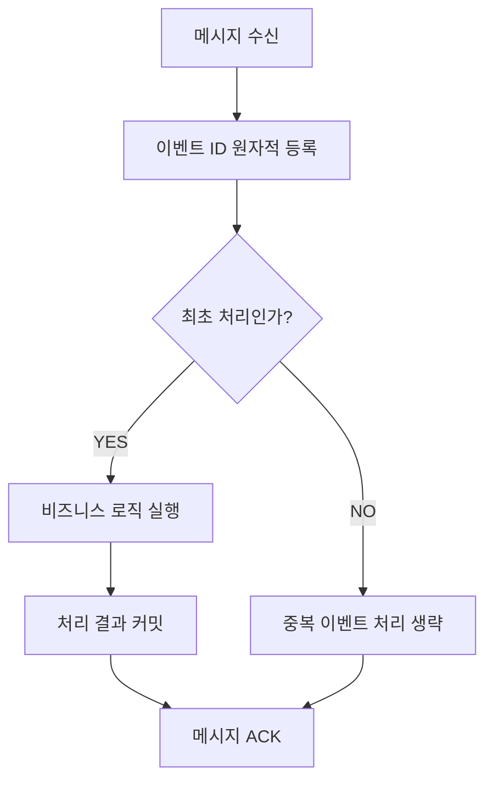

# 루덴스의 멱등성 키로 안전한 재시도 만들기
[https://youtu.be/iK5061jPDLk?si=IOve7Xa4fcBXsdrW](https://youtu.be/iK5061jPDLk?si=IOve7Xa4fcBXsdrW)

# 루덴스의 멱등성 키로 안전한 재시도 만들기  
* toc
{:toc}

---

### 멱등성(Idempotency)과 Idempotency Key - 중복 결제를 방지하고 안전한 재시도 구현하기

웹 서비스를 개발하다 보면 동일한 요청이 여러 번 전달되는 상황을 자주 마주하게 됩니다.

사용자가 결제 버튼을 연속으로 클릭하거나, 네트워크 문제로 응답을 받지 못해 클라이언트가 요청을 재시도하는 경우가 대표적입니다.

일반적인 조회 API라면 동일한 요청이 여러 번 발생하더라도 큰 문제가 되지 않을 수 있습니다.

하지만 결제, 포인트 적립, 쿠폰 발급, 재고 차감처럼 실제 데이터를 변경하는 API에서는 이야기가 달라집니다.

예를 들어 사용자가 20,000원짜리 상품을 구매했다고 가정하겠습니다.

정상적인 결제 흐름은 다음과 같습니다.

```text
사용자
  │
  │ 결제 요청 (20,000원)
  ▼
주문 서버
  │
  │ 결제 승인 요청
  ▼
결제 서버
  │
  │ 20,000원 결제 완료
  ▼
주문 서버
  │
  │ 결제 성공 응답
  ▼
사용자
```

그런데 결제 서버에서 실제 결제를 완료한 직후, 주문 서버로 성공 응답을 전달하는 과정에서 네트워크 장애가 발생했다고 가정해 보겠습니다.

```text
사용자
  │
  │ 결제 요청 (20,000원)
  ▼
주문 서버
  │
  │ 결제 승인 요청
  ▼
결제 서버
  │
  │ 20,000원 결제 완료
  │
  │ 성공 응답 전송
  X  네트워크 장애
  │
  ▼
주문 서버
  │
  │ 응답 수신 실패
  ▼
결제 결과를 알 수 없는 상태
```

이때 주문 서버는 결제가 실제로 성공했는지 알 수 없습니다.

여기서 중요한 점은 **응답을 받지 못했다는 사실이 결제 실패를 의미하지는 않는다**는 것입니다.

실제로는 다음과 같은 상황이 모두 가능합니다.

| 상황 | 실제 결제 상태 | 주문 서버가 인지한 상태 |
|---|---|---|
| 결제 요청이 전달되지 않음 | 결제되지 않음 | 알 수 없음 |
| 결제 요청 처리 중 장애 발생 | 실패 또는 처리 중 | 알 수 없음 |
| 결제 완료 후 응답 전송 실패 | 결제 성공 | 알 수 없음 |
| 결제 완료 후 주문 서버 장애 | 결제 성공 | 알 수 없음 |

이러한 상황에서 주문 서버가 단순히 결제 요청을 다시 전송한다면 어떻게 될까요?

이미 첫 번째 결제가 완료되었다면 동일한 금액이 두 번 결제될 수 있습니다.

그렇다고 재시도를 하지 않으면 실제 결제에 실패한 사용자가 정상적으로 서비스를 이용하지 못할 수도 있습니다.

이러한 문제를 해결하기 위해 필요한 개념이 **멱등성(Idempotency)**이며, 이를 구현하기 위한 대표적인 방법이 **멱등성 키(Idempotency Key)**입니다.

---

### 개념

#### 1. 멱등성(Idempotency)이란?

멱등성이란 동일한 연산을 여러 번 수행하더라도 한 번 수행했을 때와 동일한 결과를 유지하는 성질을 의미합니다.

수학적으로는 다음과 같이 표현할 수 있습니다.

```text
f(f(x)) = f(x)
```

어떤 함수 `f`를 한 번 적용한 결과와 여러 번 적용한 결과가 동일하다면 해당 연산은 멱등성을 가진다고 볼 수 있습니다.

예를 들어 특정 값을 10으로 설정하는 연산을 생각해 보겠습니다.

```java
int value = 0;

value = 10;
value = 10;
value = 10;
```

동일한 연산을 세 번 수행했지만 최종 결과는 항상 10입니다.

반면 다음 연산은 다릅니다.

```java
int value = 0;

value += 10;
value += 10;
value += 10;
```

연산할 때마다 값이 증가합니다.

```text
첫 번째 실행: 10
두 번째 실행: 20
세 번째 실행: 30
```

따라서 덧셈 연산은 일반적으로 멱등성을 가지지 않습니다.

두 연산을 비교하면 다음과 같습니다.

| 구분 | 값 설정 | 값 증가 |
|---|---|---|
| 연산 | value = 10 | value += 10 |
| 1회 실행 | 10 | 10 |
| 2회 실행 | 10 | 20 |
| 3회 실행 | 10 | 30 |
| 멱등성 | O | X |

여기서 중요한 것은 연산의 실행 횟수가 아니라 **연산을 반복했을 때 최종적으로 남는 상태**입니다.

이 개념을 HTTP API에 적용하면 동일한 요청을 여러 번 보내더라도 서버에 발생하는 의도된 효과가 한 번 요청했을 때와 같아야 한다는 의미가 됩니다.

#### 2. HTTP 메서드와 멱등성

HTTP에서는 요청 메서드마다 멱등성에 관한 의미가 정의되어 있습니다.

RFC 9110에서는 동일한 요청을 여러 번 수행했을 때 서버에 발생하는 의도된 효과가 한 번 수행했을 때와 같다면 해당 메서드를 멱등하다고 정의합니다.

대표적인 HTTP 메서드의 특성은 다음과 같습니다.

| HTTP 메서드 | 멱등성 | 설명 |
|---|---|---|
| GET | O | 리소스 조회 |
| HEAD | O | 응답 본문 없이 리소스 정보 조회 |
| PUT | O | 리소스를 지정한 상태로 생성 또는 교체 |
| DELETE | O | 리소스 삭제 |
| POST | 기본적으로 보장되지 않음 | 리소스 생성 및 특정 작업 수행 |
| PATCH | 기본적으로 보장되지 않음 | 리소스 일부 변경 |

여기서 주의해야 할 점은 POST가 반드시 멱등하지 않은 API만 구현할 수 있다는 의미는 아니라는 것입니다.

POST는 HTTP 표준에서 멱등성이 보장되는 메서드로 정의되어 있지 않지만, 애플리케이션에서 별도의 중복 처리 방지 로직을 구현하면 멱등하게 동작하도록 만들 수 있습니다.

반대로 PUT이나 DELETE를 사용했더라도 서버에서 의도된 효과가 중복 발생하도록 잘못 구현했다면 실제 비즈니스 동작은 멱등하지 않을 수 있습니다.

HTTP 메서드의 멱등성은 메서드의 표준적인 의미를 나타내며, 실제 시스템의 비즈니스 정합성은 별도로 고려해야 합니다.

#### 3. DELETE는 왜 멱등한가?

게시글을 삭제하는 API를 생각해 보겠습니다.

```http
DELETE /api/posts/10
```

첫 번째 요청에서는 게시글이 존재하기 때문에 삭제가 수행됩니다.

```text
요청: DELETE /api/posts/10

응답: 204 No Content

서버 상태:
게시글 ID 10 없음
```

같은 요청을 다시 실행하면 어떻게 될까요?

```text
요청: DELETE /api/posts/10

응답: 404 Not Found

서버 상태:
게시글 ID 10 없음
```

세 번째 요청 역시 동일합니다.

```text
요청: DELETE /api/posts/10

응답: 404 Not Found

서버 상태:
게시글 ID 10 없음
```

첫 번째 요청과 두 번째 요청은 HTTP 응답 상태 코드가 다를 수 있습니다.

그러나 최종 서버 상태는 동일합니다.

| 요청 횟수 | HTTP 응답 예시 | 서버 상태 |
|---|---|---|
| 1회 | 204 | 게시글 없음 |
| 2회 | 404 | 게시글 없음 |
| 3회 | 404 | 게시글 없음 |

따라서 DELETE는 멱등성을 가진다고 설명할 수 있습니다.

물론 두 번째 DELETE 요청에 반드시 404를 반환해야 한다는 의미는 아닙니다.

API 설계에 따라 이미 삭제된 리소스에 대해서도 204를 반환할 수 있습니다.

중요한 것은 응답 코드가 아니라 **동일한 삭제 요청을 반복해도 리소스가 삭제된 상태로 유지된다는 점**입니다.

#### 4. POST는 왜 기본적으로 멱등하지 않은가?

이번에는 게시글 생성 API를 생각해 보겠습니다.

```http
POST /api/posts
Content-Type: application/json

{
  "title": "멱등성 이해하기",
  "content": "멱등성에 대해 알아보겠습니다."
}
```

서버가 요청할 때마다 새로운 게시글을 생성한다고 가정하겠습니다.

첫 번째 요청에서는 게시글이 하나 생성됩니다.

```text
첫 번째 요청

게시글 ID: 100
```

두 번째 요청에서는 동일한 내용의 게시글이 추가됩니다.

```text
두 번째 요청

게시글 ID: 101
```

세 번째 요청에서도 새로운 게시글이 생성됩니다.

```text
세 번째 요청

게시글 ID: 102
```

최종적으로 서버에는 동일한 내용의 게시글이 세 개 생성됩니다.

| 요청 횟수 | 생성된 게시글 수 | 서버 상태 |
|---|---|---|
| 1회 | 1개 | ID 100 |
| 2회 | 2개 | ID 100, 101 |
| 3회 | 3개 | ID 100, 101, 102 |

따라서 이러한 POST API는 멱등성을 가지지 않습니다.

그렇다면 POST를 사용하는 결제 API에서는 어떻게 중복 결제를 방지할 수 있을까요?

이때 사용하는 것이 Idempotency Key입니다.

---

### 왜 사용하는가?

#### 1. 네트워크 장애로 인한 중복 처리를 방지하기 위해

분산 시스템에서는 요청을 보낸 쪽과 요청을 처리한 쪽이 서로 다른 상태를 인지할 수 있습니다.

주문 서버가 결제 서버에 요청을 보냈다고 가정하겠습니다.



결제 서버에서는 정상적으로 처리가 완료되었지만 주문 서버는 결과를 알지 못합니다.

이 상태를 단순히 결제 실패로 처리하면 잘못된 판단이 발생할 수 있습니다.

따라서 이러한 경우에는 성공이나 실패로 단정하기보다 결과가 확인되지 않은 상태로 관리해야 합니다.

이를 일반적으로 `UNKNOWN`, `PENDING` 등의 상태로 표현할 수 있습니다.

정확한 상태 명칭은 시스템마다 다르지만 핵심은 동일합니다.

**응답을 받지 못했다면 실패했다고 가정하지 말고 실제 처리 결과를 확인할 수 있어야 합니다.**

#### 2. 사용자의 중복 요청을 방지하기 위해

사용자가 결제 버튼을 여러 번 클릭하는 상황을 생각해 보겠습니다.

```text
사용자

결제 버튼 클릭
결제 버튼 클릭
결제 버튼 클릭
```

클라이언트에서 버튼을 비활성화하면 일정 부분 중복 요청을 방지할 수 있습니다.

하지만 이것만으로는 충분하지 않습니다.

브라우저가 새로고침되거나, 다른 기기에서 동일한 요청을 보내거나, 네트워크 재시도가 발생할 수 있기 때문입니다.

서버는 클라이언트의 동작과 관계없이 동일한 결제 시도가 여러 번 처리되지 않도록 설계해야 합니다.

따라서 클라이언트의 중복 클릭 방지는 사용자 경험을 개선하는 수단이고, 서버의 멱등성 처리는 데이터 정합성을 보장하기 위한 핵심 수단이라고 구분할 수 있습니다.

#### 3. 장애 이후 안전한 재시도를 가능하게 하기 위해

분산 시스템에서는 네트워크 오류가 발생할 수 있다는 사실을 전제로 설계해야 합니다.

하지만 실패한 요청을 무조건 다시 전송하는 것은 위험합니다.

특히 결제나 환불과 같은 작업에서는 중복 실행이 실제 금전적 손실로 이어질 수 있습니다.

따라서 재시도를 안전하게 수행하려면 서버가 다음 두 가지를 구분할 수 있어야 합니다.

**새로운 요청인지, 이전 요청의 재시도인지**

이를 구분하기 위한 식별자가 Idempotency Key입니다.

---

### 주요 특징

#### 1. Idempotency Key란?

Idempotency Key는 동일한 비즈니스 작업을 식별하기 위해 사용하는 고유한 값입니다.

예를 들어 사용자가 치킨 한 마리를 주문했다고 가정하겠습니다.

주문 서버는 다음과 같은 정보를 생성합니다.

```json
{
  "orderId": "ORDER-100",
  "amount": 20000,
  "currency": "KRW"
}
```

그리고 해당 결제 시도를 식별하기 위한 키를 생성합니다.

```text
Idempotency-Key: 550e8400-e29b-41d4-a716-446655440000
```

이 키를 결제 요청에 포함합니다.

```http
POST /api/payments
Content-Type: application/json
Idempotency-Key: 550e8400-e29b-41d4-a716-446655440000

{
  "orderId": "ORDER-100",
  "amount": 20000,
  "currency": "KRW"
}
```

결제 서버는 요청을 받으면 Idempotency Key를 확인합니다.

처음 받은 키라면 새로운 결제 시도로 판단하고 처리합니다.

반면 이미 처리한 키라면 해당 키에 연결된 기존 결제 상태를 확인합니다.

정상적으로 결제가 완료된 상태라면 실제 결제를 다시 실행하지 않고 저장된 결과를 반환할 수 있습니다.

이렇게 하면 네트워크 오류로 인해 같은 요청이 여러 번 전달되더라도 중복 결제를 방지할 수 있습니다.

다만 단순히 키가 존재한다는 사실만으로 이미 결제가 완료되었다고 판단해서는 안 됩니다.

해당 키가 현재 처리 중인지, 성공했는지, 실패했는지를 함께 확인해야 합니다.

#### 2. 동일한 키는 동일한 결제 시도를 의미

Idempotency Key를 설계할 때 가장 중요한 규칙은 다음과 같습니다.

**동일한 비즈니스 작업의 재시도에는 반드시 동일한 키를 사용해야 합니다.**

예를 들어 다음과 같은 요청이 있다고 가정하겠습니다.

| 요청 | Idempotency Key | 주문 | 처리 |
|---|---|---|---|
| 첫 번째 | KEY-ABC | ORDER-100 | 최초 결제 |
| 두 번째 | KEY-ABC | ORDER-100 | 기존 결제 확인 |
| 세 번째 | KEY-ABC | ORDER-100 | 기존 결과 재사용 |
| 네 번째 | KEY-DEF | ORDER-101 | 새로운 결제 |

첫 번째부터 세 번째 요청까지는 동일한 결제 시도로 취급합니다.

네 번째 요청은 키가 다르므로 새로운 결제 시도로 취급할 수 있습니다.

그러나 여기서 주의할 점이 있습니다.

**서로 다른 멱등성 키가 반드시 서로 다른 주문을 의미하는 것은 아닙니다.**

예를 들어 사용자가 동일한 주문에 대해 매번 새로운 키를 생성한다면 멱등성 키만으로 중복 결제를 방지할 수 없습니다.

따라서 실무에서는 멱등성 키뿐 아니라 주문번호, 결제 시도 ID 등 비즈니스 식별자도 함께 관리하는 것이 중요합니다.

특히 하나의 주문에 대해 결제가 한 번만 승인되어야 한다면 주문번호에 대한 중복 결제 방지 정책도 별도로 필요합니다.

#### 3. 요청 내용도 동일해야 함

동일한 키를 사용하더라도 요청 내용이 다르다면 어떻게 해야 할까요?

첫 번째 요청이 다음과 같다고 가정하겠습니다.

```http
Idempotency-Key: KEY-ABC

{
  "orderId": "ORDER-100",
  "amount": 20000
}
```

그런데 두 번째 요청에서는 같은 키를 사용하면서 금액을 변경했습니다.

```http
Idempotency-Key: KEY-ABC

{
  "orderId": "ORDER-100",
  "amount": 30000
}
```

동일한 키지만 결제 금액이 다릅니다.

이 요청을 기존 결제와 동일하게 취급하면 잘못된 결제 결과를 반환할 수 있습니다.

반대로 새로운 결제로 처리하면 동일한 키에 대해 서로 다른 결제가 발생할 수 있습니다.

따라서 일반적으로 동일한 키에 서로 다른 요청 내용이 전달되면 오류를 반환하도록 설계합니다.

이를 구현하기 위해 요청 내용의 해시값을 저장할 수 있습니다.

```text
Idempotency Key: KEY-ABC
Request Hash: 8c9f...
```

재시도 요청이 들어오면 기존에 저장한 요청 해시와 비교합니다.

```text
동일한 키 + 동일한 요청 내용
    → 기존 결제 시도로 처리

동일한 키 + 다른 요청 내용
    → 요청 충돌 오류

다른 키 + 다른 결제 시도
    → 새로운 결제 여부 검증
```

실제 Stripe에서도 동일한 멱등성 키로 전달된 요청의 파라미터가 기존 요청과 다른 경우 오류를 발생시키도록 설계하고 있습니다.

#### 4. 멱등성 키는 요청 전에 생성하고 보관해야 함

멱등성 키는 서버에 요청을 보내기 전에 생성되어야 합니다.

특히 주문 서버가 결제 서버를 호출하는 구조라면 주문 서버는 결제 시도와 멱등성 키의 관계를 저장해야 합니다.

```text
ORDER-100
   │
   ├── amount: 20000
   │
   ├── paymentStatus: PENDING
   │
   └── idempotencyKey: KEY-ABC
```

이후 재시도가 발생하면 기존에 생성한 키를 재사용합니다.

```java
String idempotencyKey = paymentAttempt.getIdempotencyKey();
```

반면 재시도할 때마다 새로운 UUID를 생성하면 다음과 같은 문제가 발생합니다.

```java
// 잘못된 예시
public void retryPayment() {

    String idempotencyKey = UUID.randomUUID().toString();

    paymentClient.pay(idempotencyKey);
}
```

매번 새로운 키가 생성되므로 결제 서버는 서로 다른 요청으로 판단할 수 있습니다.

올바른 방식은 최초 결제 시도에서 생성한 키를 유지하는 것입니다.

```java
// 동일한 결제 시도의 재시도
public void retryPayment(PaymentAttempt paymentAttempt) {

    String idempotencyKey =
            paymentAttempt.getIdempotencyKey();

    paymentClient.pay(idempotencyKey);
}
```

실무에서는 키를 생성하는 것보다 **키가 언제 생성되고, 어느 범위에서 유지되며, 언제 만료되는지**를 명확하게 설계하는 것이 더 중요합니다.

---

### 예제

#### 1. Spring Boot에서 멱등성 키 구현하기

Spring Boot와 PostgreSQL을 사용해 간단한 멱등성 처리 구조를 살펴보겠습니다.

구현 목표는 다음과 같습니다.

첫 번째 결제 요청이 들어오면 멱등성 키를 등록하고 결제를 실행합니다.

동일한 키로 재요청이 들어오면 기존 처리 상태를 확인합니다.

이미 결제가 완료되었다면 저장된 결과를 반환합니다.

현재 처리 중이라면 새로운 결제를 실행하지 않습니다.

그리고 외부 결제 API의 결과를 확인할 수 없다면 성공이나 실패로 단정하지 않고 복구할 수 있는 상태로 관리합니다.

#### 2. 데이터베이스 테이블 설계

먼저 멱등성 키와 결제 상태를 저장할 테이블을 생성합니다.

```sql
CREATE TABLE payment_idempotency (
    id BIGSERIAL PRIMARY KEY,

    merchant_id VARCHAR(100) NOT NULL,

    idempotency_key VARCHAR(255) NOT NULL,

    order_id VARCHAR(100) NOT NULL,

    amount NUMERIC(18, 2) NOT NULL,

    currency VARCHAR(10) NOT NULL,

    request_hash VARCHAR(64) NOT NULL,

    status VARCHAR(20) NOT NULL,

    provider_payment_id VARCHAR(255),

    failure_code VARCHAR(100),

    created_at TIMESTAMP NOT NULL DEFAULT CURRENT_TIMESTAMP,

    updated_at TIMESTAMP NOT NULL DEFAULT CURRENT_TIMESTAMP,

    CONSTRAINT uk_payment_idempotency
        UNIQUE (merchant_id, idempotency_key),

    CONSTRAINT ck_payment_idempotency_status
        CHECK (
            status IN (
                'PROCESSING',
                'SUCCEEDED',
                'FAILED',
                'UNKNOWN'
            )
        )
);
```

각 컬럼은 다음과 같은 역할을 합니다.

| 컬럼 | 설명 |
|---|---|
| merchant_id | 결제를 요청한 가맹점 또는 테넌트 |
| idempotency_key | 동일한 결제 시도를 구분하는 키 |
| order_id | 주문 식별자 |
| amount | 결제 금액 |
| currency | 결제 통화 |
| request_hash | 원본 요청의 핵심 파라미터 해시 |
| status | 현재 결제 처리 상태 |
| provider_payment_id | 외부 결제 시스템의 거래 식별자 |
| failure_code | 확정된 실패 사유 |
| created_at | 최초 요청 시각 |
| updated_at | 마지막 상태 변경 시각 |

여기서 중요한 부분은 UNIQUE 제약조건입니다.

```sql
CONSTRAINT uk_payment_idempotency
    UNIQUE (merchant_id, idempotency_key)
```

이 제약조건은 동일한 가맹점에서 동일한 멱등성 키가 중복 등록되는 것을 방지합니다.

단일 가맹점만 운영하는 시스템이라면 키 자체를 전역 고유값으로 관리할 수도 있습니다.

하지만 여러 가맹점을 운영하는 시스템에서는 멱등성 키의 유효 범위를 명확하게 정의하는 것이 중요합니다.

#### 3. 결제 상태 정의

멱등성 키가 존재한다고 해서 결제가 성공한 것은 아닙니다.

따라서 별도의 상태를 관리해야 합니다.

```java
public enum PaymentStatus {

    PROCESSING,

    SUCCEEDED,

    FAILED,

    UNKNOWN
}
```

상태별 의미는 다음과 같습니다.

| 상태 | 의미 | 동일 키 재요청 시 |
|---|---|---|
| PROCESSING | 결제 처리 중 | 중복 실행 방지 |
| SUCCEEDED | 결제 성공 확정 | 기존 성공 결과 반환 |
| FAILED | 결제 실패 확정 | 기존 실패 결과 반환 |
| UNKNOWN | 결제 결과 불명확 | 상태 조회 또는 복구 진행 |

특히 `UNKNOWN` 상태가 중요합니다.

외부 결제 서버에 요청을 보낸 이후 타임아웃이 발생했다면 실제 결제가 성공했는지 알 수 없습니다.

이 경우 단순히 실패로 처리하고 새로운 결제를 실행하면 중복 결제 문제가 발생할 수 있습니다.

따라서 결과가 확정되지 않은 경우에는 `UNKNOWN` 상태로 관리하고 실제 결제 상태를 확인하는 복구 과정이 필요합니다.

또한 실패가 확정된 경우와 일시적인 네트워크 오류는 구분해야 합니다.

예를 들어 카드 한도 초과로 결제가 명확하게 거절되었다면 `FAILED`로 처리할 수 있습니다.

반면 응답을 받지 못한 네트워크 타임아웃은 `UNKNOWN`으로 처리하는 것이 적절합니다.

#### 4. 멱등성 키를 원자적으로 등록하기

가장 먼저 해결해야 하는 문제는 동일한 키를 가진 요청이 동시에 도착하는 상황입니다.

단순히 다음과 같이 구현하면 문제가 발생할 수 있습니다.

```java
if (!repository.existsByIdempotencyKey(key)) {

    repository.save(payment);

    paymentGateway.pay(payment);
}
```

위 코드는 조회와 저장이 서로 분리되어 있습니다.

따라서 두 요청이 동시에 실행되면 모두 키가 존재하지 않는다고 판단할 수 있습니다.

```text
요청 A: 키 조회 → 없음
요청 B: 키 조회 → 없음

요청 A: 결제 실행
요청 B: 결제 실행
```

이를 흔히 Check-Then-Act 경쟁 상태라고 부릅니다.

이 문제를 해결하려면 키를 확인하고 선점하는 과정을 원자적으로 수행해야 합니다.

PostgreSQL에서는 `INSERT ... ON CONFLICT DO NOTHING`을 활용할 수 있습니다.

```sql
INSERT INTO payment_idempotency (
    merchant_id,
    idempotency_key,
    order_id,
    amount,
    currency,
    request_hash,
    status
)
VALUES (
    :merchantId,
    :idempotencyKey,
    :orderId,
    :amount,
    :currency,
    :requestHash,
    'PROCESSING'
)
ON CONFLICT (merchant_id, idempotency_key)
DO NOTHING;
```

이미 동일한 키가 존재하면 새로운 레코드를 생성하지 않습니다.

따라서 실제로 레코드를 삽입한 요청만 결제 실행 권한을 획득하도록 구성할 수 있습니다.

Spring JDBC를 사용한다면 다음과 같이 구현할 수 있습니다.

```java
@Repository
@RequiredArgsConstructor
public class PaymentIdempotencyRepository {

    private final NamedParameterJdbcTemplate jdbcTemplate;

    public boolean tryAcquire(
            String merchantId,
            String idempotencyKey,
            String orderId,
            BigDecimal amount,
            String currency,
            String requestHash
    ) {

        String sql = """
                INSERT INTO payment_idempotency (
                    merchant_id,
                    idempotency_key,
                    order_id,
                    amount,
                    currency,
                    request_hash,
                    status
                )
                VALUES (
                    :merchantId,
                    :idempotencyKey,
                    :orderId,
                    :amount,
                    :currency,
                    :requestHash,
                    'PROCESSING'
                )
                ON CONFLICT (
                    merchant_id,
                    idempotency_key
                )
                DO NOTHING
                """;

        MapSqlParameterSource params =
                new MapSqlParameterSource()
                        .addValue("merchantId", merchantId)
                        .addValue("idempotencyKey", idempotencyKey)
                        .addValue("orderId", orderId)
                        .addValue("amount", amount)
                        .addValue("currency", currency)
                        .addValue("requestHash", requestHash);

        int inserted = jdbcTemplate.update(sql, params);

        return inserted == 1;
    }
}
```

반환값이 `true`라면 새로운 결제 시도를 등록한 것입니다.

반환값이 `false`라면 이미 동일한 키가 등록되어 있다는 의미입니다.

이때 실제 결제 실행 권한은 최초 등록에 성공한 요청에만 부여합니다.

PostgreSQL은 `ON CONFLICT`를 통해 UNIQUE 제약조건과 충돌하는 INSERT를 처리할 수 있도록 지원합니다.

다만 여기서 중요한 점이 하나 더 있습니다.

**키를 선점하는 트랜잭션은 외부 결제 API를 호출하기 전에 커밋되어야 합니다.**

그렇지 않으면 외부 결제 API를 호출하는 동안 데이터베이스 트랜잭션이 오래 유지될 수 있습니다.

따라서 실제 시스템에서는 키 선점과 외부 결제 호출을 분리하는 것이 좋습니다.

#### 5. 결제 서비스의 핵심 처리 흐름

멱등성 처리 서비스는 다음과 같은 순서로 구성할 수 있습니다.

```java
public PaymentResponse pay(
        String merchantId,
        String idempotencyKey,
        PaymentRequest request
) {

    String requestHash = createRequestHash(request);

    boolean acquired = acquireIdempotencyKey(
            merchantId,
            idempotencyKey,
            request,
            requestHash
    );

    if (!acquired) {

        return getExistingPaymentResult(
                merchantId,
                idempotencyKey,
                requestHash
        );
    }

    return executePayment(
            merchantId,
            idempotencyKey,
            request
    );
}
```

위 코드는 핵심 처리 순서를 나타낸 예시입니다.

실제 구현에서는 `acquireIdempotencyKey()`, `getExistingPaymentResult()`, `executePayment()`에 각각 데이터베이스 트랜잭션, 기존 상태 확인, 외부 결제 처리 로직을 구현해야 합니다.

전체 흐름은 다음과 같습니다.



이 구조에서 중요한 것은 기존 키가 발견되었을 때 결제를 무조건 다시 실행하지 않는다는 점입니다.

반드시 기존 요청의 상태를 확인해야 합니다.

#### 6. 실제 API 요청과 응답

처음 결제 요청이 들어왔다고 가정하겠습니다.

```http
POST /api/payments
Idempotency-Key: KEY-ABC
Content-Type: application/json

{
  "orderId": "ORDER-100",
  "amount": 20000,
  "currency": "KRW"
}
```

결제가 성공하면 다음과 같이 응답할 수 있습니다.

```http
HTTP/1.1 200 OK
Content-Type: application/json

{
  "paymentId": "PAYMENT-100",
  "orderId": "ORDER-100",
  "status": "SUCCEEDED"
}
```

이후 동일한 키로 같은 요청이 다시 들어오면 저장된 결과를 반환합니다.

```http
POST /api/payments
Idempotency-Key: KEY-ABC
Content-Type: application/json

{
  "orderId": "ORDER-100",
  "amount": 20000,
  "currency": "KRW"
}
```

응답은 다음과 같습니다.

```http
HTTP/1.1 200 OK
Content-Type: application/json

{
  "paymentId": "PAYMENT-100",
  "orderId": "ORDER-100",
  "status": "SUCCEEDED"
}
```

실제 결제는 다시 수행되지 않습니다.

반면 기존 요청이 아직 처리 중이라면 다음과 같은 응답 정책을 사용할 수 있습니다.

```http
HTTP/1.1 202 Accepted
Content-Type: application/json
Retry-After: 2

{
  "orderId": "ORDER-100",
  "status": "PROCESSING",
  "message": "결제 처리 중입니다."
}
```

`202 Accepted`는 요청이 접수되었지만 처리가 완료되지 않았다는 의미로 활용할 수 있습니다.

다만 처리 중인 중복 요청에 `202`를 반환할지, `409 Conflict`를 반환할지는 서비스의 API 계약에 따라 결정할 수 있습니다.

이미 처리 중인 요청이 있다는 이유로 반드시 특정 상태 코드를 사용해야 하는 것은 아닙니다.

핵심은 클라이언트가 기존 요청의 진행 상태를 이해하고, 새로운 결제를 생성하지 않도록 하는 것입니다.

---

### 구조

#### 1. 멱등성 키를 적용한 정상 결제 흐름

멱등성 키가 적용된 결제 시스템의 기본 구조는 다음과 같습니다.



처음 들어온 요청은 키를 등록한 뒤 결제를 실행합니다.

정상적으로 결제가 완료되면 결제 상태와 외부 PG의 거래번호를 저장합니다.

이후 동일한 키로 요청이 들어오면 해당 거래의 저장된 상태를 이용할 수 있습니다.

#### 2. 결제 성공 후 응답이 유실된 경우

이번에는 결제는 성공했지만 응답 전달에 실패한 상황을 살펴보겠습니다.



첫 번째 요청에서 이미 결제가 완료되어 데이터베이스에 성공 상태가 저장되어 있습니다.

따라서 두 번째 요청에서는 실제 결제를 수행하지 않고 기존 결과를 반환합니다.

이것이 멱등성 키를 이용한 재시도의 가장 기본적인 동작 원리입니다.

하지만 실제 시스템에서는 이보다 복잡한 문제가 발생할 수 있습니다.

#### 3. 외부 결제는 성공했지만 내부 DB 저장에 실패한 경우

가장 주의해야 하는 상황 중 하나입니다.

다음과 같은 흐름을 생각해 보겠습니다.



여기서는 결제 서버의 데이터베이스에 멱등성 키가 존재합니다.

하지만 상태는 여전히 `PROCESSING`입니다.

외부 PG에서는 이미 결제가 성공했습니다.

따라서 단순히 `PROCESSING` 상태가 오래되었다는 이유로 새로운 결제를 실행하면 안 됩니다.

이러한 상황에서는 외부 PG의 거래 상태를 조회하거나, 외부 PG가 보장하는 멱등성 기능을 활용하여 기존 결제 결과를 확인해야 합니다.

결과가 명확하지 않다면 별도의 복구 대상으로 관리해야 합니다.

이 과정이 없으면 내부 DB에 멱등성 키를 저장하더라도 중복 결제 문제가 발생할 수 있습니다.

---

### 멱등성 키만으로 중복 결제를 완벽하게 방지할 수 있을까?

멱등성 키를 사용하면 동일한 요청을 식별할 수 있습니다.

하지만 키를 저장한다는 사실만으로 안전한 재시도가 완성되는 것은 아닙니다.

실제 운영 환경에서는 복구 로직, 서버 간 계약, 동시성 제어를 함께 고려해야 합니다.

#### 1. 복구 로직 - 중단된 결제를 다시 확인해야 함

서버가 재시작되었다고 해서 처리 중이던 결제가 자동으로 복구되지는 않습니다.

예를 들어 다음과 같은 상황이 발생할 수 있습니다.

```text
결제 요청 수신
    ↓
PROCESSING 저장
    ↓
외부 PG 결제 요청
    ↓
서버 장애
    ↓
서버 재시작
```

서버가 재시작된 이후에도 데이터베이스에는 `PROCESSING` 상태가 남아 있을 수 있습니다.

이 상태를 계속 방치하면 사용자는 결제 결과를 확인할 수 없습니다.

따라서 일정 시간이 지난 미완료 결제를 찾아 상태를 확인하는 복구 로직이 필요합니다.

예를 들어 Spring의 스케줄러를 활용할 수 있습니다.

```java
@Scheduled(fixedDelay = 60000)
public void recoverPendingPayments() {

    List<PaymentAttempt> attempts =
            paymentRepository.findRecoverablePayments();

    for (PaymentAttempt attempt : attempts) {

        paymentRecoveryService.recover(attempt);
    }
}
```

이 코드는 일정 주기로 복구 대상 결제를 조회하는 예제입니다.

다만 실제 복구 로직에서는 단순히 결제 API를 다시 호출해서는 안 됩니다.

먼저 외부 PG의 거래 상태를 확인해야 합니다.

그리고 이미 결제가 완료된 거래라면 내부 상태를 `SUCCEEDED`로 동기화합니다.

실패가 확정된 거래라면 `FAILED`로 처리합니다.

결과가 불명확한 경우에는 외부 PG의 멱등성 정책에 따라 동일한 키로 재시도할 수 있습니다.

복구 대상이 여러 서버에서 동시에 처리될 가능성이 있다면 복구 작업 자체에도 선점이나 임대(Lease) 기반 동시성 제어를 적용해야 합니다.

#### 2. 서버 간 계약 - 양쪽이 같은 규칙을 지켜야 함

멱등성 키는 요청을 보내는 서버와 받는 서버가 동일한 규칙을 이해해야 효과가 있습니다.

예를 들어 주문 서버가 다음과 같이 요청한다고 가정하겠습니다.

```http
POST /api/payments
Idempotency-Key: KEY-ABC
```

그런데 결제 서버가 해당 헤더를 무시한다면 멱등성 키는 아무런 의미가 없습니다.

결제 서버는 키를 저장하고 동일한 요청의 재시도를 식별해야 합니다.

또한 어떤 요청을 동일한 작업으로 볼 것인지에 대해서도 계약이 필요합니다.

| 항목 | 정의해야 하는 규칙 |
|---|---|
| 키 전달 위치 | HTTP Header 또는 요청 본문 |
| 키 생성 주체 | 클라이언트 또는 호출 서버 |
| 키 유효 범위 | 사용자, 가맹점, API 등 |
| 키 재사용 기준 | 동일한 비즈니스 작업 |
| 요청 내용 검증 | 동일 키의 파라미터 일치 여부 |
| 처리 중 응답 | 202, 409 등 |
| 키 보관 기간 | 재시도 및 복구 정책에 따라 결정 |
| 실패 처리 | 확정 실패와 결과 불명확 상태 구분 |

특히 외부 결제 시스템을 연동하는 경우 제공업체별 멱등성 정책이 다를 수 있으므로 해당 정책을 고려해야 합니다.

#### 3. 동시성 제어 - 같은 키가 동시에 들어와도 한 번만 처리해야 함

동일한 키를 가진 두 요청이 동시에 들어왔다고 가정하겠습니다.

```text
요청 A: KEY-ABC
요청 B: KEY-ABC
```

다음과 같은 구현은 안전하지 않습니다.

```java
if (!exists(key)) {

    save(key);

    executePayment();
}
```

두 요청이 동시에 키를 조회하면 모두 키가 존재하지 않는다고 판단할 수 있습니다.

따라서 두 요청 모두 결제를 실행할 가능성이 있습니다.

이 문제를 해결하려면 키 선점 과정을 원자적으로 처리해야 합니다.

대표적인 방법은 데이터베이스의 UNIQUE 제약조건을 활용하는 것입니다.

또는 Redis의 `SET NX`와 같은 원자적 연산을 활용할 수도 있습니다.

다만 Redis만으로 중복 결제를 완전히 방지하려면 키의 영속성, TTL, 장애 복구, 네트워크 분리 상황까지 고려해야 합니다.

특히 결제와 같은 중요한 작업에서는 Redis에만 의존하기보다 데이터베이스의 영속적인 거래 기록과 외부 PG의 멱등성 정책을 함께 활용하는 것이 안전합니다.

---

### 실무에서의 활용

#### 1. Stripe 결제 시스템에서의 멱등성 처리

Stripe는 멱등성 키를 이용해 API 요청을 안전하게 재시도할 수 있는 기능을 제공합니다.

예를 들어 다음과 같이 요청할 수 있습니다.

```http
POST /v1/payment_intents
Idempotency-Key: ORDER-100-PAYMENT-1
Authorization: Bearer <SECRET_KEY>
```

실제 요청에서는 Stripe API가 요구하는 파라미터와 형식으로 전달해야 합니다.

Stripe의 멱등성 처리에서 중요한 점은 최초 요청의 결과를 저장한다는 것입니다.

Stripe API v1 문서에서는 최초 요청의 실행이 시작된 이후 반환된 상태 코드와 응답 본문을 저장하며, 동일한 키로 재요청하면 기존 결과를 반환한다고 설명합니다.

여기에는 성공 응답뿐 아니라 `500` 오류 응답도 포함됩니다.

또한 일정 기간이 지난 키는 삭제될 수 있으며, 삭제된 키를 다시 사용하면 새로운 요청으로 처리될 수 있습니다.

따라서 Stripe의 멱등성 키가 영구적으로 유지된다고 가정해서는 안 됩니다.

특히 `500` 응답이 반복된다고 해서 반드시 결제되지 않았다고 판단해서도 안 됩니다.

결제 상태 조회와 Webhook 이벤트 등을 통해 실제 결제 결과를 확인하는 구조가 필요합니다.

#### 2. PayPal 결제 시스템에서의 멱등성 처리

PayPal 역시 멱등성 처리를 위한 식별자를 제공합니다.

대표적으로 `PayPal-Request-Id` 헤더를 사용할 수 있습니다.

```http
POST /v2/checkout/orders/{order_id}/capture
PayPal-Request-Id: ORDER-100-CAPTURE-1
Authorization: Bearer <ACCESS_TOKEN>
Content-Type: application/json
```

이 헤더를 지원하는 API에서는 동일한 요청 ID를 이용해 재시도를 수행할 수 있습니다.

다만 모든 PayPal API가 동일한 방식으로 이 헤더를 지원하는 것은 아닙니다.

API별 지원 여부와 보관 기간을 확인해야 합니다.

또한 동일한 키를 가진 요청이 동시에 실행될 경우 두 번째 요청이 실패할 수도 있습니다.

따라서 PayPal을 사용하더라도 내부 시스템에서 중복 요청과 동시성을 관리하는 것이 중요합니다.

#### 3. 주문번호와 결제 시도 ID를 분리하기

실무에서는 주문번호를 그대로 멱등성 키로 사용하는 경우가 있습니다.

간단한 시스템에서는 가능하지만, 결제 재시도와 결제 수단 변경을 지원하는 서비스에서는 주의해야 합니다.

예를 들어 주문 하나에 여러 결제 시도가 존재할 수 있습니다.

```text
ORDER-100
    │
    ├── PAYMENT-ATTEMPT-1
    │       └── PayPal 결제 실패
    │
    └── PAYMENT-ATTEMPT-2
            └── Stripe 결제 성공
```

이때 주문번호와 결제 시도를 동일한 개념으로 취급하면 새로운 결제 시도를 구분하기 어려워질 수 있습니다.

따라서 주문과 결제 시도를 별도의 엔티티로 관리하는 것이 유용합니다.

```text
Order
  └── PaymentAttempt
          ├── paymentAttemptId
          ├── idempotencyKey
          ├── paymentMethod
          ├── status
          └── providerPaymentId
```

동일한 결제 시도의 네트워크 재시도에는 기존 멱등성 키를 사용합니다.

반면 기존 결제 시도가 확정적으로 실패하고 새로운 결제 수단을 이용해 다시 결제한다면 새로운 결제 시도를 생성할 수 있습니다.

이 경우에도 동일한 주문에 대해 두 건의 결제가 최종 승인되지 않도록 별도의 비즈니스 제약을 적용해야 합니다.

#### 4. 쿠폰 발급 시스템에서의 활용

멱등성은 결제뿐 아니라 쿠폰 발급 시스템에서도 중요합니다.

예를 들어 특정 이벤트에 참여한 사용자에게 쿠폰 한 장을 발급한다고 가정하겠습니다.

```http
POST /api/coupons/issue
Idempotency-Key: EVENT-100-USER-200
```

요청이 여러 번 발생하더라도 사용자에게 동일한 이벤트 쿠폰이 중복 발급되지 않아야 합니다.

이 경우 멱등성 키와 함께 다음과 같은 UNIQUE 제약조건을 사용할 수 있습니다.

```sql
ALTER TABLE issued_coupon
ADD CONSTRAINT uk_event_user
UNIQUE (event_id, user_id);
```

동일한 사용자에게 동일 이벤트 쿠폰을 한 장만 발급해야 한다는 비즈니스 정책을 데이터베이스에서 보장하는 방식입니다.

멱등성 키는 동일 요청의 재시도를 식별하고, UNIQUE 제약조건은 실제 쿠폰 발급 규칙을 강제합니다.

두 방법을 함께 사용하면 중복 요청에 대한 안정성을 높일 수 있습니다.

#### 5. 포인트 적립 시스템에서의 활용

포인트 적립은 멱등성이 중요한 대표적인 작업입니다.

다음과 같은 로직을 생각해 보겠습니다.

```java
userPoint += 1000;
```

동일한 요청이 두 번 실행되면 포인트가 2,000점 적립됩니다.

따라서 포인트 적립 요청에는 거래 식별자를 부여하는 것이 좋습니다.

```json
{
  "transactionId": "PAYMENT-100",
  "userId": 200,
  "point": 1000
}
```

포인트 적립 이력 테이블에서는 거래 식별자에 UNIQUE 제약조건을 적용할 수 있습니다.

```sql
CREATE TABLE point_history (
    id BIGSERIAL PRIMARY KEY,

    transaction_id VARCHAR(100) NOT NULL UNIQUE,

    user_id BIGINT NOT NULL,

    point BIGINT NOT NULL,

    created_at TIMESTAMP NOT NULL DEFAULT CURRENT_TIMESTAMP
);
```

동일한 거래번호로 포인트 적립 요청이 다시 들어오더라도 중복 적립되지 않도록 처리합니다.

다만 이력 저장과 실제 포인트 잔액 변경은 하나의 트랜잭션으로 처리해야 합니다.

이력 저장에 성공했지만 잔액 변경에 실패하거나, 반대로 잔액만 변경된 상태가 발생하지 않도록 데이터 정합성을 보장해야 하기 때문입니다.

#### 6. 메시지 큐에서 중복 이벤트 처리

Kafka, RabbitMQ, Azure Service Bus와 같은 메시징 시스템에서도 멱등성은 중요합니다.

메시지 전달 시스템에서는 장애나 재전달 정책에 따라 동일한 메시지가 여러 번 소비될 수 있습니다.

예를 들어 결제 완료 이벤트가 다음과 같이 전달될 수 있습니다.

```text
PaymentCompletedEvent
    │
    ├── 1차 전달
    │
    └── 2차 전달
```

포인트 적립 서비스가 두 이벤트를 각각 새로운 결제로 판단한다면 포인트가 중복 적립될 수 있습니다.

따라서 소비자는 이벤트 식별자나 비즈니스 거래번호를 저장해 중복 처리를 방지해야 합니다.

```sql
CREATE TABLE processed_event (
    event_id VARCHAR(100) PRIMARY KEY,
    processed_at TIMESTAMP NOT NULL DEFAULT CURRENT_TIMESTAMP
);
```

처리 흐름은 다음과 같습니다.



중요한 것은 이벤트 처리 이력과 비즈니스 데이터 변경을 가능한 한 동일한 데이터베이스 트랜잭션에서 처리하는 것입니다.

그렇지 않으면 이벤트는 처리되었다고 기록했지만 실제 비즈니스 데이터는 변경되지 않은 상태가 발생할 수 있습니다.

또한 메시지 ACK는 처리 결과가 안전하게 반영된 이후 수행하도록 설계해야 합니다.

#### 7. Redis를 이용한 중복 요청 선점

Redis에서는 `SET NX`를 이용해 특정 키가 존재하지 않을 때만 값을 저장할 수 있습니다.

예를 들어 다음과 같이 사용할 수 있습니다.

```redis
SET payment:KEY-ABC PROCESSING NX EX 300
```

각 옵션의 의미는 다음과 같습니다.

| 옵션 | 의미 |
|---|---|
| SET | 키와 값 저장 |
| NX | 키가 존재하지 않을 때만 저장 |
| EX 300 | 300초의 TTL 설정 |

최초 요청에서는 다음과 같은 결과가 반환됩니다.

```text
OK
```

동일한 키가 이미 존재한다면 일반적으로 다음과 같은 결과를 반환합니다.

```text
(nil)
```

이러한 방식으로 한 요청만 선점하도록 구성할 수 있습니다.

하지만 Redis에 저장한 키가 만료되면 동일한 요청이 다시 처리될 가능성이 있습니다.

특히 결제 처리 시간이 예상보다 오래 걸리거나 Redis 장애로 키가 유실되는 상황을 고려해야 합니다.

따라서 Redis를 단독으로 사용해 결제의 정확한 1회 실행을 보장한다고 생각해서는 안 됩니다.

Redis는 단기 중복 요청 제한이나 처리 중인 작업의 선점에 활용하고, 실제 결제 결과는 영속적인 데이터베이스와 외부 PG의 거래 정보를 기준으로 관리하는 것이 적절합니다.

#### 8. 멱등성 키의 TTL 관리

멱등성 키는 무한정 저장하기 어려울 수 있습니다.

따라서 시스템에서는 일정 기간이 지난 키를 정리하는 정책을 운영할 수 있습니다.

하지만 키를 너무 빨리 삭제하면 문제가 발생합니다.

예를 들어 결제 요청이 다음과 같은 순서로 처리되었다고 가정하겠습니다.

```text
10:00 결제 성공

10:05 멱등성 키 삭제

10:10 동일 요청 재시도
```

서버는 이미 처리한 키를 찾을 수 없으므로 새로운 요청으로 판단할 수 있습니다.

따라서 키의 보관 기간은 클라이언트의 재시도 기간보다 충분히 길어야 합니다.

또한 주문이나 결제 거래 자체의 고유 식별자는 멱등성 키보다 더 오랫동안 유지해야 할 수 있습니다.

실무에서는 멱등성 키 만료 정책과 결제 거래 이력 보관 정책을 별도로 정의하는 것이 좋습니다.

#### 9. 재시도에는 Backoff 정책이 필요

멱등성 키를 사용한다고 해서 요청을 무제한으로 재시도해도 되는 것은 아닙니다.

외부 결제 시스템이 장애 상태일 때 모든 요청을 즉시 반복하면 오히려 부하가 증가할 수 있습니다.

따라서 재시도에는 Backoff 정책을 적용할 수 있습니다.

예를 들어 다음과 같이 재시도 간격을 점진적으로 증가시키는 방식입니다.

```text
첫 번째 재시도: 1초 후

두 번째 재시도: 2초 후

세 번째 재시도: 4초 후

네 번째 재시도: 8초 후
```

이 방식을 Exponential Backoff라고 합니다.

실무에서는 여러 요청이 동시에 재시도되지 않도록 무작위 지연 시간을 추가하는 Jitter도 함께 고려할 수 있습니다.

다만 결제 API에서의 재시도는 외부 PG가 멱등성을 보장하는 범위 안에서 수행해야 합니다.

결과가 불명확한 거래라면 무조건 승인 요청을 반복하기보다 거래 상태 조회를 먼저 수행하는 것이 안전할 수 있습니다.

#### 10. 웹훅 중복 처리

Stripe나 PayPal과 같은 외부 결제 시스템에서는 Webhook을 통해 결제 상태 변경을 전달할 수 있습니다.

Webhook은 동일한 이벤트가 여러 번 전달될 가능성을 고려해야 합니다.

예를 들어 다음과 같은 이벤트가 전달되었다고 가정하겠습니다.

```json
{
  "eventId": "evt_100",
  "type": "payment.succeeded",
  "paymentId": "PAYMENT-100"
}
```

이 이벤트가 여러 번 전달되더라도 사용자 권한이 중복으로 생성되거나 포인트가 여러 번 적립되어서는 안 됩니다.

따라서 Webhook 이벤트 ID를 별도로 저장하고 처리 여부를 확인하는 구조가 필요합니다.

또한 이벤트 ID를 이용한 중복 전달 방지와 결제 ID를 이용한 비즈니스 상태 변경 방지는 구분하는 것이 좋습니다.

서로 다른 이벤트가 동일한 거래를 나타낼 수도 있기 때문입니다.

따라서 최종적으로는 결제 ID와 현재 결제 상태를 기준으로 허용 가능한 상태 전이인지 검증해야 합니다.

#### 11. 결제 취소와 환불에도 멱등성이 필요

멱등성은 결제 승인뿐 아니라 취소와 환불에도 적용해야 합니다.

예를 들어 20,000원 결제를 취소하는 요청이 여러 번 전달되었다고 가정하겠습니다.

첫 번째 요청에서 이미 환불이 완료되었다면 두 번째 요청에서 동일한 금액이 다시 환불되어서는 안 됩니다.

이때는 결제 승인에 사용했던 멱등성 키를 그대로 재사용하기보다 환불 작업을 식별하는 별도의 키를 사용하는 것이 적절합니다.

```text
결제 승인:
PAYMENT-100-APPROVE-1

결제 환불:
PAYMENT-100-REFUND-1
```

특히 부분 환불을 지원하는 서비스에서는 하나의 결제에 여러 환불이 발생할 수 있습니다.

따라서 각 환불 요청을 별도의 비즈니스 작업으로 식별해야 합니다.

```text
PAYMENT-100
    │
    ├── REFUND-100 (5,000원)
    │
    └── REFUND-101 (3,000원)
```

동일한 환불 시도를 재시도할 때는 같은 키를 사용하고, 새로운 부분 환불을 수행할 때는 새로운 환불 식별자를 사용해야 합니다.

#### 12. 멱등성 키와 분산 락의 차이

멱등성 키와 분산 락은 함께 사용될 수 있지만 목적이 다릅니다.

멱등성 키는 동일한 비즈니스 작업을 식별하고 중복 실행을 방지하기 위한 수단입니다.

반면 분산 락은 여러 서버나 스레드가 동일한 자원에 동시에 접근하는 것을 제어하기 위한 수단입니다.

예를 들어 동일한 주문의 결제가 여러 서버에서 동시에 처리되는 상황에서는 분산 락을 활용할 수 있습니다.

하지만 분산 락만으로 멱등성을 보장할 수는 없습니다.

락이 해제된 이후 동일한 요청이 다시 전달되면 새로운 작업으로 실행될 수 있기 때문입니다.

따라서 두 개념을 다음과 같이 구분할 수 있습니다.

| 구분 | 멱등성 키 | 분산 락 |
|---|---|---|
| 목적 | 중복 작업 방지 | 동시 접근 제어 |
| 식별 기준 | 비즈니스 작업 | 공유 자원 |
| 주요 관심사 | 같은 요청을 다시 처리할 것인가 | 동시에 실행할 수 있는가 |
| 처리 완료 후 역할 | 기존 결과 식별 | 일반적으로 락 해제 |
| 영속적인 중복 방지 | 저장 정책에 따라 가능 | 단독으로는 어려움 |

결제 시스템에서는 멱등성 키로 동일한 결제 시도를 식별하고, UNIQUE 제약조건이나 원자적 선점을 통해 동시성을 제어하는 구조를 우선 고려할 수 있습니다.

분산 락은 여러 자원에 걸친 복잡한 동시성 요구가 있을 때 추가적인 수단으로 검토하는 것이 좋습니다.

---

### 운영 환경에서 반드시 고려해야 하는 설계 사항

#### 1. 멱등성은 정확히 한 번 실행을 의미하지 않음

분산 시스템에서는 네트워크 장애로 인해 요청 결과를 확인하지 못하는 상황이 발생합니다.

이때 외부 시스템에서 실제 작업이 실행되었는지 완벽하게 알 수 없는 구간이 존재할 수 있습니다.

따라서 멱등성 키를 도입했다고 해서 시스템 전체에서 모든 작업이 물리적으로 정확히 한 번만 실행된다고 단정해서는 안 됩니다.

예를 들어 외부 PG로 결제 요청이 두 번 전송되더라도 PG가 동일한 멱등성 키를 인식해 실제 승인 효과를 한 번만 발생시키도록 처리할 수 있습니다.

이는 네트워크 요청 횟수가 한 번이라는 의미가 아닙니다.

**동일한 비즈니스 작업을 반복 요청하더라도 의도한 부작용이 중복 발생하지 않도록 만드는 것**이 핵심입니다.

#### 2. 멱등성 키의 범위를 명확하게 정의해야 함

단일 서비스에서 사용하는 멱등성 키와 여러 가맹점이 공유하는 결제 플랫폼의 멱등성 키는 관리 범위가 다를 수 있습니다.

예를 들어 가맹점 A와 가맹점 B가 우연히 동일한 키를 사용했다고 가정하겠습니다.

```text
가맹점 A: KEY-100
가맹점 B: KEY-100
```

키를 전역적으로만 관리한다면 서로 다른 가맹점의 요청이 충돌할 수 있습니다.

따라서 다음과 같이 가맹점 ID와 멱등성 키를 조합해 관리할 수 있습니다.

```text
merchantId + idempotencyKey
```

또한 외부 PG로 전달하는 멱등성 키는 해당 PG 계정에서 고유하도록 설계해야 합니다.

내부 시스템의 키 범위와 외부 PG의 키 범위가 다를 수 있기 때문입니다.

#### 3. 동일한 주문에 대한 새로운 키를 제한해야 함

멱등성 키는 동일한 키를 가진 요청의 중복 처리를 방지합니다.

하지만 사용자가 동일한 주문에 대해 새로운 키를 계속 생성한다면 멱등성 키만으로 중복 결제를 방지하기 어렵습니다.

따라서 주문 단위의 최종 결제 상태를 별도로 관리하는 것이 중요합니다.

예를 들어 주문 상태가 이미 `PAID`라면 새로운 결제 시도가 들어오더라도 실제 결제 승인을 진행하지 않도록 구성할 수 있습니다.

이때 결제 시도 테이블과 주문 테이블의 상태 전이 규칙을 명확하게 관리해야 합니다.

#### 4. 실패 결과를 무조건 재시도하지 않아야 함

결제 실패에는 여러 종류가 있습니다.

카드 한도 초과, 결제 수단 사용 불가, 네트워크 타임아웃, PG 시스템 장애 등 실패 원인에 따라 재시도 정책이 달라져야 합니다.

| 실패 상황 | 처리 방향 |
|---|---|
| 카드 한도 초과 | 확정 실패 처리 |
| 카드 유효기간 만료 | 확정 실패 처리 |
| 요청 파라미터 오류 | 요청 수정 필요 |
| 네트워크 타임아웃 | 실제 거래 상태 확인 |
| PG 일시 장애 | 정책에 따른 재시도 |
| 내부 DB 저장 실패 | 기존 거래 조회 및 복구 |
| 응답 유실 | 동일 키로 상태 확인 또는 재시도 |

특히 네트워크 타임아웃을 확정 실패로 간주하지 않는 것이 중요합니다.

외부 PG에서 실제 결제가 완료되었을 수 있기 때문입니다.

#### 5. 모니터링과 운영 도구를 함께 구축해야 함

멱등성 키를 적용한 시스템에서는 단순히 중복 요청을 방지하는 것뿐 아니라 처리 상태를 추적할 수 있어야 합니다.

운영 환경에서는 다음과 같은 지표를 모니터링하는 것이 유용합니다.

| 지표 | 설명 |
|---|---|
| 신규 결제 시도 수 | 새롭게 생성된 결제 요청 |
| 멱등성 키 중복 요청 수 | 동일 키 재시도 발생 횟수 |
| PROCESSING 장기 유지 건수 | 처리 중 상태가 오래 지속된 거래 |
| UNKNOWN 상태 건수 | 결과를 확인하지 못한 거래 |
| 복구 성공 건수 | 재처리 또는 상태 조회로 복구한 거래 |
| 중복 결제 차단 건수 | 기존 작업으로 식별해 차단한 요청 |
| 요청 해시 충돌 건수 | 동일 키에 서로 다른 요청 내용 전달 |

특히 `UNKNOWN` 상태가 일정 시간 이상 유지되는 거래는 장애 대응 대상으로 관리하는 것이 좋습니다.

결제와 같은 중요한 시스템에서는 개발자가 로그를 직접 확인하는 방식에만 의존하기보다 운영자가 거래 상태를 조회하고 복구할 수 있는 관리 기능을 제공하는 것이 효율적입니다.

---

### 정리

멱등성은 동일한 연산을 여러 번 수행하더라도 최종적으로 동일한 효과가 유지되도록 하는 성질입니다.

HTTP에서는 GET, PUT, DELETE 등의 메서드가 멱등성을 가진다고 정의되어 있습니다.

반면 POST는 기본적으로 멱등성이 보장되지 않기 때문에 결제, 쿠폰 발급, 포인트 적립과 같이 중복 실행이 문제가 되는 작업에서는 별도의 중복 처리 방지 설계가 필요합니다.

이를 구현하기 위한 대표적인 수단이 Idempotency Key입니다.

Idempotency Key는 동일한 비즈니스 작업을 식별하기 위한 고유한 값입니다.

동일한 키를 가진 요청이 여러 번 전달되더라도 기존 처리 결과를 확인하거나 재사용함으로써 중복 실행을 방지할 수 있습니다.

하지만 멱등성 키를 저장하는 것만으로 안전한 재시도가 완성되는 것은 아닙니다.

특히 실제 운영 환경에서는 다음과 같은 요소를 함께 고려해야 합니다.

**첫째, 동일한 키를 가진 요청이 동시에 도착하더라도 하나의 요청만 작업을 선점해야 합니다.**

이를 위해 데이터베이스 UNIQUE 제약조건이나 원자적 연산을 사용할 수 있습니다.

**둘째, 처리 중이던 작업이 서버 장애로 중단되었을 때 복구할 수 있어야 합니다.**

서버가 재시작되었다고 해서 미완료 작업이 자동으로 복구되는 것은 아니므로 별도의 복구 프로세스가 필요합니다.

**셋째, 요청을 보내는 쪽과 받는 쪽이 동일한 멱등성 규칙을 지켜야 합니다.**

서버 간 계약이 일치하지 않으면 멱등성 키를 전달하더라도 중복 실행을 방지할 수 없습니다.

**넷째, 응답을 받지 못한 상황과 실제 작업이 실패한 상황을 구분해야 합니다.**

특히 결제 시스템에서는 응답 유실이 실제 결제 실패를 의미하지 않습니다.

따라서 결과가 불명확한 거래를 별도로 관리하고 외부 시스템의 실제 처리 상태를 확인해야 합니다.

마지막으로 멱등성은 요청을 물리적으로 정확히 한 번 전송하거나 실행한다는 의미가 아닙니다.

동일한 요청이 반복되더라도 의도한 비즈니스 효과가 중복 발생하지 않도록 설계하는 것이 핵심입니다.

결국 안전한 재시도는 멱등성 키 하나가 아니라 **원자적 선점, 상태 관리, 장애 복구, 외부 시스템과의 계약, 데이터 정합성 보장**이 함께 이루어질 때 완성됩니다.

#### 한 줄 요약

**멱등성 키(Idempotency Key)는 동일한 비즈니스 작업의 재시도를 식별하기 위한 수단이며, 실제 중복 실행을 방지하려면 동시성 제어와 상태 관리, 장애 복구 로직을 함께 설계해야 합니다.**
