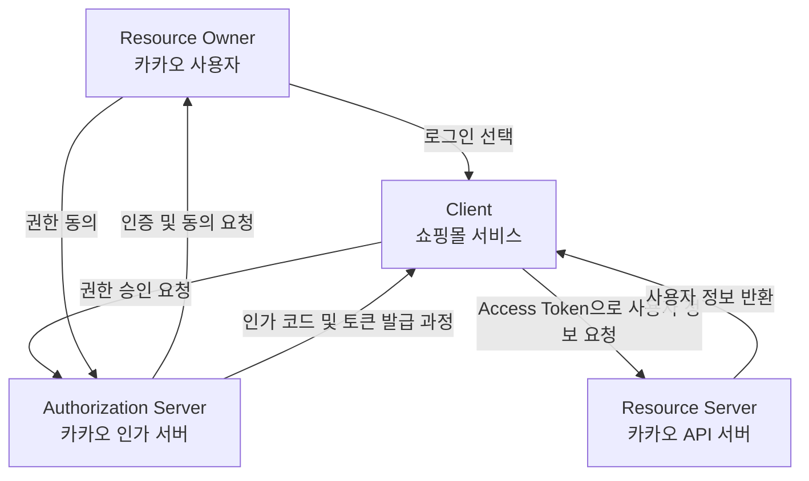
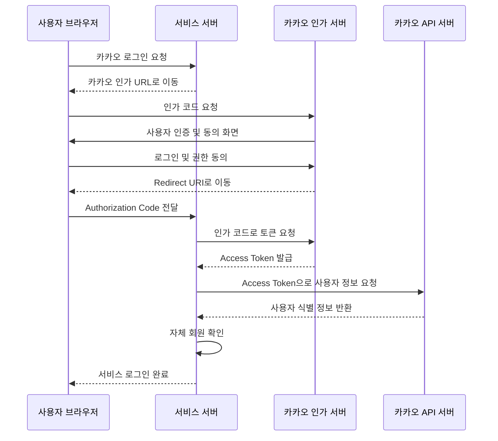
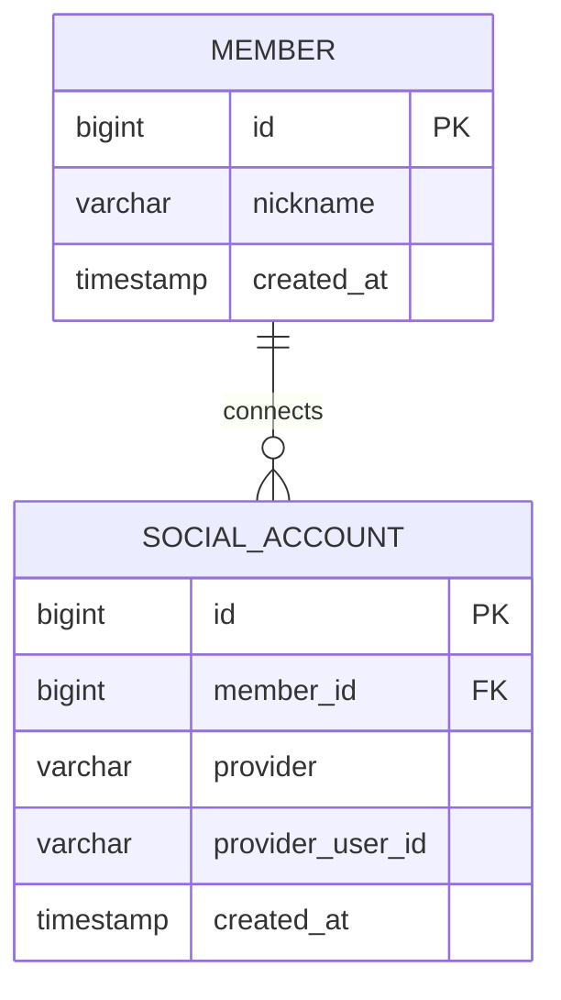
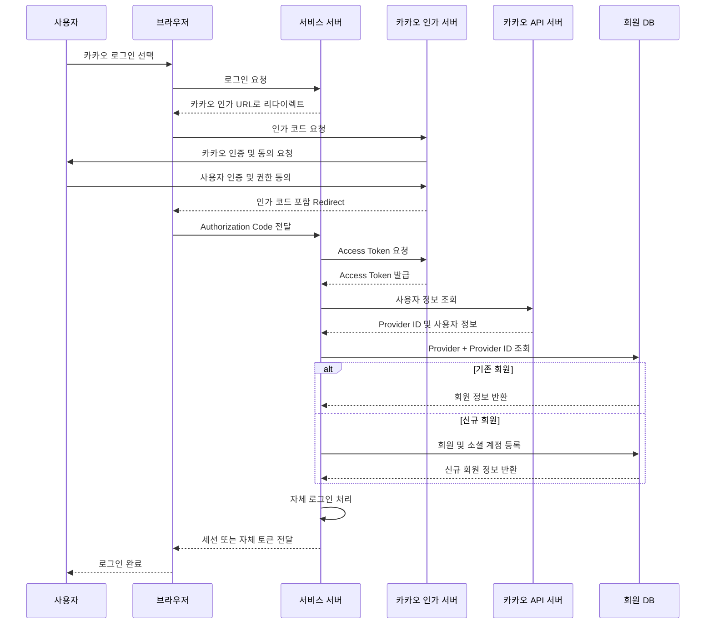
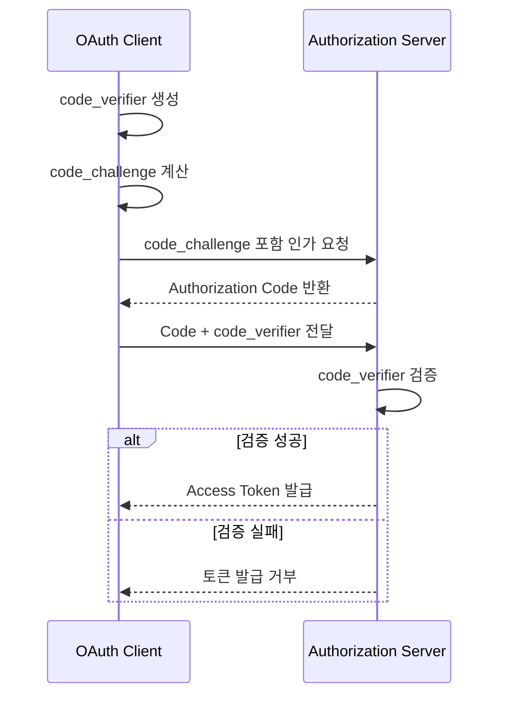

# 아티의 OAuth 2.0 기반 소셜 로그인은 어떻게 동작할까?
[https://youtu.be/3qE7o6JFOsc?si=48pcDlOFpkQOP8Hf](https://youtu.be/3qE7o6JFOsc?si=48pcDlOFpkQOP8Hf)

# 아티의 OAuth 2.0 기반 소셜 로그인은 어떻게 동작할까?
* toc
{:toc}

---

### OAuth 2.0 기반 소셜 로그인은 어떻게 동작할까?

웹 서비스를 개발하다 보면 카카오, 네이버, 구글과 같은 외부 계정을 이용해 로그인하는 기능을 구현해야 하는 경우가 많습니다.

사용자는 별도의 회원가입 절차 없이 기존에 사용하던 계정을 이용해 서비스에 접근할 수 있습니다.

개발자는 사용자에게 새로운 비밀번호를 만들도록 요구하지 않고, 외부 서비스에서 제공하는 정보를 활용해 회원가입과 로그인 기능을 구현할 수 있습니다.

이러한 기능을 일반적으로 **소셜 로그인(Social Login)**이라고 부릅니다.

소셜 로그인을 구현할 때 자주 등장하는 기술이 `OAuth 2.0`입니다.

그런데 OAuth 2.0을 이해하기 위해서는 먼저 한 가지 질문을 생각해 볼 필요가 있습니다.

**OAuth 2.0은 사용자를 로그인시키기 위한 기술일까요?**

정확하게 말하면 OAuth 2.0은 로그인 자체를 정의한 표준이 아닙니다.

OAuth 2.0은 사용자가 자신의 비밀번호를 제3자 애플리케이션에 제공하지 않고, 특정 리소스에 접근할 수 있는 권한을 위임하기 위한 인가 프레임워크입니다.

소셜 로그인은 이러한 OAuth 2.0의 권한 위임 기능을 활용해 사용자 정보를 확보하고, 해당 정보를 바탕으로 서비스 자체의 회원 인증을 수행하는 방식으로 구현할 수 있습니다.

예를 들어 사용자가 쇼핑몰에서 카카오 로그인을 선택했다고 가정하겠습니다.

```text
사용자
   │
   │ 카카오 로그인 선택
   ▼
쇼핑몰 서비스
   │
   │ 카카오 인증 및 동의 요청
   ▼
카카오
   │
   │ 사용자 인증 및 권한 동의
   ▼
쇼핑몰 서비스
   │
   │ 카카오 사용자 정보 조회
   ▼
쇼핑몰 회원 DB
   │
   │ 기존 회원 확인 또는 신규 회원가입
   ▼
쇼핑몰 자체 로그인 완료
```

이 과정에서 카카오 계정의 비밀번호는 쇼핑몰 서비스에 전달되지 않습니다.

쇼핑몰은 카카오로부터 허용된 사용자 정보를 가져와 자체 회원을 식별합니다.

그리고 자체 세션이나 JWT를 생성해 쇼핑몰 서비스에 로그인한 상태를 유지할 수 있습니다.

따라서 OAuth 2.0 기반 소셜 로그인을 제대로 이해하려면 다음 세 가지를 구분해야 합니다.

1. OAuth 2.0을 이용한 외부 서비스의 권한 위임
2. 외부 서비스에서 사용자 식별 정보 획득
3. 획득한 정보를 이용한 자체 서비스의 회원가입 및 로그인

이 세 단계는 서로 연결되어 있지만 각각 다른 목적을 가지고 있습니다.

---

### 개념

#### 1. OAuth 2.0이란?

OAuth 2.0은 사용자가 자신의 비밀번호를 직접 공유하지 않고도 외부 애플리케이션이 제한된 권한으로 리소스에 접근할 수 있도록 하는 표준 인가 프레임워크입니다.

OAuth는 Open Authorization에서 유래한 이름입니다.

예를 들어 일정 관리 애플리케이션에서 사용자의 구글 캘린더 정보를 조회하려는 상황을 생각해 보겠습니다.

OAuth 2.0이 없다면 애플리케이션은 사용자의 구글 계정 정보를 직접 요구하는 방식으로 구현될 수 있습니다.

```text
일정 관리 서비스

구글 이메일: __________

구글 비밀번호: __________

[연결하기]
```

사용자가 비밀번호를 입력하면 애플리케이션은 해당 계정에 접근할 수 있게 됩니다.

하지만 이러한 방식에는 여러 문제가 있습니다.

사용자는 외부 애플리케이션에 자신의 계정 비밀번호를 직접 전달해야 합니다.

애플리케이션이 계정 정보를 유출하거나 부적절하게 사용하면 캘린더뿐 아니라 다른 구글 서비스까지 영향을 받을 수 있습니다.

또한 애플리케이션이 필요한 권한이 단순한 일정 조회라고 하더라도 계정 정보 자체를 보유하게 됩니다.

OAuth 2.0은 이러한 문제를 해결하기 위해 권한 위임 방식을 제공합니다.

```text
사용자
   │
   │ 구글 캘린더 연결 요청
   ▼
일정 관리 서비스
   │
   │ 캘린더 읽기 권한 요청
   ▼
구글
   │
   │ 사용자에게 권한 동의 요청
   ▼
사용자
   │
   │ 캘린더 읽기 권한 승인
   ▼
구글
   │
   │ Access Token 발급
   ▼
일정 관리 서비스
   │
   │ Access Token으로 캘린더 조회
   ▼
구글 캘린더 API
```

이 과정에서 일정 관리 서비스는 사용자의 구글 비밀번호를 알 필요가 없습니다.

대신 구글이 발급한 Access Token을 이용해 허용된 리소스에 접근합니다.

또한 권한의 범위를 제한할 수 있기 때문에 사용자가 승인하지 않은 모든 리소스에 접근할 수 있는 것은 아닙니다.

OAuth 2.0은 RFC 6749에서 정의되었으며, 이후 여러 보안 확장과 모범 사례가 추가되었습니다.

#### 2. 인증(Authentication)과 인가(Authorization)의 차이

OAuth 2.0을 이해하기 위해서는 인증과 인가의 차이를 정확하게 알아야 합니다.

**인증(Authentication)**

인증은 사용자가 누구인지 확인하는 과정입니다.

예를 들어 사용자가 아이디와 비밀번호를 입력했을 때 해당 계정의 소유자가 맞는지 확인하는 과정이 인증입니다.

```text
사용자 로그인 요청
       │
       ▼
아이디 / 비밀번호 확인
       │
       ▼
사용자 신원 확인
       │
       ▼
인증 완료
```

**인가(Authorization)**

인가는 인증된 사용자 또는 클라이언트가 특정 리소스에 접근할 권한을 가지고 있는지 확인하는 과정입니다.

예를 들어 일반 회원이 관리자 페이지에 접근하려고 한다면 서버는 해당 사용자가 관리자 권한을 가지고 있는지 확인해야 합니다.

```text
사용자 API 요청
       │
       ▼
사용자 권한 확인
       │
       ▼
관리자 권한 존재?
       │
       ├── YES → 접근 허용
       │
       └── NO  → 접근 거부
```

두 개념을 비교하면 다음과 같습니다.

| 구분 | 인증(Authentication) | 인가(Authorization) |
|---|---|---|
| 목적 | 사용자의 신원 확인 | 리소스 접근 권한 확인 |
| 핵심 질문 | 누구인가? | 무엇을 할 수 있는가? |
| 대표 예시 | 아이디 및 비밀번호 로그인 | 관리자 API 접근 |
| 관련 기술 | 세션, OIDC, 인증 토큰 | OAuth 2.0, RBAC, Scope |
| 결과 | 신원 확인 | 접근 권한 부여 또는 거부 |

예를 들어 사용자가 카카오 계정으로 로그인하는 상황을 생각해 보겠습니다.

카카오는 사용자의 계정을 확인하고 인증합니다.

이후 사용자가 동의한 범위에 따라 외부 애플리케이션이 카카오 사용자 정보에 접근할 수 있는 권한을 부여합니다.

외부 애플리케이션은 전달받은 사용자 정보를 이용해 자체 서비스의 회원을 식별하고 로그인 처리할 수 있습니다.

따라서 OAuth 2.0을 이용한 소셜 로그인에는 인증과 인가가 모두 관련되어 있지만, **OAuth 2.0 자체의 주된 목적은 권한 위임**이라는 점을 구분해야 합니다.

#### 3. OAuth 2.0의 네 가지 역할

OAuth 2.0에서는 네 가지 주요 역할을 정의합니다.

- Resource Owner
- Client
- Authorization Server
- Resource Server

카카오 로그인을 예시로 살펴보겠습니다.

사용자가 쇼핑몰에서 카카오 계정으로 로그인하려는 상황입니다.

| OAuth 역할 | 카카오 로그인 예시 | 설명 |
|---|---|---|
| Resource Owner | 카카오 사용자 | 리소스에 대한 권한을 가진 주체 |
| Client | 쇼핑몰 서비스 | 사용자 정보를 요청하는 애플리케이션 |
| Authorization Server | 카카오 인가 서버 | 사용자 동의를 처리하고 토큰을 발급 |
| Resource Server | 카카오 API 서버 | 사용자 정보를 보유하고 제공 |

**Resource Owner**

Resource Owner는 보호된 리소스에 대한 접근을 허용할 수 있는 주체입니다.

일반적인 소셜 로그인에서는 사용자 본인이 해당합니다.

예를 들어 카카오 계정의 닉네임, 이메일, 프로필 사진 등에 대한 접근을 허용하는 사용자가 Resource Owner입니다.

**Client**

Client는 Resource Owner를 대신해 보호된 리소스에 접근하려는 애플리케이션입니다.

여기서 Client라는 이름 때문에 브라우저나 프론트엔드만 의미한다고 생각하기 쉽습니다.

하지만 OAuth 2.0에서 Client는 권한을 위임받아 리소스에 접근하는 애플리케이션을 의미합니다.

따라서 백엔드 서버도 OAuth 2.0의 Client가 될 수 있습니다.

**Authorization Server**

Authorization Server는 사용자 인증과 권한 동의를 처리하고 Access Token을 발급하는 서버입니다.

카카오 로그인에서는 카카오의 인가 서버가 해당 역할을 수행합니다.

**Resource Server**

Resource Server는 Access Token을 검증하고 보호된 리소스를 제공하는 서버입니다.

카카오 사용자 정보 조회 API를 제공하는 서버가 대표적인 예시입니다.

이 네 가지 역할을 구조로 표현하면 다음과 같습니다.



Authorization Server와 Resource Server는 논리적으로 구분되는 역할입니다.

반드시 서로 다른 물리적 서버에 존재해야 하는 것은 아닙니다.

하나의 서비스 제공자가 두 역할을 모두 수행할 수도 있습니다.

#### 4. Scope란?

OAuth 2.0에서는 Access Token을 통해 허용되는 권한의 범위를 나타내기 위해 Scope라는 개념을 사용합니다.

예를 들어 외부 애플리케이션이 사용자의 프로필 사진과 이메일만 필요하다고 가정하겠습니다.

그렇다면 모든 사용자 정보에 접근할 수 있는 권한을 요청할 필요는 없습니다.

필요한 정보에 접근할 수 있는 범위만 요청하면 됩니다.

```text
사용자 프로필 조회 권한
이메일 조회 권한
```

OAuth 제공자는 사용자 동의와 설정에 따라 허용된 권한을 토큰에 연결할 수 있습니다.

Scope는 일반적으로 다음과 같은 목적으로 사용됩니다.

| 목적 | 설명 |
|---|---|
| 접근 범위 제한 | 필요한 리소스에만 접근 |
| 권한 분리 | 조회, 수정 등 작업별 권한 구분 |
| 사용자 동의 | 외부 애플리케이션에 제공할 권한 확인 |
| 보안 강화 | 불필요한 권한 요청 최소화 |

다만 Scope의 명칭과 동작 방식은 OAuth 제공자마다 다를 수 있습니다.

또한 사용자가 동의했다고 해서 모든 사용자 정보가 반드시 응답에 포함되는 것은 아닙니다.

해당 사용자가 정보를 보유하고 있는지, 동의가 유효한지, 제공업체의 정책상 전달 가능한 정보인지 등을 추가로 확인해야 할 수 있습니다.

카카오의 경우 동의항목 설정과 추가 동의 요청을 통해 사용자 정보 접근 범위를 관리합니다.

---

### 왜 사용하는가?

#### 1. 사용자 비밀번호를 직접 관리하지 않기 위해

소셜 로그인을 활용하면 사용자의 외부 계정 비밀번호를 직접 전달받을 필요가 없습니다.

사용자는 카카오나 구글에서 자신의 계정을 인증합니다.

애플리케이션은 인증 과정에서 발급된 인가 코드를 이용해 Access Token을 획득하고, 허용된 사용자 정보를 조회합니다.

따라서 외부 계정의 비밀번호가 애플리케이션으로 전달되지 않습니다.

다만 소셜 로그인을 사용한다고 해서 서비스의 모든 보안 책임이 사라지는 것은 아닙니다.

서비스가 발급하는 자체 세션이나 JWT, 사용자 정보, 회원 계정 연결 관계 등은 여전히 안전하게 관리해야 합니다.

#### 2. 사용자 회원가입 절차를 단순화하기 위해

일반적인 회원가입에서는 다음과 같은 과정이 필요할 수 있습니다.

```text
회원가입 페이지 접근
       ↓
이메일 입력
       ↓
비밀번호 입력
       ↓
이메일 인증
       ↓
회원정보 입력
       ↓
회원가입 완료
```

반면 소셜 로그인을 활용하면 사용자가 승인한 정보와 서비스의 가입 정책에 따라 절차를 줄일 수 있습니다.

```text
카카오 로그인 선택
       ↓
카카오 인증 및 동의
       ↓
사용자 정보 확인
       ↓
서비스 회원가입
       ↓
로그인 완료
```

물론 모든 서비스에서 소셜 로그인만으로 회원가입을 완료할 수 있는 것은 아닙니다.

서비스 이용약관 동의, 본인확인, 연령 확인 등 추가 절차가 필요한 경우에는 별도로 처리해야 합니다.

#### 3. 외부 서비스의 기능을 제한된 권한으로 사용하기 위해

OAuth 2.0의 활용 범위는 소셜 로그인에 한정되지 않습니다.

예를 들어 다음과 같은 기능에도 적용할 수 있습니다.

| 서비스 | OAuth 2.0 활용 예시 |
|---|---|
| 구글 | 캘린더 및 사용자 정보 접근 |
| GitHub | 저장소 정보 조회 |
| 카카오 | 사용자 정보 조회 및 지원 API 호출 |
| 네이버 | 사용자 프로필 조회 |
| Microsoft | Microsoft Graph API 접근 |

OAuth 2.0은 외부 서비스의 기능을 사용자 대신 호출할 수 있도록 권한을 위임하는 구조이기 때문에 여러 종류의 서비스 연동에 활용할 수 있습니다.

---

### 주요 특징

#### 1. Authorization Code Grant

소셜 로그인을 구현할 때 대표적으로 사용하는 방식은 Authorization Code Grant입니다.

이 방식에서는 사용자가 외부 제공자의 인증 및 동의 과정을 완료하면 애플리케이션이 인가 코드(Authorization Code)를 전달받습니다.

이후 애플리케이션은 인가 코드를 Access Token으로 교환합니다.

전체 과정은 크게 세 단계로 나눌 수 있습니다.

1. 사용자 인증 및 권한 동의를 통한 인가 코드 발급
2. 인가 코드를 이용한 Access Token 발급
3. Access Token을 이용한 사용자 정보 조회



각 단계를 자세히 살펴보겠습니다.

#### 2. 첫 번째 단계 - 사용자 인증 및 인가 코드 발급

사용자가 카카오 로그인 버튼을 클릭하면 서비스는 카카오의 인가 엔드포인트로 브라우저를 이동시킵니다.

카카오의 인가 코드 요청 주소는 다음과 같습니다.

```http
GET https://kauth.kakao.com/oauth/authorize
```

실제 요청에서는 다음과 같은 파라미터를 전달합니다.

```http
GET https://kauth.kakao.com/oauth/authorize
    ?response_type=code
    &client_id={REST_API_KEY}
    &redirect_uri={REDIRECT_URI}
    &state={STATE}
```

각 파라미터의 의미는 다음과 같습니다.

| 파라미터 | 설명 |
|---|---|
| response_type | 응답으로 받을 인가 방식이며 `code` 지정 |
| client_id | OAuth 제공자가 애플리케이션을 식별하는 값 |
| redirect_uri | 인증 및 동의 처리 후 브라우저가 이동할 주소 |
| state | 로그인 요청과 콜백을 연결하고 CSRF를 방지하기 위한 값 |
| scope | 요청할 권한 범위. 제공자 및 요청 유형에 따라 사용 |

예를 들어 애플리케이션이 카카오에 등록한 Redirect URI가 다음과 같다고 가정하겠습니다.

```text
https://shop.example.com/login/oauth2/code/kakao
```

사용자가 카카오에서 인증 및 동의를 완료하면 카카오는 브라우저를 해당 주소로 이동시킵니다.

이때 인가 코드가 쿼리 파라미터로 전달됩니다.

```http
GET /login/oauth2/code/kakao
    ?code=AUTHORIZATION_CODE
    &state=RANDOM_STATE
```

여기서 중요한 것은 인가 코드가 Access Token 자체는 아니라는 점입니다.

인가 코드는 Access Token을 발급받기 위한 일회성 자격 증명입니다.

따라서 해당 코드를 이용해 토큰 발급 요청을 수행해야 합니다.

또한 카카오의 Redirect URI는 사전에 등록한 주소를 사용해야 합니다.

임의의 주소를 자유롭게 지정할 수 있도록 구현하면 인가 코드가 공격자가 제어하는 주소로 전달될 위험이 있습니다.

#### 3. Client ID와 Client Secret의 차이

OAuth 2.0에서는 Client ID와 Client Secret을 구분해야 합니다.

**Client ID**

Client ID는 OAuth 제공자에게 등록된 애플리케이션을 식별하기 위한 값입니다.

이 값 자체를 비밀번호처럼 취급하지는 않습니다.

브라우저를 통해 전달되는 인가 요청에도 포함될 수 있습니다.

**Client Secret**

Client Secret은 클라이언트 인증을 지원하는 환경에서 애플리케이션의 자격 증명으로 사용하는 비밀값입니다.

따라서 서버에서 안전하게 관리해야 합니다.

```text
Client ID
    → 애플리케이션 식별자

Client Secret
    → 애플리케이션 인증을 위한 비밀값
```

Client Secret은 프론트엔드 JavaScript 코드나 모바일 애플리케이션에 하드코딩해서는 안 됩니다.

브라우저와 모바일 앱은 배포된 코드를 사용자가 분석할 수 있기 때문입니다.

카카오의 REST API 방식에서도 Client Secret 기능이 활성화된 경우 토큰 발급 요청에 해당 값을 포함해야 합니다.

#### 4. 두 번째 단계 - Access Token 발급

인가 코드를 전달받은 서비스 서버는 카카오의 토큰 발급 API를 호출합니다.

```http
POST https://kauth.kakao.com/oauth/token
```

요청에는 일반적으로 다음 값이 포함됩니다.

```http
POST /oauth/token HTTP/1.1
Host: kauth.kakao.com
Content-Type: application/x-www-form-urlencoded

grant_type=authorization_code
&client_id={REST_API_KEY}
&redirect_uri={REDIRECT_URI}
&code={AUTHORIZATION_CODE}
&client_secret={CLIENT_SECRET}
```

위 요청은 설명을 위해 파라미터를 구분한 형태이며, 실제 요청에서는 `application/x-www-form-urlencoded` 형식으로 인코딩해야 합니다.

카카오 인가 서버는 인가 코드와 애플리케이션 정보를 검증합니다.

요청이 유효하면 Access Token을 발급합니다.

응답은 다음과 같은 형태입니다.

```json
{
  "token_type": "bearer",
  "access_token": "ACCESS_TOKEN_VALUE",
  "expires_in": 7199,
  "refresh_token": "REFRESH_TOKEN_VALUE",
  "refresh_token_expires_in": 5184000,
  "scope": "profile_nickname account_email"
}
```

토큰 문자열과 만료 시간은 예시입니다.

실제 값은 제공자 정책과 애플리케이션 설정에 따라 달라질 수 있습니다.

여기서 중요한 값은 `access_token`입니다.

서비스는 이 토큰을 이용해 카카오의 보호된 API를 호출할 수 있습니다.

또한 `refresh_token`은 지원되는 정책에 따라 만료된 Access Token을 갱신하는 데 사용할 수 있습니다.

Refresh Token은 모든 OAuth 요청에서 반드시 발급된다고 가정해서는 안 됩니다.

제공업체와 Grant Type, 클라이언트 설정에 따라 발급 여부가 달라질 수 있습니다.

#### 5. Authorization Code와 Access Token의 차이

인가 코드와 Access Token은 서로 다른 목적을 가지고 있습니다.

| 구분 | Authorization Code | Access Token |
|---|---|---|
| 목적 | 토큰 발급을 위한 임시 자격 증명 | 보호된 리소스 접근 |
| 발급 시점 | 사용자 인증 및 동의 이후 | 토큰 교환 요청 이후 |
| 사용 대상 | Authorization Server | Resource Server |
| 사용 방식 | 토큰 발급 요청 | API 호출 |
| 특징 | 짧은 수명, 일반적으로 일회성 | 제한된 유효기간과 권한 |

쉽게 말하면 Authorization Code는 Access Token을 발급받기 위한 교환권에 가깝습니다.

반면 Access Token은 실제로 보호된 API에 접근할 수 있도록 하는 자격 증명입니다.

두 값 모두 보안상 중요한 정보이므로 외부에 노출되지 않도록 관리해야 합니다.

#### 6. 세 번째 단계 - Access Token으로 사용자 정보 조회

Access Token을 발급받았다면 사용자 정보 조회 API를 호출할 수 있습니다.

카카오에서 사용자 정보를 조회하는 대표적인 API는 다음과 같습니다.

```http
GET https://kapi.kakao.com/v2/user/me
```

Access Token을 HTTP Authorization 헤더에 포함합니다.

```http
GET /v2/user/me HTTP/1.1
Host: kapi.kakao.com
Authorization: Bearer ACCESS_TOKEN_VALUE
```

카카오 API 서버는 토큰의 유효성과 접근 권한 등을 확인한 뒤 사용자 정보를 반환합니다.

응답은 다음과 같은 형태가 될 수 있습니다.

```json
{
  "id": 123456789,
  "connected_at": "2026-01-01T00:00:00Z",
  "kakao_account": {
    "profile": {
      "nickname": "홍길동",
      "profile_image_url": "https://example.com/profile.png"
    },
    "has_email": true,
    "email_needs_agreement": false,
    "is_email_verified": true,
    "email": "user@example.com"
  }
}
```

이 예제에서 중요한 값은 최상위 `id`입니다.

해당 값은 카카오 앱과 연결된 사용자를 식별하는 데 사용할 수 있습니다.

반면 이메일과 프로필 정보는 사용자의 동의 상태와 정보 보유 여부에 따라 제공되지 않을 수도 있습니다.

따라서 소셜 로그인 구현에서는 이메일을 항상 필수로 반환되는 값이라고 가정해서는 안 됩니다.

#### 7. OAuth 2.0을 완료하면 서비스 로그인도 완료되는가?

여기서 중요한 점이 있습니다.

**OAuth 2.0을 통해 Access Token을 획득했다고 해서 우리 서비스의 로그인까지 자동으로 완료되는 것은 아닙니다.**

OAuth 2.0을 통해 확보한 것은 외부 리소스에 접근할 수 있는 권한입니다.

우리 서비스의 회원인지 확인하고 로그인 상태를 생성하는 것은 별도의 과정입니다.

예를 들어 카카오 사용자 정보 조회 API에서 다음과 같은 식별자를 반환받았다고 가정하겠습니다.

```json
{
  "id": 123456789
}
```

서비스는 이 값을 이용해 회원 데이터베이스를 조회할 수 있습니다.

```sql
SELECT *
FROM social_account
WHERE provider = 'KAKAO'
  AND provider_user_id = '123456789';
```

조회 결과에 따라 다음과 같이 처리합니다.

```text
카카오 사용자 정보 조회 성공
            │
            ▼
Provider + Provider ID 추출
            │
            ▼
서비스 회원 DB 조회
            │
      ┌─────┴─────┐
      │           │
   회원 존재    회원 없음
      │           │
      │           ▼
      │       신규 회원가입
      │           │
      └─────┬─────┘
            │
            ▼
     자체 로그인 처리
            │
            ▼
       세션 또는 JWT
            │
            ▼
       로그인 완료
```

이 과정을 통해 외부 계정과 우리 서비스의 계정을 연결할 수 있습니다.

다만 사용자를 자동으로 회원가입시키는 것은 하나의 서비스 정책입니다.

필요한 약관 동의나 추가 회원정보가 있다면 회원가입 절차를 별도로 제공해야 합니다.

---

### OAuth 2.0과 OpenID Connect(OIDC)의 차이

#### 1. OAuth 2.0은 인증 표준이 아니다

OAuth 2.0 기반 소셜 로그인을 구현하다 보면 다음과 같은 의문이 생길 수 있습니다.

카카오에서 사용자 ID를 가져왔고, 해당 ID를 이용해 회원을 식별할 수 있다면 OAuth 2.0도 인증에 사용하는 기술이라고 볼 수 있지 않을까요?

실제로 많은 서비스에서 OAuth 2.0의 사용자 정보 조회 기능을 활용해 로그인을 구현하고 있습니다.

하지만 OAuth 2.0 자체는 사용자의 신원과 인증 결과를 표준화해서 전달하는 프로토콜이 아닙니다.

OAuth 2.0에서 Access Token은 리소스 접근 권한을 나타내는 값입니다.

따라서 Access Token을 발급받았다는 사실만으로 사용자의 신원을 표준화된 방식으로 검증했다고 단정해서는 안 됩니다.

이러한 문제를 해결하기 위해 OAuth 2.0 위에 인증 계층을 추가한 표준이 **OpenID Connect(OIDC)**입니다.

#### 2. OIDC란?

OpenID Connect는 OAuth 2.0을 기반으로 사용자의 인증 정보를 전달하고 검증할 수 있도록 확장한 인증 프로토콜입니다.

OIDC에서는 일반적으로 ID Token이라는 토큰을 사용합니다.

ID Token은 인증된 사용자에 대한 정보를 포함하는 JWT 형식의 토큰입니다.

```text
OAuth 2.0
    │
    └── 리소스 접근 권한 위임

OIDC
    │
    ├── OAuth 2.0 기반
    │
    └── 사용자 인증 정보 제공
```

OAuth 2.0과 OIDC의 차이를 정리하면 다음과 같습니다.

| 구분 | OAuth 2.0 | OpenID Connect |
|---|---|---|
| 주요 목적 | 인가 및 권한 위임 | 사용자 인증 |
| 대표 토큰 | Access Token | ID Token |
| 확인 대상 | 리소스 접근 권한 | 사용자의 인증 정보 |
| 사용자 식별 | 제공자별 별도 방식 | 표준화된 Claim 사용 |
| 활용 | API 접근, 권한 위임 | 소셜 로그인, SSO |

OIDC는 OAuth 2.0을 대체하는 것이 아니라 인증 기능을 확장하는 관계입니다.

OpenID Connect Core 명세에서는 OAuth 2.0을 기반으로 사용자 인증 정보를 검증하는 방식을 정의합니다.

#### 3. ID Token의 구조

ID Token은 일반적으로 JWT 형식으로 제공됩니다.

JWT는 다음과 같은 구조를 가집니다.

```text
Header.Payload.Signature
```

예를 들어 ID Token의 Payload는 다음과 같은 정보를 포함할 수 있습니다.

```json
{
  "iss": "https://kauth.kakao.com",
  "sub": "123456789",
  "aud": "KAKAO_CLIENT_ID",
  "iat": 1798761600,
  "exp": 1798765200
}
```

각 Claim의 의미는 다음과 같습니다.

| Claim | 의미 |
|---|---|
| iss | 토큰 발급자 |
| sub | 사용자 식별자 |
| aud | 토큰의 대상 클라이언트 |
| iat | 토큰 발급 시간 |
| exp | 토큰 만료 시간 |
| nonce | 요청과 응답의 연결 및 재생 공격 방지에 사용하는 값 |

ID Token을 검증할 때는 단순히 Payload를 디코딩해서는 안 됩니다.

서명 검증뿐 아니라 발급자, 대상 클라이언트, 만료 시간, 요청에 사용한 nonce 등을 검증해야 합니다.

또한 JWT는 기본적으로 인코딩된 구조이지 암호화된 구조가 아닙니다.

따라서 JWT의 Payload에 포함된 정보를 누구나 디코딩할 수 있다는 점을 고려해야 합니다.

#### 4. 카카오에서도 OIDC를 사용할 수 있을까?

카카오 로그인은 OAuth 2.0 기반의 OpenID Connect를 지원합니다.

OIDC를 활성화하면 ID Token을 발급받을 수 있습니다.

카카오는 ID Token 서명 검증을 위한 공개키 정보도 제공합니다.

```http
GET https://kauth.kakao.com/.well-known/jwks.json
```

또한 OIDC 설정 정보를 조회할 수 있는 Discovery Endpoint도 제공합니다.

```http
GET https://kauth.kakao.com/.well-known/openid-configuration
```

서비스에서는 이러한 정보를 활용해 ID Token을 검증할 수 있습니다.

단, 카카오에서 OIDC를 사용하려면 애플리케이션의 OIDC 설정 및 요청 조건을 확인해야 합니다.

---

### 예제

#### 1. Spring Boot에서 카카오 로그인 구현하기

Spring Boot에서는 `Spring Security OAuth2 Client`를 활용해 OAuth 2.0 기반 로그인을 구현할 수 있습니다.

Spring Security는 다음과 같은 기능을 제공합니다.

- Authorization Code Grant 처리
- 인가 서버로의 리다이렉트
- Authorization Code 수신
- Access Token 교환
- 사용자 정보 조회
- OAuth2AuthenticationToken 생성
- 로그인 성공 및 실패 처리

따라서 개발자가 OAuth 2.0 프로토콜의 모든 요청을 직접 구현하지 않아도 됩니다.

여기서는 Spring Boot 3.x와 Spring Security 6.x의 Servlet 기반 구조를 기준으로 살펴보겠습니다.

#### 2. Gradle 의존성 설정

먼저 다음 의존성을 추가합니다.

```gradle
dependencies {

    implementation 'org.springframework.boot:spring-boot-starter-web'

    implementation 'org.springframework.boot:spring-boot-starter-security'

    implementation 'org.springframework.boot:spring-boot-starter-oauth2-client'

    implementation 'org.springframework.boot:spring-boot-starter-data-jpa'

    runtimeOnly 'org.postgresql:postgresql'

    testImplementation 'org.springframework.boot:spring-boot-starter-test'
}
```

각 의존성의 역할은 다음과 같습니다.

| 의존성 | 역할 |
|---|---|
| starter-web | REST API 및 웹 요청 처리 |
| starter-security | 인증 및 인가 처리 |
| starter-oauth2-client | OAuth 2.0 Client 기능 제공 |
| starter-data-jpa | 회원 정보 데이터베이스 처리 |
| PostgreSQL Driver | PostgreSQL 연결 |
| starter-test | 테스트 환경 구성 |

여기서 핵심은 `spring-boot-starter-oauth2-client`입니다.

해당 의존성을 추가하면 Spring Security의 OAuth 2.0 Client 기능을 활용할 수 있습니다.

#### 3. application.yml 설정

카카오 로그인을 사용하기 위한 OAuth 2.0 Client 정보를 설정합니다.

```yaml
spring:
  security:
    oauth2:
      client:
        registration:
          kakao:
            client-id: ${KAKAO_REST_API_KEY}
            client-secret: ${KAKAO_CLIENT_SECRET}
            client-authentication-method: client_secret_post
            authorization-grant-type: authorization_code
            redirect-uri: "{baseUrl}/login/oauth2/code/{registrationId}"
            client-name: Kakao

        provider:
          kakao:
            authorization-uri: https://kauth.kakao.com/oauth/authorize
            token-uri: https://kauth.kakao.com/oauth/token
            user-info-uri: https://kapi.kakao.com/v2/user/me
            user-name-attribute: id
```

위 설정은 카카오 REST API 방식의 OAuth 로그인을 구성하는 예시입니다.

카카오 애플리케이션에는 로그인 기능을 활성화하고 Redirect URI와 필요한 동의항목을 등록해야 합니다.

설정 항목을 살펴보겠습니다.

**client-id**

카카오에서 발급받은 REST API 키입니다.

**client-secret**

카카오의 클라이언트 시크릿입니다.

민감한 값이므로 소스 코드에 직접 저장하지 않고 환경변수나 Secret Manager 등을 통해 관리하는 것이 좋습니다.

**client-authentication-method**

카카오의 Client Secret 전송 방식에 맞춰 `client_secret_post`를 사용합니다.

**authorization-grant-type**

Authorization Code Grant를 사용하기 위해 `authorization_code`를 지정합니다.

**redirect-uri**

OAuth 인증 및 동의 처리 후 브라우저가 돌아올 주소입니다.

Spring Security의 기본 Redirect URI 패턴은 다음과 같습니다.

```text
{baseUrl}/login/oauth2/code/{registrationId}
```

예를 들어 애플리케이션 주소가 다음과 같다면,

```text
https://shop.example.com
```

카카오 로그인 콜백 주소는 다음과 같습니다.

```text
https://shop.example.com/login/oauth2/code/kakao
```

이 주소를 카카오 애플리케이션에 등록해야 합니다.

**user-name-attribute**

사용자 정보 조회 API에서 사용자를 식별할 필드를 지정합니다.

카카오는 사용자 정보의 최상위 `id`를 반환하므로 해당 값을 지정합니다.

Spring Security의 OAuth 2.0 Login 설정은 `ClientRegistration`을 기반으로 구성되며, 제공자별 엔드포인트를 설정할 수 있습니다.

#### 4. Spring Security 설정

OAuth 2.0 로그인을 활성화하기 위해 `SecurityFilterChain`을 구성합니다.

```java
@Configuration
@EnableWebSecurity
public class SecurityConfig {

    @Bean
    public SecurityFilterChain securityFilterChain(
            HttpSecurity http
    ) throws Exception {

        http
            .authorizeHttpRequests(auth -> auth

                .requestMatchers(
                    "/",
                    "/login/**",
                    "/oauth2/**"
                ).permitAll()

                .anyRequest().authenticated()
            )

            .oauth2Login(Customizer.withDefaults());

        return http.build();
    }
}
```

`oauth2Login()`을 활성화하면 Spring Security가 OAuth 2.0 로그인 처리를 수행합니다.

카카오 로그인을 시작하는 기본 주소는 다음과 같습니다.

```text
/oauth2/authorization/kakao
```

사용자가 해당 주소에 접근하면 Spring Security는 등록된 OAuth 클라이언트 정보를 기반으로 카카오의 인가 서버에 요청을 보냅니다.

사용자가 카카오에서 인증 및 동의를 완료하면 등록된 Redirect URI로 돌아옵니다.

이후 Spring Security가 Authorization Code를 이용해 토큰을 발급받고 사용자 정보를 조회합니다.

위 예제는 Spring Security의 기본 세션 로그인 방식을 사용하는 구성입니다.

JWT 기반으로 자체 인증 구조를 구현하려면 로그인 성공 이후 별도의 토큰 발급 처리를 추가해야 합니다.

#### 5. 사용자 정보 조회 결과 처리

Spring Security에서는 `OAuth2UserService`를 통해 외부 제공자에서 반환한 사용자 정보를 처리할 수 있습니다.

카카오 사용자 정보의 구조는 다음과 같습니다.

```json
{
  "id": 123456789,
  "kakao_account": {
    "profile": {
      "nickname": "홍길동"
    },
    "email": "user@example.com"
  }
}
```

이 응답에서 가장 중요한 값은 카카오 사용자 식별자인 `id`입니다.

다음과 같이 사용자 정보를 추출할 수 있습니다.

```java
OAuth2User oauth2User = ...;

Map<String, Object> attributes =
        oauth2User.getAttributes();

Object providerId = attributes.get("id");

Map<String, Object> kakaoAccount =
        (Map<String, Object>) attributes.get("kakao_account");
```

실무에서는 `Map`을 직접 사용하는 것보다 별도의 DTO나 변환 클래스를 구성하는 방법도 고려할 수 있습니다.

외부 제공자의 응답 구조가 변경되더라도 내부 회원 도메인에 영향을 최소화할 수 있기 때문입니다.

예를 들어 다음과 같은 DTO를 정의할 수 있습니다.

```java
public record SocialUserInfo(

        String provider,

        String providerId,

        String email,

        String nickname

) {
}
```

이 DTO는 외부 제공자의 응답을 내부 서비스에서 사용하는 공통 형식으로 변환하기 위한 객체입니다.

카카오뿐 아니라 네이버, 구글 등 여러 소셜 로그인 제공자를 지원할 때 유용합니다.

#### 6. 자체 회원 데이터베이스 설계

OAuth 2.0을 통해 가져온 사용자 정보는 서비스 자체의 회원 계정과 연결해야 합니다.

이를 위해 회원 테이블과 소셜 계정 테이블을 분리할 수 있습니다.

```sql
CREATE TABLE member (

    id BIGSERIAL PRIMARY KEY,

    nickname VARCHAR(100),

    created_at TIMESTAMP NOT NULL DEFAULT CURRENT_TIMESTAMP

);
```

소셜 계정 정보를 저장하는 테이블은 다음과 같이 구성할 수 있습니다.

```sql
CREATE TABLE social_account (

    id BIGSERIAL PRIMARY KEY,

    member_id BIGINT NOT NULL,

    provider VARCHAR(30) NOT NULL,

    provider_user_id VARCHAR(255) NOT NULL,

    created_at TIMESTAMP NOT NULL DEFAULT CURRENT_TIMESTAMP,

    CONSTRAINT fk_social_account_member
        FOREIGN KEY (member_id)
        REFERENCES member(id),

    CONSTRAINT uk_social_account
        UNIQUE (provider, provider_user_id)

);
```

두 테이블의 관계는 다음과 같습니다.



이렇게 설계하면 하나의 서비스 회원 계정에 여러 소셜 계정을 연결할 수 있습니다.

```text
서비스 회원 ID: 100
        │
        ├── KAKAO / 123456789
        │
        ├── GOOGLE / 987654321
        │
        └── NAVER / ABCD1234
```

여기서 중요한 것은 `provider_user_id`만으로 사용자를 구분하지 않는다는 점입니다.

서로 다른 소셜 로그인 제공자에서 동일한 식별자를 발급할 가능성을 고려해야 합니다.

따라서 일반적으로 다음 두 값을 조합해 사용자를 식별합니다.

```text
provider + provider_user_id
```

또한 `UNIQUE (provider, provider_user_id)` 제약조건을 적용하면 동일한 소셜 계정이 중복 등록되는 것을 방지할 수 있습니다.

동시에 여러 로그인 요청이 들어오는 상황에서는 조회 후 삽입하는 방식만으로 중복 가입을 완전히 방지할 수 없으므로 데이터베이스의 고유 제약조건과 충돌 처리까지 고려해야 합니다.

#### 7. 최초 로그인과 재로그인 처리

서비스는 카카오에서 반환한 사용자 식별자를 기준으로 회원을 조회합니다.

```java
Optional<SocialAccount> socialAccount =
        socialAccountRepository
            .findByProviderAndProviderUserId(
                "KAKAO",
                providerId
            );
```

기존 회원이 존재한다면 해당 회원을 이용해 로그인 처리합니다.

```java
if (socialAccount.isPresent()) {

    Member member = socialAccount.get().getMember();

    return member;
}
```

반면 기존 회원이 없다면 서비스 정책에 따라 신규 회원가입을 수행할 수 있습니다.

```java
Member member = new Member();

memberRepository.save(member);

SocialAccount account = new SocialAccount(
        member,
        "KAKAO",
        providerId
);

socialAccountRepository.save(account);
```

위 코드는 신규 가입의 개념적인 처리 순서입니다.

실제 구현에서는 회원과 소셜 계정 등록을 하나의 데이터베이스 트랜잭션으로 묶고, 중복 가입 경쟁 상태를 처리해야 합니다.

또한 회원가입을 완료하기 전에 필수 약관 동의나 서비스별 추가 정보를 확인해야 할 수 있습니다.

#### 8. 자체 JWT 발급

소셜 계정과 서비스 회원의 연결이 완료되면 서비스 자체의 로그인 상태를 생성할 수 있습니다.

대표적인 방식은 세션 기반 인증과 JWT 기반 인증입니다.

세션 기반 방식에서는 Spring Security의 인증 상태를 세션에 저장하고, 브라우저는 세션 쿠키를 이용합니다.

JWT 기반 방식에서는 서비스가 자체적으로 JWT를 발급하고, 이후 API 요청에서 해당 토큰을 검증할 수 있습니다.

예를 들어 로그인 성공 후 자체 JWT를 발급하는 흐름은 다음과 같습니다.

```text
카카오 로그인 성공
        │
        ▼
카카오 사용자 정보 조회
        │
        ▼
서비스 회원 DB 조회
        │
        ▼
Member ID 확인
        │
        ▼
자체 JWT 생성
        │
        ▼
클라이언트에 전달
        │
        ▼
이후 API 요청에서 JWT 사용
```

여기서 중요한 점은 카카오 Access Token과 서비스 자체 JWT가 서로 다른 토큰이라는 것입니다.

```text
카카오 Access Token
    → 카카오 API 접근

서비스 자체 JWT
    → 우리 서비스 API 인증
```

JWT를 발급할 때는 외부 제공자의 식별자보다 내부 서비스의 회원 식별자를 기준으로 설계하는 것이 일반적으로 유용합니다.

예를 들어 다음과 같은 Claim을 사용할 수 있습니다.

```json
{
  "sub": "100",
  "iss": "https://shop.example.com",
  "aud": "shop-api",
  "iat": 1798761600,
  "exp": 1798765200
}
```

여기서 `sub`는 서비스 내부 회원 ID를 의미합니다.

JWT를 구현할 때는 서명 알고리즘, 서명 키 관리, 만료 시간, Refresh Token 정책, 토큰 탈취 대응 등을 함께 설계해야 합니다.

또한 브라우저 환경에서는 토큰을 어디에 저장할지도 중요합니다.

예를 들어 HttpOnly, Secure, SameSite 속성이 설정된 쿠키를 활용할 수 있습니다.

쿠키 기반 인증에서는 CSRF 방어까지 고려해야 하며, JWT를 URL 쿼리 파라미터에 포함해 전달하는 방식은 토큰 노출 위험 때문에 피하는 것이 좋습니다.

---

### 구조

#### 1. OAuth 2.0과 자체 로그인 전체 흐름

지금까지 살펴본 과정을 하나로 연결해 보겠습니다.



이 흐름에서 OAuth 2.0과 서비스 로그인의 경계를 구분하면 다음과 같습니다.

| 구간 | 처리 내용 | 담당 |
|---|---|---|
| 1 | 카카오 인증 및 동의 | 카카오 |
| 2 | Authorization Code 발급 | 카카오 |
| 3 | Access Token 발급 | 카카오 |
| 4 | 카카오 사용자 정보 조회 | 카카오 API |
| 5 | 자체 회원 조회 및 가입 | 서비스 서버 |
| 6 | 자체 세션 또는 JWT 발급 | 서비스 서버 |
| 7 | 서비스 API 인증 | 서비스 서버 |

핵심은 **외부 제공자의 사용자 식별 정보를 획득하는 과정과 자체 서비스의 인증 상태를 생성하는 과정이 분리되어 있다는 점**입니다.

#### 2. State를 이용한 CSRF 공격 방지

OAuth 2.0에서는 `state` 파라미터를 이용해 인증 요청과 콜백을 연결할 수 있습니다.

예를 들어 사용자가 로그인 버튼을 클릭하면 서버는 예측하기 어려운 임의의 값을 생성합니다.

```text
state = RANDOM_VALUE_123
```

이 값을 사용자의 로그인 시도와 연결해 안전하게 보관합니다.

그리고 카카오 인가 서버에 요청할 때 포함합니다.

```http
GET /oauth/authorize
    ?client_id=CLIENT_ID
    &response_type=code
    &redirect_uri=REDIRECT_URI
    &state=RANDOM_VALUE_123
```

이후 콜백 요청에서도 동일한 `state`가 전달됩니다.

```http
GET /login/oauth2/code/kakao
    ?code=AUTHORIZATION_CODE
    &state=RANDOM_VALUE_123
```

서비스는 요청을 시작할 때 보관했던 값과 콜백으로 전달된 값을 비교합니다.

```text
최초 요청 state
        │
        ▼
RANDOM_VALUE_123
        │
        ▼
콜백 state 비교
        │
   ┌────┴────┐
   │         │
 일치       불일치
   │         │
   ▼         ▼
진행       요청 거부
```

이러한 검증은 사용자가 시작하지 않은 로그인 요청이 콜백으로 주입되는 공격을 방지하는 데 도움이 됩니다.

실제 구현에서는 `state`를 단순히 고정 문자열로 사용해서는 안 됩니다.

로그인 시도마다 안전하게 생성하고, 해당 브라우저 세션 또는 로그인 트랜잭션과 연결해 검증해야 합니다.

#### 3. PKCE를 이용한 인가 코드 탈취 방지

OAuth 2.0 보안에서는 인가 코드가 탈취되는 상황도 고려해야 합니다.

Authorization Code를 가로챈 공격자가 이를 이용해 Access Token을 발급받을 수 있다면 사용자 계정이 위험해질 수 있습니다.

PKCE(Proof Key for Code Exchange)는 이러한 위험을 줄이기 위한 보안 확장입니다.

PKCE는 다음과 같은 값을 사용합니다.

- code_verifier
- code_challenge

클라이언트는 먼저 예측하기 어려운 `code_verifier`를 생성합니다.

이후 `code_verifier`를 기반으로 `code_challenge`를 생성합니다.

S256 방식에서는 다음과 같이 계산합니다.

```text
code_challenge =
    BASE64URL(SHA256(code_verifier))
```

인가 코드 요청 시에는 `code_challenge`를 전달합니다.

```http
GET /authorize
    ?response_type=code
    &client_id=CLIENT_ID
    &redirect_uri=REDIRECT_URI
    &code_challenge=CODE_CHALLENGE
    &code_challenge_method=S256
```

이후 Access Token을 발급받을 때는 원래의 `code_verifier`를 전달합니다.

```http
POST /token

grant_type=authorization_code
&code=AUTHORIZATION_CODE
&code_verifier=CODE_VERIFIER
```

인가 서버는 전달받은 `code_verifier`를 이용해 기존 `code_challenge`와 일치하는지 검증합니다.

따라서 공격자가 Authorization Code만 탈취하더라도 올바른 `code_verifier`를 알지 못하면 토큰 발급에 실패하도록 만들 수 있습니다.



2025년 1월 공개된 OAuth 2.0 Security Best Current Practice인 RFC 9700에서는 Public Client의 PKCE 사용을 요구하고, Confidential Client에도 PKCE 사용을 권고합니다.

또한 Authorization Server에는 PKCE 지원을 요구합니다.

카카오의 OIDC Discovery 정보에서도 PKCE 관련 메타데이터를 확인할 수 있습니다. 실제 적용에서는 사용 중인 클라이언트 유형과 카카오 SDK 또는 API의 지원 조건을 확인해야 합니다.

#### 4. State와 PKCE의 차이

State와 PKCE는 OAuth 2.0 보안에서 중요한 개념이지만 목적에 차이가 있습니다.

| 구분 | State | PKCE |
|---|---|---|
| 주요 목적 | 요청과 콜백 연결 및 CSRF 방어 | 인가 코드 탈취 및 주입 공격 방어 |
| 주요 값 | state | code_verifier, code_challenge |
| 검증 주체 | OAuth Client | Authorization Server |
| 핵심 검증 | 최초 요청과 콜백 연결 확인 | 토큰 요청자가 코드에 연결된 verifier를 보유하는지 확인 |

다만 PKCE 역시 특정 조건에서는 CSRF 방어에 활용될 수 있습니다.

따라서 두 기술이 완전히 독립적인 보안 기능만 제공한다고 이해하기보다는 각각의 역할과 보안 요구사항을 구분하는 것이 좋습니다.

---

### 실무에서의 활용

#### 1. 이메일이 아닌 Provider ID로 회원 식별하기

소셜 로그인을 구현할 때 자주 발생하는 실수 중 하나는 이메일을 사용자 고유 식별자로 사용하는 것입니다.

예를 들어 카카오 로그인에서 다음과 같은 이메일을 전달받았다고 가정하겠습니다.

```text
user@example.com
```

서비스는 해당 이메일로 기존 회원을 조회할 수 있습니다.

하지만 이메일은 변경될 수 있으며 제공되지 않을 수도 있습니다.

또한 서로 다른 소셜 제공자에서 같은 이메일을 반환했다고 해서 반드시 동일한 사용자라고 단정할 수는 없습니다.

따라서 소셜 계정 식별에는 제공자의 고유 사용자 식별자를 사용하는 것이 좋습니다.

```text
KAKAO + 123456789
```

OIDC를 사용하는 경우에는 일반적으로 `iss`와 `sub`를 조합해 사용자를 식별합니다.

이메일은 회원 연락처나 사용자 편의 기능을 위한 정보로 활용하되, 계정의 소유권을 증명하는 유일한 기준으로 사용하지 않는 것이 안전합니다.

#### 2. 여러 소셜 계정을 하나의 서비스 회원에 연결하기

사용자가 처음에는 카카오로 가입했지만 이후 구글 계정으로도 로그인하고 싶어 할 수 있습니다.

이때 새로운 회원을 무조건 생성하면 같은 사용자가 여러 계정으로 분리될 수 있습니다.

따라서 하나의 서비스 회원에 여러 소셜 계정을 연결하는 기능을 고려할 수 있습니다.

```text
Member ID: 100
      │
      ├── KAKAO
      │     └── Provider ID: 123456789
      │
      └── GOOGLE
            └── Provider ID: google-user-100
```

다만 계정 연결은 보안상 중요한 작업입니다.

단순히 이메일이 같다는 이유로 서로 다른 소셜 계정을 자동으로 연결하면 계정 탈취 위험이 발생할 수 있습니다.

따라서 기존 회원의 인증 상태와 새롭게 연결하려는 소셜 계정의 인증 결과를 확인하는 절차가 필요합니다.

#### 3. 신규 가입과 기존 회원 로그인을 분리하기

소셜 로그인 성공 후 기존 회원이 존재하지 않는다고 해서 즉시 회원가입을 완료하는 것이 항상 적절한 것은 아닙니다.

서비스에 따라 다음 정보가 필요할 수 있습니다.

- 이용약관 동의
- 개인정보 처리 관련 동의
- 추가 회원정보
- 본인확인
- 서비스별 가입 자격 검증

따라서 회원가입이 완료되지 않은 상태를 별도로 관리할 수 있습니다.

```text
소셜 인증 완료
       │
       ▼
기존 회원 조회
       │
       ├── 기존 회원
       │      └── 로그인 완료
       │
       └── 신규 사용자
              │
              ▼
          추가 가입 절차
              │
              ▼
          가입 완료
              │
              ▼
          로그인 완료
```

이렇게 하면 소셜 제공자의 인증 결과와 서비스 회원가입 정책을 분리할 수 있습니다.

#### 4. 최초 로그인과 재로그인의 성능 최적화

소셜 로그인에서는 매번 외부 API를 호출해야 하는 구간이 존재할 수 있습니다.

하지만 자체 서비스에 로그인한 이후 모든 API 요청에서 다시 카카오 사용자 정보를 조회할 필요는 없습니다.

일반적으로 소셜 로그인 과정에서 외부 사용자 정보를 확인한 뒤 자체 인증 상태를 생성합니다.

이후 요청은 자체 세션이나 JWT를 이용해 처리합니다.

```text
소셜 로그인
    ↓
카카오 사용자 확인
    ↓
자체 로그인 상태 생성
    ↓
이후 API 요청
    ↓
자체 인증 정보 검증
```

이를 통해 외부 소셜 로그인 제공자의 API에 불필요하게 의존하는 것을 줄일 수 있습니다.

#### 5. OAuth Access Token과 자체 JWT의 수명 분리

카카오 Access Token과 자체 서비스 JWT는 서로 다른 목적을 가지고 있습니다.

따라서 만료 정책도 독립적으로 관리할 수 있습니다.

| 토큰 | 사용 목적 | 관리 주체 |
|---|---|---|
| 카카오 Access Token | 카카오 API 호출 | 카카오 |
| 카카오 Refresh Token | 카카오 Access Token 갱신 | 카카오 |
| 서비스 Access Token | 자체 API 인증 | 서비스 |
| 서비스 Refresh Token | 자체 Access Token 재발급 | 서비스 |

예를 들어 카카오 Access Token이 만료되더라도 자체 서비스 로그인 세션은 여전히 유효할 수 있습니다.

반대로 자체 서비스에서 로그아웃했다고 해서 카카오 계정의 로그인 세션까지 자동으로 종료되는 것은 아닙니다.

따라서 두 인증 상태를 분리해 관리해야 합니다.

#### 6. 외부 제공자 장애에 대비하기

카카오 로그인 API에서 장애가 발생하면 신규 로그인 요청이 실패할 수 있습니다.

이때 서비스 전체가 영향을 받지 않도록 외부 로그인 제공자와 자체 서비스의 의존 관계를 관리해야 합니다.

예를 들어 이미 로그인한 사용자의 자체 인증 상태가 유효하다면 매 요청마다 카카오 API를 호출할 필요는 없습니다.

또한 외부 API 호출에는 적절한 연결 타임아웃과 응답 타임아웃을 적용해야 합니다.

다만 인증 실패나 인가 코드 오류에 대해 무조건 재시도하는 것은 적절하지 않을 수 있습니다.

인가 코드가 이미 사용되었거나 만료된 경우에는 새로운 인가 절차가 필요할 수 있기 때문입니다.

#### 7. 사용자 동의 철회 처리

사용자는 소셜 로그인 제공자에서 애플리케이션에 부여한 권한을 철회할 수 있습니다.

이 경우 외부 Access Token이 더 이상 유효하지 않을 수 있습니다.

또한 서비스에 저장된 소셜 계정 연결 정보와 실제 제공자의 연결 상태가 달라질 수 있습니다.

따라서 사용자 동의 철회나 연결 해제에 대한 정책을 마련해야 합니다.

특히 사용자가 외부 소셜 계정 연결을 해제했을 때 서비스 계정을 어떻게 처리할지 명확하게 정의해야 합니다.

소셜 계정 연결 해제와 서비스 회원 탈퇴는 서로 다른 작업일 수 있습니다.

#### 8. 로그아웃과 연결 해제 구분하기

소셜 로그인 시스템에서는 다음 개념을 구분해야 합니다.

- 서비스 로그아웃
- 소셜 제공자 로그아웃
- 소셜 계정 연결 해제
- 서비스 회원 탈퇴

예를 들어 사용자가 쇼핑몰에서 로그아웃했다면 자체 세션이나 토큰을 무효화하는 처리가 필요합니다.

그러나 쇼핑몰에서 로그아웃했다는 이유로 카카오 계정의 인증 상태까지 반드시 종료되는 것은 아닙니다.

또한 카카오 연결 해제는 앱과 카카오 계정의 연결 관계 및 관련 토큰에 영향을 줄 수 있습니다.

따라서 각 기능의 목적과 사용자에게 미치는 영향을 구분해 구현해야 합니다.

#### 9. 여러 소셜 제공자의 응답 구조 통합

카카오, 네이버, 구글은 각각 사용자 정보를 반환하는 구조가 다를 수 있습니다.

예를 들어 사용자 식별자도 서로 다른 위치에 존재할 수 있습니다.

```text
Kakao
    └── id

Google
    └── sub

Naver
    └── response.id
```

이러한 차이를 서비스 전반에서 직접 처리하면 코드가 복잡해질 수 있습니다.

따라서 제공자별 응답을 공통 DTO로 변환하는 구조를 고려할 수 있습니다.

```java
public interface SocialUserMapper {

    SocialUserInfo map(
            Map<String, Object> attributes
    );
}
```

각 제공자에 대한 구현체를 구성합니다.

```java
public class KakaoUserMapper
        implements SocialUserMapper {

    @Override
    public SocialUserInfo map(
            Map<String, Object> attributes
    ) {

        String providerId =
                String.valueOf(attributes.get("id"));

        return new SocialUserInfo(
                "KAKAO",
                providerId,
                null,
                null
        );
    }
}
```

위 코드는 사용자 식별 정보를 추출하는 최소 예시입니다.

이메일과 닉네임은 카카오 응답의 중첩 필드에서 별도로 추출해야 합니다.

이렇게 제공자별 변환 책임을 분리하면 새로운 소셜 로그인 제공자를 추가할 때 기존 회원가입 로직의 변경을 줄일 수 있습니다.

#### 10. 소셜 로그인 과정의 장애 추적

OAuth 2.0은 여러 서버 사이에서 요청과 응답이 이동하는 구조입니다.

따라서 장애가 발생했을 때 어느 단계에서 문제가 발생했는지 확인하는 것이 중요합니다.

예를 들어 다음과 같이 구분할 수 있습니다.

```text
OAuth 로그인 시작
       │
       ▼
인가 코드 발급 실패
       │
       ▼
토큰 발급 실패
       │
       ▼
사용자 정보 조회 실패
       │
       ▼
자체 회원가입 실패
       │
       ▼
자체 토큰 발급 실패
```

각 단계에서 실패 원인과 처리 시간을 기록하면 장애 분석에 도움이 됩니다.

다만 Access Token, Refresh Token, Authorization Code, Client Secret 등의 민감한 값은 로그에 남기지 않도록 주의해야 합니다.

로그인 실패 원인, 제공자, 요청 식별자, HTTP 상태 코드 등 필요한 최소한의 정보만 기록하는 것이 적절합니다.

#### 11. 소셜 로그인 이후 권한 관리 분리

소셜 로그인을 통해 사용자 인증이 완료되었다고 해서 해당 사용자에게 서비스의 모든 권한을 부여해서는 안 됩니다.

예를 들어 자체 서비스에서 다음과 같은 권한을 관리한다고 가정하겠습니다.

```text
ROLE_USER

ROLE_MANAGER

ROLE_ADMIN
```

카카오에서 인증된 사용자라고 하더라도 기본적으로 일반 회원 권한만 부여할 수 있습니다.

관리자 권한은 서비스 자체의 권한 관리 정책에 따라 부여해야 합니다.

소셜 제공자의 Access Token에 포함된 Scope와 자체 서비스의 역할 기반 접근 제어는 서로 다른 개념입니다.

```text
OAuth Scope
    → 외부 리소스에 대한 접근 범위

서비스 Role
    → 자체 서비스 내부 권한
```

따라서 인증과 인가를 분리하고, 자체 서비스의 권한 관리 체계를 명확하게 설계해야 합니다.

#### 12. 소셜 로그인 제공자 변경에 대비한 계정 구조

특정 소셜 제공자만 사용하도록 계정 구조를 설계하면 나중에 다른 로그인 방식을 추가할 때 문제가 발생할 수 있습니다.

예를 들어 회원 테이블에 다음과 같이 카카오 식별자를 직접 저장했다고 가정하겠습니다.

```text
member
    ├── id
    ├── kakao_id
    └── nickname
```

이후 구글 로그인이나 네이버 로그인을 추가하려면 회원 테이블에 새로운 컬럼을 계속 추가해야 할 수 있습니다.

반면 회원 테이블과 소셜 계정 연결 테이블을 분리하면 확장하기 쉽습니다.

```text
member
    └── id

social_account
    ├── member_id
    ├── provider
    └── provider_user_id
```

이러한 구조는 여러 로그인 제공자를 지원하거나 기존 회원에게 소셜 계정을 연결하는 기능을 구현할 때 유용합니다.

---

### 정리

OAuth 2.0은 사용자가 자신의 비밀번호를 제3자 애플리케이션에 직접 제공하지 않고도 제한된 권한을 위임할 수 있도록 하는 표준 인가 프레임워크입니다.

많은 서비스에서 소셜 로그인에 활용하고 있지만, OAuth 2.0 자체는 사용자 인증을 표준화하기 위한 프로토콜은 아닙니다.

소셜 로그인은 OAuth 2.0을 통해 외부 사용자 정보에 접근할 권한을 획득하고, 해당 정보를 이용해 자체 서비스의 회원을 식별하는 방식으로 구현할 수 있습니다.

Authorization Code Grant를 사용하는 소셜 로그인에서는 일반적으로 다음과 같은 과정이 수행됩니다.

1. 사용자가 소셜 로그인 버튼을 선택합니다.
2. 서비스가 외부 인가 서버로 인증 및 동의를 요청합니다.
3. 사용자가 인증과 권한 동의를 완료합니다.
4. 인가 서버가 Authorization Code를 발급합니다.
5. 서비스가 Authorization Code를 이용해 Access Token을 발급받습니다.
6. Access Token으로 사용자 정보를 조회합니다.
7. Provider와 Provider ID를 기준으로 자체 회원을 확인합니다.
8. 기존 회원이면 로그인하고, 신규 사용자라면 서비스 정책에 따라 회원가입을 진행합니다.
9. 자체 세션이나 JWT를 이용해 서비스 로그인 상태를 생성합니다.

여기서 중요한 것은 OAuth 2.0을 통한 권한 위임과 자체 서비스의 로그인은 서로 다른 단계라는 점입니다.

또한 실제 운영 환경에서는 단순히 사용자 정보를 가져오는 것만으로 충분하지 않습니다.

State와 PKCE를 이용한 OAuth 보안, Client Secret 보호, 토큰 검증, 계정 중복 등록 방지, 사용자 동의 철회, 로그아웃 정책, 자체 권한 관리까지 함께 고려해야 합니다.

특히 사용자 인증 정보를 표준화된 방식으로 검증하려면 OAuth 2.0 기반의 인증 확장 프로토콜인 OpenID Connect를 함께 이해하는 것이 중요합니다.

궁극적으로 소셜 로그인은 외부 계정을 이용해 사용자를 편리하게 식별하는 기능이지만, **외부 인증 제공자와 자체 서비스의 회원 및 권한 관리 책임을 명확하게 분리하는 것**이 안정적인 시스템을 설계하는 핵심입니다.

#### 한 줄 요약

**OAuth 2.0은 사용자의 비밀번호를 공유하지 않고 외부 리소스에 대한 접근 권한을 위임하는 표준이며, 소셜 로그인은 이 과정을 통해 얻은 사용자 식별 정보를 바탕으로 자체 서비스의 회원가입과 인증을 수행하는 방식으로 구현할 수 있습니다.**
