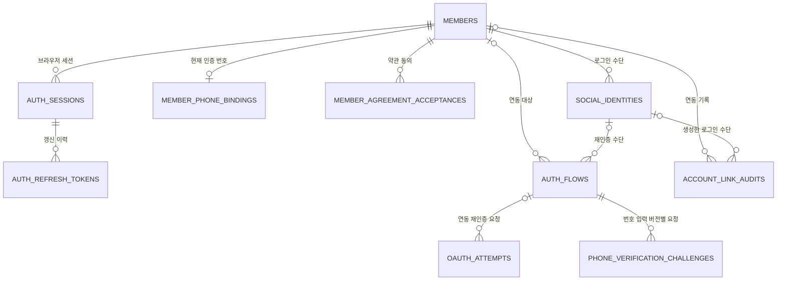

# 가격 매경 Auth 상세 설계 초안

대상은 `auth-service`의 카카오 + OCTOMO 1차 구현이다. 개발 순서는 카카오 → 구글 → 네이버다. 이후 제공자는 동일한 내부 회원·번호 인증 흐름을 재사용한다. Marketplace와 별도 MySQL 8.4/InnoDB 스키마를 사용하며 서비스 간 FK/JOIN은 만들지 않는다. 이 문서는 API·DB 계약 초안이며 실제 로그인, SMS 및 앱 구현을 뜻하지 않는다.

## 1. 먼저 구현할 세 흐름

| 상황 | 처리 | 최종 결과 |
| --- | --- | --- |
| 이미 연결된 카카오로 로그인 | 검증한 카카오 식별자로 기존 활성 회원을 찾는다. 전화번호는 다시 받거나 덮어쓰지 않는다. | 기존 `member_id`의 일반 세션 |
| 처음 보는 카카오 + 새 번호 | 가입 대기 → 사용자 문자 전송 → 서버에서 점유 확인 → 현재 버전의 필수 약관 동의 → 가입 확정 | 내부 회원, 번호, 소셜 연결, 동의가 모두 저장된 뒤 일반 세션 |
| 처음 보는 카카오 + 등록된 번호 | 점유 확인 후에만 연동을 제안 → 사용자가 동의 → 기존 계정에 연결된 소셜로 재인증 → 연동 확정 | **신규 회원 없음.** 기존 `member_id`와 기존 번호·제재 유지 |

초기에는 카카오만 사용할 수 있으므로 세 번째 흐름은 **기존 회원이 다른 카카오 계정으로 가입을 시도한 경우**에도 필요하다. 재인증할 때 기존 카카오 계정으로 전환해야 하며, 대기 중인 새 카카오 계정으로 다시 인증해도 연동되지 않는다. 재인증할 수 없거나 연동을 거절하면 신규 가입권한·기존 세션을 발급하지 않는다. 나중에 구글을 추가하면 이메일이 서로 다른 카카오·구글 계정으로도 같은 시나리오를 테스트한다.

## 2. ERD와 데이터 소유권

| 저장 대상 | 기준 |
| --- | --- |
| `members` | 가격 매경이 발급한 불변 UUID. 입찰·채팅·제재의 참조값이며, 프로필과 Marketplace 제재 데이터는 이 스키마에 복제하지 않는다. |
| `social_identities` | `(provider, identity_scope, subject)` 유일. 카카오는 검증한 issuer와 등록 앱 범위를 정규화한 `identity_scope`, 검증한 `sub`를 사용한다. 이메일·이름은 식별 키가 아니다. 여러 소셜 계정이 한 내부 회원을 가리킬 수 있다. |
| `member_phone_bindings` | 회원당 현재 번호 1개, 정규화한 번호의 HMAC 지문당 회원 1명. 번호 원문은 보관하지 않는다. HMAC은 익명화가 아니며 키는 앱 외부의 비밀 저장소에 둔다. 지문 키 교체는 중복 탐색을 깨뜨리므로 별도 이전 설계 전에는 키를 단순 교체하지 않는다. |
| `auth_flows`, `oauth_attempts` | 가입 대기와 서버 검증된 대기 소셜을 저장한다. OAuth 시도는 로그인/연동 재인증 목적을 분리하고 `state`·브라우저 비밀의 지문, 암호화한 PKCE 검증값을 보관한다. 연동 재인증 시도는 시작 시점의 번호 입력 버전에도 묶는다. 연동 흐름에는 재인증에 성공한 기존 소셜의 ID와 시각을 저장하고, 번호나 대상이 바뀌면 둘 다 지운다. |
| `phone_verification_challenges` | 흐름·번호 입력 버전·번호 지문에 묶인 일회용 증표. 조회용 번호 원문은 이 테이블에만 AEAD 암호문으로 임시 저장하고, 검증 성공·만료·취소·번호 교체 시 암호문을 제거한다. |
| `member_agreement_acceptances`, `account_link_audits` | 문서 코드와 버전별 동의 및 연동 결과를 기록한다. 감사 기록의 `flow_ref`는 단기 흐름을 별도로 정리할 수 있도록 FK 없는 상관관계 값이다. 토큰, 문자 원문, 전화번호 원문은 감사 로그에 남기지 않는다. |
| `auth_sessions`, `auth_refresh_tokens` | 세션과 회전한 리프레시 토큰 지문. 사용된 토큰 지문은 유효기간까지 보존해 재사용을 판별한다. 카카오 액세스·리프레시 토큰은 서비스 세션으로 쓰지 않는다. |

인증 번호당 한 회원을 보장하는 범위이며 1인 1계정·실명 확인을 보장하지 않는다. 번호 재할당, 계정 복구, 마지막 소셜 해제, 탈퇴·보관 정책은 별도다. 회원 생성 Outbox도 이벤트 소비자가 정해질 때 계약과 함께 추가한다.

## 3. API 계약

기본 경로는 `/api/v1/auth`. `{flowId}`, `{challengeId}`는 UUID이고 주소의 ID 자체는 인증 수단이 아니다. 가입/연동 API에서는 서버가 발급한 임의의 브라우저 비밀 쿠키와 흐름의 `browser_digest`를 대조한다. 회원 세션과는 다른 쿠키다. 본계정 세션 발급 전에는 회원 API를 사용할 수 없다.

| 메서드와 경로 | 입력 | 성공 응답·효과 |
| --- | --- | --- |
| `GET /csrf` | 없음. 다른 출처에 CORS를 허용하지 않는다. | `200 { csrfToken }`. 짧게 유효한 브라우저 쿠키에 묶인 CSRF 토큰을 제공한다. |
| `POST /oauth/{provider}/start` | 1차 `provider=kakao`; 앱이 제공자 등록 정보를 선택 | `303` 카카오 인가 주소. 새 `LOGIN` 시도와 브라우저 비밀을 설정. |
| `GET /oauth/{provider}/callback` | `code`, `state` 또는 제공자 오류 | 시도·쿠키·인가 결과 검증. 기존 연결이면 세션 쿠키 설정, 미연결이면 가입 흐름과 해당 흐름을 가리키는 쿠키 설정, `LINK_REAUTH`이면 적합한 기존 회원만 재인증한다. 고정된 서비스 화면으로 `303`; 서비스 화면의 URL에 토큰·번호를 넣지 않는다. |
| `GET /onboarding/flows/current` | 흐름 쿠키 | `200 { flowId, state, expiresAt }`. 서버가 계산한 다음 단계만 반환하며 대상 회원 ID, 소셜 목록, 전화번호 원문은 반환하지 않는다. |
| `POST /onboarding/flows/{flowId}/phone-challenges` | `{ phoneNumber }` | `201 { challengeId, recipient, smsText, expiresAt }`. 같은 번호의 유효한 미검증 요청은 `200`으로 재사용한다. 변경 시 이전 증표와 재인증을 무효화한다. |
| `POST /onboarding/flows/{flowId}/phone-challenges/{challengeId}/verify` | 서버가 보관한 번호와 문자 내용을 사용. 클라이언트는 `verified`나 코드를 보내지 않는다. | `200`과 `verification`이 `PENDING` 또는 `VERIFIED`. 성공 시 `nextAction`은 `SIGNUP` 또는 `OFFER_LINK`. 이미 검증됐으면 남은 유효기간 안에서 결과만 돌려준다. |
| `POST /onboarding/flows/{flowId}/complete` | `{ agreements: [{ code, version }] }` | `201` 회원 가입 및 세션 쿠키. 최신 필수 약관 버전과 인증을 검사. 가입 경합으로 번호가 선점됐으면 `409 LINK_REQUIRED`로 전환한다. |
| `POST /onboarding/flows/{flowId}/link/reauth/{provider}` | 중복 번호 연동 제안에 동의한 사용자가 기존 로그인 제공자를 선택한다. | `303` 제공자 인가 주소. 새 `LINK_REAUTH` 시도를 시작한다. 카카오는 `prompt=login`으로 재인증을 요청한다. |
| `POST /onboarding/flows/{flowId}/link/complete` | 본문 없음. 대상 회원은 서버 상태에서만 결정한다. | `200` 기존 회원에 새 소셜을 연결하고 동일 회원으로 세션을 발급한다. |
| `POST /onboarding/flows/{flowId}/cancel` | 본문 없음 | `204` 취소, 가입·연동을 종료하고 번호 암호문을 제거한다. |
| `POST /sessions/refresh`, `POST /sessions/logout` | 리프레시 쿠키. 로그아웃은 이미 종료된 경우에도 성공 처리. | `204`와 새 쿠키 또는 세션 폐기·쿠키 삭제. |

공통 오류는 `{ code, message, requestId }`. `400 INVALID_INPUT`(형식), `401 AUTH_REQUIRED`(브라우저/세션 불일치), `403 REAUTH_MISMATCH`(기존 회원 불일치), `409 FLOW_STATE_CONFLICT` / `SOCIAL_ALREADY_LINKED` / `LINK_REQUIRED`(경합·상태), `410 FLOW_EXPIRED`(만료), `429 TOO_MANY_REQUESTS`(자체 제한), `503 VERIFICATION_UNAVAILABLE`(OCTOMO 응답 실패·한도 초과)를 구분한다. 다른 브라우저 소유의 흐름은 존재 여부를 드러내지 않는다. OAuth 시작·재인증은 CSRF 토큰을 담은 폼으로 최상위 페이지를 이동한다. 로그인 리다이렉트 실패 화면에도 상세 제공자 오류나 식별자를 붙이지 않는다. 최종 가입·연동 응답이 유실되어도 같은 흐름으로 두 번 쓰거나 세션을 재발행하지 않는다. 성공한 회원은 해당 소셜로 다시 로그인한다.

**로컬 초기값:** OAuth 시도 5분, 가입 흐름 20분, SMS 요청 생성 후 조회 가능 5분, 점유 확인 후 확정 가능 10분(흐름 만료가 먼저면 그 시각까지), 기존 재인증 5분(점유 증표 유효기간을 넘지 않음). SMS 검증 요청은 5초 간격·요청당 최대 8회부터 시작하고 브라우저·IP·번호 지문별 발급 제한도 적용한다. 공개 전 실제 모바일 흐름과 호출량으로 조정한다.

## 4. 서버 검증과 트랜잭션

- **OAuth:** 카카오 OIDC의 인가 코드 흐름. 등록한 issuer·클라이언트·콜백만 허용하고 `state`와 브라우저 비밀을 대조한 뒤 `claimed_at IS NULL` 조건으로 한 번만 상태를 소모한다. PKCE S256, 검증한 ID 토큰 서명·issuer·audience·만료·nonce를 사용한다. 기존 계정 재인증은 `prompt=login`을 쓰고, 검증된 `auth_time`이 현재 시도와 신선도 기준에 맞지 않거나 없다면 연동을 확정하지 않는다. 재인증 응답은 대기 소셜 정보를 갱신하지 않는다. [카카오 로그인 REST API](https://developers.kakao.com/docs/ko/kakaologin/rest-api)
- **OCTOMO:** 국내 `010` 휴대전화 번호만 허용하고 내부 비교값은 E.164로 정규화한다. 서버에서 challenge ID와 전용 비밀키로 고유 문자 내용을 생성하고, 실제 조회에는 원래 번호를 국내 11자리로 변환해 `mobileNum`과 `text`를 함께 전송한다. 조회 권한·간격·횟수를 먼저 확보하고 외부 요청은 DB 트랜잭션 밖에서 호출한다. `exists=true` 결과를 적용할 때 다시 행을 잠그고 현재 버전과 유효기간을 검사한다. 예전 요청, 번호 수정, 만료, 실패·429·타임아웃은 통과시키지 않는다. [OCTOMO 문자 조회 API](https://octomo.octoverse.kr/api-docs/message-exists/)
- **가입:** 흐름 → 현재 번호 인증 증표 순으로 잠그고, 확인된 번호·현재 소셜·약관 버전을 재검사한다. 회원·번호 바인딩·소셜 연결·동의·증표 소모·흐름 완료·새 세션은 한 트랜잭션이다. `uq_phone_fingerprint` 위반 시 **전체 롤백한 후** 새 트랜잭션에서 동일 흐름과 인증이 아직 유효할 때만 실제 번호 소유자를 다시 읽고 연동을 제안한다. `uq_social_identity` 경합도 전체 롤백하며 임의 연결하지 않는다. DB 잠금 대기·교착은 중복 가입과 구분한다.
- **연동:** 재인증 콜백 반영 시 흐름을 잠그고 재인증 시도의 번호 입력 버전과 현재 버전이 같아야 `LINK_READY`로 이동한다. 최종 연동은 흐름과 증표, 현재 번호 바인딩을 다시 잠그고 현재 번호 소유자와 재인증된 기존 회원, 연동 대상이 모두 일치하는지 확인한다. 기존 소셜이 여전히 그 회원에 연결돼 있는지도 검사한다. 새 소셜 연결·감사·증표 소모·흐름 완료·세션 발급만 한 트랜잭션으로 처리하며 회원·번호·기존 제재를 덮어쓰지 않는다.
- **세션:** 첫 설계값은 서비스 액세스 JWT 5분, 리프레시 세션 최대 7일(절대 만료). 리프레시 시 세션을 잠그고 현재 토큰 소모와 새 토큰 추가를 원자 처리한다. 이전 토큰 재사용은 그 세션을 폐기한다. 브라우저는 갱신 요청을 직렬화하고, 응답 유실로 재사용으로 판단되면 소셜 로그인부터 다시 시작한다. 로그아웃은 세션과 갱신 권한을 즉시 폐기한다. 이미 발행된 JWT의 즉시 무효화가 필요한 경로는 세션 폐기 상태도 확인해야 하며, JWT만 확인하는 경로에는 최대 5분 잔여 수명이 있다.
- **웹 경계:** 운영의 브라우저 비밀·세션 쿠키는 `Secure`, `HttpOnly`를 사용하고 동일 출처로 구성한다. OAuth 콜백에 필요한 쿠키는 `SameSite=Lax`로 설계한다. 모든 상태 변경 `POST`에는 Origin과 CSRF 토큰을 검증하고, 인증 응답은 `Cache-Control: no-store`를 사용한다. 숫자·토큰·가입 흐름 URL 등이 일반 접근 로그에 남지 않도록 콜백·인증 경로를 마스킹한다.

## 5. 로컬 검증과 다음 작업

- [Flyway V1 SQL](db/migration/V1__create_auth_schema.sql)은 이미 존재하는 Auth 전용 빈 스키마에만 적용한다. Marketplace SQL과 합치지 않고 실제 인증 저장소가 준비되면 `src/main/resources/db/migration/`로 옮긴다.
- [검증 모듈](verification/README.md)은 Flyway 최초 적용·검증·재실행과 DB 제약을 별도 임시 스키마에서 확인한다. MySQL의 행 제약은 API 상태 전이·로그인 권한을 대신하지 않는다. [MySQL CHECK 제약](https://dev.mysql.com/doc/refman/8.4/en/create-table-check-constraints.html), [Flyway MySQL 지원](https://documentation.red-gate.com/flyway/reference/database-driver-reference/mysql)
- 앱 구현 시 남은 검증: 콜백 중복, 번호 변경 후 지연된 OCTOMO 성공 처리 거부, 다른 브라우저·대상 불일치, 번호/소셜 경합의 API 응답, 새 소셜로 재인증하는 잘못된 동선, 토큰 갱신 경합과 폐기, 실제 카카오·OCTOMO API/모바일 동작. 사용자가 가입 화면에서 수락할 최종 약관 문구나 복구 정책은 별도로 검토한다.
